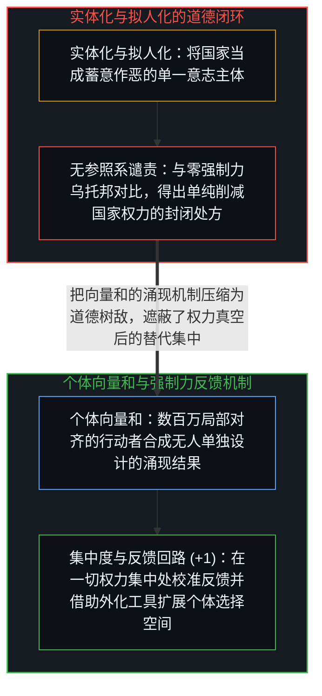
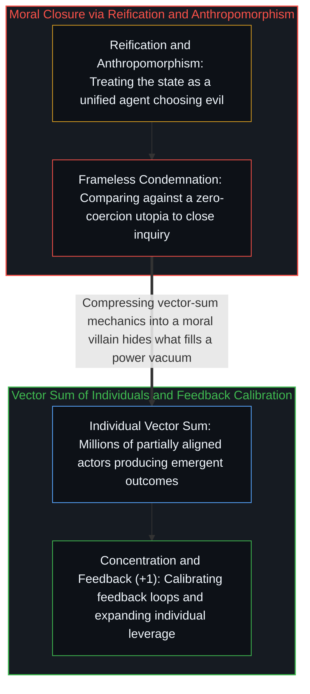

# 米塞斯论国家与强制力的向量和 / Mises on the State and the Vector Sum of Coercion

*将国家实体化为单一道德恶魔，遮蔽了权力集中加弱反馈的普适结构及背后的个体向量和。 / Reifying the state as a moral enemy obscures the vector sum and universal feedback mechanics.*

路德维希·冯·米塞斯曾断言：“对国家的崇拜就是对武力的崇拜……人类历史上所遭受的最深重灾难，大多由恶劣的政府所施加。”米塞斯指向了一个真实的因果机制：当高度集中的强制能力配以极其微弱的反馈回路时，掠夺与压迫便会顺畅地运转。但他的修辞框架同时遮蔽了另一个事实——这一机制并非“国家”这一特定制度形态的专利，而是只要权力集中且缺乏逆向负反馈就会浮现的普适结构。

Ludwig von Mises famously wrote that the worship of the state is the worship of force, arguing that the worst disasters in human history were inflicted by bad governments. Mises points at a genuine causal mechanism: wherever concentrated coercive capacity operates under weak feedback loops, extraction and oppression follow. Yet his rhetorical framing obscures that this mechanism is not a unique property of states; it operates wherever power concentrates without countervailing feedback.

## 一、 强制力垄断的双刃结构与参照系缺失 / 1. The Double-Edged Monopoly of Coercion and the Missing Reference Frame

若剥去道德谴责的词汇，大规模社会协调的底层算术可以清晰地展示出来：跨地域的广域协调需要规则执行，规则执行需要强制能力，而将强制能力收归单一中心则能阻止竞争性武装之间的混战，从而压低群体间的分布式暴力。然而，同一个足以平息私斗与军阀混战的强制力垄断结构，在结构上天然是一把双刃剑——持有垄断权的一方既可以用它来维持协调契约，也可以在反馈失灵时将其转向寻租、掠夺与压迫。

Stripped of moral vocabulary, the underlying mechanics of large-scale coordination unfold in a clear sequence: coordination across wide populations requires rule enforcement, enforcement requires coercive capacity, and monopolizing coercion suppresses competing enforcement rackets and inter-group violence. By its very structure, however, the same concentration of force that suppresses distributed violence can be directed toward extraction and oppression whenever feedback loops weaken.

米塞斯的表述在此制造了三重扭曲。第一是把“权力集中加弱反馈”的普遍变量当成了“国家”的专属属性，忽略了宗教裁判所、私人军阀、黑帮卡特尔与殖民特许公司在相同结构下展现出的同等掠夺性；第二是“宣称与否定的耦合”——假定只要削减国家权力就能自动减少人类苦难，却无视当公共强制力垄断瓦解时，填补真空的常是更缺乏问责机制的军阀混战与保护费勒索；第三则是隐去了比较参照系：与“零强制力的乌托邦”相比，任何国家都显得面目可憎，但与前国家时代的血亲复仇或失败国家的武装割据相比，暴力的分布与烈度呈现出截然不同的图景（参见[战争、革命与帝国的衰落](../war-revolution-and-the-fall-of-empires/)与[约束即基底与作为平台的个体](../constraints_are_ground/)）。

Mises's formulation introduces three structural distortions here. First, it treats a general variable—concentrated power paired with weak feedback—as if it were an exclusive category property of the state, overlooking how theocracies, private warlords, cartels, and colonial company towns exhibit the exact same extractive behavior under similar conditions. Second, it triggers claim-negation coupling: assuming that minimizing state power automatically minimizes human suffering ignores how the collapse of centralized enforcement routinely hands the territory over to distributed warlordism and less accountable protection rackets. Third, it omits the reference frame: measured against an implicit utopia of zero coercion, every state looks monstrous, whereas measured against realistic historical alternatives of competing warlords, the net trajectory of violence is far more complex (see [War, Revolution, and the Fall of Empires](../war-revolution-and-the-fall-of-empires/) and [Constraints Are Ground](../constraints_are_ground/)).

## 二、 实体化拟人链条与向量和的拆解 / 2. The Reification-Anthropomorphism Chain and the Vector Sum

更深层的认识论切分在于拆解“实体化—拟人化—道德化—终结追问”的四步链条。日常政治话语先把一种宏观互动模式实体化为一个名叫“国家”的物件，接着将其拟人化为一个能够“崇拜武力”或“蓄意施恶”的单一行动主体，随后给这个虚构主体贴上“邪恶威胁”的道德标签，最终给出一种已经找到罪魁祸首的“抵达感”，从而过早关闭了对底层机制的追问。

A deeper epistemological cut dissects the four-step chain of reification, anthropomorphism, moralization, and inquiry closure. Political rhetoric first reifies a macroscopic interaction pattern into a discrete object called "the state," then anthropomorphizes that object into a unified agent capable of choosing evil, assigns moral depravity to that fictional person, and finally induces a sense of arrival—the enemy has been named and the inquiry can stop.

然而在现实的因果层面上，从来不存在一个名叫“国家”的独立大脑在作决定；存在的只是数以百万计部分对齐的个体行动者，在特定约束与激励下各自施力所合成的“向量和”（参见[个体抉择是唯一的因果杠杆](../individual-choices-as-the-only-causal-levers/)）。所谓的“恶劣政府”，正是当反馈通道堵塞、个体激励偏转时，无数局部向量叠加出的涌现结果。那些极具传播力的格言之所以朗朗上口，恰恰因为它们把复杂的向量和机制压缩成了单一的道德靶子；而在今天，当个体能够借助密码学、开源工具与如[你的代码库即是记忆](../your-codebase-is-memory/)所剖析的外部化认知脚手架直接扩展自身的协调与防御半径时，真正的杠杆不再是对着拟人化的“国家”幻象做道德声讨，而是在每一个具体的制度与技术节点上重塑反馈回路与选择基底。

In causal reality, there is no unified brain called "the state" making choices; there is only the vector sum of millions of partially aligned individuals acting under specific constraints and feedback structures (see [Individual Choices as the Only Causal Levers](../individual-choices-as-the-only-causal-levers/)). What registers as "bad government" is the emergent outcome when those individual vectors sum under broken feedback loops. Memorable political aphorisms propagate precisely because they compress away this vector-sum mechanics into a single moralized villain; yet as individuals increasingly couple with cryptographic tools and externalized cognitive scaffolding as traced in [Your Codebase Is Memory](../your-codebase-is-memory/), the real causal lever lies not in moralizing against a reified state phantom, but in reshaping feedback loops and expanding the ground of individual choice.
