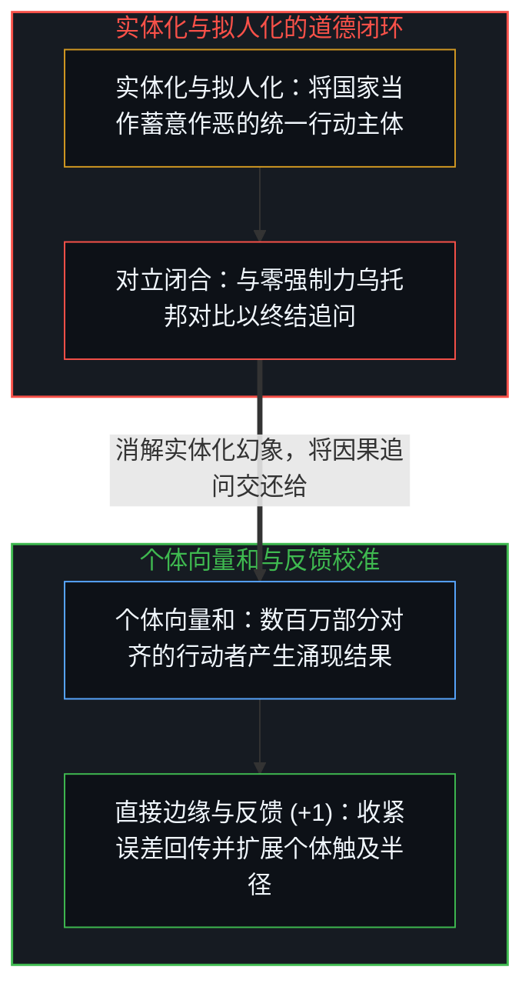
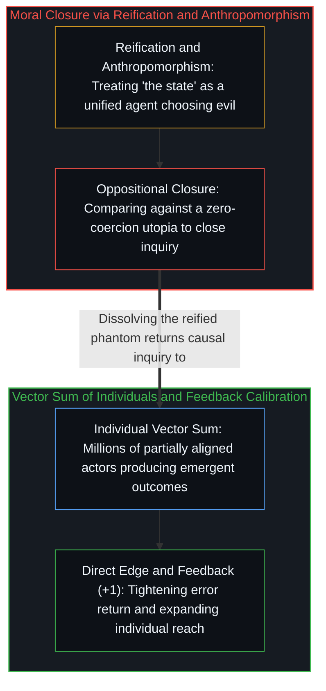

# 米塞斯论国家与强制力的向量和 / Mises on the State and the Vector Sum of Coercion

*将国家实体化为单一道德恶魔，遮蔽了权力集中加弱反馈的普适结构及背后的个体向量和。 / Reifying the state as a moral enemy obscures the vector sum and universal feedback mechanics.*

路德维希·冯·米塞斯在《全能政府》中写道，对国家的崇拜就是对武力的崇拜，并主张人类历史上最深重的灾难是由恶劣政府所施加的。这一论断标出了一项可观察到的动态：集中的强制能力若在缺乏制衡反馈的情况下运转，常会带来掠夺与压迫。然而，若将问题框定在作为外在装置的“国家”身上，便会遮蔽更深的两点：凡权力集中之处，同样的弱反馈动态都会出现；而透过“国家”起作用的，从来不是凌驾于社会之上的独立实体，而是个体抉择的向量和。

Ludwig von Mises wrote in *Omnipotent Government* that the worship of the state is the worship of force, arguing that the worst disasters in human history were inflicted by bad governments. That claim isolates an observable dynamic: concentrated coercive capacity operating without countervailing feedback regularly yields extraction and oppression. Yet framing the problem around "the state" as an external apparatus obscures two deeper points: the same weak-feedback dynamic appears wherever power concentrates, and what acts through "the state" is never a separate entity over society, but the vector sum of individual choices.

## 一、 强制力垄断的双刃结构与参照系缺失 / 1. The Double-Edged Monopoly of Coercion and the Missing Reference Frame

若剥去道德词汇，强制执行沿着一条清晰的序列展开：凡跨广大人群的协调倚赖针对施暴或不守约者的强制规则，执行便会动用强制能力，而集中这项能力，便能压制彼此竞争的保护费勒索团伙与群体间暴力。然而，这种集中由无数个体的对齐所维系，并非一座自主装置，在结构上本就具有双刃性：同一份执行契约的能力，每当反馈回路变薄，便也会放大寻租、掠夺与压迫——使中心处的行动者与回传的误差信号隔绝，并压低了掠夺的局部代价。

Stripped of moral vocabulary, coercive enforcement unfolds in a clear sequence: where coordination across wide populations relies on mandatory rules against violent or non-compliant actors, enforcement draws on coercive capacity, and concentrating that capacity can suppress competing protection rackets and inter-group violence. Yet that concentration—sustained by countless individual alignments rather than an autonomous apparatus—is structurally double-edged: the same capacity that enforces contracts also amplifies rent-seeking, extraction, and oppression whenever feedback loops thin, insulating actors at the center from returning error signals and lowering the local cost of extraction.

米塞斯本人并非无政府主义者——他拒绝零强制力的乌托邦，并维护针对私人暴力的有限规则执行——但仅以武力来界定国家（“对国家的崇拜就是对武力的崇拜”）并将这句格言抽离语境，会招致三重结构性扭曲。第一，它将“权力集中配以弱反馈”这一普遍变量压缩为国家的专属属性，忽略了神权政体、私人军阀、卡特尔与殖民公司市镇在相似条件下展现出如出一辙的掠夺模式；第二，它落入了对立轴闭合：认定只要否定或最小化国家权力便能自动减少苦难，却无视集中式强制执行一旦瓦解，常常将地盘拱手让给碎片化的军阀割据与更缺乏问责的保护费勒索——又或者，正如[战争、革命与帝国的衰落](../war-revolution-and-the-fall-of-empires/)所追溯的那样，将同样的集中压缩留待新的索取者接手；第三，它略去了参照系：对照隐含的“零强制力乌托邦”，任何国家都显得面目可憎，而对照前国家时代的血亲复仇或失败国家的武装割据等现实基线，暴力的净轨迹远为复杂。

Mises himself was no anarchist—he rejected zero-coercion utopias and defended limited rule enforcement against private violence—yet defining the state simply through force ("the worship of the state is the worship of force") and lifting that aphorism out of context invites three structural distortions. First, it compresses a general variable—concentrated power paired with weak feedback—into an exclusive attribute of the state, overlooking how theocracies, private warlords, cartels, and colonial company towns exhibit the exact same extractive pattern under similar conditions. Second, it falls into oppositional axis-closure: treating the negation or minimization of state power as automatically minimizing suffering ignores how collapsing centralized enforcement routinely hands territory to fragmented warlordism and less accountable protection rackets—or, as [War, Revolution, and the Fall of Empires](../war-revolution-and-the-fall-of-empires/) traces, leaves the same centralized compression ready for new claimants. Third, it omits the reference frame: measured against an implicit utopia of zero coercion, every state looks monstrous, whereas measured against realistic baselines of pre-state blood feuds or armed warlords in failed states, the net trajectory of violence is far more complex.

## 二、 实体化拟人链条与向量和的拆解 / 2. The Reification-Anthropomorphism Chain and the Vector Sum

更深层的认识论切分在于拆解“实体化—拟人化—道德化—终结追问”的四步链条。政治修辞先把一种宏观互动模式实体化为一个名叫“国家”的离散物件，接着将其拟人化为一个能够蓄意作恶的统一行动主体，随后将道德败坏归于这个虚构人格，最终诱发出一种抵达感——敌人已经指认，追问可以就此止步。

A deeper epistemological cut dissects the four-step chain of reification, anthropomorphism, moralization, and inquiry closure. Political rhetoric first reifies a macroscopic interaction pattern into a discrete object called "the state," then anthropomorphizes that object into a unified agent capable of choosing evil, assigns moral depravity to that fictional person, and finally induces a sense of arrival—the enemy has been named and the inquiry can stop.

在因果的底层，并不存在一个名叫“国家”的统一大脑在作决定；正如[约束即基底与作为平台的个体](../constraints_are_ground/)与[个体抉择是唯一的因果杠杆](../individual-choices-as-the-only-causal-levers/)所确立的，看似自主的制度，其实是数以百万计部分对齐的个体在共同约束与激励下行动，由此留下的宏观痕迹。被登记为“恶劣政府”的，正是这些个体抉择在断裂的反馈回路下相互叠加所产生的涌现向量和。那些令人过目难忘的政治格言之所以广为传播，恰恰因为它们把这套向量和机制压缩成了一个单一的道德化恶徒；而在今天，当个体能够与密码学、开源工具及外部化认知脚手架相耦合——正如[你的代码库即是记忆](../your-codebase-is-memory/)所追溯的那样——直接拓宽自身的协调与防御半径时，起作用的杠杆不再是对着实体化的“国家”幻象作道德声讨，而在于收紧承担后果的反馈回路，并在具体的制度与技术节点上直接行使个体抉择。

At the causal floor, there is no unified brain called "the state" making choices; as [Constraints Are Ground](../constraints_are_ground/) and [Individual Choices as the Only Causal Levers](../individual-choices-as-the-only-causal-levers/) establish, what looks like an autonomous institution is the macroscopic trace of millions of partially aligned individuals acting under shared constraints and incentives. What registers as "bad government" is the emergent vector sum when those individual choices compound under broken feedback loops. Memorable political aphorisms propagate precisely because they compress vector-sum mechanics into a single moralized villain; yet today, when individuals can couple with cryptography, open-source tools, and externalized cognitive scaffolding as traced in [Your Codebase Is Memory](../your-codebase-is-memory/) to directly widen their coordination and defensive reach, the operative lever lies not in moralizing against a reified state phantom, but in tightening consequence-bearing feedback and exercising individual choice directly across concrete institutional and technical nodes.
