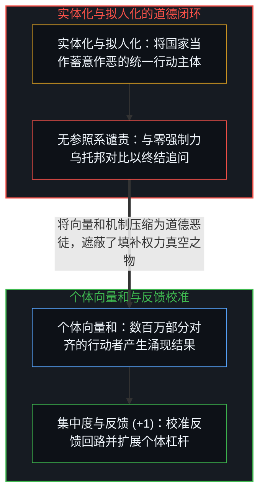
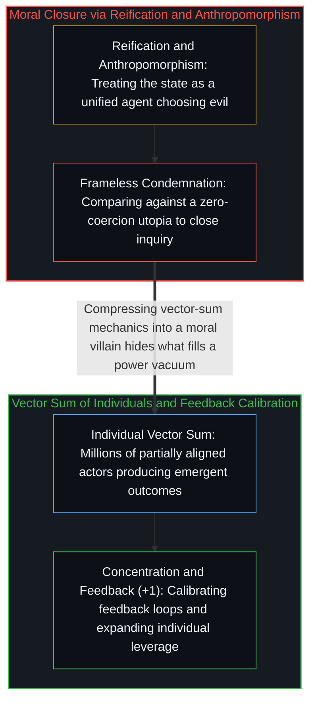

# 米塞斯论国家与强制力的向量和 / Mises on the State and the Vector Sum of Coercion

*将国家实体化为单一道德恶魔，遮蔽了权力集中加弱反馈的普适结构及背后的个体向量和。 / Reifying the state as a moral enemy obscures the vector sum and universal feedback mechanics.*

路德维希·冯·米塞斯曾写道，对国家的崇拜就是对武力的崇拜，并主张人类历史上最深重的灾难是由恶劣政府所施加的。米塞斯指向了一个真实的因果机制：只要集中的强制能力在微弱的反馈回路下运转，掠夺与压迫便会随之而来。但他的修辞框架同时遮蔽了一点——这一机制并非国家的独有属性；凡权力集中而缺乏制衡反馈之处，它都会运作。

Ludwig von Mises famously wrote that the worship of the state is the worship of force, arguing that the worst disasters in human history were inflicted by bad governments. Mises points at a genuine causal mechanism: wherever concentrated coercive capacity operates under weak feedback loops, extraction and oppression follow. Yet his rhetorical framing obscures that this mechanism is not a unique property of states; it operates wherever power concentrates without countervailing feedback.

## 一、 强制力垄断的双刃结构与参照系缺失 / 1. The Double-Edged Monopoly of Coercion and the Missing Reference Frame

若剥去道德词汇，强制执行的结构机制便沿着清晰的序列展开：凡跨地域的广域协调倚赖对施暴或不守约者实施强制性规则执行，规则执行便会动用强制能力，而将强制能力收归垄断中心，则能压制彼此竞争的强制勒索团伙与群体间暴力。然而，就结构本身而言，这同一份压制分布式暴力的强制力集中正是一把双刃剑：它固然能用于维持协调契约，但每当反馈回路减弱，值守该中心的行动者便会将其转向寻租、掠夺与压迫。

Stripped of moral vocabulary, the structural mechanics of coercive enforcement unfold in a clear sequence: where coordination across wide populations relies on mandatory rule enforcement against violent or non-compliant actors, enforcement draws on coercive capacity, and monopolizing coercion suppresses competing enforcement rackets and inter-group violence. By its very structure, however, the same concentration of force that suppresses distributed violence is a double-edged sword: it can uphold coordinating contracts, yet whenever feedback loops weaken, the actors staffing that center turn it toward rent-seeking, extraction, and oppression.

米塞斯的表述在此引入了三重结构性扭曲。第一是把“权力集中加弱反馈”这一普遍变量当成国家的专属类别属性，忽略了神权政体、私人军阀、卡特尔与殖民公司市镇在相似条件下展现出如出一辙的掠夺行为；第二是触发“宣称与否定的耦合”：假定只要将国家权力最小化就能自动减少人类苦难，却无视集中式强制执行一旦瓦解，常常会将地盘拱手让给四散的军阀割据与更缺乏问责的保护费勒索；第三则是略去了参照系：对照隐含的“零强制力乌托邦”，任何国家都显得面目可憎，而对照现实的历史替代形态——前国家时代的血亲复仇或失败国家的武装割据——暴力的净轨迹远为复杂（参见[战争、革命与帝国的衰落](../war-revolution-and-the-fall-of-empires/)与[约束即基底与作为平台的个体](../constraints_are_ground/)）。

Mises's formulation introduces three structural distortions here. First, it treats a general variable—concentrated power paired with weak feedback—as if it were an exclusive category property of the state, overlooking how theocracies, private warlords, cartels, and colonial company towns exhibit the exact same extractive behavior under similar conditions. Second, it triggers claim-negation coupling: assuming that minimizing state power automatically minimizes human suffering ignores how the collapse of centralized enforcement routinely hands the territory over to distributed warlordism and less accountable protection rackets. Third, it omits the reference frame: measured against an implicit utopia of zero coercion, every state looks monstrous, whereas measured against realistic historical alternatives of pre-state blood feuds or armed warlords in failed states, the net trajectory of violence is far more complex (see [War, Revolution, and the Fall of Empires](../war-revolution-and-the-fall-of-empires/) and [Constraints Are Ground](../constraints_are_ground/)).

## 二、 实体化拟人链条与向量和的拆解 / 2. The Reification-Anthropomorphism Chain and the Vector Sum

更深层的认识论切分在于拆解“实体化—拟人化—道德化—终结追问”的四步链条。政治修辞先把一种宏观互动模式实体化为一个名叫“国家”的离散物件，接着将其拟人化为一个能够蓄意作恶的统一行动主体，随后将道德败坏归于这个虚构人格，最终诱发出一种抵达感——敌人已经指认，追问可以就此止步。

A deeper epistemological cut dissects the four-step chain of reification, anthropomorphism, moralization, and inquiry closure. Political rhetoric first reifies a macroscopic interaction pattern into a discrete object called "the state," then anthropomorphizes that object into a unified agent capable of choosing evil, assigns moral depravity to that fictional person, and finally induces a sense of arrival—the enemy has been named and the inquiry can stop.

在现实的因果层面上，并不存在一个名叫“国家”的统一大脑在作决定；存在的只是数以百万计部分对齐的个体在特定约束与激励下行动所合成的向量和（参见[个体抉择是唯一的因果杠杆](../individual-choices-as-the-only-causal-levers/)）。被登记为“恶劣政府”的，正是这些个体向量在断裂的反馈回路下叠加所产生的涌现结果。那些令人过目难忘的政治格言之所以广为传播，恰恰因为它们把这套向量和机制压缩成了一个单一的道德化恶徒；而在今天，当个体能够与密码学、开源工具及外部化认知脚手架相耦合——正如[你的代码库即是记忆](../your-codebase-is-memory/)所追溯的那样——直接扩展自身的协调与防御半径时，起作用的杠杆不再是对着实体化的“国家”幻象作道德声讨，而是在具体的制度与技术节点上重塑反馈回路并扩展个体抉择的基底。

In causal reality, there is no unified brain called "the state" making choices; there is only the vector sum of millions of partially aligned individuals acting under specific constraints and incentives (see [Individual Choices as the Only Causal Levers](../individual-choices-as-the-only-causal-levers/)). What registers as "bad government" is the emergent outcome when those individual vectors sum under broken feedback loops. Memorable political aphorisms propagate precisely because they compress away this vector-sum mechanics into a single moralized villain; yet today, when individuals can couple with cryptography, open-source tools, and externalized cognitive scaffolding as traced in [Your Codebase Is Memory](../your-codebase-is-memory/) to directly expand their coordination and defensive reach, the operative lever lies not in moralizing against a reified state phantom, but in reshaping feedback loops and expanding the ground of individual choice at concrete institutional and technical nodes.
