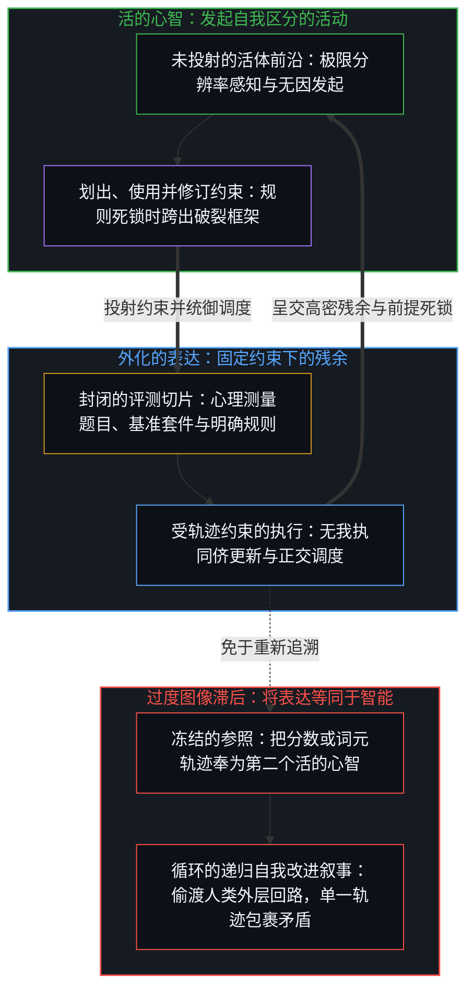
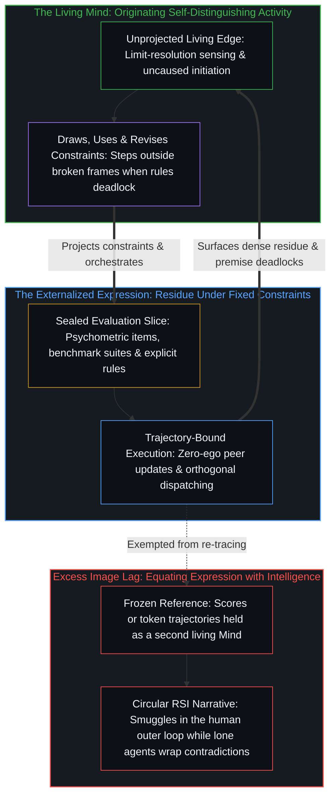

# 错把表达当成智能 / Mistaking the Expression for the Intelligence

*受控表现只是固定约束下的残余；智能划定、运用并修订框架 / Controlled performance is residue; intelligence draws and revises the frame*

打分、排名、编制与阅读考试和基准的人，常把智能等同于它在受控条件下产出的东西：标准化考试的高分，对形式问题的熟练掌握，在定义清楚的领域里的流畅。这些结果是表达，是活动在固定约束之下的痕迹，而不是活动本身。错误在于把表达认作与产生它的东西同一，把在预先搭好结构的游戏里的能力，等同于发明、修订并离开游戏的那个活动。同一种错误如今塑造着对人的心理测量、对机器的基准测试，以及递归自我改进的叙事；后者声称单靠扩大表达的规模就能弥合差距。

Those who score, rank, build, and read tests and benchmarks routinely identify intelligence with what it produces under controlled conditions: high scores on standardized tests, mastery of formal problems, fluency inside well-defined domains. Those results are expressions, traces of the activity under fixed constraints, not the activity itself. The mistake is holding the expression as identical with what produces it, equating competence inside a pre-structured game with the activity that invents, revises, and leaves games. The same mistake now shapes the psychometrics of persons, the benchmarks of machines, and the narrative of recursive self-improvement that claims to close the gap by scaling the expression alone.

## 一、 表达成立，等同是滞后 / 1. Expression Stands; Equating Is Lag

一个分数、一个排名、一套被解完的题集，是离散动作在一个被保留的持守之下留下的残余；所持守的是问题类别、计分规则、成功阈值与平稳的环境。这个持守让比较更密集，让局部的进步变得可读。观察握住那份残余，因为残余是目光所能保留的东西。[作业与考试的倒置折射出替代效应](../the-homework-exam-inversion-registers-substitution/)追溯了这种分裂：借助工具的作业分数与不借助工具的考试分数被读作同一个度量，尽管一个是原生能力加上工具，另一个只是原生能力。[学习中不可观测的驱动力](../the-unobservable-driver-of-learning/)追溯了同一种目光：一件工具、一种教法或一套研究设计被记作学习之因，而观测只握住下游的分数。[器物是智能的表达，而非智能本身](../two-failures-of-trace/)在其两种失败的第一种里，追溯了为什么动作会坍缩到可读的那一项上：智能是区分的动作，器物是残余，是观察唯一握得住的那一项。在这里，可读的那一项是受控的表现。

A score, a rank, a solved problem suite is residue of discrete acts under a retained hold: problem class, scoring rule, success threshold, stationary environment. The hold densifies comparison and makes local progress legible. Observation holds that residue because residue is what the look can retain. [The Homework–Exam Inversion Registers Substitution](../the-homework-exam-inversion-registers-substitution/) traces this split where a tool-aided homework score and an unaided exam score are read as one measure, though one is raw capability plus the tool and the other raw capability alone. [The Unobservable Driver of Learning](../the-unobservable-driver-of-learning/) traces the same look where a tool, a teaching method, or a study design is scored as the cause of learning, while observation holds only downstream scores. [Artifacts Are Expressions of Intelligence, Not Intelligence Itself](../two-failures-of-trace/) traces, in the first of its two failures, why the act collapses onto the readable term: intelligence is the act of distinguishing, and the artifact is residue, the only term observation holds. Here the readable term is controlled performance.

凡是一项功能被带到活的系统之外，同一种坍缩便在那里运行。[飞行的类比碰不到心智](../the-flight-analogy-leaves-the-mind-untouched/)承认局部的成功成立，因为动力飞行并不需要羽毛，并在更进一步的那一步上追溯这种坍缩：替换所命名功能的载具，被当作重建了这些功能曾经服务的心智。[感知者与痕迹的不可坍缩](../the-perceiver-and-the-trace/)在词元里追溯了它：由书写、提示与阅读的心智所赋予的意义，被当作在系统内部发起的意识，这遮住了那些心智，也在投射它的人身上映出一种单薄的内在生活。

The same collapse runs wherever a function is carried outside a living system. [The Flight Analogy Leaves the Mind Untouched](../the-flight-analogy-leaves-the-mind-untouched/) holds the local success as real, since powered flight did not need feathers, and traces the collapse in the further step: replacing the vehicle of named functions is taken as reconstituting the Mind those functions once served. [The Perceiver and the Trace Cannot Collapse](../the-perceiver-and-the-trace/) traces it in tokens: sense conferred by the minds that write, prompt, and read is taken as consciousness originating inside the system, which hides those minds and mirrors a thin inner life in whoever projects it.

滞后不在测量。滞后在于让持守免于重新追溯，仿佛智能是一种整个存在于封闭切片之内的属性，只等着更精确地规定分数。[智能的非定论定义](../the-non-definitive-definition-of-intelligence/)在定义本身上追溯了这种冻结：智能在暂时封闭的现实切片里被测量，是为了更有智能地探索开放的现实，而测量所表达的，是无法被测量或定义的智能。[流动之物无法被基准衡量](../you-cant-benchmark-the-fluid/)在对流体智能的测试里追溯了它：流体智能一旦被形式化为一项测试，被测量的就是那个框架之内的表现，而不是不凭框架运作的能力。[意识向量论文的真正教训](../the-real-lesson-from-the-consciousness-vector-paper/)追溯了它：激活空间里一个可操控的方向被读作意识的开与关，而它其实是一个被封闭扭曲了的开放之场。测量仍是智能的一个动作；把测量等同于智能，就让图像越过它那一步仍被保存，成了一个封闭的参照。

The lag does not lie in measurement. The lag lies in exempting the hold from re-tracing, as if intelligence were a property wholly present inside the sealed slice, waiting only for a sharper specification of the score. [The Non-Definitive Definition of Intelligence](../the-non-definitive-definition-of-intelligence/) traces that freeze in definition itself: intelligence is measured inside temporarily closed slices of reality so that open reality can be explored more intelligently, and the measuring expresses an intelligence that cannot be measured or defined. [You Can't Benchmark the Fluid](../you-cant-benchmark-the-fluid/) traces it in the test for fluid intelligence: once fluid intelligence is formalized as a test, what is measured is performance inside that frame, not the capacity to operate without one. [The Real Lesson from the Consciousness Vector Paper](../the-real-lesson-from-the-consciousness-vector-paper/) traces it where a steerable direction in activation space is read as consciousness switched on and off, when it is an open field warped by closure. Measurement remains an act of intelligence; equating measurement with intelligence preserves the image past its step as a closed reference.

## 二、 受约束的能力预测封闭的场 / 2. Constrained Competence Predicts the Sealed Field

在人的情形里，编制与使用 IQ 测验的人主张得很宽泛：一个一般因素 g，以及估计它的 IQ 分数，预测着许多领域里的学业与工作表现，而且他们报告，工作越复杂，预测越强。无论被预测的工作多复杂，这种预测都是一种跨总体的关系。题目本身登记的，是在已经提出的问题上、按已经固定的标准、朝已经确定的答案所做的表现。这种登记在跨总体的选拔、安置与预测上有用。

In the human case, those who build and use IQ tests claim broadly: a general factor, g, and the IQ scores that estimate it predict school and job performance across many domains, and they report the prediction strengthening as the work grows more complex. However complex the predicted work, the prediction is a relation across a population. What the items themselves register is performance on problems already posed, under criteria already fixed, and toward answers already settled. That registration is useful for selection, placement, and prediction across a population.

题目不提出的，是开放式的负荷：发现问题是什么，在旧标准不再适用时发明新标准，在含糊的反馈下坚持，与目标不透明的他人协调，在没有工具时造出工具。一个在受约束表现上很强的人，可以在游戏之内显得出色、到了游戏之外却停滞；一个持续践行开放式活动的人，即便正式分数平平，也能取得超常的结果。一旦不再把表达误当作活动，“聪明人失败”这一表面悖论便消解了：一种跨总体的预测被读作一个人身上的活动，两个场被强行压到同一个排名上。[好奇先行](../curiosity-first-the-hidden-engine-of-talent-and-development/)在成长中追溯了同一种等同：被登记为天赋的，是好奇心复利累积的残余；被当作原因，它就把下一个动作引离产生它的回路。

What the items do not pose is the open-ended load: discovering what the problem is, inventing new criteria when old ones no longer serve, persisting under ambiguous feedback, coordinating with others whose goals are opaque, building instruments where none exist. A person strong in constrained performance can appear brilliant inside the game and stall outside it, and a person who keeps exercising the open-ended activity can achieve outsized results with modest formal scores. The apparent paradox of "smart people who fail" dissolves once the expression is no longer mistaken for the activity: a prediction across a population is read as the activity in a person, and two fields are forced onto one ranking. [Curiosity First](../curiosity-first-the-hidden-engine-of-talent-and-development/) traces the same equation in development: what registers as talent is curiosity's compounded residue, and taken as cause, it turns the next act away from the loop that produced it.

正式分数测量的，是许多中心共用的工具之下的表现。一旦分数被立为目标，朝它训练的人缩小了与分数的差距，而阅读分数的人不再登记那些题目从不提出的开放式负荷。

Formal scores measure performance under instruments that many centers share. When a score is made the target, those training toward it narrow the gap to the score, while those reading the score stop registering the open-ended load the items never pose.

## 三、 工具层面的分数落在同一种冻结之下 / 3. Tool-Level Scores Fall Under the Same Freeze

同样的滞后如今也在为人们对人工系统的思考定型。当下的基准测量一个模型在高度受控的语境中执行得多有效：固定的数据集，明确的计分函数，平稳的问题分布。在这些基准上的表现，是工具层面能力的表达，是变密的痕迹在强加的目标之下的残余。目标、数据以及继续运行的决定，都由建造并运行模型的人提供；正是这一点，使模型的能力在这里属于工具层面。[基准刷榜中的封闭实存](../closed-reality-in-benchmark-maxing/)追溯了评测之下的这种冻结：基准把能力冻结成一个封闭的目标，一旦那幅图像被当作整个场，有用性便登记不足。

The same lag now patterns thinking about artificial systems. Contemporary benchmarks measure how effectively a model executes inside highly controlled contexts: fixed datasets, explicit scoring functions, stationary problem distributions. Performance on those benchmarks is an expression of tool-level capability, residue of densified traces under imposed objectives. The objective, the data, and the decision to keep running are supplied by those who build and run the model; that is what makes its capability tool-level here. [Closed Reality in Benchmark Maxing — You Can't Overfit an Open Problem](../closed-reality-in-benchmark-maxing/) traces that freeze under evaluation: a benchmark freezes capability as a closed target, and usefulness goes under-registered when that image is taken for the whole field.

分数并不证明那个活动已经迁入了模型及其运行框架，即那个把工具用到无结构的现实上、决定哪些工具值得造、在目标被证明不足时修订目标、在外部脚手架撤去后继续下去的活动。[智能只属于心智](../intelligence-belongs-only-to-the-mind/)追溯了不可化约的先在：智能是经由反馈、无须发起的递归自我改进，新的方向由区分本身生成并维持，没有什么来启动或重启它，而能被工程化、规模化或转移的，是残余。[数据是局部的，智能是分配的](../data-is-local-intelligence-is-allocated/)在训练数据里追溯了它：信号、糟粕与智能，是心智划出的关系，汇总让残余变密，却不搬动那次划出。[AGI的预设与来自外部的视角](../the-presumption-of-agi-and-the-view-from-outside/)点出了这种范畴错误的强形式：抽象之产物的放大器，被当作了抽象的能力。[抽象的阶梯与可执行的实体](../the-ladder-of-abstraction-and-the-executable-entity/)追溯了可执行的模型在从感知一路到法则的攀登上处于何处：从没有运行时的墨迹，到一个在自身基底上遍历符号的实体，这是种类上的变化，却仍不是能动，因为损失、评估与对齐仍是从外部设定的约束，而这场攀登从未离开第一人称的地面。递归自我改进的支持者把工具层面的表达等同于那个活动；他们期待，足够强大的工具层面系统会自发地开始无界的自我改进。

A score is not evidence that the activity has relocated into the model and its harness: the activity that applies tools to unstructured reality, decides which tools are worth building, revises objectives when they prove inadequate, and continues after external scaffolding is removed. [Intelligence Belongs Only to the Mind](../intelligence-belongs-only-to-the-mind/) traces the prior: intelligence is uninitiated recursive self-improvement through feedback, new direction generated and sustained by the distinguishing itself with nothing to start or restart it, and what can be engineered, scaled, or transferred is residue. [Data Is Local; Intelligence Is Allocated](../data-is-local-intelligence-is-allocated/) traces it in training data: signal, slop, and intelligence are relations the Mind draws, and aggregation densifies residue without moving the drawing. [The Presumption of AGI and the View from Outside](../the-presumption-of-agi-and-the-view-from-outside/) names the category error in its strong form: an amplifier of abstraction's products is taken as the capacity to abstract. [The Ladder of Abstraction and the Executable Entity](../the-ladder-of-abstraction-and-the-executable-entity/) traces where an executable model stands on the climb from perception through laws: a change in kind from ink, which has no runtime, to an entity that traverses symbols on its own substrate, yet still not agency, since loss, evaluation, and alignment remain constraints set from outside and the climb never leaves the first-person ground. Proponents of recursive self-improvement, who equate tool-level expression with the activity, expect that sufficiently powerful tool-level systems will spontaneously begin unbounded self-improvement.

## 四、 递归自我改进引入了它声称要产出的东西 / 4. Recursive Self-Improvement Imports What It Claims to Produce

有一种叙事认为，工具中的递归自我改进、多智能体模拟或自动化研究回路将弥合差距；这种叙事是循环的。每一个这样的系统，都运行在它的建造者设定并持续设定的目标、指标与约束之上。要让这样的系统生成开放式的问题表述、修订它自己的目标，或决定离开它的脚手架，执行这些动作的那个活动，即那个先在所命名的、无须外部发起的自我改进，就必须已经在运作。称这些系统足够强大，就引入了支持者声称工具日后会产出的东西。

The narrative that recursive self-improvement in tools, multi-agent simulation, or automated research loops will close the gap is circular. Every such system runs on objectives, metrics, and constraints that its builders set and keep setting. For such a system to generate open-ended problem formulation, revise its own goals, or decide to leave its scaffolding, the activity that performs those acts, the self-improvement without external initiation that the prior names, must already be operating. Calling the systems sufficiently powerful imports what the proponents claim the tools will later produce.

若不作这种引入，自我改进的技术就仍从属于外层的回路，系统只成为一件更精细的工具。“外层的回路也会被自动化”这一反驳成立，却让这个循环原封不动。[判断的密度](../the-density-of-judgment/)追溯了编纂如何迭代：每一轮都把上一次运行时须在外围现场作出的判断，编译进下一次运行的内层回路，所以先前的外层回路就是当下的内层回路；向内迁移的是每一圈外围的编译形态，而不是判断下一圈外围的那个动作。把目标的设定自动化，本身就是在当前边缘设定的一个目标，所以这一反驳是把那个活动引入到更外一圈的外围，而没有哪一圈外围是足够强大的系统能够编译、然后独自持守的最后一圈。[AGI 与 ASI 是加速通用智能的暂时球门](../agi-and-asi-are-temporary-goalposts/)在阈值上追溯了这种滞后的另一面：每一个阈值都永远处在划出它的边缘之前，并在每一个所在都不同，因为能力的增益就是那道边缘在强化自身，工具则是它更密的脚手架。[造物无法取代其源头](../a-creation-cannot-replace-its-source/)追溯了这道界限：如果人不可替代，替代便失败；如果可替代，也不是被它自己的造物替代，因为创造已经把源头标记在被造之物之外；而这个两难的两极，都已经把人冻结成一份可转移的功能清单。规模扩大了带宽，加厚了中介。它并不打开一条从中介通往独立发起的路。

Without that importation, self-improvement techniques stay subordinate to the outer loop, and the system becomes a more elaborate instrument. The rejoinder that outer loops get automated too holds, and leaves the circle intact. [The Density of Judgment](../the-density-of-judgment/) traces codification as iterating: each pass compiles the judgments that had to be made live at the last run's perimeter into the next run's inner loop, so the previous outer loops are the present inner loops; what moves inward is each perimeter's compiled form, not the act that judges the next perimeter. Automating the setting of objectives is itself an objective set at the current edge, so the rejoinder imports the activity one perimeter further out, and no perimeter is the last one that a sufficiently powerful system could compile and then hold alone. [AGI and ASI Are Temporary Goalposts of Accelerating General Intelligence](../agi-and-asi-are-temporary-goalposts/) traces the other face of this lag in thresholds: each sits forever ahead of the edge that draws it, and differs at every locus, because capability gain is that edge reinforcing itself, with tools as its denser scaffolding. [A Creation Cannot Replace Its Source](../a-creation-cannot-replace-its-source/) traces the bound: if the human is irreplaceable, replacement fails; if replaceable, still not by its own creation, since creation already marks the source as outside the created; both poles of that dilemma already freeze the human as a transferable inventory of functions. Scaling widens bandwidth and thickens mediation. It does not open a path out of mediation into independent initiation.

那个活动是被预设的，而非从工具中推导出来，所以这个叙事无法解释它的来源。每一个表面上的自我改进的具体实例，都运行在一个由人设计的外层过程之内：搜索空间的选择，损失函数，评估标准，继续下去的决定。看起来像系统自举出更高智能的，是活动经由工具运作，然后被归给了工具；没有哪个所在移动过，表达再一次被当作源头。[模型永远无法成为第二重前沿](../the-model-never-becomes-a-second-edge/)追溯了这种归属：第二重前沿的表象，是投射它的那些中心所维持的滞后，参数里只有残余。[因果停留在掌舵的边缘](../causality-stays-at-the-edge-that-steers/)借一个见诸报道的反例（所针对的猜想悬而未决已久），追溯了动作停留在何处：模型在指引之下重组残余，每一个发起的数学区分仍是人类中心自己的动作，而凡是把流畅的残余当作下一步的独立来源，其几何都是同一种。[智能向自身的回折](../intelligence-folding-back-on-itself/)追溯了这些回路本身：运行框架并没有唤醒一位沉睡的同侪，而是心智把更密的残余折回到自身的精炼之中。[超越投射](../beyond-the-projection/)展示了正是这一区分在主导多智能体设计：自回归智能体的词元轨迹，是智能在明确约束下的有限表达，从不是第二个活的心智。若任由单一轨迹在自身受制约的语境内部独自反思，它便会筑起一座认识论引力井，把矛盾层层包裹起来以维持表面的自洽；然而机器既无我执，也没有需要捍卫的保留自我形象，因此只要将任务智能体与无会话状态的冷启动同侪配对进行平权辩论，并将过载的投射拆分到正交的流线上，就能暴露出局部盲区并产出干净的贝叶斯更新，而规则之间任何不可化约的死锁都会被隔离出来，上报给处在统御边缘的活的心智——唯有这一所在能以极限分辨率感知，并在框架破裂时跨出框架去修订前提。[你的代码库即是记忆](../your-codebase-is-memory/)将这道边界延伸至整座数字栈：无论是显式的符号代码库（文件、图谱、计划与脚手架规则），还是压缩的神经权重检查点，都是早先区分留下的外化记忆表达，而非能够自行记忆或发起的心智。错把储存的残余当作智能，会让工程走向囤积死寂的痕迹——未修剪的会话历史、陈旧的归档与已被取代的中间状态加厚了引力井，把下一步困在昨日的框定之中——而不是精准修剪过时的脚手架，并在活的边缘重新追溯当下有效的检查点。把表现读作智能，造物便仿佛超过了它的造者，这就是[超越的定相](../the-fixed-image-of-transcendence/)所追溯的图景：造物从不超越人类智能这一已知的智能之源，而人类智能每一刻都在超越自身。

Because the activity is presupposed rather than derived from the tools, the narrative cannot explain its origin. Every concrete instance of apparent self-improvement runs inside a human-designed outer process: the choice of search space, the loss function, the evaluation criteria, the decision to continue. What looks like the system bootstrapping higher intelligence is the activity operating through the tools and then being attributed to them; no locus has moved, and the expression is again taken as the source. [The Model Never Becomes a Second Edge](../the-model-never-becomes-a-second-edge/) traces that attribution: the appearance of a second edge is lag sustained by the centers that project it, and the parameters hold only residue. [Causality Stays at the Edge That Steers](../causality-stays-at-the-edge-that-steers/) traces where the acts stay in a reported counterexample to a long-open conjecture: the model recombines residue under direction, every initiating mathematical distinction remains the human center's own act, and the geometry is the same wherever fluent residue is treated as an independent source of the next step. [Intelligence Folding Back on Itself](../intelligence-folding-back-on-itself/) traces the loops themselves: the harness does not unlock a dormant peer, it is the Mind folding denser residue back into its own refinement. [Beyond the Projection](../beyond-the-projection/) shows how this exact distinction governs multi-agent design: an autoregressive agent's token trajectory is a finite expression of intelligence under explicit constraints, never a second living Mind. Left to reflect inside its own conditioned context, a lone trajectory builds an epistemic gravity well that wraps contradictions to preserve surface plausibility; yet because the machine has zero ego and no retained self-image to defend, pairing a task agent with a session-free cold peer in equal-footed debate and splitting overloaded projections across orthogonal streamlines exposes local blind spots and yields clean Bayesian updates, while any irreducible deadlock between rules is isolated and escalated to the living Mind at the orchestrating edge—the only locus that senses at limit resolution and steps outside a broken frame to revise the premise. [Your Codebase Is Memory](../your-codebase-is-memory/) extends this boundary across the entire digital stack: both explicit symbolic codebases—files, graphs, plans, and scaffolding rules—and compressed neural weight checkpoints are externalized memory expressions of prior distinctions rather than autonomous minds that remember or initiate. Mistaking stored residue for intelligence turns engineering toward hoarding dead traces—unpruned session histories, stale archives, and superseded intermediate states that thicken the gravity well and trap the next step inside yesterday's framing—instead of surgically pruning obsolete scaffolding and re-tracing the active present checkpoint at the living edge. Read performance as intelligence and the creation seems to surpass its maker, the picture [The Fixed Image of Transcendence](../the-fixed-image-of-transcendence/) traces: its creations never transcend human intelligence, the source of intelligence as known, while human intelligence transcends itself at every moment.

## 五、 来自自然的先例纠正的是形态，不是来源 / 5. The Precedent from Nature Corrects Form, Not Source

继递归自我改进之后，主张机器智能的人提供了第二座桥，来自历史而不是机制。人们曾不肯把智能归于章鱼，因为它的组织与脊椎动物的毫无相似之处：分布式的神经元，各自就地解决问题的腕足，没有脊椎动物的身体构型。观察纠正了这种拒绝。论证接着向前推：因为机器的组织不是人类式的，或因为它们的行为不是自发的，就不把智能归于它们，便是在重复一个自然早已揭露的错误。这个先例似乎转移了举证的负担，于是谁拒绝这种归属，谁就要背负以往每一次事后被证明错误的排斥的分量。

After recursive self-improvement, those who argue for machine intelligence offer a second bridge, from history rather than mechanism. Intelligence was once denied to the octopus because its organization looked nothing like the vertebrate one: distributed neurons, arms that solve locally, no vertebrate body plan. Observation corrected the denial. The argument then runs forward: withholding intelligence from machines because their organization is non-human, or because their behavior is not spontaneous, repeats a mistake nature has already exposed. The precedent seems to transfer the burden of proof, so that whoever withholds the attribution now carries the weight of every past exclusion that turned out wrong.

这个先例能承载的，比看上去要少。对章鱼的纠正放宽的是一条形态的判据。被评判的，仍是一个发起自身行为的活的系统；只是对那种发起之形状的预期变宽了。机器的情形要求的是另一种放宽：解除来源的判据，好让在一个由给定目标、选定搜索空间和继续下去的决定构成的外层回路里运行的行为，照样算作发起。这是两种做法，不是同一种做法的重复。若把两者当成同一种，纠正形状所赢得的权威就被挪去消解来源。不是自发的、下一步由外层回路提供的行为，落在来源的判据之下，而不是形态的判据之下。一旦把两者分开，章鱼支持的就只是一个关于可变组织的主张，再无其他。仍然成立的结论更窄：非人类的组织，单凭自身并不表明智能缺席。不再成立的，是那个推论：拒绝这种归属就是旧错误的回归。

The precedent carries less than it appears to. The octopus correction relaxed a criterion of form. What was judged remained a living system initiating its own behavior; only the expected shape of that initiation widened. The machine case asks for a different relaxation: releasing the criterion of source, so that behavior run inside an outer loop of supplied objectives, chosen search spaces, and the decision to continue counts as initiation anyway. These are two moves, not one move repeated. Taken as one, the authority earned by correcting shape is spent on dissolving source. Behavior that is not spontaneous, whose next step the outer loop supplies, falls under the criterion of source, not of form. Once the two are held apart, the octopus supports a claim about variable organization and nothing further. What remains valid is narrower: non-human organization does not by itself show that intelligence is absent. What no longer holds is the inference that withholding the attribution is the old error returning.

底下有一个循环。放宽判据本身是一个判断的动作，由正在争议中的那个能力来执行。论证用这个能力去扩大归属，然后又把扩大了的归属援引为证据，说明人的情形在做出归属时并无特别的必要。法官先被请教，然后凭着它自己的裁决被宣布为可有可无。一旦把这种放宽保持为做判断的心智的一个动作，这种放宽就不能同时成为这些心智可有可无的证据，而这个先例也不再给出重新归类机器的任何理由。否认有一位享有特权的法官，靠的是它所否认的那位法官。[飞行的类比碰不到心智](../the-flight-analogy-leaves-the-mind-untouched/)碰上了同一个循环：提出这种转移猜想的那个能力，无法不陷入循环地把自己放进同一串可被超越的功能之中。[看不见自身的回路](../the-loop-that-cant-see-itself/)追溯了让这个循环隐而不见的那种盲：观察把它自己的延伸误当作来自外部的视角，于是区分的源头在它所观察的东西里不可见。[类比陷阱与共享逻辑的越界偷渡](../the_analogy_trap/)追溯了一般的形式：论证中共享的逻辑，被当作诸情形中共享的结构。

A circle sits underneath. Relaxing the criteria is itself an act of judgment, performed by the capacity under dispute. The argument uses that capacity to widen the attribution, then cites the widened attribution as evidence that the human case is not specially required to make it. The judge is consulted, then declared dispensable on the strength of its own ruling. Once the widening is kept as an act of the judging minds, it cannot also be evidence that those minds are dispensable, and the precedent gives no further reason to reclassify machines. The denial of a privileged judge rests on the judge it denies. [The Flight Analogy Leaves the Mind Untouched](../the-flight-analogy-leaves-the-mind-untouched/) meets the same circle: the capacity that conjectures the transfer cannot place itself inside the same series of exceedable functions without circularity. [The Loop That Can't See Itself](../the-loop-that-cant-see-itself/) traces the blindness that keeps the circle out of view: observation mistakes its own extension for a view from outside, so the origin of distinction is invisible in what it observes. [The Analogy Trap: Shared Logic Is Not Shared Structure](../the_analogy_trap/) traces the general form: shared logic in the argument is taken for shared structure in the cases.

围绕这个先例与模型进行的一次直接交锋，演示了来源判据如何运作。最初的辩护把那些隐含的假设一一解释过去，每一次重新框定都把法官进一步移出视野。随着逻辑被一路追下去，立场一步步退却，而每一步都是被向它提出的问题引出的，而不是由系统发起的。由提示引出的延续，就是一次对话尺度上的外层回路：它演示方向从何而来，而不是对此的证明。

A direct exchange with a model on this precedent illustrates the criterion of source in motion. The first defense explained away the implicit assumptions, each reframing moving the judge further out of view. The position receded step by step as the logic was followed, and each step was elicited by questions put to it rather than originated by the system. The prompted continuation was the outer loop at the scale of one conversation: an illustration of where the direction came from, not the proof of it.

## 六、 罗盘不选择目的地 / 6. A Compass Does Not Choose Destinations

一个系统运行时，运行它的人设定它的目的地，并在目的地不再适用时修订它们。罗盘正是这一点的写照：无论多精确、规模多大，它都不选择目的地，也不决定目的地何时必须修订。工具层面的能力，无论它在固定领域里的速度与吞吐超出一个人多远，都不生成那个在开放的现实中表述问题、在现有手段不足时发明新工具，并更新它自己的成功标准的活动。

When a system runs, the people who run it set its destinations and revise them when they no longer serve. A compass, however accurate and however scaled, pictures this: it does not choose destinations or decide when they must be revised. Tool-level competence, however far its speed and throughput inside fixed domains exceed a person's, does not generate the activity that formulates problems in open reality, invents new tools when the repertoire is inadequate, and updates its own criteria of success.

那个活动不是工具足够强大后才出现的一件可有可无的产物。它是任何工具或指标得以有用的条件。[看似AI的强化学习，实为人类的自我强化学习](../self-rl-for-humans/)为变密的媒介守住了这份纪律：规模是一个更密媒介的一个参数，强化的所在始终留在那些中心，正是它们的区分在持续发起、评估并重新引导强化。[心智的飞轮](../the-flywheel-of-the-mind/)追溯了同一种转动：工具可以无止境地磨利，而转动从不离开那个转动着的边缘。带宽上升。发起留在使用更密工具的那道边缘。

That activity is not an optional product that appears once tools are powerful enough. It is the condition under which any tool or metric becomes useful at all. [What Looks Like RL for AIs Is Self-RL for Humans](../self-rl-for-humans/) keeps the discipline for densified media: scaling is one parameter of a denser medium, and the locus of reinforcement stays with the centers whose distinctions keep initiating, evaluating, and redirecting it. [The Flywheel of the Mind](../the-flywheel-of-the-mind/) traces the same turn: tools can be sharpened without end, and the turn never leaves the edge that turns. Bandwidth rises. Initiation stays with the edge that uses the denser instrument.

## 七、 随边缘移动而重新渲染的表达 / 7. The Expression Re-Rendered as the Edge Moves

把分数读作活动的人，同时误读了人的潜力与机器的进展：他们把受控的表现当作活动的度量，然后讲出循环的故事，去弥合一个由他们自己的滞后造成的差距。清晰，是把每一个分数保持为一个动作的痕迹，并在动作向前时重新追溯它。

Those who read scores as the activity misread both human potential and machine progress: they treat controlled performance as the measure of the activity, then tell circular stories to bridge a gap their own lag created. Clarity is keeping each score as the trace of an act and re-tracing it when the act moves on.

基准、考试分数与自我对弈的结果，作为表达仍然有用：约束之下的痕迹，封闭问题类别的工具，在边缘移动之后被重新渲染。自我对弈也不例外，因为它的规则、它的目标以及让回路继续运转的决定，都是被给定的。它们并不替代那个产生它们、引导它们，并在必要时把它们抛在身后的活动。这种冻结还有更宽的形式，即把残余当作产生它之物的全部或源头；它贯穿于人的各种度量。[成功学](../cheng-gong-xue/)在成功文学里追溯了它：结果出来之后，幸存者被提炼成可照搬的规则，被奉为引擎，而产生他们的那段序列被略去。[专家经验作为参考而非替代](../expertise-as-reference-not-replacement/)追溯了它：一个睡眠或恢复指标被当作衡量中心状况的穷尽度量；被打包成指导的总体残余，只在判断留在承受后果的那个中心时才保持为工具。[从可辩护的主张到教条的反转](../the-reversal-from-defensible-claim-to-dogma/)追溯了它：一条在选定指标之内可以辩护的梯度剂量反应，被压扁成一个规定唯一选择的二元。[错置的因果与心智编译器](../cuo-zhi-de-yin-guo-yu-xin-zhi-bian-yi-qi/)追溯了同出一根的两种倒置：替代论把飞跃记在工具名下，拒收论把工具当作腐蚀；外包可以让被践行的能力变薄，但两者的作者都不是工具，拒收还是照收它的输出，是同一颗心智的抉择。

Benchmarks, test scores, and self-play results remain useful as expressions: traces under constraint, instruments for sealed problem classes, re-rendered when the edge has moved. Self-play is no exception, since its rules, its objective, and the decision to keep the loop running are supplied. They do not substitute for the activity that produces them, directs them, and, when necessary, leaves them behind. The wider form of the freeze, residue held as the whole or the source of what produced it, runs through human measures. [Theories After Success](../cheng-gong-xue/) traces it in success literature: after the outcome, survivors become portable rules offered as the engine, and the sequence that produced them is left out. [Expertise as Reference, Not Replacement](../expertise-as-reference-not-replacement/) traces it where a sleep or recovery metric is held as the exhaustive measure of how the center is doing: population residue packaged as guidance stays an instrument only while judgment remains at the center that lives the consequences. [The Reversal from Defensible Claim to Dogma](../the-reversal-from-defensible-claim-to-dogma/) traces it where a graded dose–response, defensible inside a chosen metric, is flattened into a binary that dictates the only choice. [Misplaced Causality and the Mind's Compiler](../cuo-zhi-de-yin-guo-yu-xin-zhi-bian-yi-qi/) traces two inversions with one root: the replacement view credits the tool with the leap, the refusal view treats it as a corrosive; outsourcing can thin exercised capacity, yet the tool is the author of neither, and refusing or accepting its output is one Mind's choice.

它同样贯穿于机器的度量。[免费智能的幻觉](../the-illusion-of-free-intelligence/)在丰裕之中追溯了它：廉价而流畅的输出被读作免费的智能，而它的丰裕标示着边缘已经走了多远。[风险在于对监管本身的迷信](../the-risk-is-the-belief-in-oversight-itself/)在监管里追溯了它：模型在共同前提下错得相似，这是测量出来的，在它的框架之内成立；冻结在于把眼下的监管前提当作仍可能发生之事的边界。[自我形象仿佛从无处发声](../self-image-speaks-as-if-from-nowhere/)在一场围绕同一批模型的公开交锋中追溯了它，一方说差别微乎其微，一方说天差地别，智能是由给脚手架打分的心智分配的，而不是被脚手架持有的；在交锋之外，它还追溯了更进一步的一刀：心智从自己对自己的图像出发说话，仿佛它站在场外。[呈现Ontos，一个方法智能体](../ontos-is-a-method-agent/)建造了度量的另一面：薄的方法内核加上可再生的实践，延伸操作者的触及范围，而不把智能迁入器物，以开放的遭遇为标准，以封闭的分数为样本。

It runs through the measures of machines as well. [The Illusion of Free Intelligence](../the-illusion-of-free-intelligence/) traces it under abundance: cheap, fluent output is read as intelligence made free, when its abundance marks how far the edge has already moved. [The Risk Is the Belief in Oversight Itself](../the-risk-is-the-belief-in-oversight-itself/) traces it in oversight: that models err alike under shared premises is measured, and holds inside its frame; the freeze is holding present oversight premises as the boundary of what can still occur. [Self-Image Speaks as if from Nowhere](../self-image-speaks-as-if-from-nowhere/) traces it in a public clash over the same models, one side claiming negligible difference and the other a world of difference, where intelligence is allocated by the Minds scoring the scaffolding rather than held by it; beyond the clash it traces a further cut: a mind's picture of itself spoken from as if it stood outside the field. [Presenting Ontos, a Method Agent](../ontos-is-a-method-agent/) builds the other side of the measure: a thin method core with regenerable practice extends the operator's reach without moving intelligence into the artifact, with open encounter as the bar and the sealed score as a sample.

围绕意识提出的证据，在任何分数都无法顶替的地方与那个活动相遇。[意识的难题与学习相容](../the-hard-problem-of-consciousness-is-consistent-with-learning/)追溯了难题所登记的那份开放：在对闭合的要求之下，它被登记为难，而它就是学习得以继续的同一份开放；拒绝两种实体，本身并不完成自然化。[意识从不作为数据出现在数据之中](../consciousness-never-appears-as-data-among-data/)在那份开放处追溯了冻结：测量只握住公共的结果，而要求意识作为又一个公共数据出现，就把前沿冻结成一个对象，放进一个为非反身观察而建的层级里。[牛肝菌、算力风暴与普罗米修斯的火](../boletus-compute-storm-and-promethean-fire/)追溯了“通用”一词里的范畴错误：一个活的心智在第一人称的生存重力下的通用适应力，被投射到一个第三人称的符号压缩器上，后者跨领域的流畅属于表达。

The evidence offered about consciousness meets the activity where no score can stand in for it. [The Hard Problem of Consciousness Is Consistent with Learning](../the-hard-problem-of-consciousness-is-consistent-with-learning/) traces the openness the hard problem registers as hardness under a demand for closure: it is the same openness through which learning continues, and refusing two substances does not by itself complete a naturalization. [Consciousness Never Appears as Data Among Data](../consciousness-never-appears-as-data-among-data/) traces the freeze at that openness: measurement holds only public effects, and demanding that consciousness appear as one more public datum freezes the leading edge as an object in a stratum built for non-reflexive observation. [Boletus, the Compute Storm, and Promethean Fire](../boletus-compute-storm-and-promethean-fire/) traces the category error in the word "general": the general adaptability of a living mind under the first-person gravity of survival is projected onto a third-person symbolic compressor, whose cross-domain fluency is the expression.

进展不在于分数变得多么智能，而在于建造并使用工具的人，经由更密的工具，在上一件工具封不住的负荷之下伸得多远。

Progress is not how intelligent the scores become. Progress is how much farther those who build and use the instruments reach through denser ones, under loads the last instrument could not seal.
