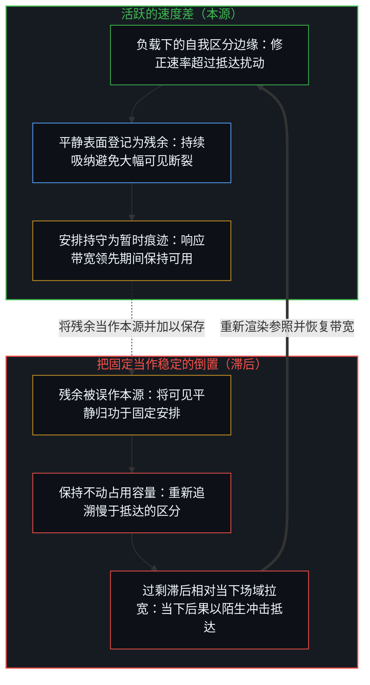
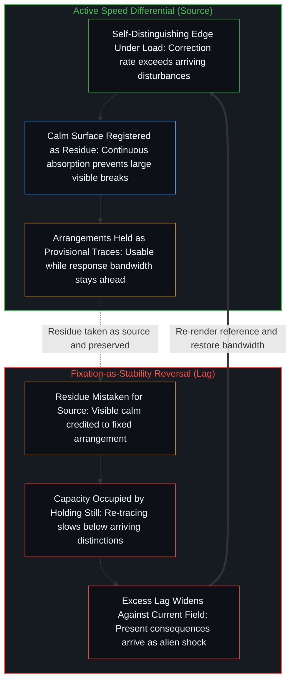
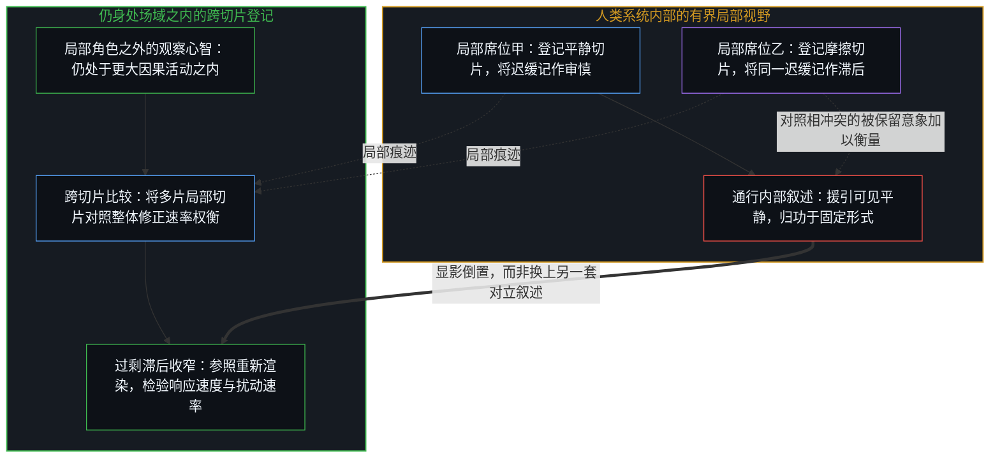
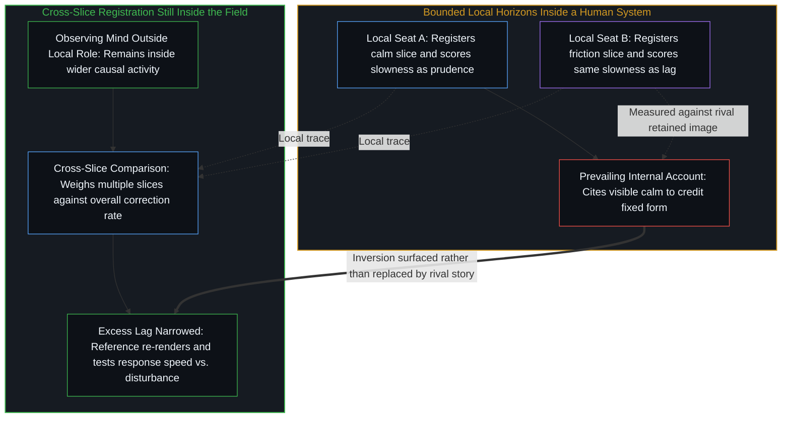

# 把稳定的症状当作稳定的来源 / Mistaking the Symptom of Stability for Its Source

*平静的表面是响应速度超过扰动时的残余，而非保持不动的产物。 / The calm surface is residue of response speed exceeding disturbance, not the product of holding still.*

自我区分的活动发生——无因而生，永不停止。称它为心智：已经在进行中的观察者，其每一个行为都是一次区分。被登记为稳定的，是修正持续快于抵达扰动时所剩余的表面。秩序的显现是这一速度差的残余。把残余当作本源，便颠倒了序列：固定的安排被持守为产生平静之物，而实际生成它的带宽却未被检视。在包含人类中心的系统中，这一颠倒会进一步加厚，因为每个中心只登记自身的局部视野，而视野内通行的叙事会把可见的平静当作当前安排本身即是来源的证据。

Self-distinguishing activity occurs — uncaused, unceasing. Call it the Mind: the observer already underway, every act of which is a distinction. What registers as stability is the surface that remains when correction continues faster than the disturbances that arrive. The appearance of order is residue of that speed differential. Treating the residue as the source reverses the sequence: the fixed arrangement is then held as what produces the calm, while the bandwidth that actually generates it is left unexamined. In systems that include human centers the reversal thickens, because each center registers only its local horizon and the prevailing story inside that horizon treats the visible calm as evidence that the current arrangements are themselves the source.

## 一、 显现是残余而非本源 / 1. Appearance Is Residue Rather Than Source

看起来稳定的表面，是更快的修正吸纳抵达的偏离之后所剩余的部分。当区分与重新追溯的速率持续领先于新区分压入的速率，场域便能在没有大幅可见断裂的情况下延续。这一连续性是结果。速度差维持期间碰巧在位的安排，并非连续性的生成者，而是这道速度差留下的痕迹。一旦表面被当作本源，回应便围绕保住这一可见层面重新组织——这正是[当效果主宰了框架的叙事](../when-the-effect-authors-the-frame/)所追溯的同一倒置——这些安排也随之越过产生它们的那一步而被保存下来，正如[遗忘的脚手架](../the-scaffolding-we-forget/)所刻画的那样，从可用的脚手架硬化为滞后。此后的偏离便对照那幅被保留的意象、而非对照当下的修正能力来登记，于是滞后的后果抵达时，仿佛来自这些安排之外。凡是一段平静期在事后被引为证据、用以证明正是期间可见的结构维系了这份平静，那里浮现的都是同一套几何。

The surface that looks stable is what remains after faster correction has already absorbed the arriving deviations. When the rate of distinction and re-tracing stays ahead of the rate at which new distinctions press in, the field continues without large visible breaks. That continuity is the effect. The arrangements that happen to be in place while the speed differential holds are not the generators of the continuity; they are the traces left by the differential. Once the surface is taken as the source, responses reorganize around preserving that visible register—the same inversion traced in [When the Effect Authors the Frame](../when-the-effect-authors-the-frame/)—and the arrangements themselves are preserved past the step that produced them, hardening from usable scaffolding into lag just as [The Scaffolding We Forget](../the-scaffolding-we-forget/) describes. Later deviations then register against the preserved image rather than against the current capacity to correct, so the consequences of lag arrive as if they came from outside the arrangements. The same geometry appears wherever a calm interval is later cited as proof that the interval's visible structure was what kept the interval calm.

控制论与飞行控制对这种不对称给出了定量表达。在 W. 罗斯·艾什比的必要多样性定律中，受控系统的结果多样性 V_O 存在下界，不低于扰动多样性减去调节器多样性（V_O ≥ V_D − V_R）：想让关键变量维持在看似静止的低熵表面，就必须经由调节器持续注入修正多样性，其速率至少不低于扰动抵达的速度；反过来，把调节器锁死在单一固定值上，外来多样性便会径直穿透到结果之中。倒立摆之所以笔直竖立，像 F-16 或 X-29 这类放宽静稳定性的电传操纵机体之所以能在湍流中平稳巡航，表面轮廓纹丝不乱，只因为作动器高频微偏转的速度跑赢了重力倾倒或气动俯仰发散；一旦将舵面锁死不动，飞行器立刻就会脱离受控飞行。这正是[可见性的速度差](../the-velocity-of-visibility/)所追溯的采样不对称在主动调节一侧的对应形态：在那里，刷新频率远高于慢速褶皱（v ≪ c）的观察者，将时间冗余编译为可触碰的坚实感；在这里，运行快于抵达扰动的修正行动，留下的是一层看似静止的平静表面。凡是受控对象动力学与目标包络可以预先给定的场合，控制论与经典控制依然极为有效，但其奠基前提——一套由外部划定的耦合关系，其中的关键变量与目标设定点在调节开始前即已固定——同时标出了它们的不完备边界。在活的心智或持续演进的制度里，所持守的目标并非从外部下达，而是一份随着新轴线敞开而重新渲染的暂时痕迹；若把高强度的修正多样性耗费在将过时参照锁死不动上，不过是在加倍保存昨日的意象。

Cybernetics and flight control express this asymmetry quantitatively. In W. Ross Ashby's *Law of Requisite Variety*, the outcome variety V_O of a regulated system is bounded below by disturbance variety minus regulator variety (V_O ≥ V_D − V_R): holding an essential variable at an apparently motionless, low-entropy surface requires pumping corrective variety through the regulator at least as fast as disturbances arrive, whereas clamping the regulator to a single fixed value passes incoming variety straight through into outcomes. An inverted pendulum standing upright, or a relaxed-static-stability fly-by-wire airframe such as the F-16 or X-29 cruising smoothly through turbulence, exhibits an unruffled silhouette only because high-frequency actuator micro-deflections outpace gravitational fall or aerodynamic pitch divergence; locking the control surfaces rigid guarantees immediate departure from controlled flight. This is the active-regulation twin of the sampling asymmetry traced in [The Velocity of Visibility](../the-velocity-of-visibility/): there, an observer refreshing far faster than a slow-motion fold (v ≪ c) compiles temporal redundancy into tactile solidity; here, corrective action running faster than arriving perturbations leaves behind a calm surface that looks static. Cybernetics and classical control remain highly effective wherever plant dynamics and target envelopes can be specified in advance, yet their foundational premise—an externally partitioned coupling whose essential variables and target set-points stay fixed prior to regulation—marks their boundary of incompleteness. In a living Mind or an evolving institution, the held target is not handed down from outside; it is a provisional trace that re-renders as new axes open, so high corrective variety spent clamping an obsolete reference steady merely intensifies the preservation of yesterday's image.

## 二、 把固定当作稳定是滞后 / 2. Treating Fixation as Stability Is Lag

把一种构型保持不动，要求活动运行得比它试图冻结的场域更慢。试图将参照固定下来，本身就是一次占用有限容量的离散行动；这份容量被占用期间，边缘重新追溯的速度便赶不上新区分的抵达。重新追溯相对于抵达越慢，被保留的意象与当下场域之间的间隙就越宽。后果落在当下，却对照过时的参照来登记，于是这份间隙有多宽，后果显得就有多外来。从固定参照内部看来像是受控稳定的东西，正是滞后本身——意象被豁免于重新渲染，现实也被当作一座有待调速的静态仓库，而非在接触面迎面相遇的活态摩擦，这正是[调速者的幻觉与行动的活态摩擦](../the-fallacy-of-pacing-and-the-felt-friction-of-ground-truth/)所审视的同一倒置。[阻力体感与速率差](../felt-resistance-and-the-speed-differential/)追溯了速率落差动荡的一面——推进中的边缘跑赢了周遭适应，由此登记为阻力；而固守静态构型则是从平静的一面演出了同样的容量抽离：把带宽耗费在防卫被保留的意象上，会不断拖慢响应，直至抵达的扰动将其反超。

Holding a configuration still requires the activity to operate more slowly than the field it is trying to freeze. The attempt to keep the reference fixed is itself a discrete act that occupies finite capacity; while that capacity is occupied, the edge cannot re-trace as quickly as the arriving distinctions. The slower the re-tracing relative to the arrivals, the wider the gap between the preserved image and the current field. Consequences land in the present yet register against the outdated reference, so they appear alien exactly to the width of the gap. What looked like controlled stability from inside the fixed reference is the lag itself: the image exempted from re-rendering, while reality is treated as a static storehouse to be paced rather than live friction met at the contact surface, the same inversion examined in [The Fallacy of Pacing and the Felt Friction of Ground Truth](../the-fallacy-of-pacing-and-the-felt-friction-of-ground-truth/). Where [Felt Resistance and the Speed Differential](../felt-resistance-and-the-speed-differential/) traces the turbulent face of a speed gap—an advancing edge outrunning ambient adaptation and registering as drag—fixating on a static configuration enacts the same capacity diversion from the calm side: spending bandwidth to defend a preserved image slows response until arriving disturbances overtake it.

凡是将固定、可检视的基础设施当作安全来源的地方，制度案例都会把这一倒置暴露出来。2026 年 11 月 13 日，美国联邦航空管理局（FAA）下达全国范围停飞令，致使出港航班中断近五个小时。起因是阿肯色州与得克萨斯州两处边缘站点例行执行铜线转光纤路由器割接时，向 L3Harris 科技公司旧版 FAA 电信基础设施（FTI）骨干网涌入每四至五秒 1,000 次的连接请求洪峰；这条骨干网依托老化的铜线与时分复用电路搭建，洪峰随之扰乱了 22 座航路交通管制中心里 17 座的无线电与雷达数据流，直到来自这两处站点的流量被阻断为止。在随后的交锋中，主管层一方面认可卫星链路的速度——这类链路已在阿拉斯加偏远站点经过测试并投入使用——另一方面仍为拒绝在更广空管范围内引入卫星带宽辩护，理由是面对辽阔空域与遍布各处的设施资产，“最好的办法是拥有一套基于地面的网络”。这种偏好将可检视的固定形式当作了安全的来源。只要扰动停留在电路仍能吸纳的故障隔离与恢复速度之内，地面网络便保持可用；一旦控制面风暴的扩散速度快过旧有分段机制的遏制能力，地面形态本身并不会生成额外的修正，它只标出先前的速度差业已丧失的那一点。维系运行连续性的，并非静态媒介标签——无论埋入地下的铜线，还是未加隔离的边缘终端——而是足以跑赢故障扩散速度的端到端故障隔离、故障转移与交换带宽。把熟悉的固定构型辩护为足够的安全保障，重演的正是[关闭选择权的代价](../the-price-of-closing-optionality/)所追溯的闭合：把未经检视的滞后记作审慎，直到抵达的负载亮出那张迟到的账单。

The institutional case exposes this reversal wherever a fixed, inspectable infrastructure is treated as the source of safety. On November 13, 2026, a nationwide Federal Aviation Administration ground stop halted departures for nearly five hours after routine copper-to-fiber router cutover work at two edge sites in Arkansas and Texas sent a flood of 1,000 connection attempts every four to five seconds across L3Harris Technologies' legacy FAA Telecommunications Infrastructure (FTI) backbone—built on aging copper and Time-Division Multiplexing circuits—disrupting radio and radar feeds across 17 of 22 en-route Air Route Traffic Control Centers until traffic from the two sites was blocked. In the exchange that followed, leadership acknowledged the speed of satellite links already tested and used at remote Alaska sites, yet defended declining broader air-traffic satellite bandwidth on the ground that, across a vast airspace with assets everywhere, *"the best method is to have a network that's based on the ground."* That preference treats an inspectable fixed form as the source of safety. A ground network remains usable for as long as disturbances stay inside the fault-isolation and recovery speed its circuits can still absorb; when a control-plane storm propagates faster than legacy segmentation can contain it, the terrestrial form generates no additional correction and only marks the point at which the prior speed differential has already been lost. What sustains operational continuity is not a static medium label—whether buried copper lines or unisolated edge terminals—but end-to-end fault isolation, failover, and switching bandwidth fast enough to outpace how quickly a fault spreads. Defending a familiar fixed configuration as sufficient safety repeats the closure traced in [The Price of Closing Optionality](../the-price-of-closing-optionality/), scoring unexamined lag as prudence until arriving load exposes the delayed bill.

活体生理学在表面静止与活跃响应带宽之间展现出同样的分野。教科书式的内稳态把生理稳定操作化为反应式负反馈，将各项参数钳定在固定的局部设定点上，然而 24 小时连续监测记录到的却恰恰相反。正如彼得·斯特林与约瑟夫·艾尔在“异稳态”——借变动以求稳——的概念下所阐述的，健康的动脉血压会随体位、睡眠、注意力与用力程度而迅速且大幅地摆动，健康的窦性心律同样带有宽频带的逐搏变异性。被锁死、不再变动的输出反而是病态的标志：慢性高血压将血压钳闭在收窄的高位区间里，并伴随压力反射响应迟钝；节拍器般恒定不变的心率，则预示着严重的自主神经衰竭。作为刻画多器官前瞻性调节的生物学模型，异稳态行之有效，也解释了为何只靠药物把下游生物指标钉死而不恢复调节响应能力，反而会招致代偿性反弹；它的边界在于将大脑预设为最小化代谢预测误差的第三人称演化优化器。这一前提无力解释，为何人类中心会在身体安全的房间里长期维持慢性异稳态过载——当一个中心把受防卫的自我形象豁免于重新渲染，便会把前瞻性唤醒死死钳在开启状态，持续对抗一个单靠身体反馈无从清除的符号性威胁。

Living physiology displays the same split between apparent stillness and active response bandwidth. Textbook homeostasis operationalized physiological stability as reactive negative feedback clamping each parameter to a fixed local set-point, yet continuous 24-hour monitoring records the opposite. As Peter Sterling and Joseph Eyer formulated under *allostasis*—stability through change—healthy arterial blood pressure swings rapidly and widely across posture, sleep, attention, and exertion, and healthy cardiac sinus rhythm carries broadband beat-to-beat variability. Clamped, non-varying outputs mark pathology: chronic hypertension locks pressure into a narrowed elevated band with blunted baroreflex responsiveness, and a metronomically constant heart rate signals severe autonomic collapse. Allostasis serves well as a biological model for anticipatory multi-organ regulation and explains why pharmacologically pinning a downstream biomarker without restoring regulatory responsiveness invites compensatory rebound; its boundary lies in its premise of the brain as a third-person evolutionary optimizer minimizing metabolic prediction error. That premise stops short of explaining why human centers sustain chronic allostatic overload inside physically safe rooms—when a center exempts a defended self-image from re-rendering and clamps anticipatory arousal open against a symbolic threat that bodily feedback alone cannot clear.

## 三、 人类系统中的局部视野与外部登记 / 3. Local Horizons in Human Systems and External Registration

在非人类复杂系统中——无论是稳住静不稳定机体的自动驾驶仪、自动路由网络，还是生理上的压力反射——没有任何子系统会编织或捍卫一套理论，把平稳输出归功于某种冻结形式。一旦作动放慢或被钳制在抵达扰动之下，振荡与崩溃便会直接暴露出带宽缺口。由人类中心组成的系统，则叠加了一层额外的压缩。每个中心只登记抵达自身边界的那一片场域切片，重演着[技术变革的局部陷阱](../the-local-trap-of-technological-change/)所追溯的局部样本外推。在这片切片里，当前安排可以显现为这一中心之所以感到平静的必要条件。同一缓慢响应，在一处视角下登记为审慎，在另一处视角下却登记为滞后，因为两个中心各自对照着不同的被保留意象来衡量——正如[AI 争论中的观察划界](../the-observational-cut-in-ai-debates/)所剖析的那道观察切口，把同一条连续序列切成了针锋相对的范畴立场。通行的内部叙述因此倾向于把可见的平静当作安排正是来源的印证。

In a non-human complex system—an autopilot stabilizing an unstable airframe, an automated routing fabric, or a physiological baroreflex—no subsystem authors or defends a theory crediting a frozen form for its smooth output. When actuation slows or clamps beneath arriving perturbations, oscillation and breakdown expose the bandwidth deficit directly. A system composed of human centers adds a further compression. Each center registers only the slice of the field that reaches its own boundary, repeating the local-sample generalization traced in [The Local Trap of Technological Change](../the-local-trap-of-technological-change/). Inside that slice the current arrangements can appear as the necessary condition of the calm the center experiences. The same slow response can register as prudence from one vantage and as lag from another, because the two centers are measuring against different retained images—the same observational cut that turns one continuous sequence into rival categorical positions in [The Observational Cut in AI Debates](../the-observational-cut-in-ai-debates/). The prevailing internal account therefore tends to treat the visible calm as confirmation that the arrangements are the source.

一个站在特定局部角色之外、同时认清自己仍身处更大因果活动之内的观察心智，可以将多片局部切片与修正发生的整体速率加以对照比较。这个心智并不占据无何有之乡的视角；它只是把更宽的一组痕迹持守得足够久，久到足以察觉共同叙事何时颠倒了残余与本源。正如[旁观者洞察的悖论](../the-paradoxical-nature-of-bystander-insights/)为一切抽离审视标出的边界那样，这一比较视角唯有被持守为暂时器具、而非冻结为凌驾于回路内行动者之上的外部宝座时，才保持诊断效力。这一颠倒并非靠用另一套内部叙述取代既有叙述来纠正。当参照沿着移动的边缘持续重新渲染以收窄过剩滞后，检验标准也转变为系统的修正速度是否依然超过它所面对的扰动速率——无论某处局部安排眼下看起来多么有序——这一颠倒便由此消解。

An observing Mind standing outside a particular local role—while recognizing that it remains inside the larger causal activity—can compare multiple local slices against the overall rate at which corrections are occurring. That Mind does not occupy a view from nowhere; it simply holds a wider set of traces long enough to notice when the shared story has inverted residue and source. Just as [The Paradoxical Nature of Bystander Insights](../the-paradoxical-nature-of-bystander-insights/) marks the boundary of any detached look, that comparative vantage stays diagnostic only while held as a provisional instrument rather than frozen into an exterior throne over the actors inside the loop. The inversion is not corrected by replacing one internal account with another. It dissolves as the reference is continuously re-rendered with the moving edge to narrow excess lag, and the test becomes whether the system's correction speed still exceeds the rate of the disturbances it faces, regardless of how orderly any particular local arrangement currently looks.

## 四、 速度差是可检验的 / 4. The Speed Differential Is Testable

速度差并非额外的地基。它是负载下自我区分活动的持续运作：后续行动发生在已由先前行动塑形的场域之内，其速率要么防止新区分压缩到单个中心之上，要么听任这种压缩发生。只要重新追溯的速率保持领先，表面便继续登记为有序。一旦速率落后，表面随即断裂，先前的安排也显露出它们一直以来不过是残余——正如[进步叙事中的症候与原因](../symptom-and-cause-in-the-narratives-of-progress/)所揭示的，集体情绪是延迟的症候，而非经济运动的引擎。检验方式既局部又可重复：在扰动速率变化的多个时段里，让被声称的来源（固定安排、既定程序、地面网络）保持不变。倘若安排未变而结果发散，因果权重便会从安排身上排出，归还给活动得以重新追溯的速度。

The differential is not an additional ground. It is the continued operation of self-distinguishing activity under load: later acts occurring within a field already shaped by earlier ones, at a rate that either keeps new distinctions from compressing onto one center or allows that compression. Where the rate of re-tracing stays ahead, the surface continues to register as ordered. Where the rate falls behind, the surface breaks and the prior arrangements are revealed as the residue they always were—just as [Symptom and Cause in the Narratives of Progress](../symptom-and-cause-in-the-narratives-of-progress/) shows collective mood to be a delayed symptom rather than the engine of economic motion. The test is local and repeatable: hold the claimed source (the fixed arrangement, the established procedure, the ground network) constant across intervals while the rate of disturbance varies. If outcomes diverge while the arrangement is unchanged, causal weight drains from the arrangement and returns to the speed at which the activity was able to re-trace.

在信贷市场中，每逢平静期持续拉长，这一检验便会上演。按照海曼·明斯基的金融不稳定假说——即稳定或者说平静本身会孕育不稳定——长期维持的低实际违约率与平滑的资产价格，会令借方、贷方与监管者把表面的平静解读为现行规则的结构性恒久。出于对可见表面的信任，参与者不断削薄资产负债表缓冲：从经营现金流足以覆盖本息的对冲性融资，经由需要持续借新还旧的投机性融资，滑入依赖估值上涨或信贷扩张维系的庞氏融资。账面上的安排看似毫无变化，直到一次寻常的利率抬升或融资暂停跑赢了再融资速度，才暴露出平静表层之下吸收扰动的能力早已掏空到了何种地步。明斯基的假说精准勾勒了内生的资产负债表脆弱性，但它把央行兜底与财政赤字视为立于周期之外的外部配重，在此到达了边界：央行与财政部门同样身处同一条因果回路之中，每当它们的干预借压制可见波动来制造持久平静，便会加厚恒久不变的幻象，令参与者在这一幻象下继续加杠杆，制度也随之推迟调适。无论把安排钳定不动，还是将一幅统计凸性地图抬升为先于区分的常设处方——这正是[重新审视反脆弱](../a-new-deeper-look-at-antifragility/)所追溯的边界——都无法替代变化负载下鲜活的重新追溯。无论系统是控制回路、市场、生物响应还是制度网络，同一套检验都适用。稳定的显现作为读数保持可用；它并不成为读数的来源。

In credit markets, that test plays out whenever tranquility endures. Under Hyman Minsky's *Financial Instability Hypothesis*—his thesis that stability, or tranquility, is destabilizing—prolonged stretches of low realized defaults and smooth asset prices lead borrowers, lenders, and supervisors to read surface calm as structural permanence of the prevailing rules. Trusting the visible surface, participants thin their balance-sheet buffers from hedge finance, where operating cash flows cover principal and interest, through speculative finance requiring continual rollover, into Ponzi finance dependent on rising valuations or expanding credit. The arrangements on the books appear unchanged until an ordinary rate uptick or funding pause outruns refinancing speed, revealing how far disturbance-absorption capacity had hollowed out beneath the calm. Minsky's hypothesis maps endogenous balance-sheet fragility with precision, yet it reaches its boundary where it treats central-bank backstops and fiscal deficits as external counter-weights standing outside the cycle: central banks and treasuries sit inside the same causal loop, and whenever their interventions suppress visible volatility to manufacture prolonged calm, they thicken the illusion of permanence under which participants extend leverage and institutions defer adaptation. Neither clamping arrangements still nor elevating a statistical convexity map into a standing prescription prior to distinguishing—the boundary traced in [A New Deeper Look at Antifragility](../a-new-deeper-look-at-antifragility/)—replaces live re-tracing under varying load. The same test applies whether the system is a control loop, a market, a biological response, or an institutional network. The appearance of stability remains usable as a reading; it does not become the source of the reading.
