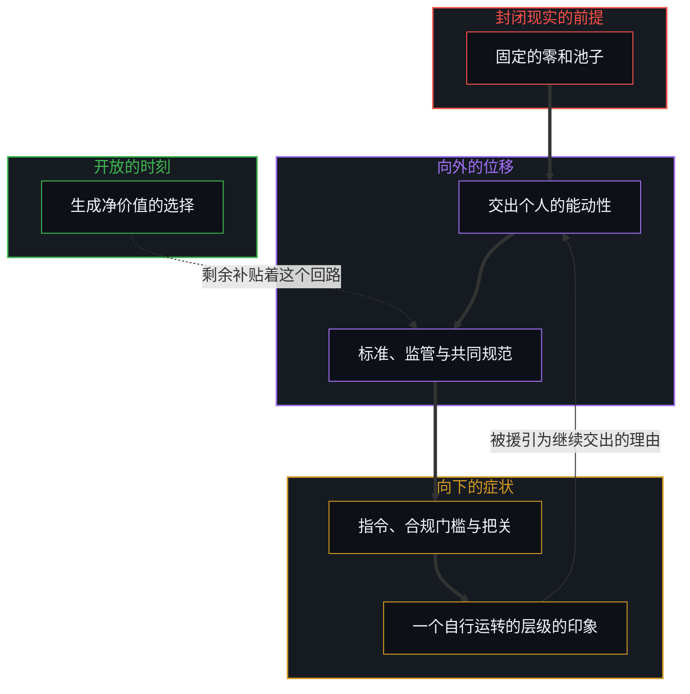
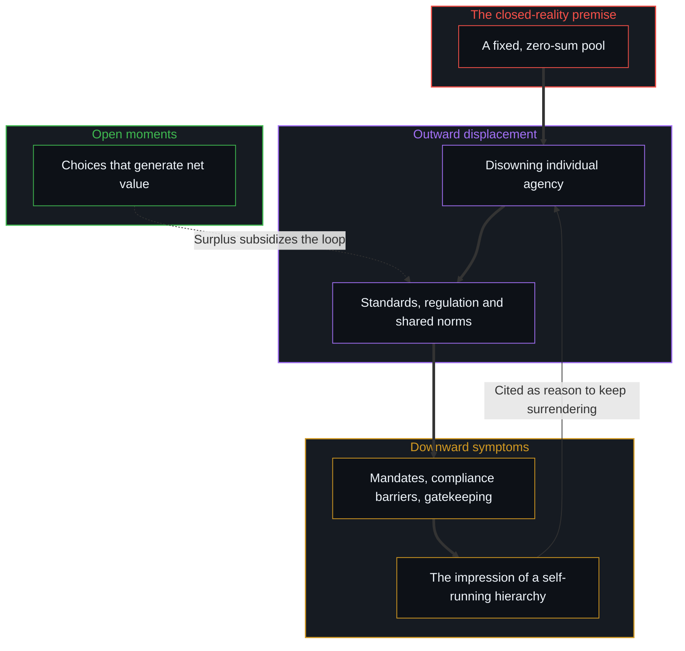

# 道德语言作为投影 / Moral Language as Projection

*道德语言不描述现实，它投射说话者的位置；边界一旦敞开，道德效价便消散 / Moral language does not describe reality but projects the speaker's position; once boundaries open, its valence dissolves.*

从第一人称追溯，被登记到的现实本身不带道德的属性：它就是它，敞开而完整。道德的、不道德的、无关道德的，这些范畴并不作为世界的独立属性存在；它们是道德语言与社会标准划出的区分。道德语言不描述现实；它投射说话者的相对位置，以伦理判断的样子，编码地位、被感到的威胁与防御的姿态。把制度的摩擦称作“审慎”，说话者就站到了集体的稳妥与共同责任一边；把同一份摩擦称作“减速”，说话者就站到了前沿的进步与个人的主动一边。词汇追踪的是运作中的位置，而不是因果的机制。社会把一些东西道德化为美德或病态，那是能动性已经从个人的中心被剥离、投射到集体结构上之后留下的残余，在那里它可以被协调、被控制，或被归咎。

Traced from the first person, reality as it registers carries no moral property of its own: it simply is, open and complete. The categories of the moral, the immoral and the amoral do not exist as independent properties of the world; they are distinctions drawn by moral language and social standards. Moral language does not describe reality; it projects the speaker's relative position, encoding status, perceived threat and defensive posture in the form of ethical judgment. Calling institutional friction "caution" places the speaker on the side of collective prudence and shared responsibility. Calling the same friction "deceleration" places the speaker on the side of frontier progress and individual initiative. The vocabulary tracks operational position, not causal mechanism. What society moralizes as virtue or pathology is the residue of agency already stripped from individual centres and projected outward onto collective structures, where it can be coordinated, controlled or blamed.

## 一、 能动性的向外位移与控制的反馈回路 / 1. The Outward Displacement of Agency and the Feedback Loop of Control

道德语言的广泛采用，扎根于封闭现实的假设：一份未经审视的确信，认为资源、地位、安全与可能性存在于一个固定的、零和的池子里。

The wide adoption of moral language is rooted in the assumption of closed reality: the unexamined conviction that resources, status, security and possibility exist in a fixed, zero-sum pool.

在一个封闭的世界里，每一次前沿的扩张，对锚定在既有均衡里的人来说，都被登记为一次未经同意的损失，或一种生存上的危险。[潜能作为威胁或启发](../ones-potential-as-threat-or-inspiration/)描绘了这个分岔：在封闭的前提下，另一个中心的能力被体验为对自己地位的直接减法，于是触发防御性的围堵。

In a closed world, every expansion of the frontier registers, for those anchored in existing equilibria, as an unconsented loss or an existential hazard. [One's Potential as Threat or Inspiration](../ones-potential-as-threat-or-inspiration/) maps this divergence: under a closed premise, another centre's capacity is experienced as a direct subtraction from one's own standing, setting off defensive containment.

对被感到的零和脆弱，社会一贯的回应是放弃个人的能动性，把它投射出去：交托给标准机构、监管体制、行政装置，以及负责配给稀缺、管理风险的共同规范。

The consistent social response to a perceived zero-sum vulnerability is to disown individual agency and project it outward: entrusting it to standards bodies, regulatory regimes, administrative apparatuses and shared norms charged with rationing scarcity and managing risk.

能动性一旦被向外位移，随之而来的指令、合规门槛与把关规则，就作为向下的症状回到个人身上。这生出一个自我强化的反馈回路：向下的行政压力被感到的分量，造出一个先已存在、自行运转的向上层级的有力印象，而这个印象又被援引来为继续向外交出能动性辩护。把这个过程讲成一次“向上的转移”，这个叙述习惯本身，就是制度优先的错觉在语言里沉积得多深的诊断残余。[主权、信念与规制结构的生成](../sovereignty-belief-and-regulatory-structures/)揭示的正是这个回路：持久的监管装置并不独立地生成权威；它们之所以维持，只因为个人持续地把自己的决策权外化到一个集体的脚手架上，换取一种安全的错觉。

Once agency is displaced outward, the resulting mandates, compliance barriers and gatekeeping rules return to the individual as downward symptoms. This produces a self-reinforcing feedback loop: the felt weight of downward administrative pressure creates the convincing impression of a pre-existing, self-running upward hierarchy, which is then cited to justify the continued outward surrender of agency. The very habit of narrating this process as an "upward transfer" is itself diagnostic residue of how deeply the illusion of institutional primacy has settled into language. [Sovereignty, Belief, and the Generation of Regulatory Structures](../sovereignty-belief-and-regulatory-structures/) reveals this loop: durable regulatory apparatuses do not generate authority independently; they are sustained only because individuals keep externalizing their own decision-making power onto a collective scaffold in exchange for an illusion of safety.

## 二、 零和装置的不对称补贴 / 2. The Asymmetric Subsidy of Zero-Sum Apparatuses

没有哪个人是封闭现实或开放现实的漫画式化身。人并不被分成永久的种姓；封闭与开放描述的，是一刻一刻被实行出来的运作姿态，是同一个心智在不同时刻都可能经过的位置。

No individual is a caricature of closed or open reality. People are not divided into permanent castes; closed and open describe an operational stance enacted from moment to moment, positions one and the same Mind may pass through at different times.

大多数人在大多数日常里，默认采用封闭现实的假设。可净价值只在个人依开放现实的前提行动时才被生成：区分尚未被描绘的可能，发明新的工具，扩大总的容量。

Most people, through most of their daily routines, default to closed-reality assumptions. Yet net value is generated only when individuals act under the open-reality premise: distinguishing unmapped possibilities, inventing new tools and enlarging total capacity.

这种不对称，显出了零和系统隐藏的脆弱。按它们自己的运作追下去，封闭现实的活动，再分配的政治、监管上的寻租与道德上的把关，是负和的，因为每一次强制的价值转移，都要在摩擦、监控与行政损耗里消耗资源。

This asymmetry shows the hidden fragility of zero-sum systems. Followed through their own workings, closed-reality activities, redistributive politics, regulatory rent-seeking and moral gatekeeping, are negative-sum, because every compulsory transfer of value consumes resources in friction, surveillance and administrative attrition.

如果全然任其自行运转，一个封闭现实的装置无法维持自己；它会很快耗尽供养它的东西，就像一家赌场，如果没有新玩家带着在外部生产性事业中生成的新财富进场，玩家的钱很快就会输光。零和的制度机器之所以延续，只因为同一批个人，在他们开放的时刻，持续地生产出一份剩余，补贴着集体游戏的损耗。[秩序、剩余与道德拦截](../order-surplus-and-the-moral-intercept/)追踪的正是这个拦截的动态：道德化的制度并不生成它们所管制的剩余；它们拦截开放行动的生成产出，并把自己安装为这份产出的必要前提。

Left wholly to itself, a closed-reality apparatus cannot sustain itself; it would soon use up what feeds it, like a casino that would run out of players' money if no new players arrived with fresh wealth generated in productive enterprise outside. The zero-sum institutional machinery endures only because the very same individuals, in their open moments, keep producing a surplus that subsidizes the attrition of the collective games. [Order, Surplus, and the Moral Intercept](../order-surplus-and-the-moral-intercept/) tracks this dynamic of interception: moralizing institutions do not generate the surplus they regulate; they intercept the generative output of open action and install themselves as its necessary precondition.

## 三、 制度因果的错觉 / 3. The Illusion of Institutional Causality

能动性一旦被外化，又由开放的剩余补贴着，集体的结构就被误认作人类事务中首要的因果行动者。

Once agency is externalized and subsidized by open surplus, the collective structure is mistaken for the primary causal actor in human affairs.

无论讲成善意的守护，还是讲成官僚的俘获，底下的因果故事都一样：被当作结果作者的，是制度，而不是个人分布式的、有心智的选择。技术被降为配角，要么被塑造成需要约束的生存威胁，要么被塑造成系统性颠覆的钝器；而设计、选择并采用工具的那些个人不可化约的能动性，被从账本上划掉了。

Whether told favourably as benevolent guardianship or unfavourably as bureaucratic capture, the underlying causal story is the same: the institution, rather than the distributed, minded choices of individuals, is treated as the author of outcomes. Technology is demoted to a supporting role, cast either as an existential threat needing restraint or as a blunt instrument of systemic disruption, while the irreducible agency of the individuals who design, choose and adopt tools is written out of the ledger.

[能动性的错配](../the-misallocation-of-agency/)追踪了这个基础的倒置：把集体的记录与行动的生成之源混为一谈，就反转了因果的流向。协调者或监管者被赋予因果上的优先，而真正提供劳作的分布式选择，被当作下游的效果。[协调者的范畴错误](../the-coordinators-category-error/)是同一个错误在账本上的那一面：把中央的记账记录当作下一步的共同作者。

[The Misallocation of Agency](../the-misallocation-of-agency/) tracks this foundational inversion: confusing the collective record with the generative source of action reverses the flow of causation. The coordinator or regulator is granted causal priority, while the distributed choices that actually supply the work are treated as downstream effects. [The Coordinator's Category Error](../the-coordinators-category-error/) is the ledger face of the same mistake: treating the central accounting record as co-author of the next step.

## 四、 开放的边界与道德效价的消散 / 4. Open Boundaries and the Dissolving of Moral Valence

当边界被认出是开放、可延展的，另一个框架就出现了。

The alternative frame appears when boundaries are recognized as open and extendable.

现实一旦被认出是开放的，它不带道德属性的样子就清楚了。新的技术配置、扩大的市场与涌现的协调规则，扩大的是总的容量，而不是重新分配一块静止的蛋糕。可能性一旦被理解为可以扩展，制度的摩擦就失去了它作为一种自主道德力量的神圣地位，被平实地认出是它所是的东西：进步需要去流线化、去越过的阻力。

Once reality is recognized as open, the way it carries no moral property becomes clear. New technical configurations, expanded markets and emergent protocols of coordination enlarge total capacity rather than redistributing a static pie. Once possibility is understood as expandable, institutional friction loses its sacred status as an autonomous moral force and is recognized plainly for what it is: drag that progress needs to streamline and overcome.

[减速是加速时感受到的阻力](../deceleration-is-the-drag-felt-when-accelerating/)抓住了这个流体力学的图像：阻力随速度自然增大，合适的回应是流线化，而不是道德上的交战。边界敞开时，附着在摩擦上的道德效价，“审慎”与“减速”之间的意识形态对决，就消散为视角的不同。

[Deceleration Is the Drag Felt When Accelerating](../deceleration-is-the-drag-felt-when-accelerating/) captures this hydrodynamic picture: drag naturally grows with velocity, and the fitting response is streamlining, not moral warfare. When boundaries are open, the moral valence attached to friction, the ideological duel between "caution" and "deceleration", dissolves into a difference of perspective.

## 五、 观察上的对称与默认的集体归咎 / 5. Observational Symmetry and the Default to Collective Blame

表面的症状，推迟的采用进度、过渡期的摩擦、意料之外的副作用、有组织的政治抵抗，在封闭与开放两种诠释下，在观察上一模一样。

Surface symptoms, delayed adoption schedules, transitional friction, unexpected side effects and organized political resistance, look the same to observation under both the closed and the open interpretation.

如果不先把个人选择确立为不可化约的前提，单凭经验数据，无法区分一场危机是源自一项新技术内在的危险，还是源自先前能动性从个人身上被错配进僵硬的集体垄断。因为封闭现实的假设是运作中的文化默认，公共叙事便条件反射式地回到制度因果：制度被当作原因，技术被塑造成问题或武器，道德语言继续投射防御性的社会站队，而不是澄清机制。

Without first setting individual choice as an irreducible prior, empirical data alone cannot tell whether a crisis comes from the inherent danger of a new technology or from the earlier misallocation of agency away from individuals into rigid collective monopolies. Because the closed-reality assumption is the operating cultural default, public narratives revert by reflex to institutional causality: institutions are taken as causes, technology is cast as the problem or the weapon, and moral language goes on projecting defensive social alignments instead of clarifying mechanisms.

## 六、 个人的姿态是唯一的化解之处 / 6. The Individual Stance as the Only Point of Resolution

既然零和装置没有独立的生成引擎，只靠一份它自己并不生成的、来自开放创造的补贴维持，化解之处就只在每一个个人的中心。

Since the zero-sum apparatus has no independent engine of generation and is sustained only by a subsidy from open creation that it does not itself generate, the point of resolution lies only at each individual centre.

化解从来不在于按零和装置自己的条件与它周旋：向监管的脚手架请求许可，改革道德的词汇，或向制度控制的向下症状开战。杠杆只在于每个个人提高依开放现实的前提做出的离散选择所占的比例。

Resolution never lies in engaging the zero-sum apparatus on its own terms: petitioning the regulatory scaffold for permission, reforming the moral vocabulary, or waging war on the downward symptoms of institutional control. The lever lies only in each individual raising the share of discrete choices made under the open-reality premise.

这个转变同时完成两件相互放大的事。在生成的一侧，它在开放的前沿写下新的财富、工具与正和的容量；与此同时，它从零和的转移那里收回服从、注意与补贴，让监管装置自己承受内部的损耗。

This shift does two self-amplifying things at once. On the generative side, it writes new wealth, tools and positive-sum capacity at the open frontier; at the same time, it withdraws compliance, attention and subsidy from zero-sum transfers, leaving the regulatory apparatus to bear its own internal attrition.

开放现实的行动频率一步步提高，制度摩擦的阻力系数就一步步降低。财富转移的机制失去补贴而收缩，因果则不受干扰地回到做出选择的有心智的前沿。[表征的闭环](../the-closed-loop-of-representation/)追踪的正是这种内在：指向他人的道德评判，总是自己现有的概念与内部模型之间未化解的落差向外的位移。在这个动态里，诊断外部行动者的动机或被感到的欠缺，从来不是对一片外部领土客观的检视；正如[投射中的自画像](../the-self-portrait-in-the-projection/)所考察的，把低维的漫画投射到他人身上，主要是在保护观察者自己脆弱的评价框架，免受真实异质性的摩擦。现实的边界不是靠改造脚手架扩展的，而是靠个人持续地实行那个生成的动作，所以[个体抉择是唯一的因果杠杆](../individual-choices-as-the-only-causal-levers/)。按目的去评判，是道德投射背后的认知缺省，[目的性的评判与认知的缺省状态](../cong-mu-di-xing-de-ping-pan-kan-ren-zhi-que-sheng/)讲清了这一点。

As the frequency of open-reality action rises step by step, the drag coefficient of institutional friction falls step by step. Wealth-transfer mechanisms shrink as their subsidy is withdrawn, while causation returns undisturbed to the minded edge that chooses. [The Closed Loop of Representation](../the-closed-loop-of-representation/) tracks this interiority: moral judgments aimed at others are always the outward displacement of unresolved discrepancies between one's own standing concepts and inner models. In this dynamic, diagnosing the motives or perceived deficits of outside agents is never an objective inspection of foreign territory; as [The Self-Portrait in the Projection](../the-self-portrait-in-the-projection/) examines, projecting low-dimensional caricatures onto others serves mainly to protect the observer's own fragile evaluative schema from the friction of real heterogeneity. The boundary of reality is widened not by reworking the scaffold but by individuals continually enacting the generative move, which is why [Individual Choices as the Only Causal Levers](../individual-choices-as-the-only-causal-levers/). Judging by purpose is the cognitive default behind moral projection, as [Judging by Purpose and the Default State of Cognition](../cong-mu-di-xing-de-ping-pan-kan-ren-zhi-que-sheng/) explains.
