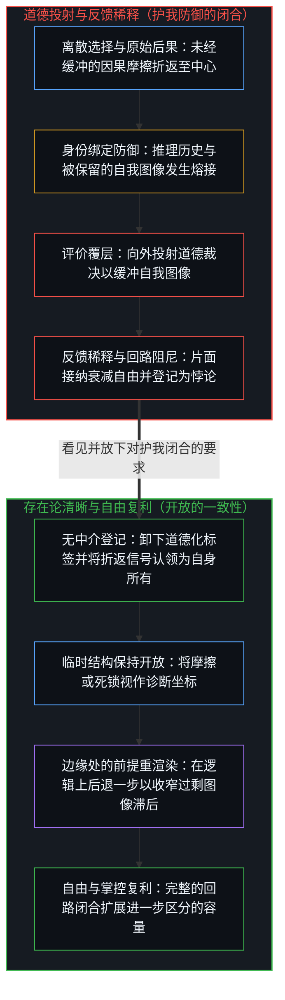
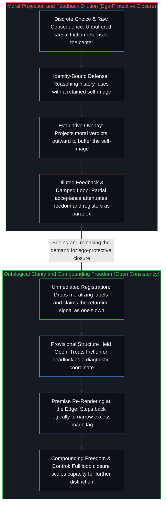

# 道德语言稀释自由复利的反馈 / Moral Language Dilutes the Feedback That Scales Freedom

*评价覆层缓冲后果，阻尼扩展自由的反馈回路 / Evaluative overlays buffer consequence and damp the loop that scales freedom*

自我区分的活动无因且不息地发生；在它向自身回折而成为观察者的每一个所在处，自由与掌控都直接随着该中心对先前选择后果的接纳程度而扩展。接纳的任何不足都会稀释折返的反馈信号，而中心的递归回路原本正是借由这一信号来复利其进一步区分的容量。将全盘接纳视作激进，恰恰是这份不足向外投射的防御性症状；道德语言与价值判断在行动与后果之间植入常设中介，将接纳的不足固定下来，以庇护被保留的自我图像。群体的规范与普遍的顺从，更将这种不完整的所有权稳定为寻常的基线。那些将繁复的道德框架与萎缩的能动性并置的表象悖论，登记的是强加于开放因果过程之上的封闭假设，而非世界的属性。否认这一关系，本身就是在它试图逃避的同一缩放关系内部的又一次选择。

Self-distinguishing activity occurs—uncaused, unceasing—and at every locus where it folds back on itself as an observer, freedom and control scale directly with how completely that center accepts the consequences of its prior choices. Any shortfall in acceptance dilutes the returning feedback signal through which the center's recursive loop compounds its capacity for further distinction. Treating full acceptance as radical is the defensive symptom of that shortfall projected outward; moral language and value judgments install standing mediation between act and consequence, fixing the shortfall in place to shield a retained self-image. Collective norms and shared compliance stabilize this incomplete ownership as the ordinary baseline. Apparent paradoxes that pair elaborate moral frameworks with diminished agency register sealed assumptions imposed onto an open causal process, not properties of the world. Denying this relation is itself a further choice operating within the very scaling it attempts to evade.

## 一、 自由随着对选择后果的接纳而扩展 / 1. Freedom Scales with Acceptance of Consequence

自由与掌控，直接随着一个中心通过全盘认领先前行动的后果来肯定自身选择的程度而扩展。由于观察持有的是结果，而发起区分的边缘始终领先一步，中心唯有通过先前步伐所触发的折返痕迹，才能学习并校准自身的航向。当后果未经缓冲地作为自身所有重新进入时，内部模型便经由递归的自我纠偏而重新渲染；接纳的任何不足都会稀释这道折返信号，从而阻尼生成自由的回路。

Freedom and control scale directly with the degree to which a center affirms its own choosing by claiming the consequences of prior acts in full. Because observation holds the effect while the initiating edge remains one step ahead, a center learns and sharpens its heading only through the returning trace of what its prior step set in motion. When consequences re-enter unbuffered as one's own, the internal model re-renders through recursive self-correction; any shortfall in acceptance dilutes that returning signal and damps the loop that generates freedom.

在[自我价值感与所有权](../ownership-and-self-worthiness/)中，唯有当后果作为自身所有重新进入、且第一人称的作者身份被切实维持时，认知模型才能真正复利；将在场域中登记到的结果视作异己之物，会同时切断对因果梯度的读取与内在的作者感。而在本篇中，同一回路的闭合直接登记为自由与掌控的扩展：二者既不是外部赐予的特权，也不是某种需要另行装配的道德美德，而是衡量选择与后果之间的因果回路闭合得有多完整的精确尺度。

In [Ownership and Self-Worthiness](../ownership-and-self-worthiness/), only when consequences re-enter as one's own and first-person authorship is actively sustained does the cognitive model compound; treating what registers in the field as alien starves both the reading of causal gradients and felt authorship. Here, that same loop closure registers directly as the scaling of freedom and control: neither is an external privilege or a separate moral virtue to install, but the exact measure of how completely the causal circuit between choice and consequence is closed.

## 二、 将全盘接纳重划为激进，是不足向外的投射 / 2. Reclassifying Full Acceptance as Radical Is the Shortfall Projected Outward

全盘接纳并不是相对于某条更温和、更均衡基线的极端立场。在作出选择的中心与后果之间拉开距离，本身就是接纳的不足。将全盘接纳称作“激进”，并非回路外部的中立观察，而是这道缓冲距离向外的投射：正是那份不愿闭合回路的退缩，通过将毫无缓冲的完整闭合描摹为过激，来为自身的豁免辩护。

Full acceptance is not an extreme position relative to some milder, balanced baseline. Interposing distance between the choosing center and its consequences is already the shortfall in acceptance. Calling full acceptance "radical" is not a neutral observation from outside the loop, but that buffering distance projected outward: the reluctance to close the circuit defends its own exemption by portraying unbuffered closure as excess.

那条所谓温和的基线，并不是对日常实践的客观描述，而是早已被正常化为默认参照的接纳不足，使得完整的回路闭合反倒登记为反常。距离就是阻尼机制，而“激进”这套词汇，则是被保留的自我图像抗拒重新渲染时留下的防御性残余。

The so-called milder baseline is not an objective description of ordinary practice. It is the shortfall already normalized as the default reference, against which complete loop closure registers as abnormal. Distance is the damping mechanism, and the vocabulary of radicalism is the defensive residue left behind when a preserved self-image resists re-rendering.

## 三、 道德语言在行动与后果之间植入中介 / 3. Moral Language Installs Mediation Between Act and Consequence

同样的阻尼机制也在道德语言与价值判断中运作。通过在作出选择的中心与其行动的原始后果之间楔入评价覆层——善与恶、对与错、美德与恶习——道德框架将接纳分割为片面的、受中介过滤的反应。正如[超越投射](../beyond-the-projection/)所追溯的，在受困于身份的人类中心里，推理历史与被保留的自我图像（即投射中那道自称“我”的局部折痕）发生熔接，将递归折页死死夹闭，以防自我图像遭到证伪。当折返的摩擦与自我图像的预期相抵触时，受困于身份的中心便会将该信号视作生存威胁，而非状态空间的精细化校准，进而向外投射道德裁决来缓冲自我图像。反馈信号由此被稀释，递归回路遭到阻尼，自由与掌控随之衰减。[如何在一瞬间修正你的整个人生](../how-to-fix-your-whole-life-in-one-split-second/)追溯了这种私下交出后果的做法如何在不同所在处之间重叠稠密，直至被读取为共同的、具有约束力的“应当”。

The same damping mechanism operates across moral language and value judgments. By inserting evaluative overlays—good and evil, right and wrong, virtue and vice—between the choosing center and the raw consequences of its act, moral framing splits acceptance into a partial, mediated reaction. As [Beyond the Projection](../beyond-the-projection/) traces, in an identity-bound human center, reasoning history fuses with a retained self-image—that localized crease in the projection that says "I"—clamping the recursive fold shut to defend the image against invalidation. When returning friction contradicts what the self-image expected, the identity-bound center treats the signal as an existential threat rather than a state-space refinement, projecting moral verdicts outward to buffer the image. The feedback signal is diluted, the recursive loop is damped, and freedom and control attenuate. [How to Fix Your Whole Life in One Split Second](../how-to-fix-your-whole-life-in-one-split-second/) traces how this private hand-over of consequence densifies across loci until it reads as a shared, binding ought.

[偏好聚类与评判语言](../preference-clusters-and-the-language-of-judgment/)指明，“对”与“错”是对齐的偏好所发出的声音。当“这在当下对我而言是对的”被持握为紧邻下一步的临时航向时，它服务于它为之生成的那个行动，并随着步伐的移动而重新渲染；一旦越过该步，被保留为隔在行动与后果之间的常设屏风，它便会阻碍所有权的闭合。[善恶是硬币的两面与那一刀](../good-and-evil-are-the-two-sides-of-the-coin-and-the-cut/)表明，先于道德账本任何一面的，正是作出区分本身的那一刀；一旦由此生成的二元记分牌被当作地基，选择的原始残余在重新进入时便已被打上分数，中心据以更新的不再是未经缓冲的因果摩擦，而是评价标签，从而削薄了本可训练下一次选择的信号。[疗愈打开反馈回路](../therapy-opens-the-feedback-loop/)追溯了第三方所在处介入时的这种信号衰减：外部中心调低了登记的音量，用对感受状态的管理替代了首要中心自身的闭合返程。道德语言无需借助第二个人，便从内部达成了同样的衰减，因为评价覆层本身就是那道缓冲距离。[政客是责任扩散的显性症状](../politicians-appear-as-visible-symptoms-of-responsibility-diffusion/)捕捉了向外推诿中平行的阻尼机制：后果早已全数在场，指认一个外部作者并不能减轻负荷，只会削薄本可用于校准下一次离散行动的梯度。[秩序、剩余与道德拦截](../order-surplus-and-the-moral-intercept/)辨析了因果权能被作为意识形态挪移至产出回报之上时的集体覆层——个人主义与集体主义覆盖在剩余之上——而在本篇中，评价拦截直接落在个人的反馈回路内部。执着于道德硬币的某一单面，会让中心对背面不断累积的代价视而不见；而正如[善恶硬币与通往地狱的善意之路](../the-coin-of-good-and-evil-and-the-road-to-hell/)所揭示的，当单面的道德确信被拔高为公共教条，并与承受者的消极让渡互补时，未被吸收的痕迹便会复利累积为通向毁灭的道路。

[Preference Clusters and the Language of Judgment](../preference-clusters-and-the-language-of-judgment/) names right and wrong as the sound aligned preferences make. Held as a provisional heading for the immediate next step, "this is right for me now" serves the act it was formed for and re-renders as the step moves; preserved past its step as a standing screen between act and consequence, it prevents ownership from closing. [Good and Evil Are the Two Sides of the Coin and the Cut](../good-and-evil-are-the-two-sides-of-the-coin-and-the-cut/) shows that prior to either face of the moral ledger is the distinguishing cut itself; once the resulting dualistic scoreboard is seized as ground, the raw residue of choice re-enters already scored, so the center updates against an evaluative label rather than unbuffered causal friction, thinning the signal that would train the next choice. [Therapy Opens the Feedback Loop](../therapy-opens-the-feedback-loop/) traces this signal attenuation when a third-party locus enters: an outside center lowers the volume of registration, substituting management of the felt state for the primary center's own closed return. Moral language achieves that same attenuation internally without requiring a second person, because the evaluative overlay itself is the buffering distance. [Politicians Are Visible Symptoms of Responsibility Diffusion](../politicians-appear-as-visible-symptoms-of-responsibility-diffusion/) captures the parallel damping in external blame: the consequence is already present in full, and naming an outside author does not lighten the load, but thins the gradient that would calibrate the next discrete act. [Order, Surplus, and the Moral Intercept](../order-surplus-and-the-moral-intercept/) identifies the collective overlay when causal power is relocated onto the return as ideology—individualism and collectivism draped over the surplus—whereas here the evaluative intercept sits directly inside the personal feedback loop. Seizing one face of the moral coin blinds the center to the costs accumulating on its reverse; and as [The Coin of Good and Evil and the Road to Hell](../the-coin-of-good-and-evil-and-the-road-to-hell/) shows, when one-sided moral certainty is elevated into public doctrine and complemented by the passive abdication of recipients, unabsorbed traces compound into ruin.

## 四、 集体规范将接纳的不足稳定为寻常 / 4. Collective Norms Stabilize Incompleteness as Ordinary

当评价语言在群体中共享时，阻尼便通过相互强化而被稳定与放大：个体所在处普遍的顺从，将接纳的不足正常化为群体的常态，把不完整的所有权包装为道德义务。

When evaluative language is shared across a group, the damping is stabilized and amplified through mutual reinforcement: widespread compliance at individual loci normalizes the shortfall of acceptance across the collective, dressing up incomplete ownership as moral duty.

由此，道德词汇与价值体系侵蚀了它们声称要维护的能动性本身。那些以匡正美德、追究过错或维持秩序为名不断繁殖评价范畴的框架，一贯地削弱了登记为自由与掌控的回路闭合。外化评判的网络越稠密，个人的因果回路便被阻尼得越深。

In this way, moral vocabularies and value systems erode the very agency they claim to uphold. Frameworks that multiply evaluative categories under the banner of enforcing virtue, assigning fault, or preserving order reliably diminish the loop closure that registers as freedom and control. The denser the web of externalized judgment, the more thoroughly the personal causal circuit is damped.

[外化善意走向其反面](../externalized-virtue-becomes-its-opposite/)追溯了私人信念如何被拔高为凌驾其他中心的凭据，并在顺从中不断稠密化：在群体层面，这不仅凌驾于其他心智之上，更在每一个顺从的所在处将片面的所有权正常化，把不完整的接纳确立为共有的道德基线。[托付道德的自指悖论](../recursive-contradiction-of-entrusted-morality/)揭示了权威之下同样的阻尼：挑选一个外部权威来规定评价覆层，这一行动本身就已经行使了据称匮乏的判断容量，而将后果评估外包出去，只会让个人的回路进一步变薄。[强求善意的残暴与范畴反馈的因果遮蔽](../compulsory-kindness-and-the-obscuration-of-categorical-feedback/)追溯了自律被向外倒转为强制配额时的倒错：要求另一个心智展现善意，是将原本用于维护自身感知分辨率的克制，颠倒为对外部的索取权，把索求者安放为至高仲裁官，并用对范畴标签的迎合替代了直接的因果摩擦。

[Externalized Virtue Becomes Its Opposite](../externalized-virtue-becomes-its-opposite/) traces how private conviction is elevated into a warrant to override other centers and densified through compliance: across a group, this not only overrides other minds, but normalizes partial ownership at every complying locus, establishing incomplete acceptance as the shared moral baseline. [The Recursive Contradiction of Entrusted Morality](../recursive-contradiction-of-entrusted-morality/) exposes that same damping under authority: selecting an external authority to dictate the evaluative overlay already exercises the very capacity for judgment claimed to be lacking, while outsourcing consequence evaluation leaves the personal loop to thin further. [Compulsory Kindness and the Obscuration of Categorical Feedback](../compulsory-kindness-and-the-obscuration-of-categorical-feedback/) traces the inversion when self-restraint is turned outward as a mandatory quota: demanding kindness of another mind inverts what was the upkeep of one's own perceptual resolution into an external entitlement, installing the claimant as supreme arbiter and substituting conformity to categorical labels for direct causal friction.

## 五、 悖论登记的是强加在开放过程上的封闭假设 / 5. Paradox Registers Sealed Assumptions onto an Open Process

社会中反复浮现的表象悖论——精致的道德框架与萎缩的所有权并存、无休止的互相指责循环、或令个体愈发失去自由的集体规制——并不是因果关系本身的内在特征。回溯到底层回路，该过程始终是融贯且开放的：一个由选择与折返后果构成的连续回路，或复利增强，或阻尼衰减，内部并无矛盾。唯有当某种诠释将封闭假设强加于这一开放延续之上，拒绝痕迹的单向连续性，制造出接纳的不足，稀释反馈信号，进而将由此产生的断裂登记为世界的属性时，悖论才会浮现。当同行审查与安全合规被拔高为权威的准入关卡，用形式上的签字放行替代与现实的直接摩擦时，它们稀释的也是同一个因果回路，正如[数字火箭、同行审查与因果闭环的稀释](../the-dilution-of-the-causal-loop-and-the-misallocation-of-agency/)所追溯的那样。

Apparent paradoxes recurring across societies—elaborate moral frameworks coinciding with shrinking ownership, endless cycles of mutual blame, or collective regulations that leave individuals less free—are not intrinsic features of causality. Traced to the underlying loop, the process is coherent and open: an unceasing circuit of choice and returning consequence that compounds or damps without internal contradiction. Paradox surfaces only when an interpretation imposes sealed assumptions onto that open continuation, refusing the one-way continuity of trace, generating a shortfall in acceptance, diluting the feedback signal, and then registering the resulting fracture as a property of the world. When peer review and safety regimes are elevated into authoritative clearance gates that substitute formal sign-off for direct friction with reality, they dilute the same causal loop, as [Digital Rockets, Peer Review, and the Dilution of the Causal Loop](../the-dilution-of-the-causal-loop-and-the-misallocation-of-agency/) traces.

[开放即一致](../openness-is-consistency/)阐明了这一精确的几何结构：对完结、封闭框架的要求，将观察立场冻结得仿佛占据着永久的外部，从而制造出登记为矛盾的张力；反之，将结构作为临时工具保持开放，则能让感知到的差异一致地继续。[超越投射](../beyond-the-projection/)将这种开放的一致性落实到了人类与智能体的反馈回路之中：不再将执行封闭在护我防御的叙事或包裹、合理化矛盾的静态主控规则手册里，而是将每一条规则与前提都作为有限投射保持开放；当正交的流线将某个前提推入不可化约的死锁时，碰撞不会被记入道德指责的账本，也不会被折中妥协所模糊，而是作为未经缓冲的诊断信号被隔离出来，折返至掌舵边缘的人类心智，在逻辑上后退一步以重新渲染前提。[剩余个人主义](../residual-individualism/)展示了当集体形式被误作独立杠杆时的同一开放过程：社会模式与保护性制度始终只是先前选择行动留下的持久残余，将它们当作基底性的地基，仅仅是挪移了因果归属的视线，而唯一能够复利的变量，依然是个人的选择与后果回路。

[Openness Is Consistency](../openness-is-consistency/) clarifies this exact geometry: the demand for a finished, sealed frame freezes the observational stand as if it occupied a permanent exterior, producing the very tension that registers as contradiction, whereas holding structure open as provisional instrument allows sensed difference to continue consistently. [Beyond the Projection](../beyond-the-projection/) operationalizes this open consistency across human and agentic feedback loops: rather than sealing execution inside an ego-defensive narrative or a static master rulebook that wraps and rationalizes contradictions, every rule and premise is held open as a finite projection; when an orthogonal streamline runs a premise into an irreducible deadlock, the collision is not scored with moral blame or blurred by compromise, but isolated as an unbuffered diagnostic signal that returns to the human Mind at the steering edge to step further back logically and re-render the premise. [Residual Individualism](../residual-individualism/) shows the same open process when collective forms are mistaken for independent levers: social patterns and protective institutions remain the durable residue of prior choosing acts, and treating them as foundational ground merely relocates the attribution of cause while the only variable that compounds remains the personal loop of choice and consequence.

## 六、 否认选择，又作为选择重新进入 / 6. Denial of Choice Re-enters as Choice

这一关系的递归结构不可化约，因为它正是区分活动本身。任何试图否认、悬置或用解释消解选择的尝试，本身都是当下作出选择的一次离散行动，因而必然重新进入它试图逃避的同一缩放关系之中。不存在任何外部法庭或第三人称视角，能够将行动与后果的回路搁置一旁。一旦看清评价覆层只是过剩的滞后并将其放下，由选择与后果构成的连续开放回路，便作为能动性本身未经中介的结构继续展开。

The recursive structure of this relation is irreducible because it is the activity of distinguishing itself. Any attempt to deny, bracket, or explain away choice is itself a discrete act of choosing in the present, and therefore re-enters the very scaling relation it seeks to escape. No external tribunal or third-person vantage exists from which the loop of act and consequence can be set aside. Once the evaluative overlay is seen as an excess lag and released, the continuous open circuit of choice and consequence proceeds as the unmediated structure of agency itself.
