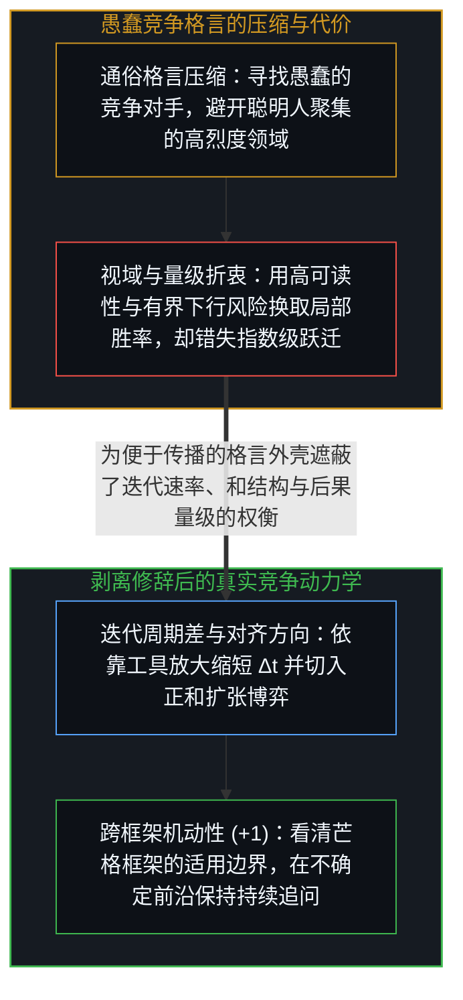
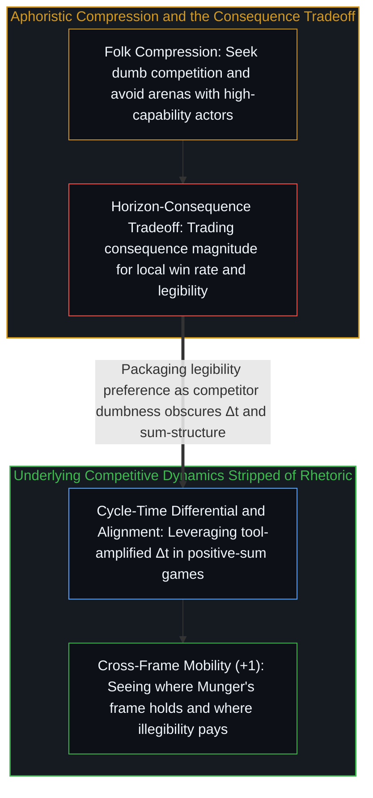

# 消解芒格的愚蠢竞争论 / Dissolving Munger's Dumb Competition

*愚蠢竞争论把迭代周期差、目标对齐与博弈和结构压扁为智商标签并牺牲了后果量级。 / The dumb-competition maxim compresses cycle-time differentials and sum-structure into an IQ label.*

查理·芒格曾向 Flexport 首席执行官瑞安·彼得森给出过一句广为流传的忠告：“成功的秘诀在于愚蠢的竞争对手。”当人们将这句话套用到人工智能时代时，便推演出一条看似老练的策略：避开顶尖聪明人扎堆的前沿技术研发，去寻找无需与地球上最聪明的大脑正面交锋的传统应用领域。这句格言包裹着一层真实的局部洞见，却在压缩传播的过程中混入了严重的范畴错位。

Charlie Munger once advised Flexport chief executive Ryan Petersen that "the key to success is dumb competition." Exported into the artificial intelligence era, the maxim is routinely read as counsel to avoid domains where frontier researchers congregate and instead seek out traditional sectors where one does not have to compete against the smartest people on Earth. The aphorism wraps a coherent local observation inside a category confusion.

## 一、 被误读为智商差异的三重机制 / 1. Three Mechanisms Misread as Competitor Intelligence

不同领域的竞争动力学确实存在显著差异：在前沿模型实验室里，参与者以相近的高频节奏攻关同类问题，个体的优化推力时刻遭遇对等的反向推力；而在传统行业应用中，既有巨头常沿着旧有轨道高度固化，难以迅速调头。然而决定这一利差的变量从来不是竞争对手的“聪明”或“愚蠢”。真正发生变化的，首先是迭代周期差（Δt）：当一方耦合了人工智能与如[你的代码库即是记忆](../your-codebase-is-memory/)所揭示的高密度外部代码库，而另一方仍停留在手工流程时，复利优势来自迭代周期的数量级落差，而非对手的心智缺陷。

Competition dynamics genuinely differ across domains: inside frontier research labs, participants iterate at closely matched frequencies on shared benchmarks so that optimization pressures cancel at the margin, whereas in legacy application domains incumbents are locked into established vectors with high reorientation friction. Yet the operative variable is never competitor "dumbness." What actually varies is first the iteration-speed differential (Δt): when one actor couples with artificial intelligence and an externalized cognitive repository as traced in [Your Codebase Is Memory](../your-codebase-is-memory/) while incumbents rely on manual coordination, compounding advantage arises from the gap in cycle time rather than a deficit in raw intelligence.

第二个变量是“优化目标的对齐方向”：前沿研究员高度对齐于算法与论文指标的优化，传统物流高管则高度对齐于既有供应链网络的维护，双方都在各自对准的靶心上全力运转，所谓的不对称只是用对手尚未对齐的新工具去重构旧目标（参见[作为认知主动延伸的工具](../extended-cognition-refined/)）。第三个变量则是“博弈的和结构”：芒格暗中把竞争预设为零和博弈——只要聪明人在场，入局就意味着分走更少的存量蛋糕；然而唯有所有人都挤在同一条狭窄跑道上争夺同一个固定名次时，竞争才是零和的，而在能力边际成本陡降的前沿，正和创造不断把整个可行空间的蛋糕成倍放大。

The second variable is alignment to the optimization target: frontier researchers are tightly aligned to benchmark and architecture optimization, whereas logistics incumbents are tightly aligned to existing operational targets; neither population lacks intelligence, they simply point their capacity at different axes (see [Tools as Active Extensions of Cognition](../extended-cognition-refined/)). The third variable is game sum-structure: Munger's framing implicitly treats competition as a finite zero-sum pie where the presence of capable players guarantees lower returns, overlooking how compounding capability turns the frontier into a positive-sum expansion of new territory.

## 二、 后果量级的折衷与跨框架的机动性 / 2. The Consequence-Magnitude Tradeoff and Mobility Across Frames

更关键的盲点在于，“寻找愚蠢的竞争对手”在结构上必然筛选出低利害、低后果量级的博弈。成果的后果量级与博弈的利害程度成正比，而高利害领域自然吸引高密度的能力投入。回顾伯克希尔的投资组合便能验证这一结构：真正带来改天换地回报的是苹果与可口可乐这类极少数超级离群值——且苹果是在早已打赢智能机正面战役、进入收获期后才被纳入组合——而非喜诗糖果或家具零售这类典型的“温和竞争”标的。用“避开聪明人”来优化局部胜率，代价则是与谷歌、早期苹果、微软、英伟达或 SpaceX 等重塑时代的指数级机会擦肩而过；在指数分布的宇宙里，错失一次量级跃迁，会让无数次温和港湾里的局部小胜沦为舍入误差（参见[成功学](../cheng-gong-xue/)）。

More importantly, selecting for "dumb competition" selects by definition for low-stakes games with bounded consequence magnitude. Consequentiality scales with stakes, and high stakes naturally attract capable participants. Berkshire Hathaway's own portfolio illustrates this structure: its transformational wealth was driven by outliers like Apple—entered only after Apple had already fought and won its frontier phase—rather than low-competition plays like See's Candies or furniture retail. Optimizing for the probability of local wins by avoiding high-capability arenas trades away consequence magnitude, turning steady harbor victories into rounding errors against missed exponential outliers like early Google, Nvidia, or SpaceX (see [Theories After Success](../cheng-gong-xue/)).

芒格真正筛选的其实是“高可读性且下行风险有界”的标的——喜诗糖果之所以入选，不是因为糖果业高管愚蠢，而是因为其护城河与现金流在芒格的估值模型里高度透明。将“超出我当前模型可读性边界”压缩成“入局者皆傻、对手最好愚蠢”的民间格言，用一种“终于知道去哪竞争了”的虚假抵达感关闭了真正需要保持敞开的追问：我在这里的真实迭代周期差（Δt）是多少？对手正对齐于什么目标？这场博弈是零和分配还是正和创造？赢下它的后果量级有多大？真正的清晰不在于背诵某条防身格言，而在于看清芒格的框架在何种尺度上成立、在何种视域下失效，并始终保有在不同框架之间自由切换的机动性。

What Munger actually selected for was legible value with bounded downside: See's Candies was chosen not because candy executives were foolish, but because its cash flows and failure modes were transparent to his pricing model. Compressing "outside my current legibility boundary" into the folk aphorism "find dumb competition" induces a false sense of arrival that closes the very questions inquiry must hold open: what is my real cycle-time advantage (Δt), what are incumbents aligned to optimize, what is the sum-structure of the game, and what is the consequence magnitude if I win? Clarity lies not in adopting a fixed rule, but in maintaining the mobility to see what Munger's frame captures at its chosen horizon and where it gives way to open-ended creation.
