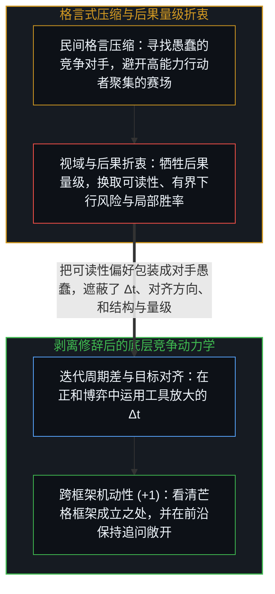
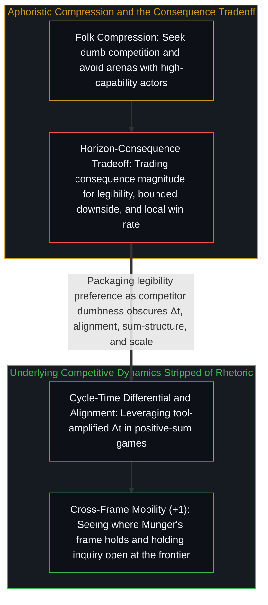

# 消解芒格的愚蠢竞争论 / Dissolving Munger's Dumb Competition

*愚蠢竞争论把迭代周期差、目标对齐与博弈和结构压扁为智商标签并牺牲了后果量级。 / The dumb-competition maxim flattens cycle-time differentials, target alignment, and sum-structure into an IQ label, trading away consequence magnitude.*

查理·芒格曾建议 Flexport 首席执行官瑞安·彼得森：“成功的关键在于愚蠢的竞争对手。”搬到人工智能时代，这句格言常被读作一条忠告：避开前沿研究员聚集的领域，转而寻找无需与地球上最聪明的人同场竞争的传统行业。这句格言把一项自洽的局部观察包裹在了范畴混淆之中。

Charlie Munger once advised Flexport chief executive Ryan Petersen that "the key to success is dumb competition." Exported into the artificial intelligence era, the maxim is routinely read as counsel to avoid domains where frontier researchers congregate and instead seek out traditional sectors where one does not have to compete against the smartest people on Earth. The aphorism wraps a coherent local observation inside a category confusion.

## 一、 被误读为智商差异的三重机制 / 1. Three Mechanisms Misread as Competitor Intelligence

不同领域的竞争动力学确实存在差异：在前沿研究实验室里，参与者围绕共同基准以高度相近的频率迭代，使优化推力在边际上相互抵消；而在传统应用领域，既有企业锁定在既定方向上，转向摩擦极高。然而，起作用的变量从来不是竞争对手的“愚蠢”。真正发生变化的首先是迭代速率差（Δt）：当行动者如[你的代码库即是记忆](../your-codebase-is-memory/)所追溯的那样，与人工智能及外化认知库相耦合，而既有企业仍依赖人工协调时，复利优势源于迭代周期的落差，而非原始智力的欠缺。

Competition dynamics genuinely differ across domains: inside frontier research labs, participants iterate at closely matched frequencies on shared benchmarks so that optimization pressures cancel at the margin, whereas in legacy application domains incumbents are locked into established vectors with high reorientation friction. Yet the operative variable is never competitor "dumbness." What actually varies is first the iteration-speed differential (Δt): when one actor couples with artificial intelligence and an externalized cognitive repository as traced in [Your Codebase Is Memory](../your-codebase-is-memory/) while incumbents rely on manual coordination, compounding advantage arises from the gap in cycle time rather than a deficit in raw intelligence.

第二个变量是优化目标的对齐方向：前沿研究员高度对齐于基准与架构优化，传统物流企业则高度对齐于既有供应网络的维护；两类人群都不缺智力——双方都在各自的坐标轴上全功率运转，不对称源于用既有企业尚未对齐的新工具去重构旧目标（参见[作为认知主动延伸的工具](../extended-cognition-refined/)）。第三个变量是博弈的和结构：芒格的框架暗中将竞争当作一块有限的零和蛋糕——只要高能力参与者在场，留给自己的份额就会缩水；然而唯有所有人都挤在同一条狭窄跑道上争夺固定名次时，竞争才是零和的，而在能力持续复利、边际成本不断下降的前沿，正和创造拓展的是可行疆域本身。

The second variable is alignment to the optimization target: frontier researchers are tightly aligned to benchmark and architecture optimization, whereas logistics incumbents are tightly aligned to maintaining existing supply networks; neither population lacks intelligence—both operate at full capacity along different axes, and the asymmetry arises from reframing legacy targets with new tools incumbents have not yet aligned to (see [Tools as Active Extensions of Cognition](../extended-cognition-refined/)). The third variable is game sum-structure: Munger's framing implicitly treats competition as a finite zero-sum pie where the presence of capable players leaves a smaller slice, yet competition is zero-sum only when everyone crowds onto the same narrow track for a fixed rank, whereas at a frontier of compounding capability and falling marginal cost, positive-sum creation expands the feasible territory itself.

## 二、 后果量级的折衷与跨框架的机动性 / 2. The Consequence-Magnitude Tradeoff and Mobility Across Frames

更重要的是，筛选“愚蠢的竞争对手”，按定义就是在筛选后果量级有界的低利害博弈。后果量级随博弈的利害程度而放大，而高利害自然会吸引高能力的参与者。伯克希尔·哈撒韦自身的投资组合便印证了这一结构：驱动其财富跃迁的是苹果这类离群值——且它是在苹果早已打赢前沿阶段的战役之后才入局的——而非喜诗糖果或家具零售这类低竞争标的。靠避开高能力赛场来优化局部胜率，牺牲的是后果量级：在回报跨步按乘法复利累积的场域里，错失单次数量级跃迁——例如早期苹果、谷歌、微软、英伟达或 SpaceX——便会让安稳港湾里的稳健胜利沦为舍入误差（参见[成功学](../cheng-gong-xue/)）。

More importantly, selecting for "dumb competition" selects by definition for low-stakes games with bounded consequence magnitude. Consequentiality scales with stakes, and high stakes naturally attract capable participants. Berkshire Hathaway's own portfolio illustrates this structure: its transformational wealth was driven by outliers like Apple—entered only after Apple had already fought and won its frontier phase—rather than low-competition plays like See's Candies or furniture retail. Optimizing for local win rate by avoiding high-capability arenas trades away consequence magnitude: where returns compound multiplicatively across steps, missing a single order-of-magnitude leap—such as early Apple, Google, Microsoft, Nvidia, or SpaceX—turns steady harbor victories into rounding errors (see [Theories After Success](../cheng-gong-xue/)).

芒格实际筛选的是下行风险有界的可读价值：喜诗糖果之所以入选，不是因为糖果业高管愚蠢，而是因为它的现金流与失效模式对他的定价模型而言清晰透明。将“超出我当前的可读性边界”压缩成“寻找愚蠢的竞争对手”这句民间格言，会诱发一种虚假的抵达感，从而关闭探究必须保持敞开的追问：我的实际迭代周期优势（Δt）是多少？既有参与者正对齐于优化什么？这场博弈的和结构是什么？若我胜出，后果量级有多大？清晰不在于采纳一条固定规则，而在于保持机动性，看清芒格的框架在其选定视域内捕捉到了什么，又在何处让位于开放式创造。

What Munger actually selected for was legible value with bounded downside: See's Candies was chosen not because candy executives were foolish, but because its cash flows and failure modes were transparent to his pricing model. Compressing "outside my current legibility boundary" into the folk aphorism "find dumb competition" induces a false sense of arrival that closes the very questions inquiry must hold open: what is my real cycle-time advantage (Δt), what are incumbents aligned to optimize, what is the sum-structure of the game, and what is the consequence magnitude if I win? Clarity lies not in adopting a fixed rule, but in maintaining the mobility to see what Munger's frame captures at its chosen horizon and where it gives way to open-ended creation.
