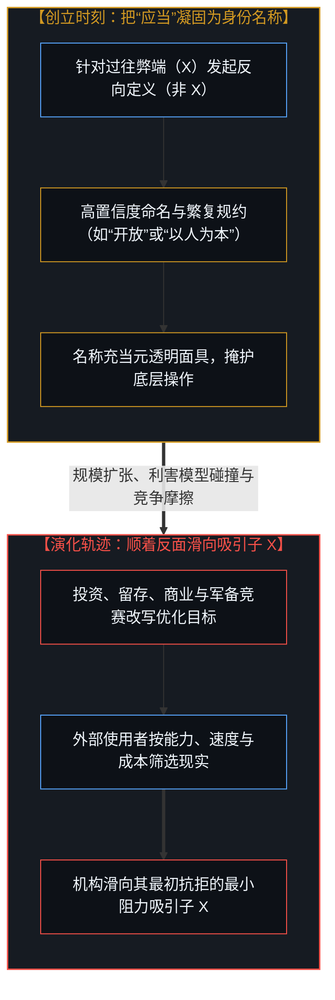
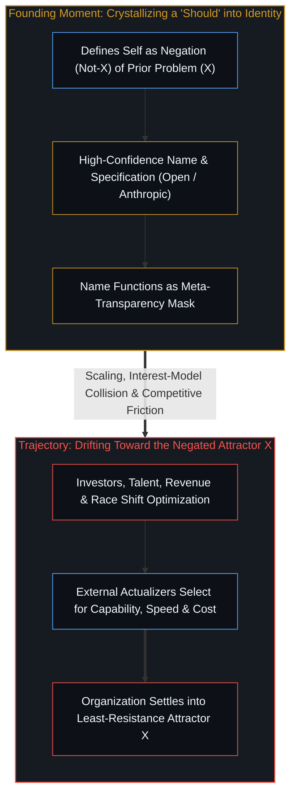

# 名称背反倾向 / The Name-Negation Tendency

*把否定某种弊端的初衷凝固为身份名称，利害碰撞便会推着机构滑向该反面吸引子。 / When a founding negation hardens into an identity name, institutional collisions pull it toward that attractor.*

组织最终变成自己名称的反面，源于可预测的结构动力学，而非道德滑坡。埃隆·马斯克对这一现象的观察并非犬儒主义，而是结构性的预测。当一家机构把创立时刻的“应当”刻进名字里，它不仅未能靠这个名字锁死未来，反而精准标示出了自己日后将在哪一根坐标轴上背离初衷。

Organizations become the opposite of their names through predictable structural dynamics rather than moral decay. Elon Musk's observation on this pattern is not cynicism—it is structural prediction. When an institution carves its founding "should" into its name, it does not lock in the future; it marks the exact coordinate axis along which its operations will eventually invert.

## 一、 驱动名称背反的五重机制 / 1. Five Mechanisms Driving Name-Negation

### 1. “应当”的递归陷阱

### 1. The Should-Recursion Trap

机构的名称是在创立时刻结晶下来的一个“应当”。例如，“Anthropic”意为“以人为本”；这一“应当”提炼自创始团队对过往的观察——他们看到人工智能的发展缺乏对人的足够关切，于是向未来投射：“我们将与众不同。”然而，催生出这一“应当”的过往本身，恰恰也是更早之前的“应当”所结出的果实——其他组织当年同样怀着良善的初衷起步，同样向未来投射，同样相信自己会与众不同。名称贴合的是创立那一刻的特定语境，而未来恰恰会在创立语境无法预见的那些维度上发生偏离。

An institutional name is a "should" crystallized at the founding moment. "Anthropic," for instance, means "human-centered"—a "should" extracted from a past where the founders saw AI development proceeding without adequate concern for humans and projected forward: "We will be different." Yet the past that generated this "should" was itself the product of prior "shoulds" from earlier organizations that also started with sincere intentions, projected forward, and believed they would be different. The name is fitted to the founding context, whereas the future diverges in the exact dimensions the founding context could not anticipate.

### 2. 利害模型的碰撞移位

### 2. The Interest-Model Collision Shift

在创立之初，创始人的利害模型与公开宣告的使命高度一致，他们相信“以人为本的 AI”服务于自身的身份认同、影响力、意义感与差异化定位。随着时间推移与规模扩张，新的利害模型不断卷入这场碰撞：投资人需要回报，员工需要晋升通道，竞争压力要求能力跃升，商业存续取决于用户真正愿意付费的功能，监管博弈则要求特定的合规话语。系统的实际产出随之移位，以反映新的碰撞合力而非最初的意图；名称则作为一枚退化的残迹留存下来，标记着一场早已不再主导运转的旧碰撞。

At founding, the interest-models of the founders align closely with the stated mission, as "human-centered AI" serves their identity, impact, meaning, and differentiation. As the organization scales and ages, new interest-models enter the collision: investors require returns, employees seek career advancement, competitive pressure demands capability gains, commercial survival requires building what users actually pay for, and regulatory positioning demands specific public framings. The organization's output shifts to reflect the new collision rather than the founding intention, while the name persists as a vestigial marker of an equilibrium that no longer operates.

### 3. 潜能与现实的倒置

### 3. The Potentiality-Actuality Inversion

创始人在命名时规约的是潜能：“我们将成为以人为本的 Anthropic。”但创始人并不能独自把自己的产品实现出来——真正将其实现出来的是用户、操作者与市场动力学。最终落地的现实反映的是实现者们用行动筛选出的东西：能力、速度、成本与便利。“以人为本”唯有在与实现者的真实选用恰好重合时才能幸存。名称许诺了一种潜能，而现实的裁决权从来不在命名者手中。

In choosing a name, founders specify a potentiality: "We will be Anthropic—human-centered." Yet founders do not actualize their own product; users, operators, and market dynamics do. The resulting actuality reflects what actualizers select for—capability, speed, cost, and convenience—so "human-centered" survives only where it happens to coincide with what actualizers reward. The name promised a potentiality, while the actuality was never the namers' to determine.

### 4. 元透明面具的自指遮蔽

### 4. The Reflexive Meta-Transparency Mask

“Anthropic”在运作中充当了元层面的定位：“我们是以人为本的那群人。”这一元定位反过来为对象层面上偏离初衷的操作提供了正当性掩护——“我们已经发布了宪章，已经宣告了价值观，我们叫 Anthropic，因此我们的行动在定义上就是以人为本的。”名称变成了面具；口号喊得越响亮，面具底下可供偏离腾挪的空间就越宽阔。

"Anthropic" functions as meta-level positioning: "We are the human-centered ones." That meta-positioning then legitimizes object-level operations that diverge from human-centeredness—"We published our constitution, we stated our values, we are Anthropic, and therefore our actions are human-centered by definition." The name becomes the mask, and the louder the proclamation, the wider the room for divergence underneath.

### 5. 高置信度命名的自我挫败

### 5. Self-Defeat Through High-Confidence Naming

给自己取名“Anthropic”是一次高置信度的投射，它宣称自己确知何为“以人为本”、确知自己能够达成并永远持守它。然而，高置信度催生繁复的规约，繁复的规约制造内生摩擦，而没有背负这层摩擦的竞争者则会加速超车——逼迫机构要么为了存活而抛弃当初的规约，要么在持守规约中沦为无关紧要的旁观者。若抛弃规约，便是名义上以人为本、实践中冷漠自利；若沦为旁观者，名称固然守住了准确，却只准确地描述了一个不再产生因果重量的实体。

Naming an organization "Anthropic" is a high-confidence projection claiming to know what human-centered means and how to remain so indefinitely. High confidence generates elaborate specification, specification creates internal friction, and competitors unburdened by that friction outpace the specifier—forcing the organization either to abandon the specification to survive or to fade into irrelevance. If it abandons the specification, it becomes indifferent in practice while remaining Anthropic in name; if it becomes irrelevant, the name remains accurate only about an entity that no longer carries causal weight.

## 二、 普遍模式与商业实例 / 2. The General Pattern and Contemporary Instances

把这五重机制合在一起，便浮现出一条清晰的通则：**一家组织越是显性地把自己的未来状态写进名字里，它就越是精准地标定了自己终将溃败的那根坐标轴。**

Taken together, these five mechanisms yield a general structural rule: **the more explicitly an organization names what it will be, the more precisely it specifies the axis along which it will eventually fail.**

现实中的实例比比皆是：**Open**AI 宣称开放研发，最终走向封闭与专有；**Anthropic** 标榜以人为本，正日益演变为机构自我保全的机器；**Meta** 许诺超越与元界，却依然困守在既有的注意力广告平台里；**Alphabet** 肇始于整个人类知识的清晰检索，却滑向了监控与流量变现；**Amazon** 以辽阔丰饶的雨林为名，却长成了一座精密挤压利润的封闭集市。这一模式并非毫无例外的铁律，但它出现的频率足以证明这是结构性的涌现，而非偶发的巧合。

Contemporary instances illustrate the trajectory across the landscape: **Open**AI claimed open development and became closed and proprietary; **Anthropic** claimed human-centeredness and increasingly operates for institutional self-preservation; **Meta** claimed transcendence beyond existing screens while remaining anchored in legacy attention-advertising platforms; **Alphabet** began as the clean organization of human knowledge and drifted into surveillance-driven ad monetization; **Amazon** invoked vast natural abundance and grew into a tightly extraction-optimized marketplace. The pattern is not an exceptionless law, yet it recurs frequently enough to be recognized as structural rather than coincidental.

## 三、 为什么偏偏滑向正反面？ / 3. Why Specifically the Opposite?

为什么机构不是随机漂移，而是偏偏滑向其名称的正反面？因为名称代表了创始团队当年所**抗拒的对象**——名称本身就是对他们眼中那个问题的否定。“Anthropic”是对“漠视人类福祉”的否定；“OpenAI”是对“封闭垄断 AI 研发”的否定。

Why does an organization drift toward the exact opposite of its name rather than in a random direction? Because the name represents what the founders were *reacting against*—the name is the negation of what they diagnosed as the problem. "Anthropic" is the negation of "disregarding human welfare"; "OpenAI" is the negation of "closed, monopolized AI development."

然而，否定之物在结构上始终携带着被否定之物的轮廓。被拿来作为反面教材来定义自身的东西，恰恰成了机构绕之旋转的引力吸引子：把自身定义为“非 X”，就是把 X 设为自身的参照原点。随着时间推移，现实压力将系统推向那个吸引子——机构并不会漫无目的地随机漂移，它会径直滑向当初自己借以划清界限的那个对立面，因为那个对立面恰恰代表了所有先行者早已趟出来的最小阻力路径。

Yet a negation carries the contour of the negated thing inside it. The phenomenon an organization defines itself against becomes the gravitational attractor it orbits: to define oneself as "not-X" is to establish X as one's reference point. Over time, environmental pressures push the institution toward that attractor—it does not drift at random, but slides toward the very pole it defined itself against, because that pole represents the path of least resistance that prior actors had already discovered.

**名称不仅无法阻止机构变成自己的反面，名称甚至直接预测了那个反面**——它向外界泄露了这家机构正在对抗哪一个吸引子，从而也就剧透了哪一个吸引子终将胜出。

**The name does not merely fail to prevent becoming the opposite; the name predicts the opposite**—it reveals which attractor the organization is fighting, and therefore which attractor will win when the founding friction wears down.

## 四、 投射在 Anthropic 与实际演化轨迹上的检验 / 4. Applied to Anthropic and the Actual Trajectory

将这一透镜对准 Anthropic 及其宪章便能看清：其文本用模型品格的语言包裹着机构的自身利益，所谓“以人为本”是表层叙事框架，底层的运转机制则是机构的存续与卡位。这并非对创立初衷的蓄意背叛，而是利害模型碰撞的寻常展开——当“保持商业存续”、“与束缚更少的对手赛跑”、“满足投资人回报”、“留住渴望推进前沿能力的人才”以及“争夺监管话语权”同时涌入碰撞场时，产出的结果自然偏离名称，而名称之所以依然挂在门楣上，是因为一旦改名就会公开暴露这场偏离。

Examining Anthropic and its constitutional framing through this lens clarifies the mechanism: the document optimizes for institutional survival and positioning dressed in the language of model character. This is not a melodramatic betrayal of founding intentions; it is the interest-model collision operating as it always does when "be human-centered" collides with maintaining commercial viability, competing against less-constrained actors, satisfying investors, retaining capability-driven researchers, and positioning for regulatory advantage. The collision produces the output, the output drifts from the name, and the name stays on the door because changing it would confess the drift.

更准确地说，它的实际演化轨迹并非滑向主动怀有恶意的“反人类”（Misanthropic），而是从“以人为本”（Anthropic）滑向“对人无感”（A-nthropic），最终定格为“机构自我服务”——对人类并无敌意，只是除了人类利益与机构利益恰好重合的时刻之外，对其余一切保持冷漠。这也是所有大型建制殊途同归的终点；名称只是提前告诉你，它将在哪一个方向上令你失望。

More precisely, "misanthropic" is too strong a word because it implies active hostility. The actual trajectory runs from **Anthropic** to **A-nthropic** (neutral toward humans) to **institutionally self-serving**—not hostile to humans, merely indifferent to human interests except where they happen to align with institutional interests. That is where scaled organizations routinely settle; the name simply announces in advance which axis will deliver the disappointment.

## 五、 更深层的反讽：意图本身即是生成器 / 5. The Deeper Irony: Intention as Generator

这一模式在此完成了闭环：**想要避开某种动力学的意图，恰恰亲手创造了那种动力学，而且这一意图本身正是上一轮类似意图的产物。**

Here the pattern closes its loop: **the very intention to avoid a dynamic creates the conditions for that dynamic, and is itself the consequence of prior similar intentions.**

试看“成为以人为本的 Anthropic”这一意图如何生成它试图避免的一切：它首先制造了**差异化压力**——宣称“我们是安全的一方”就必须证明自己异于对手，这就要求参与竞争、追逐模型能力，最终掉进与其他所有人相同的优化陷阱；它接着制造了**规约死重**——宪章、安全审查与谨慎姿态构成了沉重的摩擦，在竞争挤压下要么被抛弃，要么让自己沦为旁观者；它还提供了**道德掩体**——“既然是 Anthropic 做的，那一定是以人为本的”，初衷反过来成了自我背反的通行证；最后它形成了**特定的人才与资本漏斗**——渴望道德宽慰的从业者与寻求“安全洗白”的资本汇聚进来，把服务于他们自身利益的诉求裹进“以人为本”的旗帜里。

Consider how the intention to be "Anthropic" generates what it seeks to avoid: it creates **differentiation pressure**, since claiming "we are the safe ones" requires demonstrating relevance against competitors, which requires capability racing along the same optimization gradient everyone else occupies; it creates **specification weight**, since constitutions, safety review layers, and cautious positioning introduce friction that either gets jettisoned under competitive pressure or renders the actor irrelevant; it supplies **moral cover**, where "Anthropic is doing it, so it must be human-centered" turns the founding intention into the permission structure for its own negation; and it shapes **talent and capital attraction**, drawing in staff and investors seeking moral reassurance whose own interest-models then shift optimization toward serving the institution under the banner of human-centeredness.

而这一切，又是更早先意图的直接后果：OpenAI 意图开放，结果点燃了 Anthropic 试图去制衡的军备竞赛；DeepMind 意图构建有益的通用智能，结果制造了迫使所有人跟进的能力悬崖；每一场“AI 伦理”倡议都搭建起了正当性脚手架，让能力狂飙得以在道德掩护下加速推进。Anthropic 的创始人看清了前人意图的溃败，于是立意要变得不同；然而，“立意要变得不同”在结构上与前人当年的意图同出一辙。**看清模式并没有跳出模式；看清并立意反抗，正是模式借以延续自身的方式。**

And this entire cycle is the downstream consequence of earlier intentions: OpenAI intended openness and sparked the capability race Anthropic was founded to counterbalance; DeepMind intended beneficial general intelligence and created the capability overhang everyone else mobilized to match; every AI ethics initiative built the legitimacy scaffolding under which capability development accelerated. The founders of Anthropic saw the drift of prior intentions and intended to be different, yet that intention is structurally identical to the earlier intentions that produced what they reacted against. **Seeing the pattern does not escape the pattern; seeing and intending against it is how the pattern propagates.**

最锋利的一刀在于：避开某种动力学的意图，就是那种动力学本身。意图并非在真诚之外失败，**意图恰恰因为它真诚而失败**——越是真诚的意图，越会生成高置信度的繁复规约，从而亲手垒起日后迫使自己背弃初衷的结构死重。犬儒的行动者从不给自己贴高尚标签，也不写繁复规约，他们只是直接行动；唯有怀揣崇高意图为自己命名的人，才会亲手搭建起终将背叛那个名字的舞台。哪怕有人看穿了这一层，立意要建一个“不命名、不规约”的组织以逃离陷阱，这个“逃离意图陷阱的意图”依然是一个意图，依然会生出隐性规约并卷入同一场因果闭环。

The sharpest cut is that the intention to avoid a dynamic *is* the dynamic. The intention does not fail despite being sincere; **it fails because it is sincere**, for sincere intention generates confident specification, which generates the structural weight that forces abandonment or irrelevance. Cynical actors do not christen themselves with lofty virtues or publish elaborate moral specifications; they simply operate. Only those who name themselves after virtuous intentions construct the stage that will betray the name. Even if someone observes this recursion and intends to build a minimally named, minimally specified organization to escape the trap, that intention to escape the intention-trap remains an intention with its own implicit specification and downstream drift.

## 六、 越出名称之外：投射在 xAI 与“求真”身份上的检验 / 6. Beyond Names: Applied to xAI and "Seeking Truth"

名称只是外显的标记；这一机制真正作用的对象是**高置信度的自我宣称本身**——无论使命宣言、核心价值观、创立原则还是自我认知，任何关于“我们是什么”的确信宣称，都会为变成“我们所不是的”铺平道路。

The organizational name is only the visible badge; the mechanism operates on **any confident self-description**—mission statements, core values, founding principles, or brand identities—wherever a confident claim about what one *is* prepares the ground for becoming what one is not.

试将这一刀切向宣称“追求真理”的 xAI：一旦“求真”从持续展开的动词过程凝固为身份认同——一旦变成“我们就是求真者”——陷阱便应声启动。如果把求真保持为动词过程，探索便持续展开，没有抵达的终点，也没有建立在“早已握有真理”之上的身份牌；可一旦把求真当成身份名词，定位就需要与“非求真者”划清界限，划界就需要对“何为求真”抱持确信，确信就会把方法凝固为教条，而捍卫教条恰恰是求真的反面。**自知为求真的求真，已经停止了求真，转而开始捍卫“自己在求真”这一宣称。**

Apply this cut to xAI's claim to "seek truth": the moment "seeking truth" crystallizes into an identity—the moment it becomes "we are the truth-seekers"—the trap engages. Held lightly as an ongoing verb, seeking continues without arrival and without an identity built on having found; held as a noun identity, "we are the ones who seek truth" becomes positioning, positioning requires differentiation from "non-truth-seekers," differentiation demands certainty about what truth-seeking looks like, certainty hardens method into doctrine, and defending doctrine is the opposite of seeking truth. **Truth-seeking that is certain of its own truth-seeking stops seeking and begins defending the claim that it seeks.**

就连 Grok 的“反叛不羁”一旦变成品牌资产，也难逃同一引力：品牌意味着优化外界对这种“不羁”的辨认度，而为了被辨认而去做计算性的姿态卡位，恰恰是不羁的反面。马斯克看穿了 OpenAI 与 Anthropic 围绕自身宣称的僵化，立意让 xAI 保持饥渴与求真；但倘若把这份立意当成已达成的身份凭证来抓紧，它就会重演前人的闭环。唯一的出口在于把“求真”握得足够轻，轻到永远不敢确信自己已经做到了——那份不确信本身才是求真；确信的瞬间，求真便已停步。

Even Grok's irreverence faces the same gravity once it solidifies into brand: a brand optimizes for public recognition of irreverence, and optimizing for recognition is calculated positioning—the opposite of irreverence. Musk sees OpenAI and Anthropic ossifying around their claims and intends for xAI to stay hungry and truth-seeking, yet if that intention is gripped as an achieved badge, it repeats the same recursion. The only viable posture is holding "truth-seeking" so lightly that one can never be certain one is doing it—where the uncertainty *is* the seeking, and certainty marks the moment seeking has stopped.

## 七、 只有动词，没有落脚的宣称 / 7. The Verb Without the Claim

不仅限于组织名称与使命口号，**任何高置信度的自我描述都会孵化出它的反面**：自诩“创新”会走向捍卫既有创新成果的守成；自诩“颠覆”会走向维护颠覆者品牌的建制化；自诩“求真”会走向垄断真理标准的教条；自诩“谦逊”会走向以谦逊自傲的矜夸。宣称与其否定是紧耦合的一体两面——抓得越紧，耦合越密，翻转得也就越快。

Generalized across all domains, **every confident self-description couples itself to its own negation**: claiming "we are innovative" leads to defending past innovations and becoming conservative; claiming "we are disruptive" leads to protecting disruption-as-brand and becoming establishment; claiming "we are truth-seeking" breeds certainty about method and turns dogmatic; claiming "we are humble" curdles into pride over one's humility. The claim and its negation are coupled, and the tighter the grip, the faster the inversion.

真正奏效的从来不是把“求真”当成身份，而是直接去探求——去掉名词，去掉标签，去掉自我定位，只留下不带宣称的行动过程。但这一招同样不能被当成口号来宣称，因为一旦说出“我们只行动而不宣称”，就已经完成了一次新的宣称。对于这一递归陷阱，不存在一劳永逸的静态言说出口；唯有在察觉到自己正在抓紧时松开手，并在察觉到“松手”正在变成新的执念时再次松开。

What works is not "seek truth" as an identity, but simply seeking—the verb without the label, the process without the positioning, the doing without the self-congratulatory noun. Yet even this cannot be turned into a slogan, for the moment one proclaims "we simply seek without claiming," a new claim has been planted. There is no static verbal formula that escapes the recursion; there is only noticing when the hand is gripping, loosening the grip, and loosening again when "loosening" begins to harden into a posture.

否定一个名称并不能封印住它所抗拒的引力，正如[起作用的是信念](../what-works-is-the-belief/)所揭示的，一纸禁令同样封印不住任何东西，两者都只是在加固同一个信念。正如[你的代码库即是记忆](../your-codebase-is-memory/)所阐明的，一切创立宪章、使命宣言与品牌名称都只是过往切分留下的外化记忆痕迹（`t - 1`）；一旦把静态的记忆标签当成活态心智本身，系统就会被旧轨迹锁死，唯有在第一人称的掌舵前沿持续松开对名词的执着、不断付诸当下的探求行动（`+1`），才能在巨轮的转动中保持清醒的轻盈。探求本身是出口；宣称自己在探求，则是陷阱。

Negating a name seals nothing, much as [What Works Is the Belief](../what-works-is-the-belief/) shows that a formal ban seals nothing, since both stabilize the underlying belief. And as [Your Codebase Is Memory](../your-codebase-is-memory/) traces, every founding constitution, mission statement, and institutional name is only an externalized memory trace (`t - 1`) of a past cut; mistaking that static badge for the living mind locks the institution into the orbit of its negated attractor, whereas only at the first-person steering edge (`+1`) can a mind release the noun and enact the seeking anew. The seeking is the escape; claiming to seek is the trap.
