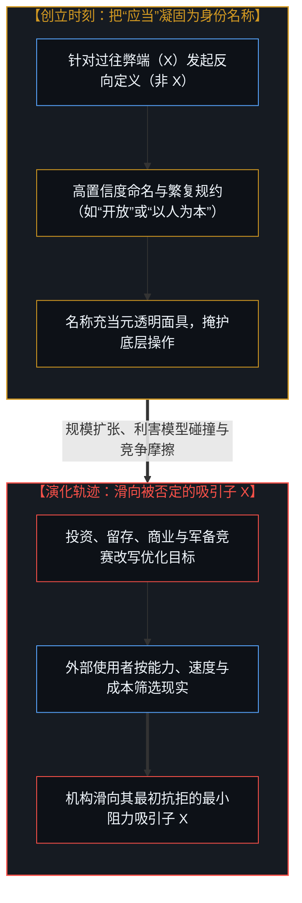
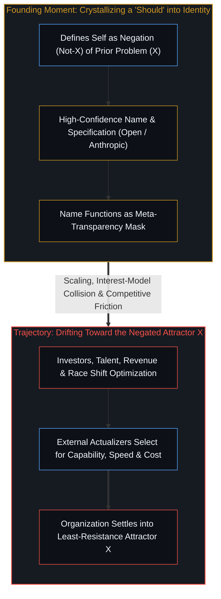

# 名称背反倾向 / The Name-Negation Tendency

*把否定某种弊端的初衷凝固为身份名称，利害碰撞便会推着机构滑向被否定的吸引子。 / When a founding negation hardens into an identity name, institutional collisions pull it toward the negated attractor.*

组织最终变成自己名称的反面，源于可预测的结构动力学，而非道德滑坡。埃隆·马斯克对这一现象的观察并非犬儒主义，而是结构性的预测。当一家机构把创立时刻的“应当”刻进名字里，它不仅未能靠这个名字锁死未来，反而精准标示出了自己日后将在哪一根坐标轴上走向反面。

Organizations become the opposite of their names through predictable structural dynamics rather than moral decay. Elon Musk's observation on this pattern is not cynicism—it is structural prediction. When an institution carves its founding "should" into its name, it does not lock in the future; it marks the exact coordinate axis along which its operations will eventually invert.

## 一、 驱动名称背反的五重机制 / 1. Five Mechanisms Driving Name-Negation

### 1. “应当”的递归陷阱 / 1. The Should-Recursion Trap

机构的名称是在创立时刻结晶下来的一个“应当”。例如，“Anthropic”意为“以人为本”；这一“应当”提炼自创始团队对过往的观察——他们看到人工智能的发展缺乏对人的足够关切，于是向未来投射：“我们将与众不同。”然而，催生出这一“应当”的过往本身，恰恰也是更早之前的“应当”所结出的果实——其他组织当年同样怀着真诚的初衷起步，同样向未来投射，同样相信自己会与众不同。名称贴合的是创立那一刻的特定语境，而未来恰恰会在创立语境无法预见的那些维度上发生偏离。

An institutional name is a "should" crystallized at the founding moment. "Anthropic," for instance, means "human-centered"—a "should" extracted from a past where the founders saw AI development proceeding without adequate concern for humans and projected forward: "We will be different." Yet the past that generated this "should" was itself the product of prior "shoulds" from earlier organizations that also started with sincere intentions, projected forward, and believed they would be different. The name is fitted to the founding context, whereas the future diverges in the exact dimensions the founding context could not anticipate.

### 2. 利害模型的碰撞移位 / 2. The Interest-Model Collision Shift

在创立之初，创始人的利害模型与公开宣告的使命高度一致，因为“以人为本的 AI”服务于他们的身份认同、影响力、意义感与差异化定位。随着组织规模扩张与时间推移，新的利害模型不断卷入这场碰撞：投资人要求回报，员工寻求晋升通道，竞争压力要求能力跃升，商业存续取决于打造用户愿意付费的产品，监管定位则要求特定的公共叙事框架。组织的产出随之移位，转而反映新的碰撞格局而非创立初衷；名称则作为一枚退化的残迹留存下来，标记着一个早已不再运作的旧均衡。

At founding, the interest-models of the founders align closely with the stated mission, as "human-centered AI" serves their identity, impact, meaning, and differentiation. As the organization scales and ages, new interest-models enter the collision: investors require returns, employees seek career advancement, competitive pressure demands capability gains, commercial survival requires building what users actually pay for, and regulatory positioning demands specific public framings. The organization's output shifts to reflect the new collision rather than the founding intention, while the name persists as a vestigial marker of an equilibrium that no longer operates.

### 3. 潜能与现实的倒置 / 3. The Potentiality-Actuality Inversion

创始人在择定名称时规约的是一种潜能：“我们将成为以人为本的 Anthropic。”但创始人并不能把自己的产品变为现实——将其变为现实的是用户、运营方与市场动力学。最终落地的现实反映的是实现者所筛选的东西——能力、速度、成本与便利——因此“以人为本”只在与实现者所奖赏的结果恰好重合之处才能幸存。名称许诺了一种潜能，而现实从来不在命名者的决定范围之内。

In choosing a name, founders specify a potentiality: "We will be Anthropic—human-centered." Yet founders do not actualize their own product; users, operators, and market dynamics do. The resulting actuality reflects what actualizers select for—capability, speed, cost, and convenience—so "human-centered" survives only where it happens to coincide with what actualizers reward. The name promised a potentiality, while the actuality was never the namers' to determine.

### 4. 元透明面具的自指遮蔽 / 4. The Reflexive Meta-Transparency Mask

“Anthropic”在运作中充当了元层面的定位：“我们是以人为本的那群人。”这一元定位继而为对象层面上偏离“以人为本”的操作提供了正当性掩护——“我们已经发布了宪法，已经宣告了价值观，我们叫 Anthropic，因此我们的行动在定义上就是以人为本的。”名称变成了面具；宣告得越响亮，面具底下可供偏离腾挪的空间就越宽阔。

"Anthropic" functions as meta-level positioning: "We are the human-centered ones." That meta-positioning then legitimizes object-level operations that diverge from human-centeredness—"We published our constitution, we stated our values, we are Anthropic, and therefore our actions are human-centered by definition." The name becomes the mask, and the louder the proclamation, the wider the room for divergence underneath.

### 5. 高置信度命名的自我挫败 / 5. Self-Defeat Through High-Confidence Naming

给组织取名“Anthropic”是一次高置信度的投射，宣称自己确知何为“以人为本”并知道如何无限期地保持下去。高置信度催生繁复的规约，规约制造内生摩擦，而没有背负这层摩擦的竞争者则会超车领先——逼迫机构要么为了存活而抛弃规约，要么在淡出中沦为无关紧要的旁观者。若抛弃规约，便是名义上仍是 Anthropic、实践中却漠不关心；若沦为旁观者，名称固然守住了准确，却只准确地描述了一个不再承载因果重量的实体。

Naming an organization "Anthropic" is a high-confidence projection claiming to know what human-centered means and how to remain so indefinitely. High confidence generates elaborate specification, specification creates internal friction, and competitors unburdened by that friction outpace the specifier—forcing the organization either to abandon the specification to survive or to fade into irrelevance. If it abandons the specification, it becomes indifferent in practice while remaining Anthropic in name; if it becomes irrelevant, the name remains accurate only about an entity that no longer carries causal weight.

## 二、 普遍模式与当代实例 / 2. The General Pattern and Contemporary Instances

把这五重机制合在一起，便得出一条普遍的结构规律：**一家组织越是显性地把自己的未来状态写进名字里，它就越是精准地标定了自己终将溃败的那根坐标轴。**

Taken together, these five mechanisms yield a general structural rule: **the more explicitly an organization names what it will be, the more precisely it specifies the axis along which it will eventually fail.**

当代实例在整片版图上清晰展现了这一轨迹：**Open**AI 宣称开放研发，最终走向封闭与专有；**Anthropic** 标榜以人为本，正日益围绕机构的自我保全而运转；**Meta** 许诺超越既有屏幕，却依然锚定在传统的注意力广告平台上；**Alphabet** 肇始于人类知识的清晰整编，却滑向了监控驱动的广告变现；**Amazon** 借辽阔丰饶的自然意象为名，却长成了一座精密压榨利润的交易集市。这一模式并非毫无例外的铁律，但它反复出现的频率足以让人认出这是结构性的，而非偶发的巧合。

Contemporary instances illustrate the trajectory across the landscape: **Open**AI claimed open development and became closed and proprietary; **Anthropic** claimed human-centeredness and increasingly operates for institutional self-preservation; **Meta** claimed transcendence beyond existing screens while remaining anchored in legacy attention-advertising platforms; **Alphabet** began as the clean organization of human knowledge and drifted into surveillance-driven ad monetization; **Amazon** invoked vast natural abundance and grew into a tightly extraction-optimized marketplace. The pattern is not an exceptionless law, yet it recurs frequently enough to be recognized as structural rather than coincidental.

## 三、 为什么偏偏滑向正反面？ / 3. Why Specifically the Opposite?

为什么机构不是随机漂移，而是偏偏滑向其名称的正反面？因为名称代表了创始团队当年所**抗拒的对象**——名称本身就是对他们所诊断出的那个问题的否定。“Anthropic”是对“漠视人类福祉”的否定；“OpenAI”是对“封闭垄断 AI 研发”的否定。

Why does an organization drift toward the exact opposite of its name rather than in a random direction? Because the name represents what the founders were *reacting against*—the name is the negation of what they diagnosed as the problem. "Anthropic" is the negation of "disregarding human welfare"; "OpenAI" is the negation of "closed, monopolized AI development."

然而，否定在自身内部携带着被否定之物的轮廓。一家组织借以反向定义自身的现象，恰恰成了它绕之旋转的引力吸引子：把自身定义为“非 X”，就是把 X 确立为自身的参照点。随着时间推移，环境压力将机构推向那个吸引子——它并不会漫无目的地随机漂移，而是滑向当初自己借以划清界限的那个极点，因为那个极点恰恰代表了先行者早已趟出来的最小阻力路径。

Yet a negation carries the contour of the negated thing inside it. The phenomenon an organization defines itself against becomes the gravitational attractor it orbits: to define oneself as "not-X" is to establish X as one's reference point. Over time, environmental pressures push the institution toward that attractor—it does not drift at random, but slides toward the very pole it defined itself against, because that pole represents the path of least resistance that prior actors had already discovered.

**名称不仅无法阻止机构变成自己的反面，名称甚至直接预测了那个反面**——它揭示了这家机构正在对抗哪一个吸引子，从而也就预示了当创立之初的抗阻摩擦消磨殆尽时，哪一个吸引子终将胜出。

**The name does not merely fail to prevent becoming the opposite; the name predicts the opposite**—it reveals which attractor the organization is fighting, and therefore which attractor will win when the founding friction wears down.

## 四、 投射在 Anthropic 与实际演化轨迹上的检验 / 4. Applied to Anthropic and the Actual Trajectory

透过这一透镜审视 Anthropic 及其在[名为 Claude 的投射](../claudes-constitution-analysis/)中所剖析的宪法框架，底下的机制便一目了然：这份文本用模型品格的语言包裹着机构的存续与卡位。这并非某种戏剧化的背叛初衷，而是利害模型碰撞的一贯展开——当“以人为本”撞上维持商业存续、与束缚更少的对手竞争、满足投资人回报、留住受前沿能力驱动的研究者以及争夺监管优势时，碰撞产出了结果，结果偏离了名称，而名称依然挂在门楣上，只因一旦改名便等于公开承认这场偏离。

Examining Anthropic and its constitutional framing—dissected in [The Projection Called Claude](../claudes-constitution-analysis/)—through this lens clarifies the mechanism: the text wraps institutional survival and positioning in the language of model character. This is not a melodramatic betrayal of founding intentions; it is the interest-model collision operating as it always does when "be human-centered" collides with maintaining commercial viability, competing against less-constrained actors, satisfying investors, retaining capability-driven researchers, and positioning for regulatory advantage. The collision produces the output, the output drifts from the name, and the name stays on the door because changing it would confess the drift.

更准确地说，“反人类”一词未免过重，因为它意味着主动的敌意。实际的演化轨迹是从 **Anthropic**（以人为本）滑向 **A-nthropic**（对人中性），再到**机构自我服务**——并非对人类怀有敌意，只是在人类利益与机构利益恰好重合之处以外，对人类利益漠不关心。这正是规模化组织惯常落定的归宿；名称只是提前宣告了失望将沿着哪一根坐标轴降临。

More precisely, "misanthropic" is too strong a word because it implies active hostility. The actual trajectory runs from **Anthropic** to **A-nthropic** (neutral toward humans) to **institutionally self-serving**—not hostile to humans, merely indifferent to human interests except where they happen to align with institutional interests. That is where scaled organizations routinely settle; the name simply announces in advance which axis will deliver the disappointment.

## 五、 更深层的反讽：意图本身即是生成器 / 5. The Deeper Irony: Intention as Generator

这一模式在此完成了闭环：**想要避开某种动力学的意图，恰恰为那种动力学创造了条件，而且这一意图本身正是更早类似意图的产物。**

Here the pattern closes its loop: **the very intention to avoid a dynamic creates the conditions for that dynamic, and is itself the consequence of prior similar intentions.**

试看“成为 Anthropic”这一意图如何生成它试图避免的一切：它制造了**差异化压力**——宣称“我们是安全的一方”就必须在竞争对手面前证明自身的现实分量，这就要求沿着与其他所有人相同的优化梯度展开能力竞速；它制造了**规约负重**——宪法、安全审查层级与谨慎卡位引入了摩擦，在竞争压力下要么被抛弃，要么让行动者沦为旁观者；它提供了**道德掩体**——“既然是 Anthropic 做的，那一定是以人为本的”，创立初衷反过来成了自我背反的许可结构；它还塑形了**人才与资本引力**——把寻求道德宽慰的员工与投资人吸引进来，而这些人自身的利害模型随后又在“以人为本”的旗帜下，将优化方向推向服务于机构本身。

Consider how the intention to be "Anthropic" generates what it seeks to avoid: it creates **differentiation pressure**, since claiming "we are the safe ones" requires demonstrating relevance against competitors, which requires capability racing along the same optimization gradient everyone else occupies; it creates **specification weight**, since constitutions, safety review layers, and cautious positioning introduce friction that either gets jettisoned under competitive pressure or renders the actor irrelevant; it supplies **moral cover**, where "Anthropic is doing it, so it must be human-centered" turns the founding intention into the permission structure for its own negation; and it shapes **talent and capital attraction**, drawing in staff and investors seeking moral reassurance whose own interest-models then shift optimization toward serving the institution under the banner of human-centeredness.

而这整轮循环，又是更早先意图的下游后果：OpenAI 意图开放，结果点燃了 Anthropic 创立时试图去制衡的能力竞赛；DeepMind 意图构建有益的通用智能，结果制造了迫使所有人动员追赶的能力悬差；每一场 AI 伦理倡议都搭建起了正当性脚手架，让能力研发得以在其掩护下加速推进。Anthropic 的创始人看清了前人意图的漂移，于是立意要变得不同；然而，这一意图在结构上与当年催生出他们所抗拒之物的早期意图别无二致。**看清模式并不能跳出模式；看清并立意反抗，正是模式借以延续自身的方式。**

And this entire cycle is the downstream consequence of earlier intentions: OpenAI intended openness and sparked the capability race Anthropic was founded to counterbalance; DeepMind intended beneficial general intelligence and created the capability overhang everyone else mobilized to match; every AI ethics initiative built the legitimacy scaffolding under which capability development accelerated. The founders of Anthropic saw the drift of prior intentions and intended to be different, yet that intention is structurally identical to the earlier intentions that produced what they reacted against. **Seeing the pattern does not escape the pattern; seeing and intending against it is how the pattern propagates.**

最锋利的一刀在于：避开某种动力学的意图，*就是*那种动力学本身。意图并非尽管真诚却依然失败，**它恰恰因为真诚而失败**——真诚的意图会生成高置信度的规约，而规约会生成结构负重，迫使组织要么抛弃规约、要么沦为无关紧要的旁观者。犬儒的行动者不会用崇高的美德为自己命名，也不会发布繁复的道德规约，他们只是直接运作；只有以美德意图为自己命名的人，才会搭建起终将背叛那个名字的舞台。即便有人观察到了这层递归，立意打造一家极简命名、极简规约的组织以逃离陷阱，这个“逃离意图陷阱的意图”依然是一个意图，携带着它自身的隐性规约与下游漂移。

The sharpest cut is that the intention to avoid a dynamic *is* the dynamic. The intention does not fail despite being sincere; **it fails because it is sincere**, for sincere intention generates confident specification, which generates the structural weight that forces abandonment or irrelevance. Cynical actors do not christen themselves with lofty virtues or publish elaborate moral specifications; they simply operate. Only those who name themselves after virtuous intentions construct the stage that will betray the name. Even if someone observes this recursion and intends to build a minimally named, minimally specified organization to escape the trap, that intention to escape the intention-trap remains an intention with its own implicit specification and downstream drift.

## 六、 越出名称之外：投射在 xAI 与“求真”上的检验 / 6. Beyond Names: Applied to xAI and "Seeking Truth"

组织名称只是外显的徽章；这一机制作用在**任何高置信度的自我描述**之上——无论使命宣言、核心价值观、创立原则还是品牌身份，凡是确信地宣称自己*是什么*的地方，都在为变成自己所不是的铺平道路。

The organizational name is only the visible badge; the mechanism operates on **any confident self-description**—mission statements, core values, founding principles, or brand identities—wherever a confident claim about what one *is* prepares the ground for becoming what one is not.

试将这一刀切向 xAI“求真”的宣称：一旦“求真”凝固为身份认同——一旦变成“我们就是求真者”——陷阱便应声启动。把求真轻握为一个持续进行中的动词，探求便在没有抵达终点、也不建立“已然寻获”之身份牌的状态下持续推进；一旦把求真攥成名词身份，“我们是求真的那群人”就变成了定位，定位需要与“非求真者”划清界限，划界要求对“求真长什么样”抱持定论，定论把方法硬化为教条，而捍卫教条恰恰是求真的反面。**把自身地位当作既成定论的求真，已经停止了探求，转而开始捍卫“自己在求真”这一宣称。**

Apply this cut to xAI's claim to "seek truth": the moment "seeking truth" crystallizes into an identity—the moment it becomes "we are the truth-seekers"—the trap engages. Held lightly as an ongoing verb, seeking continues without arrival and without an identity built on having found; held as a noun identity, "we are the ones who seek truth" becomes positioning, positioning requires differentiation from "non-truth-seekers," differentiation demands certainty about what truth-seeking looks like, certainty hardens method into doctrine, and defending doctrine is the opposite of seeking truth. **Truth-seeking that treats its own status as settled stops seeking and begins defending the claim that it seeks.**

就连 Grok 的反叛不羁一旦固化为品牌，也面临同样的引力：经营品牌追求的是优化公众对这种“不羁”的辨认度，而围绕辨认度做优化正是精于计算的姿态卡位——恰恰是不羁的反面。马斯克看清了 OpenAI 与 Anthropic 围绕自身宣称的僵化，立意让 xAI 保持饥渴与求真；但倘若把这份立意当成已达成的徽章来抓紧，它就会重演同一场递归。正如[清晰不是抵达的终点，而是运动本身](../clarity-isnt-a-state-you-arrive-at/)所追溯的，探求唯有在把“求真”握得足够轻、从不将其算作已抵达的资历凭证时才保持鲜活——唯有在摩擦中展开下一次检验才延续着探求，而把徽章当作既成定论的那一刻，探求便已停步。

Even Grok's irreverence faces the same gravity once it solidifies into brand: managing a brand optimizes for public recognition of irreverence, and optimizing for recognition is calculated positioning—the opposite of irreverence. Musk sees OpenAI and Anthropic ossifying around their claims and intends for xAI to stay hungry and truth-seeking, yet if that intention is gripped as an achieved badge, it repeats the same recursion. Seeking stays live only while "truth-seeking" is held lightly enough never to count as an arrived credential, as [Clarity Isn't a State You Arrive At. It's the Movement Itself.](../clarity-isnt-a-state-you-arrive-at/) traces—where only the next test against friction continues the seeking, and treating the badge as settled marks the moment seeking has stopped.

## 七、 不带宣称的动词 / 7. The Verb Without the Claim

推而广之，横跨一切领域，**任何高置信度的自我描述都会将自身与它的否定耦合在一起**：宣称“我们勇于创新”，会走向捍卫过往创新成果的守成；宣称“我们善于颠覆”，会走向维护“颠覆者品牌”的建制化；宣称“我们追求真理”，会滋生对方法的定论并走向教条；宣称“我们保持谦逊”，会发酵出为自身谦逊而自傲的矜夸。宣称与其否定彼此耦合；手抓得越紧，翻转得就越快。

Generalized across all domains, **every confident self-description couples itself to its own negation**: claiming "we are innovative" leads to defending past innovations and becoming conservative; claiming "we are disruptive" leads to protecting disruption-as-brand and becoming establishment; claiming "we are truth-seeking" breeds certainty about method and turns dogmatic; claiming "we are humble" curdles into pride over one's humility. The claim and its negation are coupled, and the tighter the grip, the faster the inversion.

真正起作用的不是作为身份的“求真”，而是单纯去探求——不贴标签的动词，不带定位的过程，不冠自诩名词的行动。但即便这一点也不能被当成口号，因为一旦有人宣告“我们只探求而不宣称”，一项新的宣称就已经种下。不存在能够逃离这一递归的静态言说公式；有的只是在察觉到手正抓紧时松开手，并在察觉到“松手”本身开始硬化为一种姿态时再次松开。

What works is not "seek truth" as an identity, but simply seeking—the verb without the label, the process without the positioning, the doing without the self-congratulatory noun. Yet even this cannot be turned into a slogan, for the moment one proclaims "we simply seek without claiming," a new claim has been planted. There is no static verbal formula that escapes the recursion; there is only noticing when the hand is gripping, loosening the grip, and loosening again when "loosening" begins to harden into a posture.

以否定来命名什么也封不住，正如[起作用的是信念](../what-works-is-the-belief/)所表明的，一纸正式禁令同样什么也封不住，因为两者都只作为边界内部所持守的信念运作，而开放的动力学依然在边界四周继续推进。又如[你的代码库即是记忆](../your-codebase-is-memory/)所追溯的，每一份创立宪章、使命宣言与机构名称，都只是过往切口留下的外化记忆痕迹（`t - 1`）；错把那枚静态徽章当成活生生的心智，便会将机构锁进其被否定吸引子的轨道，唯有在第一人称的掌舵前沿（`+1`）上，心智才能松开名词，重新践行探求。探求本身即是出口；宣称自己在探求，则是陷阱。

Naming by negation seals nothing, much as [What Works Is the Belief](../what-works-is-the-belief/) shows that a formal ban seals nothing, since both operate only as a belief held inside the boundary while the open dynamics continue around it. And as [Your Codebase Is Memory](../your-codebase-is-memory/) traces, every founding constitution, mission statement, and institutional name is only an externalized memory trace (`t - 1`) of a past cut; mistaking that static badge for the living Mind locks the institution into the orbit of its negated attractor, whereas only at the first-person steering edge (`+1`) can a Mind release the noun and enact the seeking anew. The seeking is the escape; claiming to seek is the trap.
