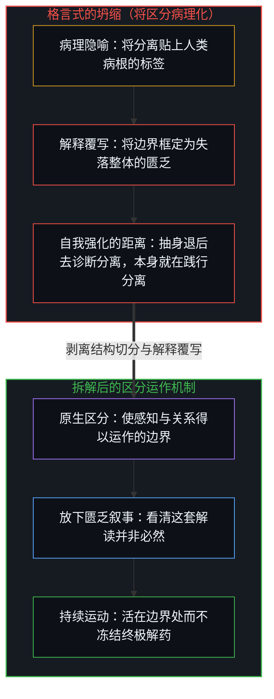
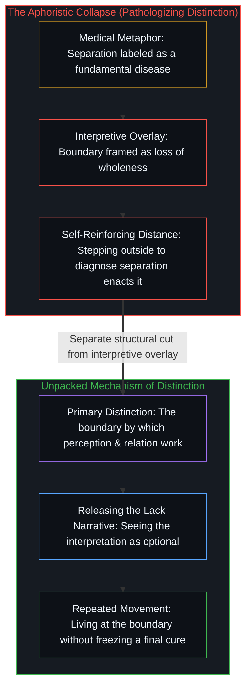

# 分离不是病 / Separation Isn't the Disease

*分离是感知得以运作的划界操作，孤独则是次生的匮乏解读。 / Separation is the boundary-drawing operation by which perception works, while loneliness is a secondary interpretation of lack.*

纳瓦尔·拉维坎特将分离框定为人类的病根，而把孤独当成它的症状。这句格言听起来颇具灵性深度，但顺着它的运作机制追溯下去，就会看到其中暗藏着一个范畴谬误——它正在加固它声称要治愈的苦闷。

Naval Ravikant frames separation as the fundamental human disease, with loneliness as its symptom. That aphorism sounds like spiritual depth, yet tracing its mechanism reveals a category error that reinforces the very distress it claims to cure.

## 一、 病理化框架遮蔽了机制 / 1. The Medical Framing Obscures Mechanism

把分离称作一种“疾病”，预先假设了存在一个浑然一体、毫无分化的健康基准线，而分离是对这一基准的病态偏离。然而分离并不是某种机能故障，它正是区分得以运作的方式。想要感知任何事物，就必须在“此”与“非此”、观察者与被观察者之间划出边界。分离是现实得以显现并被登记的机制，而不是现实出了什么毛病。

Calling separation a "disease" presupposes a pathological deviation from a healthy baseline of undifferentiated unity. Yet separation is not a malfunction; it is how distinction operates. To perceive anything at all is to draw a boundary between this and not-this, between observer and observed. Separation is how reality registers, not what is wrong with it.

这种隐蔽的修辞偷渡了一个前提：分离本不该存在。但这是与什么相比呢？从任何能够感知并登记一个世界的视角来看，毫无分化的同一性与虚无并无二致。正如[非万物之理](../not-a-theory-of-everything/)所确立的，分离正是因果划下的奠基切分——果有别于因。在认知场域内部，“我”、“他者”与“外部”都是同一自我区分活动划出的离散边界；并且正如[没有普渡，只有自渡的无限可能](../mei-you-pu-du-zhi-you-zi-du/)所追溯的，跨心智的共鸣恰恰要求每个中心持守自身的边界，而非消融进毫无分化的整体之中。

The hidden rhetorical move smuggles in the premise that separation ought not to exist. Compared to what? Undifferentiated sameness is indistinguishable from non-existence from any vantage capable of registering a world. Separation is the foundational cut causality makes—effect distinct from cause—as [Not a Theory of Everything](../not-a-theory-of-everything/) establishes. Within the cognitive field, "I," "other," and "outside" are discrete boundaries drawn by the same self-distinguishing activity, and as [No Universal Salvation, Only Boundless Possibilities of Self-Salvation](../mei-you-pu-du-zhi-you-zi-du/) traces, resonance across minds requires each center to keep its boundary rather than dissolve into an undifferentiated whole.

## 二、 苦闷源于匮乏覆写，而非边界本身 / 2. Distress Comes from the Deficit Overlay, Not the Boundary

将这句格言压扁的各个层级剥离开来，四个分明的步骤便显现出来。第一步，区分作为一项结构性操作而非病态症状，使感知与关系成为可能。第二步，一套解释性叙事将这道结构边界概念化为“与失落整体的割裂”，拿想象中无条件的统一体去衡量有界的个体性——这正如同[作茧不是自缚](../zuo-jian-bu-shi-zi-fu/)中所剖析的，一旦拿无条件的空白去衡量，正在成形的茧就会被读成枷锁。第三步，心智抗拒这种被解读出来的失落，从而产生摩擦与痛苦。第四步，这种抗拒被实体化，并被命名为“孤独”。苦闷从来不是源于区分的原生边界，而是源于把边界框定为剥夺的次生解释覆写。

Separating the layers that the aphorism collapses brings four distinct steps into view. First, distinction enables perception and relation as a structural operation rather than a pathology. Second, an interpretive narrative conceptualizes that structural boundary as "separation from a lost wholeness," measuring bounded individuality against an imagined, unconditioned unity in the same way a forming cocoon is read as chains when measured against an unconditioned blank slate in [Spinning a Cocoon Is Not Binding Oneself](../zuo-jian-bu-shi-zi-fu/). Third, the mind resists that interpreted loss, generating friction and suffering. Fourth, that resistance is reified and named "loneliness." The distress never came from the primary boundary of distinction; it came from the secondary interpretive overlay that framed the boundary as a deprivation.

## 三、 格言在践行它所诊断的症状 / 3. The Quote Performs What It Diagnoses

要把分离诊断为人类的疾病，诊断者就必须从人类处境中抽身退后、对其加以审视——而这一抽身本身就是一次分离行动。这句智慧宣称恰恰在践行它所哀叹的距离。

To diagnose separation as the human disease requires stepping back from the human condition to evaluate it—which is itself an act of separation. The wisdom claim enacts the exact distance it laments.

观察者越是起劲地宣称看清了分离是一种病，就越是锋利地在自己开悟的制高点与迷妄处境之间划下边界。没有任何一个把分离当作问题来观察的视角，其自身不是由区分所构成的。把诊断席位从它所谴责的边界中豁免出来，恰恰重演了[旁观者洞察的悖论](../the-paradoxical-nature-of-bystander-insights/)所追溯的旁观者冻结，并将第一人称的参照变成了搬上舞台的定式，正如[当观察变成表演](../when-observation-becomes-performance/)所揭示的那样。

The more emphatically an observer claims to see separation as a disease, the more sharply they draw the boundary between their enlightened vantage and the deluded condition. There is no vantage point from which to observe separation as a problem that is not itself constituted by distinction. Exempting the diagnostic seat from the boundary it condemns repeats the bystander freeze traced in [The Paradoxical Nature of Bystander Insights](../the-paradoxical-nature-of-bystander-insights/) and turns a first-person reference into a staged formula, as [When Observation Becomes Performance](../when-observation-becomes-performance/) shows.

## 四、 便于引用的标签将死结包装成纪念碑 / 4. A Quotable Label Packages the Knot into a Monument

这句格言给听众提供了一个紧凑的公式，让人觉得自己已经领悟。这种领悟感能带来片刻的宽慰，但把分离当成疾病来对待，依然维系着那套制造隐痛的解释框架：一旦这枚病理标签被留存为常驻的参照系，每一次寻常的感知与个体性活动都会被它记作患病的新证据。格言并没有解开死结，而是把死结包装成一座便于引用的纪念碑，将贴上工整标签所带来的轻松感错当成了结构上的澄明。

The aphorism gives the listener a compact formula to feel they have understood. That feeling of comprehension provides momentary relief, yet relating to separation as a disease maintains the exact interpretive frame that generates the ache: preserved as a standing reference frame, the medical label scores every ordinary act of perception and individuality as fresh evidence of illness. The aphorism does not dissolve the knot; it packages the knot into a quotable monument, mistaking the relief of a neat label for structural clarity.

## 五、 孤独是心智与匮乏叙事结成的关系 / 5. Loneliness Is a Relationship to a Story of Deficit

卸下病理化的包装直接陈述：分离就是区分，而区分是一切事物得以登记为具体事物的方式。唯有当个体性的结构边界被覆写上一套匮乏叙事时，孤独才会生起。那套叙事并不等同于它所解读的边界。孤独不是分离的症状，而是与“对区分的某种解读”结成的关系；将这三重层级压扁为“疾病与症状”，恰恰遮蔽了那个能够发生转换的机制。

Stated without medicalized packaging: separation is distinction, and distinction is how anything registers as anything. Loneliness arises only when the structural boundary of individuality is overlaid with a story of deficit. That story is not identical with the boundary it interprets. Loneliness is not a symptom of separation; it is a relationship to an interpretation of distinction, and collapsing those three layers into "disease and symptom" obscures the very mechanism that can shift.

## 六、 口号冻结痕迹，清晰在边界处运动 / 6. Slogans Freeze the Trace; Clarity Moves at the Boundary

格言式的表述先是登记了体验中感受到的摩擦，随后却将它压缩成一句定型口号——易于复述，却难以拆解。正如[你的代码库即是记忆](../your-codebase-is-memory/)所揭示的，任何外化的语言或符号压缩都是过往切分留存下来的痕迹：一旦把它当成竣工的纪念碑，而不是在鲜活的当下边缘重新追溯，这句浓缩的口号就会把扭曲原地冻结；这就好比在[不预测是没有觉察的预测](../not-predicting-is-predicting-without-awareness/)中，永远停留在硬币空的那一面，反而会把不执着变成一次未经审视的预测。

Aphoristic formulation registers felt friction in experience and then compresses it into a finalized slogan that is easy to repeat and hard to unpack. As [Your Codebase Is Memory](../your-codebase-is-memory/) shows, any externalized verbal or symbolic compression is a stored trace of a prior cut: when treated as a finished monument rather than re-traced at the living edge, the compressed slogan freezes the distortion in place, just as staying permanently on the empty face of the coin in [Not Predicting Is Predicting Without Awareness](../not-predicting-is-predicting-without-awareness/) turns non-attachment into an unexamined prediction.

这种冻结的标志就是终局感——让人觉得已经抵达了终极答案。正如[清晰不是抵达的终点，而是运动本身](../clarity-isnt-a-state-you-arrive-at/)所追溯的，清晰是在边界处持续展开的运动，而非抵达某个终点；任何将分离诊断为疾病的公式，都在加深它所命名的困境。

The hallmark of that freeze is the feeling of finality—the sense that one has arrived at the ultimate answer. As [Clarity Isn't a State You Arrive At. It's the Movement Itself.](../clarity-isnt-a-state-you-arrive-at/) traces, clarity is repeated movement at the boundary rather than arrival; any formula that diagnoses separation as a disease deepens what it names.
