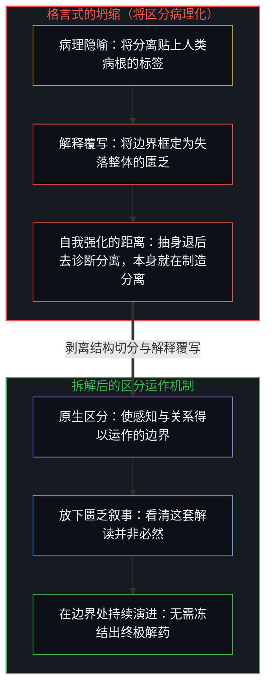
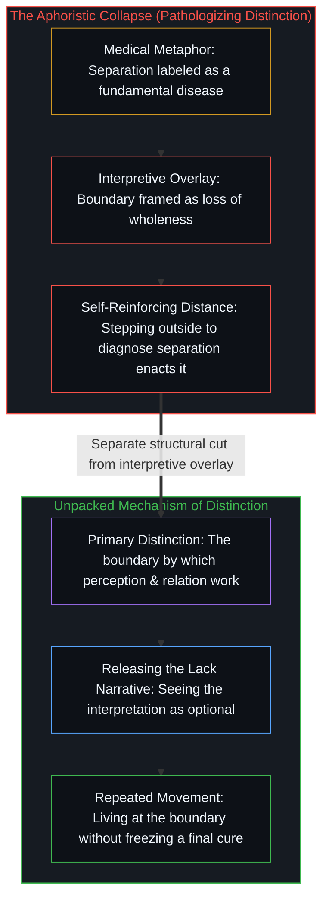

# 分离不是病 / Separation Isn't the Disease

*分离是感知的划界，孤独则是次生的匮乏解读。 / Separation is the boundary-drawing operation by which perception works, while loneliness is a secondary interpretation of lack.*

纳瓦尔·拉维坎特（Naval Ravikant）将分离视作人类的病根，而把孤独当成它的症状。这句格言听起来颇具灵性深度，但只要顺着它的运作机制一路追溯，就会发现其中暗藏着一个范畴谬误——它非但没有消解苦闷，反而在加固它声称要治愈的痛楚。

Naval Ravikant frames separation as the fundamental human disease, with loneliness as its symptom. That aphorism sounds like spiritual depth, yet tracing its mechanism reveals a category error that reinforces the very distress it claims to cure.

## 一、 病理化框架遮蔽了机制 / 1. The Medical Framing Obscures Mechanism

把分离称作一种“疾病”，预先假设了存在一个浑然一体、毫无分化的健康基准线，而分离是对这一基准的病态偏离。然而分离并不是某种机能故障，它正是区分得以运作的方式。想要感知任何事物，就必须在“此”与“非此”、观察者与被观察者之间划出边界。分离是现实得以显现的机制，而不是现实出了什么毛病。

Calling separation a "disease" presupposes a pathological deviation from a healthy baseline of undifferentiated unity. Yet separation is not a malfunction; it is how distinction operates. To perceive anything at all is to draw a boundary between this and not-this, between observer and observed. Separation is how reality registers, not what is wrong with it.

这种隐蔽的修辞偷渡了一个前提：分离本不该存在。但这是与什么相比呢？从任何能够感知世界的视角来看，毫无分化的同一性与虚无并无二致。正如[非万物之理](../not-a-theory-of-everything/)所确立的，分离正是因果律划下的第一道切分——果有别于因。

The hidden rhetorical move smuggles in the premise that separation ought not to exist. Compared to what? Undifferentiated sameness is indistinguishable from non-existence from any vantage capable of registering a world. Separation is the foundational cut causality makes—effect distinct from cause—as [Not a Theory of Everything](../not-a-theory-of-everything/) establishes.

## 二、 追溯实际发生的过程 / 2. Trace What Actually Happens

将这句格言压扁的各个层级剥离开来，四个清晰的步骤便显现出来。第一步，区分作为一项结构性操作而非病态症状，使感知本身成为可能。第二步，一套解释性叙事将这道结构边界概念化为“与失落整体的割裂”。第三步，心智抗拒这种被解读出来的失落，从而产生摩擦与痛苦。第四步，这种抗拒被实体化，并被命名为“孤独”。苦闷从来不是源于区分的原生边界，而是源于把边界框定为剥夺的次生解释覆写。

Separating the layers that the aphorism collapses brings four distinct steps into view. First, distinction enables perception itself as a structural operation rather than a pathology. Second, an interpretive narrative conceptualizes that structural boundary as "separation from a lost wholeness." Third, the mind resists that interpreted loss, generating friction and suffering. Fourth, that resistance is reified and named "loneliness." The distress never came from the primary boundary of distinction; it came from the secondary interpretive overlay that framed the boundary as a deprivation.

## 三、 格言在践行它所诊断的症状 / 3. The Quote Performs What It Diagnoses

要把分离诊断为人类的疾病，诊断者就必须从人类处境中抽身退后、对其加以审视——而这一抽身本身就是一次分离行动。这句智慧箴言恰恰在践行它所哀叹的距离。

To diagnose separation as the human disease requires stepping back from the human condition to evaluate it—which is itself an act of separation. The wisdom claim enacts the exact distance it laments.

观察者越是起劲地宣称看清了分离是一种病，就越是锋利地在自己开悟的制高点与众生迷妄的处境之间划下边界。要将分离当作问题来观察，观察所立足的基点本身就离不开区分。

The more emphatically an observer claims to see separation as a disease, the more sharply they draw the boundary between their enlightened vantage and the deluded condition. There is no vantage point from which to observe separation as a problem that is not itself constituted by distinction.

## 四、 格言究竟做了什么 / 4. What the Quote Actually Does

这句格言给听众提供了一个紧凑的公式，让人觉得自己已经顿悟。这种领悟感能带来片刻的宽慰，但把分离当成疾病来对待，依然维系着那套制造隐痛的解释框架。格言并没有解开死结，而是把死结包装成一座便于引用的纪念碑，把贴上工整标签所带来的轻松感错当成了结构上的澄明。

The aphorism gives the listener a compact formula to feel they have understood. That feeling of comprehension provides momentary relief, yet relating to separation as a disease maintains the exact interpretive frame that generates the ache. The aphorism does not dissolve the knot; it packages the knot into a quotable monument, mistaking the relief of a neat label for structural clarity.

## 五、 清晰的图景 / 5. What Clarity Looks Like

卸下病理化的包装后，事实十分明朗：分离就是区分，而区分是一切事物得以显现为具体事物的方式。唯有当个体性的结构边界被覆写上一套亏欠叙事时，孤独才会滋生。那套叙事并不等同于它所解读的边界。孤独不是分离的症状，而是心智与“对区分的某种解读”结成的关系；将这三重层级压扁为“疾病与症状”，恰恰遮蔽了真正能够发生转变的机制。

Stated without medicalized packaging: separation is distinction, and distinction is how anything registers as anything. Loneliness arises only when the structural boundary of individuality is overlaid with a story of deficit. That story is not identical with the boundary it interprets. Loneliness is not a symptom of separation; it is a relationship to an interpretation of distinction, and collapsing those three layers into "disease and symptom" obscures the very mechanism that can shift.

## 六、 更广泛的模式 / 6. The Broader Pattern

格言式的智慧常常捕捉到某种真实的体验，随后却将它压缩成一句定型口号——易于复述，却难以拆解。正如[你的代码库即是记忆](../your-codebase-is-memory/)所揭示的，任何外化的语言或符号压缩都是过往切分留存下来的痕迹：一旦把它当成竣工的纪念碑，而不是在鲜活的当下边缘重新追溯，这句浓缩的口号就会把扭曲原地冻结。

Aphoristic wisdom often tracks a genuine phenomenon and then compresses it into a finalized slogan that is easy to repeat and hard to unpack. As [Your Codebase Is Memory](../your-codebase-is-memory/) shows, any externalized verbal or symbolic compression is a stored trace of a prior cut: when treated as a finished monument rather than re-traced at the living edge, the compressed slogan freezes the distortion in place.

这种冻结的标志就是终局感——让人觉得已经抵达了终极答案。然而澄明是在边界处不断重演的动态推演，而非抵达终点；任何将分离诊断为疾病的公式，都在加深它所命名的困境。

The hallmark of that freeze is the feeling of finality—the sense that one has arrived at the ultimate answer. Clarity is repeated movement at the boundary rather than arrival; any formula that diagnoses separation as a disease deepens what it names.
