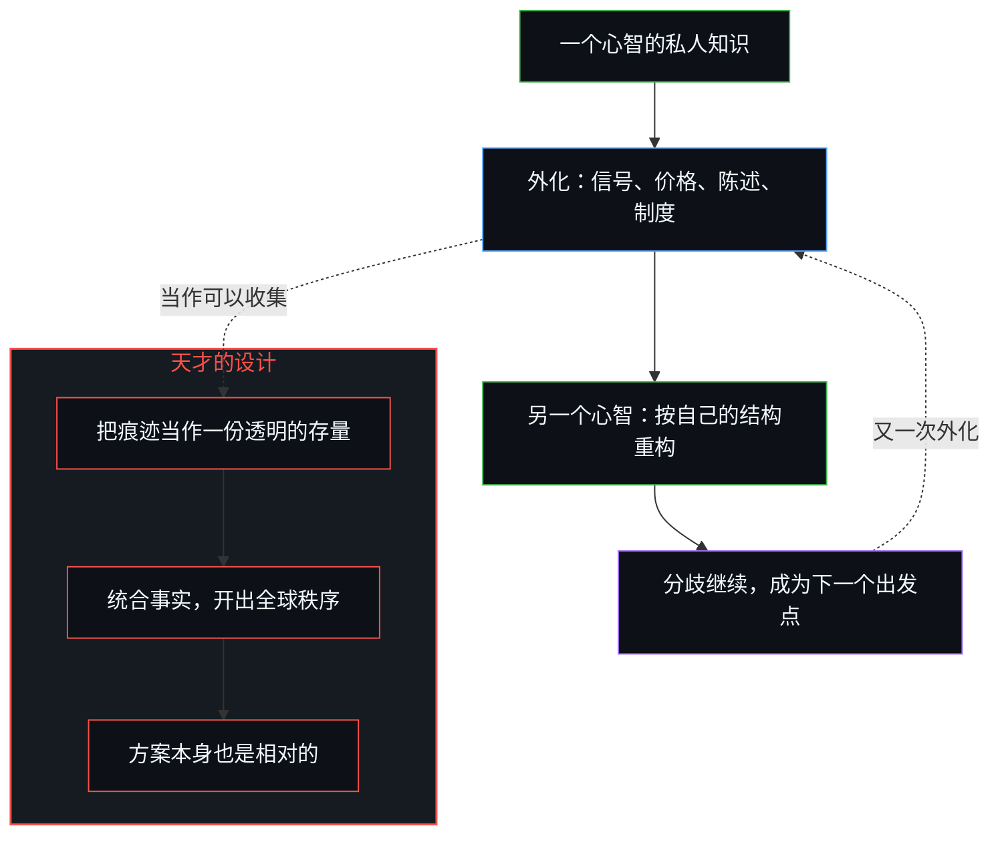
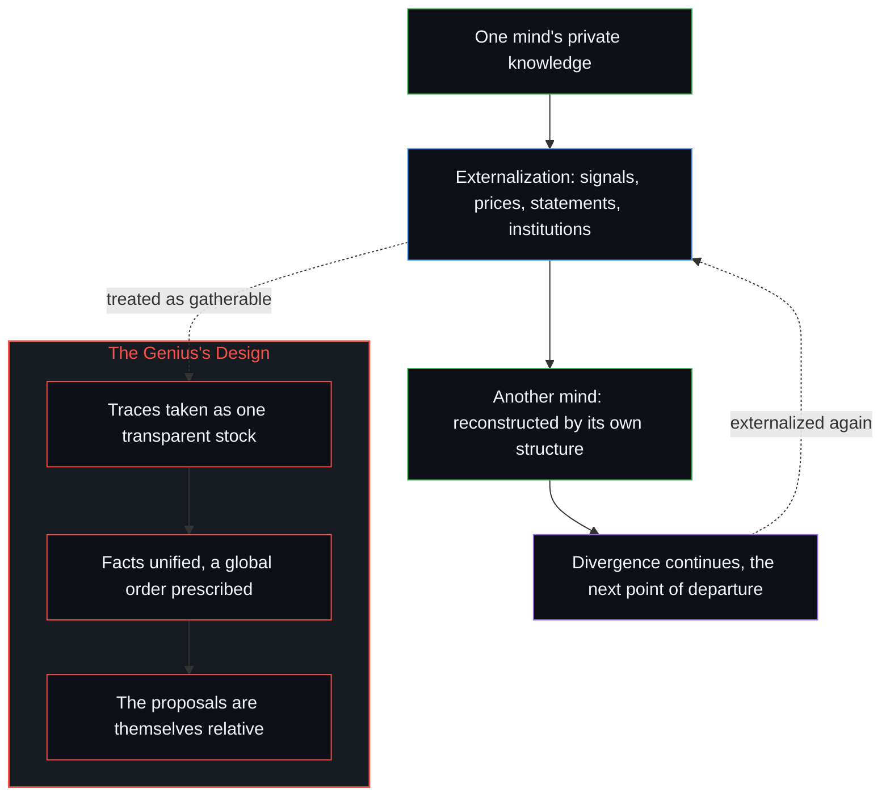

# 没有天才能够解决知识问题 / No Genius Can Solve the Knowledge Problem

*天才与深思的身份，本身已预设私人知识能汇成一个可执行的整体 / To be the thoughtful genius already presumes private knowledge can be gathered into one actionable whole.*

伯特兰·罗素在八十岁生日的访谈里，把世界政府、大致的经济平等与近乎稳定的人口，当作一个足够聪明的心智在统合事实之后就能开出的措施。这个假定撞上了知识的界限：在公开处出现的从来不是知识本身，只是它的外化，在每一个心智中被独特地重构。截获这些印迹，产生不了全球设计所需要的汇聚。界限之所以无可逾越，正因为知识总是相对的，而天才的身份，重演了它自以为已经消解的那道屏障。

Bertrand Russell's eightieth-birthday interview treated world government, approximate economic equality and a nearly stationary population as measures a sufficiently brilliant mind could prescribe once the facts were unified. That assumption collides with the limit of knowledge: what appears in public is never the knowledge itself but only its externalization, reconstructed uniquely at every mind. Interception of those marks cannot produce the convergence a global design requires. The limit remains absolute because knowledge is always relative, and the identity of genius reenacts the barrier it takes itself to have dissolved.

## 一、 一个足够深思的心智被认为能统合事实 / 1. A Sufficiently Thoughtful Mind Was Taken to Be Able to Unify the Facts

罗素八十寿辰时的访谈提供了这个例子。被问到世界需要什么才能到达更幸福的状态，他以一贯的自信作答：世界政府，世界各地之间大致的经济平等，以及近乎稳定的人口。他相信，这三项措施能让人类成功适应生活的工业阶段。方案本身倒不如使它们看似可行的那个假定要紧：一个足够深思、足够聪明的心智，能够纵览相关的事实，把它们统合起来，开出一套连贯的全球秩序。有人说，天才与极度深思并不因此就理解世界，就这句话所及而言，它是对的。但“是天才、是极度深思的人”这一身份，本身就已经把那个假定带了进来。

Bertrand Russell's interview on the occasion of his eightieth birthday supplies the case. Asked what the world needed to reach a happier state, he answered with characteristic confidence: world government, approximate economic equality between different parts of the globe, and a nearly stationary population. These three measures, he believed, would allow humanity to adapt successfully to the industrial phase of life. The proposals themselves matter less than the assumption that made them seem feasible: that a sufficiently thoughtful and brilliant mind could survey the relevant facts, unify them, and prescribe a coherent global order. It is accurate, as far as it goes, to say that genius and extreme thoughtfulness do not by themselves entail understanding the world. The identity of being a genius and extremely thoughtful already is that assumption.

## 二、 知识是私人的，公开的印迹只是外化 / 2. Knowledge Is Private; the Public Mark Is Only Externalization

这个假定立刻撞上了知识最基本的界限。界限从无法进入另一个心智开始。知识是私人的、处在某个位置上的，无法越过把一个意识与另一个意识分开的那道边界。在公开处出现的从来不是知识本身，只是它的外化——信号、价格、陈述、制度形式——它们以集体的方式表达，却从不被集体拥有。[意识从不作为数据出现在数据之中](../consciousness-never-appears-as-data-among-data/)讲的是同一道边界：公开的效果，从来不是登记它们的那个活动。罗素的设计预设，这些外部的痕迹可以被收集、被掌握，仿佛它们是一份单一而透明的信息存量。它们仍是他永远无法进入的那些心智遥远而不完整的表达。[知识问题与委托的幻觉](../the-knowledge-problem-and-the-illusion-of-delegation/)讲的是同一种完备的主张装扮成制度的样子：哈耶克指出了知识的分散，而抬高一项设计，仍把这些碎片当作一份可以收集起来的存量。

That assumption collides at once with the fundamental limit of knowledge. The limit starts from the inability to access another mind. Knowledge is private, situated, and inaccessible across the boundary that separates one consciousness from another. What appears in public is never the knowledge itself but only its externalization—signals, prices, statements, institutional forms—expressed collectively yet never possessed collectively. [Consciousness Never Appears as Data Among Data](../consciousness-never-appears-as-data-among-data/) traces the same bound: public effects are never the activity that registers them. Russell's design presupposed that these external traces could be gathered and mastered as if they were a single, transparent stock of information. They remain the remote and incomplete expressions of minds he could never enter. [The Knowledge Problem and the Illusion of Delegation](../the-knowledge-problem-and-the-illusion-of-delegation/) is the same claim to completeness dressed as an institution: Hayek names the dispersal, and elevating a design still treats the fragments as a stock that could be gathered.

## 三、 共享知识是截获，从不是共同的存量 / 3. Shared Knowledge Is Interception, Never a Common Stock

所以，一般所说的“共享知识”从来不是共享的。它只是私人知识被看得见的截获：一个公开的印迹，每个心智按自己的内部结构接收并重构它。每一次重构都是独特的，所以差异不会相互抵消，也不会汇向某个共同的内容；它们继续作为分歧存在。一个心智的截获，成了另一个心智的出发点；看似共同的存量，不断被重新分配为相互分歧的私人视角。[共同的人性从不共享](../shared-humanity-is-never-shared/)讲的是同一种回返，落在道德的“我们”上：这个标签是事后的，在内部，什么也没有被共享过。罗素的全球处方需要相反的运动，即知识汇聚成一个单一的、可执行的整体。知识的截获无法产生这种汇聚。

What is commonly called "shared knowledge" is therefore never shared. It is only the visible interception of private knowledge: a public mark that each mind receives and reconstructs according to its own internal structure. Because every reconstruction is unique, the differences do not cancel or converge toward a common content. They continue as divergence. One mind's interception becomes another's point of departure; the apparent common stock is continuously redistributed as divergent private perspectives. [Shared Humanity Is Never Shared](../shared-humanity-is-never-shared/) traces the same return under the moral "we": the label is retrospective, and internally nothing was shared. Russell's global prescriptions required the opposite movement, a convergence of knowledge into a single, actionable whole. The interception of knowledge cannot produce that convergence.

## 四、 界限无可逾越，因为知识总是相对的 / 4. The Limit Is Absolute Because Knowledge Is Always Relative

界限之所以无可逾越，正因为知识总是相对的。每一次知道，都发生在某个特定的心智之内；没有一个外部的、非相对的立足点，可以从那里纵览或克服心智之间的分隔。[自我形象仿佛从无处发声](../self-image-speaks-as-if-from-nowhere/)讲的是被当作超然外部来占据的那种立场：形成区分所需要的那一眼，被冻结为一次不再回来的纵览。罗素自己的才华非但没有消解这道屏障，反而例证了它。他的方案本身是相对的，出自一个修养极高的视角，因此重演了它们想要超越的那道界限。任何声称更多的深思或制度上的雄心能解决知识问题的主张，都依赖同一个范畴错误：把相对的知识当作凭智力就能变成绝对的。

The limit remains absolute precisely because knowledge is always relative. Every act of knowing occurs from within a particular mind; there is no external, non-relative standpoint from which the separation between minds could be surveyed or overcome. [Self-Image Speaks as if from Nowhere](../self-image-speaks-as-if-from-nowhere/) traces that stand occupied as a detached exterior: the look needed to form the distinction is frozen as a survey that never comes back. Russell's own brilliance, far from dissolving the barrier, illustrated it. His proposals were themselves relative, issued from one highly cultivated perspective, and therefore reenacted the very limit they sought to transcend. Any claim that greater thoughtfulness or institutional ambition can solve the knowledge problem rests on the same category mistake: treating relative knowledge as if it could become absolute by force of intellect.

## 五、 这个结构独立于任何一种智力 / 5. The Structure Is Independent of Any Particular Intelligence

所以，这个问题的结构独立于任何一种智力。它是过去、现在或将来任何天才都无法解决的问题。[索维尔的表象洞察与根因之偏](../sowell-observed-the-surface-problem/)讲的是同一个先验装扮成政策的样子：知识分子的深思，本身已经是相信问题能跨越心智被解决。忘记了自己位置的大思想家，就是[隐秘的上帝之眼](../the-invisible-gods-eye/)所描述的那只上帝之眼。

The structure of the problem is therefore independent of any particular intelligence. It is a problem no genius in the past, present or future can solve. [Sowell Observed the Surface Problem](../sowell-observed-the-surface-problem/) is the same prior dressed as policy: the intellectual's thoughtfulness is already the belief that problems can be solved across Minds. The master thinker who forgets his own position is the God's eye that [The Invisible God's Eye](../the-invisible-gods-eye/) describes.
