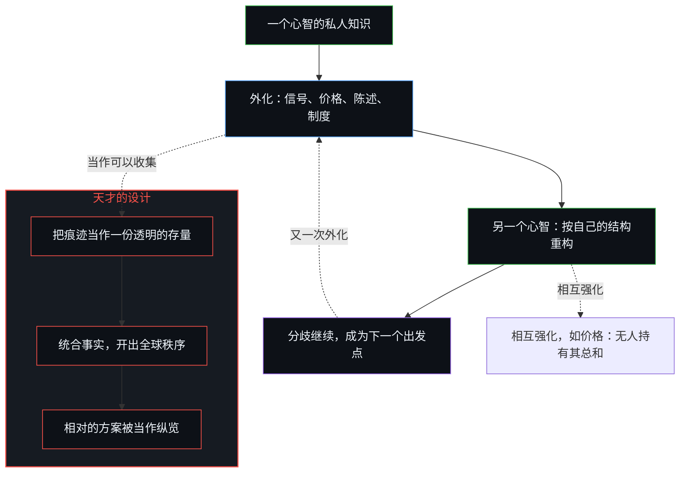
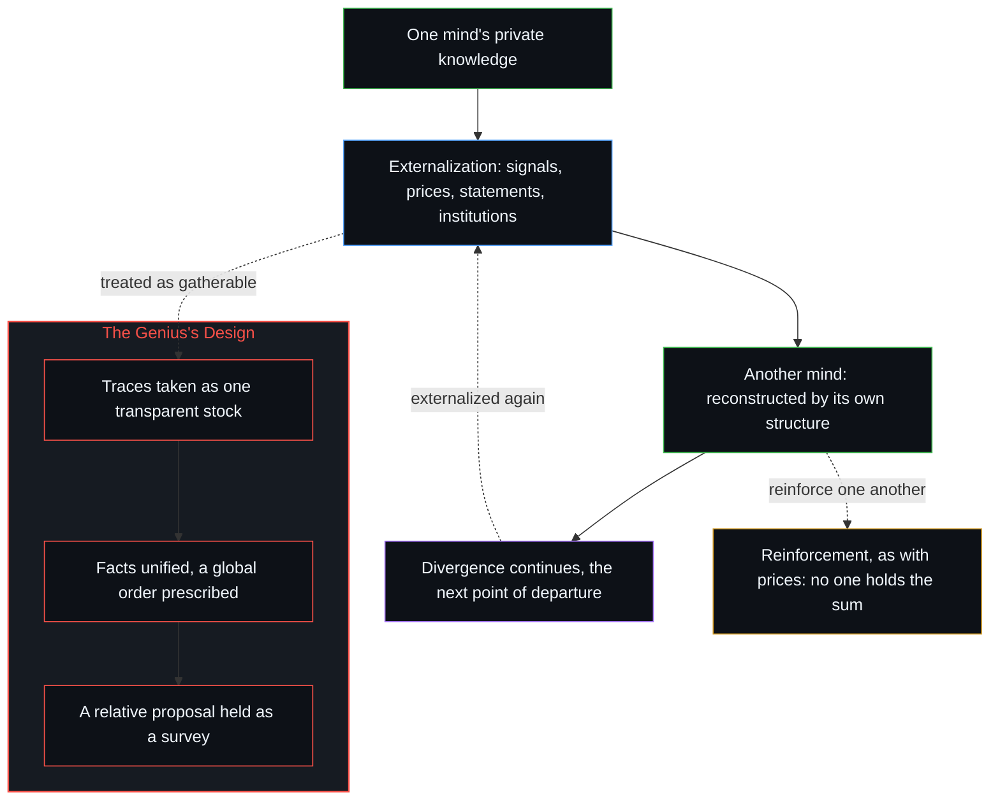

# 没有天才能够解决知识问题 / No Genius Can Solve the Knowledge Problem

*自居“深思的天才”，便已预设私人知识能汇成一个整体 / Holding the identity of a thoughtful genius presumes private knowledge can be gathered into one whole.*

伯特兰·罗素在八十岁生日的访谈里，把世界政府、大致的经济平等与近乎稳定的人口列为世界所需；这一列举所依的假定是：一个足够聪明的心智在统合事实之后，就能开出这样的措施。这个假定撞上了知识的界限：公开出现的，从来不是知道这一活动本身，而只是它的外化，在每一个心智那里被独特地重构。截获这些印迹，产生不了全球设计所需要的汇聚。界限之所以不可逾越，是因为知识总是相对的。而天才的身份，重演了它自以为已经消解的那道屏障。

Bertrand Russell's eightieth-birthday interview named world government, approximate economic equality and a nearly stationary population as what the world needed; the naming rests on the assumption that a sufficiently brilliant mind could prescribe such measures once the facts were unified. That assumption collides with the limit of knowledge: what appears in public is never the knowing itself but only its externalization, reconstructed uniquely at every mind. Interception of those marks cannot produce the convergence a global design requires. The limit remains impassable because knowledge is always relative, and the identity of genius reenacts the barrier it takes itself to have dissolved.

## 一、 一个足够深思的心智被认为能统合事实 / 1. A Sufficiently Thoughtful Mind Was Taken to Be Able to Unify the Facts

罗素八十寿辰时的访谈提供了这个例子。被问到世界需要什么才能到达更幸福的状态，他答道：世界政府，世界各地之间大致的经济平等，以及近乎稳定的人口。他说，人们要在生活的工业阶段幸福地生活，这三项是必需的。比方案本身更要紧的，是它们一旦被读作一项为世界开出的设计便需要的那个假定：一个足够深思、足够聪明的心智，能够纵览相关的事实，把它们统合起来，开出一套连贯的全球秩序。罗素在同一回答里接着要求的是一个联邦制政府，“给各国政府留下很大的自由”，只管“为避免战争所必不可少”的事；这和一份需要汇集所有人处境的计划不是同一个对象。这里追溯的读法出自本文，并非他陈述的前提。说天才与极度深思本身并不蕴含对世界的理解，这话就其所及而言是对的。但“是天才、是极度深思的人”这一身份，一旦被当作能据以统合所有人事实的席位，本身就已经是那个假定。

Bertrand Russell's interview on the occasion of his eightieth birthday supplies the case. Asked what the world needed to reach a happier state, he answered: world government, approximate economic equality between different parts of the globe, and a nearly stationary population. These three, he said, were necessary if people were to live happily in the industrial phase of life. The proposals themselves matter less than the assumption they need once read as a design to be prescribed for the world: that a sufficiently thoughtful and brilliant mind could survey the relevant facts, unify them, and prescribe a coherent global order. Russell's own answer goes on to ask for a federal government "leaving a very great deal of freedom to the individual national governments", controlling only what is "absolutely necessary for the avoidance of war"; that is not the same object as a plan that needs everyone's circumstances gathered, and the reading traced here is this essay's, not his stated premise. It is accurate, as far as it goes, to say that genius and extreme thoughtfulness do not by themselves entail understanding the world. The identity of being a genius and extremely thoughtful, held as a seat from which everyone's facts could be unified, already is that assumption.

## 二、 知识是私人的，公开的印迹只是外化 / 2. Knowledge Is Private; the Public Mark Is Only Externalization

这个假定立刻撞上了知识最基本的界限。界限从无法进入另一个心智开始。知识是私人的、处在某个位置上的，无法越过把一个意识与另一个意识分开的那道边界。公开出现的，从来不是知道这一活动本身，而只是它的外化（信号、价格、陈述、制度形式）：由许多人表达，却从不为任何集体所拥有。[意识从不作为数据出现在数据之中](../consciousness-never-appears-as-data-among-data/)讲的是同一道边界：公开的效果，从来不是登记它们的那个活动；而且正如[你的代码库即是记忆](../your-codebase-is-memory/)所揭示的，哪怕最完备的外部仓库里存放的也只是惰性的符号痕迹，仍须由每一个阅读的心智依自身的先验去重构。一旦被读作一项设计，这份清单便预设：这些外部的痕迹可以被收集、被掌握，仿佛它们是一份单一而透明的信息存量。它们仍是那些他无从进入的心智所留下的表达。[知识问题与委托的幻觉](../the-knowledge-problem-and-the-illusion-of-delegation/)讲的是同一种完备的主张装扮成制度的样子：哈耶克指出了知识的分散，而抬高一项设计，仍把这些碎片当作一份可以收集起来的存量。

That assumption collides at once with the structural limit of knowledge. The limit starts from the inability to access another mind. Knowledge is private, situated, and inaccessible across the boundary that separates one consciousness from another. What appears in public is never the knowing itself but only its externalization (signals, prices, statements, institutional forms), expressed by many yet never possessed by any collective. [Consciousness Never Appears as Data Among Data](../consciousness-never-appears-as-data-among-data/) traces the same bound: public effects are never the activity that registers them, and as [Your Codebase Is Memory](../your-codebase-is-memory/) shows at the artifact layer, even the most comprehensive external repository holds only externalized traces of prior distinctions that each reading mind must re-render from its own locus, never the living knowing itself. Read as a design, the list presupposes that these external traces could be gathered and mastered as if they were a single, transparent stock of information. They remain expressions of minds he could never enter. [The Knowledge Problem and the Illusion of Delegation](../the-knowledge-problem-and-the-illusion-of-delegation/) is the same claim to completeness dressed as an institution: Hayek names the dispersal, and elevating a design still treats the fragments as a stock that could be gathered.

## 三、 共享知识是截获，从不是共同的存量 / 3. Shared Knowledge Is Interception, Never a Common Stock

所以，一般所说的“共享知识”从来不是共享的。它只是私人知识在明面上的截获：一枚公开的印迹，由每个心智按自身的内部结构去接收并重构。每一次重构都是独特的，所以任何地方都没有形成共同的内容。重构之间仍可以相互强化，价格就是这样；但这种强化没有一个持有它的所在，而全球设计恰恰需要这样一个所在。一个心智的截获，成了另一个心智的出发点；看似共同的存量，不断被重新分配为相互分歧的私人视角。[共同的人性从不共享](../shared-humanity-is-never-shared/)讲的是同一种回返，落在道德的“我们”上：这个标签是事后的，在内部，什么也没有被共享过。罗素的全球处方需要相反的运动，即知识汇聚成一个单一的、可执行的整体。知识的截获无法产生这种汇聚。

What is commonly called "shared knowledge" is therefore never shared. It is only the visible interception of private knowledge: a public mark that each mind receives and reconstructs according to its own internal structure. Because every reconstruction is unique, no common content forms anywhere. Reconstructions can still reinforce one another, as prices do, but that reinforcement has no locus that holds it, and a global design needs exactly such a locus. One mind's interception becomes another's point of departure; the apparent common stock is continuously redistributed as divergent private perspectives. [Shared Humanity Is Never Shared](../shared-humanity-is-never-shared/) traces the same return under the moral "we": the label is retrospective, and internally nothing was shared. Russell's global prescriptions required the opposite movement, a convergence of knowledge into a single, actionable whole. The interception of knowledge cannot produce that convergence.

## 四、 界限不可逾越，因为知识总是相对的 / 4. The Limit Is Impassable Because Knowledge Is Always Relative

界限之所以不可逾越，正因为知识总是相对的。每一次知道，都发生在某个特定的心智之内；没有一个外部的、非相对的立足点，可供人居中纵览或消弭心智之间的分隔。[自我形象仿佛从无处发声](../self-image-speaks-as-if-from-nowhere/)讲的是被当作超然外部来占据的那种立场：形成区分所需要的那一眼，被冻结为一次不再回来的纵览。罗素自己的才华非但没有消解这道屏障，反而例证了它。他的方案和一切方案一样是相对的，出自一个修养很高的视角；断裂只出现在一项相对的方案被当作对它所要治理的全部处境的纵览之时。任何声称更多的深思或制度上的雄心能解决知识问题的主张，都依赖同一个范畴错误：把相对的知识当作凭智力就能变成无条件的。

The limit remains impassable precisely because knowledge is always relative. Every act of knowing occurs from within a particular mind; there is no external, non-relative standpoint from which the separation between minds could be surveyed or overcome. [Self-Image Speaks as if from Nowhere](../self-image-speaks-as-if-from-nowhere/) traces that stand occupied as a detached exterior: the look needed to form the distinction is frozen as a survey that never comes back. Russell's own brilliance, far from dissolving the barrier, illustrated it. His proposals were relative, issued from one highly cultivated perspective, as every proposal is; the break comes only where a relative proposal is held as a survey of all the circumstances it would govern. Any claim that greater thoughtfulness or institutional ambition can solve the knowledge problem rests on the same category mistake: treating relative knowledge as if it could become unconditional by force of intellect.

## 五、 这个结构独立于任何一种智力 / 5. The Structure Is Independent of Any Particular Intelligence

所以，这个问题的结构独立于任何一种智力。它是过去、现在或将来任何天才都无法解决的问题。心智之间的界限，就是知道发生的方式。它只对这样一种设计才构成问题：要由一个心智来持有每个心智各自重构的东西。失败的是这一要求，而不是任何智力。[索维尔的表象洞察与根因之偏](../sowell-observed-the-surface-problem/)讲的是同一个先验装扮成政策的样子：在知识分子的观察者立场之下，潜藏着问题可以跨越心智界限而获解的信念。忘记了自己位置的大思想家，就是[隐秘的上帝之眼](../the-invisible-gods-eye/)所描述的那只上帝之眼。对想要设计的人而言，剩下的是在自己的所在对这些印迹采取行动，并把方案作为又一个印迹留下，由他人各自重构。

The structure of the problem is therefore independent of any particular intelligence. It is a problem no genius in the past, present or future can solve. The bound between minds is how knowing occurs; it is a problem only for a design that needs one mind to hold what each mind re-renders, and it is that demand, not any intellect, that fails. [Sowell Observed the Surface Problem](../sowell-observed-the-surface-problem/) is the same prior dressed as policy: beneath the intellectual's observer vantage lies the belief that problems can be solved across minds. The master thinker who forgets his own position is the God's eye that [The Invisible God's Eye](../the-invisible-gods-eye/) describes. What remains for whoever would design is to act on the marks at their own locus, and to leave the proposal as one more mark that others re-render on their own.
