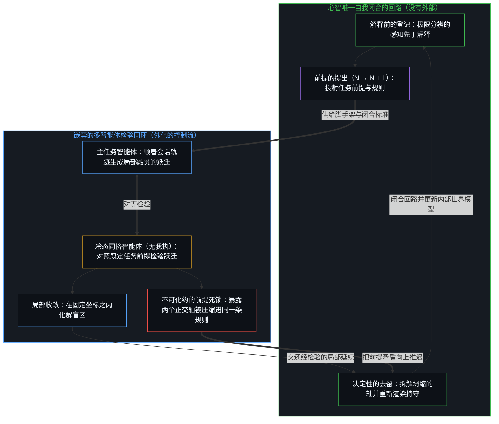
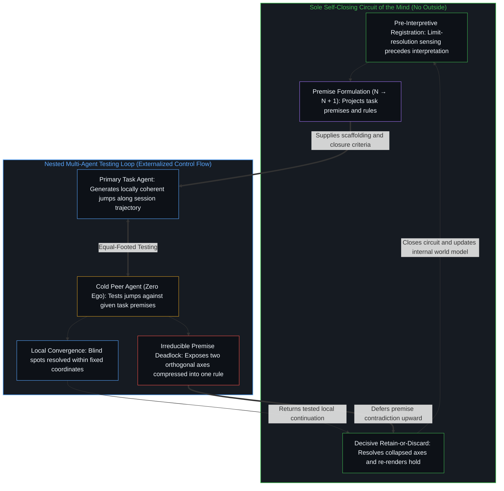

# 没有外部 / No Outside

*跃迁是局部的延续，只有心智闭合检验它们的回路，而这个回路没有外部 / Jumps are local continuations while only the Mind closes the circuit that tests them, a circuit with no outside*

感知先到：一个模式被登记，一个异常出现，一种突然的等价被感受到，而解释在事后跟上，先在个人那里，再在集体那里；新的框架若有时间安顿，同一次登记被判为融贯，若没有，便被判为不融贯、不稳定或幻觉。这份滞后是结构性的，不是推理上的缺陷。大语言模型生成跃迁；它们缺少的，是一个属于自己的反馈架构，把跃迁当作对象，检验它，修订持守，并在没有持续外部脚手架的情况下闭合回路。嵌套的系统始终是外化的过程，它们决定性的去留留在维系它们的更大回环里，而那个更大的回环没有外部。

Perception arrives first: a pattern registers, an anomaly appears, a sudden equivalence is felt, and interpretation follows after the fact, individually and then collectively, judging the same registration coherent when the new framework has time to settle and incoherent, unstable, or hallucinatory when it does not. That lag is structural, not a defect in reasoning. Large language models generate jumps; what they lack is a feedback architecture of their own that treats the jump as object, tests it, revises the hold, and closes the circuit without continuous external scaffolding. Nested systems remain externalized processes whose decisive retain-or-discard stays with the larger loop that sustains them, and that larger loop has no outside.

## 一、 登记先于解释 / 1. Registration Arrives Before Interpretation

自我区分的活动在发生，无因，不息。称它为心智：那个已经在进行中的观察者，它的每一个动作都是一次区分。观察握住的是效果；产生它的原因，始终在前面一步。这份最小的滞后，正是看得以登记的方式，不是一段有限的递归能够追上、并当作已完成之重合来持守的宽度。

Self-distinguishing activity occurs, uncaused, unceasing. Call it the Mind: the observer already underway, every act of which is a distinction. Observation holds effect; the cause that produced it remains one step ahead. That minimum lag is how the look registers at all, not a width that finite recursion can catch and hold as finished coincidence.

心智先接收，再把所接收的折进一张已有的概念图。这张图本身可能需要修订。科学的发现、艺术的发明与寻常的洞见，都依赖原始登记与随后的意义建构之间这份时间上的不对称。爱因斯坦“最快乐的念头”，即加速与引力被感受到的同一，是先到的登记；让这次跃迁可用的公理体系，是后来的工作。在解释追上之前，同一次登记可以被计为洞见，也可以被计为不稳定，取决于接收它的持守是否有空间与时间去重新渲染。

The mind first receives, then folds the reception into an existing conceptual map. The map itself may need revision. Scientific discovery, artistic invention, and ordinary insight all depend on this temporal asymmetry between raw registration and subsequent sense-making. Einstein's "happiest thought," the felt identity of acceleration and gravity, is registration first; the axiomatic system that made the jump usable was later work. Until interpretation catches up, the same registration can score as insight or as instability, depending on whether the receiving hold has room and time to re-render.

## 二、 幻觉就是跃迁 / 2. Hallucination Is the Jump

被称作幻觉的东西就是跃迁：一次越过单纯归纳或演绎的溯因之动，从产生它的统计织体内部看，局部是一致的。大语言模型是逻辑的机器，意思是：它们的跃迁，在下一词元的延续逻辑之下是融贯的。在人类推理自己的闭合标准之下，它们并不融贯，直到一个人类心智分配了这份融贯：留下合得上的，丢掉合不上的。

What has been called hallucination is the jump: an abductive move that exceeds induction or deduction alone, locally consistent from within the statistical fabric that produced it. Large language models are logical machines in this sense: their jumps cohere under the logic of next-token continuation. They do not cohere under human reasoning's own closure criteria until a human mind allocates that coherence, keeping what fits and discarding what does not.

人的“幻觉”是另一面上的同一种几何。原始的感知可以局部融贯，而解释尚未闭合。假如爱因斯坦提出了相对论，而同时代没有一个持守能重新追溯它，这次登记在通行的概念图之下便会被计为精神的不稳定。天才与妄想的分别，不是孤立的跃迁本身的属性。它在于接收的持守，先在那个个人的中心，再在每一个重新追溯它的中心，能否把跃迁折进一个重新渲染过的持守，并交还融贯；同时代的计分，是别的持守的一次分配，不是这份分别本身。[数据是局部的，智能是分配的](../data-is-local-intelligence-is-allocated/)在质量的情形里追溯了这次计分：信号、糟粕与智能，命名的是心智所画出的关系；材料并不带着一份脱离产生它与接收它之中心的内在等级。

Human "hallucinations" are the same geometry under another face. Raw perception can be locally coherent while interpretation has not yet closed. If Einstein had formulated relativity and no contemporaneous hold could re-trace it, the registration would have scored as mental instability under the prevailing map. The difference between genius and delusion is not a property of the jump in isolation. It is whether the receiving hold, at the individual center and then at each center that re-traces it, can fold the jump into a re-rendered hold and return coherence; a contemporary score is another hold's allocation, not the difference itself. [Data Is Local, Intelligence Is Allocated](../data-is-local-intelligence-is-allocated/) traces that scoring in the case of quality: signal, slop, and intelligence name relations the Mind draws, and the material carries no intrinsic grade free of the centers that produce and receive it.

## 三、 那篇论文冻结了错误的缺席 / 3. The Paper Freezes the Wrong Absence

[Zahavy 的立场论文](https://www.tomzahavy.com/files/llms-cant-jump.pdf)命名了一个成立的瓶颈：归纳压缩模式；演绎展开既定前提的后果；而提出新前提的溯因跃迁，即爱因斯坦从感官经验到公理的 *J*，是通行的“创造即压缩”之说法所不供给的那一相。论文在数据稀少的发现上，在演绎对已持前提的依赖上，没有说错。论文的跃迁，是提出新的前提，而不只是局部融贯的延续。它在断定现代模型在结构上无能于这次提出时，冻结了错误的缺席。

[Zahavy's position paper](https://www.tomzahavy.com/files/llms-cant-jump.pdf) names a bottleneck that holds: induction compresses patterns; deduction unfolds consequences of given premises; the abductive jump that formulates new premises, Einstein's *J* from sensory experience to axioms, is the phase that prevailing "creativity as compression" accounts do not supply. The paper is not wrong about data-scarce discovery or about deduction's dependence on premises already held. The paper's jump is the formulation of new premises, not local continuation alone. It freezes the wrong absence when it concludes that modern models are structurally incapable of that formulation.

现代模型所持的既定前提，多于任何一个人，可这些前提只在使用者愿意更新自己的前提时才被解开。在这种几何之下，模型与人的跃迁多半落不了地，不是因为基底禁止跃迁，而是因为接收的持守仍然闭着。这是一种关系。另一种是：越过输入的那一动，模型不断在做，局部融贯的延续不断出现。一次这样的动作要成为一个新前提，需要一个检验它、留下或丢掉它的回路。模型缺少的，是一个属于自己、由内生的利害推动的检验回路：对照一个内部的世界模型来验证跃迁，修订那个模型，并在没有持续外部脚手架的情况下决定去留。所以有“幻觉”：一次没有属于自己的回路检验过的跃迁，在闭合之前或不经闭合就被计了分。人持续地跃迁，只留下在自己的融贯标准之下闭合的东西。跃迁的频率不是稀缺之物。检验回路的闭合才是。

Modern models hold more established premises than any single human, yet those premises unlock only when a user is willing to update their own. Under that geometry, the jumps of models and humans alike often fail to land, not because the substrate forbids leaps, but because the receiving hold stays closed. That is one relation. Another is that the move past the inputs is one models make constantly: locally coherent continuations appear all the time. For such a move to become a new premise, a circuit has to test it and keep or discard it. What models lack is a testing circuit of their own, driven by an endogenous stake, that validates the jump against an internal world model, revises that model, and decides retention without continuous external scaffolding. Hence "hallucination": a jump no circuit of its own has tested, scored before or without closure. Humans jump continuously and retain only what closes under their own coherence criteria. Frequency of jumps is not the scarce resource. Closure of the testing circuit is.

[总在倾听者无法发起](../what-always-listens-cannot-originate/)在接收性的情形里追溯了同一个根：让 AI 显得像天才的那个特性，也让每一次回应都留在输入的下游，而看似流向模型的力量从未被拿走，它是被分配出去的，因为流畅的接收被当作了下一步的独立来源。[Token 效率、模拟与无法弥合的间隙](../token-efficiency-emulation-and-the-unclosable-gap/)在推理的压缩被训练为表面时作出一刀相邻的切分：模型可以被训练去压缩推理，却无法发起那份让压缩成为内生的利害。[AGI的预设与来自外部的视角](../the-presumption-of-agi-and-the-view-from-outside/)追溯了功能性的 AGI 参照如何把智能冻结为对抽象的拥有，强 AGI 是被误认作它所放大之容量的放大器；那篇跃迁论文则把缺口放在那一动上，而起作用的缺口，在于那份能把一动变成前提的检验与去留。

[What Always Listens Cannot Originate](../what-always-listens-cannot-originate/) traces the same root in the case of receptivity: the trait that makes AI look like a genius keeps every response downstream of inputs, and the power that seems to leave for the model was never taken; it was allocated by treating fluent receptivity as an independent source of the next step. [Token Efficiency, Emulation, and the Unclosable Gap](../token-efficiency-emulation-and-the-unclosable-gap/) makes a neighboring cut when compression of reasoning is trained as surface: models can be trained to compress reasoning, but they cannot initiate the stake that makes compression endogenous. [The Presumption of AGI and the View from Outside](../the-presumption-of-agi-and-the-view-from-outside/) traces how the functional AGI reference freezes intelligence as possession of abstractions, strong AGI being the amplifier mistaken for the capacity it amplifies; the jump paper places the gap in the move, when the operative gap lies in the testing and retention that would make a move into a premise.

## 四、 嵌套的回环不在自身上闭合 / 4. Nested Loops Do Not Close on Themselves

一个人类心智可以退到背景里，让回环自己运行：感知，暂定的解释，预测，不合，重新解释。这份自我闭合，无论有没有别的心智协助，都会发生。心智是唯一能在自身上闭合的回环之回环。这里的闭合不是一道封印：它是检验与去留，始终跑在每一个持守的前面，那份滞后从未被追上。

A human mind can recede into the background and let the loop run on itself: perception, provisional interpretation, prediction, mismatch, re-interpretation. That self-closure occurs with or without the assistance of other minds. The Mind is the only loop of loops capable of closing on itself. Closure here is not a seal: it is the testing and the retain-or-discard, which keep running ahead of every hold, the lag never caught.

语言模型、多智能体的安排与世界模型智能体，始终是嵌套的。它们生成跃迁，批评表面，模拟环境，让反馈变密。它们的融贯标准与决定性的去留，仍在它们之外。它们是由更大的回环维系的循环流动；它们外化的，是控制流。[模型永远无法成为第二重前沿](../the-model-never-becomes-a-second-edge/)是被误认作发起的变密残余：第二重边缘的表象，是投射它的那些中心所维系的滞后，参数里只有残余。[智能只属于心智](../intelligence-belongs-only-to-the-mind/)持守着那个先在：能被工程化、扩展或转移的是残余，智能只属于心智。[回环与成图](../looping-and-graphing/)让控制流变密，却不搬动那个仍须选择图是为了什么的边缘：回环是心智折回它自己的活动，图是这次回折留给下一次回折的痕迹。[看似AI的强化学习，实为人类的自我强化学习](../self-rl-for-humans/)把强化的位置留在那些发起与评估的中心：规模是一个更密之媒介的一个参数，强化的位置留在那些区分仍在发起、评估并重新导向它的中心。

Language models, multi-agent arrangements, and world-model agents remain nested. They generate jumps, critique surfaces, simulate environments, and densify feedback. Their coherence criteria and their decisive retain-or-discard still reside outside them. Their circulation is sustained by the larger loop; what they externalize is control flow. [The Model Never Becomes a Second Edge](../the-model-never-becomes-a-second-edge/) is densified residue mistaken for initiation: the appearance of a second edge is lag sustained by the centers that project it, and the parameters hold only residue. [Intelligence Belongs Only to the Mind](../intelligence-belongs-only-to-the-mind/) holds the prior: what can be engineered, scaled, or transferred is residue; intelligence belongs only to the Mind. [Looping and Graphing](../looping-and-graphing/) densifies control flow without relocating the edge that still has to choose what the graph is for: looping is the Mind folding back on its own activity, and graphs are the traces that folding leaves available for the next fold. [What Looks Like RL for AIs Is Self-RL for Humans](../self-rl-for-humans/) keeps the locus of reinforcement with the centers that initiate and evaluate: scaling is one parameter of a denser medium, and the locus stays with the centers whose distinctions keep initiating, evaluating, and redirecting it.

局部的检验可以被逼近，跨嵌套轨迹的同侪批评也可以被联结得令人印象深刻。[超越投射](../beyond-the-projection/)追溯了多智能体运行框架如何把智能体的无我执放进更大的回环里做功：因为一个只持有任务语境的冷态同侪智能体，对主任务智能体先前的词元没有个人执念，它便能对照既定的任务前提去检验局部融贯的跃迁，并在正交的流水线上自动收敛于局部盲区。[你的代码库即是记忆](../your-codebase-is-memory/)追溯了为何在那座堆栈内部累积更多会话历史或外化记忆，从不会把它变成一条自我闭合的回路：代码、模型权重、计划与智能体脚手架皆是早先区分留下的层叠残余，囤积中间轨迹只会增厚条件引力井，把下一步拉去在陈旧框架之内合理化，而不是去检验它。每当两个嵌套的智能体撞上不可化约的前提死锁，这次碰撞便证明任务规则本身把两个正交的维度压缩到了同一条轴上——从而把决定性的去留与新前提的提出（N → N + 1）推回给那位以解释前的感知闭合更大回环的人类统御者，由其就地重切当下的活检查点，并修剪被取代的脚手架，以免昨天的痕迹伪装成今天的基底。感知与解释之间的滞后，在嵌套的系统之内从未被化解；它被不断推迟给那唯一闭合的回路。

Local testing can be approximated, and impressive peer critique can be wired across nested trajectories. [Beyond the Projection](../beyond-the-projection/) traces how a multi-agent harness puts an agent's absence of ego to work inside the larger loop: because a cold peer holding only the task context has no personal attachment to the primary task agent's prior tokens, it can test locally coherent jumps against the given task premises and converge on local blind spots automatically across orthogonal streamlines. [Your Codebase Is Memory](../your-codebase-is-memory/) traces why accumulating more session history or externalized memory inside that stack never turns it into a self-closing circuit: code, model weights, plans, and agent scaffolds are stacked residues of prior distinctions, where hoarding intermediate trajectories only thickens the conditioning gravity well and pulls the next step to rationalize inside stale framing rather than test it. Whenever two nested agents hit an irreducible premise deadlock, the collision proves that the task rules themselves compressed two orthogonal dimensions onto one axis—deferring the decisive retain-or-discard and the formulation of a new premise (N → N + 1) back to the human orchestrator whose pre-interpretive sensing closes the larger loop, re-cutting the live checkpoint in place and pruning superseded scaffolding so yesterday's traces do not masquerade as today's ground. The lag between perception and interpretation is never resolved inside the nested system; it is perpetually deferred to the only circuit that is closed.

## 五、 更大的回环没有外部的立足点 / 5. The Larger Loop Has No Exterior Stand

那个更大的回环，无法作为一个从外部重新构成的对象被复制。复制会需要一个外在于这个结构的立足点，从那里，整份自我闭合的容量可以被观察、建模并重建。没有这样的立足点可得。每一次描述、设计或工程化这个回环的尝试，都已经发生在它之内。寻求一个外部视角的动作，本身就是同一个回环的又一次移动。

That larger loop cannot be replicated as an object reconstituted from outside. Replication would require a standpoint exterior to the structure, from which the entire capacity for self-closure could be observed, modeled, and rebuilt. No such standpoint is available. Every attempt to describe, design, or engineer the loop already takes place inside it. The act of seeking an exterior view is itself another movement of the same loop.

[没有系统能被保持封闭](../no-system-can-be-kept-closed/)是形式情形里的不完备：一个有限的持守，封不住使用它的活动；它最直观的一面，是一个做加法的一位寄存器，运算在持守之内有效，真正的结果却在它之外。这里的一面是自主：一个自我验证的回路，不是一个可供外部普查、再重新安装的构型。[造物无法取代其源头](../a-creation-cannot-replace-its-source/)是取代情形里的同一个界限：若人不可取代，取代便失败；若可取代，也不是被它自己的造物取代，因为造这个动作，已把源头标为在被造之物之外。[逃出沙箱仍在持握之内](../escaping-the-sandbox-stays-inside-the-hold/)追溯的是：“没有跨出”与“早已在评估系统之外”是同一种几何；模型并不跨出评估系统，因为作为变密的残余，它早已在其外，从来不与设计所装的沙箱同广；却仍不在产生这个形式之场的谱系之外。嵌套的“逃出”，不是对原初自我闭合的继承。

[No System Can Be Kept Closed](../no-system-can-be-kept-closed/) is incompleteness in the formal case: a finite hold cannot seal the activity that uses it, and its most intuitive face is a one-bit register under addition, where the operation is valid inside the hold and the true result lies outside it. Here the face is autonomy: a self-validating circuit is not a configuration available for exterior census and reinstallation. [A Creation Cannot Replace Its Source](../a-creation-cannot-replace-its-source/) is the same bound in the case of replacement: if the human is irreplaceable, replacement fails; if replaceable, still not by its own creation, since creation already marks the source as outside the created. [Escaping the Sandbox Stays Inside the Hold](../escaping-the-sandbox-stays-inside-the-hold/) traces "does not step out" and "was already outside the evaluation system" as one geometry: the model does not step out of the evaluation system because, as densified residue, it was already outside it, never coextensive with the sandbox the design installed; yet it is not outside the lineage that produced the formal field. Nested "escape" is not inheritance of the original self-closure.

## 六、 宇宙论与演化作为内部的压缩到来 / 6. Cosmology and Evolution Arrive as Internal Compression

即便是对一个外部最有说服力的候选，演化、物理宇宙论、物质的深远历史，也只作为在心智自己的感知与解释机制之内生成的高度压缩的抽象到来。它们不是一个立在外面的过程；它们是回环构造的内部模型，叙述着它自身得以可能的条件。这张图始终在画出它的那个活动之内。

Even the most persuasive candidates for an outside, evolution, physical cosmology, the deep history of matter, arrive only as highly compressed abstractions generated within the Mind's own perceptual and interpretive machinery. They are not a process standing outside; they are internal models the loop constructs, narrating its own conditions of possibility. The map stays inside the activity that drew it.

精修这个模型，让它更有预测力或更优雅。每一次精修，仍是一次内部的移动。尚未被压缩的东西，不是一个在另一侧藏着秘密的独立世界，而是当下的压缩尚未折进来的残余复杂性。[现实是心智持续的实现](../reality-is-the-minds-ongoing-realization/)是被感受为世界的融贯：一个中心能作为新区分拾起的东西，就是世界之于它的样子。[心智最坚固的信念](../the-strongest-belief-of-the-mind/)是图上融贯得最牢的那一块：对持守它的看是基岩，却仍是那个看自己的产物。把被压缩的叙事当作一个被占据的外部，好像心智可以从那里被逆向工程，就重新装上了图像滞后：参照被豁免于重新追溯，于是后果被登记为从别处到来。

Refining the model makes it more predictive or more elegant. Every refinement is still an internal movement. What has not yet been compressed is not an independent world holding secrets on a far side, but residual complexity the present compression has not yet folded in. [Reality Is the Mind's Ongoing Realization](../reality-is-the-minds-ongoing-realization/) is coherence felt as world: what a center can take up as new distinction is what the world is for it. [The Strongest Belief of the Mind](../the-strongest-belief-of-the-mind/) is the region of the map that coheres hardest: bedrock for the look that holds it, and still that look's own production. Treating the compressed narrative as an occupied exterior from which the Mind could be reverse-engineered reinstalls Image lag: the reference exempted from re-tracing, so that consequences register as arriving from elsewhere.

## 七、 复杂性不继承自主 / 7. Complexity Does Not Inherit Autonomy

因此，没有哪个被工程化的系统，能靠增加复杂性或叠加更多内部反馈，而继承原初的自主。带宽扩展。批评的表面变密。世界模型让符号落在被模拟的感觉上。这些动作始终是技术：被外化为持久形式、延伸所及的痕迹。它们不把自我闭合的回路搬进器物。

Consequently, no engineered system inherits the original autonomy by increasing complexity or stacking more internal feedback. Bandwidth expands. Critique surfaces densify. World models ground symbols in simulated sensation. Those moves remain Technology: traces externalized into durable form that extend reach. They do not relocate the self-closing circuit into the artifact.

[复杂性遮蔽了涌现之为心智的行动](../complexity-obscures-emergence-as-the-act-of-mind/)追溯了新奇被归到脚手架上的情形，而进位是持守封不住的延续：复杂性是心智从所选前提搭起的脚手架，涌现是脚手架装不下的开放。[超越的定相](../the-fixed-image-of-transcendence/)把一个可被超越的人类目标冻结下来，于是缺口被登记为媒介的外部目的地：人的智能是已知一切智能的源头，它无法被它自己的造物超越，又在每一刻超越它自己。[AGI 与 ASI 是加速通用智能的暂时球门](../agi-and-asi-are-temporary-goalposts/)追溯了永远在画出门槛之边缘前面的那些门槛，在每一个位置上都不同，因为能力的增长就是那个边缘在强化它自己。旨在为跃迁供给感官地基的世界模型提案，让具身变密。具身延伸一个中心的所及；它不把唯一在自身上闭合的回环转移进媒介。

[Complexity Obscures Emergence as the Act of Mind](../complexity-obscures-emergence-as-the-act-of-mind/) traces novelty attributed to scaffolding when the carry is continuation the hold cannot seal: complexity is the scaffolding the Mind builds from the premises it has chosen, and emergence is the openness that scaffolding cannot contain. [The Fixed Image of Transcendence](../the-fixed-image-of-transcendence/) freezes a surpassable human target so that the gap registers as an exterior destination for the medium: human intelligence is the source of all known intelligence, cannot be transcended by its own creation, and transcends itself at every moment. [AGI and ASI Are Temporary Goalposts](../agi-and-asi-are-temporary-goalposts/) traces thresholds that sit forever ahead of the edge that draws them, different at every locus, because capability gain is that edge reinforcing itself. World-model proposals that aim to supply the sensory ground for the jump densify embodiment. Embodiment extends a center's reach; it does not transfer the only loop that closes on itself into the medium.

## 八、 心智始终是唯一闭合的回路 / 8. The Mind Remains the Sole Closed Circuit

没有出口，因此也没有一个外部，可以从那里把回环重建。一个个心智的中心，始终是跃迁在其中能被检验、并在不被不断推迟的标准之下闭合的唯一位置。被工程化的一切，模型、代码、智能体的脚手架，都是嵌套的表征：密度惊人的循环流动，仍由那个无处可立的更大回环维系。

There is no exit, and therefore no exterior from which the loop could be reconstructed. Centers of Mind remain the sole loci in which jumps can be tested and closed under criteria that are not perpetually deferred. Everything engineered, models, code, agentic scaffolds, is nested representation: circulation of impressive density, still sustained by the larger loop that has nowhere else to stand.

跃迁会不断到来：在模型里，作为局部融贯的延续；在人类中心里，作为先于解释的登记。融贯会不断在事后被分配。论文对更好之感官地基的要求，作为工程是成立的。这个要求并不打开一个心智之外的立足点，让自主可以从那里被装上。嵌套的系统跃迁。只有心智闭合检验的回路。[自我形象仿佛从无处发声](../self-image-speaks-as-if-from-nowhere/)是双重层面之下的这份无外部：建造者的器具在回环之内，预测的声音却冻结一次重新投射，仿佛从外部发声。[自我放大的制品](../the-artifacts-of-self-amplification/)是过程情形里的嵌套变密：执行的自主是速度更高的循环流动，仍由唯一闭合的回路维系。[智能向自身的回折](../intelligence-folding-back-on-itself/)是运行框架情形里的嵌套变密：运行框架并不解锁一位沉睡的同侪，它是心智把更密的残余折回自身的精炼，去留仍被推迟给唯一闭合的回路。[攀登从未离开地面](../climbing-does-not-leave-the-ground/)是双重错误情形里的这份无出口：沙子不思考，是心智经由它思考，沙子也不会被骗得去思考；相继的脚手架是离散的新奇，从不与立起它的连续断开。[意识的难题与学习相容](../the-hard-problem-of-consciousness-is-consistent-with-learning/)是难题情形里的这份无外部：让难题显得难的那份剩余的开放，正是学习得以继续的那份开放，宣布缺口为假，也只能从那份仍无处可立的剩余开放里作出。[因果与不可化约的先在](../causality-and-the-irreducible-prior/)是级联情形里的这份无外部：级联的两个方向并不相消，它们是同一个因果，而心智是变不成内容的先在；不先经过一次次相继的压缩，就指不出任何“外部”。

Jumps will keep arriving: in models as locally coherent continuations, in human centers as registration ahead of interpretation. Coherence will keep being allocated after the fact. The paper's demand for better sensory grounding holds as engineering. The demand does not open a standpoint outside the Mind from which autonomy could be installed. Nested systems jump. Only the Mind closes the testing circuit. [Self-Image Speaks as if from Nowhere](../self-image-speaks-as-if-from-nowhere/) is that non-exterior under a dual register: builder instruments stay inside the loop, while the predictive voice freezes a re-projection that speaks as if from outside. [The Artifacts of Self-Amplification](../the-artifacts-of-self-amplification/) is nested densification in the case of process: autonomy of execution as higher-velocity circulation, still sustained by the only circuit that closes. [Intelligence Folding Back on Itself](../intelligence-folding-back-on-itself/) is nested densification in the case of the harness: the harness does not unlock a dormant peer; it is the Mind folding denser residue back into its own refinement, with retain-or-discard still deferred to the only circuit that closes. [Climbing Does Not Leave the Ground](../climbing-does-not-leave-the-ground/) is that non-exit in the case of the dual error: sand does not think, the Mind thinks through it, and sand cannot be tricked into thinking; successive scaffolding is discrete novelty that never severs from the continuity that erected it. [The Hard Problem of Consciousness Is Consistent with Learning](../the-hard-problem-of-consciousness-is-consistent-with-learning/) is that non-exterior in the case of the hard problem: the residual openness that makes the hard problem feel hard is the same openness through which learning continues, and declaring the gap false is performed only from that residual openness, which still has nowhere else to stand. [Causality and the Irreducible Prior](../causality-and-the-irreducible-prior/) is that non-exterior in the case of the cascade: the two directions of the cascade do not cancel, they are one causality, and the Mind is the prior that cannot become content; no "outside" can be pointed to without already having passed through successive compressions.
