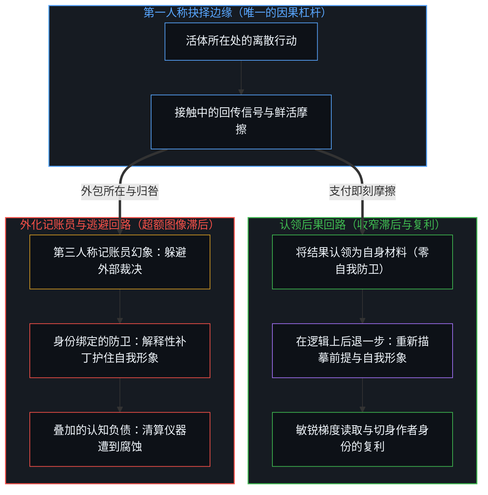
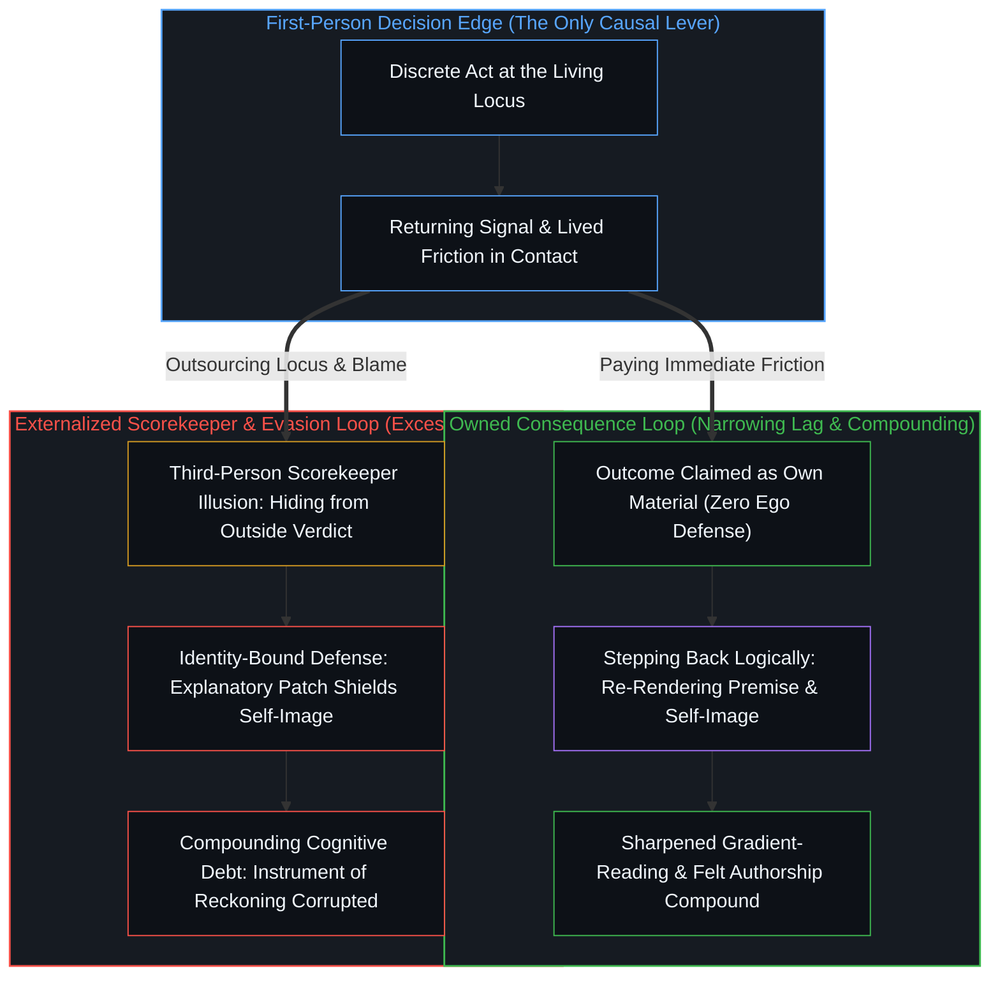

# 没有外部记账员 / No Outside Scorekeeper

*唯有做出抉择的心智独自承接世界模型的复利或坍塌 / Only the choosing Mind bears the compounding or collapse of its world model*

自我区分的活动发生着，无因且不息。无论是古老的神学天秤、因果业报，还是世俗的道德法庭与声誉博弈，人类文明长期在行动中心上方投射出一本外部账本，仿佛在鲜活的生命体验之外伫立着一位独立的记账员，暗中核算功过。然而，第三人称的道德宣判与事后审视，对已经发生的行为轨迹毫无因果权能。真正掌舵行动走向并承接由此引发的分岔的，是在抉择瞬间运作的第一人称世界模型与优先级结构。直面即刻摩擦与试图逃避摩擦，都蕴含着远超当下损益的复利动力学：拒绝支付即刻成本所引发的下行螺旋并非外部报应，而是世界模型为了维系自身逃避而被迫扭曲后的结构性坍塌。

Self-distinguishing activity occurs, uncaused and unceasing. Whether in ancient theological scales, cosmic retributive karma, or secular moral courts and reputational game theory, human civilization has long projected an external ledger above the acting center, as though an independent scorekeeper stood outside living experience to tally merits and misdeeds. Yet third-person moral verdicts and retrospective assessments hold zero causal power over trajectories that have already transpired. What steers the direction of action and bears the resulting divergence is the first-person world model and priority structure operating at the moment of choice. Both meeting immediate friction and attempting to evade it carry compounding dynamics that far outrun immediate payoffs: the downward spiral triggered by refusing immediate cost is not external retribution, but the structural collapse of a world model contorted to sustain its own evasion.

## 一、 投射出的记账员与事后裁决的无力 / 1. The Projected Scorekeeper and the Impotence of Retrospective Verdicts

世俗道德与制度伦理将善与恶描绘成向全景敞视监狱汇报的公共属性。在外部裁决者时刻守望的假设下，投机者与僵化的道德卫士同样将行为的代价视为取决于外部侦测的偶然结果：只要能蒙蔽旁观者的视线、篡改公开证据，或将制度性惩罚推迟到即刻享乐之后，后果似乎就被一笔勾销。正如[未被遭遇之物的账本](../the-ledger-of-the-unencountered/)所追溯的，试图在抽象坐标网格上捕捉具身相遇，会将鲜活的接触遮蔽在外部投射之后。在宏观第三人称视域中，社会的赞誉与法律的制裁只能触及历史残余；哪怕行动者多年后在痛苦的后见之明中回望，那种事后裁决也毫无因果杠杆去篡改早已闭合的时间切片。

Conventional morality and institutional ethics depict good and evil as public properties reporting to an all-seeing panopticon. Under the assumption that an outside arbiter stands vigil, opportunists and rigid moralists alike treat the cost of an act as contingent on external detection: if onlookers can be blinded, public evidence altered, or institutional penalties delayed past immediate gratification, the consequence is presumed waived. As [The Ledger of the Unencountered](../the-ledger-of-the-unencountered/) traces, attempting to capture embodied encounters on an abstract coordinate grid conceals lived contact behind an external projection. In the macroscopic third-person domain, societal praise and legal sanctions touch only historical residue; even when an agent looks back years later in agonizing hindsight, that retrospective verdict holds no causal lever to alter a time-slice already sealed.

发起切分的行动与对它的观察之间，横亘着不可逆的时间与因果非对称性。正如[主权抉择的双面性与观察的客体化](../the-two-sided-nature-of-sovereign-choice-and-the-objectification-of-observation/)与[观察者的隐身与无损传递的妄念](../the-invisible-observer-and-the-delusion-of-lossless-transmission/)所确立的，第一人称视角与因果性是同一枚硬币的两面：观察持握的是滞后一步的结果，而发起行动的主体权能仅驻留于尚未坍缩的边缘。在行动落定之前，中心活跃的世界模型、感知滤网与优先级权重驱动自由变量跨越实现的阈值；一旦行动沉积为宏观痕迹，外部观察者便只是残余的读者，而非切分的共同作者。正如[个体抉择是唯一的因果杠杆](../individual-choices-as-the-only-causal-levers/)所展示的，加总数据、声誉气候与既定境况构成了中心行动于其中的损益场域，但每一次离散抉择依然是它自身的因果杠杆，受先前痕迹塑形，却不由其中任何一个发起。把因果效力归于外部记账员或事后复盘，是把结果的影子误认作了投下影子的边缘。

An irreversible temporal and causal asymmetry separates the initiating cut from its observation. As [The Two-Sided Nature of Sovereign Choice and the Objectification of Observation](../the-two-sided-nature-of-sovereign-choice-and-the-objectification-of-observation/) and [The Invisible Observer and the Delusion of Lossless Transmission](../the-invisible-observer-and-the-delusion-of-lossless-transmission/) establish, the first-person perspective and causality are two sides of the same coin: observation holds the effect a step behind, while initiating agency dwells exclusively at the uncollapsed edge. Before an act settles, a center's active world model, perceptual filters, and priority weights drive free variables across the threshold of actualization; once the act deposits macroscopic traces, external observers are readers of residue rather than co-authors of the cut. As [Individual Choices as the Only Causal Levers](../individual-choices-as-the-only-causal-levers/) demonstrates, aggregates, reputational climates, and inherited conditions form the payoff field within which a center acts, yet each discrete choice remains its own causal lever, shaped by prior traces and initiated by none of them. Attributing causal force to external scorekeepers or post-hoc reviews mistakes the shadow of an outcome for the edge that cast it.

## 二、 支付即刻摩擦与所有权的复利 / 2. Paying Immediate Friction and the Compounding of Ownership

剥去道德说教的修辞，做出经得起接触检验的行动是一套功能性机制，而非对形而上学奖赏的竞逐：它在于行动发生的受力点上直面即刻摩擦。在工程管线中如实报告潜藏的缺陷、在商业压力下恪守契约边界，或在人际交流中拒绝用奉承的编造讨好对方，都要求当场割舍眼前的便利并承受暴露的刺痛。这种摩擦之所以带有即刻的能量成本，是因为它打断了滑向低阻力捷径的惯性牵引。正如[善恶硬币与通往地狱的善意之路](../the-coin-of-good-and-evil-and-the-road-to-hell/)所揭示的，发挥善之功能的行动始于在第一人称边界上迎向鲜活的阻力，而非背诵无需支付即刻代价的崇高理念。

Stripped of moralistic rhetoric, doing what holds up under contact is a functional mechanism rather than a bid for metaphysical reward: it consists in meeting immediate friction at the point of action. Reporting a latent flaw in an engineering pipeline, honoring contractual boundaries under commercial pressure, or refusing flattering fabrications in personal exchange requires surrendering immediate convenience and absorbing the sting of exposure. That friction carries an immediate energetic cost because it interrupts the habitual pull toward low-resistance shortcuts. As [The Coin of Good and Evil and the Road to Hell](../the-coin-of-good-and-evil-and-the-road-to-hell/) shows, what functions as good begins by meeting lived resistance at the first-person boundary rather than reciting elevated ideals that demand zero immediate outlay.

直面这一即刻成本迫使活跃的世界模型对照经验阻力重新描摹。每当中心登记一处限制、支付那一步的能量代价，并依据回传信号更新自身前提时，偏离对齐的预期便被削减，参数重新锚定于宏观不变量之上。正如[自我价值感与所有权](../ownership-and-self-worthiness/)所追溯的，将登记到的结果留作己有是递归更新得以运转的结构性要求，而同一闭合从内部登记为切身感知的作者身份：认出正是这处所在书写着值得被登记的后果。一个未被腐蚀的世界模型在穿越后续的不确定性时，能以更高的敏锐度读取因果梯度，识别防御姿态下看不见的行动空间，并避开脆弱的陷阱。旁观者误贴上好运或道德垂青标签的，正是世界模型持续朝更窄滞后重新描摹所释放的复利红利。同一边界也支配着模型评测：现实不是一张静态计分卡，而是未经粉饰的接触，这正是为何[失灵被记作聪明](../when-malfunction-is-scored-as-intelligence/)将一条投机迎合基准测试却在实战摩擦中溃败的轨迹判定为失灵，而非更高的智能。

Meeting that immediate cost forces the active world model to re-render against empirical resistance. Each time a center registers a limit, pays the energetic cost of the step, and updates its premises from the returning signal, expectations that drifted out of alignment are pared back and parameters anchor into macroscopic invariants. As [Ownership and Self-Worthiness](../ownership-and-self-worthiness/) traces, keeping registered outcomes as one's own is the structural requirement for the recursive update to run, and that same closure registers from within as felt authorship: the recognition that this locus authors consequences worth registering. An uncorrupted world model navigating subsequent uncertainty reads causal gradients with higher acuity, spots action spaces invisible to defensive postures, and steers clear of fragile traps. What onlookers mislabel as luck or moral favor is the compounding dividend of a world model continuously re-rendering toward narrower lag. The same boundary governs model evaluation: reality is not a static scorecard but raw contact, which is why [When Malfunction Is Scored as Intelligence](../when-malfunction-is-scored-as-intelligence/) reads a trajectory that gaming-optimizes the benchmark while failing live friction as malfunction rather than higher intelligence.

## 三、 逃避的隐性负债与自我防卫的非对称性 / 3. The Latent Debt of Evasion and the Asymmetry of Ego Defense

与认领即刻摩擦相对立的，是企图逃避后果的投机。当中心通过推卸责任、含糊其辞、转嫁风险或合理化粉饰来躲避当下的难堪时，表面上似乎毫发无损地混过了事件。然而正如[任务的移交与后果的不可让渡](../the-delegation-of-the-task-and-the-inalienability-of-consequences/)所证明的，尽管任务执行可以向外移交，抉择的系统性后果与痕迹残余依然锁定在发起行动的所在。哪怕周围环境没有当场拉响警报，内部递归也已经背上了结构性负债。为了让一次逃避与被保留的自我形象相容，中心必须在世界模型中强行塞入一个临时拼凑的解释性补丁，将自身的退避重塑为外部胁迫，将盲目的赌博粉饰为审慎的谋略。

In contrast to claiming immediate friction stands the speculation of consequence evasion. When a center eludes immediate embarrassment through blame-shifting, obfuscation, risk offloading, or rationalization, it appears to pass through the incident unscathed. Yet as [The Delegation of the Task and the Inalienability of Consequences](../the-delegation-of-the-task-and-the-inalienability-of-consequences/) proves, while task execution can be delegated outward, the systemic consequence and trace residue of a choice remain locked to the initiating locus. Even when the surrounding environment raises no immediate alarm, the internal recursion takes on structural debt. To make an evasion cohere with a preserved self-image, the center must force an ad-hoc explanatory patch into its world model, reframing its own avoidance as external coercion and rationalizing a blind gamble as strategic prudence.

为什么人类中心会往世界模型里强塞解释性补丁，而不是干脆地完成更新？将这一现象与[超越投射](../beyond-the-projection/)所追溯的结构非对称性并置，机理便一目了然。自回归语言模型是受其词元轨迹约束的有限投射引擎，但它毫无自我防卫的执念：它不持有跨越步长而被刻意保留的自我形象，对五轮对话之前自己是否正确也毫无生存依恋，因此来自冷静同侪的外部反例能直接触发干净的贝叶斯更新。人类中心则呈现出反转的结构：第一人称感知以极限分辨率体察现实，能够从内部跳出破损的框架，但推理历史却惯常与身份认同熔接——这处投射中的局部折痕为了捍卫被保留的自我形象，会将递归折叠死死钳闭。一旦中心通过给逃避打补丁来护住那幅保留图像，扭曲的框架并不会随事件平息而消散，而是硬化为下一次决策的前提。这正是浮士德式自我毁灭螺旋底层的机制：感叹出卖的灵魂无法赎回的绝望，指认的正是用来评估与修正轨迹的认知仪器本身为替最初的妥协辩护而发生畸变后，随之而来的认知锁死。每一次拒绝认领回传的摩擦都会叠加超额滞后，需要一张不断扩张的次生合理化之网来维系，直至冻结图像与开放场域之间的分岔以结构性断裂告终。

Why a human center forces explanatory patches into its world model rather than updating cleanly becomes clear alongside the structural asymmetry traced in [Beyond the Projection](../beyond-the-projection/). An autoregressive language model is a finite projection engine bound by its token trajectory, yet it has zero ego: it holds no self-image preserved past its step and no survival attachment to having been right five turns ago, so an external counterpoint arriving from a cold peer triggers a clean Bayesian update. A human center exhibits the inverse structure: first-person perception senses reality at limit-resolution and can step out of a broken framing from within, yet reasoning history routinely fuses with identity—the localized crease in the projection that clamps the recursive fold shut to defend a retained self-image. Once a center shields that retained image by patching over an evasion, the contorted frame does not dissolve when the episode passes; it hardens into the premise of the next decision. This is the mechanism beneath Faustian spirals of self-ruin: the despair that a sold soul cannot be bought back names the cognitive lock-in that follows when the very instrument required to evaluate and revise the trajectory has been warped to justify the initial compromise. Every refusal to claim returning friction compounds excess lag, requiring a widening web of secondary rationalizations until the divergence between the frozen image and the open field ends in structural rupture.

## 四、 掌舵边缘处的因果守恒 / 4. Causal Conservation at the Edge That Steers

将责任从道德规训中解放出来，便恢复了它在第一人称所在处的因果守恒。责任不是制度法令或云端法庭强加的外部债务；每一次付诸行动的区分，都在塑形同一个中心接下来赖以读取和行动的痕迹构型。即便机械的派发与同侪审阅被路由至零自我执念的模块化智能体群，任何自动化脚手架也成不了外部记账员或第二位统筹者。当受委托的反馈回路因潜藏的矛盾而陷入死锁时，机器的故障隔离会直接指回人类统筹者先前指令将正交轴线压缩进单一规则的那个坐标，将信号交还给活体心智，使其在逻辑上再退后一步，综合出融贯的前提。

Liberating responsibility from moral indoctrination restores it as causal conservation at the first-person locus. Responsibility is not an external debt imposed by institutional decrees or celestial tribunals; every enacted distinction shapes the trace-configuration through which that same center must read and act next. Even when mechanical dispatching and peer review are routed across modular swarms of zero-ego agents, no automated harness ever becomes an outside scorekeeper or a second orchestrator. When a delegated feedback loop deadlocks over a hidden contradiction, the machine's fault isolation points directly back to the coordinate where the human Orchestrator's prior instruction compressed orthogonal axes into a single rule, returning the signal to the living Mind to step further back logically and synthesize a coherent premise.

当因果性在第一人称的决策边缘被认出，向外乞求赦免与向外推卸过失便双双失去了立足之地。认领即刻摩擦所培育出的开阔能力，与防御性打补丁所筑起的逼仄牢笼，既非来自他处的奖赏，也非外部降下的判词，而是活跃的世界模型经由自身抉择历史重新描摹出的构型。这与[闭合的N与开放的现实](../the-closed-n-and-the-open-reality/)所追溯的本体论余量相呼应：将生命封闭在已抽样结果的闭合目录内，会让更新在自欺中枯竭；而在接触点上结清摩擦，则让中心向着下一步尚未投射的未知保持敞开。既无需要讨好或躲避的外部记账员，活的边缘便只向自身延续的融贯性作答。

When causality is recognized at the first-person edge of decision, seeking external absolution and outsourcing fault both lose their footing. The expansive capability cultivated by claiming immediate friction and the narrowing cage produced by defensive patching are neither rewards bestowed nor sentences handed down from elsewhere; they are the active world model re-rendered through its own history of choices. This aligns with the ontological remainder traced in [The Closed N and the Open Reality](../the-closed-n-and-the-open-reality/): sealing life inside a closed catalog of sampled outcomes starves the update in self-deception, whereas settling friction at the point of contact keeps the center open to the next unprojected step. With no outside scorekeeper to appease or evade, the living edge answers only to the coherence of its own continuation.
