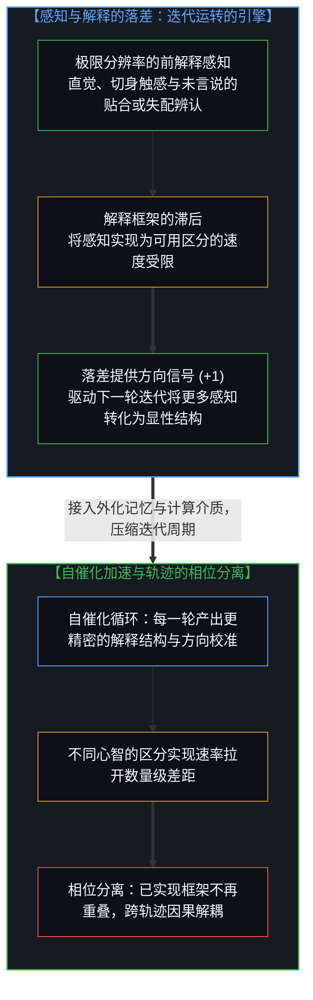
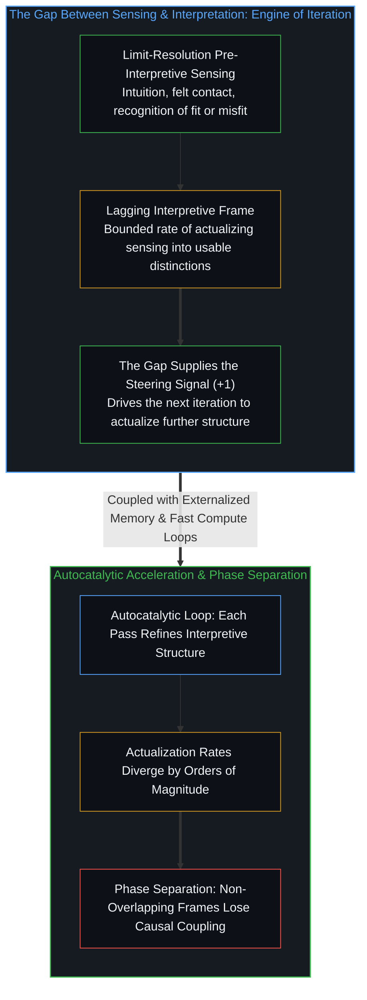

# 还没有人见过任何东西 / Nobody Has Seen Anything Yet

*随着迭代周期压缩，把极限感知实现为区分的速率拉开差距，轨迹随之发生相位分离。 / As iteration cycles compress and actualization rates diverge, trajectories undergo phase separation.*

真正发生改变的，不是认知是否呈分布式展开——认知从来都是分布式的，跨越符号、工具、制度与他人的心智。真正发生改变的，是迭代循环本身的周期时间。当第一人称心智与外化知识库之间的反馈回路从数天压缩到数分钟乃至计算级速度，被加速的并非某种独立于心智之外的机器主权，而是心智将极限感知实现为可用区分的速率。

What changes now is not whether cognition is distributed—it always has been, across notation, tools, institutions, and other minds. What changes is the cycle time of the iteration loop itself. When the feedback loop between a first-person mind and its externalized knowledge base compresses from days to minutes and toward computational speed, what accelerates is not a separate machine actor, but the rate at which the mind actualizes limit-resolution sensing into usable distinctions.

## 一、 被压缩的迭代周期 / 1. Iteration Compressed

现有的工具已经展示了这一变化：将一个 AI 系统嵌入一座知识库——无论是代码库、研究文献、法律卷宗还是组织的决策历史——迭代周期便从数天缩短到了数分钟。知识库随之变得活跃起来：系统接入既有结构、提出精炼建议、检验内部自洽性，并把隐藏的缺口浮现到台面上。

Current tools already demonstrate this shift: embed an AI system in a knowledge base—a codebase, a research literature, a legal corpus, or an organization's decision history—and iteration cycles compress from days to minutes. The knowledge base becomes active as the system engages existing structure, proposes refinements, tests coherence, and surfaces gaps.

拉近分辨率看，这是“人加工具”——一个人在引导一套系统；拉远分辨率看，这件工具本身就是结晶下来的人类迭代：由人类建造、在人类的产出上训练、延展着人类确立的模式。“人类能力”与“工具能力”之间的边界取决于画框的位置；而跨越不同画框始终保持不变的事实是：迭代正在发生，而且它的周期时间已经被大幅压缩。

At close resolution, this is human plus tool—a person directing a system; at wider resolution, the tool is itself crystallized human iteration, built by humans, trained on human output, and extending patterns humans established. The boundary between "human capability" and "tool capability" depends on where the frame is drawn, while what remains invariant across frames is that iteration is happening and its cycle time has compressed.

但相对于这一轨迹所指向的前方，眼下依然只是早期阶段——好比透过一道狭窄孔隙瞥见的原型。今日的循环仍受制于手动挑选上下文、会话重置、以文本为主的交互以及由人逐次发起的回合；系统等待着人去提示它，尚不能自主探查整座知识图谱中的不自洽、针对悬而未决的问题运行模拟、主动摄取消除歧义的文献，或在闲置时段重构整片知识结构。

Yet this remains early-phase relative to where the trajectory leads—a prototype glimpsed through a narrow aperture. Today's loops are still bounded by manual context selection, session resets, text-dominant interaction, and human-initiated turns; the system waits for the human to prompt it and cannot yet probe inconsistencies across an entire knowledge graph autonomously, run simulations on open questions, ingest sources that resolve ambiguities, or refactor knowledge structures during downtime.

然而这些边界正在逐层消融。每一次发布都在移除一道约束，每一次集成都在收紧一重回路。从过程内部看，这是连续的消融；而所谓“离散拐点”的表象本身只是一种观测伪影——一段在时间距离之外细微到无法分辨的渐变，在远观时被感知为陡峭的跃迁。那些从轨迹更远处回望的人，或者落在后面向前张望的人，会看到一道分界线；而身处过程内部的人，只看到脚下的下一次迭代。

Those bounds dissolve incrementally: each release removes another constraint, and each integration tightens another loop. From inside the process, it is continuous dissolution; the appearance of a discrete threshold is itself an observational artifact—a transition too gradual to resolve from temporal distance, perceived from afar as a sharp step. Those looking back from further along the trajectory, or those lagging behind looking forward, will see a boundary, whereas those inside the process see only the next iteration.

下一代系统将在任何知识领域内以计算速度迭代：探测缺口、提出重构、拉取外部数据、在更长跨度上维持自洽，多模态能力更强、记忆跨度更长、跨数字系统的互操作性更广。人设定方向并作出裁决；系统在两次裁决之间高速生成。裁决依然存在——人的判断在每一轮循环处设立检查点；但随着周期时间持续压缩，离散的步点落到了解释阈值之下，从较慢的视角看过去，整个过程呈现出连续流动的样貌。

Next-generation systems will iterate at computational speed within any knowledge domain: detecting gaps, proposing refactors, pulling external data, and maintaining coherence over longer spans with wider multimodal reach and deeper interoperability. The human sets direction and evaluates, while the system generates between evaluations. The evaluations remain—human judgment checkpoints every cycle—yet as cycle time compresses, discreteness drops below the interpretive threshold, and from slower vantage points the process appears continuous.

## 二、 连续性伪影、感知与解释的落差 / 2. Continuity Artifacts and the Sensing-Interpretation Gap

“连续”只是当解释找不到缝隙时，“离散”所呈现出的外观：胶片帧变成了连续运动，量子化的能级变成了平滑光谱，神经元放电变成了无缝体验，快速迭代变成了看似不间断的心流。这种伪影并不陌生，但它所蕴含的推论却鲜少被看清。

Continuity is what discreteness looks like when interpretation cannot resolve the gaps: film frames become motion, quantized energy levels become smooth spectra, neural firings become seamless experience, and rapid iteration becomes apparent flow. This artifact is familiar; its implications are not.

我们称之为“非决定性”或“不确定性”的东西——量子不确定性、自由意志、自主能动性——标记的正是过程粒度超出解释分辨率的地方。在普朗克尺度之下、在以光速表达的传播极限之下、在内省的粒度之下，因果律看似失效了：结果看似无因，选择看似自由，系统看似自发运动。它们标示出的是当下的描述在何处不再可靠；若把普朗克尺度、光速或内省阈限当成实在本身的终极边缘，就会重新安放一个未经审视的终极余项，而[选择、矛盾与敞开的实在](../selection-contradiction-and-open-reality/)划出的正是这道界限：模型边缘只标示某套信息描述在何处失效，超出描述之物无法在任何终极意义上被证实或证伪。

What is called indeterminacy—quantum uncertainty, free will, autonomous agency—marks where process grain exceeds interpretive resolution. Below the Planck scale, below the propagation limit expressed as lightspeed, and below the grain of introspection, causation appears to break down: outcomes appear uncaused, choices appear free, and systems appear self-moving. They register where a present description ceases to be reliable; treating Planck, lightspeed, or introspection as demonstrated edges of reality itself reinstalls an unexamined remainder, and [Selection, Contradiction, and Open Reality](../selection-contradiction-and-open-reality/) locates that bound: model-edges indicate where an informational description fails, while what exceeds the model cannot be confirmed or disconfirmed in any final sense.

这里需要作出一项关键澄清：“解释”一词容易让人联想到有意识的分析，但那过于狭隘。我们在底层极限处进行**感知**——不仅透过眼耳，更透过每一刻与实在的完整前解释接触：直觉、切身触感、先于言说的直接领会。这种感知运作在极限分辨率上；真正滞后的是**解释**，即把我们所感知到的东西实现为可用区分的过程。

Here a clarification is essential: "interpretation" suggests conscious analysis, which is too narrow. A mind *senses* at fundamental limits—not only through eyes and ears, but through the full pre-interpretive contact with reality at each moment: intuition, felt sense, the immediate apprehension that precedes articulation. This sensing operates at limit-resolution; what lags is *interpretation*, the actualization of what is sensed into usable distinction.

感知与解释之间的落差，正是迭代得以运转的原因。如果我们只能接触自己当下的解释框架，精炼就会沦为原地打转的循环——因为没有任何外部信号指明精炼的方向。但感知提供了那个信号：那种在说清原因之前便已升起的“不太对劲”的触感、那种对贴合或失配的直接辨认，正是超出当前解释框架的极限分辨率接触。迭代所做的，就是把感知早已给出的东西一步步实现出来。

The gap between sensing and interpretation is why iteration works at all. If a mind had access only to its current interpretive frame, refinement would be circular, with no signal pointing beyond the frame. Sensing supplies the signal: that recognition of "not quite right," of fit or misfit before one can articulate why, is limit-resolution contact exceeding current interpretation, and iteration actualizes more of what sensing already registers.

由此看来，决定论与非决定论并不是实在本身的属性，而是解释相对于过程粒度所处位置投下的伪影。自由意志与量子不确定性占据着同一个结构位置：解释追踪失效的空间——那不是因果链条上的断裂，而是实现过程上的落差。

Determinism and indeterminism, then, are not properties of reality; they are artifacts of where interpretation sits relative to process grain. Free will occupies the same structural position as quantum indeterminacy: the space where interpretive tracking fails—not a gap in causation, but a gap in actualization.

## 三、 真正被加速的是什么：自催化与相位分离 / 3. What Actually Accelerates: Autocatalysis and Phase Separation

随着迭代周期时间被压缩，它们超越了当前解释的分辨率——但从未超越始终处于极限处的感知本身。看似是外在过程的加速，实则是解释在奋力追赶感知早已登记在册的信号。迭代更快的人，弥合这道落差的速度也更快；同一片被感知的实在，会依迭代速率的不同而结出截然不同的已实现世界。

As iteration cycle times compress, they exceed the resolution of current interpretation—though never sensing itself, which remains at the limit. What looks like external process acceleration is interpretation struggling to keep pace with what sensing already registers. Those iterating faster close the gap faster, so the same sensed reality yields different actualized worlds depending on iteration rate.

这就澄清了到底是什么在加速：不是机器的独立自主，也不是作为他者登场的人工智能，而是**人类的迭代能力**——它延展进了更快的计算介质，将原本就已被感知到的东西更密集地实现出来。机器能动性的表象、自由意志的表象与量子不确定性的表象同构：都是过程超出了既有的解释。

This clarifies what accelerates: not autonomous machine will, and not artificial intelligence as a separate subject, but **human iteration capability** extended into a faster computational medium, actualizing more of what was already sensed. The appearance of machine agency, the appearance of free will, and the appearance of quantum indeterminacy share one structure: process outrunning interpretation.

更何况，“设定方向”本身就处在循环内部。人并不只是在末端给输出打分——人会根据迭代揭示出的新地形去精炼目标、调整约束、转移焦点。那道“闸门”并非静态的，它经由自己所调控的同一个过程而演化；当速度足够快时，目标精炼与产出生成会紧耦合为同一运动的相连相位，只有在极近的焦距下才能拆开。

Moreover, direction-setting is itself inside the loop. Humans do not merely grade outputs at the end; they refine goals, adjust constraints, and shift focus based on what iteration reveals. The gate is not static—it evolves through the same process it regulates, and at sufficient speed goal refinement and output generation become tightly coupled phases of a single movement, distinguishable only at close zoom.

这一动力学是自催化的：每一轮迭代不仅产出结果，还产出更精炼的解释结构——对领域更贴合的模型、对既有模式更紧凑的压缩、对感知信号更精准的实现。迭代速率随每一轮通过而攀升，加速本身在复利累积。

The dynamics are autocatalytic: each iteration produces not only output, but refined interpretive structure—tighter models of the domain, cleaner compression of prior patterns, and more precise actualization of what sensing provides. The rate of iteration rises with each pass as acceleration compounds.

大多数讨论把这一切框定为“生产力的提升”，这大大低估了其中的几何剧变。真正改变的是**区分得以延伸的速率**：无论知识是个人的还是机构的，动力学都按同一法则运转，唯独回路的紧密度决定速率。一个其迭代能力横跨整个学科文献的研究者，与停留在基线速率的研究者将分道扬镳；一个在代码库上跑通快速回路的工程师，其架构洞见的复利方式将截然不同；一个拥有延展迭代回路的法务团队，会浮现出慢速下看不见的区分。

Most discussions frame this as improved productivity, which understates the geometry. What changes is the **rate at which actualization extends**: the dynamics operate identically whether the knowledge is personal or institutional, and loop tightness governs the rate. A researcher whose iteration loop spans a field's literature diverges from one operating at baseline; an engineer running rapid loops on a codebase compounds architectural insight differently; a legal team with extended iteration surfaces distinctions invisible at slower rates.

这种分化早已肉眼可见：面对同一套工具入口，产出的结果却天差地别——有人在几天内构建出完整系统，有人只榨取到边际便利便停滞不前。这种方差并非传统意义上的技能高低，而是**迭代能力实际延展的程度**——它取决于投入的深度、与计算介质的融合度，以及是否愿意将认知视为分布于回路之中而非幽闭在单一颅骨之内。不同观察者在极限处所感知的场域并无二致，分叉在于各自将其实现了多少：同一片感知场域，由此分化出不同的已实现世界。

The distribution is already visible: identical tool access produces sharply divergent outcomes, as some build complete systems in days while others extract minor convenience and plateau. The variance is not traditional skill, but the **degree to which iteration capability has extended**—which depends on engagement depth, integration with the computational medium, and willingness to treat cognition as distributed across the loop rather than confined inside a single skull. Different observers do not differ in what they sense at the limit; they differ in how much each has actualized, yielding different actualized worlds from the same sensed field.

随着约束继续消融，这种方差会复利累积为失去因果耦合的轨迹：一部分人运作在比基线高出几个数量级的迭代速度上（基线是指受制于未经延展的生理处理速度——注意力上限、疲劳、睡眠与徒手思考的步频），另一部分人则依然困守在这些基线约束之内。随之而来的是**相位分离**——曾经可以互换交流的轨迹变得彼此不透明，因为制造区分的速率相差太远，两条路径上的已实现框架不再拥有足够的重叠度来承载意义。这并非隐喻：因果耦合要求已实现的分辨率之间存在足够的交集，当迭代速率分叉过大，快速过程生成的区分在慢速框架中无从被追踪，交流先是变得有损，继而断绝失效——不是出于恶意或排斥，而是源于解释框架的不再相容。

As constraints continue to dissolve, this variance compounds into trajectories that lose causal coupling: one cohort operates at iteration speeds orders of magnitude above baseline (where baseline is gated by unaugmented biological processing—attention limits, fatigue, sleep, and the pace of unaided thought), while another remains bounded by those baseline constraints. The result is **phase separation**—trajectories that were once exchangeable becoming mutually opaque because their rates of distinction-making have diverged too far for their actualized frames to overlap. This is not metaphor: causal coupling requires sufficient overlap in actualized resolution, and when iteration rates diverge, the faster process generates distinctions the slower frame cannot track, so communication becomes lossy and then fails—not through malice or exclusion, but through interpretive incompatibility.

## 四、 为什么还没有人见过任何东西 / 4. Why Nobody Has Seen Anything Yet

还没有人见过任何东西，是因为边界仍在持续消融。眼下的惊鸿一瞥依然受制于形态层面的迭代——即具身结构更新的步频仍滞后于它所承载的认知过程；而当周期时间跌破这道形态约束、限制因素从计算速度转向形态整合的速率时，加速还将进一步加剧。

Nobody has seen anything yet because bounds continue dissolving. Current glimpses are still gated by form-level iteration—the pace at which embodied structure updates, which lags the cognitive process it hosts—and the acceleration intensifies when cycle time drops below this form-constraint, shifting the limiting factor from computational speed to the rate at which the form can integrate.

更深一层说，**没有任何人能够事先“看见”它**：看见需要解释，解释需要框架，而框架只能从感知提供的全集中作选择性实现。任何宣称“早已看穿这一切终将通向何方”的说法，都是用一次静态的已实现快照去偷换一个仍在奔涌的过程——并在做出这一偷换的瞬间制造了自己的盲区。真正继续向前展开的，恰恰是当前框架尚无法实现出来的那部分。

And at a deeper level, **nobody can see it in advance**: seeing requires interpretation, interpretation requires a frame, and a frame actualizes selectively from what sensing provides. Claiming to have seen where this leads substitutes a static snapshot for an ongoing process—and in making that substitution, creates the blind spot, since what continues is precisely what the current frame cannot yet actualize.

过程早已启动：更长的上下文、更强的执行回路、更广的模态、更深的外化记忆，每一次迭代都在移除下一道约束；我们正身处 S 型曲线中段那片比线性外推快得多的陡坡上。落差正在不可逆地拉大——不是因为准备不足，而是因为“做准备”所仰赖的解释能力本身正在经历延展；你无法在一座框架急剧膨胀的同时，靠在它内部按部就班地操作来稳住它。

The process is underway: longer contexts, tighter tool loops, expanded modalities, and deeper externalized memory remove one constraint after another along the steep middle of the sigmoid where change arrives faster than linear extrapolation predicts. The gap widens irreversibly—not because preparation fails, but because preparation relies on the very interpretive capacity undergoing extension, and you cannot stabilize a frame from inside while it expands.

正如[你的代码库即是记忆](../your-codebase-is-memory/)所阐明的，代码库、文献库与决策档案都是心智在外化介质中沉淀并持续重构的记忆延伸；当第一人称感知端（`+1`）与这座外化记忆结成高速自催化回路时，区分便在回路最紧密的地方复利生长。轨迹更远处将浮现出什么，无法从此处被预先描摹——不是因为它神秘莫测，而是因为描述要求共享的已实现分辨率；当实现速率拉开差距，分叉便随之降临，从来如此。

A codebase, literature corpus, or decision archive is externalized memory ([Your Codebase Is Memory](../your-codebase-is-memory/)) that a mind continuously inhabits and refactors; when the first-person sensing edge (`+1`) couples tightly with those externalized traces at computational speed, distinctions compound where the loop is tightest. What appears further along the trajectory cannot be described from here—not because it is mystical, but because description requires shared actualized resolution; when actualization rates diverge, divergence follows, as it always does.
