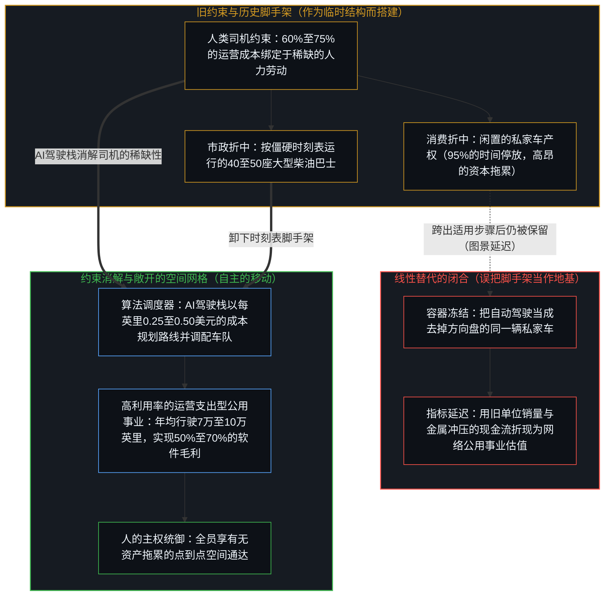
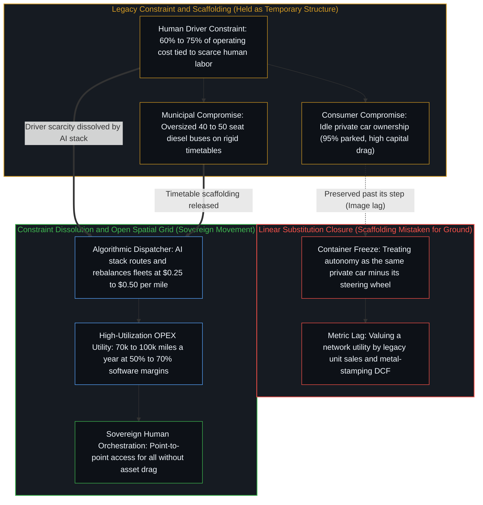

# 一个可能的全自动交通未来的非定论预测 / Non-Definitive Forecast of a Possible Fully Autonomous Transportation Future

*消解人类司机的约束，将在私家车之外重组出行的空间结构 / Dissolving the driver constraint restructures movement beyond the private car*

评估重大的技术转变时，公共与金融领域的分析习惯于落入一对一的线性替代思维。观察者假定电动车只是燃油车的零排放替身，或者假定自动驾驶只是去掉了方向盘的私家车产权。可如果从约束的一侧追溯，技术转变很少靠保留旧容器来展开。一旦人类司机这一稀缺且占大头的成本约束得以消解，塑造旧交通体系的那些历史折中也随之瓦解。全自动电动出行不只是替换路上现有的汽车；它解锁了一张不受约束、按需响应的协调网格，重新组织物理空间与人的在场相交汇的方式。这是一份非定论的预测，旨在追溯约束松绑后随之敞开的结构几何，而非预先宣告某种封闭的宿命。

When major technological transitions are evaluated, public and financial analyses habitually fall into linear, one-to-one substitution thinking. Observers assume that electric vehicles are merely zero-emission stand-ins for combustion cars, or that autonomous driving is simply private car ownership with the steering wheel removed. Yet traced from the side of the constraint, transitions seldom unfold by preserving the old containers. When a foundational constraint—the human driver as the scarce and dominant unit of cost—is dissolved, the historical compromises that shaped legacy transportation dissolve with it. Fully autonomous electric mobility does not merely substitute for the cars now on the road; it unlocks an unconstrained, on-demand grid of coordination that reorganizes how physical space and human presence meet. This is a non-definitive forecast that traces the structural geometry that opens once a binding constraint is released, rather than declaring a closed destiny in advance.

## 一、 微型公交的锚点与司机稀缺性的消解 / 1. The Microtransit Anchor and Dissolving Driver Scarcity

这种结构转变的一个可见早期迹象，正出现在市政基础设施之中。德国勃兰登堡州的地区主管部门正在探索将自动驾驶车队用于乡村公共交通，而面对长期司机短缺与公交客流下滑的地方政府，也正在评估引入自动驾驶载客车队以恢复公共出行能力。

A visible early sign of this structural transition is emerging in municipal infrastructure. Regional authorities in Brandenburg, Germany, are exploring autonomous vehicle fleets for rural public transit, and local governments facing chronic driver shortages and falling bus ridership are evaluating autonomous passenger fleets to restore public mobility.

在旧的经济结构下，公交主管部门被迫接受一种低效的折中：沿着僵硬而稀疏的班次，运行可载四十至五十人的大型柴油巴士。这种安排之所以延续，并不是因为乘客偏爱固定的时刻表或过大的车型，而是因为人类司机占了运营成本的 60% 至 75%。由于人类驾驶员的时间与注意力不可分割且极为稀缺，公交机构必须在固定时段将乘客成批装入大型金属容器，才能证明单次排班的财务合理性。在需求稀疏的乡村或郊区，空驶率高企的巴士在财务上难以为继，迫使主管部门削减班次，将不开车的人群留在孤立无援的境地。

Under legacy economics, transit authorities are forced into an inefficient compromise: running large diesel buses designed for forty to fifty passengers along rigid, infrequent schedules. This arrangement persists not because passengers prefer fixed timetables or oversized vehicles, but because the human driver accounts for 60% to 75% of operating costs. Because a human operator's time and attention are indivisible and scarce, transit agencies must batch passengers into large metallic containers at fixed hours to justify a single shift. Where demand in rural or suburban areas is sparse, running nearly empty buses cannot be sustained financially, forcing service cuts that leave people who do not drive isolated.

自动驾驶出行并不是用一辆自动驾驶巴士去替换柴油巴士，而是消解了固定时刻表赖以存在的经济理由。摆脱了司机人力的约束后，车队可以全天候运行，沿着由乘客需求实时塑造的动态路线行驶。小型载客车辆贴合实际的出行负载，大幅减少了能量耗散、空驶里程与道路磨损，而长期被僵硬公交遗漏的居民——尤其是老人、学生与没有私家车的家庭——则获得了连续的点到点出行能力。[遗忘的脚手架](../the-scaffolding-we-forget/)追踪的正是这一动态：僵硬的班次与过大的巴士，都是为应对人类司机的稀缺而搭起的临时脚手架。一旦这层稀缺消解，再把旧时刻表或四十座大巴当作公共交通本身，就是滞留于心智图景的延迟——在要求某件工具的步骤早已过去之后，仍把工具保留为僵化的前提。

Autonomous mobility does not replace the diesel bus with an autonomous bus; it dissolves the economic rationale for the fixed schedule itself. Freed from the constraint of driver labor, fleets can run around the clock on dynamic routes shaped in real time by passenger demand. Smaller passenger vehicles match actual trip loads, sharply reducing energy dissipation, empty running, and road wear, while residents whom rigid transit has long left unserved—particularly seniors, students, and households without a private vehicle—gain continuous point-to-point mobility. [The Scaffolding We Forget](../the-scaffolding-we-forget/) tracks this exact dynamic: the rigid schedule and the oversized bus were temporary scaffolding erected to manage the scarcity of human drivers. Once that scarcity dissolves, mistaking the legacy timetable or the forty-seat vehicle for public transit itself is Image lag—preserving an instrument past the step that required it.

## 二、 从拥有物质资产到按需进入空间 / 2. From Owning Physical Assets to On-Demand Access to Space

消费一侧最深的转变，是从拥有一件物质资产，转向无摩擦、按需响应的空间进入权。传统的私家车拥有权被资本、运营与监管的摩擦层层把守。购车款、贷款利息、保险、保养、燃料与城市停车费，使私家车对全球数十亿人而言要么是沉重的财务负担，要么可望而不可即。在财务成本之外，不会开车的人、未成年人、老人与残障人士，更在结构上被排除在独立驾驶私家车之外。

The deepest shift on the consumer side is the move from owning a physical asset to frictionless, on-demand spatial access. Traditional car ownership is gated by layers of capital, operational, and regulatory friction. Purchase price, loan interest, insurance, maintenance, fuel, and urban parking fees make a private car either a heavy financial burden or out of reach for billions of people worldwide. Beyond financial cost, non-drivers, minors, the elderly, and people with disabilities are structurally excluded from operating a private vehicle on their own.

人工驾驶的网约车引入了按需派单，但由于司机报酬占了车费的 60% 至 75%，其价格底线始终被锁死在每英里 2.00 至 3.50 美元甚至更高。在这个价格门槛上，网约车只能充当一种相机抉择的便利补充，而无法在结构上替代私家车产权。

Human-driven ride-hailing introduced on-demand dispatch, yet because driver compensation accounts for 60% to 75% of the fare, it remains locked at a price floor of $2.00 to $3.50 or more per mile. At that threshold, ride-hailing serves as a discretionary convenience rather than a structural replacement for owning a car.

自动驾驶电动车队将运营成本压缩至电力、算力开销、硬件摊销与日常车队维护的边际支出，预计约为每车英里 0.25 至 0.50 美元。到达这一成本门槛时，经济激励便发生倒转：按需的私人出行，变得明显比购买、投保、保养并停放一辆入门级私家车更便宜。这次倒转让更广泛的全球人口在无需前期资本、信用审查或驾照的情况下，获得私人车辆出行的全部效用。[关闭选择权的代价](../the-price-of-closing-optionality/)阐明了这种松绑的机理：把一件数吨重、持续贬值的资产锚定在自家车道上，是为了对冲偶尔的用车需求而占压资本与物理空间，从而关闭了财务与空间上的选择权；而按需响应的公用服务则在每次行程结束时即刻结清，不留下任何残余拖累。

Autonomous electric fleets compress operating costs toward the marginal expense of electricity, compute, hardware amortization, and routine fleet maintenance, projected at roughly $0.25 to $0.50 per vehicle-mile. At that cost threshold, the economic incentive inverts: on-demand private transport becomes markedly cheaper than owning, insuring, maintaining, and parking an entry-level personal car. This inversion grants a far wider global population the full utility of private vehicular movement without upfront capital, credit checks, or a driver's license. [The Price of Closing Optionality](../the-price-of-closing-optionality/) clarifies the nature of this release: anchoring a multi-ton depreciating asset in a driveway ties up capital and physical space to hedge against the occasional need for a driver, closing financial and spatial optionality, whereas an on-demand utility clears each trip cleanly without residual drag.

## 三、 数量级的市场扩张 / 3. Order-of-Magnitude Market Expansion

传统的汽车估值模型紧盯着全球每年的新车单位销量——这是一个周期性的制造市场，上限约为每年八千万至九千万辆新乘用车，而这些车辆在其工作寿命的 95% 时间里都处于停放状态，不产生任何收益。转向自动驾驶的出行即服务架构，将该行业从硬件销售与资本支出的范式，推向高利用率乘客里程与经常性运营支出的范式。

Traditional automotive valuation models fixate on annual global unit sales—a cyclical manufacturing market capped at roughly 80 to 90 million new passenger cars a year, where vehicles sit parked and generate nothing for 95% of their working lives. Moving to an autonomous mobility-as-a-service architecture shifts the sector from a paradigm of hardware sales and capital expenditure (CAPEX) to one of high-utilization passenger miles and recurring operating expenditure (OPEX).

这种扩张沿着三个相互咬合的维度复利式叠加。首先，资产利用率成倍放大：一辆私家车平均每年行驶一万至一万两千英里，而在连续服务班次中运行的自动驾驶车队车辆，每年可以跑出七万至十万以上的付费英里。其次，一旦驾驶、停车与公交排班的摩擦趋近于零，弹性需求便被激活，人均出行总次数随之大幅跃升——原先受压抑的出行需求、两百至五百英里的短途航空客流、郊区包裹物流，以及每日的上学接送与老人通勤，都被吸纳进自动驾驶网格之中。第三，可服务市场越出了零售购车的边界，将市政公交补贴、最后一公里包裹配送、区域铁路与支线航空收入，以及商业停车基础设施等相邻支出悉数纳入版图。

This expansion compounds across three interlocking dimensions. First, asset utilization multiplies: whereas a privately owned car averages 10,000 to 12,000 miles a year, an autonomous fleet vehicle operating across continuous service shifts can log 70,000 to 100,000 or more paid miles annually. Second, elastic demand activates once the friction of driving, parking, and transit scheduling approaches zero, sharply expanding total trips per person as previously suppressed journeys, short-haul air routes of 200 to 500 miles, suburban parcel logistics, and daily school and elderly commutes are absorbed into the autonomous grid. Third, the addressable market reaches beyond retail car purchases to capture adjacent spending across municipal transit subsidies, last-mile parcel delivery, regional rail and flight revenues, and commercial parking infrastructure.

通过从售卖持续贬值的钢铁盒子转向调度数以万亿计的高频出行里程，整个可服务市场比旧汽车产业扩大了一个数量级。[技术变革的局部陷阱](../the-local-trap-of-technological-change/)诊断了金融观察者为何屡屡漏看这十倍的规模：线性分析师用旧容器的单位销量去衡量新兴的前沿，因而看不见在旧约束下无从存在的新需求正如何复利式地激活。

By shifting from selling depreciating steel boxes to orchestrating trillions of high-frequency transport miles, the total addressable market expands by an order of magnitude beyond the legacy car industry. [The Local Trap of Technological Change](../the-local-trap-of-technological-change/) diagnoses why financial observers routinely miss this tenfold scale: linear analysts measure the emerging frontier in the unit volume of the old container, remaining blind to the compounding activation of demand that could not exist under the prior constraint.

## 四、 从硬件装配到软件公用事业的财务蜕变 / 4. Financial Metamorphosis from Hardware Assembly to Software Utility

出行行业的财务架构正迎来一场结构性的蜕变，类似于从本地部署的企业服务器向云计算公用事业的跃迁。传统的汽车制造是一门周期性的硬件装配生意，毛利率仅有单薄的 8% 至 15%，每售出一辆车只能确认一次性的硬件收入。相比之下，自动驾驶出行平台作为经常性的软件与网络公用事业运作，能够维持 50% 至 70% 以上的综合毛利率。

The financial architecture of the mobility sector is poised for a structural metamorphosis akin to the transition from on-premise enterprise servers to cloud computing utilities. Traditional car manufacturing is a cyclical hardware assembly business characterized by thin gross margins of 8% to 15% and one-time revenue recognition per vehicle sold. An autonomous mobility platform, by contrast, operates as a recurring software and network utility capable of sustaining blended gross margins above 50% to 70%.

这种利润结构源于软件复制、网络协调与持续硬件摊销三者的协同运作。由于自动驾驶车队的核心能力驻留于 AI 驾驶栈之中，一旦该技术栈完成训练、验证并通过空中升级部署，再向新增的一辆车或一英里乘客里程延伸驾驶能力的边际成本便趋近于零。与此同时，负责实时路线规划、动态车队调配、能源与充电优化以及智能派单的网络平台，在每一笔行程上赚取高毛利的软件服务费；而车辆的连续高频运转又将底层物理硬件的成本分摊到海量里程之上，使运营商得以将低廉的消费端价格与软件级别的高盈利能力结合在一起。

This margin structure emerges from the interplay of software replication, network coordination, and continuous hardware amortization. Because the core capability of an autonomous fleet resides in its AI driving stack, once that stack is trained, validated, and deployed over the air, the marginal cost of extending driving capability to one additional vehicle or passenger-mile approaches zero. Simultaneously, the platform that coordinates real-time routing, dynamic fleet rebalancing, energy and charging optimization, and dispatch earns high-margin software fees on every trip, while continuous vehicle operation amortizes the underlying physical hardware across massive mileage, allowing operators to pair low consumer prices with software-like profitability.

传统的现金流折现模型之所以难以捕捉这一转变，是因为它们试图拿旧式金属冲压产业的参数，去为一种涌现中的网络公用事业定价。[进步叙事中的症候与原因](../symptom-and-cause-in-the-narratives-of-progress/)追踪了这种概念上的倒置：传统分析师把物理汽车当作首要原因，把软件当作附属配件；而自动驾驶车队则将该层级倒转过来，使软件协调网络成为首要的坐标系，车辆本身则成为标准化的物理终端。[超越投射](../beyond-the-projection/)与[你的代码库即是记忆](../your-codebase-is-memory/)为这种架构倒转奠定了基础，说明它为何无需将机器拟人化便能运转自如：车道保持、路线规划与车队运力的动态调配，皆是在明确约束内部执行的有界结构操作。交由算法栈接管后，车队在平行的空间流线上充当外化的空间记忆与不知疲倦、毫无我执的调度器，而鲜活的人类心智则始终是唯一的统御者，持守着未加投射的出行意图——去往何处，以及为何出发。

Traditional discounted cash flow models struggle to register this transition because they attempt to price an emergent network utility using the parameters of a legacy metal-stamping industry. [Symptom and Cause in the Narratives of Progress](../symptom-and-cause-in-the-narratives-of-progress/) tracks this conceptual inversion: legacy analysts treat the physical car as the primary cause and software as an accessory, whereas autonomous fleets invert the hierarchy so that the software coordination network becomes the primary coordinate system and the vehicle serves as a standardized physical terminal. [Beyond the Projection](../beyond-the-projection/) and [Your Codebase Is Memory](../your-codebase-is-memory/) ground why this architectural inversion works without anthropomorphizing the machine: navigating lanes, routing traffic, and rebalancing fleet supply are bounded operations over externalized traces inside explicit constraints. Assigned to an algorithmic stack, the vehicle fleet executes continuous spatial routing and dispatch without fatigue or self-image lag, while the living human Mind remains the sole locus of agency at the steering edge, choosing where to go and why.

## 五、 无摩擦空间协调的涌现 / 5. The Emergence of Frictionless Spatial Coordination

沿着这份预测追溯下去，未来的交通形态不会只是个人消费者在同一个产权牢笼里把内燃机换成电池组。它的真实轮廓生成于一种按需响应的智能出行公用事业：它拆除资本门槛，向不开车的人群敞开移动自由，解锁潜在的出行需求，并将行业的经济重心从低利润的硬件制造，移向一个由软件驱动、规模大一个数量级的高利润生态。

Traced along this forecast, the future of transportation will not consist of individual consumers merely trading combustion engines for battery packs inside the same ownership cage. Its shape emerges from an on-demand, intelligent mobility utility that removes capital barriers, opens movement to non-drivers, unlocks latent travel demand, and shifts the industry's economic center of gravity from low-margin hardware manufacturing to a high-margin, software-driven ecosystem an order of magnitude larger.

至关重要的是，这一转变不需要任何中央政令或自上而下的强制推行。它之所以自然展开，是因为数以百万计的个体自由选择了更顺畅、更便宜的点到点服务，而不再背负拥有并亲自驾驶一件闲置资产的财务与认知摩擦——这恰恰印证了为什么[个体抉择是唯一的因果杠杆](../individual-choices-as-the-only-causal-levers/)始终是结构性普及的真正引擎。[开放即一致](../openness-is-consistency/)则在认识论层面为这一结论落了锚：每当人们强行让某个有限的历史折中——无论是市政公交时刻表、车道上的私家车资产，还是按单位销量计价的估值模型——充当人类移动的永久地基时，不一致便随之产生。一旦看清旧的技术边界只是临时的脚手架并将其放下，交通便不再是一本记录强制折中的僵硬账本，而化作一片敞开、连续的地面，任由人的在场与抉择在其上自由展开。

Crucially, this transition requires no central mandate or top-down coercion. It unfolds because millions of individuals freely choose a smoother, cheaper point-to-point service over the financial and cognitive friction of owning and steering an idle asset—demonstrating why [Individual Choices as the Only Causal Levers](../individual-choices-as-the-only-causal-levers/) remain the real engine of structural adoption. [Openness Is Consistency](../openness-is-consistency/) anchors this conclusion at the epistemological level: inconsistency arises whenever a finite historical compromise—whether a municipal bus timetable, a private driveway asset, or a unit-sales valuation model—is forced to stand as the permanent ground of movement. Once the old technological boundary is seen as provisional scaffolding and released, transportation ceases to be a rigid ledger of enforced compromises and becomes an open, continuous ground on which human presence and choice unfold.
