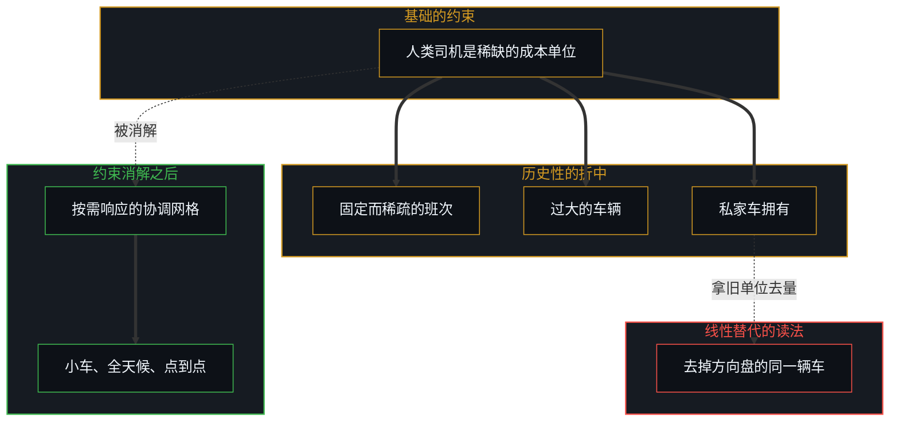
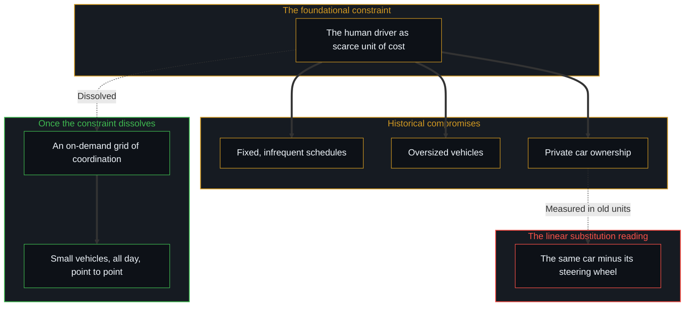

# 一个可能的全自动交通未来的非定论预测 / Non-Definitive Forecast of a Possible Fully Autonomous Transportation Future

*自动驾驶出行不是去掉方向盘的私家车，消解司机约束会重组出行的几何 / Autonomous transit is not the private car minus its steering wheel; dissolving the driver constraint restructures movement.*

评估重大的技术转变时，公共与金融领域的分析习惯于一种线性的、一对一的替代思维。观察者假定电动车只是燃油车的零排放替身，自动驾驶只是去掉了方向盘的私家车。可从约束的一侧追溯，转变很少是靠保留旧容器展开的。当一个基础的约束，人类司机这个稀缺而占主导的成本单位，被消解，塑造了旧交通的那些历史性折中也随之消解。全自动的电动出行不只是替换路上现有的汽车；它解锁了一张不受约束、按需响应的协调网格，重新组织物理空间与人的在场相交的方式。这是一份非定论的预测：它追溯的是约束消解之后可能展开的形状，而不是一份已经到来的结果。

When major technological transitions are evaluated, public and financial analyses habitually fall into linear, one-to-one substitution thinking. Observers assume that electric vehicles are merely zero-emission stand-ins for combustion cars, or that autonomous driving is simply private car ownership with the steering wheel removed. Yet traced from the side of the constraint, transitions seldom unfold by preserving the old containers. When a foundational constraint, the human driver as the scarce and dominant unit of cost, is dissolved, the historical compromises that shaped legacy transportation dissolve with it. Fully autonomous electric mobility does not merely substitute for the cars now on the road; it unlocks an unconstrained, on-demand grid of coordination that reorganizes how physical space and human presence meet. This is a non-definitive forecast: it traces the shape that may unfold once the constraint dissolves, not an outcome that has already arrived.

## 一、 微型公交的锚点，消解司机的稀缺 / 1. The Microtransit Anchor, Dissolving the Scarcity of Drivers

这种结构转变的一个可见的早期迹象，正出现在市政的基础设施里。德国勃兰登堡州的地区主管部门正在探索把自动驾驶车队用于乡村公共交通；面对长期司机短缺与公交客流下滑的地方政府，正在评估用自动驾驶的载客车队让公共出行重新活起来。

A visible early sign of this structural transition is emerging in municipal infrastructure. Regional authorities in Brandenburg, Germany, are exploring autonomous vehicle fleets for rural public transit; local governments facing chronic driver shortages and falling bus ridership are evaluating autonomous passenger fleets to bring public mobility back to life.

在旧的经济结构下，公交主管部门被迫接受一种低效的折中：沿着僵硬而稀疏的班次，开着可载四五十人的大型柴油巴士。这不是因为乘客偏爱僵硬的时刻表或过大的车辆，而是因为人类司机占了运营成本的百分之六十到七十五。在需求稀疏的乡村或郊区，跑空车在财务上难以为继，迫使服务削减，把不开车的人群留在孤立之中。

Under the old economics, transit authorities are pushed into an inefficient compromise: large diesel buses for forty to fifty passengers running on rigid, infrequent schedules. This is not because passengers prefer rigid timetables or oversized vehicles, but because the human driver accounts for 60% to 75% of operating costs. Where demand in rural or suburban areas is sparse, running empty buses cannot be sustained financially, forcing service cuts that leave people who do not drive isolated.

自动驾驶出行并不是用一辆自动驾驶巴士去替换柴油巴士，而是消解了固定班次的经济理由。摆脱了司机人力的约束，车队可以全天候运行，沿着由乘客需求实时塑造的动态路线行驶；小型载客车辆贴合实际的出行负载，大幅减少能耗、空驶与道路磨损；被僵硬的公交长期照顾不到的人群，特别是老人、学生与没有私家车的居民，获得了持续的点到点出行。[遗忘的脚手架](../the-scaffolding-we-forget/)追踪的正是这个动态：僵硬的班次与过大的车辆，是为应对人类司机的稀缺而搭起的临时脚手架；稀缺一旦消失，再把旧时刻表当作公共交通本身，就是一个范畴错误。

Autonomous mobility does not replace the diesel bus with an autonomous bus; it dissolves the economic rationale for the fixed schedule. Freed from the constraint of driver labour, fleets can run around the clock on dynamic routes shaped in real time by passenger demand; small passenger vehicles match actual trip loads, sharply reducing energy use, empty running and road wear; and the people rigid transit has long left unserved, particularly seniors, students and residents without a car of their own, gain continuous point-to-point mobility. [The Scaffolding We Forget](../the-scaffolding-we-forget/) tracks this dynamic: the rigid schedule and the oversized vehicle were temporary scaffolding put up to manage the scarcity of human drivers; once the scarcity is gone, treating the old timetable as public transit itself is a category error.

## 二、 从拥有物质资产到按需进入空间 / 2. From Owning Physical Assets to On-Demand Access to Space

消费一侧最深的转变，是从拥有物质资产，转向无摩擦的、按需的虚拟进入。

The deepest shift on the consumer side is the move from owning a physical asset to frictionless, on-demand virtual access.

传统的拥车被资本、运营与监管上的摩擦层层把守。购车款、贷款利息、保险、保养、燃料与城市停车费，让私家车对全世界数十亿人来说，要么是沉重的财务负担，要么可望而不可即。此外，不会开车的人、未成年人、老人与残障人士，被排除在独立驾驶私家车之外。

Traditional car ownership is gated by friction of capital, operation and regulation. Purchase price, loan interest, insurance, maintenance, fuel and urban parking fees make a private car either a heavy financial burden or out of reach for billions of people worldwide. Beyond that, non-drivers, minors, the elderly and people with disabilities are excluded from driving a private car on their own.

人工驾驶的网约车带来了按需预约，可司机报酬占车费的百分之六十到七十五，把每英里的成本维持在二到三点五美元甚至更高。在这个价格底线上，网约车仍是一种可有可无的便利，而不是私家车拥有的全面替代。

Human-driven ride-hailing brought on-demand booking, but driver compensation accounts for 60% to 75% of the fare, keeping the cost per mile at $2.00 to $3.50 or more. At that price floor, ride-hailing remains a discretionary convenience rather than a full replacement for owning a car.

自动驾驶的电动车队把运营成本压向电费、算力开销、硬件摊销与日常车队维护的边际支出，预计约为每车英里零点二五到零点五美元。到了这个成本门槛，经济上的激励就倒了过来：按需的私人出行，变得明显比拥有、投保、保养并停放一辆入门级私家车更便宜。关键在于，这让更广大的全球人口在无需前期资本、信用审查或驾照的情况下，获得私家车出行的全部效用。[关闭选择权的代价](../the-price-of-closing-optionality/)说明了这种松绑：把一件数吨重、不断贬值的资产停在车道上，关闭了财务与空间上的选择权，而一种按需的公用服务清完一次出行，不留下拖累。

Autonomous electric fleets compress operating costs toward the marginal expense of electricity, compute, hardware amortization and routine fleet maintenance, projected at roughly $0.25 to $0.50 per vehicle-mile. At that cost threshold the economic incentive inverts: on-demand private transport becomes markedly cheaper than owning, insuring, maintaining and parking an entry-level personal car. Crucially, this gives a far wider global population the full use of private vehicular transport without upfront capital, credit checks or a driver's licence. [The Price of Closing Optionality](../the-price-of-closing-optionality/) shows this release: holding a depreciating asset of several tons in a driveway closes financial and spatial optionality, whereas an on-demand utility clears each trip without residual drag.

## 三、 数量级的市场扩张 / 3. Order-of-Magnitude Market Expansion (10x TAM)

传统的汽车估值模型盯着全球每年的新车销量，一个周期性的制造市场，上限约为每年八千万到九千万辆新乘用车，而车辆在其使用寿命的百分之九十五里停着、不产生收入。

Traditional automotive valuation models focus on annual global unit sales, a cyclical manufacturing market capped at roughly 80 to 90 million new passenger cars a year, with vehicles sitting parked and earning nothing for 95% of their working lives.

转向自动驾驶的出行即服务架构，把这个行业从硬件销售的范式（资本支出）转到高利用率的乘客里程范式（运营支出），扩张来自三处：

Moving to an autonomous mobility-as-a-service architecture shifts the sector from a paradigm of hardware sales (CAPEX) to one of high-utilization passenger miles (OPEX), and the expansion comes from three places:

- **资产利用率的倍增**：一辆私家车平均每年行驶一万到一万两千英里，而一辆自动驾驶车队的车辆在连续的服务班次中，每年可以跑出七万到十万以上的付费英里。
- **弹性需求的激活**：当驾驶、停车与公交排班的摩擦趋近于零，人均出行次数会大幅增加。被压抑的出行、两百到五百英里的短途航线、郊区的包裹物流，以及每天的上学与老人通勤，都被吸收进自动驾驶的网格。
- **吸纳相邻的支出**：可服务的市场越出零售汽车销售，吸纳公交补贴、最后一公里的包裹配送、区域铁路与航班的收入，以及商业停车的开支。

- **Multipliers of asset utilization**: a privately owned car averages 10,000 to 12,000 miles a year, while an autonomous fleet vehicle can log 70,000 to 100,000 or more paid miles a year across continuous service shifts.
- **Activation of elastic demand**: when the friction of driving, parking and transit scheduling approaches zero, total trips per person expand sharply. Suppressed trips, short-haul air routes of 200 to 500 miles, suburban parcel logistics, and daily school and elderly commutes are absorbed into the autonomous grid.
- **Capturing adjacent spending**: the addressable market extends beyond retail car sales to absorb transit subsidies, last-mile parcel delivery, regional rail and flight revenues, and commercial parking spending.

从卖不断贬值的钢铁盒子，转向调度数以万亿计的高频出行里程，可服务的市场总量比旧汽车产业扩大一个数量级。[技术变革的局部陷阱](../the-local-trap-of-technological-change/)诊断了金融观察者为什么看不到这个规模：线性的分析者用旧容器的单位销量去量新的前沿，看不到新激活的需求在复利式地叠加。

Moving from selling depreciating steel boxes to orchestrating trillions of high-frequency transport miles, the total addressable market expands by an order of magnitude beyond the legacy car industry. [The Local Trap of Technological Change](../the-local-trap-of-technological-change/) diagnoses why financial observers miss this scale: linear analysts measure the new frontier by the unit volume of the old container and do not see the compounding addition of newly activated demand.

## 四、 财务形态的蜕变，从工业装配到平台软件的利润 / 4. Financial Metamorphosis, from Industrial Assembly to Platform Software Margins

出行行业的财务架构，可能经历一次结构性的转变，类似从本地部署的企业服务器转向云计算的公用服务。

The financial architecture of the mobility sector may go through a structural shift like the move from on-premise enterprise servers to cloud computing utilities.

传统的汽车制造是一门周期性的硬件装配生意，毛利率很薄（百分之八到十五），每卖出一辆车确认一次收入。相比之下，一个自动驾驶出行平台的运作像一种经常性的软件公用服务，综合毛利率超过百分之五十到七十，来源有三：

Traditional car manufacturing is a cyclical business of hardware assembly with thin gross margins (8% to 15%) and one-time revenue recognized per vehicle sold. An autonomous mobility platform, by contrast, works like a recurring software utility with blended gross margins above 50% to 70%, from three sources:

- **智能的边际成本趋近于零**：自动驾驶车队的核心价值来自 AI 驾驶系统。一旦训练、验证并通过空中升级部署，再为一辆车或一英里乘客里程提供驾驶智能的边际成本趋近于零。
- **高利润的网络协调**：负责实时路线、动态车队调配、能源与充电优化以及派单的平台，在每一笔交易上收取软件平台的费用。
- **硬件摊销的效率**：由于车辆连续运行，底层硬件的成本在大量里程上被迅速摊销，让运营者在给出极低消费价格的同时，取得接近软件的高利润率。

- **Near-zero marginal cost of intelligence**: the core value of an autonomous fleet comes from the AI driving stack. Once trained, validated and deployed over the air, the marginal cost of providing driving intelligence to one more vehicle or passenger-mile approaches zero.
- **High-margin network coordination**: the platform that coordinates real-time routing, dynamic fleet rebalancing, energy and charging optimization, and dispatch takes software platform fees on every transaction.
- **Efficient hardware amortization**: because the vehicle runs continuously, the cost of the underlying hardware is amortized quickly over high mileage, letting operators reach software-like margins while offering very low consumer prices.

传统的现金流折现模型难以处理这个转变，因为它们试图用一个旧的金属冲压产业的参数，去预测一种涌现的网络公用服务。[进步叙事中的症候与原因](../symptom-and-cause-in-the-narratives-of-progress/)追踪了这种概念上的倒置：分析者把汽车当作首要的原因、把软件当作附件，而自动驾驶车队把这个层级倒了过来，软件网络是首要的坐标系，车辆只是一个标准化的终端。

Traditional discounted cash flow models struggle with this transition because they try to forecast an emergent network utility with the parameters of a legacy metal-stamping industry. [Symptom and Cause in the Narratives of Progress](../symptom-and-cause-in-the-narratives-of-progress/) tracks this conceptual inversion: analysts treat the car as the primary cause and the software as an accessory, whereas autonomous fleets invert the hierarchy, so that the software network is the primary coordinate system and the vehicle a standardized terminal.

## 五、 无摩擦的空间协调的涌现 / 5. The Emergence of Frictionless Spatial Coordination

按这份预测追溯下去，交通的未来不会只是个人消费者把内燃机换成电池组。它的形状来自一种按需的、智能的出行公用服务的涌现：它去掉资本门槛，向不会开车的人敞开出行，解锁潜在的交通需求，并把行业的经济重心从低利润的硬件制造，移向一个以软件驱动、规模大一个数量级的高利润生态。

Traced along this forecast, the future of transportation will not be individual consumers merely trading combustion engines for battery packs. Its shape comes from the emergence of an on-demand, intelligent mobility utility that removes capital barriers, opens movement to non-drivers, unlocks latent travel demand, and moves the industry's economic centre of gravity from low-margin hardware manufacturing to a high-margin, software-driven ecosystem an order of magnitude larger.

这种采用不需要中央的命令；它发生，是因为数以百万计的个人自由地选择了更顺手、更便宜的点到点服务，而不再承担拥有资产的财务摩擦，所以[个体抉择是唯一的因果杠杆](../individual-choices-as-the-only-causal-levers/)。[开放即一致](../openness-is-consistency/)为这个结论落了锚：旧的技术边界一旦消解，交通就不再是一张由强制折中排成的僵硬时刻表，而成为人的移动可以在其上展开的、敞开而连续的地面。

Adoption of this kind needs no central mandate; it happens because millions of individuals freely choose the smoother and cheaper point-to-point service over the financial friction of owning an asset, which is why [Individual Choices as the Only Causal Levers](../individual-choices-as-the-only-causal-levers/). [Openness Is Consistency](../openness-is-consistency/) anchors the conclusion: once the old technological boundaries dissolve, transportation stops being a rigid timetable of enforced compromises and becomes an open, continuous ground on which human movement unfolds.
