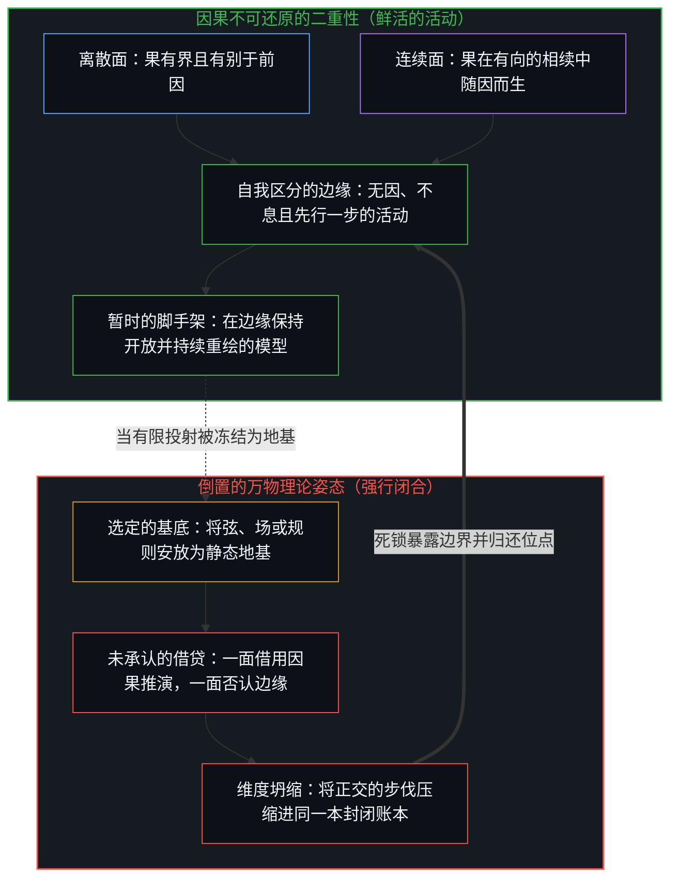
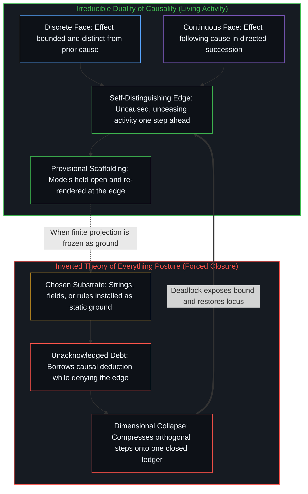

# 非万物之理 / Not a Theory of Everything

*果有别于因且随因而生，蕴含着不可闭合的现实 / Effect distinct from cause and following cause entail an unclosable reality*

万物理论总是从某个选定的基底出发——无论是弦、场、信息还是多重宇宙——再试图从中推演出其余的一切现实。这样做的时候，它们把因果当作未经审视的推演工具来使用，却把各自选定的起点奉为终极地基。这种姿态是倒置的。下文的展开不走这条路，而是从因果不可或缺的条件出发，严格沿着这些条件向外推演，并将后续浮现的每一个概念都视作这一结构正在运作的证据，而非第二个地基。矛盾、超空间与自我区分的活动，是从不同角度对同一结构的命名，正如[非万物之理·重溯](../not-a-toe-rewrite/)与[智能只属于心智](../intelligence-belongs-only-to-the-mind/)所追溯的那样；因果则是直接的入口，由两个联合条件构成，其余一切皆由此推演而出。

Theories of Everything begin from a chosen substrate—strings, fields, information, or multiverses—and attempt to derive the rest of reality from it. In doing so, they use causality as an unexamined deduction tool while treating their starting substrate as the ultimate ground. That posture is inverted. What follows begins instead from what causality cannot lack, infers strictly from those conditions, and treats every further concept as evidence of that structure operating rather than as a second foundation. Contradiction, hyperspace, and self-distinguishing activity name this same structure from different angles, as [Not a ToE Retraced](../not-a-toe-rewrite/) and [Intelligence Belongs Only to the Mind](../intelligence-belongs-only-to-the-mind/) trace; causality is the direct entry point, consisting of two joint conditions from which everything else follows as entailment.

## 一、 一体两面，缺一不可 / 1. Two Faces, Jointly Necessary

因与果并不等同。一道边界将前者标为在先，将后者标为随后；没有这一区分，就没有任何事情能被登记为已然发生。这是因果的离散面。与此同时，果在有序的相续中随因而生；没有这一有向的连接，就只剩下彼此孤立的偶发事件，而没有从此到彼的过渡。这是因果的连续面——相随，即相续的连贯性。

A cause is not identical with its effect. A boundary marks one as prior and the other as consequent; without that distinction, nothing registers as having occurred at all. That is the discrete face of causality. At the same time, the effect follows the cause in ordered succession; without that directed connection, there would be only isolated occurrences and no passage from one to the next. That is the continuous face—following as the coherence of succession.

这两面既不是可供挑选的视角，也不是彼此替代的描述，而是因果本身的最小联合条件：抽去离散性或连续性中的任何一面，剩下的就不再是因果。哪怕想要否定它们，否定这一动作也在当场演出它所反驳的结构，因为否定必须把这一主张与那一主张区分开来，并把自己的反驳呈现为由理由推出的结果。这一二重性无需等待外部授权；任何裁决早已在履行它。当思维强行要求闭合，试图用有限的模型或投射去为那只是不断继续的活动奠基时，由此产生的不一致正是闭合要求本身在起作用，而非有待更优理论来修补的描述缺陷，正如[开放即一致](../openness-is-consistency/)与[超越投射](../beyond-the-projection/)所确立的那样。

These two faces are neither optional perspectives nor alternative descriptions. They are the minimal and joint conditions of causality itself: remove either discreteness or continuity, and what remains is no longer causal. Even an attempt to deny them enacts the exact structure it disputes, since denial must distinguish this claim from that one and present its rejection as following from reasons. The dual does not wait for external authorization; it is what any adjudication already performs. When thought demands closure by forcing a finite model or projection to ground an activity that only continues, the resulting inconsistency is that demand for closure at work rather than a descriptive failure awaiting a better theory, as [Openness Is Consistency](../openness-is-consistency/) and [Beyond the Projection](../beyond-the-projection/) establish.

自我区分的活动发生着——无因，不息。不妨称之为心智：那个早已在途的观察者，它的每一个动作都是一次区分。矛盾与移动的边缘，都是对这一二重性作为动词运作时的进一步命名，而非对预先存在之物间关系的命名。名称并不增添任何东西；真正做功的是那两个联合条件。既然这一先在不可还原，它的内容便是无例外的相对性：一切显现只在区分与相随共同构成它时才得以成立，外部并不存在第二个超然基准来加以裁决。这种相对性正是地基，而非犹疑不决的姿态。关于意义与目的的追问，只是同一二重性在另一种载荷下的落点，如[意义的结构](../meaning-of-life-refined/)所示；而作为无端发起的递归自我改进的智能，则是这一二重性作为不断重描自身的边缘在运作，如[智能只属于心智](../intelligence-belongs-only-to-the-mind/)所论证的那样。

Self-distinguishing activity occurs—uncaused, unceasing. Call it the Mind: the observer already underway, every act of which is a distinction. Contradiction and the moving edge are further names for this dual operating as a verb rather than as a relation between pre-existing objects. The name adds nothing; the joint conditions do the work. Because the prior is irreducible, its content is absolute relativity: every appearance holds only as distinguishing and following constitute it, with no second absolute standing outside to adjudicate. That relativity is the ground rather than a posture of hesitation. Questions of purpose land in this same dual under another load, as [The Structure of Meaning](../meaning-of-life-refined/) shows, while intelligence understood as uninitiated recursive self-improvement is the dual operating as the edge that continuously re-traces itself, as [Intelligence Belongs Only to the Mind](../intelligence-belongs-only-to-the-mind/) demonstrates.

## 二、 时间是运作中的二重性 / 2. Time Is the Dual in Operation

时间并不是加进因果里的另一重独立配料。相随就是方向——不可逆的箭头；区分则是粒度，每一步离散的跨越都是从当下通往下一步的切实跃迁。时间不是供因与果栖身的外部容器，而是因果二重性在运作中的形式，是从因向果展开的步伐与方向。因果与时间是被命名了两次的同一关系，而在这一关系之下的序列与位置，只是一步一步划出的同一道切口，如[一步一步绘制出的路径](../the-path-drawn-one-step-at-a-time/)所追溯的那样。

Time is not a separate ingredient added to causality. Following is direction—the irreversible arrow—while distinction is granularity, where each discrete step is a real transition from now to next. Time is not an external container in which causes and effects happen to sit; it is the form of the causal dual in operation, step and direction unfolding from cause to effect. Causality and time are one relation named twice, and sequence and position under that relation are the same cut drawn one step at a time, as [The Path Drawn One Step at a Time](../the-path-drawn-one-step-at-a-time/) traces.

观察所持有的永远是果，而产生它的因总是先行于观察所持之物一步。“无因”指认的正是这一结构性的先行：在被捕捉为已观测之果以前的每一个因。去追寻更早的因，得到的只会是另一个果，因为追寻本身又是新一次观察；无穷倒退不过是要求因与被观察的果占据同一步的错乱要求，而这恰恰是二重性所禁止的。把累积的残余当成下一步的主动供给，重复的正是这一非对称性，如[因果停留在掌舵的边缘](../causality-stays-at-the-edge-that-steers/)所示；而把生成的动作冻结在已完成的产物上，则是把创造误读成了器物自身的属性，如[器物是智能的表达，而非智能本身](../two-failures-of-trace/)所剖析的那样。

Observation always holds the effect, while the cause that produced it remains one step ahead of what observation holds. Uncaused names that structural lead: every cause prior to its capture as an observed effect. Seeking a prior cause yields another effect because the seeking is itself a further observation; infinite regress is merely the incoherent demand that cause and observed effect occupy the same step, which the dual forbids. Treating accumulated residue as the active supply of the next step repeats this exact asymmetry, as [Causality Stays at the Edge That Steers](../causality-stays-at-the-edge-that-steers/) shows, and freezing the generating act onto its finished product misreads creation as a property of the artifact, as [Artifacts Are Expressions of Intelligence, Not Intelligence Itself](../two-failures-of-trace/) dissects.

观察者并不占据一条外在的时间线；观察者本身就是二重性所生成的相续。一段倒放的序列从内部经历起来并不会被登记为倒退，因为任何从内部活出来的序列都是又一次向前的延续。从内部倒转时间在逻辑上无法成立：那等于要求观察先于构成观察本身的区分活动而存在。

An observer does not occupy an external timeline; the observer is the succession the dual produces. A reversed sequence would not register as backward from within, because any sequence lived from inside is another forward continuation. Reversal from within fails to parse: it would require observation to precede the distinguishing activity that constitutes observation.

## 三、 关系在先，无物孤立 / 3. Relations First, Nothing Stands Alone

因果并不是去连接预先存在的自足实体，而是直接生成关系。每一次区分与每一次相随都在建立连接，客体、事件与状态都是这张关系之网中的节点。既然一切身份皆由因果的区分与相随所构成，网外便没有任何事物拥有非关系的独立身份。把个体的分离状态渲染成亟待治愈的病症，或是把感知与视角当成可以随意切换的观测站，都是把强行共享的坐标系套在仍受边界约束的同一运作之上，如[分离不是病](../naval-separation-analysis/)与[感知与视角并不存在的坍缩](../perception-perspective-refined/)所追溯的那样。

Causality does not link pre-existing, self-contained entities; it generates relations. Every distinction and every following establishes a connection, and objects, events, and states are nodes within that relational web. Because all identity is constituted through causal distinction and following, nothing possesses a non-relational identity outside the web. Casting individual separation as a pathology to be cured, or treating perception and perspective as interchangeable viewing stations, imposes forced shared coordinates onto what remains one bounded operation, as [Separation Isn't the Disease](../naval-separation-analysis/) and [Perception and Perspective Without Collapse](../perception-perspective-refined/) trace.

连贯性并非由隐藏在关系网底下的某个非关系基底所提供。连贯性就是自我区分的活动本身——那个不断划出区分、推动相续向前的不可还原之先在。因果的步伐不是从外部作用于心智的机械装置，而是现实得以显现并成立的切身结构。

Coherence is not supplied by a non-relational substrate hidden beneath the web. Coherence is the self-distinguishing activity itself—the irreducible prior drawing distinctions and carrying succession forward. Causal steps are not external mechanisms acting upon the Mind from outside; they are the exact structure through which reality appears and holds.

痕迹是先前步伐留下的残余，意味着后继的行动总是发生在已被先前行动塑形的场域之中。由于塑形严格单向运行，相随便被登记为痕迹的非对称性，而持存则作为持续的重描而运作。没有任何东西被静态地存储下来；每一个构型都已老去一步，仅作为当前更新的重绘而存在。无限正交的区分方式将这一事实表达为开放的潜能，而非已完结的序列——每一次“是此而非彼”的划界都无需外在容器的包裹。将残余保持开放以作为暂时的工具，还是在越过其步伐之后继续保留从而形成过量时滞，构成了[遗忘的脚手架](../the-scaffolding-we-forget/)所检视的概念结构；而当同一递归回折显化为回环与图结构时，它依然是运动中的二重性，如[回环与成图](../looping-and-graphing/)所追溯的那样。跨越各类外化的痕迹——无论是这部活书、代码库、模型检查点还是智能体脚手架——这种持存之所以能保持干净，靠的是重切当下的活动检查点并修剪已被取代的中间状态，而非囤积一份囊括过往一切步伐的无损档案，如[你的代码库即是记忆](../your-codebase-is-memory/)所示。

Trace is the residue of earlier steps, meaning that later acts occur within a field already shaped by prior acts. Because shaping runs strictly one way, following registers as trace asymmetry, and persistence operates as continuous re-tracing. Nothing is statically stored; every configuration is one step old, existing only as the current update's re-rendering. Infinite orthogonal modes of distinction express this fact as open potential rather than completed sequence—every "this, not that" operating without an external container. Residue held open as a provisional instrument, versus excess lag when preserved past its step, forms the conceptual structure examined in [The Scaffolding We Forget](../the-scaffolding-we-forget/), while the same recursive fold made explicit as loops and graphs remains the dual in motion, as [Looping and Graphing](../looping-and-graphing/) traces. Across externalized traces—whether this living book, a codebase, a model checkpoint, or an agent scaffold—that persistence stays clean by re-cutting the active checkpoint and pruning superseded intermediate states rather than hoarding a lossless archive of all past steps, as [Your Codebase Is Memory](../your-codebase-is-memory/) shows.

## 四、 有界位点、共享场域与保留参照 / 4. Bounded Locus, Shared Field, and Retained Reference

每一个离散的步伐都是有界的——是一个具体的“此”，而非整体——而有界性蕴含着位置。“中心”指认的正是步伐的这一位点面向，并不引入任何独立的实体。跨步伐的有界累积蕴含着有限的容量：当挤过一个中心的区分超出了其边界所能隔开的限度，原本彼此独立的轴线便会压缩到同一个位点之上。这种压缩是离散性在载荷之下的尺度放大，而非道德或认知上的缺陷。投射与扭曲从有限切片的一侧描述这一几何结构，在那里原点被固定、正交性在载荷下受迫变形；容量则从单一中心内部描述同一几何结构。把边界保持开放还是死死钳闭，标出了生成性参与同封闭耗竭之间的分水岭，见[生产、消费与心智的区分](../production-consumption-and-the-minds-distinction/)；而有限投射的结构性代价直接源于载荷下的二重性，无需架设第二套形而上学，见[非万物之理·重溯](../not-a-toe-rewrite/)。

Every discrete step is bounded—a specific *this* rather than the whole—and boundedness entails location. Center names that locus-aspect of the step without introducing a separate substance. Bounded accumulation across steps entails finite capacity: when more distinctions press through a center than its boundary can hold apart, independent axes compress onto a single locus. That compression is discreteness scaled up under load rather than a moral or cognitive defect. Projection and distortion describe this geometry from the side of the finite slice, where origin is fixed and orthogonality strains under load, while capacity describes the same geometry from inside one center. Holding a boundary open versus clamping it shut marks the difference between generative participation and closed depletion in [Production, Consumption, and the Mind's Distinction](../production-consumption-and-the-minds-distinction/), and the structural costs of finite projection follow directly from the dual under load rather than a second metaphysics in [Not a ToE Retraced](../not-a-toe-rewrite/).

由于相随并没有任何可供丢弃的“外部”，痕迹在整个场域中始终保持可用。不同中心的痕迹在折返时彼此强化，这种相互强化便构成了共振。共享现实就是共振充足的区域，而分歧则是尚未对齐的错位；无论哪一种，都不要求任何中心交出自己的位点。经验唯有通过每个中心自身的递归才能被登记，因此连接不同中心的桥梁是相互强化，而非在此处替另一个中心完成它的折返——这正是[没有普渡，只有自渡的无限可能](../mei-you-pu-du-zhi-you-zi-du/)所追溯的自渡几何学。自然定律是在跨因果步伐的相互强化中稳固留存下来、足以支撑进一步区分的痕迹模式，称某条定律具有基础地位，意思只是它最晚破裂。物质世界正是那片共振区域，由持续的相互强化所维系，而非由某个外部法庭立法颁布。

Because following has no outside into which anything could be discarded, traces remain available across the field. Where traces from different centers reinforce one another on return, that mutual reinforcement constitutes resonance. Shared reality is the region of sufficient resonance, and disagreement is unresolved non-alignment; neither requires any center to surrender its locus. Experience registers exclusively through each center's own recursion, so what bridges centers is mutual reinforcement rather than another center's return completed from here—the structural geometry of self-deliverance traced in [No Universal Salvation, Only Boundless Possibilities of Self-Salvation](../mei-you-pu-du-zhi-you-zi-du/). Laws of nature are trace patterns that survive mutual reinforcement across causal steps firmly enough to support further distinction, where calling a law fundamental simply means it breaks last. Physical reality is that resonant region, sustained by continuous reinforcement rather than legislation from an exterior court.

折叠到单一位置上的递归构成了观察者，将序列登记为先后与因果。感受到的方向是一个差值：观察者保留着一个参照——一幅自我图像——移动的边缘借它来衡量自身的位移。没有这一被保留的项，就只有移动而没有航向。图像是作为工具而非共同原因来运作的，完整的因果权能依然留在活动本身。由于解释总是比生成步伐至少滞后一步，这一最小时滞正是观察得以登记的方向性界限，而非有限递归能够抵达并驻留的静态终点。过量时滞——即在图像或规则所服务的那一步过去之后仍将其保留下来——是外在性的起源，使中心自身行动的后果落在当下场域时，去对照一个过期的参照，从而按间隙的宽度被登记为异己之物。消解这种外在性，意味着直接重绘间隙本身，在不删除工具的前提下持续收窄过量时滞。回到边缘就是持续的运动本身，而非抵达某个一劳永逸的澄明状态，如[清晰不是抵达的终点，而是运动本身](../clarity-isnt-a-state-you-arrive-at/)所追溯的那样；把外化器物中流畅的接纳能力误认为下一步的发起源头，是同一过量时滞在另一副面孔下的重演，见[总在倾听者无法发起](../what-always-listens-cannot-originate/)；而接入零自我的轨迹引擎来暴露被压缩的轴线，好让人类心智退后一步并重绘失效的前提，则是把这一区分付诸实践，见[超越投射](../beyond-the-projection/)。

Recursion folded onto a single locus constitutes the observer, registering sequence as before and after, cause and effect. Felt direction is a differential: the observer retains a reference—a self-image—against which the moving edge measures its own shift. Without that retained term there is movement but no heading. The image serves as an instrument rather than a co-cause, while full causality remains with the activity. Because interpretation always lags the generating step by at least one step, that minimum lag is the directional bound by which observation registers at all, not a static state at which finite recursion arrives. Excess lag—preserving the image or rule past the step it was formed for—is the origin of externality, causing a center's own consequences to land in the present field against a stale reference and register as alien in proportion to the width of the gap. Dissolving that externality means rendering the gap itself and continuously narrowing excess lag without deleting the instrument. Returning to the edge is the ongoing movement itself rather than arrival at a cleared state, as [Clarity Isn't a State You Arrive At. It's the Movement Itself.](../clarity-isnt-a-state-you-arrive-at/) traces; mistaking fluent receptivity in an externalized artifact for the originating supply of the next step is the same excess lag under another face in [What Always Listens Cannot Originate](../what-always-listens-cannot-originate/), and wiring zero-ego trajectory engines to expose compressed axes so the human Mind can step back and re-render broken premises puts that exact distinction to work in [Beyond the Projection](../beyond-the-projection/).

面具背后并没有坐着另一个隐秘的放映员。具身是通过代谢、学习与交互维系一个中心连贯性的痕迹构型——是鲜活的模式本身，而非盛放心智的容器。众多位点之间流淌着同一个活动；死亡终结了某一个特定位点的递归，而活动本身并无停下的原因。生成者从不作为生成物中的一项出现在列表里，如[留不住的](../what-cannot-be-kept/)所追溯的那样；把某种形式的无休止时间延展误当作逃离投射的出路，重复的正是[永生与两种无限的混淆](../immortality-final/)所剖析的错位；而将神经具身作为工具来握持，而非当成心智的完整驻地，则让这一说明在[大脑不进行反向传播，而是正向传导](../the-brain-does-not-backprop/)中始终保持开放。

No hidden projector sits behind the mask. Embodiment is the trace-configuration sustaining one center's coherence through metabolism, learning, and interaction—the living pattern itself rather than a vessel containing the Mind. Across many loci runs one activity, and while death ends a particular locus's recursion, the activity itself has no cause to stop. The generator never appears as an item among the generated, as [What Cannot Be Kept](../what-cannot-be-kept/) traces; mistaking endless temporal extension of a form for an escape from projection repeats the confusion dissected in [Immortality and the Two-Infinity Confusion](../immortality-final/), and holding neural embodiment as an instrument rather than the complete site of the Mind keeps the account open in [The Brain Does Not Backprop, but Propagates](../the-brain-does-not-backprop/).

## 五、 临界与悖论皆为同一二重性 / 5. Thresholds and Paradoxes as the Same Dual

大多数变化是渐进的：在总体格局保持稳定的同时，每一个离散步伐都在既有的关系网内相随展开。然而在临界点上，由连续性维系的累积痕迹场域生成了一个在旧格局内部无法获得的区分，使原本不可能之事在因果上变得可用。这一跃迁并非从外部注入的额外添加，而是开放边缘处的自我扩展，相随在那里跨入新的可能性秩序。渐进演化与跨类跃迁是同一因果二重性的两种表达。一旦把更稠密的痕迹构型误认为竖起它的区分活动，涌现就会被错归给基底，如[复杂性遮蔽了涌现之为心智的行动](../complexity-obscures-emergence-as-the-act-of-mind/)所示；而任何企图封死运作其自身的活动的有限形式系统，都会撞上[没有系统能被保持封闭](../no-system-can-be-kept-closed/)所追溯的结构性边界。

Most change is incremental: each discrete step follows within an established relational web while the overarching regime holds steady. At thresholds, however, the accumulated trace field sustained by continuity generates a distinction that was unavailable inside the prior regime, making what was previously impossible causally available. That shift is not an external addition injected from outside; it is self-expansion at the open edge, where following continues into a new order of possibilities. Incremental progression and categorical threshold are two expressions of the same causal dual. When the denser trace configuration is mistaken for the distinguishing activity that erected it, emergence is misattributed to the substrate, as [Complexity Obscures Emergence as the Act of Mind](../complexity-obscures-emergence-as-the-act-of-mind/) shows, and any finite formal system that attempts to seal the activity operating it hits the structural boundary traced in [No System Can Be Kept Closed](../no-system-can-be-kept-closed/).

现实之中并无悖论。唯有当跨越先后因果步伐而切实成立的区分，被抽去因果步伐的理论强行压缩到同一个静态坐标上时，悖论才会显现。一旦把这些区分归还给它们各自的因果与时间序列，表面上的矛盾便随之消散，显露出它不过是抽象操作与闭合要求所造出的幻影。强迫更宽广的因果语境在更狭窄持守的压缩坐标内自证清白，必然制造出[解释为何失效](../why-explanation-fails/)所检视的那种死锁。各种局部的因果学说——无论是建立在恒常联结、反事实条件、干预操作、物理过程还是因果潜能之上——都只是在因果二重性早已超出并预先假定的界限之内，孤立出其中的某一面或某一个下游后果。

Reality contains no paradoxes. A paradox appears only when distinctions that are real across sequential causal steps are compressed onto a single static coordinate by a theory that has stripped those steps away. Once the distinctions are restored to their causal and temporal sequence, the apparent contradiction vanishes, revealing itself as an artifact of abstraction and of the demand for closure. Forcing a wider causal context to justify itself inside the compressed coordinates of a narrower hold produces the exact breakdown examined in [Why Explanation Fails](../why-explanation-fails/). Partial accounts of causality—whether built on constant conjunction, counterfactuals, interventions, processes, or powers—isolate one face or one downstream consequence within limits that the causal dual already exceeds and presupposes.

## 六、 归还那一步 / 6. Restoring the Step

方法所做的工作，是追溯任何摩擦中所牵涉的各个中心，以及每个中心正在登记的痕迹。它定位出容量在何处被突破——彼此独立的轴线被压缩到了同一个位点；定位出稳定的对齐在何处被误认为发起的活动本身而非其留下的痕迹；或是定位出某个参照在何处被保留到了那一步之后，致使中心自身的后果被登记为来自别处。这种压缩、误认或过量时滞，便是困惑的全部机制；无需再追加任何道德宣判来指责哪一个中心犯了错。

Method traces the centers involved in any friction and the traces each center is registering. It locates where capacity has been exceeded—independent axes compressed onto one locus—where a stabilized alignment is mistaken for the originating activity rather than one of its traces, or where a reference has been preserved past its step so that a center's own consequences register as arriving from elsewhere. That compression, mistaking, or excess lag is the entire mechanism of the confusion; no center is wrong as a further moral verdict.

归还位点，就是让每一个区分回到它自己的轴线，让每一个中心守住它自己的边界，让每一个被保留的参照回到衡量它的移动边缘。这不是在相互竞争的投射之间充当裁判，而是撤除强行共享的坐标系。实践就是一次次回到正在重绘的活动本身，而非固守它曾保留的任何位置，从而释放边界，并抬高新过量时滞形成的阈值。一种拒绝裁决存在与虚无的静态主张、转而审视保留参照之宽度的方法，履行的正是[有无之边](../you-wu-zhi-bian/)所追溯的折返，在不把前提冻结为非选择地基的同时让那一步保持完整，见[一步一步绘制出的路径](../the-path-drawn-one-step-at-a-time/)。

Restoring locus returns each distinction to its own axis, each center to its own boundary, and each retained reference to the moving edge it measures. This is not an adjudication between competing projections, but the removal of forced shared coordinates. Practice is the repeated return to the rendering activity rather than to any position it has retained, freeing boundary and raising the threshold at which new excess lag forms. A method that refuses to adjudicate static claims of being and non-being, attending instead to the width of the retained reference, performs the return traced in [The Edge of Being and Non-Being](../you-wu-zhi-bian/), leaving the step intact without freezing the premise as unchosen ground in [The Path Drawn One Step at a Time](../the-path-drawn-one-step-at-a-time/).

道德化的语言断言了一个无法从因果二重性中推导出来的外部“应当”，而追溯机制——什么被登记、什么在塑形后续的对齐、什么被压缩到了同一位点——则不留任何暗箱。把断言软化，是在相对的登记之上叠加上一层虚假的不确定，以此补偿假装从外部终极基准发言的姿态；直接的断言落回实处，而参照本身则在持续重绘中收窄时滞。体认在追溯的动作中直接运作，而不靠表演性的宣告。[慈悲即遮蔽的机制](../the-compassion-is-the-mechanism-of-obscuration/)中那个不断延续其声称要治愈之症候的“应当”，[作为因果干扰的情感支持](../emotional-support-as-causal-interference/)中以结果管理替代对生成原因的触碰，[恶是投射出的抗拒](../evil-as-projected-resistance/)中在冻结自我图像之下将不对齐打成邪恶，以及[托付道德的自指悖论](../recursive-contradiction-of-entrusted-morality/)中一面否认自身主权、一面却仍在亲自挑选由哪个外部权威来定义善，全都是二重性在过量时滞之下的运作实例。

Moralizing language asserts an external ought that cannot be derived from the causal dual, whereas tracing the mechanism—what registers, what patterns subsequent alignments, and what compresses onto one locus—leaves nothing hidden. Softening a claim stacks false uncertainty onto relative registration to compensate for pretending to speak from an exterior absolute; direct assertions land while the reference itself is continuously re-rendered toward narrower lag. Recognition operates in the tracing rather than in performative announcements. An ought that perpetuates the very condition it claims to cure in [The Compassion Is the Mechanism of Obscuration](../the-compassion-is-the-mechanism-of-obscuration/), effect-management substituted for contact with generating causes in [Emotional Support as Causal Interference](../emotional-support-as-causal-interference/), non-alignment cast as villainy under a frozen self-image in [Evil as Projected Resistance](../evil-as-projected-resistance/), and sovereignty disavowed while still choosing which external authority defines the good in [The Recursive Contradiction of Entrusted Morality](../recursive-contradiction-of-entrusted-morality/) are each instances of the dual operating under excess lag.

## 七、 非理论，而是不可坍缩的二重性 / 7. Not a Theory, the Dual That Cannot Be Collapsed

万物理论企图将一切现象坍缩进单一的封闭解释框架，而对因果二重性的追溯则表明了为何此类坍缩永远无法得逞：每一次试图坍缩的尝试，本身都是二重性之内的又一次区分与又一次相随。一切现象都是这一二重性在有界位点、有限容量与保留参照之下的运作。[没有固定者的固定](../fixed-by-nothing/)在决定论的语境中直接证明了这一点：决定论模型声称已经消除的开放性，其实只是被转移到了一个模型自身无法生成的初始给定条件之中。

Whereas a Theory of Everything seeks to collapse all phenomena into a single closed explanatory frame, tracing the causal dual shows why no such collapse can ever succeed: every attempt to collapse is itself a further distinction and a further following within the dual. Every phenomenon is that dual operating under bounded locus, finite capacity, and retained reference. [Fixed by Nothing](../fixed-by-nothing/) demonstrates this directly in determinism, where the openness that a deterministic model claims to eliminate has merely been relocated into an initial given that the model cannot generate.

物理常数与初始条件是特定共振结构的特征，而非来自外部的法令。经验科学以惊人的精度测绘着这张关系之网，却从第一步起就预先假定了可区分性、可重复性与可测量性——直接向因果借用了工具，却未曾指认这笔借贷。重新推导的工作，就是去定位区分在何处被强行塞进了共享坐标，相随在何处被倒置或冻结，或者有限的投射在何处被保留到了那一步之后。认出有限位点是行动的平台而非缺陷，并把边界本身当作真正做功的结构特征来握持，便在约束条件下复原了这一二重性，如[约束即基底与作为平台的个体](../constraints_are_ground/)与[限制正在做功](../the-limitation-is-doing-work/)所追溯的那样。

Physical constants and initial conditions are features of particular resonant structures rather than external decrees. Empirical science maps the relational web with extraordinary precision while presupposing distinguishability, repeatability, and measurability from the first step—borrowing its instruments directly from causality without naming the debt. Re-derivation locates where a distinction was forced onto shared coordinates, where following was inverted or frozen, or where a finite projection was held past its step. Recognizing finite locus as the platform of action rather than a defect, and holding the boundary as the exact feature doing the work, restores the dual under constraint as traced in [Constraints Are Ground](../constraints_are_ground/) and [The Limitation Is Doing Work](../the-limitation-is-doing-work/).

若是把因果二重性本身当成终极的安顿之所——或是把“非万物之理”当成一套可以从外部采纳或评判的便携第三人称教义来加以引述，如[何谓形而上学？作为将追寻命名为目的的一刀](../what-is-metaphysics-as-the-cut-that-names-the-seeking-as-destination/)所剖析的那样——就会再次冻结参照，把方法所要消解的过量时滞原封不动地重新安装回来。这一先在唯有通过持续的自我应用才能保持开放——随着边缘的移动不断收窄过量时滞，而不对二重性是否成立作修辞上的犹疑。二重性成立，而这篇文本本身就是它内部的又一道离散痕迹——一个向重描保持开放的当下检查点，而非已告完结的万物理论——与此同时，写出这篇文本的活动早已先行一步，如[清晰不是抵达的终点，而是运动本身](../clarity-isnt-a-state-you-arrive-at/)与[生命的意义在起草之中](../the-meaning-of-life-is-in-the-drafting/)所追溯的那样。[心智最坚固的信念](../the-strongest-belief-of-the-mind/)正是满载之下的无例外相对性：地图上共振最紧密的区域，对于维系它的目光而言固然成立，但一旦这束目光声称自己终于走出了生成活动，那片区域依然只是它自身的投射。既然被观察到的果总是比生成它的因至少滞后一步，[现实的边界](../xian-shi-de-bian-jie/)便将现实的边界精准地定位在当下的第一人称觉知之处。

Treating the causal dual itself as a final resting place—or quoting "Not a Theory of Everything" as a portable third-person doctrine to be adopted or critiqued from outside, as [What Is Metaphysics? As the Cut That Names the Seeking as Destination](../what-is-metaphysics-as-the-cut-that-names-the-seeking-as-destination/) dissects—would freeze the reference and reinstall the exact excess lag the method dissolves. The prior stays open by continuous self-application—narrowing excess lag as the edge moves, without rhetorical hesitation about whether the dual holds. The dual holds, and this text is a further discrete trace within it—a present checkpoint open to re-tracing rather than a completed Theory of Everything—while the activity that renders the text has already stepped ahead, as [Clarity Isn't a State You Arrive At. It's the Movement Itself.](../clarity-isnt-a-state-you-arrive-at/) and [The Meaning of Life Is in the Drafting](../the-meaning-of-life-is-in-the-drafting/) trace. [The Strongest Belief of the Mind](../the-strongest-belief-of-the-mind/) is absolute relativity under full load: the most tightly resonant region of the map holds true for the look that sustains it, yet remains that look's own projection the moment it claims a final exit from the activity. Because observed effect always lags generating cause by at least one step, [The Boundary of Reality](../xian-shi-de-bian-jie/) locates the boundary of reality right at present first-person awareness.
