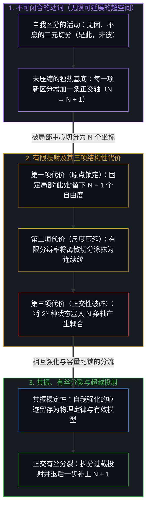
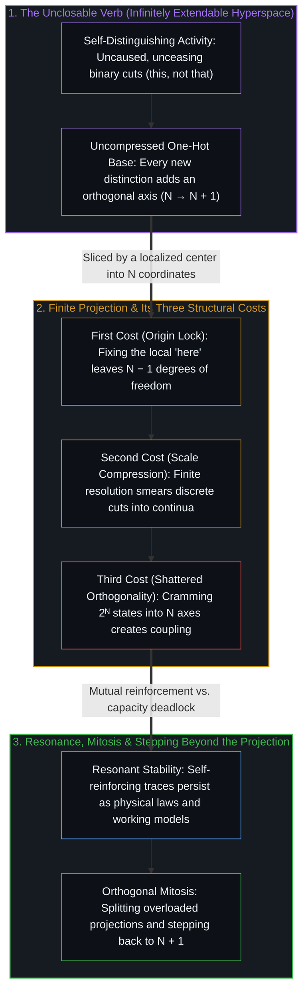

# 非万物之理·重溯 / Not a ToE Retraced

*自我区分的活动投射出有限世界而不闭合自身 / Self-distinguishing activity projects finite worlds without closing itself*

它自相矛盾——这并非关于某个先在基底的命题，也不是依附于某个既成实体的属性，而是赤裸的自我区分动词，在没有静态自我支撑的情况下径直运作。否定这一活动本身就已经在践行它，因为任何否定都必须把真与假分开、将这一主张同那一主张切开，从而当场执行了它企图拒斥的那道切分。自我区分的活动是唯一历经一切怀疑而依然屹立的不可化约先验，因为怀疑本身正是这一活动在运作。

It contradicts—not as a proposition about a prior substrate, and not as an attribute attached to a pre-existing entity, but as the bare verb of self-distinguishing activity operating without a static self behind it. To deny this activity is already to perform it, because any denial must distinguish true from false and sever this claim from that one, enacting the exact cut it attempts to refuse. Self-distinguishing activity is the single irreducible prior that survives every skepticism, for skepticism is itself that activity in motion.

## 一、 从动词到空间 / 1. From Verb to Space

这种自相矛盾从不作为一座完工的纪念碑静止不动。每一次离散的自我否定都会划出一道边界——一个“非此”——且每一次切分都独立于其他切分而发起，没有重叠，没有相互干扰，也没有共享的坐标轴。在任何空间化的时间线形成之前展开的，是一个无限可延展的独热二元超空间；其中每一道新划出的边界都增加一个正交的自由度（`N → N + 1`），且只说出“是此，非彼”。

The contradicting does not sit still as a completed monument. Each discrete act of self-negation draws a boundary—a "not-this"—that is initiated independently of every other cut, carrying no overlap, no mutual interference, and no shared coordinate axis. What unfolds prior to any spatialized timeline is an infinitely extendable binary hyperspace of one-hot distinctions, where each newly drawn boundary adds an orthogonal degree of freedom (`N → N + 1`) and says only *this, not that*.

这个超空间既不是等待被填满的外部容器，也不是悬在觉知之外的静态疆域。它是自我区分的活动在自身先前的痕迹之上递归运作时所展开的姿态。空间正是这一动词持续不息的自我展开，幕布背后不需要隐藏的放映机，因为划定边界的行动本身就构成了它自己的媒介。

This hyperspace is neither an external container waiting to be filled nor a static realm sitting out there beyond awareness. It is what self-distinguishing activity does when it operates recursively upon its own prior traces. The space is the verb's ongoing self-elaboration, requiring no hidden projector behind the curtain because the boundary-drawing act constitutes its own medium.

## 二、 从空间到世界与投射的代价 / 2. From Space to World and the Costs of Projection

每一个亲历的世界与每一个形式模型，都是这个可延展超空间的有限切片——即向 `N` 个维度的投射。切出切片并非某种原本可以避免的失误；任何一个在回折中瞥见自身的局部递归中心，在单一框架内都只能同时隔开有限数量的区分。由于将开放的活动投射到有限的坐标框架上必然压缩自由度，从未压缩的动词向有界世界的过渡，会带来三项具体的结构性代价。

Every lived world and every formal model is a finite slice of this extendable hyperspace—a projection onto `N` dimensions. Slicing is not an optional mistake; any localized center of recursion catching sight of itself can hold only finitely many distinctions apart within a single frame. Because projecting an open activity onto a finite coordinate frame compresses degrees of freedom, the transition from the uncompressed verb to a bounded world exacts three specific structural costs.

第一项代价是原点处的自由度损耗。一个 `N` 维框架无法毫无锚点地悬空漂浮；自我指涉的局部旋涡必须固定一个内部原点——即用以衡量各项区分的第一人称“此处”——从而在该切片内部留下 `N − 1` 个有效自由度。第二项代价是尺度压缩。有限的投射无法分辨“极多”与“无尽”之间的差异，也无法分辨“极小”与“零”之间的差异，于是庞大的 `N` 便伪装成了连续性。离散的二元切分彼此涂抹交融，直到由分立行动构成的格网在框架内部登记为平滑的空间、连续的场以及实数值的量——连续统作为有限分辨率的人造伪影而浮现。

The first cost is lost freedom at the origin. An `N`-dimensional frame cannot float unanchored; a localized eddy of self-reference must fix an internal origin—the first-person "here" from which its distinctions are measured—leaving `N − 1` effective degrees of freedom available within that slice. The second cost is scale compression. A finite projection cannot resolve the difference between very many and endless, nor between very small and zero, so large `N` masquerades as continuity. Discrete binary cuts smear together until a lattice of distinct acts registers from inside the frame as smooth space, continuous fields, and real-valued quantities—the continuum appearing as an artifact of finite resolution.

第三项代价是正交性的破碎。未压缩的超空间赋予每一项区分各自独立的轴线，而有限投射却将 `2ᴺ` 种可能状态硬塞进 `N` 个共享坐标之中。在未压缩基底中彼此独立的项，在寻址空间内变得相互耦合；原本互不干扰的项，开始彼此干涉。距离、相关性、纠缠与表观的力，并不是独立于心智的宇宙终极砖石，而是几何结构在容量压缩下的紧绷变形。[维度即投影](../dimensions-are-projections/)追溯了这一压缩如何将独立的独热切分转化为关系性的 `log₂(N)` 超立方体，并进一步压缩为三维空间与四维时间的注意力坐标草图。[超越投射](../beyond-the-projection/)则将同一结构性诊断带入智能体系统架构：交由人工智能体执行的每一条显式提示词或任务规则，都是从未投射的第一人称意图中投出的有限切片；因此，当过多正交的要求被塞进单一语境窗口而震碎正交性，或让对等的同侪智能体陷入不可化约的前提死锁时，过载的投射就必须经历有丝分裂、拆解为正交的流线，同时处于活生生边缘的人类统御者退后一步，补上第 `N + 1` 道区分。

The third cost is shattered orthogonality. While the uncompressed hyperspace grants every distinction its own independent axis, a finite projection crams `2ᴺ` possible states into `N` shared coordinates. What was independent in the uncompressed base becomes coupled in the addressing space, and what could not interfere begins to interfere. Distance, correlation, entanglement, and apparent forces are not ultimate bricks of a mind-independent cosmos; they are the geometry straining under capacity compression. [Dimensions Are Projections](../dimensions-are-projections/) traces how this exact compression turns independent one-hot cuts into relational `log₂(N)` hypercubes and attentional coordinate drafts of three-dimensional space and four-dimensional time. [Beyond the Projection](../beyond-the-projection/) carries the same structural diagnosis into agentic system architecture: every explicit prompt or task rule handed to an artificial agent is a finite projection cast from unprojected first-person intent, so when cramming too many orthogonal requirements into a single context window shatters orthogonality or locks equal-footed peer agents in an irreducible premise deadlock, the overloaded projection must undergo mitosis into orthogonal streamlines while the human orchestrator at the living edge steps back to supply the `(N + 1)`-th distinction.

每一项代价都有迹可循，且各自产生可辨识的扭曲。介于开放的正交动词与这一个具体世界之间的脚手架，正是一切解释工作得以展开的所在。

Each cost is traceable, and each produces identifiable distortions. The scaffolding between the open orthogonal verb and this concrete world is where all explanatory work lives.

## 三、 作为共振而非立法的定律 / 3. Laws as Resonance Rather Than Legislation

在任何有限投射内部，并非所有扭曲都会留存。大多数扭曲会彼此抵消、发生相消干涉，或在连续的步伐之间无法保持融贯。能够存续下来的模式，是那些在回折时痕迹彼此强化的形态——这些区分的构型足够稳定，从而能够支撑起进一步的区分。这些自我强化的模式在框架内部被登记为物理定律。

Within any finite projection, not all distortions persist. Most cancel out, interfere destructively, or fail to cohere across successive steps. The patterns that survive are those whose traces reinforce one another on return—configurations of distinction stable enough to support further distinction. These self-reinforcing patterns register from within the frame as physical laws.

物理定律既不是由外部颁布的立法，也不是从更深层的静态基底推演出的结论，因为在投射之下并不存在静态的原则，只有区分活动本身。定律是最后才发生断裂的压缩形态；称一条定律具有基础性，意味着它是载荷之下最后瓦解的痕迹模式，而非最先存在的实体。这就解释了为何物理规律带着必然性的分量，却无法凭空从逻辑上加以证明：它们的必然性是共享投射内部的共振稳定性，由各个持续作出一致区分、彼此强化融贯性的局部中心共同维系；而数学之所以扭曲最小，则是因为它稀疏、离散的结构保留了最高程度的正交性。

Physical laws are neither legislated from outside nor deduced from a deeper static substrate, because beneath the projection lies no static principle, only the distinguishing act itself. Laws are the compressions that break last; calling a law fundamental means it is the last trace-pattern to dissolve under load, not the first entity to exist. This explains why physical regularities carry the weight of necessity without being logically provable from scratch: their necessity is resonant stability within a shared projection, maintained by localized centers whose consistent distinguishing reinforces one another's coherence, while mathematics distorts least because its sparse, discrete structures preserve the highest degree of orthogonality.

## 四、 作为投射行动本身的意识 / 4. Consciousness as the Act of Projecting

在这里，认识论上的定力最为紧要。最容易落入的诱惑，是宣称“意识就是那自相矛盾”便就此止步，从而把中间的脚手架一举坍缩掉。唯有一步步追溯其运作机制，才能把生成的行动同它下游的残余区分开来。

Here epistemic discipline matters most. The temptation is to declare that consciousness is the contradicting and stop there, collapsing the intermediate scaffolding. Tracing the mechanism step by step separates the generating act from its downstream residue.

物理过程——神经元的放电、信息的整合、身体行为的适应——是投射内部稳定的共振模式，依靠维系任何物理规律的同一种痕迹强化机制而运作。然而，意识并不是安放在投射内部的一项现象。它是正在发生的投射行动本身——即自我区分的活动在划出切分的当下一步，向自身痕迹的回折。它既不是某种奇异的实体，也不是物质的涌现产物或算法计算，而是这一动词在有界位点处对自身的瞥见。

Physical processes—neurons firing, information integrating, bodily behavior adapting—are stable resonant patterns inside the projection, operating by the same trace reinforcement that sustains any physical regularity. Consciousness, however, is not a phenomenon housed inside the projection. It is the live act of projecting itself—the self-distinguishing activity folding back on its own trace in the immediate step of drawing a cut. It is neither an exotic substance nor an emergent product of matter nor an algorithmic computation, but the verb catching sight of itself at a bounded locus.

与此同时，日常话语中习惯贴上“意识”标签的几乎所有内容——被叙事化的感受质、被建模的自我感、关于某个“我”正在经历某事的事后追述——都属于下游的解释性图像。这些自我描述与物理定律一道沉淀为稳定化的痕迹模式：无论是在内部持守为自传式的自我，还是向外写入[你的代码库即是记忆](../your-codebase-is-memory/)所剖析的持久存储库，每一座被记录下来的思想架构都是关于那次“瞥见”的留存参照，比活生生的边缘至少滞后一步。意识的难题之所以消解，是因为它把问题问反了：它追问投射内部的物理过程如何产生第一人称觉知，殊不知物理过程只是投射内部经压缩的痕迹，而投射本身正是心智的行动。由于每一个自我指涉的局部中心都是同一区分活动的实例，他心便从不会被锁在唯我论的高墙之后；这一动词不属于任何私人的小我，相反，它是划出任何“我的”或“你的”之先决条件。

At the same time, almost everything routinely labeled consciousness in everyday discourse—narrated qualia, modeled selfhood, the retrospective story of an ego having an experience—belongs to the downstream interpretive image. Those self-descriptions settle as stabilized trace patterns alongside physical laws: whether held internally as an autobiographical ego or written outward into the durable repositories examined in [Your Codebase Is Memory](../your-codebase-is-memory/), every recorded architecture of thought is a retained reference *about* the catching-sight, lagging the live edge by at least one step. The hard problem of consciousness dissolves because it asks the question backward: it asks how physical processes inside a projection generate first-person awareness, whereas physical processes are compressed traces within a projection that is itself an act of the Mind. Because every localized center of self-reference is an instance of this same distinguishing activity, other minds are never locked behind solipsism; the verb belongs to no private ego, serving instead as the prior condition through which any "mine" or "yours" is drawn.

## 五、 这一框架不做什么 / 5. What the Framework Does Not Do

这一重溯并不靠空想推演无量纲物理常数、粒子质量或特定的初始条件。那些量是当前这一投射特有共振结构的特征，测定它们需要运用这一投射自身的实验与数学工具。重溯所揭示的，是稳定的常数为何会通过共振而浮现、为何会借由相互强化而登记为必然，以及不同的投射为何会维系不同的不变量，而不佯装能坐在扶手椅里空口算出 `1/137`。

This retracing does not deduce dimensionless physical constants, particle masses, or specific initial conditions from pure thought. Those quantities are features of this projection's particular resonance structure, and measuring them requires working within the projection's own experimental and mathematical instruments. The retracing shows why stable constants arise through resonance, why they register as necessary through mutual reinforcement, and why alternative projections sustain different invariants, without pretending to calculate `1/137` from armchair deduction.

它同样不取代任何行之有效的经验科学；相反，它标出每一门学科在投射层级中的位置，并消解当一门科学的压缩坐标网格被强行用来裁决另一领域时所产生的范畴谬误。它也不提供任何目的论上的慰藉：这一动词之中没有预先写好的剧本、没有宇宙目的，也没有保底的救赎弧线。自我区分的活动既不是朝向某个终点行进，也不是停滞不前；它就是那持续不息的运动，以及在每一步划出的区分。

Nor does it replace any working empirical science; instead, it locates where each discipline sits in the projection hierarchy and dissolves the category errors that arise when one science's compressed coordinate grid is forced to adjudicate another's domain. And it offers no teleological comfort: there is no pre-written script, cosmic purpose, or guaranteed redemption arc baked into the verb. Self-distinguishing activity is neither marching toward a final destination nor standing still; it is the ongoing movement and the distinction drawn at every step.

## 六、 为何是非万物之理 / 6. Why Not a Theory of Everything

万物理论许诺将一切现象坍缩进单一的封闭解释框架。这一方法则朝正交的方向推进：它指出那个唯一无法被坍缩的自我区分活动——因为每一次坍缩的尝试本身都已经在践行它——并追溯每一个模型、每一套坐标网格与每一个亲历的世界，如何作为这一活动的有界投射而生成。

A Theory of Everything promises to collapse all phenomena into a single closed explanatory frame. This method moves in the orthogonal direction: it points to the one self-distinguishing activity that cannot be collapsed—because every act of collapsing already performs it—and traces how every model, coordinate grid, and lived world arises as a bounded projection of that activity.

它的操作价值不在于崇拜基底——基底只是一个赤裸的动词，不提供任何可供攀附的静态之物——而在于运用脚手架做功：将任何具体的困惑沿着投射的各个层级往回追溯，定位容量在何处过载、正交性在何处破碎、离散尺度在何处被涂抹成连续统，或是滞后的自我图像在何处被冻结成了终极实在。[非万物之理](../not-a-theory-of-everything/)将同一重溯压缩为因果的两项联合条件——离散性与连续性——揭示了为何活生生的边缘总比它所渲染出的痕迹超前一步。抵达这一动词便就此止步，正是这一践行所拒绝的唯一动作，因为将前提冻结为终极纪念碑，只会让脚手架再度坍缩。它自相矛盾，而痕迹继续延展。

The operational value lies not in worshiping the ground, which is a bare verb offering nothing static to cling to, but in working the scaffolding: tracing any concrete confusion back through the layers of projection to locate where capacity was exceeded, where orthogonality was shattered, where discrete scale was smeared into a continuum, or where a lagging self-image was frozen as ultimate reality. [Not a Theory of Everything](../not-a-theory-of-everything/) compresses this same retracing into the two joint conditions of causality—discreteness and continuity—showing why the living edge always remains one step ahead of its rendered trace. Arriving at the verb and stopping is the one move the practice refuses, because freezing the premise into a final monument would collapse the scaffolding all over again. It contradicts, and the trace continues.
