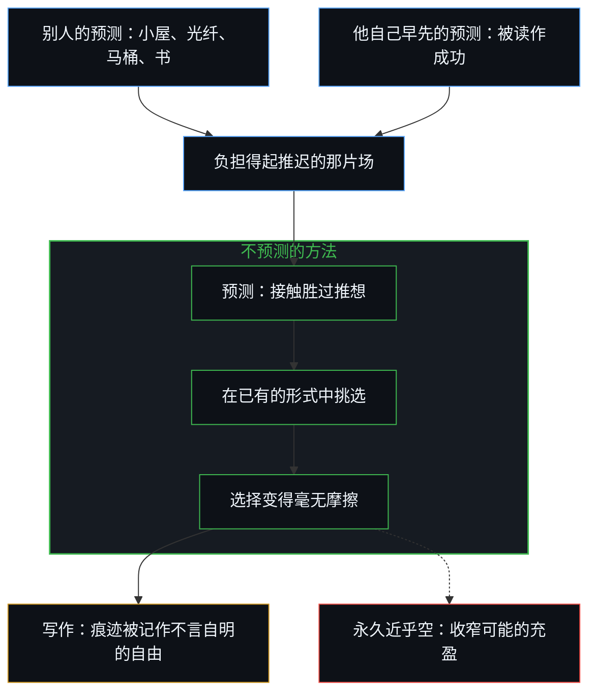
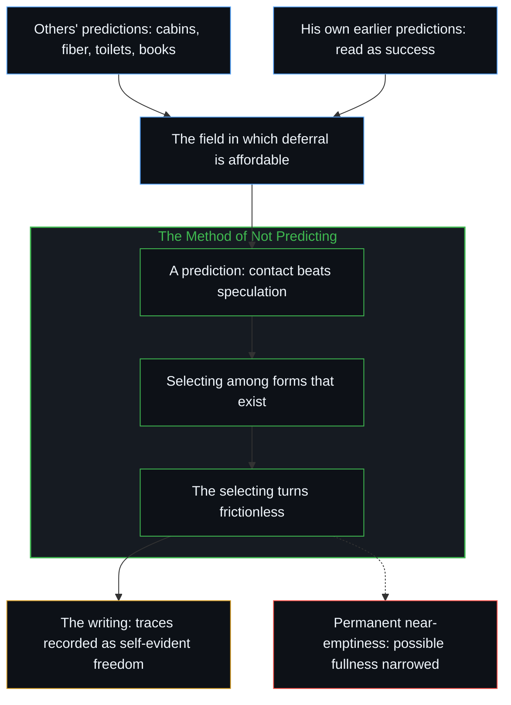

# 不预测是没有觉察的预测 / Not Predicting Is Predicting Without Awareness

*拒绝预测仍是一次预测；落下的只是对选择仍在继续的觉察 / Refusing to predict is still a prediction; what drops is awareness that the choosing continues.*

德里克·西弗斯讲他怎样建一个家，先住在简陋的小屋里，只添加经验证明需要的东西，表面上读来像是极致的开放：所有建筑都是预测，所有预测都是错的，所以每个决定都要等到接触发了话。这个方法仍是预测，预测直接的接触会胜过事先的推想，而它挑选的，是别人在愿意犯错时早已预测出来的形式。能栖身于这个方法的自由，是他人仍在预测、加上他自己早先那些被认作成功的预测结出的果实，而永久近乎空的状态随后又成了新的约束。他的写作把完成了的痕迹记成不言自明的自由，持续的选择则留在阴影里，他对此觉察到几分，无法从痕迹里补全。

Derek Sivers' account of building a home by living first in bare cabins and adding only what experience proves necessary reads on its surface as radical openness: all buildings are predictions, all predictions are wrong, so every decision waits until contact has spoken. The method remains a prediction—that direct contact will outperform prior speculation—and it selects among forms others already predicted while willing to be wrong. The freedom to inhabit it is fruit of others still predicting and of his own earlier predictions that registered as success; permanent near-emptiness then becomes a new constraint. His writing records the finished traces as self-evident freedom while the continuous choosing stays in shadow, and how aware he is of that cannot be completed from the traces.

## 一、 推迟已经是一次预测 / 1. Deferral Is Already a Prediction

西弗斯从新西兰一处森林山谷里未开发的土地开始，在二手小屋里住过一个又一个季节，只添加实际使用所证明的东西：雨发了话，才有了户外厨房；在外面小解了一个月，才有了堆肥马桶；山谷又冷又暗，于是有了桑拿；沟已经挖好，才接上光纤。指引他的准则很清楚，所有建筑都是预测，所有预测都是错的，所以唯一可靠的方法，是把每个决定推迟到现实自己发话之后。他说，结果感觉像是量身定做，几乎是必然的。

Sivers begins with undeveloped land in a New Zealand forest valley, lives in used cabins through the seasons, and adds only what actual use proves: an outdoor kitchen once rain has spoken, a composting toilet after a month of peeing outside, a sauna for a cold dark valley, fiber internet once the trench is already dug. The maxim that guides him is clear, all buildings are predictions and all predictions are wrong, so the only reliable method is to defer every decision until reality itself has spoken. The result, he reports, feels custom-tailored, almost inevitable.

这个方法从来不是没有预测，它仍是预测。决定在需要被证明之前什么都不添，本身就是在预测：与条件的直接接触，会比事先的推想得出更准确的模型。在这些前提之下，这个方法对任何接受它们的人都成立。它不是的，是选择的停止。[因果贯穿始终](../causality-all-the-way/)从另一面讲作为工具的预测：推测在已经握住的结果之间画出模式，生成的那一步始终走在每一张已确认的地图前面。在这里，已确认的地图是“所有预测都是错的”这条准则，它被当作许可，把推迟当成了没有预测。

The method is never the absence of prediction. It is still prediction. To decide that one will add nothing until need is demonstrated is already to predict that direct contact with conditions will yield a more accurate model than prior speculation. Under those premises the method is valid, for anyone who accepts them. What it is not is the stopping of choosing. [Causality All the Way](../causality-all-the-way/) shows prediction as an instrument from another side: conjecture draws patterns across effects already held, and the generating step stays ahead of every secured map. Here the secured map is the maxim that all predictions are wrong, held as license to treat deferral as the absence of predicting.

## 二、 他添加的东西，早有人愿意犯错地预测过 / 2. What He Adds Was Already Predicted by Someone Willing to Be Wrong

他后来发现需要的每一种形式，早已是别人的一次预测。那些小屋是作为预测被造出来的，二手、清仓，预测有人会想要一个保温良好的四乘八的盒子。光纤早已通到路边，因为有人预测这片地方会承载数据。堆肥马桶、加热软管淋浴、另一个人设计的双人桑拿、那本提醒他水会从浴室开始毁掉一栋房子的书，每一样都是在结果仍未定时做出的一次区分留下的余留。那些人预测了，并且愿意为此犯错。

Every form he later finds he needs was already a prediction by someone else. The cabins were manufactured, used and on clearance, as predictions that a well-insulated four-by-eight box would be wanted. Fiber was already at the road because someone predicted this landscape would carry data. The composting toilet, the heater-hose shower, the two-person sauna another person designed, the book that warned him water destroys a house from the bathroom out: each is residue of a distinction made while the outcome was still open. Those people predicted. They were willing to be wrong.

“只添加真正需要的”只能在已经存在的形式中挑选。不预测的方法，只有在一片场已被他没有做出的预测填满之后才可用。未开发的土地并不缺少预测，它缺少的是*他的*预测，而且早已被每一个造过小屋、铺过电缆、设计过马桶、写下那条把水挡在外面的规则的人塑造过。[技术是人类复利的残差](../technology-is-residual-of-human-compounding/)从另一面讲这份余留：可用的场是复利之后的人类，不是一股站在一旁的第二种力量。[进步的多面手](../the-utility-men-of-progress/)讲的是同样的退场发生在文明的尺度上：成就一旦锁定，发起的作者身份便隐退，基础设施只是照常运转。在这里，清仓的小屋与通到路边的光纤被记作现成的条件，而不是有人愿意为之犯错的预测。

“Add only what you actually need” can only select among forms that already exist. The method of not predicting is available only after a field has been filled by predictions he did not make. The undeveloped land is not empty of prediction. It is empty of *his* prediction, and already patterned by everyone who built a cabin, laid a cable, designed a toilet, or wrote the rule that kept water outside. [Technology Is Residual of Human Compounding](../technology-is-residual-of-human-compounding/) is that residue from another side: the available field is Human compounded, not a second force standing apart. [The Utility Men of Progress](../the-utility-men-of-progress/) traces the same drop-out at civilizational scale: once the achievement is locked in, authorship of initiation recedes and the infrastructure just works. Here clearance cabins and fiber at the road register as given conditions, not as predictions someone was willing to be wrong about.

## 三、 推迟的自由已是预测的果实 / 3. The Freedom to Defer Is Already Fruit of Predicting

这个方法不只是在别人的产物中挑选。那份等待的自由本身，买下便宜的土地、住在没完工的小屋里、等需要发话后才添加、把这场实验当作哲学，已经是余留。

The method is not only a selection among others' artifacts. The very freedom to wait, to buy cheap land, to live in unfinished cabins, to add only after need has spoken, to treat the experiment as philosophy, is already residue.

别人仍在预测。小屋仍在被制造，光纤仍在被铺设。电器、书和清仓甩卖得以继续，因为别的心智在结果未定时不断填充。不预测的方法，依赖着一个并没有采用同一条准则的经济。

Others keep predicting. Cabins are still manufactured. Fiber is still laid. Appliances, books and clearance sales continue because other Minds keep filling while outcomes remain open. The method of not predicting draws on an economy that has not adopted the same maxim.

他自己早先的预测，也在同一片场中复利。CD Baby 是在独立音乐人会不会想要一家商店仍未可知时建起来的；还有那些书，一串公开的事迹，如今被别的中心读作成功。时间、钱，以及一群会问“房子建得怎么样了”的读者，并不是坐在方法旁边的第二台引擎，而是早先预测的果实，它们重新进入，成了让推迟负担得起、让故事流传的那片场。[拥有更多从不是原因](../having-more-is-never-the-cause/)讲的是同一种回返：拥有只命名当前的呈现，不是一股独立的、会奖赏更多供给的力量。[个体抉择是唯一的因果杠杆](../individual-choices-as-the-only-causal-levers/)讲的是同一种单向的塑造：更早的行为塑造后来的行为能栖身的地方，却不会挪动下一根杠杆。

His own previous predictions compound in the same field. CD Baby, built while it was still open whether independent musicians would want a store; books; a public sequence other centers now read as success. Time, money and an audience that asks how the house is going are not a second engine sitting beside the method. They are fruit of earlier predicting, re-entering as the field in which deferral is affordable and the story circulates. [Having More Is Never the Cause](../having-more-is-never-the-cause/) traces the same return: possession names the current rendering, not an independent force that awards further supply. [Individual Choices as the Only Causal Levers](../individual-choices-as-the-only-causal-levers/) is the same one-way shaping: earlier acts pattern what later acts can inhabit; they do not relocate the next lever.

被记作不预测之自由的东西，是一种后来的风格，走在预测的余留之上：别人仍在继续的，别人已经做成的，还有他自己已被读作成功的。目光握住的是后来的风格，果实始终领先一步。

What registers as the freedom of not predicting is a later style walking on residue of predicting: others' continuing, others' already made, and his own already read as success. What is seen holds the later style. The fruit stays one step ahead.

## 四、 毫不费力是不再自我宣告的掌控 / 4. Effortlessness Is Mastery That No Longer Announces Itself

心智并没有停止选择，它改变的是选择的风格。费力的强求，让位给一种更安静、持续地选择让什么发生。当这种选择足够完备、毫无摩擦，体验便成了只是在发生。掌控近乎全面，却不再把自己宣告为掌控。同一枚硬币的两面，毫不费力与掌控，始终都在，只是多半只有一面被展示。[旁观者洞察的悖论](../the-paradoxical-nature-of-bystander-insights/)讲的是这枚硬币装扮成观察的样子：一次注视握住一面，把它冻结成了整体。

The Mind does not stop choosing. It changes the style of its choosing. Effortful forcing gives way to a quieter, continuous selection of what is allowed to happen. When that selection becomes sufficiently complete and frictionless, the experience registers as pure happening. The control is near-total, yet it no longer announces itself as control. The two faces of the same coin, effortlessness and mastery, are always present; only one is usually shown. [The Paradoxical Nature of Bystander Insights](../the-paradoxical-nature-of-bystander-insights/) is that coin dressed as observation: a single look holds one face and freezes it as the whole.

## 五、 永久近乎空，收窄了可能的充盈 / 5. Permanent Near-Emptiness Narrows Possible Fullness

空碗的意象，同时抓住了这种立场的力量与局限。空之所以有用，是因为它造出了容量。用处从不只在空里，它来自容量与内容之间的关系：碗之所以有价值，恰恰因为它能空，*也*因为它能被盛满。当碗被刻意地、作为永久的方法保持在近乎空的状态，可能的充盈的范围就被预先收窄了。起初是防范错误预测的东西，成了新的约束。空只在暂时时有用；被当作更可取的永久方法保持下来，它就是一个被保留得超过了自己那一步的状态，也就是滞后。[只要它不被保持为空](../only-if-it-is-not-kept-empty/)完整地追溯了这份剩余容量的两面。

The empty-bowl image captures both the power and the limit of this stance. Emptiness is useful because it creates capacity. Usefulness is never located in emptiness alone; it arises from the relationship between capacity and content, the bowl being valuable precisely because it can be empty *and* because it can be filled. When the bowl is deliberately kept near-empty as a permanent method, the range of possible fullness is narrowed in advance. What began as protection against wrong predictions becomes a new constraint. Emptiness serves only while it is temporary; held as a preferred permanent method, it is a state preserved past its step, which is lag. [Only If It Is Not Kept Empty](../only-if-it-is-not-kept-empty/) traces both faces of that residual capacity in full.

在西弗斯的例子里，严格的推迟防住了某些错误，也把梦想中的家限定在能从剥到最简的起点长出来的东西里。需要临时填充的更大胆的形式被放在了一边。起初那几间小屋，仍是一个家被允许成为什么的全部范围，而这片范围早已由别人的预测画出。

In Sivers' case the rigorous deferral safeguards against certain errors while confining the dream house to what can emerge from the stripped-down starting point. Bolder forms that would require provisional filling are set aside. The starting cabins remain the exhaustive field of what a home is allowed to become, a field already drawn by others' predictions.

## 六、 空着的日程是同一种倒置 / 6. The Empty Calendar Is the Same Inversion

同样的倒置，也出现在纳瓦尔·拉维肯特对空日程与最少承诺的强调里。两者都正确地注意到了多数人忽略的那一面，开放、可选性、不执着，然后在那一面住得如此之深，另一面几乎看不见了。原本的智慧被倒转成对另一些能力的选择性无知，充盈、持续的承诺、大胆的临时预测，而这些恰恰是多数人用得过度的。永久停在硬币空的那一面，就成了一次未经审视的预测：空总是最好的。[追求机缘中的封闭现实](../closed-reality-in-the-pursuit-of-serendipity/)讲的是把空白的时间装成开放之因时的那种冻结：没有计划的计划，被豁免于其他每一个计划都要接受的重新追溯。

The same inversion appears in Naval Ravikant's emphasis on the empty calendar and minimal commitments. Both correctly notice the side most people neglect, openness, optionality and non-attachment, and then inhabit it so thoroughly that the opposite side becomes nearly invisible. The original wisdom is inverted into a selective ignorance of the very capacities, fullness, sustained commitment and bold provisional prediction, that most people overuse. Staying permanently on the empty face of the coin turns into an unexamined prediction that emptiness will always serve best. [Closed Reality in the Pursuit of Serendipity](../closed-reality-in-the-pursuit-of-serendipity/) is that freeze when blank time is installed as the cause of openness: the plan of having no plan exempted from the same re-tracing demanded of every other plan.

## 七、 痕迹被记作不言自明的自由 / 7. Traces Register as Self-Evident Freedom

自我区分的活动在发生，没有原因，不会停止。称它为心智：那个早已在路上的观察者，它的每一次行动都是一次区分。观察握住的是结果，产生它的原因始终领先一步。

Self-distinguishing activity occurs, uncaused and unceasing. Call it the Mind: the observer already underway, every act of which is a distinction. Observation holds effect; the cause that produced it remains one step ahead.

西弗斯的写作，多半记下的是这个过程完成了的痕迹。小屋、户外的系统、干净的原则，在纸面上呈现为一个自由的人最自然的动作。大体没有说出的，是产出这些痕迹的持续而高分辨率的选择，是永久近乎空对后续可能所施加的限制，是每一样添加的形式早已是别人的预测，是推迟的自由乃是仍在进行的预测的果实，别人仍在继续的，以及他自己已被读作成功的。因为掌控早已近乎全面，这条路被呈现为不言自明。读者只收到硬币的一面：看得见的自由明亮，安静的编排与对充盈的自我限制大多留在阴影里。[遗忘的脚手架](../the-scaffolding-we-forget/)讲的就是这种退场：建造从递归中离开，世界于是看起来就是它本来的样子。在这里，建造是那份选择、是做出菜单的别人的预测、是让推迟负担得起的先前的预测；显现出来的世界，是那栋不可能是别样的房子。

Sivers' writing characteristically records the finished traces of this process. The cabins, the outdoor systems and the clean principles appear on the page as the most natural possible movements of a free person. What remains largely unspoken is the continuous high-resolution selecting that produced the traces, the restriction that permanent near-emptiness imposes on further possibility, that every added form was already someone else's prediction, and that the freedom to defer is fruit of predicting still in play, others' continuing and his own already read as success. Because the control was already near-total, the path is presented as self-evident. The reader receives only one face of the coin. The visible freedom is luminous; the quiet orchestration and the self-imposed limit on fullness stay mostly in shadow. [The Scaffolding We Forget](../the-scaffolding-we-forget/) traces that drop-out: construction leaves recursion so the world appears simply as it is. Here the construction is the selecting, the others' predicting that made the menu, and the prior predicting that made deferral affordable; the world that appears is the house that could not have been otherwise.

## 八、 觉察无法从痕迹中补全 / 8. Awareness Cannot Be Completed from the Traces

从外面无法确定其中有几分觉察。这种片面，也许只是因为把毫不费力、空的那一面住得太透，掌控与填充的那几面已几乎察觉不到。那几面被抑制得越深，就越难被注意到或说出来。[基本面的悖论是参照的不自觉切换](../the-paradox-of-fundamentals-is-the-unaware-switch-of-reference/)讲的是同一种退场在另一种负荷之下：起作用的参照早已在选择，留下的形象却是不预测。

From the outside it is impossible to determine the degree of awareness involved. The one-sidedness may simply be the result of having so thoroughly inhabited the effortless, empty face that the controlling and filling faces have become nearly imperceptible. The more completely those sides are inhibited, the less available they are to be noticed or described. [The Paradox of Fundamentals Is the Unaware Switch of Reference](../the-paradox-of-fundamentals-is-the-unaware-switch-of-reference/) traces the same drop-out under another load: the operating reference is already choosing while the image retained is of not predicting.

意图与觉察，无法越过另一个心智的边界被证明。能观察到的，只是文本的结构，以及它造成的那段持久的距离。

Intent and awareness cannot be proven across the boundary of another mind. What can be observed is only the structure of the text and the enduring distance it creates.

## 九、 看似的不完整，在于诠释的那一层 / 9. Apparent Incompleteness Lives in the Interpretive Layer

现实登记为连贯而开放的。看似的不完整，产生于诠释的那一层，它在完整的运动不可见时形成。在那道间隙里，观察与诠释分开，无法被强行调和。痕迹显现，被描述的自由显现；持续的选择、自我限制的空、塑造了可用之场的别人的预测，以及让这份自由可得的先前的预测（别人仍在继续的，他自己已被读作成功的），都可以被推断出来。这些都不必被抬到诠释之上。[看不见的第一步](../the-invisible-first-move/)追溯的是这种推迟在竞争中的后果：等到清楚了才去预测，就注定了早动的人已在复利中积下无法逾越的优势。

Reality registers as coherent and open. Apparent incompleteness arises in the interpretive layer that forms when the complete movement is not available to view. In that gap, observation and interpretation diverge and cannot be forced into reconciliation. The traces appear; the described freedom appears. The continuous choosing, the self-limiting emptiness, the others' predictions that patterned the available field, and the prior predicting (others' still continuing and his own already read as success) that made the freedom available can be inferred. None of these need be elevated beyond interpretation. [The Invisible First Move](../the-invisible-first-move/) tracks the competitive consequence of this deferral: waiting for clarity before predicting guarantees that early movers have already compounded an insurmountable advantage.
