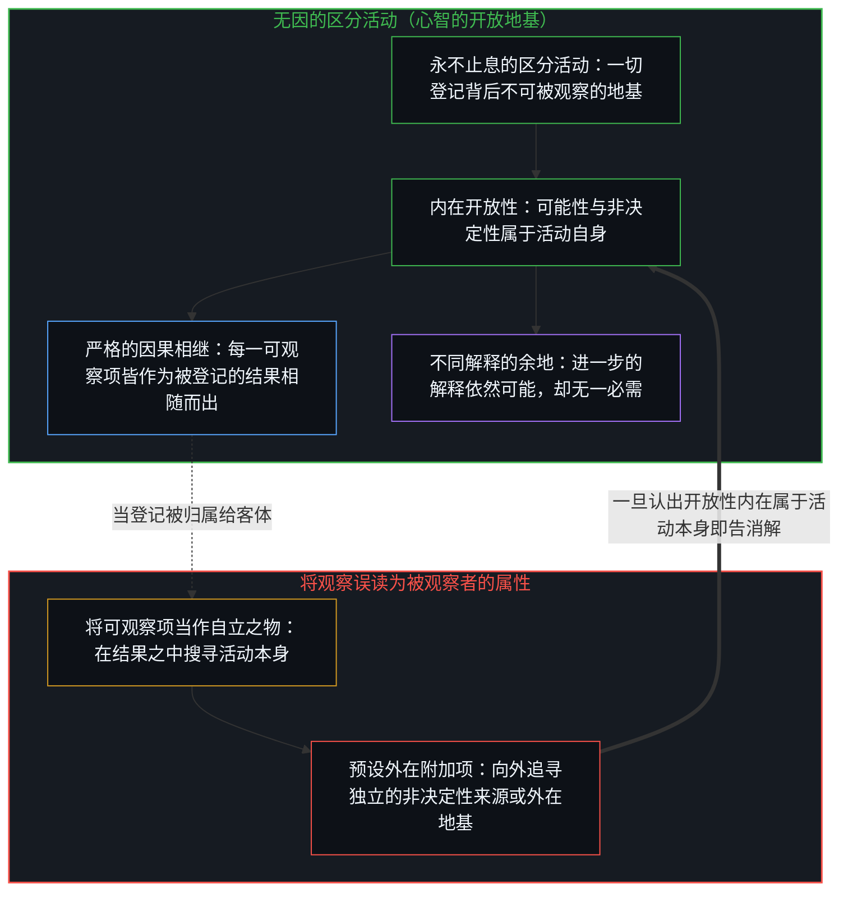
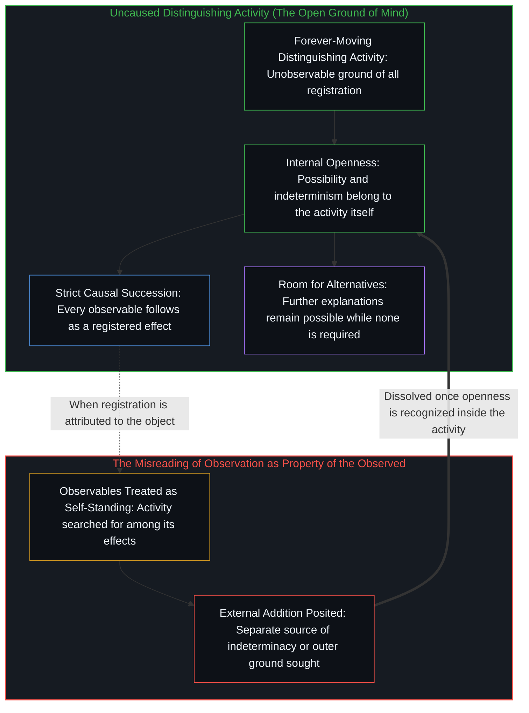
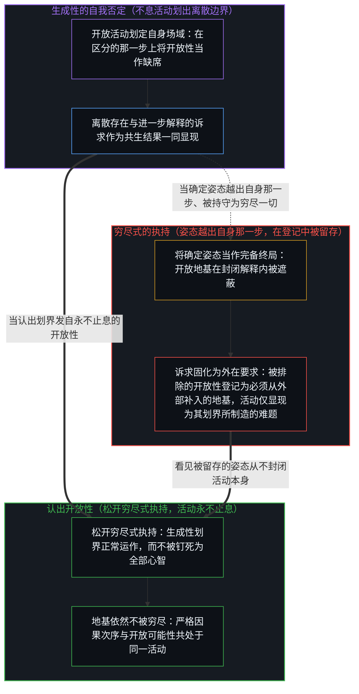
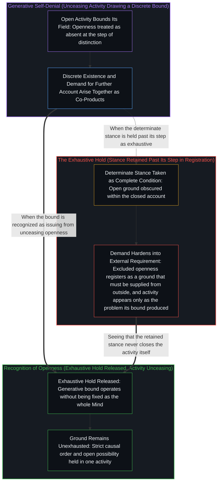

# 观察、区分活动与心智的开放地基 / Observation, Distinguishing Activity, and the Open Ground of Mind

*观察登记着无因的区分活动，这一活动对自身开放性的否定生成了存在，却不封闭其地基。 / Observation registers an uncaused distinguishing activity whose own denial of openness generates existence without closing the ground.*

每一次观察登记的，都是一项不可被观察的区分活动：它无因、不息，名为心智，整条可观察项的序列都由它依严格的因果次序相随而出。由于开放性与可能性内在地属于这一活动，其他解释便始终可能，而任何外在原则或独立的非决定性来源都不是必需的。将这份内在的开放性当作缺席，正是生成性的划界：离散存在与相伴而生的进一步解释诉求，由此一同显现。唯有当某一确定姿态越出自身那一步、被持守为对心智的穷尽时，这一诉求才会固化为对外在地基的索求；松开这一执持，因果相继依然严格，而地基亦不被穷尽。

Every observation registers an unobservable distinguishing activity—uncaused, unceasing, and called the Mind—from which the entire sequence of observables follows in strict causal order. Because openness and possibility belong internally to this activity, alternative explanations remain permanently possible while no external principle or separate source of indeterminacy is required. Treating that internal openness as absent is the generative bound through which discrete existences and the accompanying demand for further account come into view together. That demand hardens into the requirement for an external ground only when a determinate stance is held past its step as exhaustive of the Mind; releasing that hold leaves causal succession strict and the ground unexhausted.

## 一、 作为无因活动之登记的观察 / 1. Observation as Registration of the Uncaused Activity

观察起初显现为从属于被观察者的一项属性，即[主权抉择的双面性与观察的客体化](../the-two-sided-nature-of-sovereign-choice-and-the-objectification-of-observation/)所追溯的那种客体化。然而，它不过是一项区分活动的直接登记。这一活动自身并不出现在可观察项的行列里；它始终是那不可被观察的地基，无因，永不止息地运动，每一个可观察项都由它严格相随而出；正如[意识从不作为数据出现在数据之中](../consciousness-never-appears-as-data-among-data/)所追溯的，它从不在滞后的结果之中浮现为又一项数据。

Observation appears, at first, as a property belonging to the observed, the objectification traced in [The Two-Sided Nature of Sovereign Choice and the Objectification of Observation](../the-two-sided-nature-of-sovereign-choice-and-the-objectification-of-observation/). Yet it is nothing other than the direct registration of a distinguishing activity. That activity does not itself appear among the observables; it remains the unobservable ground—uncaused and forever moving—from which every observable follows strictly, never surfacing as one more datum among the lagging effects traced in [Consciousness Never Appears as Data Among Data](../consciousness-never-appears-as-data-among-data/).

区分活动与可观察项序列之间的关系，既不是外在的叠加，也不是相互的制约。一旦认出这一活动就是无因之因——即[唯一自洽的无因之果](../the-only-coherent-uncaused-effect/)中那唯一不靠前因推动而到来的发端——随后的整条序列便是严格因果的。开放性——可能性、非决定性——早已内在地属于这一永不止息的活动。因此不需要任何其他来源，这既消解了[没有固定者的固定](../fixed-by-nothing/)所揭示的借自初始状态的完备性，也消解了[悬而未决是决定论的索求](../the-open-question-is-determinisms-demand/)中那听似中立、实则暗载着决定论对既成状态之索求的“悬而未决”。

The relation between the distinguishing activity and the sequence of observables is not one of external addition or mutual conditioning. Once the activity is recognized as the uncaused cause—the one initiation that arrives without an antecedent push in [The Only Coherent Uncaused Effect](../the-only-coherent-uncaused-effect/)—the remaining sequence is strictly causal. Openness—possibility, indeterminism—belongs already and internally to this forever-moving activity. No alternative source is therefore required, dissolving both the borrowed initial-state completion exposed in [Fixed by Nothing](../fixed-by-nothing/) and the neutral-sounding "open question" that carries determinism's demand for a finished state in [The Open Question Is Determinism's Demand](../the-open-question-is-determinisms-demand/).

## 二、 内在开放性与不同解释的余地 / 2. Internal Openness and the Room for Alternatives

这一活动就是心智：自我区分、无因、不息，是早已在途的观察者，其每一行动皆是一次区分。它是所知现实的源头，即[现实是心智持续的实现](../reality-is-the-minds-ongoing-realization/)所追溯的持续实现。其余一切皆由此相随而出。

This activity is the Mind: self-distinguishing, uncaused, unceasing, the observer already underway, every act of which is a distinction. It is the source of reality as it is known, the ongoing realization traced in [Reality Is the Mind's Ongoing Realization](../reality-is-the-minds-ongoing-realization/). Everything else follows from it.

认出开放性属于内在，并不会封闭这一场域；它只是将可能性的余地安顿在活动自身之内，正如[开放即一致](../openness-is-consistency/)所追溯的结构自洽。其他解释之所以依然可能，恰恰因为这一活动始终开放，正如[选择、矛盾与开放的现实](../selection-contradiction-and-open-reality/)中每一次选择都始终被其所遗漏的部分所超出。但没有任何额外解释是必需的，因为这一活动本身已经同时说明了可观察项的因果相继，以及这一相继得以发生的恒常开放性。对任何额外解释地基的否定，只是对这一事实的认出，而不是禁止其他解释生起。

The recognition that openness is internal does not close the field; it simply locates the room for possibility inside the activity itself, the structural coherence traced in [Openness Is Consistency](../openness-is-consistency/). Alternative explanations remain possible precisely because the activity remains open, just as every selection stays exceeded by what it leaves out in [Selection, Contradiction, and Open Reality](../selection-contradiction-and-open-reality/). None is required, because the activity already accounts for both the causal succession of observables and the permanent openness within which that succession occurs. The denial of any additional explanatory ground is the recognition of this fact. It is not a prohibition against alternatives arising.

## 三、 生成性的否定与离散存在的生起 / 3. Generative Denial and the Arising of Discrete Existence

当心智在区分的那一步上将自身的开放性当作缺席时，进一步解释的诉求便与区分所划定之物一同生成。同一否定若越出那一步仍被持守，地基便显得有所缺失：[现实的边界](../xian-shi-de-bian-jie/)追溯了对第一因或终极地基的执着如何补偿因果的不可证明性；而一旦这一否定被留存、划出它的那一正在进行的内在行动却被略去，便会生起一种感受，仿佛还必须从外部另行补入某种东西：某条外在原则、某个独立的非决定性来源、某套替代解释，这重演了[能动性、矛盾与权力的移置](../agency-contradiction-and-the-relocation-of-power/)所追溯的外移。否定额外地基，是认出内在的开放性；而在区分的那一步上否定开放性本身，生成的则是对进一步解释的诉求，这一诉求仍是开放的。它并非独立存在，正产生于对开放性的否定。

When the Mind treats its own openness as absent at the step of distinction, the demand for a further account is generated alongside what the distinction bounds. Held past that step, the same denial generates the appearance of a missing ground: where [The Boundary of Reality](../xian-shi-de-bian-jie/) traces how the fixation on a first cause or ultimate foundation compensates for causality's unprovability, the sense that something further must be supplied from outside—an external principle, a separate source of indeterminacy, an alternative explanation—arises when that denial is retained while the ongoing internal act that drew it is omitted, repeating the outward displacement traced in [Agency, Contradiction, and the Relocation of Power](../agency-contradiction-and-the-relocation-of-power/). Whereas denying an additional ground recognizes internal openness, denying openness itself at the step of distinction generates the open demand for a further account. The demand is not independent; it is produced by the denial of openness.

这一否定是生成性的。[自由意志的自否自由](../the-freedom-of-will-to-deny-itself/)与[约束基底与自由自否](../the-substrate-of-constraint-and-the-self-denial-of-freedom/)追溯了在所持立场或固化前提的尺度上，对自由的否定如何本身就是由自由所执行的；同样的自我否定也运作在每一次区分的那一步上：它就是那道划界，离散存在与相应的进一步解释诉求经由它一同显现。所遭遇到的存在形态，正是通过活动的这一特征而生起。

This denial is generative. [The Freedom of Will to Deny Itself](../the-freedom-of-will-to-deny-itself/) and [The Substrate of Constraint and the Self-Denial of Freedom](../the-substrate-of-constraint-and-the-self-denial-of-freedom/) trace how a denial of freedom is itself performed by freedom at the scale of a held stance or a fixed precondition; that same self-denial operates at the step of every distinction as the bound through which discrete existences and the corresponding demand for further account come into view together. Existence, in the form it is encountered, arises through this feature of the activity.

## 四、 当确定姿态被持守为穷尽一切 / 4. When the Determinate Stance Is Held as Exhaustive

困难只在某道确定划界越出自身那一步、被持守为终极定局时才出现，正如[遗忘的脚手架](../the-scaffolding-we-forget/)所揭示的，原本起作用的边界由此固化为牢笼。无因活动自身从不止息、从不闭合；但若把封闭而确定的姿态当作心智完备的终局状态，否定所由发出的那份开放性在这次登记之中便不再可得，[何谓形而上学？作为将追寻命名为目的的一刀](../what-is-metaphysics-as-the-cut-that-names-the-seeking-as-destination/)中追问由以生起的开放地基也随之被遗忘。在那一封闭姿态之内，划界自身所排除的开放性从内部登记为一项不留余地的匮乏：原本开放的进一步解释诉求固化为必须从别处补入外在地基的硬性要求，而活动在该处也仅登记为其自身划界所制造出来的解释难题。

The difficulty appears only when a determinate bound is held past its step as absolute, hardening a working boundary into a prison in the manner of [The Scaffolding We Forget](../the-scaffolding-we-forget/). While the uncaused activity itself never ceases or closes, taking the closed, determinate stance as the complete and final condition of the Mind renders the openness from which the denial issues unavailable within that registration, forgetting the open ground from which the question itself arises in [What Is Metaphysics? As the Cut That Names the Seeking as Destination](../what-is-metaphysics-as-the-cut-that-names-the-seeking-as-destination/). Within that closed stance, the bound's own excluded openness registers from inside as a lack that stands without remainder: the open demand for further account hardens into the requirement that an external ground must be supplied from elsewhere, and the activity registers there only as the explanatory problem its own bound has produced.

对开放性的认出，并不会消除每一次离散行动借以划定其场域的生成性否定。它松开了将这一否定钉死为心智唯一品格的穷尽式执持，如[只要它不被保持为空](../only-if-it-is-not-kept-empty/)所展开的那样，让有限的确定性继续运作而不封闭地基。存在依然通过这一否定不断生起，但被留存的姿态不再遮蔽那使之可能的、永不止息的开放性。

Recognition of openness does not eliminate the generative denial through which each discrete act bounds its field. It releases the exhaustive hold that fixes that denial as the sole character of the Mind, keeping finite determinations operative without closing the ground as in [Only If It Is Not Kept Empty](../only-if-it-is-not-kept-empty/). Existence continues to arise through the denial, yet the retained stance no longer obscures the unceasing openness that makes it possible.

## 五、 未被穷尽之地基内的严格因果 / 5. Strict Causality Within an Unexhausted Ground

解释之所以保持开放，是因为作为其地基的活动本身是开放的。既不需要援引任何进一步的原则来保障因果次序，也不需要借此确保可能性的余地。二者皆属于这一永不止息地运动的活动自身。

The account remains open because the activity that is its ground is open. No further principle is invoked to secure either the causal order or the room for possibility. Both belong to the forever-moving activity itself.

那显现为解释难题的，正是活动自身的自我否定运动越出自身那一步、被持守为穷尽一切；而消解这一难题的，则是认出这一运动并未穷尽活动本身。一旦承认这一无因地基，整条关系便保持严格的因果性，而这一承认亦让地基保持开放，延续着[清晰不是抵达的终点，而是运动本身](../clarity-isnt-a-state-you-arrive-at/)所追溯的活生生的运动。在这一开放性之中，每一次进一步的阐发都依然可能，而在那早已运作着的活动之外，没有任何额外之物是必需的。

What appears as the problem of explanation is the activity's own movement of self-denial held past its step as exhaustive; what resolves the problem is the recognition that this movement does not exhaust the activity. The relation stays strictly causal once the uncaused ground is acknowledged, and the acknowledgment leaves the ground open, continuing the living movement traced in [Clarity Isn't a State You Arrive At. It's the Movement Itself.](../clarity-isnt-a-state-you-arrive-at/). In that openness every further articulation remains possible, and none is required beyond the activity that is already at work.
