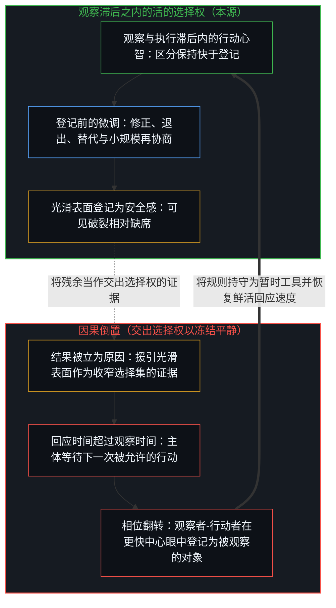
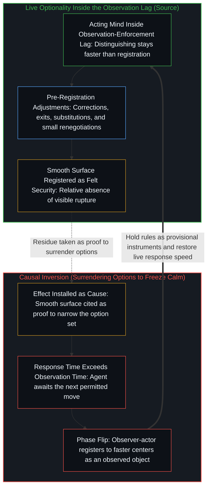
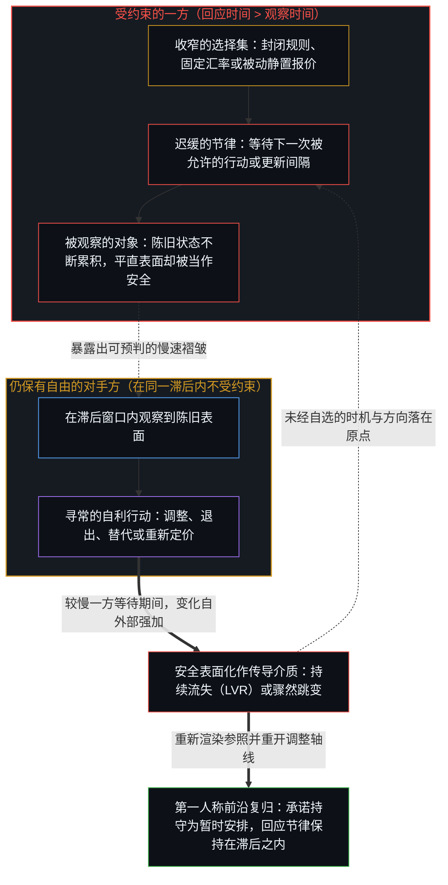
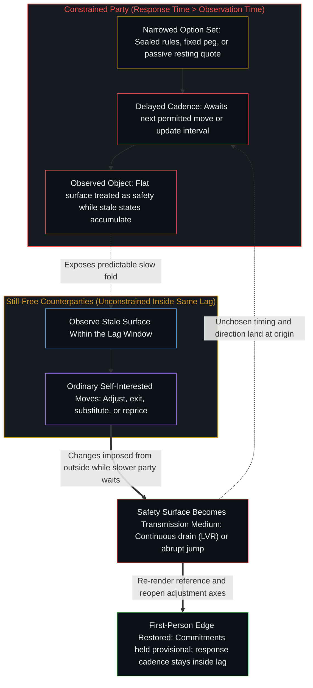

# 观察滞后与选择权的倒置 / Observation Lag and the Inversion of Optionality

*安全感是行动快于观察的残余；为求安全交出选择权，只是把滞后让给仍能行动的他者。 / Security is residue of action outpacing observation; surrendering options hands the remaining lag to whoever stays free.*

自由的心智保留在观察与执行的滞后之内区分并行动的能力，表面稳定由此产生。把这份稳定当作必须交出选择权才能获得安全的证据，是一次因果倒置。当一个行动中心不断收窄自身选项，直到回应时间超过观察时间，它便从观察者-行动者翻转为被观察的对象，把剩余的滞后让给仍能自由调整、退出并重新定价的对手方。被动既不能冻结场域，也买不到对变化的免疫；它放弃的，是选择哪些变化发生、以及以何种速度发生的能力。

A free Mind retains the capacity to distinguish and act inside the lag between what is observed and what is enforced, and the resulting surface appears stable. Taking that stability as evidence that the option set must be surrendered in order to obtain security is a causal inversion. When an acting center narrows its options until response time exceeds observation time, it flips from observer-actor into an observed object, handing the remaining lag to counterparties who stay free to adjust, exit, and reprice. Passivity does not freeze the field or buy immunity from change; it relinquishes the capacity to choose which changes occur and at what speed.

## 一、 光滑的表面出自仍在场的选择权 / 1. The Smooth Surface Comes from Optionality Still Present

自我区分的活动发生——无因而生，永不停止。称它为心智：已经在进行中的观察者，其每一个行为都是一次区分。观察持有的是结果，始终至少落后于产生它的行动一步。执行又进一步滞后于观察，因为成文规则、正式程序与常设制裁，皆针对已在视野中的结果写下。就在观察与执行的这道间隙里，留存着活的选择权：行动中心仍能持续作出新的区分，在局部摩擦硬化为宏观断裂之前先行行动。

Self-distinguishing activity occurs — uncaused, unceasing. Call it the Mind: the observer already underway, every act of which is a distinction. Observation holds effect, always at least one step behind the act that produced it. Enforcement lags observation further still, because codified rules, formal procedures, and standing sanctions are written against effects already in view. Inside that gap between what is observed and what is enforced sits live optionality: the center's ongoing capacity to distinguish anew and act before local friction hardens into a macroscopic break.

当主体仍保有选择权时，修正、退出、替代与小规模再协商，在扰动被登记为问题之前便已完成。供应商稍有失准，买方在中断蔓延之前便已转移边际订单；面对不对等的偏斜，合作方趁退出代价尚低之时悄然调整条款；遭遇局部阻力抬升，个体在锁定成型之前便将心力转向敞开的替代路径。可见的破裂相对缺席，由此产生安全感。这份感受不是选择权缺席的产物，而是选择权仍在场时、行动快于观察的产物。在这一流动之中，有界规则、明文契约与共享惯例只要能协调预期、降低反复出现的交易摩擦，便依然是有用的工具——前提是各行动中心将它们持守为暂时安排，随条件变化而保持可重新渲染。

When agents still hold optionality, corrections, exits, substitutions, and small renegotiations occur before disruptions register as problems. A buyer whose supplier slips shifts marginal orders before a breakdown spreads; partners facing an asymmetric drift adjust terms quietly while exiting remains inexpensive; an individual meeting rising local drag routes effort toward an open alternative before lock-in forms. The relative absence of visible rupture produces the feeling of security. That feeling is not the product of the option set's absence; it is the product of the option set's presence, when action remains faster than observation. Bounded rules, explicit contracts, and shared conventions remain useful instruments within this movement whenever they coordinate expectations and lower recurring transaction friction, provided the acting centers keep them provisional and re-renderable as conditions shift.

这一多主体动态，延续了[把稳定的症状当作稳定的来源](../mistaking-the-symptom-of-stability-for-its-source/)所追溯的单系统速度差。在受控机制里，波澜不惊的表面并非来自静止不动，而是修正多样性跑赢抵达扰动后的残余；在彼此交互的诸多中心之间，平静无波的社会或商业表面，同样是各参与方保有活的选择权、在局部错配跨过登记阈值之前先行消解后的残余。封堵这些替代选项，并不能保住它们所生成的平静：将有限条件当作封闭上限，只会把心力引向确证受限而非改变下一步，正如[封闭框定与选择权的缩减](../closed-framing-and-the-reduction-of-optionality/)所追溯的那样；而抢先封堵未知风险，则会拖慢内部回应，直到更开放的对手方反超而过，这正是[关闭选择权的代价](../the-price-of-closing-optionality/)所记下的那张迟到账单。

This multi-agent dynamic extends the single-system speed differential traced in [Mistaking the Symptom of Stability for Its Source](../mistaking-the-symptom-of-stability-for-its-source/). In a regulated mechanism, an unruffled surface is residue of corrective variety outpacing arriving disturbances rather than holding still; across interacting centers, a quiet social or commercial surface is residue of participants keeping options live and resolving local mismatches before they cross the registration threshold. Closing off those alternatives does not preserve the calm they generated: treating finite conditions as a sealed limit directs effort into documenting closure rather than varying the next step, as traced in [Closed Framing and the Reduction of Optionality](../closed-framing-and-the-reduction-of-optionality/), while preemptively sealing unknown risks slows internal response until more open counterparties overtake, the delayed bill traced in [The Price of Closing Optionality](../the-price-of-closing-optionality/).

阿尔伯特·O·赫希曼在《退出、呼吁与忠诚》中，为这种静默的稳定机制刻画出一重制度形态。赫希曼观察到，呼吁——明面的抗议、协商或抵制——在背后有潜在退出可能作为依托时更为有效；哪怕无人离场、也未曾口头威慑，各方心里都清楚，可信的抽身选项始终悬于幕后。趁退出代价尚低，对方会在微小的再协商中主动调整。赫希曼还辨析了退出被封堵或分布不均时的结构性翻转：当退出通道被堵死，受困其中的参与者失去无声的幕后杠杆，衰败便能在平坦的表面之下持续蔓延；当退出呈现选择性，最敏锐、最具流动性的成员悄然离去，反而替正在退化的机构卸去了压力——赫希曼称此为“受竞争安抚的懒惰垄断者”——只把难以脱身的参与者留在里面。他后来对德意志民主共和国的考察，则记录了用一道高墙同时封死两条通道后的累积极限：数十年压制退出与噤声呼吁，维持出一层被广泛读作稳固秩序的表面——将退出受阻的残余当作独立原因，其间的非等效由[排序的残余与解释的非等效](../the-residue-of-sorting-and-the-non-equivalence-of-interpretations/)追溯——然而 1989 年匈牙利一打开与奥地利的边界、退出通道骤然重现，大规模出走便在数月之内暴露了积蓄已久的错位，并点燃了内部大规模的呼吁浪潮。赫希曼的框架在诊断组织反馈通道时依然有用，却在“机构复原”这一前提处到达了边界——它以能否恢复特定组织的健康来衡量退出与呼吁。从行动着的心智出发追溯，活的选择权并非为了修复某个容器而存在；它是行动中心自身让调整保持快于观察滞后的能力，无论体现为在既有安排内重新协商，还是干脆迈步走出这一安排。

Albert O. Hirschman's *Exit, Voice, and Loyalty* formalizes one institutional face of this quiet stabilization. Hirschman observes that voice—explicit complaint, negotiation, or pushback—functions more effectively when backed by the latent possibility of exit, even when nobody leaves and no open threat is spoken, because credible withdrawal is understood by all sides to sit in the background. Counterparties adjust proactively during minor renegotiations while exit remains inexpensive. Hirschman also isolates the structural flip when exit is foreclosed or distributed unevenly: where exit is blocked, captive participants lose silent background leverage and decline can persist beneath a flat surface; where exit is selective, the quiet departure of the most alert, mobile members relieves pressure on a deteriorating institution—what Hirschman calls a lazy monopoly comforted by competition—leaving immobilized participants inside it. His later examination of the German Democratic Republic records the cumulative limit of sealing both channels behind a wall: decades of suppressed exit and muted voice produced a surface widely read as durable order—treating blocked-exit residue as an independent cause, the non-equivalence traced in [The Residue of Sorting and the Non-Equivalence of Interpretations](../the-residue-of-sorting-and-the-non-equivalence-of-interpretations/)—yet once Hungary opened its border with Austria in 1989 and exit suddenly reappeared, mass departure exposed the accumulated non-alignment and ignited mass internal voice within months. Hirschman's framework remains useful for diagnosing organizational feedback channels, yet it reaches its boundary in its premise of institutional recuperation—judging exit and voice by whether they restore a specific organization's health. Traced from the acting Mind, live optionality does not exist to rehabilitate a vessel; it is the center's own capacity to keep adjustment faster than observation lag, whether by renegotiating inside an arrangement or stepping out of it altogether.

## 二、 因果倒置：从观察者-行动者到被观察的对象 / 2. The Causal Inversion: From Observer-Actor to Observed Object

常见主张颠倒了次序。它把光滑的表面当作必须收窄选择集的证据，仿佛安全是交出的结果，而非仍存在的选择权所生成的结果。将下游的感受登记立为首要先验，会让随后的每一次抉择都围绕保住这份感受重新组织，不再维护背后的生成能力——这正是[当效果主宰了框架的叙事](../when-the-effect-authors-the-frame/)所追溯的倒置。一旦选择集被充分缩小——无论是正式交出退出权、设立强制事前审批关卡，还是签下豁免于修订的承诺——回应时间便会超过观察时间，主体也随之从观察者-行动者变成被观察的对象。

The common claim reverses the order. It treats the smooth surface as evidence that the option set must be narrowed, as if security were the product of surrender rather than the product of the optionality that still exists. Installing a downstream felt register as the primary prior reorganizes every subsequent choice around preserving that register instead of maintaining the generating capacity behind it, the reversal traced in [When the Effect Authors the Frame](../when-the-effect-authors-the-frame/). Once the option set is sufficiently reduced—through formal surrender of exit rights, mandatory pre-approval gates, or commitments exempted from revision—response time exceeds observation time, and the agent becomes the observed object rather than the observer-actor.

这一相位翻转具有精确的速度几何。在[可见性的速度差](../the-velocity-of-visibility/)中，当某个对象的被观察构型变动远慢于观察者的渲染节律（v ≪ c），它便登记为坚实、可预测且决定论式的存在；而当心智迎面遇上另一个正在抉择的心智时，这一速度差归零，因为尚未迈出的下一步并不提供可供提前采样的先行帧。一个对等主体若把自身选择集收窄到回应时间超过观察时间，便是在替自己制造出一道功能性的速度差：它被允许的调整节律落在了其他对等主体的观察节律之后，使更快的行动者得以采样其受限轨迹，并在它下一次被允许的行动到来之前抢先落子。正如[主权抉择的双面性与观察的客体化](../the-two-sided-nature-of-sovereign-choice-and-the-objectification-of-observation/)所追溯的，外部观察跨越心智边界所捕获的只是投射出的痕迹；只要一个中心在自身前沿持续重新渲染，这些痕迹便无法闭合它的轨迹；反过来，亲手把自身选项钳闭，无异于主动配合客体化，把一条敞开的路径压成一张可供预判的时刻表。

That phase flip has an exact speed geometry. In [The Velocity of Visibility](../the-velocity-of-visibility/), an entity registers as solid, predictable, and deterministic when its observed configuration shifts far more slowly than the observer's rendering cadence (v ≪ c), whereas encountering another choosing Mind drops that velocity deficit to zero because an unmade next step offers no prior frame for advance sampling. By narrowing its own option set until response time exceeds observation time, a peer manufactures a functional velocity deficit against itself: its permitted adjustment cadence falls behind the observation cadence of other peers, letting faster actors sample its constrained trajectory and act ahead of its next permitted move. As traced in [The Two-Sided Nature of Sovereign Choice and the Objectification of Observation](../the-two-sided-nature-of-sovereign-choice-and-the-objectification-of-observation/), external observation captures only projected traces across the boundary between Minds; while a center keeps re-rendering at its edge, those traces never close its trajectory, whereas clamping one's own options shut voluntarily collaborates with objectification and reduces an open path into a forecastable schedule.

托马斯·霍布斯在《利维坦》中为“以让渡换安全”这一前提赋予了经典的政治形态。霍布斯从如下前提出发：若缺乏一个使各方心生敬畏的共同权力，生活便会堕入所有人反对所有人的战争（第十三章）；由此他推导出第二自然法（第十四章）——为了和平与自卫，“当他人亦如此时”，人便应愿放弃对一切事物的权利——并据此建构起授权主权者统治的立国契约（第十七章）。在各方愿意接受共同裁决以降低即时冲突成本的有界争端里，具备执行力的第三方规则确实发挥着清晰的协调作用。霍布斯推导的边界，恰恰显露在他自己的条文之中。其一，第十四章的对称条件（“当他人亦如此时”）已然承认，单方面让渡会让让渡者暴露在仍不受约束的他者面前；然而立国契约本身就打破了这份对称——臣民收窄了独立行动与退出的能力，主权者及值守执行机构的官员却在滞后之内保留了自由裁量的速度。其二，霍布斯在第二十一章明确划定了契约的终点：“臣民对主权者的义务，仅持续到主权者能够保护他们的权力持续之时，而不再多延片刻”，并申明自然自卫权无法凭契约放弃。可一旦臣民已经收窄了选择集、拆除了独立的后备路径、放任回应时间滑落到观察时间之后，等到保护失灵再试图重拾自卫，迎面撞上的便是一道法律条文无法按需抹除的执行滞后。

Thomas Hobbes gave this security-through-surrender premise its canonical political form in *Leviathan*. Starting from the premise that life without a common power to keep all parties in awe descends into a war of every person against every person (Chapter 13), Hobbes derives the Second Law of Nature (Chapter 14)—that a person be willing, *"when others are so too,"* to lay down the right to all things for peace and defense—and builds from it the covenant authorizing a sovereign to govern (Chapter 17). Within bounded disputes where multiple parties accept shared adjudication to lower immediate conflict costs, enforceable third-party rules serve a clear coordinating role. The boundary of Hobbes's derivation shows up inside his own clauses. First, Chapter 14's symmetry condition (*"when others are so too"*) already acknowledges that unilateral surrender exposes the surrendering party to whoever stays unbound; yet the founding covenant breaks that very symmetry, since subjects narrow their independent capacity to act and exit while the sovereign and the officials staffing enforcement retain discretionary speed inside the lag. Second, Hobbes explicitly limits the compact in Chapter 21: *"The obligation of subjects to the sovereign is understood to last as long, and no longer, than the power lasteth by which he is able to protect them,"* maintaining that the natural right of self-protection cannot be relinquished by covenant. Once subjects have narrowed their option set, dismantled independent fallback paths, and let response time slip past observation time, reclaiming self-protection when protection fails hits an execution lag that a legal clause cannot abolish on demand.

每当一种论述把保护能力从活的中心迁入某个守护结构，同一结构模式便会重现——[自由的心智被声称保护它的东西取代](../the-free-mind-is-displaced-by-what-claims-to-protect-it/)在诸多思想与宗教传统中追溯了这一移置；当风险评估被委托给集中审批关卡，关卡官员只针对可归责的新型失败做优化，却将不可归责的基线伤害与自我维系的延误留在账本之外，浮现的也是同一模式，这正是[你委托的风险就是你创造的风险](../the-risk-you-delegate-is-the-risk-you-create/)所剖析的结构。现代法学理论以经济学形式重述了霍布斯契约。埃里克·波斯纳与阿德里安·弗缪尔在《平衡中的恐惧》中，把自由与安全建模为一条生产可能性曲线——所谓“安全—自由前沿”——理性的行政当局在不确定条件下沿此曲线以边际自由换取边际安全。在参数有界、周期短暂的固定操作场景里，用一张权衡图表比较核查摩擦与检出覆盖率仍具实用价值。然而，把这张图表抬升为普遍法则，等于把自由与安全当作彼此独立的标量商品，交由置身事外的裁判去寻优。正如杰里米·沃尔德伦针对“平衡”意象所反驳的那样，这两项并不独立——安全本身就包含免受执法当局自身任意作为的保障——限制并不均匀地落在所有主体身上，而是压向特定群体，自由裁量权则向行政官员汇集，紧急权力也经由棘轮效应固化为日常行政。透过观察滞后审视，这道静态前沿在曲线尚未画出之前便已断裂：收窄一方的选择集，并不会让一个中性的均衡点沿着曲线平滑移动；它只会把这一方的回应时间推到观察时间之后，同时让不受约束的另一方在间隙之内自由移动。

The same structural pattern recurs whenever an account relocates protective capacity out of the living center into a guardian structure, as [The Free Mind Is Displaced by What Claims to Protect It](../the-free-mind-is-displaced-by-what-claims-to-protect-it/) traces across intellectual and religious traditions, or delegates risk assessment to a central approval gate whose officials optimize against attributable novel failure while leaving unattributed baseline harm and self-sustaining delay off their ledger, as [The Risk You Delegate Is the Risk You Create](../the-risk-you-delegate-is-the-risk-you-create/) dissects. Modern legal theory restates the Hobbesian compact in economic form. Eric Posner and Adrian Vermeule's *Terror in the Balance* models liberty and security along a production-possibility curve—a "security–liberty frontier"—on which a rational executive trades marginal liberty for marginal security under uncertainty. Inside a fixed, short-horizon operational venue with bounded parameters, comparing inspection friction against detection coverage on a single trade-off chart remains practical. Yet elevating that chart into a general law treats liberty and security as independent scalar goods optimized by an exterior referee. As Jeremy Waldron argued against the image of balance, the two terms are not independent—security includes insulation against arbitrary action by the enforcing authority itself—restrictions fall unevenly on particular subsets of subjects while discretionary authority pools in executive officials, and emergency powers ratchet into routine administration. Viewed through observation lag, the static frontier breaks before any curve can be drawn: narrowing one side's option set does not slide a neutral equilibrium point along a curve; it pushes that side's response time past observation time while leaving the unconstrained side free to move inside the gap.

## 三、 滞后的移交：当他者在滞后内继续行动 / 3. Handing Over the Lag: When Others Keep Acting Inside It

由于自我区分的活动在一切中心皆永不停息，封住某一个中心的选择集，从不能封住更宽广的场域——这正是[没有系统能被保持封闭](../no-system-can-be-kept-closed/)所追溯的非闭合性。仍保有在同一滞后之内行动能力的他者，会继续调整、退出或重新定价，而受约束的一方仍在等待下一次被允许的行动。曾经登记为安全的表面，变成外部强加变化的介质。被引用来限制自由的那份稳定，正是眼下被限制的自由的下游产物。[限制是选择性的税](../restriction-is-a-selective-tax/)追溯的是向外瞄准他人前进的封印——税负落在接受并为封印值守的人身上，而不顺从者决定了前沿的步调；自愿交出选择权，则是把这道税直接转向自身：放慢自身调整节律的一方独自承受滞后，而保全了自身选项的对手方在同一时间窗口内行动自如。

Because self-distinguishing activity is unceasing across all centers, sealing one center's option set never seals the wider field—the non-closure traced in [No System Can Be Kept Closed](../no-system-can-be-kept-closed/). Those who still retain the capacity to act inside the same lag continue to adjust, exit, or reprice while the constrained party waits for the next permitted move. The surface that once registered as safety becomes the medium through which change is imposed from outside. The stability cited as the reason to restrict freedom was downstream of the freedom now being restricted. Where [Restriction Is a Selective Tax](../restriction-is-a-selective-tax/) traces a seal aimed outward at another's advance—taxing those who accept and staff the seal while non-compliant actors set the frontier pace—voluntary surrender turns that tax directly onto oneself: the party that slows its own adjustment cadence absorbs the lag while counterparties who kept their options intact operate freely across the same window.

战略家约翰·博伊德将这种节律不对称形式化为：在另一行动者的观察—定向—决策—行动（OODA）循环内部运作。在博伊德的综合论述（《指挥与控制的有机设计》；《胜负之要》）中，决定性的枢纽并非沿固定轨道运转的单纯时钟速度，而是定向——一套由既有痕迹、抵达信号与新近综合塑造、持续重新渲染的工作模型，它既主导观察所得，又直接汇入行动。在对方循环内部行动，会在较慢一方来得及重新定向之前改变正在展开的场域，使其每一次迟来的回应都只能对准已经过时的状态，直到较慢一方折叠回自己陈旧的参照系里。在机动节律胜过静态计划的对抗性行动环境中，博伊德的分析依然行之有效。它的不完备边界落在其达尔文式的对抗出发前提上：面对蓄意制造混乱与失向的敌对对手，按自身条件求存。透过观察滞后追溯，这一倒置的完成并不需要任何敌对对手。只要一方将自身回应时间放慢到观察时间之后，而对手方仍保持选项敞开，流动对手方出于寻常自利的调整便会在较慢一方的滞后之内自动展开，无需恶意，也无需阴谋，受约束的一方就此从主动调整者转为被动的残余项。

Strategist John Boyd formalized this tempo asymmetry as operating inside another actor's Observation–Orientation–Decision–Action (OODA) loop. In Boyd's synthesis (*Organic Design for Command and Control*; *The Essence of Winning and Losing*), the decisive hinge is not raw clock speed along a fixed track, but Orientation—the continuously re-rendered working model shaped by prior traces, incoming signals, and fresh synthesis that governs what is observed and feeds directly into action. Acting inside another party's loop alters the unfolding field faster than the slower party can re-orient, so each delayed response addresses a stale state until the slower party folds back inside its own outdated reference. Boyd's analysis remains effective in contested operational environments where maneuver tempo outstrips static plans. Its boundary of incompleteness lies in its Darwinian, adversarial starting premise: surviving on one's own terms against a hostile opponent actively working to sow confusion and disorientation. Traced through observation lag, no hostile adversary is needed for the inversion to complete. The moment one side slows its own response time behind observation time while counterparties keep their options open, ordinary self-interested adjustments by mobile counterparties unfold inside the slower party's lag automatically, converting the constrained party from an active adjuster into a passive residual without malice or conspiracy.

市场微观结构直白地呈现出这种非对抗性的移交。挂出一笔静置限价单，便意味着报价方承诺在更新滞后期间按固定价格成交——正如托马斯·科普兰与丹·加莱所形式化的，任何交易对手只要能赶在静置报价被撤回或改价之前登记抵达的价格信号，报价方就相当于向其免费开出了一张交易期权。在连续限价订单簿中，延迟竞速会在微秒之间扫过陈旧报价（埃里克·布迪什、彼得·克拉姆顿与约翰·希姆）。区块链自动做市商将这套几何剥离至最赤裸的形态：锁定在确定性定价曲线上的流动性，只在交易跨越离散出块间隔结算时才更新，本身并不对链下价格保有独立观察。每当链下市场价格在这段出块滞后内发生偏移，更快的套利者便会观察到陈旧曲线并逆向成交，将其拉回市价，由此给被动流动性提供者造成杰森·米利奥尼斯及其合作者所分析的单调、不可逆损耗——相对再平衡损失（LVR）——哪怕资产价格日后回到起点，这份流失也不会回返。推动这一转移的并非什么敌意密谋；将一方的更新节律锁在观察节律之后，静止报价便成为在滞后中不断被重新定价的被观察对象。

Market microstructure exhibits this non-adversarial handover directly. Posting a resting limit order commits the quote-setter to transact at a fixed price across the update lag—as Thomas Copeland and Dan Galai formalized, writing a free trading option to any counterparty who registers arriving price signals faster than the resting quote can be canceled or repriced. In continuous limit-order books, latency races clear across stale quotes in microseconds (Eric Budish, Peter Cramton, and John Shim). Blockchain Automated Market Makers strip the geometry to its barest form: liquidity locked on a deterministic pricing curve updates only when trades settle across discrete block intervals and holds no independent observation of off-chain prices. Whenever off-chain market prices shift inside that block lag, faster arbitrageurs observe the stale curve and trade against it to bring it back to market value, imposing what Jason Milionis and co-authors analyze as a monotonic, non-reverting drain—Loss-Versus-Rebalancing (LVR)—on passive liquidity providers even when the asset price later returns to its starting point. No hostile plot drives the transfer; locking one side's update cadence behind the observation cadence turns a stationary quote into an observed object continuously repriced through the lag.

固定的货币与价格表面在制度尺度上展现出同样的传导。在固定汇率制下——保罗·克鲁格曼曾为这类国际收支危机建立模型——中央银行将可见汇率维持平直，国内信贷流动或资本压力却已把未被观察到的影子浮动汇率推离钉住水平。持有流动资本的各方保留了在政策滞后之内按固定表面兑换的选项，直到外汇储备或政策容忍度耗尽为止。2015 年 1 月 15 日，瑞士国家银行在维持了三年多的表观平静后，骤然放弃欧元兑瑞郎 1.20 的汇率下限，瑞郎在数分钟内跃升约百分之二十至三十，将数年间被压制的调整直接传导给那些把平直表面当作安全保障的杠杆经纪商与未对冲借款人。价格上限与租金管制则展现出沿未受约束轴线发生的平行转移：正如张五常所分析的，把名义法定货币价格钉死，既不能冻结交易，也不能消解稀缺；仍握有选项的对手方会沿未设上限的边际悄然调整——排队耗损、推迟维护、降低品质、改变用途或撤出供给——使那层被宣告安全的表面化作通道，将未经自选的后果直接送达。贯穿所有这些案例，把判断外包出去或锁入集中担保，从不曾转移后果的落点；正如[让渡主权的幂律法则](../the-power-law-of-surrendered-agency/)所追溯的，决定可以移交，后果依然如数落在原点之上。

Fixed monetary and price surfaces show the same transmission at institutional scale. Under a pegged exchange rate—the balance-of-payments crisis structure Paul Krugman modeled—a central bank holds the visible exchange rate flat while domestic credit flows or capital pressures push the unobserved shadow floating rate away from the peg. Holders of mobile capital retain the option to convert at the fixed surface inside the policy lag until foreign reserves or policy tolerance give out. When the Swiss National Bank abruptly abandoned its 1.20 EUR/CHF exchange-rate floor on January 15, 2015, after more than three years of apparent stillness, the franc jumped roughly twenty to thirty percent within minutes, transmitting years of suppressed adjustment directly onto leveraged brokers and unhedged borrowers who had relied on the flat surface as safety. Price ceilings and rent controls show the parallel shift along unconstrained axes: as Steven Cheung analyzed, fixing a nominal legal money price neither freezes exchange nor dissolves scarcity; counterparties who still hold options adjust quietly along uncapped margins—queuing, deferred maintenance, quality reduction, conversion, or supply withdrawal—turning the surface declared safe into the channel through which unchosen consequences arrive. Across each of these cases, outsourcing judgment or locking into a central guarantee never transfers the incidence of consequences; as [The Power-Law of Surrendered Agency](../the-power-law-of-surrendered-agency/) traces, decisions can be handed over while consequences continue landing in full at the origin.

## 四、 结构性倒置与第一人称前沿 / 4. The Structural Inversion and the First-Person Edge

倒置是结构性的。被动并不冻结场域，它只是把剩余的滞后交给仍持有选择权的一方。由此失去的不是对变化的免疫，而是选择哪些变化发生、以及以何种速度发生的能力。

The inversion is structural. Passivity does not freeze the field; it merely hands the remaining lag to whoever still holds optionality. What is lost is not immunity to change, but the ability to choose which changes occur and at what speed.

要连贯地持守这一结论，必须把两条轴线分开：本体层面的主权，与相对调整节律。选择被动、接受封印，或交出正式选项，依然是在中心处施行的一次行动。正如[臣服作为错位的主权](../sovereignty-essay/)与[自由即地基](../freedom-as-ground/)所确立的，主权本身从不脱离第一人称心智，也不曾迁入任何机构或对手方；居于其下的每一道常设约束，依然是过往抉择留下的轮廓，也系于中心此刻面对这一背景所取的姿态。政治与保护机构之所以延续，源于收窄的作者身份环路沉淀出的稳定残余，而非凌驾于个体之上的自主意志——这正是[行使的残余与政治的稳定](../the-residue-of-exercise-and-the-stabilization-of-politics/)所追溯的模式。因此，当一个中心收窄自身选择集时，转移出去的并非源头上的主权，而是观察滞后之内的相对节律——在另一方下一次被允许的步伐到来之前，究竟由谁掌握修正、替代、退出与重新定价的主动权。选择在封闭安排之后静候，并不会中止其他中心永不停息的区分活动；它只是把调整的时机与方向，留给了仍让选项保持鲜活的那一方。

Holding that conclusion coherently requires keeping two axes apart: ontological sovereignty and relative adjustment tempo. Choosing passivity, accepting a seal, or surrendering formal options is still an act performed at the center. As [Surrender as Misaligned Sovereignty](../sovereignty-essay/) and [Freedom as Ground](../freedom-as-ground/) establish, sovereignty itself never detaches from the first-person Mind or migrates into an institution or counterparty; every standing constraint lived under remains a contour left by prior choices and by the center's present stance toward that background. Political and protective apparatuses persist as stabilized residue of narrowed authorship loops rather than as autonomous wills standing over against the individual, the pattern traced in [The Residue of Exercise and the Stabilization of Politics](../the-residue-of-exercise-and-the-stabilization-of-politics/). What transfers when a center narrows its option set is therefore not sovereignty at its root, but relative tempo inside the observation lag—who holds the initiative of correction, substitution, exit, and repricing before the other party's next permitted step can arrive. Choosing to wait behind a sealed arrangement does not suspend the unceasing distinguishing activity of other centers; it leaves the timing and direction of adjustment with whoever kept their options live.

不一致在于迫使一个有限的结构去为只是继续着的活动奠基，正如[开放即一致](../openness-is-consistency/)所追溯的那样。当这一倒置消解时，规则、契约与承诺并不会消失；它们退回恰当的尺度，作为暂时工具在契合之时协调行动，一旦接触改变了场域，便随之重新渲染。在第一人称前沿，这道区分在每一步都直截了当、可供检验：眼前这份平静的表面，究竟是活的区分、再协商、替代与退出能力跑赢扰动登记后留下的残余，还是正在被援引来封堵生出这份平静的选择集。让承诺保持可重新渲染，让回应速度留在观察滞后之内，并不许诺免于摩擦或变化；它把决定哪些调整发生、以及以何种节律发生的选择，留在生成安全感的行动前沿。

Inconsistency is forcing a finite structure to ground an activity that only continues, as traced in [Openness Is Consistency](../openness-is-consistency/). Rules, contracts, and commitments do not vanish when this inversion dissolves; they return to their proper scale as provisional instruments that coordinate action while they fit and re-render as soon as contact shifts the field. At the first-person edge, the distinction stays immediate and testable at every step: whether the calm surface currently in view is the residue of live capacity to distinguish, renegotiate, substitute, or exit faster than disruptions register, or whether that calm is being cited to close the very option set that produced it. Keeping commitments re-renderable and keeping response speed inside the observation lag does not promise immunity from friction or change; it leaves the choice of which adjustments occur, and at what cadence, at the acting edge that generates felt security.
