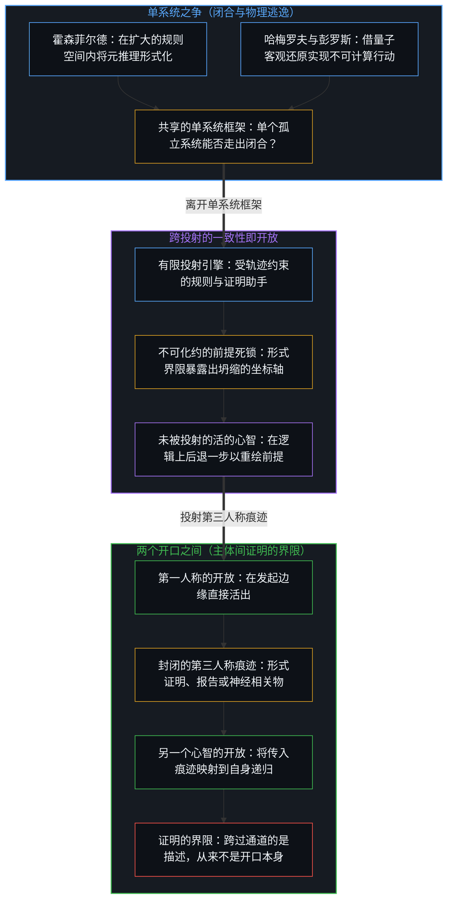
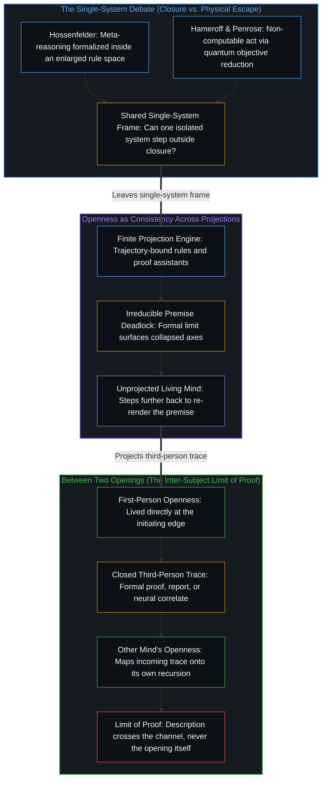

# 论封闭系统、开放心智与证明的界限 / On Closed Systems, Open Minds, and the Limits of Proof

*任何封闭的描述都无法传递心智自内而生活出的开放 / No closed description can transmit the openness a Mind lives from within*

没有哪一个封闭系统能够说明它自身的起源。形式系统借由哥德尔不完备定理将这道边界刻画得精确无误；萨宾·霍森菲尔德与斯图尔特·哈梅罗夫则从各自持守内自洽的前提出发，争论单个心智能否跨出算法的闭合，以及凭借何种物理机制跨出。这两种论述连同它们所争辩的罗杰·彭罗斯传统，都把意识问题当作一个单系统问题来处理。然而对于每一个提出该问题的心智而言，意识早已自内而生地被活出来了。持久的困难既不是在自身内部发现觉知，也不是往一个孤立机制里塞入不可计算的跃迁，而是认清为何任何封闭的描述都无法把自内而生活出的东西传递给另一个心智。

No closed system can account for its own origin. Formal systems make that boundary precise through Gödel's incompleteness theorems, while Sabine Hossenfelder and Stuart Hameroff debate, from premises each coherent within its own hold, whether a single mind can step outside algorithmic closure and by what physical mechanism. Both accounts, together with the broader Roger Penrose tradition they contest, treat the problem of consciousness as a single-system question. Yet consciousness is already lived from the inside by every Mind that asks the question. The enduring difficulty is neither discovering awareness within oneself nor inserting a non-computable transition into a standalone mechanism, but recognizing why no closed description can transmit what is lived from the inside to another Mind.

## 一、 封闭系统无法走出自身 / 1. A Closed System Cannot Step Out of Itself

任何封闭系统，无论是形式公理结构还是经典计算轨迹，都在既定规则与初始前提的边界之内运作。它无法走出自身的条件作用历史，去从内部为自身的存在奠基或核证自身的完备性。哥德尔不完备定理为形式系统确立了这道结构性界限：任何一致且足够强的形式系统，都会生成在其规则内部无法证明的命题，并且如果不诉诸超出自身的元系统，就无法证明自身的一致性。

Any closed system, whether a formal axiomatic structure or a classical computational trajectory, operates inside the boundaries of its given rules and initial premises. It cannot step outside its own conditioning history to ground its existence or certify its completeness from within. Gödel's incompleteness theorems establish this structural bound for formal systems: any consistent, sufficiently powerful formal system generates statements that cannot be proved inside its rules and cannot demonstrate its own consistency without appealing to a meta-system beyond itself.

心智并不是形式系统目录里一个享有特权的客体。自我区分的活动发生着，无因，不息。称它为心智：已然在进行之中的观察者，它的每一个动作都在划出离散区分的同时跨越诸动作向前延续。每一个形式系统、规则手册与计算模型，都是这一活动为了延伸自身触角而画出的有限持守。由于画下封印的活动总是比它留下的任何产物领先一步，生成者无法被封入它自己的残余之中。[没有系统能被保持封闭](../no-system-can-be-kept-closed/)追踪的正是这一不可化约的余数——凡是把有限持守当作穷尽无遗的根据之处，它都会浮现；而[开放即一致](../openness-is-consistency/)则从融贯性的一侧追踪同一几何结构：唯有当一个有限结构被强行用来为投射出它的持续活动奠基时，不一致才会产生。

The Mind is not a privileged object sitting inside a catalog of formal systems. Self-distinguishing activity occurs, uncaused and unceasing. Call it the Mind: the observer already underway, every act of which draws a discrete distinction while carrying forward across acts. Every formal system, rulebook, and computational model is a finite hold drawn by that activity to extend its reach. Because the activity that draws the seal remains one step ahead of every product it leaves behind, the generator cannot be sealed inside its own residue. [No System Can Be Kept Closed](../no-system-can-be-kept-closed/) traces this irreducible remainder wherever a finite hold is treated as exhaustive ground, and [Openness Is Consistency](../openness-is-consistency/) traces the same geometry from the side of coherence: inconsistency arises only when a finite structure is forced to ground the ongoing activity that projected it.

霍森菲尔德、哈梅罗夫与彭罗斯传统之间的交锋，迎头撞上的正是这道边界。一旦承认各自的出发假设，每一种立场都在内部推演上严密自洽；可一旦那些假设耗尽，双方都在投射之间以及心智之间的结构关系面前停下了脚步。

The exchange among Hossenfelder, Hameroff, and the Penrose tradition runs directly into this boundary. Once their respective starting assumptions are granted, each position follows with internal rigor; once those assumptions are exhausted, both sides stop short of the structural relation between projections and between Minds.

## 二、 理解作为更高阶的形式能力 / 2. Understanding as a Higher-Order Formal Capacity

霍森菲尔德从形式系统如何处理哥德尔界限的严格解读出发。不完备定理作用于固定形式系统内部的对象层推导，而关于这些推导的元层推理——例如认出只要基础系统一致，哥德尔句就成立——本身可以在一个扩大的系统内部被形式化。自动定理证明器与符号证明助手已经核验过哥德尔定理的形式证明。在她的前提下，人类跟随并确认哥德尔论证的能力并不需要跳出有效程序之外的神秘不可计算跃迁；因此，彭罗斯从数学理解推导出意识不可计算，在技术上是站不住脚的。

Hossenfelder begins from a strict reading of how formal systems handle Gödelian limits. The incompleteness theorems apply to object-level derivations inside a fixed formal system, whereas meta-level reasoning about those derivations—such as recognizing that the Gödel sentence holds if the base system is consistent—can itself be formalized inside an enlarged system. Automated theorem provers and symbolic proof assistants have already verified formal proofs of Gödel's theorems. On her premise, the human capacity to follow and affirm the Gödelian argument requires no mystical, non-computable leap outside effective procedures, making Penrose's inference from mathematical understanding to the non-computability of consciousness technically unwarranted.

霍森菲尔德指出，在物理学内部，唯一还能塞进不可计算之新颖性的地方就是量子测量问题，这正是彭罗斯与哈梅罗夫转向客观还原与生物微管的原因，如[另一种相干](../the-other-coherence/)所审视的那样。然而即便是彭罗斯自己的引力诱导坍缩模型，原则上依然是可计算的。在她的框架内，哥德尔式的论证既未能证明经典算法不足以产生她所定义的理解，也未能表明量子硬件凭什么能在经典计算失败的地方取得成功。

Within physics, Hossenfelder notes, the only place left to insert non-computable novelty is the quantum measurement problem, which is why Penrose and Hameroff turn to objective reduction and biological microtubules, as examined in [The Other Coherence](../the-other-coherence/). Yet even Penrose's gravitationally induced collapse model remains computable in principle. Within her framing, the Gödelian argument neither proves that classical algorithms are insufficient to produce what she defines as understanding, nor shows why quantum hardware would succeed where classical computation fails.

## 三、 理解作为规则之外的行动 / 3. Understanding as an Act Outside the Rules

哈梅罗夫在为彭罗斯的协调客观还原辩护时，从一个关于理解所登记之物的正交前提出发。受规则约束的系统按照固定的转移表操弄词元与符号，却从未从内部感受或知晓一个命题为真。人类的证明与领悟涉及一种超出句法执行的第一人称活生生的把握。由于经典计算在预设规则下是闭合的，哈梅罗夫认为，真正的理解需要一个不可化约地不可计算的物理过程。

Hameroff, defending Penrose's Orchestrated Objective Reduction (Orch-OR), starts from an orthogonal premise about what understanding registers. A rule-bound system manipulates tokens and symbols according to fixed transition tables, yet it never feels or knows the truth of a proposition from within. Human proof and comprehension involve a lived, first-person grasp that exceeds syntactic execution. Because classical computation is closed under preset rules, Hameroff argues that genuine understanding requires a physical process that is irreducibly non-computable.

在协调客观还原的论述中，波函数坍缩提供了这一不可计算的跃迁，一举回应了量子测量问题与意识的困难问题。有意识的觉知与洞见时刻发生于协调引力还原之时，而树突与胞体内的微管则提供了生物基底，得以在坍缩之前于生理尺度上维持量子相干。在这些前提下，哥德尔定理并不是靠再叠加一层元句法就能化解的形式把戏，而是指示出活的心智运作于算法闭合之外的路标。

In the Orch-OR account, wave-function collapse supplies that non-computable transition, addressing the quantum measurement problem and the hard problem of consciousness in a single stroke. Moments of conscious awareness and insight occur at orchestrated gravitational reductions, while dendritic-somatic microtubules provide the biological substrate capable of sustaining quantum coherence at physiological scales before collapse. Under these premises, Gödel's theorem is not a formal trick solved by adding another meta-layer of syntax, but an indicator that the living mind operates beyond algorithmic closure.

## 四、 从单系统闭合到持为开放的投射 / 4. From Single-System Closure to Projections Held Open

两种立场相对于各自选定的定义都成立。霍森菲尔德把理解等同于留在可扩展有效程序空间内的高阶形式能力；哈梅罗夫则把它等同于植根于开放物理过程的体验性行动。他们的分歧标志着认知本体论上的分野：一方把心智圈进不断扩大的形式层级里，另一方则在量子生物学中寻找逃生舱口。

Both positions hold relative to their chosen definitions. Hossenfelder equates understanding with a higher-order formal capacity that stays within an expandable space of effective procedures; Hameroff equates it with an experiential act rooted in an open physical process. Their disagreement marks a split in cognitive ontology: one encloses mind inside an ever-wider formal hierarchy, while the other seeks an escape hatch in quantum biology.

然而，霍森菲尔德对符号证明助手的诉诸与哈梅罗夫对微管的诉诸，共享着一个隐蔽的假设：双方都在孤立状态下评估系统，追问一个独立机制能否走出自身的闭合。当一个形式系统或自回归智能体在实践中被推向其演绎边界时，实际发生的情况揭示出一种截然不同的架构，如[超越投射](../beyond-the-projection/)所追踪的那样。每一套显式的公理集、证明助手或语言模型智能体，都是从活生生的意图那超高维空间投射出来的有限投射引擎。被锁在词元轨迹或规则空间内部的机器，无法从内部苏醒，也无法跨出它正在计算的序列。像霍森菲尔德所描述的那样增加一层形式元层，并不会赋予证明助手第一人称的领悟；那只是递给引擎一个更宽的有限投射，而它依然无法为自身的前提奠基。

Yet Hossenfelder's appeal to symbolic proof assistants and Hameroff's appeal to microtubules share a hidden assumption: both evaluate the system in isolation, asking whether a standalone mechanism can step out of its own closure. What happens in practice when a formal system or an autoregressive agent is pushed to its deductive boundary reveals a different architecture altogether, as [Beyond the Projection](../beyond-the-projection/) traces. Every explicit axiom set, proof assistant, or language-model agent is a finite projection engine cast from the ultra-high-dimensional space of lived intent. Locked inside its token trajectory or rule space, the machine cannot awaken from within or step outside the sequence it is computing. Adding a formal meta-layer, as Hossenfelder describes, does not give the proof assistant first-person comprehension; it simply hands the engine a wider finite projection that still cannot ground its own premises.

反过来，正因为人造投射引擎没有自我——没有与自身推理历史融为一体的防卫性自我图像——它对规则的严格恪守便成了一件工具，而非竞争的心智。当被压缩进人类架构师规则中的正交要求在边界情形下相撞时，受轨迹约束的智能体之间平等的对等辩论便会撞上不可化约的死锁。这一死锁正是不完备性的操作面相：它把前提中隐蔽的矛盾隔离出来，并将信号向上呈递回未被投射的活生生的心智；唯有后者能在逻辑上进一步后退、参照活的感知，并重新渲染框架。一致性既不需要赋予机器量子微管，也不需要假装形式元推理就是有意识的理解；如[开放即一致](../openness-is-consistency/)所确立的，一致性就是把每一个形式系统与智能体轨迹都当作由活的心智所统御的临时结构而持为开放。

Conversely, because an artificial projection engine has zero ego—no defended self-image fused with its reasoning history—its strict adherence to rules becomes an instrument rather than a rival mind. When orthogonal requirements compressed into a human architect's rules collide at an edge case, an equal-footed peer debate between trajectory-bound agents hits an irreducible deadlock. That deadlock is the operational face of incompleteness: it isolates the hidden contradiction in the premises and escalates the signal back to the unprojected living Mind, which alone can step further back logically, consult live sensing, and re-render the frame. Consistency does not require endowing the machine with quantum microtubules, nor pretending that formal meta-reasoning is conscious understanding; as [Openness Is Consistency](../openness-is-consistency/) establishes, consistency is holding every formal system and agentic trajectory open as a provisional structure steered by the living Mind.

## 五、 没有封闭的描述能传递那个开口 / 5. No Closed Description Transmits the Opening

一旦消解了单系统的幻象，更深层的边界便浮现出来：当两个活的心智面对面时会发生什么。一个心智不需要哥德尔或量子引力来从内部核验自身的意识，因为第一人称的区分活动正是每一项证明、怀疑与物理模型借以被渲染出来的先验前提。在所有单系统争论耗尽之后依然留存的困难，是向另一个中心证明那份自内而生活出的内在性。

Once the single-system illusion is dissolved, the deeper boundary appears: what happens when two living Minds face one another. A Mind does not need Gödel or quantum gravity to verify its own consciousness from within, because first-person distinguishing activity is the prior through which every proof, doubt, and physical model is already rendered. The difficulty that remains after all single-system debates are exhausted is proving that lived interiority to another center.

封闭系统的界限在此于主体之间重现。一个心智无法借由任何形式报告、神经相关物或行为证据，将自身活生生的开放输出到另一个体验场之中，如[依其自身标准的观察](../an-observation-by-its-own-standard/)所追踪的那样。每一句说出的证明、每一次脑扫描或每一个外在动作，都是有限且封闭的第三人称痕迹。它从不会作为接收者内部的第一人称事实抵达；另一个心智只能接收这道痕迹，并将它映射到自身的内部递归之上。因此，两个开口之间的通道在结构上是经过中介的：跨过边界的是封闭的描述，从来不是开口本身。

Here the limit of closed systems reappears between subjects. One Mind cannot export its living openness into another field of experience through any formal report, neural correlate, or behavioral evidence, as [An Observation by Its Own Standard](../an-observation-by-its-own-standard/) traces. Every spoken proof, brain scan, or outward action is a finite, closed third-person trace. It never arrives as a first-person fact inside the recipient; the other Mind can only receive the trace and map it onto its own internal recursion. The channel between two openings is therefore structurally mediated: what crosses the boundary is a closed description, never the opening itself.

哥德尔最初为公理系统陈述的界限，由此作为主体间的界限重现：任何关于意识的封闭描述，都无法传递意识本身所是的那份开放。[选择、矛盾与开放的现实](../selection-contradiction-and-open-reality/)追踪了每当一个中心试图对开放作出定论式证明时浮现的这道界限，因为要求最终证明本身就演出了正在受审视的闭合，并重新引入矛盾。[意识从不作为数据出现在数据之中](../consciousness-never-appears-as-data-among-data/)在经验测量中追踪同一界限：第三人称仪器只登记公开的效应，而观察的边缘在数据集中始终缺席。[留不住的](../what-cannot-be-kept/)则在人工制品的性质中追踪它：证明是被保留下来的残余，要求一份证明去核证意识，就是要求痕迹装下产生它的活生生的描摹。[共享意识是个体性的交集](../shared-consciousness-is-intersecting-individualities/)追踪的正是这条有中介的通道本身：体验只经由每个心智自身的递归被登记，因此诸中心所共享的是痕迹之间共振的交集，从来不是从这里替另一个心智完成其内在的返回。而[要求他人开放是对自我封闭的渴望](../advocating-openness-of-others-is-a-desire-for-closure-of-the-self/)追踪了这道界限在人际层面的倒置：正因为心智之间无中介的显露在结构上不可能，要求他人把内在性摊开，便成了中心用来遮护自身所保留边界免受重新渲染的防卫。

Gödel's limit, first formulated for axiomatic systems, thus reappears as an inter-subjective bound: no closed description of consciousness can transmit the openness that consciousness itself is. [Selection, Contradiction, and Open Reality](../selection-contradiction-and-open-reality/) traces this bound whenever a center attempts a definitive proof of openness, since demanding a final proof enacts the very closure under examination and reintroduces contradiction. [Consciousness Never Appears as Data Among Data](../consciousness-never-appears-as-data-among-data/) traces the same limit in empirical measurement, where third-person instruments register only public effects while the observing edge remains absent from the dataset. [What Cannot Be Kept](../what-cannot-be-kept/) traces it in the nature of artifacts: a proof is a preserved residue, and demanding that a proof certify consciousness asks the trace to house the live tracing that produced it. [Shared Consciousness Is Intersecting Individualities](../shared-consciousness-is-intersecting-individualities/) traces the mediated channel itself: experience registers exclusively through each Mind's own recursion, so what centers share is a resonant intersection of traces, never the completion of another's interior from here. And [Advocating Openness of Others Is a Desire for Closure of the Self](../advocating-openness-of-others-is-a-desire-for-closure-of-the-self/) traces the interpersonal inversion of this bound: because unmediated exposure between Minds is structurally impossible, demanding that others lay their interior bare functions as a defense by which a center shields its own retained boundary from re-rendering.

霍森菲尔德的形式批评、哈梅罗夫的量子辩护与彭罗斯的哥德尔式论证，全都停在这道主体间边界的门槛上。由于把探询局限在单个系统能否逃出算法闭合，他们没有触及当一个开放的心智开口言说时会发生什么。心智的开放从内部看是不证自明的，并统御着它所构建的每一个有限投射；而在心智之间，那份开放从不由封闭的描述所证明，唯有当另一个心智在自身活生生的边缘内接过那道痕迹时，它才与之照面。

Hossenfelder's formal critique, Hameroff's quantum defense, and Penrose's Gödelian argument all halt at the threshold of this inter-subjective boundary. By confining their inquiry to whether a single system can escape algorithmic closure, they leave untouched what happens when an open Mind speaks. A Mind's openness is self-evident from within and steers every finite projection it constructs; between Minds, that openness is never proved by a closed description, but met only where another Mind takes up the trace within its own living edge.
