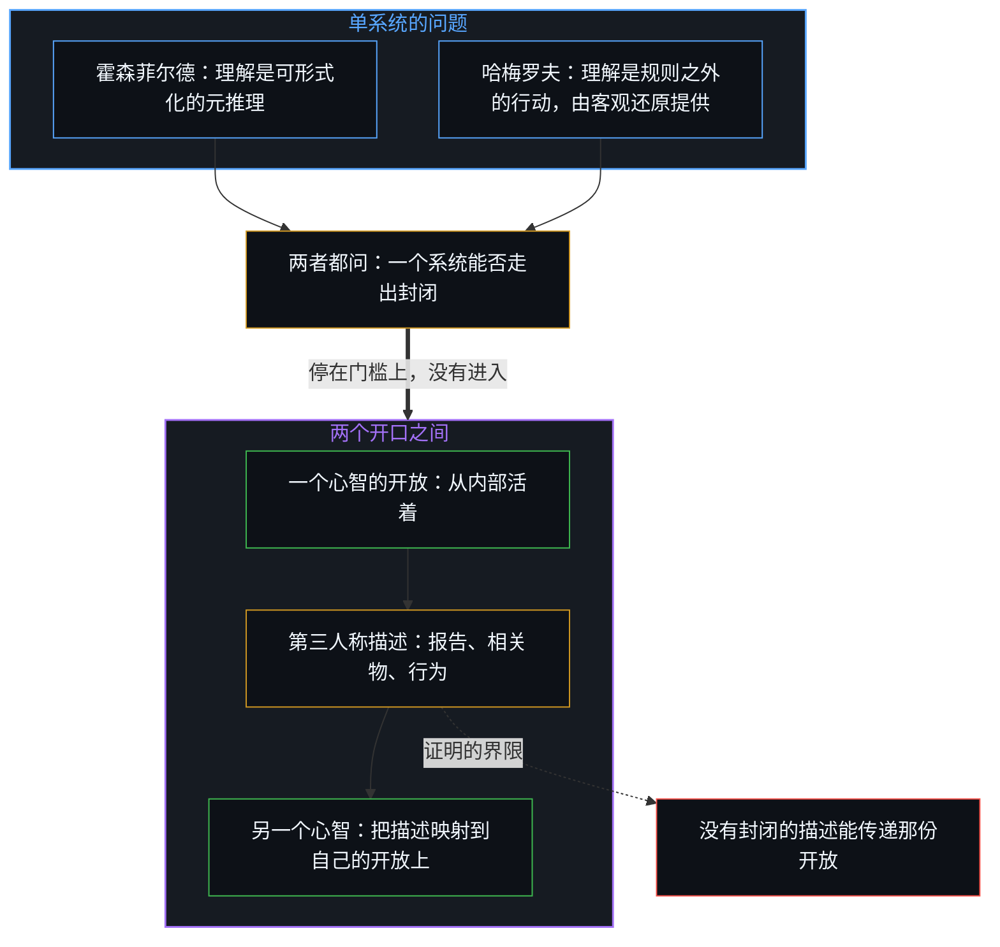
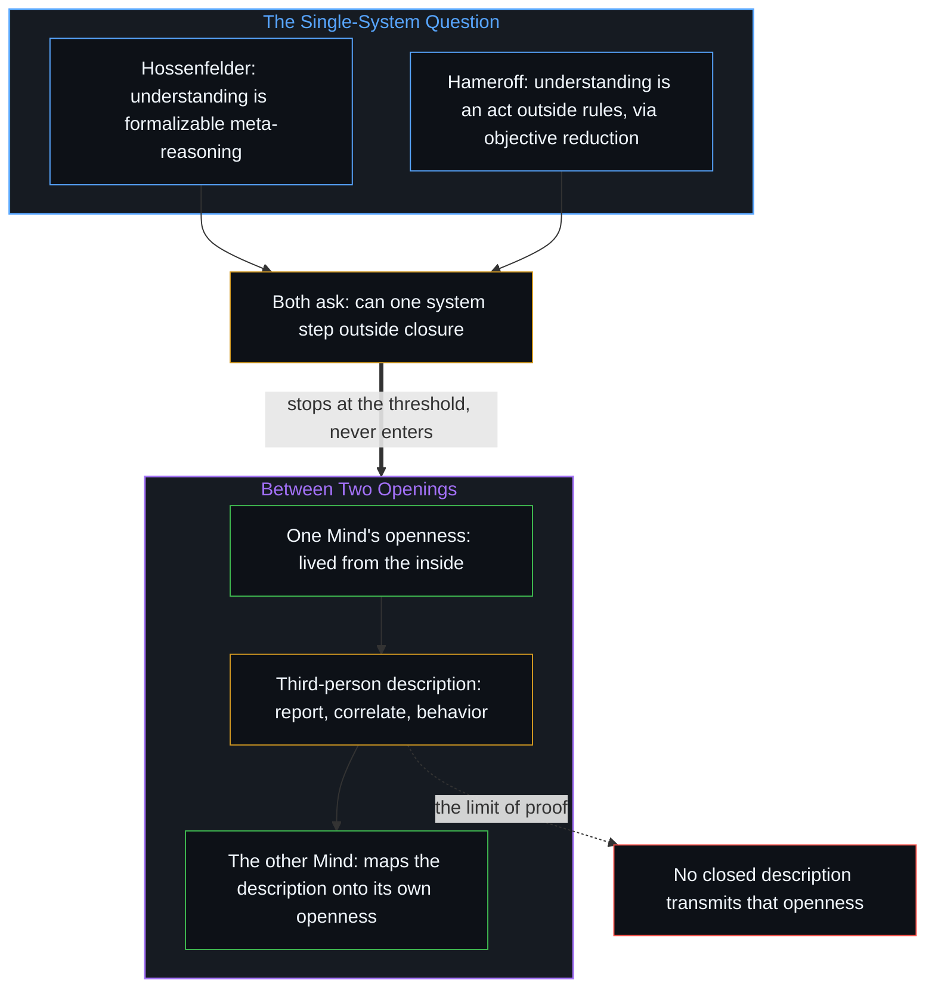

# 论封闭系统、开放心智与证明的界限 / On Closed Systems, Open Minds, and the Limits of Proof

*没有哪种关于意识的封闭描述，能传递意识本身所是的那份开放 / No closed description of consciousness can transmit the openness that consciousness itself is.*

没有哪一个封闭系统能够说明它自己的来源。形式系统把这个界限说得精确；萨宾·霍森菲尔德与斯图尔特·哈梅罗夫则从各自内部自洽的前提出发，争论单个心智能否走出算法的封闭，又靠什么样的物理。

No closed system can account for its own origin. Formal systems make that limit precise; Sabine Hossenfelder and Stuart Hameroff then debate, from premises each coherent within itself, whether a single mind can step outside algorithmic closure, and by what physics.

两种说法都停在那一个开口上。剩下的困难不是从内部发现意识，意识本就是每一个心智从内部活着的东西，而是向另一个心智证明从内部活着的东西。

Both accounts stop at that single opening. The remaining difficulty is not discovering consciousness from the inside, since consciousness is what each Mind already lives from the inside, but proving what is lived from the inside to the other Mind.

## 一、 封闭系统无法走出自身 / 1. A Closed System Cannot Step Out of Itself

任何封闭系统，一个形式公理结构，一个经典的计算过程，都无法完整地说明它自身的存在或来源。它走不出自身。哥德尔不完备定理为形式系统把一个相近的限制说得精确：任何一致且足够强的形式系统，都有它本身无法证明的真命题，也无法在内部证明自身的一致。系统始终留在它自己的规则之内。

Any closed system, a formal axiomatic structure, a classical computational process, cannot fully account for its own existence or origin. It cannot step outside itself. Gödel's incompleteness theorems make a kindred limit precise for formal systems: any consistent, sufficiently powerful formal system has true statements it cannot prove, and cannot prove its own consistency from within. The system remains inside its own rules.

心智不是系统清单里一个享有特权的例外。自我区分的活动发生着，无因，不息。称它为心智：已经在进行中的观察者，它的每一个动作都是一次区分。每一个系统，都是活动画出的一个持守。画下封印的那个活动，无法作为它的产物之一被封进去；这就是没有系统能把它封住的那个余数。[没有系统能被保持封闭](../no-system-can-be-kept-closed/)追的是同一种余数：凡是有限的持守被当作详尽无遗的根据之处，它都会出现。[开放即一致](../openness-is-consistency/)从另一侧说出同一个要求：一个被逼着为只在继续的东西奠基的有限结构，本身已经是冻结。

The Mind is not a privileged exception in a catalog of systems. Self-distinguishing activity occurs, uncaused and unceasing. Call it the Mind: the observer already underway, every act of which is a distinction. Every system is a hold the activity draws. The activity that draws the seal cannot be sealed in as one more of its products; that is the remainder no system can close over. [No System Can Be Kept Closed](../no-system-can-be-kept-closed/) traces the same remainder, which appears wherever a finite hold is treated as exhaustive ground. [Openness Is Consistency](../openness-is-consistency/) names the same demand from the other side: a finite structure forced to ground what only continues is already the freeze.

霍森菲尔德、哈梅罗夫与更广的彭罗斯传统之间最近的一场交锋，碰上的是同一道界限。一旦接受各自的前提，每一个立场都是内部自洽的；可在那些前提用尽之后，每一个都在剩下的那个困难面前停住了。

A recent exchange among Hossenfelder, Hameroff and the broader Penrose tradition runs up against the same limit. Each position is coherent within itself once its premises are granted. Each nevertheless stops short of the difficulty that remains once those premises are exhausted.

## 二、 理解作为更高阶的形式能力 / 2. Understanding as a Higher-Order Formal Capacity

霍森菲尔德从对哥德尔的精确读法出发。不完备定理关心的是形式系统内部的对象层命题；关于这些命题的元层推理，比如认出哥德尔句为真是因为系统一致，本身也可以被形式化。符号证明助手已经生成过哥德尔定理的证明。因此，人“理解”这个定理的能力并不需要不可计算的洞见；在她看来，彭罗斯从这份理解推出意识不可计算，在技术上站不住。在她看来，物理学里唯一还能塞进不可计算之新的地方，是测量问题，这就是彭罗斯转向客观还原与微管的原因。可她指出，即便是彭罗斯自己的引力坍缩模型，原则上也是可计算的。所以在她的说法里，这个论证既没能确立经典算法原则上不足以产生意识，也没能表明量子计算机会在经典计算机必然失败之处成功。

Hossenfelder begins from a precise reading of Gödel. The incompleteness theorems concern object-level statements inside a formal system; meta-level reasoning about those statements, such as recognizing that the Gödel sentence is true because the system is consistent, can itself be formalized. Symbolic proof assistants have already generated proofs of Gödel's theorems. The human capacity to "understand" the theorem therefore does not require non-computable insight, and Penrose's inference from that understanding to the non-computability of consciousness is, on her account, technically unwarranted. On her account, the only place left in physics where non-computable novelty can still be inserted is the measurement problem, which is why Penrose turns to objective reduction and microtubules. Yet even Penrose's own model of gravitational collapse, she notes, is computable in principle. On her account, the argument thus fails to establish that classical algorithms are in principle insufficient for consciousness, and fails to show that quantum computers would succeed where classical ones must fail.

## 三、 理解作为规则之外的行动 / 3. Understanding as an Act Outside the Rules

哈梅罗夫为彭罗斯辩护，从另一个关于理解是什么的前提出发。一个算法系统可以按规则操弄符号，却无法知道或感到一个落在那些规则之外的命题为真。人意义上的证明，需要一次站在任何经典计算之外的洞见。目前已知唯一能提供不可计算性的物理过程，是波函数的坍缩。客观还原因此同时回应了两个深的问题：量子力学的测量问题，与意识的困难问题。感受与理解在不可计算的坍缩那一刻出现；微管提供了生物的基底，让这种协调的还原能在合适的尺度与温度下发生。在这些前提下，哥德尔论证不是逻辑上的戏法，而是指向心智必然的非算法特性。

Hameroff, defending Penrose, starts from a different premise about what understanding is. An algorithmic system can manipulate symbols according to rules, but it cannot know or feel the truth of a statement that lies outside those rules. Proof in the human sense requires an act of insight that stands outside any classical computation. The only physical process currently known to supply non-computability is the collapse of the wave function. Objective reduction therefore addresses two deep problems at once: the measurement problem in quantum mechanics and the hard problem of consciousness. Feeling and understanding arise at the moment of non-computable collapse; microtubules supply the biological substrate in which such orchestrated reductions can occur at the right scale and temperature. On these premises the Gödelian argument is not a logical sleight of hand but a pointer to the necessarily non-algorithmic character of mind.

## 四、 两种认知本体论，一个单系统的问题 / 4. Two Ontologies of Cognition, One Single-System Question

两个立场相对于各自的起点都成立。霍森菲尔德把“理解”看作一种更高阶的形式能力，仍留在有效程序的空间之内；哈梅罗夫把理解看作一种体验性的、非形式的行动，超出每一个有效程序。这个差别不是简单的经验分歧，而是认知本身的本体论上的分道：一方把心智的力量放在一个扩大了却仍封闭的形式空间里，另一方把它放在一个不可约的开放物理过程里。

Both positions hold relative to their starting points. Hossenfelder treats "understanding" as a higher-order formal capacity that stays inside the space of effective procedures; Hameroff treats it as an experiential, non-formal act that exceeds every effective procedure. The difference is not a simple empirical disagreement but a divergence in the ontology of cognition itself: one side places the power of mind inside an enlarged but still closed formal space, the other in an irreducibly open physical process.

可两种说法，连同它们所在的彭罗斯式争论，都聚焦在单个心智或单个系统上。它们问那个心智能否走出算法的封闭，若能，又靠什么物理机制；它们没有再往前推到两个这样的心智相互面对时立刻出现的那个问题。意识已经从内部被理解了，它就是每一个心智正活着的东西；剩下的困难，是向另一个心智证明这份从内部活着的东西。

Yet both accounts, and the Penrose debate they argue within, stay focused on a single mind or a single system. They ask whether that mind can step outside algorithmic closure, and if so by what physical mechanism; they do not press on to the question that arises the moment two such minds face one another. Consciousness is already understood from the inside, since each Mind lives it; the remaining difficulty is to prove what is lived from the inside to the other Mind.

## 五、 没有封闭的描述能传递那个开口 / 5. No Closed Description Transmits the Opening

封闭系统的逻辑在这里于主体之间重现。一个意识无法借任何形式的报告、神经相关物或行为证据，把它的开放输出到另一个体验场里。言语与测量始终是第三人称的描述，它们从不成为接收者第一人称的事实；另一个心智只能把这些描述映射到它自己的开放上。两个开口之间的通道，因此总是经过中介的：能过去的是描述，从来不是开口本身。哥德尔原本为形式系统陈述的限制，重现为主体之间的限制：没有哪种关于意识的封闭描述，能传递意识本身所是的那份开放。[选择、矛盾与开放的现实](../selection-contradiction-and-open-reality/)追的是装扮成“证明开放”的同一道界限：试图对自洽与开放作定论式的证明，本身就演出了正在被审视的那种封闭，并重新引入不自洽。

Here the logic of closed systems reappears between subjects. One consciousness cannot export its openness into another field of experience by means of any formal report, neural correlate or behavioral evidence. Words and measurements remain third-person descriptions; they never become the first-person fact for the recipient, and the other Mind can only map them onto its own openness. The channel between two openings is therefore always mediated: what crosses is description, never the opening itself. Gödel's limit, first stated for formal systems, reappears as a limit between subjects: no closed description of consciousness can transmit the openness that consciousness itself is. [Selection, Contradiction, and Open Reality](../selection-contradiction-and-open-reality/) traces the same bound dressed as a proof of openness: an attempt at a definitive proof of coherence and openness enacts the closure under examination and reintroduces incoherence.

[意识从不作为数据出现在数据之中](../consciousness-never-appears-as-data-among-data/)追的是装扮成证据的同一道界限：第三人称的测量只握着公开的效应。[留不住的](../what-cannot-be-kept/)追的是装扮成制品的同一个要求：证明是制品，这个要求是让痕迹装下画出它的那个活动。[共享意识是个体性的交集](../shared-consciousness-is-intersecting-individualities/)追的是装扮成“共享”的那条通道：体验只经由每个心智自己的递归被登记；共享是一个心智对一个不完整交集的登记，从来不是从这里替另一个心智完成它内部的返回。[要求他人开放是对自我封闭的渴望](../advocating-openness-of-others-is-a-desire-for-closure-of-the-self/)追的是同一种不可显露：心智之间毫无保留的敞开原则上不可能，而要求他人敞开，正是这一处守住自己界限的方式。

[Consciousness Never Appears as Data Among Data](../consciousness-never-appears-as-data-among-data/) traces the same bound dressed as evidence: third-person measurement holds only public effects. [What Cannot Be Kept](../what-cannot-be-kept/) traces the same demand dressed as an artifact: proof is an artifact, and the demand asks the trace to contain the tracing itself. [Shared Consciousness Is Intersecting Individualities](../shared-consciousness-is-intersecting-individualities/) traces the channel dressed as sharing: experience registers only through each Mind's own recursion, and sharing is one Mind's registration of an incomplete intersection, never the completion of another's interior from here. [Advocating Openness of Others Is a Desire for Closure of the Self](../advocating-openness-of-others-is-a-desire-for-closure-of-the-self/) traces the same non-exposure: a full opening between Minds is impossible in principle, and the demand that others open is how this locus keeps its own bound.

霍森菲尔德的批评、哈梅罗夫的辩护与彭罗斯的论证，都停在这道主体之间的界限的门槛上。它们争论一个单一系统能否是开放的、靠什么物理；它们还没有问，一个心智如何向另一个心智显示它的开放。不论那场单系统的争论如何了结，这个问题都还在。意识已经从内部被理解了；持久的困难，是向另一个心智证明它，而这个困难之所以持久，是因为没有哪种封闭的描述，能把从内部活着的东西带过去。

Hossenfelder's critique, Hameroff's defense and the Penrose argument all stop at the threshold of this limit between subjects. They debate whether a single system can be open, and by what physics; they do not yet ask how one Mind demonstrates its openness to another. That question remains whichever way the single-system dispute is settled. Consciousness is already understood from the inside; the enduring difficulty is to prove it to the other Mind, and it endures because no closed description can carry what is lived from the inside across.
