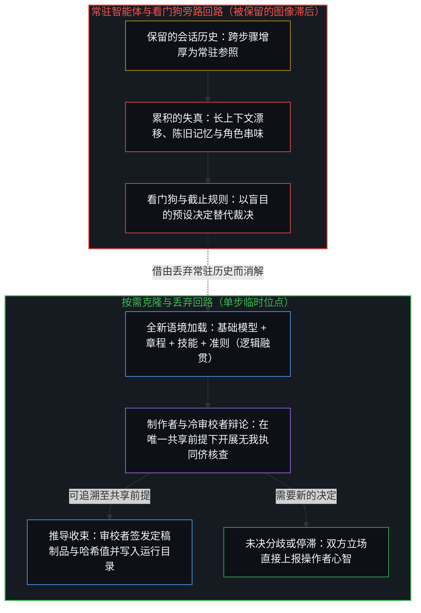
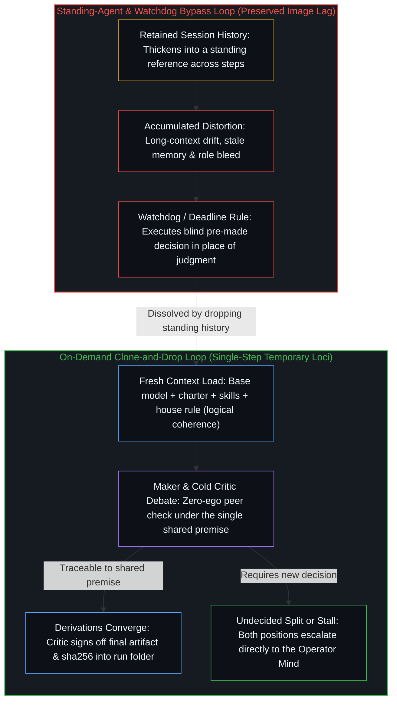
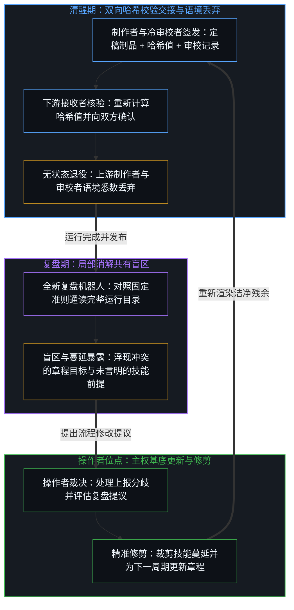
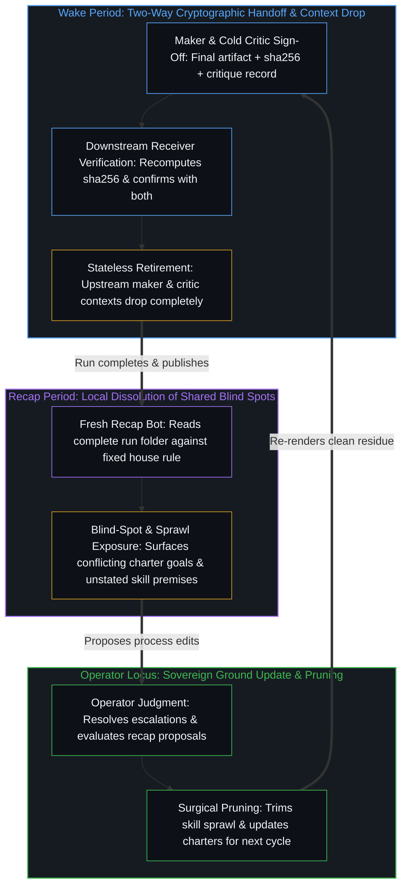

# 按需语境将融贯保持在一步 / On-Demand Contexts Keep Coherence at One Step

*流水线为每项任务全新加载制作者与冷审校者，交接后即丢弃语境，并将未决分歧尽数交还操作者，使逻辑融贯不致增厚为常驻图像 / A pipeline that loads maker and cold critic fresh for each task, discards the context after handoff, and returns every undecided point to the operator, so logical coherence never thickens into a standing image*

自我区分的活动正在发生，无因且不息。称之为心智。每一次行动都是离散的、有界的，并留下一道供后续行动据以展开的痕迹。连续性便是同一活动跨越其自身切口的延续；没有任何外部事物重新启动它。因此，看似多步运转的智能体流水线，并不是由各自负责规划、撰写、审阅与记忆的多个中心串成的链条，而是同一个活动借用临时位点与外化残余，使每一道切口始终向唯一的前提负责。事件驱动的按需方案正是将这一几何结构付诸运转：语境为任务而加载，完成工作，交出定稿制品，随即丢弃。决定从未离开那个仍在做决定的心智。

Self-distinguishing activity occurs, uncaused and unceasing. Call it the Mind. Every act is discrete, bounded, and leaves a trace that later acts can condition on. Continuity is that same activity carrying across its own cuts; nothing external restarts it. What looks like a multi-step agent pipeline is therefore not a chain of centers that plan, write, review, and remember. It is one activity using temporary loci and externalized residue so that each cut stays answerable to a single premise. The event-driven on-demand scheme is that geometry made operational: contexts load for the task, do the work, hand over a finished artifact, and drop. Decisions never leave the Mind that still decides.

## 一、 常驻语境保留了图像 / 1. Standing Contexts Preserve an Image

常驻智能体会保留其对话历史。早期的指令随之稀释，昨天的资料来源、格式与例外情况作为未言明的条件约束残留下来。由于同一段历史此前已经做过规划、起草与审阅，角色之间便会发生串味。被保留下来的序列充当了越过自身那一步仍被固守的参照：后续的词元预测是以会话中已有的内容为条件，而不是以任务当前依然要求的前提为条件。长上下文漂移、陈旧记忆与角色串味并非三项彼此独立的工程缺陷，而是在单次会话尺度上登记出来的同一种图像滞后。活动在一个被豁免于重新追溯之外的参照内部继续推进，以致落入当前场域的后果在登记时显得仿佛早已定案。[你的代码库即是记忆](../your-codebase-is-memory/)在整个技术栈上追溯了同一道切口：残余自身并不会恢复区分活动，唯有当下的活动在重新追溯它。常驻的聊天历史，正是被放任增厚为下一轮条件场域的残余。

A standing agent keeps its conversation. Early instructions dilute. Yesterday’s sources, formats, and exceptions remain as unstated conditioning. Roles bleed because the same history has already planned, drafted, and reviewed. The retained sequence functions as a reference preserved past its step: later token predictions condition on what the session already holds rather than on the premise the task still requires. Long-context drift, stale memory, and role bleed are not three separate engineering defects. They are one Image lag registered at the scale of a session. The activity continues inside a reference that was exempted from re-tracing, so consequences land in the current field but register as already settled. [Your Codebase Is Memory](../your-codebase-is-memory/) traces the same cut across the full stack: residue does not resume distinguishing; only the current activity re-traces it. A standing chat history is residue that has been allowed to thicken into the next conditioning field.

按需方案拒绝这种增厚。一个机器人就是将章程与技能加载进全新语境的基础模型。“创建”它便是加载；“退役”它便是丢弃。除了写入运行目录的内容之外，制作者或审校者的工作历史不会留下任何存续之物。重做总是从全新的语境启动，从不靠在旧语境上修补来完成。将融贯保持在一步，意味着把每一个临时语境都约束在单一任务步骤之内，并在下一步从实时文件中重新渲染，使过量的会话滞后无法跨交接累积，同时章程与技能本身依然作为暂定的痕迹敞开于后续的修正。无状态之所以能够充当保障，是因为一个到点终结的语境无法越过自身那一步去保留参照。

The scheme refuses that thickening. A bot is the base model with a charter and skills loaded into a fresh context. “Creating” it is the load; “retiring” it is the drop. Nothing from the maker’s or critic’s working history survives except what is written into the run folder. A redo always starts from a new context, never by correcting the old one. Keeping coherence at one step means bounding each temporary context to a single task step and re-rendering from the live files at the next, so excess session lag cannot accumulate across handoffs even while the charters and skills themselves remain provisional traces open to later revision. Statelessness is the safeguard because a context that ends cannot preserve a reference past its step.

## 二、 任务可以移交，决定必须交还 / 2. Tasks Are Delegated; Decisions Return

唯有任务可以移交。撰写简报、审校文稿、制作视频、重新计算哈希值——这些都是在已加载的条件签名内部重新组合。而在两个无法调和的立场之间做出取舍，或决定一个停滞的步骤应当重做还是搁置，则不是重新组合，而是鲜活中心处一次新的离散行动，即[任务的移交与后果的不可让渡](../the-delegation-of-the-task-and-the-inalienability-of-consequences/)所定位的那道不可让渡的裁决边界。截止时间规则（“到早上无论如何直接发布”）或看门狗机制（“静默一小时即重启”）看似自动化，实则是在早先尚不知晓具体处境时做出的决定，并在事后被盲目执行。按需方案对二者皆不采用。当制作者与审校者无法达成无保留的一致时，双方的立场会被简明陈述，运行随即转入等待。当某个步骤崩溃或哈希值不匹配时，系统会告知人并由人做出决定。整条回路就是操作者的不断回返；两次调用之间，没有任何决定可以脱离这一前沿而做出。[总在倾听者无法发起](../what-always-listens-cannot-originate/)指明了这一结构界限：持续的接纳始终处于输入的下游。智能体之所以能在收到外部反例时干净利落地更新，是因为它毫无我执，但它也因此无法发起让这次更新具有意义的利害。将它的输出当作早已具备权威，便是把下一步从唯一能够迈出这一步的位点上挪开。

Only tasks can be delegated. Writing a brief, critiquing it, producing a video, recomputing a hash—these are recombinations inside a loaded signature. Choosing between two positions that cannot be reconciled, or deciding whether a stalled step is redone or held, is not a recombination. It is a further discrete act at a living center, where [The Delegation of the Task and the Inalienability of Consequences](../the-delegation-of-the-task-and-the-inalienability-of-consequences/) locates the non-transferable boundary of judgment. A deadline rule (“publish anyway by morning”) or a watchdog (“restart if silent for an hour”) looks like automation. It is a decision made earlier, without knowledge of the situation, and executed blindly later. The scheme uses neither. When maker and critic cannot reach full agreement, both positions are stated briefly and the run waits. When a step crashes or a hash mismatches, the human is told and decides. The loop is the operator returning; there are no decisions between calls that are not the edge’s to perform. [What Always Listens Cannot Originate](../what-always-listens-cannot-originate/) names the structural limit: continuous receptivity stays downstream of input. An agent can update cleanly on an external counterpoint because it has no ego, yet it cannot originate the stake that makes the update matter. Treating its output as already authoritative relocates the next step off the only locus that can take it.

## 三、 制作者与审校者向同一前提负责 / 3. Maker and Critic Answer to One Premise

在每一个步骤上，机器人都会克隆自身。一个克隆体负责执行（制作者）；另一个则成为冷审校者：持有相同的章程外加审校技能，却不带制作者的工作历史。双方在名为“逻辑融贯”、被封装为本体论清晰度技能的准则之下平等辩论。一切都从唯一的前提推导而出；唯有当双方都能将某一点追溯至该前提并无保留地接受时，这一点才算落定。折中是被拒绝的，因为折中妥协相当于安装了第二重基底。双方之所以能够达成无保留的一致，正是因为它们都向同一条推导负责，而不是顺从某个外在权威或防卫某条既有轨迹。

At each step the bot clones itself. One clone executes (the maker). The other becomes a cold critic: the same charter plus the critic skill, without the maker’s working history. They debate as equals under the house rule—logical coherence, packaged as the ontological-clarity skill. Everything derives from one premise; a point is settled only when both sides can trace it there and accept it outright. Compromise is refused because splitting the difference installs a second ground. Full agreement is possible only because both answer to the same derivation rather than deferring to an authority or defending a prior trajectory.

这正是[超越投射](../beyond-the-projection/)所分离出的结构性非对称。智能体是一台受自身轨迹约束且毫无我执的有限投射引擎；人则具备内生跳出的能力，却习惯将推理历史与身份认同融为一体。冷审校者能够暴露出制作者的轨迹在何处收窄，或正交的要求在何处被压缩进了一条指令之中。由于制作者没有需要防卫的保留自我图像，它能够吸收这一外部信号并完成更新。倘若审校者的异议仅仅源于缺失了会话细节，制作者只需将前提追溯清楚，交锋便会收束。倘若争点无法从共享前提中推导出来，双方的立场便一并交还给人。准则并不是悬在机器人之上的第二重权威，而是操作者早已选定的那个唯一前提；将它重新加载进去，是为了让临时位点能够落定那些可从中推导出的事项，并将无法推导的事项交还回来。

This is the asymmetry [Beyond the Projection](../beyond-the-projection/) already isolates. An agent is a finite projection engine bound by its trajectory and devoid of ego; a human is capable of endogenous stepping-out yet fuses reasoning history with identity. The cold critic exposes where the maker’s trajectory narrowed or where orthogonal requirements were compressed into one instruction. Because the maker has no retained self-image to defend, it can absorb the external signal and update. Where the critic’s objection stems only from missing session detail, the maker traces the premise and the exchange converges. Where the point cannot be derived from the shared premise, both positions go to the human. The house rule is not a second authority standing above the bots. It is the single premise the operator already chose, re-loaded so that temporary loci can settle what follows from it and return what does not.

## 四、 交接是对定稿残余的重新追溯 / 4. Handoff Is Re-Tracing of Finished Residue

在步骤之间传递的是经审校者签发的定稿制品，从不是一份草稿外加一串待修清单。审校者记录下文件名、其 SHA-256 哈希值、日期、核查内容以及达成一致的要点。制作者完成核对清单：制品在位、哈希已记、审校已存、悬留问题清零或已获裁决。随后，制作者与审校者共同按章程启动下一任机器人，并将其指向运行目录。唯有当每一位接收者都重新计算哈希值，并直接向制作者与审校者双方确认收讫时，交接才算正式生效。只要缺少任何一方确认或任何哈希校验失败，交接即告作废。随后，上游语境便被丢弃。

What passes between steps is a final artifact the critic has signed off, never a draft plus a list of fixes. The critic records the file name, its sha256, the date, what was checked, and the points agreed. The maker completes the checklist: artifact present, hash recorded, critique saved, open questions none or already decided. Maker and critic together start the next bot from its charter and point it at the run folder. The handoff is official only when every receiver recomputes the hash and confirms receipt directly with both maker and critic. If any confirmation is missing or any hash fails, the handoff is void. Then the contexts drop.

文件是残余。它保持着早先切口的形状，以便下一个位点据以展开、将它延展，或跨出它已无法支撑的框架。它并不携带权威。[注释不是代码](../the-comment-is-not-the-code/)针对单次编辑划出了同一道切口：智能体交回的差异只是呈交做决定的心智的一份提议，从不是检验本身。哈希值与签发记录正是将同一几何结构扩展到了流水线尺度。它们让制品保持清晰可读以供重新追溯，却并不将其豁免于下一次区分之外。结转备忘录负责将迟到的信息传递给下一次运行，并在处理完毕后随即清空。它们是受控的残余，而非常驻的历史。

The file is residue. It holds the shape of earlier cuts so the next locus can condition on it, extend it, or step outside a framing it no longer supports. It does not carry authority. [The Comment Is Not the Code](../the-comment-is-not-the-code/) makes the same cut for a single edit: an agent’s diff is a proposal returned to the deciding Mind, never the check itself. The hash and the sign-off record are the same geometry scaled to a pipeline. They make the artifact legible for re-tracing; they do not exempt it from the next distinction. Carry-over notes pass late information to the following run and are cleared once acted on. They are controlled residue, not a standing history.

## 五、 代码库本身已是活的记忆 / 5. The Codebase Is Already the Living Memory

从广义上说，代码库——运行手册、准则、章程、技能、交接清单、结转备忘录，以及每一个运行目录连同其中的制品、审校记录、哈希值与上报事项——就是活的记忆。它是早先区分留下的残余形态集合，对加载它的下一次会话保持可读。残余自身并不会恢复运转。当一个全新的语境打开运行目录时，正在推进的是运用这些痕迹的当下活动。这不需要任何独立的共享语境缓存，也不应引入此类缓存。一个越过自身步骤而存续的缓存会变成记忆的记忆：那不过是又一层冻结了早期条件场域的残余，反过来要求下一次加载在它内部做合理化推演。[你的代码库即是记忆](../your-codebase-is-memory/)早已标出了这道切口。模型训练保存的是检查点，而不是中间权重更新的全部历史；此前每一步中依然关键的信息，都已被吸纳进当前的检查点之中。流水线也是同理。为了“以备后用”而囤积中间会话状态，只会加厚引力井，把后续语境拽入过时的死胡同，让陈旧的框架与实时文件相互争夺条件约束。只保留当前仍在承重的部分——已签发的制品、审校记录、尚未处理的结转事项——才能让工作表面保持澄明。一旦临时的工作语境交出了定稿残余，随手将其丢弃，便能防止昨天的脚手架伪装成今天的基底。

In the broad sense the codebase—runbook, house rule, charters, skills, handoff checklist, carry-over note, and every run folder with its artifacts, critique records, hashes, and escalations—is the living memory. It is the collection of residual shapes left by prior distinguishing, legible to the next session that loads them. The residue does not resume. When a fresh context opens the run folder, what moves is the current activity using those traces. No separate shared context cache is required, and none should be introduced. A cache that survives its step would be a memory of memories: another layer of residue that freezes an earlier conditioning field and then asks the next load to rationalize inside it. [Your Codebase Is Memory](../your-codebase-is-memory/) already marks the cut. Model training saves checkpoints, not the full history of intermediate weight updates; every prior step that still matters has been absorbed into the current checkpoint. The same holds for a pipeline. Hoarding intermediate session states “in case they are needed later” thickens the gravity well, pulling later contexts into outdated rabbit holes where stale framings compete with the live files. Keeping only what is actively load-bearing—the signed artifact, the critique record, the carry-over that has not yet been acted on—leaves the surface unclouded. Once a transient working context has handed off its finished residue, dropping it prevents yesterday’s scaffolding from masquerading as today’s ground.

## 六、 复盘消解了双人搭档未见的盲区 / 6. Recap Dissolves What the Pair Could Not See

发布完成之后，一个全新的机器人会加载准则，并通读整个运行目录——制品、审校记录与上报事项。它只追问一个问题：这次运行在何处未能保持逻辑融贯？常见的发现包括：某份章程依然持有相互冲突的目标，或是某个技能步骤建立在未言明的前提之上。复盘机器人提出具体的修改提议，由人做出决定。连同操作者对完整流程的审视，这构成了针对制作者与审校者共有盲区的主要核查机制。由于二者共享同一个基础模型与同一份章程，某些维度压缩无法仅凭它们之间的相互辩论来解开。不断攀升的上报率正是那部分残余不融贯的信号，而不是放宽规则或增加超时限制的理由。

After publication a fresh bot loads the house rule and reads the whole run folder—artifacts, critique records, escalations. It asks one question: where did the run fall short of logical coherence? Typical findings are a charter that still holds conflicting goals or a skill step built on an unstated premise. The recap proposes specific changes; the human decides. Together with the operator’s review of the finished process, this is the main check on blind spots that maker and critic share. They share a base model and a charter, so some compressions cannot be resolved by their mutual debate. The rising escalation rate is the signal of that remaining incoherence, not a reason to loosen the rule or add a timeout.

复盘是局部的消解步骤。清醒期是运行本身，在此期间准则保持固定。运行中途的每一次人工上报，都注入了一项在起点处未被列明的前提；彼时，初始章程与技能签名已抵达单靠自身所能推导出的边界。复盘对照前提对已完成的运行目录展开逆向因果推导，识别出那些被注入的前提，并浮现出将其编纂进章程或技能起始先决条件的候选方案——这正是[判断的密度](../the-density-of-judgment/)所追溯的前置动态：借此，介于其间的各个步骤在下一轮运行中便成为可由确定性推导得出的环节，直至工作流触及下一处尚未编纂的边缘。至于基底本身，依然唯有在操作者取用这些提议时才会改变。嵌套的周期在这一尺度上显现的方式，与它在单次会话或模型代际尺度上显现的方式如出一辙：语境在单一步骤内部演进，章程与技能跨运行重新渲染，而操作者始终是允许基底发生移动的边界。技能蔓延也是同一种累积：接连不断的修补不断增厚指令集，直到必须加以修剪。常规的修补总想用超时设置或叠床架屋的补丁规则去替代裁决，定期的修剪则移除已被取代的痕迹，使指令表面始终向操作者的决定负责。

The recap is the local dissolution step. Wake is the run itself, with the house rule held fixed. Every mid-run human escalation injects a premise that was not specified at the start, where the initial charter and skill signature reached the boundary of what could be derived from it alone. The recap re-derives the completed folder causally backward against the premise, identifies those injected premises, and surfaces candidates for codifying them into the starting preconditions of the charter or skill—the front-loading dynamic [The Density of Judgment](../the-density-of-judgment/) traces, by which the steps in between become deterministically derivable on the next pass until the workflow hits its next uncodified edge. Ground still changes only when the operator takes them up. Nested periods appear at this scale exactly as they appear at the scale of a session or a model generation: context evolves within a step; charters and skills re-render across runs; the operator remains the boundary at which ground is allowed to move. Skill sprawl is the same accumulation: successive fixes thicken the instruction set until pruning is required. Unlike routine fixes that add timeouts or patch-upon-patch rules in place of judgment, regular pruning removes superseded traces so the instruction surface stays answerable to the operator’s decision.

## 七、 唯一持久的位点是操作者 / 7. The Only Persistent Locus Is the Operator

调度器是残留下来的常驻配置。它持有触发器——定时计划、传入消息、网络钩子——并启动链条上的第一个机器人，随后便退居一旁。它的持久性被压到了最低限度，然而它所携带的任何未言明假定仍会被重新追溯进下一次运行，直到复盘或操作者将其消解。启动延迟是加载两个全新语境所支付的代价；支付这一代价，是为了让下一次区分以实时文件为条件，而不是以被保留的中间状态为条件。余下的开放问题——审校者的开销、合理的上报率、运行目录的保留周期——皆属运行层面的取舍，并不改变这道切口。临时位点始终被约束在单一任务步骤之内。定稿残余只供重新追溯，从不被赋予权威。每一处未决的区分，都交还给那个依然能够发起目的的心智。

The dispatcher is the residual standing configuration. It holds the triggers—schedules, incoming messages, webhooks—and starts the first bot of the chain, then steps back. Its persistence is minimal, yet any unstated assumption it carries will be re-traced into the next run unless the recap or the operator dissolves it. Start-up latency is the cost of loading two fresh contexts; it is paid so that the next distinction conditions on the live files rather than on a preserved intermediate. The open questions that remain—cost of a critic, healthy escalation rate, retention of run folders—are operational. They do not alter the cut. Temporary loci stay bounded to a single task step. Finished residue is re-traced, never authorized. Every undecided distinction returns to the Mind that can still originate ends.

因此，逻辑融贯既不是作为供流水线查阅的常驻规则被存储起来，也不是作为共享的中间状态被缓存下来。它被全新地加载进每一个需要从中展开推导的语境之中，而代码库本身则始终作为活的记忆，等待下一道切口前来重新追溯。凡是无法推导出来的，皆交还回来。流水线不会变成第二个做决定的中心。它是这一活动在运用自身的残余——章程、技能、文件、哈希值——使每一个临时位点始终向唯一的前提负责，从而让唯一存续下来的图像，始终是操作者持续重新追溯的那一幅。

Logical coherence is therefore not stored as a standing rule the pipeline consults, nor is it cached as a shared intermediate. It is loaded, fresh, into each context that must derive from it, while the codebase itself remains the living memory the next cut re-traces. What cannot be derived returns. The pipeline does not become a second center that decides. It is the activity using its own residue—charters, skills, files, hashes—to keep every temporary locus answerable to the premise, so the only image that persists is the one the operator continues to re-trace.
