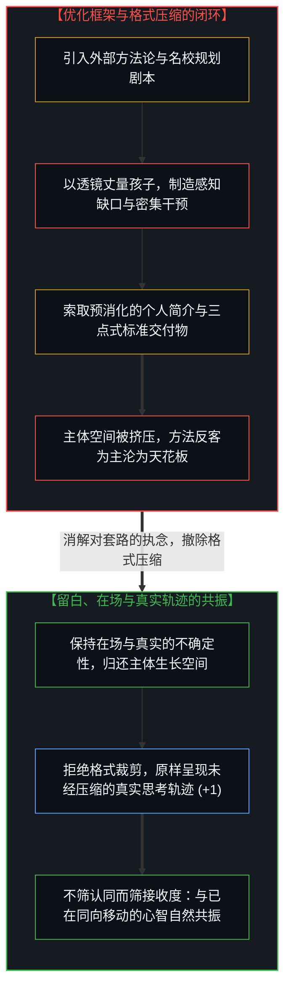
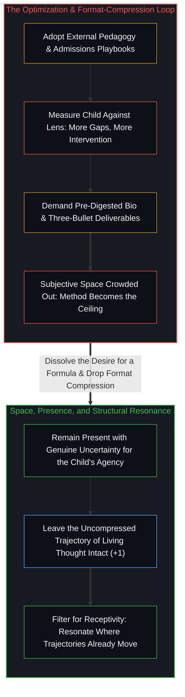

# 论教育、共振与给人真东西 / On Education, Resonance, and Giving Someone the Real Thing

*把教育当优化会挤占主体空间，撤除格式压缩才能让真东西引发共振。 / Treating education as optimization crowds out agency, while dropping format compression lets real thought resonate.*

一位五年多未曾联系的旧友突然找上门来。她运营着一个名为“美教投”（美国教育与投资）的微信频道，将自己定位为送孩子进入西方名校的规划专家，希望我分享一些关于芬兰教育的洞见。

A friend from years ago reached out after more than five years of silence. She runs a WeChat channel called *American Education and Investment*, positioning herself as an expert in getting children into prestigious Western universities, and she wanted me to share insights on Finnish education.

我刚一答应，她便立刻开始把我往一个预设的槽位里塞：个人简介、结构化选题、标准化交付物。我当即意识到：我既帮不了她，也帮不了她的受众，因为他们寻找的只是某种自己早已熟悉、早已预备好要消费的套路。于是我婉拒了。她继续施压，最后甚至将其包装成一份人情——“就算帮我个忙”——却从头到尾对我在这个问题上究竟站在哪里毫无兴趣。我原本就在思考教育问题，而这次碰撞恰恰让底层的脉络结晶了出来。

The minute I agreed, she began fitting me into a pre-cut slot: profile bio, structured topics, standardized deliverables. I realized right away that there was no way I could help her or her audience, because they were looking for something they were already familiar with and ready to consume. When I declined, she pushed back and framed it as a personal favor—"for the sake of helping me"—while showing zero interest in where I actually stood on any of it. I had been reflecting on education anyway, and the encounter crystallized the underlying structure.

## 一、 优化的悖论：方法如何变成天花板 / 1. The Paradox of Optimization: How Method Becomes the Ceiling

教育的对象是人；人是有自由、有意识的主体，因而不可能从外部被全盘塑造。

The participant in education is a person, and a person has freedom and consciousness—which means no mind can be shaped from the outside according to a blueprint.

这句话听似显浅，但只要顺着它的推论往下走，就会撞见那个核心悖论：你越是系统地去“优化”教育，你就越是把孩子当成一件有待加工成型的客体——而这直接违背了使教育具有意义的唯一前提，即孩子是一个拥有自身能动性的主体。**优化本身变成了约束。**

That premise sounds obvious, yet following its implication exposes the central paradox: the more systematically you optimize education, the more you treat the child as an object to be engineered, which contradicts the one condition that makes education meaningful—that the child is a subject with their own agency. **The optimization itself becomes the constraint.**

越是被标榜为“高效”的教育方式，越是限制孩子的潜力；越是执着于寻找“正确教育方式”的家长，越可能亲手成为孩子成长的天花板。父母把自己的过往路径而非真东西传下去，正是[成功之后的育儿谬误](../the-fallacy-of-post-success-parenting/)所剖析的错位。

The more "effective" the method claims to be, the more tightly it caps the child's potential; the more anxiously a parent pursues the right method, the more reliably the parent becomes the ceiling. Parents who hand down their own past path instead of the real thing step directly into the inversion traced in [The Fallacy of Post-Success Parenting](../the-fallacy-of-post-success-parenting/).

我曾试过各种各样的方法，也读过数不清的育儿与教育书籍。然而每一种看似奏效的方法，都会在别处带来更大的副作用；哪怕是在同一个屋檐下长大的两个孩子，同一种方法也从来不会以同样的方式起效。原因很简单：真正的因果权重驻留在孩子内部，而不在外部的方法里。方法对于一个自组织的心智系统而言，只是一次微小的外部扰动。

I have tested method after method and read shelves of books on parenting and pedagogy. Every approach that appeared to work carried larger side effects elsewhere, and even with two children growing up in the same household, the same method never lands the same way twice. The reason is structural: causal weight lives inside the child, not inside the method. Relative to a self-organizing mind, any external method is a minor perturbation.

每一本新书都会递给你一副新透镜——也就是多给了你一种“相对于这副透镜把孩子看出缺陷”的新视角。框架越多，眼中的缺口就越多；缺口越多，出手干预就越密集；干预越密集，留给孩子自主生长的空间就越狭窄。而一旦家长心里生出了向外输出的欲望——想要分享育儿心得、指导他人、围绕“我已经搞懂了教育”建立起某种身份认同——事情就变得更糟：你自己变成了一把锤子，看什么都像是亟待敲打的钉子。

Each new book hands the parent a new lens—which supplies a new way to diagnose the child as deficient relative to that lens. More frameworks generate more perceived gaps, more gaps trigger more interventions, and more interventions leave less room to breathe. Once a parent develops the urge to output—to broadcast parenting wisdom, advise others, and build an identity around "having figured education out"—the inversion hardens: the parent becomes a hammer, and every child looks like a nail.

## 二、 现实中的标本：当别人索取的只是组件 / 2. The Pattern in Practice: Asking for a Component

这便把我带回了那位旧友身上。她本身就是这一模式的活标本：她的频道、她的受众、她的个人品牌，全都建立在“教育是一道可解的优化题”这一前提之上，整套商业模式的运转都要求这一前提不得被质疑。

Which brings me back to my old friend. She *is* the pattern in practice: her channel, her audience, and her brand are built on the premise that education is a solvable optimization problem, and her entire business model requires that premise to stay unquestioned.

因此，当她找上我时，她要的并不是**我**，她需要的只是一个模块化组件——一个贴着“身处芬兰的教育视角”标签的内容资产，而非一个活生生的视角。五年多的沉默之后紧跟着一套格式化的填空要求，已经把一切说明白了。

So when she reached out, she did not need *me*; she needed a modular component—"Finland-based education perspective"—as a content asset rather than a living perspective. Five years of silence followed immediately by formatting instructions said everything.

其实我当时真的向她敞开了大门：我把过去六十天里跨工作轨迹提炼出的九百多篇长文札记汇总发给了她——那是我真实的思考脉络与运动轨迹。她压根没有读——不是因为篇幅太长，而是因为那些东西长成的形状不是她要的形状：那不是一段光鲜的个人简介加三条要点总结；那是真东西，而她索取的只是一件标准交付物。

I actually opened the door: I sent her a synthesis of my past sixty days—more than nine hundred long-form notes distilled across my working trajectory, capturing my actual thinking and movement. She did not read it—not because it was too long, but because it was not in the shape she needed. It was not a polished bio and three bullet-point takeaways; it was the real thing, whereas she had asked for a deliverable.

你给了她真的，她要的是假的。

I gave her the real thing; what she wanted was the pre-packaged substitute.

## 三、 共振的落差：不是圈子小了，是看清了 / 3. The Resonance Gap: The Circle Did Not Shrink, Vision Cleared

这一模式远远超出教育的范畴。日常公开场合中大多数对“真实”的索取，索取的其实是**一个可供表演的真实版本**——表面长得像坦诚，内里却早已被预先消化好、以便受众无摩擦地吞咽。

This pattern generalizes far beyond education. Most public requests for "authenticity" are requests for a *performable version* of authenticity—shaped like candor on the surface, yet pre-digested for frictionless consumption.

而旧相识之间拉开的共振落差，很少是因为谁突然“变了”，而是因为认清了当初的连接本就比双方以为的要单薄得多。曾经共享的处境语境掩盖了底层的分叉；一旦抽掉那层共同语境、叠加上五年的各自前行，原本就属于处境偶合而非结构同频的东西便一目了然。

And the resonance gap that opens between old acquaintances rarely comes from people suddenly changing; it comes from recognizing that the original connection was thinner than either party assumed. Shared situational context once masked the underlying divergence; remove the shared context, add five years of independent motion, and what was always situational rather than structural becomes plain.

不是圈子小了，是看清了。

The circle did not shrink; vision simply cleared.

从注意力游戏的内部算账，有人会把这种清明当成一种代价——人脉少了、触达窄了、受众小了，仿佛连接的人头数才是通行的货币。但在实际体验中，真正停止的是向那些从未产生真实接触的互动持续失血。每一段浅层连接都附带着高昂的维护损耗：配合演出、自我压缩、把真实的运动轨迹裁剪成别人预设的模板。卸下这笔损耗并不是陷入孤立，而是撤除了自找的阻力。

From inside the attention game, someone might count that clarity as a cost—fewer connections, narrower reach, a smaller audience—as though connection headcount were the currency. In practice, what stops is the continuous energy bleed into interactions that never generated real contact. Every shallow connection carries maintenance overhead: the performance, the self-compression, the trimming of one's actual trajectory to fit another's template. Dropping that overhead is not isolation; it is the removal of self-inflicted drag.

## 四、 消解对“方法”的执念 / 4. Dissolving the Desire for an Approach

关于教育，最干净的凝练在于：最富生成力的方法，就是**消解掉“想要占有一套方法”的执念**。这并非疏忽放任，而是唯有这种消解才能为另一个心智腾出生长的空间。一个孩子所需要的，是一个真正在场、敏锐回应、并且对“孩子将来会成为什么样的人”怀有真实不确定性的父母；这种不确定性不是育儿的故障模式，而是能动性得以运转的前提条件。

The cleanest formulation of the education insight is this: the most generative approach is to **dissolve the desire to possess an approach**. Not out of neglect, but because that dissolution is what leaves room for another mind to grow. A child needs a parent who is present, responsive, and genuinely uncertain about what the child will become; that uncertainty is not a failure mode, but the operating condition of agency.

分享思想遵循着同一条法则。只要存在共振的可能——只要对方的心智已经在沿着某条轨迹自主前行、使得思想有地方可以落脚——我随时乐意分享。这并不是在筛选观点上的附和，而是在筛选对方对“作品本身真实形状”的接收度。唯有当压缩是从内在清明中自然结晶出来时，压缩才真正奏效，而非把活生生的思考硬塞进外部的营销模具里——而她索取的恰恰只是那个模具。

Sharing ideas follows the same law. I am always willing to share where resonance is possible—where the other mind is already moving along a trajectory where the thought can land. That is not filtering for agreement; it is filtering for receptivity to the actual shape of the work. Compression works when it crystallizes out of clarity, not when living thought is stuffed into an external marketing mold—and the mold was all she wanted.

正如[你的代码库即是记忆](../your-codebase-is-memory/)所揭示的，过去六十天写下的九百多篇文字乃至这座活书本身，都是第一人称心智在活态前沿（`+1`）持续切分所留下的外化记忆轨迹，而不是供人装进名校规划货架的预制简历组件。因此，这里留下的便是不作迎合性压缩的完整形状：若能共振，它自然会共振；若不共振，那同样是清晰的信息。

Those nine hundred notes and this living repository itself are externalized memory traces of cuts made at the first-person edge (`+1`)—the living inscription traced in [Your Codebase Is Memory](../your-codebase-is-memory/)—not pre-packaged credential widgets for an admissions funnel. So this piece leaves the full shape uncompressed: where it resonates, it resonates; where it does not, that is clear information too.
