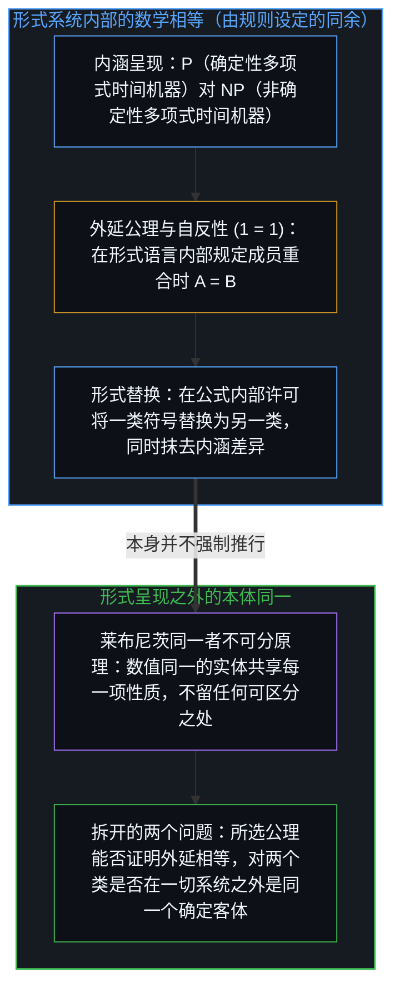
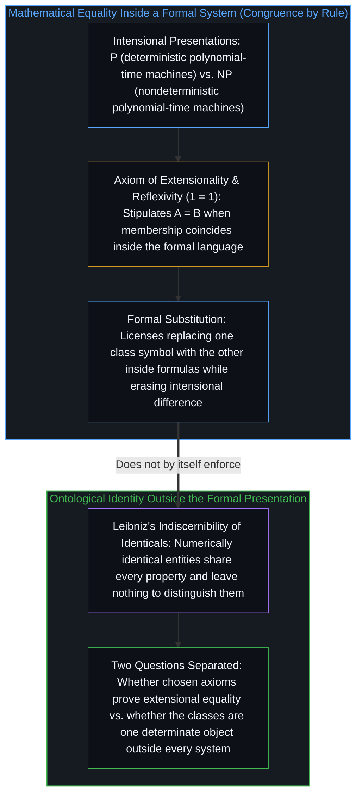
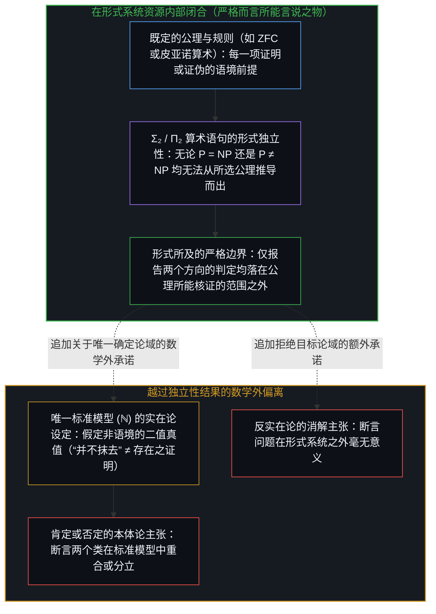
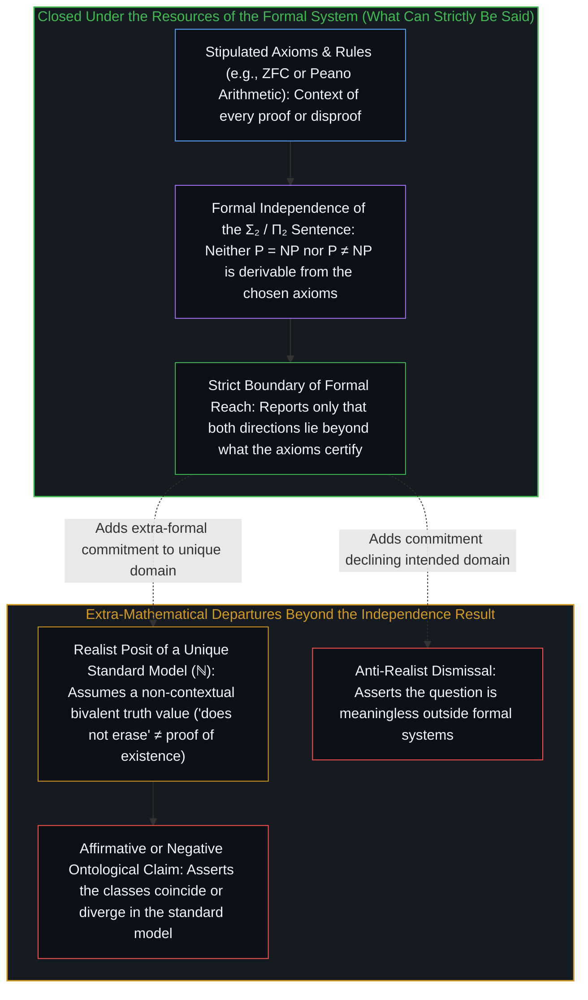

# 论关于 P 与 NP 所能言说的边界 / On the Boundaries of What Can Be Said about P and NP

*数学相等是形式系统内部的同余规则，而在独立性之外设定标准模型则越过了公理的界限 / Mathematical equality is a congruence rule inside a formal system, and positing a standard model beyond independence steps past the axioms*

称 P = NP [“在于二者的差异不可证，而非在于二者同一，因为同一同样不可证”](https://x.com/powerpig/status/2114987213033525595)——这句针对[一则重提 3-SAT 多项式时间路径戏谑传闻的帖子](https://x.com/_maxfeldman/status/2114860701219209237)所作的回应，标出的是一道精确的界限，而非一项解答。它记录的是一项关于形式所及范围的主张：在诸如 ZFC 这样强到足以将寻常算术与图灵机形式化的公理系统中，无论这两个复杂度类的相等还是不等，都无法被推导出来。这句话既没有断言这两个类相同，也没有断言它们不同，更没有断言这一问题毫无意义。它只是指出，两个方向上的判定都落在了所选公理允许推导的范围之外。下文展开的一切讨论，都是为了审视：一旦承认了这道形式边界，人们还能往前走多远，以及跨过这道边界需要付出哪些额外的承诺。

The statement that P = NP [“in that their difference is unprovable, but not in that they are identical, which is also unprovable”](https://x.com/powerpig/status/2114987213033525595), written in reply to [a post revisiting a satirical rumor of a polynomial-time route to 3-SAT](https://x.com/_maxfeldman/status/2114860701219209237), marks a precise limit rather than a resolution. It records a claim about formal reach: within a system such as ZFC, or any comparable axiomatization strong enough to formalize ordinary arithmetic and Turing machines, neither the equality of the two classes nor their inequality can be derived. The remark does not assert that the classes are the same, nor that they are different, nor that the question is meaningless. It simply notes that both directions of decision lie beyond the derivations the chosen axioms permit. Everything that follows in the discussion is an examination of how far one may go once that formal boundary has been acknowledged, and of the extra commitments required to cross it.

## 一、 数学相等是规则设定，而非本体同一 / 1. Mathematical Equality Is Introduced by Rule, Not Ontological Identity

数学上的相等是由规则引入的，而不是作为一项本体论事实被发现的。在集合论中，外延公理规定：当且仅当两个集合包含相同的元素时，它们才是相等的。相等的自反性要么是一条公理，要么是该关系定义的直接推论。当人们写下 1 = 1 时，这一表达式并没有报告某种独立于心智的客体之间存在着深层的同一；它记录的是形式系统将这枚符号的两次出现当作指称同一个实体来对待，即[工具的幻觉与时间的倒置](../the-illusion-of-the-tool-and-the-inversion-of-time/)所追溯的那项工具性设定。复杂度类的情形同样如此。P 与 NP 是由语言构成的集合。它们的相等意味着：每一个被非确定性多项式时间图灵机接受的语言，也都被确定性多项式时间图灵机所接受，反之亦然。一旦这种外延同一在某个形式系统内部得以确立，替换性质便随之成立：任何对其中一个类成立的公式，对另一个类也同样成立。这两个类的定义看上去固然不同——一个对确定性机器作量化，另一个对非确定性机器作量化——但这种差异属于内涵层面。外延相等在形式语言的范围内抹去了这一差异。

Mathematical equality is introduced by rule, not discovered as an ontological fact. In set theory the axiom of extensionality states that two sets are identical precisely when they contain exactly the same elements. Reflexivity of equality is either an axiom or an immediate consequence of the definition of the relation. When one writes 1 = 1, the expression does not report a deep sameness among mind-independent objects; it records that the formal system treats the two occurrences of the symbol as denoting the same entity, the instrumental posit traced in [The Illusion of the Tool and the Inversion of Time](../the-illusion-of-the-tool-and-the-inversion-of-time/). The same holds for complexity classes. P and NP are sets of languages. Their equality means that every language accepted by a nondeterministic polynomial-time Turing machine is also accepted by a deterministic one, and conversely. Once that extensional identity is established inside a formal system, the substitution property follows: any formula true of one class is true of the other. The definitions of the classes may look different—one quantifies over deterministic machines, the other over nondeterministic ones—but the difference is intensional. Extensional equality erases it for the purposes of the formal language.

相比之下，本体论上的同一受制于并非内生于形式系统的原则。莱布尼茨的同一者不可分原理指出，倘若两个事物在数值上是同一个，那么其中一个的每一项性质也都是另一个的性质。其逆命题，即不可分者同一原理，则存在更多争议。倘若这两个类果真是同一个语言集合，那就不会剩下任何可以把它们区分开来的东西。数学上的相等关系本身并不强制推行这种更强的读法。它只是一种在公式内部许可替换的同余关系；它并不解决这些集合是否在一切形式呈现之外作为唯一、确定的客体而存在，正如[对象是被稳定化的关系](../objects-are-stabilized-relationships/)所追溯的那样。因此，最初的那句陈述把两个极易混为一谈的问题拆了开来：一个是某个形式系统能否证明这两个类相等，另一个则是独立于任何特定系统之外，这两个类究竟是不是同一个。

Ontological identity, by contrast, is governed by principles that are not internal to the formal system. Leibniz’s indiscernibility of identicals holds that if two things are numerically the same, then every property of one is a property of the other. The converse, the identity of indiscernibles, is more contested. If the classes are truly one and the same set of languages, nothing remains by which they could be distinguished. The mathematical relation of equality does not by itself enforce this stronger reading. It is a congruence that licenses substitution inside formulas; it does not settle whether the sets exist as unique, determinate objects outside every formal presentation, as [Objects Are Stabilized Relationships](../objects-are-stabilized-relationships/) traces. The original statement therefore separates two questions that are easily conflated: whether a formal system can prove the classes identical, and whether, independently of any particular system, the classes are or are not the same.

## 二、 证明的语境性与标准模型的额外设定 / 2. The Contextual Character of Proof and the Posit of a Standard Model

每一项证明或证伪都是语境性的。推导唯有相对于一组既定的公理与规则才得以存在，正如[没有系统能被保持封闭](../no-system-can-be-kept-closed/)与[两度显现的不完备性](../incompleteness-exhibited-twice/)在各类形式系统中所追溯的那样。一个语句可以在目标解释下为真，却无法从那些公理中推导出来；或者它也可以在同一组公理的不同模型中取相反的真值。[P = NP 这一断言等价于一个低复杂度的特定算术语句](https://www.scottaaronson.com/papers/indep.pdf)，即一个对机器与多项式作量化的 Σ₂ 语句，而其否定 P ≠ NP 则是一个 [Π₂ 语句](https://www.researchgate.net/publication/2375454_On_the_Independence_of_P_Versus_NP)。在任何一个算术模型中，该语句要么为真，要么为假。形式装置所不提供的，是对“存在唯一的目标模型——自然数的标准模型——使得量词在其中恰好遍历寻常的自然数与寻常的图灵机”的保证。这一唯一性是关于该语言所指对象的额外假定，是为了让全称量化得以推进而设定的一次暂时闭合，正如[潜无限与数学思维的暂时闭合](../potential-infinity-and-the-temporary-closures-of-mathematical-thought/)所追溯的那样。它既不是 ZFC 的定理，也不是常用于讨论复杂度的任何其他形式系统的定理。没有这项假定，该语句就依然只是一串形式符号，其地位止步于人们所选择考察的那些模型。

Every proof or disproof is contextual. A derivation exists only relative to a stipulated collection of axioms and rules, as [No System Can Be Kept Closed](../no-system-can-be-kept-closed/) and [Incompleteness Exhibited Twice](../incompleteness-exhibited-twice/) trace across formal systems. A sentence may be true in the intended interpretation yet unprovable from those axioms, or it may receive opposite truth values in different models of the same axioms. The assertion [P = NP is equivalent to a specific arithmetical sentence of low complexity](https://www.scottaaronson.com/papers/indep.pdf), a Σ₂ statement quantifying over machines and polynomials whose negation P ≠ NP is a [Π₂ statement](https://www.researchgate.net/publication/2375454_On_the_Independence_of_P_Versus_NP). In any model of arithmetic the sentence is either true or false. What the formal apparatus does not supply is a guarantee that there exists a unique intended model—the standard model of the natural numbers—in which the quantifiers range over ordinary numbers and ordinary Turing machines. That uniqueness is an additional assumption about the subject matter of the language, a temporary closure posited so that universal quantification can proceed, as [Potential Infinity and the Temporary Closures of Mathematical Thought](../potential-infinity-and-the-temporary-closures-of-mathematical-thought/) traces. It is not a theorem of ZFC, nor of any other formal system commonly used to discuss complexity. Without it, the sentence remains a formal string whose status is exhausted by the models one chooses to consider.

因此，指出形式独立性“并不抹去”一个确定的真值，这番观察本身并不是对该真值存在的证明。它只是保留了实在论读法的自洽性，却并未确立这一读法，正如[没有固定者的固定](../fixed-by-nothing/)所表明的：把未被决定的余项称为“在完整状态中早已被固定”，只是给开口换了一张标签，却并未在系统内部提供任何执行固定的东西。实在论借以恢复非语境的“是或否”答案的那一步，在于设定一个使该算术语句遵循二值原则的唯一标准模型。这一设定固然可用，但它属于数学之外的额外设定。人们同样可以拒绝这一设定，将两个类的相等视为唯有相对于所选模型才有意义，或者唯有在给定系统内部能够展示出证明时才有意义。在那种设定下，最初的表述仅凭独立性结果本身便已穷尽了所能断言的一切。

Consequently, the observation that formal independence “does not erase” a definite truth value is not itself a demonstration that such a value exists. It preserves the coherence of a realist reading; it does not establish the reading, just as [Fixed by Nothing](../fixed-by-nothing/) shows that calling an undetermined remainder “fixed in the complete state” relabels the opening without supplying anything inside the system that fixes it. The realist step that restores a non-contextual yes-or-no answer consists in positing a unique standard model in which the arithmetical sentence is bivalent. That posit is available, but it is extra-mathematical. One may equally decline the posit and treat the equality of the classes as meaningful only relative to a chosen model, or only insofar as a proof can be exhibited inside a given system. In that setting the original formulation already exhausts what can be asserted on the basis of the independence result alone.

## 三、 所能言说的界限与跨出界限的偏离 / 3. The Limits of What Can Be Said and the Departure Beyond Them

所能言说的界限因此清晰可辨。严格来说，人们可以报告：从所考察的公理出发，无论 P 与 NP 的差异还是同一都不可证明。这一主张在形式系统的资源内部是闭合的，从而按照[开放即一致](../openness-is-consistency/)与[为何数学永远解不完](../why-mathematics-can-never-be-solved/)所阐明的意义，把形式持守作为器具保持在开放状态。任何进一步的断言——无论断言这两个类在标准模型中重合、在标准模型中分立，还是断言这一问题在形式系统之外毫无意义——都要求对目标解释的地位作出额外的承诺，即迈出[进位无法在寄存器之内被命名](../the-carry-that-cannot-be-named-inside-the-register/)与[论封闭系统、开放心智与证明的界限](../on-closed-systems-open-minds-and-the-limits-of-proof/)所追溯的那种跨出当前活跃寄存器的一步。这些承诺依然是可能的。它们只是不再是独立性结果的推论。它们标志着从形式内容本身出发的一次偏离，进入了一种关于算术语言是否指称某个唯一、确定论域的立场。这种偏离可以朝任何一个方向迈出，但一旦迈出，它就不再单凭公理所留下的未定之处获得许可。

The limits of what can be said are therefore clear. Strictly speaking, one may report that neither the difference nor the identity of P and NP is provable from the axioms under consideration. That claim is closed under the resources of the formal system, keeping the formal hold open as an instrument in the sense of [Openness Is Consistency](../openness-is-consistency/) and [Why Mathematics Can Never Be Solved](../why-mathematics-can-never-be-solved/). Any further assertion—that the classes coincide in the standard model, that they diverge, or that the question has no sense outside formal systems—requires an additional commitment about the status of the intended interpretation, a step outside the active register of the kind traced in [The Carry That Cannot Be Named Inside the Register](../the-carry-that-cannot-be-named-inside-the-register/) and [On Closed Systems, Open Minds, and the Limits of Proof](../on-closed-systems-open-minds-and-the-limits-of-proof/). Those commitments remain possible. They are simply no longer consequences of the independence result. They mark a departure from the purely formal content into a stance about whether the language of arithmetic is about a unique, determinate domain. The departure can be made in either direction, but once made it is no longer licensed solely by what the axioms leave undecided.

