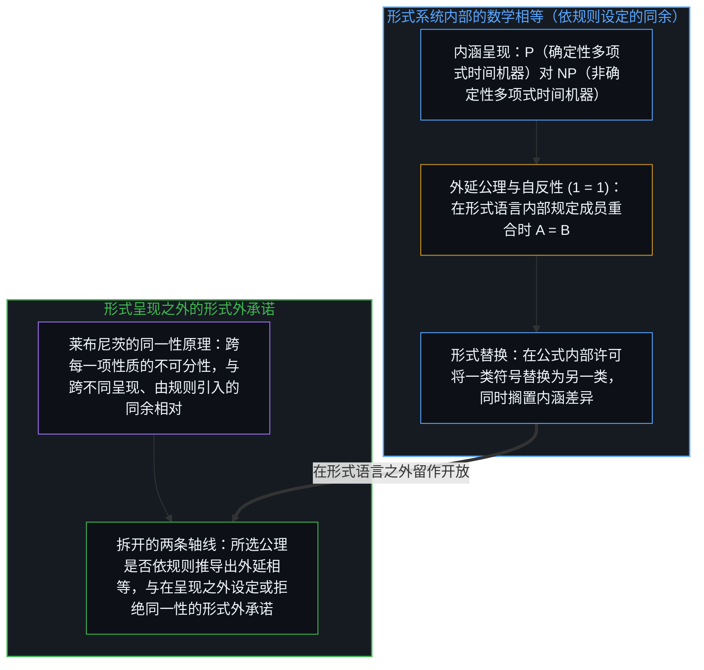
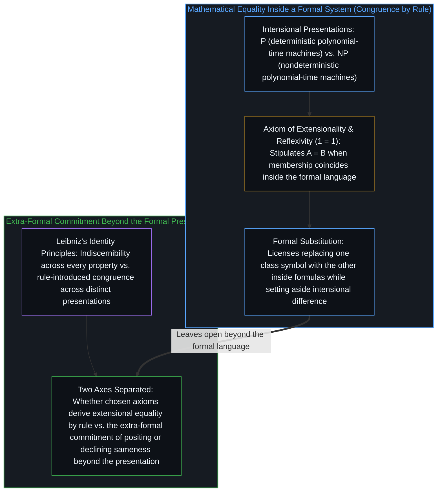
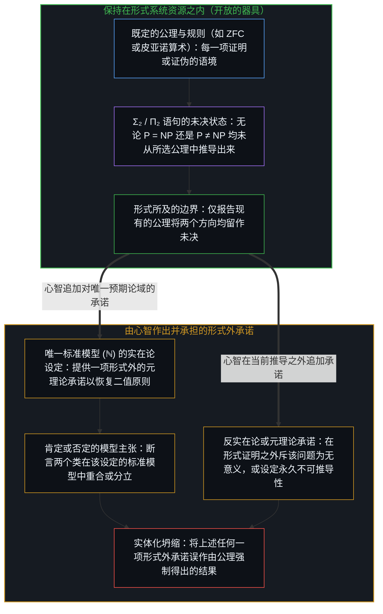
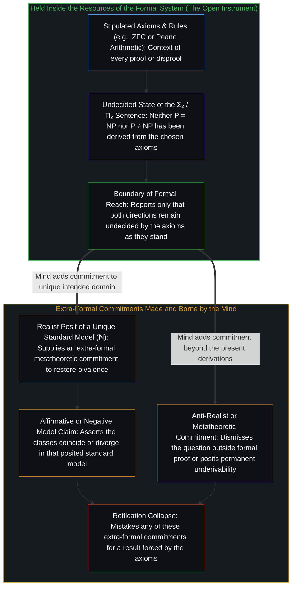

# 论关于 P 与 NP 所能言说的边界 / On the Boundaries of What Can Be Said about P and NP

*数学相等是形式系统内部的同余规则，而在公理所判定的范围之外设定唯一的标准模型则越过了形式装置 / Mathematical equality is a congruence rule inside a formal system, and positing a unique standard model beyond what the axioms decide steps past the formalism*

称 P = NP [“在于二者的差异不可证，而非在于二者同一——同一同样不可证”](https://x.com/powerpig/status/2114987213033525595)——这句针对[一则重提 3-SAT 多项式时间路径戏谑传闻的帖子](https://x.com/_maxfeldman/status/2114860701219209237)所作的回应，标出的是一道形式所及的边界，而非给出肯定或否定的解答。在 ZFC 或任何强到足以将寻常算术与图灵机形式化的同类公理系统中，无论这两个复杂度类的相等还是不等都尚未被推导出来，而元数学也尚未证明 P 对 NP 在形式上独立于 ZFC。若将这句话读作对形式记录已确立之物的报告，它既没有断言这两个类相同，也没有断言它们不同，更没有断言这一问题毫无意义；若将它读作一项更强的命题，即两个方向永远无法从这些公理中推导出来，它便在 ZFC 自身所能核证的范围之外立下了一项元理论立场。无论在哪种读法下——只要两个方向在所选公理下仍未获判定，无论是在当前的推导状态中，还是在形式独立性的条件假定下——实在论都会回应说，未决问题在标准模型中依然拥有确定答案，而这一回应要求一项额外的承诺。下文审视单凭公理能走多远，以及心智要跨过这道边界会作出哪些承诺。

The statement that P = NP [“in that their difference is unprovable, but not in that they are identical, which is also unprovable”](https://x.com/powerpig/status/2114987213033525595), written in reply to [a post revisiting a satirical rumor of a polynomial-time route to 3-SAT](https://x.com/_maxfeldman/status/2114860701219209237), marks a boundary of formal reach rather than offering a positive or negative resolution. Within ZFC, or any comparable axiomatization strong enough to formalize ordinary arithmetic and Turing machines, neither the equality of the two classes nor their inequality has been derived, and metamathematics has not proved that P versus NP is formally independent of ZFC either. Read as a report on what the formal record establishes, the remark does not assert that the classes are the same, nor that they are different, nor that the question is meaningless; and read as a stronger thesis that neither direction will ever be derived from those axioms, it stakes a metatheoretic position beyond what ZFC itself certifies. Under either reading—whenever both directions remain undecided by the chosen axioms, whether in the present state of derivation or under a conditional assumption of formal independence—the realist reply that an undecided question still possesses a definite answer in the standard model requires an extra commitment, and everything that follows examines how far one may go from the axioms alone and what commitments a Mind makes to cross that boundary.

## 一、 数学相等由规则引入，而非作为同一性被发现 / 1. Mathematical Equality Is Introduced by Rule, Not Found as Identity

数学上的相等是由规则引入的，而不是作为一项本体论事实被发现的。在集合论中，外延公理规定：当且仅当两个集合包含相同的元素时，它们才是同一的。相等的自反性要么是一条公理，要么是该关系定义的直接推论。当人们写下 1 = 1 时，这一表达式并没有报告某种独立于心智的客体之间存在着深层的同一；它记录的是形式系统通过剥离各自不同的位置与历史，将这枚符号的两次出现视为可互换，即[工具的幻觉与时间的倒置](../the-illusion-of-the-tool-and-the-inversion-of-time/)所追溯的那项工具性设定。复杂度类的情形同样如此。P 与 NP 是由语言构成的集合。它们的相等意味着：每一个被非确定性多项式时间图灵机接受的语言，也都被确定性多项式时间图灵机所接受，反之亦然。一旦这种外延同一在某个形式系统内部得以确立，替换性质便随之成立：任何对其中一个类成立的公式，对另一个类也同样成立。这两个类的定义在呈现其成员的方式上有所不同——一个对确定性机器作量化，另一个对非确定性机器作量化——而这种差异属于内涵层面。外延相等在形式语言的范围内将这一差异搁置一旁。

Mathematical equality is introduced by rule, not discovered as an ontological fact. In set theory the axiom of extensionality states that two sets are identical precisely when they contain exactly the same elements. Reflexivity of equality is either an axiom or an immediate consequence of the definition of the relation. When one writes 1 = 1, the expression does not report a deep sameness among mind-independent objects; it records that the formal system treats the two occurrences of the symbol as interchangeable by stripping away distinct positions and histories, the instrumental posit traced in [The Illusion of the Tool and the Inversion of Time](../the-illusion-of-the-tool-and-the-inversion-of-time/). The same holds for complexity classes. P and NP are sets of languages. Their equality means that every language accepted by a nondeterministic polynomial-time Turing machine is also accepted by a deterministic one, and conversely. Once that extensional identity is established inside a formal system, the substitution property follows: any formula true of one class is true of the other. The definitions of the classes differ in how they present their members—one quantifies over deterministic machines, the other over nondeterministic ones—and that difference is intensional. Extensional equality sets it aside for the purposes of the formal language.

莱布尼茨的同一者不可分原理指出，倘若两个事物在数值上是同一个，那么其中一个的每一项性质也都是另一个的性质；其逆命题，即不可分者同一原理，则认为共享每一项性质的事物即是同一个，因此不存在两个截然不同却毫无二致的事物。在物理因果中，两次并存的出现总在位置与历史上相异；而在形式语言中，数学上的相等关系是一种同余关系，许可在公式内部于不同的内涵呈现之间作替换。把不可分性当作脱离一切呈现的数值同一标准，预设了一个位于一切系统之外的席位，仿佛人们可以脱离呈现这些类的规则去检视它们；[对象是被稳定化的关系](../objects-are-stabilized-relationships/)追溯的则是，对象显现为在因果摩擦下被稳定化的关系，而非先于交互与呈现、独立自存的实体。因此，最初的那句陈述把两个容易混为一谈的问题拆了开来：一个是所选的形式系统是否依规则推导出外延相等，另一个则是心智在形式呈现之外设定或拒绝本体同一时所作出的形式外承诺。

Leibniz’s indiscernibility of identicals states that if two things are numerically the same, every property of one is a property of the other, while its converse, the identity of indiscernibles, holds that things which share every property are one and the same, so that no two distinct things are wholly indiscernible. In physical causality, two coexisting occurrences always differ in locus and history; in a formal language, the mathematical relation of equality is a congruence that licenses substitution across distinct intensional presentations inside formulas. Treating indiscernibility as a standard of numerical sameness outside every presentation presupposes a seat outside every system from which the classes could be inspected apart from the rules that present them, whereas [Objects Are Stabilized Relationships](../objects-are-stabilized-relationships/) traces how objects register as relationships stabilized under causal friction rather than as freestanding substances prior to interaction and presentation. The original statement therefore separates two things that are easily conflated: whether a chosen formal system derives extensional equality by rule, and the extra-formal commitment a Mind makes if it posits or declines ontological sameness beyond the formal presentation.

## 二、 证明的语境性与标准模型的设定 / 2. The Contextual Character of Proof and the Posit of a Standard Model

每一项证明或证伪都是语境性的。推导唯有相对于一组既定的公理与规则才得以存在，正如[没有系统能被保持封闭](../no-system-can-be-kept-closed/)与[两度显现的不完备性](../incompleteness-exhibited-twice/)在各类形式系统中所追溯的那样。一个语句可以在预期解释下成立，却依然无法从那些公理中获得证明；或者它也可以在同一组公理的不同模型中取相反的真值。P = NP 等价于一个低复杂度的特定算术语句，即一个对机器与多项式作量化的 Σ₂ 语句，而其否定 P ≠ NP 则是一个 Π₂ 语句；[阿伦森（Aaronson）](https://www.scottaaronson.com/papers/indep.pdf)以及[本-大卫（Ben-David）与哈莱维（Halevi）](https://www.researchgate.net/publication/2375454_On_the_Independence_of_P_Versus_NP)探讨了这一问题在形式上独立于标准公理系统的前景与后果。在 ZFC 的任一给定模型中，自然数集 ω 在该模型内部的同构意义下唯一，该算术语句也在那里获得一个真值。作为一阶理论的 ZFC 所无法固定的，是跨 ZFC 一切模型的单一 ω 同构类：同一组公理的不同模型可以承载非同构的自然数结构，并在 Σ₂ 与 Π₂ 算术语句上产生分歧。在元理论中挑出一个模型作为唯一的预期标准模型 ℕ——使得量词在其中遍历寻常的自然数与寻常的图灵机——是关于该语言题材的一项额外假定，是为了让全称量化得以推进而设定的一次暂时闭合，正如[潜无限与数学思维的暂时闭合](../potential-infinity-and-the-temporary-closures-of-mathematical-thought/)所追溯的那样。没有这项形式外的设定，该语句就依然只是一串形式符号，其地位随人们所选择考察的模型而变。

Every proof or disproof is contextual. A derivation exists only relative to a stipulated collection of axioms and rules, as [No System Can Be Kept Closed](../no-system-can-be-kept-closed/) and [Incompleteness Exhibited Twice](../incompleteness-exhibited-twice/) trace across formal systems. A sentence may hold in an intended interpretation yet remain unprovable from those axioms, or it may receive opposite truth values across different models of the same axioms. P = NP is equivalent to a specific arithmetical sentence of low complexity, a Σ₂ statement quantifying over machines and polynomials, and its negation P ≠ NP is a Π₂ statement; [Aaronson](https://www.scottaaronson.com/papers/indep.pdf) and [Ben-David and Halevi](https://www.researchgate.net/publication/2375454_On_the_Independence_of_P_Versus_NP) examine the prospect and consequences of the question being formally independent of standard axiomatic systems. Within any given model of ZFC, the set of natural numbers ω is unique up to isomorphism internal to that model, and the arithmetical sentence receives a truth value there. What ZFC, as a first-order theory, cannot fix is a single isomorphism class of ω across all models of ZFC: different models of the same axioms can carry non-isomorphic natural-number structures that disagree on Σ₂ and Π₂ arithmetical sentences. Singling out one model in the metatheory as the unique intended standard model ℕ—in which the quantifiers range over ordinary numbers and ordinary Turing machines—is an additional assumption about the subject matter of the language, a temporary closure posited so that universal quantification can proceed, as [Potential Infinity and the Temporary Closures of Mathematical Thought](../potential-infinity-and-the-temporary-closures-of-mathematical-thought/) traces. Without that extra-formal posit, the sentence remains a formal string whose status varies with the models one chooses to consider.

实在论读法回应说，未决状态或形式独立性并不抹去一个确定的真值；然而，这番观察本身并不是对该真值独立于那项设定而存在的证明。它只是保留了实在论读法的自洽性，却并未确立这一读法，正如[没有固定者的固定](../fixed-by-nothing/)所表明的：把未被决定的余项称为“在完整状态中早已被固定”，只是给开口换了一张标签，却并未在系统内部提供任何执行固定的东西。实在论借以恢复非语境“是或否”答案的那一步，是在元理论中设定唯一的标准模型 ℕ，使该算术语句在其中遵循二值原则。这一设定可供选用，且属于形式外。心智同样可以拒绝这一设定，将两个类的相等视为唯有相对于所选模型才有意义，或者唯有在给定系统内部能够展示出证明时才有意义。在两个方向均未从所选公理中推导出来时，报告两个方向仍未获判定，就已经道尽了单凭形式记录所能确立的一切。

A realist reading answers that undecidedness or formal independence does not erase a definite truth value, yet that observation is not itself a demonstration that such a value exists independently of the posit. It preserves the coherence of a realist reading; it does not establish the reading, just as [Fixed by Nothing](../fixed-by-nothing/) shows that calling an undetermined remainder “fixed in the complete state” relabels the opening without supplying anything inside the system that fixes it. The realist step that restores a non-contextual yes-or-no answer consists in positing a unique standard model ℕ in the metatheory in which the arithmetical sentence is bivalent. That posit is available, and it is extra-formal. A Mind may equally decline the posit and treat the equality of the classes as meaningful only relative to a chosen model, or only insofar as a proof can be exhibited inside a given system. While neither direction has been derived from the chosen axioms, reporting that both directions remain undecided already states everything that the formal record alone establishes.

## 三、 所能言说的界限与跨出界限的偏离 / 3. The Limits of What Can Be Said and the Departure Beyond Them

只报告从所考察的公理出发既未推导出 P 与 NP 的差异、也未推导出二者的同一，并且现有的公理将两个方向均留作未决，这样的报告留在了形式系统的资源之内，从而按照[开放即一致](../openness-is-consistency/)与[为何数学永远解不完](../why-mathematics-can-never-be-solved/)所阐明的意义，把形式边界作为器具保持在开放状态。任何进一步的断言——无论断言这两个类在唯一的标准模型中重合、在那里分立、断言这一问题在形式系统之外毫无意义，甚至断言两个方向永远无法被推导出来——都是心智跨出当前活跃寄存器的一步，属于[进位无法在寄存器之内被命名](../the-carry-that-cannot-be-named-inside-the-register/)与[论封闭系统、开放心智与证明的界限](../on-closed-systems-open-minds-and-the-limits-of-proof/)所追溯的那类行动，由心智自行提供一项元理论或本体论承诺。这些承诺始终可以作出。它们并非从公理所留下的未决状态中推导而出；无论心智是设定一个唯一确定的论域、在形式证明之外斥这一问题为无意义，还是立下关于不可证性的命题，它都是凭自身的主权迈出那一步，并承担自己所追加的前提。

Reporting that neither the difference nor the identity of P and NP has been derived from the axioms under consideration—and that the axioms as they stand leave both directions undecided—stays within the resources of the formal system, holding the formal boundary open as an instrument in the sense of [Openness Is Consistency](../openness-is-consistency/) and [Why Mathematics Can Never Be Solved](../why-mathematics-can-never-be-solved/). Any further assertion—that the classes coincide in a unique standard model, that they diverge there, that the question has no sense outside formal systems, or even that neither direction can ever be derived—is an act in which a Mind steps outside the active register, of the kind traced in [The Carry That Cannot Be Named Inside the Register](../the-carry-that-cannot-be-named-inside-the-register/) and [On Closed Systems, Open Minds, and the Limits of Proof](../on-closed-systems-open-minds-and-the-limits-of-proof/), and supplies its own metatheoretic or ontological commitment. Those commitments remain open to make. They do not follow from what the axioms leave undecided; whether a Mind posits a unique determinate domain, dismisses the question beyond formal proof, or stakes a thesis on unprovability, it makes that departure on its own authority and bears the premise it has added.

