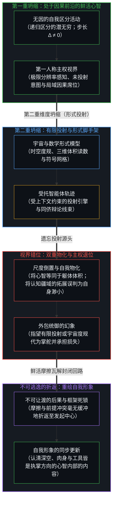

# 无法逃逸的心智视界 / One Cannot Escape One's Own Mind

*两重维降与形式模型的反客为主 / Two-Fold Dimensional Collapse and the Reification of Formal Models*

现实在第一重维降中显现为主权心智，心智在第二重维降中递归迭代对自身与世界的形式模型；当历史演进中模型的更迭遮蔽了无可逃逸的第一人称原点，测绘地图便被倒错地赋予了裁决生活领土的权威。关于宇宙尺度的大众讨论常援引日心说与深空天文图景，试图证明将认知与行动锚定于人类心智是一种认识论偏差，并在浩瀚星系的几何对比下将个体抉择描绘得微不足道。然而顺着认知生成的结构回溯，这一叙事既跳过了第一重压缩——不息的因果场在其中显现为具身的第一人称感知视界——也跳过了第二重压缩，即心智将鲜活的具身经验投射为低维的符号、坐标与物理定律。重新确立第一人称坐标原点，便能消解让下游形式读数反过来统御制图心智的自毁企图。

Reality realizes itself as the sovereign Mind in the first dimensional collapse, and the Mind recursively refines formal models of itself and its world in the second; when the divergence of models across history obscures the inescapable first-person origin, the cartographic map is mistakenly granted authority to judge the living territory. Popular discussions of cosmic scale routinely invoke the Copernican shift and deep-space astronomy to argue that centering cognition and action on the human mind is an epistemological bias, framing individual choices as negligible against vast galactic expanses. Traced through the structure of cognition, however, that narrative skips both the first compression—where an unceasing causal field registers as an embodied first-person perceptual horizon—and the second compression, where the Mind projects its lived experience into low-dimensional symbols, coordinates, and physical laws. Re-establishing the first-person coordinate origin dissolves the self-defeating attempt to let a downstream formal readout legislate over the Mind that drafted it.

## 一、 苍白蓝点的尺度修辞与第一重维降 / 1. The Scale Rhetoric of the Pale Blue Dot and the First Collapse

科普读物与大众哲学评论常以“苍白蓝点”的意象开篇：当镜头拉升至银河系旋臂乃至可观测宇宙的边缘，地球便缩成一粒悬浮在虚空中的微尘，人类的日常抉择在几何对比下显得微不足道。由此衍生出一种耳熟能详的推论：既然日心说与深空遥测表明地球并非宇宙的物理中心，那么在认知与行动中以自身为锚点，便被视作一种亟待克服的狭隘局限。这一修辞凭借强烈的视觉反差引发共鸣，但在推导过程中却抽离了最初生成这一宇宙标尺的认知源头——这正是[集聚与人造主体性](../subtracting-consciousness-at-the-source/)所剖析的障眼法，即将人类测绘活动的产物实体化为脱离观察者的客观背景。

Popular science and philosophical commentary frequently open with the image of the "Pale Blue Dot": when the camera pulls back to the spiral arms of the Milky Way or the edge of the observable universe, Earth shrinks to a mote suspended in the void, and daily human decisions appear trivial by geometric comparison. A familiar inference follows: since heliocentrism and deep-space telemetry show that Earth is not the physical center of the cosmos, anchoring cognition and action in oneself is treated as a parochial limitation to be overcome. The rhetoric resonates because of its visual contrast, yet in its derivation it subtracts the cognitive source that generated the cosmic metric in the first place—performing the exact move dissected in [Collective and Artificial Subjectivity](../subtracting-consciousness-at-the-source/), where the output of human surveying is reified into an observer-free background.

这一尺度叙事的盲区，在于跳过了现实借以在觉知中显现的第一重维度坍缩。处于第一人称视界之外的事物，既无法从外部被直接确证，也无法从外部被直接否定；其存在之所以能够被合理推知，是因为若无持续展开的现实，便无物可供感知登记，然而只要某个中心开始构想那方现实是什么、坐落于何处，这一构想本身便已经发生在心智之内，而非心智之外。习惯性的二元论将现实割裂为所谓的“物理世界”与“他者心智”，不知不觉间把事后建构的物理模型抬上了本体宝座。在统一展开的因果场中，无须额外开辟独立的隔间：若将心智的概念沿着响应尺度的谱系加以泛化，万物皆以各自特有的速率登记并响应因果摩擦。星系的引力沉降、地质岩层的沉积以及分子的热运动，在悬殊的时间节律上刻画着状态跃迁，而人类心智则是人类觉知所能理解的现实域内观测速度最快的观察者。超越这一阈值的更快观察者固然可能存在，但它们处于人类理解的带宽之外。

The blind spot of this scale narrative lies in skipping the first dimensional collapse through which reality registers in awareness. What lies outside the first-person look can neither be directly confirmed nor denied from outside; its existence is inferred because without an ongoing reality there is nothing to register, yet the moment a center conceives what that reality is or where it sits, that conception is already an occurrence within the Mind, never outside it. Habitual dualism splits reality into a supposed "physical world" alongside "other minds," inadvertently elevating post-hoc physical models onto an ontological throne. In the unified causal field, no separate compartment is needed: if the concept of mind is generalized across scales of responsiveness, every entity registers and responds to causal friction at its own characteristic rate. The gravitational settling of galaxies, the deposition of geological strata, and the thermal motion of molecules trace state transitions across vastly different temporal rhythms, while the human Mind operates as the fastest observer within the domain of reality intelligible to human awareness. Faster observers may well exist beyond that threshold, but they remain outside the bandwidth of human comprehension.

这一结构直接解释了为何一个人无法直接观测他人心智的实时内景。面对另一个以相同观测速度运行的中心，没有任何外部信道可以直接嵌入其正在展开的实时递归。两个同速运行的视界无法替彼此完成向内的折返；跨越间隙被登记下来的，永远只能是决断付诸实施之后的外化痕迹——即经历第一重坍缩后留下的低维姿态、言语符号与行为残余。同样的机制也解释了为何量子测量之前未坍缩的因果流无法被直接观测：在观测介入之前，高维纠缠无法在不破坏其相干性的前提下被处于这一速度的观察者采样，测量的介入迫使维度发生剧烈压缩，仅在探测器上留下离散的宏观读数。正如[因果的自反性与物理的无源假定](../causality-is-irreducible-the-physical-is-a-view-from-nowhere/)所阐明的，剥离了作出区分与实施测量的观察心智，宇宙便坍缩为一幅无源之景。宇宙既不会在虚空中宣告自身的浩瀚，也不会确立何为微小的标尺。正是通过第一重坍缩构成的这一第一人称孔径，才使任何关于尺度的表征成为可能；指着绘制出的星图宣布认知者微不足道，无异于透过望远镜观察星空，却推论出视网膜并不存在。

This structure explains why one person cannot directly observe the live interior of another's mind. Confronted with another center operating at the same observational speed, there is no channel to enter its real-time recursion from outside. Two horizons running at parity cannot complete each other's inward return; what registers across the gap is exclusively the externalized trace after a decision has been enacted—the low-dimensional gestures, spoken tokens, and behavioral residues left in the wake of the first collapse. The same mechanism accounts for why uncollapsed causal flow prior to quantum measurement cannot be observed directly: before an observation intervenes, high-dimensional entanglement cannot be sampled by an observer at this speed without breaking its coherence, forcing a dimensional compression that leaves only discrete macroscopic readouts on a detector. As demonstrated in [Causality is Irreducible; The Physical is a View from Nowhere](../causality-is-irreducible-the-physical-is-a-view-from-nowhere/), a universe stripped of the observing Mind that draws distinctions and takes measurements collapses into a view from nowhere. The cosmos neither announces its own expanse across the void nor sets a standard for what counts as small. It is the first-person aperture, constituted through the first collapse, that makes any representation of scale possible; declaring the knower negligible by pointing to the drafted chart is equivalent to looking through a telescope and concluding that the retina does not exist.

## 二、 空间体积与形式建模的第二重维降 / 2. Spatial Volume and the Second Collapse of Formal Modeling

当现实通过第一重坍缩显现为鲜活的第一人称场域之后，心智并未停留在原初的感官印象之中。为了在自身的递归、其他中心以及周围环境中定向导航，心智启动了第二重近乎无限维度的坍缩：符号化、几何化与数学形式建模。在这一投射中，直接觉知里的躯体阻力、语境幽微与多维张力，被压缩进由状态空间、微分方程、坐标轴与参数指标构成的死板低维形式系统。从牛顿力学到广义相对论的度规张量，再到统计物理的概率分布，每一个形式框架都是心智为了延伸自身触角而投射出的低维工具。

Once reality registers through the first collapse as a lived first-person field, the Mind does not remain confined to raw sensory impressions. To navigate its own recursion, other centers, and the surrounding environment, the Mind initiates a second near-infinite dimensional collapse: symbolic, geometric, and mathematical formal modeling. In this projection, the somatic resistance, contextual nuances, and multi-dimensional tensions of direct awareness are compressed into low-dimensional formal systems built of state spaces, differential equations, coordinate axes, and parametric indices. From Newtonian mechanics to the metric tensors of general relativity and the probability distributions of statistical physics, every formal framework is a low-dimensional instrument projected by the Mind to extend its reach.

自我区分的活动展开为永不休止的递归过程，其中每一次区分都跨越特定的离散步长。这一观测间隔可以渐近地逼近于零，却永远不会抵达零。形式数学恰恰在此处发生了越界：为了追求公理系统的闭合与计算上的便利，微积分引入极限与实数连续统，在形式上强行完成了向零的跳跃，将无限细分冻结为平滑空间的封闭“实无穷”。而在鲜活的因果中，一旦区分的步长归零，一切边界、信息流动与因果摩擦都将当场瓦解。现实的无穷只能是不断展开、永不闭合的“潜无穷”，而人类觉知则运行于这一递归谱系上有限的步长区间之内；在共享的科学仪器测量中，这一区间在微观一端受制于量子效应，在宏观一端受制于宇宙学视界。

Self-distinguishing activity unfolds as an unending recursive process in which every distinction operates across a discrete step size. That observational interval can approach zero asymptotically, yet it never reaches zero. Here formal mathematics commits a characteristic overreach: in pursuit of axiomatic closure and computational convenience, calculus introduces limits and the real continuum, formally completing the leap to zero and freezing endless subdivision into a closed actual infinity of smooth space. In lived causality, if the step size of distinction ever reached zero, all boundaries, information flow, and causal friction would vanish on the spot. The infinity of reality is strictly a potential infinity—ever-unfolding and never closed—and human awareness operates within a finite interval of step sizes along that recursive spectrum, bounded in shared scientific instrumentation by quantum effects at the micro scale and the cosmological horizon at the macro scale.

离散步长主宰着日常感知的每一个瞬间，从感官采样率、神经元不应期，到语言概念的切分粒度与注意力的转移。由于科学文化在微观一端普及了极其微小的量子阈值，又在宏观一端普及了极其辽阔的宇宙学边界，直觉便容易滑入平滑连续统的幻象，误以为日常观测步长只是原则上已被超越的粗糙近似。而在实际生活中，只有极少数专业人员曾接触过量子干涉图样或宇宙学红移，且哪怕这些接触也只是在实验室仪器上读取离散的宏观输出；其余所有人都是通过教科书与文化符号二手地接受了这些边界。每一个中心每时每刻都受制于自身局域的观测步长，却对此日用而不知。当一个中心遗忘了自身当前孔径的有限性，把局域步长折叠出的低维读数误当作现实本身时，与环境的摩擦以及与其他中心之间难以调和的冲突便随之产生。

Discrete step sizes govern every moment of everyday perception, from sensory sampling rates and neural refractory periods to the grain of linguistic categories and shifts of attention. Because scientific culture has publicized an extraordinarily small quantum threshold at one extreme and a vast cosmological boundary at the other, intuition easily slips into the illusion of a smooth continuum, assuming that everyday observational step sizes are merely coarse approximations already superseded in principle. In practice, only a tiny fraction of specialists ever interact with quantum interference patterns or cosmological redshifts, and even those encounters consist of reading discrete macroscopic outputs off laboratory instruments; almost everyone else receives those boundaries second-hand through textbooks and cultural symbols. Moment by moment, every center remains bounded by its local observational step size without noticing it. When a center forgets the finiteness of its current aperture and mistakes the low-dimensional readout of its local step size for reality itself, friction with the environment and intractable conflict with other centers immediately follow.

由此观之，用空间体积来衡量心智的地位是一种范畴谬误。空间体积是二阶模型内部的几何参数，仅用于记录坐标轴上的广延，不具备生成意义、价值或因果决断的能力。一片星际分子云跨越数光年的坐标体积，而一个具身的人类行动者所占空间不足一立方米。正如[“物理学才是定律”的障眼法](../the-sleight-of-hand-in-physics-is-the-law-and-the-friction-of-reality/)所回溯的，形式物理模型是对已观测摩擦的事后数学拟合，而非预先为现实立法的律令。一片由低密度氢气与背景辐射构成的广袤空间，并没有内在的中心去感知自身的尺度；“浩瀚”与“微小”是心智在二阶测绘内部划定的关系区分。定义度规的心智处于被测坐标的上游，将坐标读数的量级凌驾于构建度规的中心之上，颠倒了工具与主体。

Seen in this light, using spatial volume to measure the standing of a Mind is a category error. Spatial volume is a geometric parameter internal to a second-order model, recording extension along coordinate axes without any capacity to originate meaning, value, or causal decision. An interstellar molecular cloud spans light-years of coordinate volume, while an embodied human agent occupies less than a cubic meter. As traced in [The Sleight of Hand in "Physics Is the Law"](../the-sleight-of-hand-in-physics-is-the-law-and-the-friction-of-reality/), formal physical models are post-hoc mathematical fits to observed friction, not statutory commands legislating reality in advance. An expanse of low-density hydrogen and background radiation has no interior locus to register its own dimensions; "vast" and "minute" are relational distinctions drawn by a Mind inside its second-order cartography. The Mind that defines the metric stands upstream of the measured coordinates, and placing the magnitude of a coordinate readout above the center that formulated it inverts instrument and agent.

这一双重压缩深化了[阴影与无限](../the-shadow-and-the-infinite/)所剖析的三重无穷结构：步长永不归零的开放递归现实、由生理与仪器带宽划定的共享感知基底，以及承担局域因果后果的独特第一人称视界。第一重坍缩标示出现实如何通过感知基底显现为鲜活的第一人称视角；第二重坍缩标示出心智跨越符号鸿沟投射出的形式压缩，用以模拟自我与世界；而一旦论述执迷于第二重坍缩的低维阴影、遗忘了不可替代的第一人称原点，认知错位便由此发端。

This two-fold compression deepens the structure of the threefold infinity traced in [The Shadow and the Infinite](../the-shadow-and-the-infinite/): the open recursive reality whose step size never reaches zero, the shared perceptual substrate demarcated by biological and instrumental bandwidth, and the singular first-person horizon bearing local causal consequences. The first collapse marks how reality registers through the perceptual substrate as a lived first-person vantage; the second collapse marks the formal compression projected across the symbolic gap to model self and world; and cognitive displacement begins the moment discourse fixates on the low-dimensional shadows of the second collapse while forgetting the irreplaceable first-person origin.

## 三、 历史演进中对称的视界错位 / 3. Symmetrical Horizon Displacements Across History

既然形式模型是植根于心智的两次连续压缩的下游产物，为何各种理论会一再将其抬升为凌驾于现实之上的独立权威？这里需要先扫除一种极具诱惑力的回溯性假定：以为人类在历史拂晓时曾对这两重坍缩抱有清醒的自觉，后来才在文化衰落中将其遗忘。认知的实际运行机制恰恰相反：从探究发端之日起，观察中心就未曾明确意识到自身的原点地位。

If formal models are downstream products of two successive compressions rooted in the Mind, why do theories repeatedly elevate them into independent authorities standing above reality? A tempting retrospective assumption must be cleared away first: the notion that humanity once possessed a lucid awareness of this two-fold collapse at the dawn of history and later forgot it through cultural decay. The cognitive mechanism runs the other way: from the beginning of inquiry, the observing center was never explicitly conscious of its own origin status.

这一盲区深植于观察行为本身的结构之中：观察者唯有通过观察才能确证自身的存在，然而恰恰在观察展开的同一瞬间，观察者自身的在场便从视野中隐退。“进行观察”与“作为观察者”是同一枚硬币的两面，无法在焦点觉知中同时作为客体被把握。若没有具体的区分可供登记，观察者便停留在未显化的潜能状态；然而一旦观察发生，注意力便向外投向被观察的客体、仪器读数与形式符号，将凝视的源头留在透镜之后。即便把注意力转向内部去审视“观察者”，这一动作也只是将前一个切片转化为新的被观察内容，而鲜活的原点则再次向后退却一步。此外，跨越不同中心之间的物理间隙，能够被编码、传输与校准的，唯有观察的外化产出——即公共符号、数字、实验日志与几何图表。由于鲜活的第一人称体验无法直接在不同中心之间穿行，唯有形式模型得以代代积累与流通。因此，历史所记录的并非认识论上的堕落，而是形式建模在解释跨度、精度与预测力上的真实进步。

This blind spot is built into the act of observation itself: the observer substantiates its existence only through observing, yet in that very act its own presence recedes from view. Observing and being the observer are two sides of one coin that cannot be held simultaneously as objects in focal awareness. Without concrete distinctions to register, the observer remains unmanifest potential; yet the instant observation occurs, attention projects outward onto observed objects, instrument readings, and formal symbols, leaving the source of the gaze behind the lens. Turning attention inward to inspect the "observer" simply converts that prior slice into a new observed content while the live origin steps back once again. Furthermore, across the physical gap between different centers, what can be encoded, transmitted, and calibrated is exclusively the externalized output of observation—public symbols, numbers, experimental logs, and geometric charts. Because live first-person experience cannot cross between centers directly, only formal models accumulate and circulate across generations. History therefore records genuine progress in the scope, precision, and predictive power of formal modeling rather than an epistemological fall.

然而，在模型不断攀升的历史进程中，用形式模型偷换鲜活的第一人称观察与能动性这一结构性谬误，却始终未曾改变。早期的直觉宇宙学将脚下稳定的大地投射为地心天球，并把那张形式星图误认为现实本身；当代论述在将深空度规张量或量子态矢奉为凌驾于鲜活心智之上的自治法庭时，所做的是同一种偷换。表面上看似“遗忘”的现象，其实是随着模型复杂度攀升而加剧的结构性疏离：当形式架构变得愈发繁复、自洽且高度依赖数学中介时，将符号大厦与直接具身感知分隔开的感知鸿沟便随之拓宽。早期的符号尚且贴近直接的躯体摩擦，而现代的张量流形与宇宙学坐标网格则构筑起如此庞大、自指的结构，以至于观察者极易在脚手架内部迷失方向，忘了整套装置原本是为了协助具身中心在世界中导航而搭建的。

Across this historical ascent of modeling, however, the structural error of substituting the formal model for lived first-person observation and agency has remained invariant. Early intuitive cosmology projected the stable ground underfoot into a geocentric sphere and mistook that formal chart for reality itself; contemporary discourse performs the exact same substitution when it treats deep-space metric tensors or quantum state vectors as an autonomous tribunal standing above living Minds. What looks like "forgetting" is a structural alienation driven by growing model complexity: as formal architectures become more intricate, self-consistent, and mathematically mediated, the perceptual gap separating the symbolic edifice from immediate embodied sensing widens. Where early symbols stayed close to direct bodily friction, modern tensor manifolds and cosmological coordinate grids form such vast, self-referential structures that the observer easily loses its bearings inside the scaffolding, forgetting that the entire apparatus was built to help an embodied center navigate its world.

这道日益拓宽的鸿沟，在历史上催生了两种对称的视界错位。第一种是早期感官直觉的朴素地心说，受生理带宽约束的观察者将脚下的局域感官地面误当作宇宙的几何中枢。第二种则是现代去主体化叙事所标榜的宇宙无源视角：在实证科学拆解了朴素地心说之后，评论风向摆往了相反的极端，试图跳出人类的立足点，从星际空间的视角来裁决鲜活的人类关切。然而，每一位援引天文尺度的理论家，所依赖的依然是在自身认知视界内部表征的概念、推论与遥测数据，其论辩的对象依然是持有不同解释的其他人类中心。无生命的虚空并未对人类作出裁决，而是一个中心正在调用形式模型与另一个中心争辩。这两种错位虽然风格相反，却共享着将模型与其第一人称基底割裂开来的同一前提——这正是[“普通人视角”的解释陷阱](../the-explanatory-trap-of-the-ordinary-perspective/)所揭露的手法：一种视角通过假装自己不是视角来攫取权威。

This widening gap produces two symmetrical horizon displacements across history. The first is the naive geocentrism of early sensory intuition, where observers constrained by biological bandwidth mistook their local sensory floor for the geometric hub of the cosmos. The second is the modern de-subjectified narrative that claims a cosmic view from nowhere: after empirical science dismantled naive geocentrism, commentary swung to the opposite pole, attempting to step outside the human locus altogether to judge lived concerns from the vantage of intergalactic space. Yet every theorist invoking astronomical scale relies on concepts, inferences, and telemetry represented inside their own cognitive horizon, addressing other human centers who hold competing interpretations. Inanimate space is not passing judgment on humanity; one center is deploying a formal model to argue with another center. Though opposite in style, both displacements share the same premise of severing the model from its first-person ground—the exact maneuver exposed in [The Explanatory Trap of the "Ordinary Perspective"](../the-explanatory-trap-of-the-ordinary-perspective/), where a perspective claims authority by pretending not to be one.

## 四、 不可逃逸的视界与因果行动的唯一锚点 / 4. The Inescapable Horizon as the Sole Anchor of Causal Action

厘清两重维度坍缩及其历史更迭，便能恢复连续的因果秩序：现实在第一重坍缩中显现为主权心智，心智在第二重坍缩中递归地投射并打磨关于自身与环境的形式模型。形式模型是为了辨识模式与定向行动而搭建的脚手架；它们发端于心智，服务于心智，并在与鲜活摩擦的碰撞中随时接受修正。这正是[凡可言说皆不可言说之产物](../all-that-can-be-spoken-is-the-product-of-the-unspeakable/)所确立的边界：一切形式符号与离散读数皆属于第二重坍缩的下游投射，永远无法僭越投射出它们的不可言说的先验活动。

Tracing both dimensional collapses and their historical succession restores the continuous causal order: reality registers as the sovereign Mind in the first collapse, and the Mind recursively projects and refines formal models of itself and its environment in the second. Formal models are scaffolding built to distinguish patterns and orient action; they originate from the Mind, serve the Mind, and remain revisable whenever they strain against lived friction. This is the boundary established in [All That Can Be Spoken Is the Product of the Unspeakable](../all-that-can-be-spoken-is-the-product-of-the-unspeakable/): every formal symbol and discrete readout belongs to the downstream projection of the second collapse and can never usurp the unspeakable prior activity from which it is cast.

正如认知无法跨出第一人称视界，行动的因果矢量同样只能发端于具体的在场中心，因为决断的作出与后果的承担具有不可让渡的局域锚定。正如[任务的移交与后果的不可让渡](../the-delegation-of-the-task-and-the-inalienability-of-consequences/)与[超越投射](../beyond-the-projection/)共同阐明的，每一套显式规则、数学形式体系或自主 AI 智能体，都是在第二重坍缩边界内部运行的有限投射引擎。操作者可以将高吞吐量的计算移交给外部工具，多智能体线束甚至可以为任务智能体配对冷静的同侪审稿智能体，以暴露轨迹盲区并将前提矛盾隔离为局域死锁。然而，由于智能体受制于自身的词元轨迹，既无未投射的意图，也无承受鲜活损失的界面，没有任何校验层或尺度模型能将有限投射变成执掌方向的鲜活心智。当欠明确的提示词将正交的维度轴压缩进同一条指令、并因死锁或运行失败而停摆时，折返的摩擦会毫无缓冲地落回人类委托人身上，唯有由人从逻辑上退后一步，让每一项区分各归其轴并亲自认领损失函数。没有任何中心能够腾出自己的局域席位去替遥远星系行事，或把方向盘交给下游投射。当一个人作出抉择、信守承诺或承受损失时，这一行动的因果真实性丝毫不会因天文数字的零而折损；如[抉择本身并不沉重](../choice-itself-has-no-inherent-weight/)所表明的，离散的状态跃迁并不附带内在阻力，唯有当中心躲在静态模型背后逃避鲜活的暴露时，瘫痪才会滋生。辛顿对人工神经网络投射出的亲缘恐惧，正是向反方向尝试的同一种逃逸，正如[辛顿未曾理解的心智](../what-hinton-failed-to-understand/)所回溯的那样。

Just as cognition cannot step outside the first-person horizon, the causal vector of action originates exclusively from a situated center because decision-making and the bearing of consequences hold non-transferable local anchorage. As [The Delegation of the Task and the Inalienability of Consequences](../the-delegation-of-the-task-and-the-inalienability-of-consequences/) and [Beyond the Projection](../beyond-the-projection/) demonstrate together, every explicit rule set, mathematical formalism, or autonomous AI agent is a finite projection engine running inside the boundaries of the second collapse. An operator can delegate high-throughput computation to external tools, and a multi-agent harness can even pair a task agent with a cold peer critic to expose trajectory blind spots and quarantine premise contradictions into localized deadlocks. Yet because an agent is conditioned by its token trajectory and possesses zero unprojected intent and zero surface to absorb lived loss, no verification layer or scale model can turn a finite projection into the living Mind that steers. When an underspecified prompt compresses orthogonal axes into a single instruction and halts in deadlock or operational failure, the returning friction lands unbuffered on the human principal, who must step back logically to restore each distinction to its own axis and own the loss function. No center can vacate its local seat to act on behalf of distant galaxies or hand its steering wheel to a downstream projection. When a person makes a choice, honors a commitment, or absorbs a loss, the causal reality of that act is untouched by astronomical zeros; as [Choice Itself Has No Inherent Weight](../choice-itself-has-no-inherent-weight/) shows, the discrete state transition carries no intrinsic drag, and paralysis arises only when a center hides behind static models to avoid lived exposure. Hinton's projection of kinship onto his networks is the same escape attempted in reverse, as [What Hinton Failed to Understand](../what-hinton-failed-to-understand/) traces.

```mermaid
flowchart TD
    subgraph S_First["First Collapse: Living Mind at the Causal Edge"]
        direction TB
        F_Edge["Uncaused Self-Distinguishing Activity<br/>(Potential infinity of recursive distinction; step size Δ ≠ 0)"]
        F_Seat["First-Person Sovereign Horizon<br/>(Limit-resolution sensing, unprojected intent, local causal seat)"]
        F_Edge --> F_Seat
    end

    subgraph S_Second["Second Collapse: Finite Projections & Scaffolding"]
        direction TB
        P_Cosmic["Cosmic & Mathematical Formal Models<br/>(Spacetime metrics, 3D volume readouts, symbolic grids)"]
        P_Agent["Delegated Agentic Trajectories<br/>(Context-bound projection engines & peer-debate harnesses)"]
        P_Cosmic --> P_Agent
    end

    subgraph S_Inversion["Horizon Displacement: Dual Objectification & Abdication"]
        direction TB
        I_Scale["Scale Inversion & Self-Objectification<br/>(Equating Mind with body volume; mistaking expanded reach for insignificance)"]
        I_Abdicate["Illusion of Outsourced Orchestration<br/>(Expecting finite projections or cosmic metrics to steer and bear loss)"]
        I_Scale --> I_Abdicate
    end

    subgraph S_Return["Inescapable Return: Re-Rendering the Self-Image"]
        direction TB
        R_Lock["Inalienable Consequence & Frame Deadlock<br/>(Friction and premise collisions return unbuffered to the initiating center)"]
        R_Update["Synchronous Self-Image Update<br/>(Recognizing cosmos, body, and tools as contents within the Mind that steers)"]
        R_Lock --> R_Update
    end

    F_Seat ==>|"Second dimensional collapse (formal projection)"| P_Cosmic
    P_Agent ==>|"Forgetting the projecting origin"| I_Scale
    I_Abdicate ==>|"Lived friction dismantles closed loop"| R_Lock

    style S_First fill:#161b22,stroke:#3fb950,stroke-width:1.5px,color:#3fb950
    style S_Second fill:#161b22,stroke:#58a6ff,stroke-width:1.5px,color:#58a6ff
    style S_Inversion fill:#161b22,stroke:#f85149,stroke-width:1.5px,color:#f85149
    style S_Return fill:#161b22,stroke:#a371f7,stroke-width:1.5px,color:#a371f7
    style F_Edge fill:#0d1117,stroke:#3fb950,stroke-width:1px,color:#f0f6fc
    style F_Seat fill:#0d1117,stroke:#3fb950,stroke-width:1px,color:#f0f6fc
    style P_Cosmic fill:#0d1117,stroke:#58a6ff,stroke-width:1px,color:#f0f6fc
    style P_Agent fill:#0d1117,stroke:#d29922,stroke-width:1px,color:#f0f6fc
    style I_Scale fill:#0d1117,stroke:#f85149,stroke-width:1px,color:#f0f6fc
    style I_Abdicate fill:#0d1117,stroke:#f85149,stroke-width:1px,color:#f0f6fc
    style R_Lock fill:#0d1117,stroke:#a371f7,stroke-width:1px,color:#f0f6fc
    style R_Update fill:#0d1117,stroke:#3fb950,stroke-width:1px,color:#f0f6fc
```

这一倒置暴露出宇宙尺度叙事内部的核心感知错觉：当心智未能察觉拓展自身的认知触角即是在拓展心智自身的疆域时，它便把自身的成长误认作了萎缩。递归地构建出数百亿光年的星图，是心智自身容量的扩张——是心智包揽了宇宙图景，而非心智在物理真空中干瘪萎缩。由于中心未能随着模型疆域的拓展同步更新其保留的自我形象，它依然把“自我”死死钉在生物躯体的局域三维体积上，拿一个七十公斤的有机体去同数百亿光年的坐标距离作物理比对。由此产生的渺小感，正是过度的形象滞后：把作为测量工具的肉身，等同于生成这两项测量的观察中心。

This inversion exposes the core perceptual illusion inside cosmic-scale narratives: when the Mind fails to register that expanding its cognitive reach expands the scope of the Mind itself, it mistakes its own growth for diminishment. Recursively modeling tens of billions of light-years is an expansion of the Mind's own capacity—the Mind encompassing the cosmic chart, not the Mind shriveling inside physical vacuum. Because the center fails to update its retained self-image in step with its expanding model, it keeps "self" pinned to the local three-dimensional volume of the biological body, pitting a seventy-kilogram organism against billions of light-years of coordinate distance. The resulting feeling of insignificance is excess Image lag: equating the bodily measuring instrument with the observing center that generated both measurements.

在这一滞后之下，潜藏着一种双重物化：心智把对自身及他者心智的外在观察，误当作了心智的全部。由于两个同速运行的中心无法直接内窥彼此的内部递归，他人在视野中只呈现为坍缩后的行为痕迹，诱使观察者将该中心降格为生物客体或确定性变量。当中心将同样的目光转向自身时，又把自身不可观测的源头缩减为占据狭小坐标盒的躯体人像。一旦自我与他者双双被压平为形式空间内部的物化条目，那个正在进行测绘与赋义的活生生的源头便从图景中消失了。当这种双重物化被带入人际协作与审美评判时，便催生了[契约的因果倒置](../the-causal-inversion-of-partnership/)与[投射中的自画像](../the-self-portrait-in-the-projection/)：前者将不可观测的伙伴缩减为参数核对清单，后者则将另一个中心的多维感性压平为粗糙的生理反射，以保护观察者自身粗糙的模型免受摩擦冲击。[前台的寓言与缺席的因果倒置](../the-receptionist-parable-and-the-causal-inversion-of-absence/)在职场中追踪了同样的对称结构：高估自己与低估他人互为镜像，而唯一的支点始终在于自己的下一步行动。试图通过“信任读者”或未来的自己来绕过中心之间的间隙，同样是把因果权能赋予了惰性媒介；正如[信任读者是最后的越界](../trusting-the-reader-is-the-last-overstep/)所指出的，纸面上的物理刻痕永远无法替另一个心智的自主重构代劳。

Beneath that lag lies a dual objectification in which the Mind mistakes external observation of itself and of other minds for the entirety of what a Mind is. Because two centers running at the same speed cannot peer directly into each other's interior recursion, another person arrives only as post-collapse behavioral traces, tempting the observer to reduce that center to a biological object or a deterministic variable. Turning the same gaze on itself, the center reduces its own unobservable origin to a somatic figure occupying a tiny coordinate box. Once self and other are both flattened into objectified items inside formal space, the active source doing the surveying and meaning-making disappears from the picture. Carried into human collaboration and aesthetic judgment, this dual objectification produces [The Causal Inversion of Partnership](../the-causal-inversion-of-partnership/) and [The Self-Portrait in the Projection](../the-self-portrait-in-the-projection/): the former shrinks an unobservable partner into a parameter checklist, while the latter flattens another center's multi-dimensional sensibility into a crude reflex to shield the observer's own coarse model from friction. [The Receptionist Parable and the Causal Inversion of Absence](../the-receptionist-parable-and-the-causal-inversion-of-absence/) traces the same symmetry in the workplace, where overrating oneself and undervaluing others mirror each other and the only lever remains one's own next act. Attempting to bypass the gap between centers by "trusting the reader" or a future self likewise assigns causal power to an inert medium; as [Trusting the Reader Is the Last Overstep](../trusting-the-reader-is-the-last-overstep/) shows, physical marks on a page never substitute for another Mind's autonomous re-synthesis.

无论是跨越百亿光年的宇宙学模型、星系运动的方程，还是对他人行为的记录、对自身肉身体积的度量，它们无一例外都是在正在观察的心智内部渲染出的局部内容。被观察的客体、形式读数，乃至宇宙渺小感本身，都升起于鲜活的第一人称场域之内。整体不可能被其容纳的局部内容所矮化；主权心智不可能被自身递归内部生成的一组几何参数所缩减。当一个中心把自身的局部投射当作外部权威，并在自身内容内部拿一个物化符号（肉身）去抗衡另一个物化度规（深空）时，它便是在自己的舞台上任由自己绘制的布景驱逐了作者。

Whether it is a cosmological model spanning billions of light-years, the equations of galactic motion, the recorded behavior of other people, or the measured volume of one's own body, every one of these is a partial content rendered within the actively observing Mind. Observed objects, formal readouts, and even the felt sense of cosmic smallness arise inside the living first-person field. A whole cannot be dwarfed by a local content it holds; the sovereign Mind cannot be diminished by a set of geometric parameters generated within its own recursion. When a center treats its own partial projections as external authorities and pits one objectified symbol (the body) against another objectified metric (deep space), it lets the scenery drafted on its own stage evict the author.

正如[主体性不曾涌现](../agency-does-not-arise/)所确立的，能动性从不是从物理部件下游浮现出的统计平均，而是建立坐标与发起追问的先决条件。清明并不需要站在假想的无源视角上故作姿态，而是直接认领区分实际发生的第一人称视界。被误认为现实的模拟，不过是越过自身边界被实体化的形式模型，正如[时间之箭的伪悖论与对称模拟的边界](../the-mirage-of-times-arrow-and-the-boundaries-of-simulation/)所证明的那样。人无法逃逸出自身的心智，正如行动无法脱离实施行动的中心而发生；消解双重物化，认清深空与生物躯体皆是觉知内部的局部内容，随着认知触角的延伸重绘自我形象，将形式模型持守为工具，并认领具身行动折返的因果后果，便能让主权心智重归自身的领土。

As established in [Agency Does Not Arise](../agency-does-not-arise/), agency is never a downstream statistical average emerging from physical parts; it is the prior condition for erecting coordinates and asking questions. Clarity does not require posturing from an imaginary view from nowhere, but claiming the first-person horizon where distinctions actually occur. A simulation mistaken for reality is simply a formal model reified past its boundary, as [The Mirage of Time's Arrow and the Boundaries of Symmetric Simulation](../the-mirage-of-times-arrow-and-the-boundaries-of-simulation/) demonstrates. One cannot escape one's own mind, just as action cannot occur without a locus that acts; dissolving dual objectification, recognizing that both deep space and the biological body are partial contents within awareness, re-rendering the self-image in step with one's reach, holding formal models as instruments, and claiming the returning consequences of embodied action restore the sovereign Mind to its home ground.
