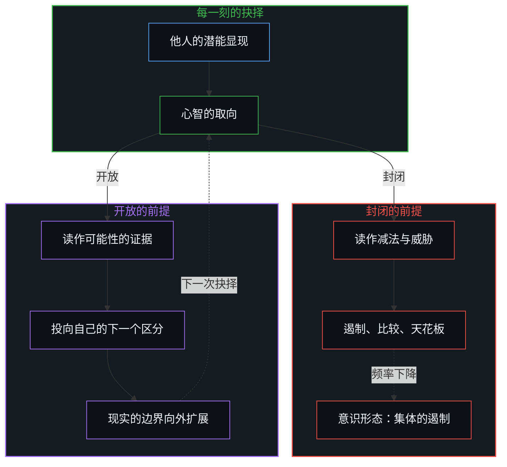
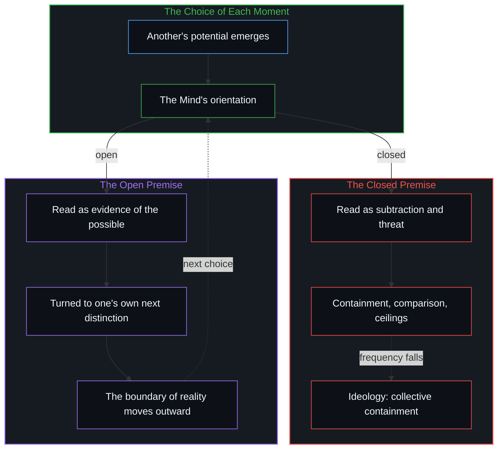

# 潜能作为威胁或启发

*封闭前提下他人的上升读作损失；进步系于多频繁把潜能视作敞开的地平线 / Under a closed premise another’s rise reads as loss; progress turns on how often potential is met as open horizon.*

在[封闭、零和的现实假设](../the-arithmetic-of-the-register/)之下，另一个人正在显现的潜能被登记为直接的威胁：从地位、安全与认可这份固定存量中减去的一份。推动人的能力、扩展现实边界的那些人，并不是一个固定的阶层；他们是更频繁地以非零和的取向运作的中心，把另一个人的卓越当作启发，而不是侵占。这个频率在一群人中下降时，意识形态便作为集体的症状出现，把共享的信念转成防御性的正统，去监管越出常规的能力。生成的杠杆始终握在每个心智中心未受强迫的当刻抉择里。

Under the assumption of [a closed, zero-sum reality](../the-arithmetic-of-the-register/), another person’s emerging potential registers as an immediate threat, a subtraction from a fixed stock of status, security and recognition. Those who advance human capability and extend the boundaries of reality are not a permanent caste; they are centers that act more often from a non-zero-sum orientation, taking another’s excellence as inspiration rather than encroachment. When this frequency falls across a group, ideologies appear as its collective symptom, turning shared beliefs into defensive orthodoxies that police outlier capacity. The generative lever stays in the uncoerced, moment-to-moment choice of each minded center.

## 一、 封闭的前提制造威胁 / 1. The Closed Premise Manufactures Threat

当现实被建模为一个封闭的容器，盛着定量的认可、财富与权威，另一个中心正在扩展的能力，就自动登记为自己位置的缩减。

When reality is modelled as a closed vessel holding a fixed quantity of recognition, wealth and authority, another center’s expanding competence registers automatically as a reduction of one’s own standing.

在这个前提下，相对位置是唯一可读的度量。他人的上升被体验为一次无端的挤占。随之而来的姿态是防御：贬低成就，设置程序上的关卡，加上监管的天花板，或强制文化上的一致，使新出现的能力无法挑战既有的基线。

Under this premise, relative position is the only readable measure. Another’s ascent is felt as an unprovoked displacement. The posture that follows is defensive: playing achievements down, raising procedural hurdles, imposing regulatory ceilings or enforcing cultural conformity, so that the emerging capability cannot challenge the prevailing baseline.

一个社会环境滑进这种防御的均衡，是因为它在认知上省力，在情感上带来保护：把地形当作固定的，就免去了面对一个开放、扩张、要求持续自我区分的前沿时的不适。[来自个体差异的层级](../hierarchy-from-individual-difference/)正是在一把共同的尺上计分：只有当所有中心被压到同一块封闭的记分板上，差异才被体验为纵向的挤占。

A social environment drifts into this defensive equilibrium because it is cognitively economical and emotionally protective: treating the landscape as fixed spares the discomfort of an open, expanding frontier that asks for continual self-differentiation. [Hierarchy from individual difference](../hierarchy-from-individual-difference/) is that scoring under one common measure: difference is felt as vertical displacement only when every center is pressed onto one closed scoreboard.

## 二、 进步取决于取向的频率 / 2. Progress as a Function of Orientation Frequency

生成的前沿与防御的姿态之间的分界，不是固定阶层或道德类别之间的分裂，而是同一个心智在不同时刻所处的不同位置。

The line between the generative edge and the defensive posture is not a split between fixed castes or moral categories; it runs between positions one Mind passes through at different moments.

没有谁对零和的惊慌免疫，也没有谁全然不能进入非零和的共鸣。区分各条轨迹的，是每种姿态出现的频率：在防御的回路里，一个中心在把他人的卓越读作威胁的时刻，把稀缺的能力花在遏制、比较与维持人为的天花板上，注意力绑在压制他人上，自己也就被拖住了；在生成的回路里，一个中心在把他人的突破看作可能性之证据的时刻，把能力投向自己的下一个区分，他人的前进由此成了一份证据，表明前沿比此前绘出的更宽。

No one is immune to zero-sum alarm, and no one is incapable of non-zero-sum resonance. What separates trajectories is how often each stance is taken: in the defensive loop, the moments a center reads another’s excellence as a threat spend scarce capacity on containment, comparison, and the upkeep of artificial ceilings, so attention bound to holding others down holds the center back too; in the generative loop, the moments a center sees another’s breakthrough as evidence of what is possible turn capacity toward its own next distinction, reading another’s advance as proof that the frontier is wider than it was mapped.

进步在这些离散的迭代中复利累积。一个人把潜能当作启发的频率提高，私人的能力便复利增长；一张中心网络里的总频率上升，共享的现实边界便向外扩展。[平均值是残余，不是引擎](../the-average-is-residue-not-the-engine/)反映的正是这种频率分布：文明的推进由极端正向离群者的复利速度承载，而不是由大众的均衡承载。

Progress compounds across these discrete iterations. As one person raises the frequency with which potential is taken as inspiration, private capacity compounds; as the aggregate frequency rises across a network of centers, the shared boundaries of reality move outward. [The average is residue, not the engine](../the-average-is-residue-not-the-engine/) reflects this frequency distribution: civilizational advance is carried by the compounding velocity of the extreme positive outliers, not by the mass equilibrium.

## 三、 意识形态作为集体的遏制 / 3. Ideology as Collective Containment

意识形态是非零和的频率下降之后立起的制度性纪念碑。

Ideologies are institutional monuments raised as the non-zero-sum frequency declines.

每一种意识形态都登记为一套集体的装置，区别只在它神圣化哪一种信条，以及惩罚偏离时有多严厉。即便以个人自由的宣言开端的哲学，一旦其信条被制度化为神圣的教条，也会硬化为部落式的执行机制。

Every ideology registers as a collective apparatus, differing only in the doctrine it sanctifies and the severity with which it punishes divergence. Even philosophies that begin as declarations of individual liberty harden into tribal enforcement once their tenets are institutionalized as sacred dogma.

意识形态一旦钙化，离群的表现与未经批准的区分就被归为异端或传染。系统在道德的旗帜下重新引入零和的惊慌：群体的凝聚与信条的纯洁，必须防着个体的差异来守护。[道德语言作为投影](../moral-language-as-projection/)追溯了这面旗帜如何运作：零和的惊慌借伦理的话语标出防御的位置，同时遮住开放边界的生成机制。

Once an ideology calcifies, outlier performance and unapproved distinctions are classed as heresy or contagion. The system reintroduces zero-sum alarm under moral banners: the group’s cohesion and doctrinal purity must be defended against individual variance. [Moral Language as Projection](../moral-language-as-projection/) traces how that banner works: zero-sum alarm borrows ethical discourse to mark defensive positions while obscuring the generative mechanism of open boundaries.

集体主义的信条通过国家指令与明文配额公开执行这种遏制；个人主义的派系则通过社会排斥、凭证把关与信条的纯洁测试来执行。两种表现中，结构上的效果是同一个：压低个体心智进入开放前沿的频率。[限制是选择性的税](../restriction-is-a-selective-tax/)描绘的正是这份制度性的税：最重的负担落在执行者身上，他们的能力被绑在看守这次冻结上。

Collectivist doctrines carry out this containment openly, through state mandates and explicit quotas; individualist factions carry it out through social ostracism, credentialist gatekeeping and doctrinal purity tests. In both, the structural effect is the same: lowering the frequency with which individual Minds can meet the open frontier. [Restriction is a selective tax](../restriction-is-a-selective-tax/) maps this institutional tax: the heaviest burden falls on the enforcers, whose capacity is bound to policing the freeze.

## 四、 扩展现实的边界 / 4. Extending the Boundary of Reality

如何面对他人的潜能，是每个心智中心在每一步皆可自主作出的离散抉择。

The orientation toward another’s potential is an uncoerced, discrete choice open to every minded center at every step.

它不需要制度的章程、外部的补贴或集体的共识。它是一次直接的自我辨认：留意此刻的注意力是在收缩进比较，还是在扩展进启发，然后选取生成的那一步。

It needs no institutional charter, no outside subsidy and no collective consensus. It is an act of direct self-recognition: noticing whether attention is contracting into comparison or widening into inspiration, and taking the generative move.

在反复的练习中，这种姿态在个体中心之内自我倍增。内在的频率外化为可触及的工作、有纪律的手艺与新的协作。随之而来的集体推进，从来不是一份设计出来的社会蓝图的产物；它是个体心智把他人的潜能当作罗盘而不是牢笼时，自发累积的算术。正如[你的代码库即是记忆](../your-codebase-is-memory/)所展示的，他人的突破与留存的代码库皆是外化的记忆脚手架，唯有在重溯而非防范中才能拓宽自身的地平线；[个体抉择是唯一的因果杠杆](../individual-choices-as-the-only-causal-levers/)仍是不变的地基，现实的边界只向选择走过它的中心让开。

Through repeated practice, this posture multiplies itself within the individual center. The inner frequency comes out as tangible work, disciplined craft and new coordination. Because [Your Codebase Is Memory](../your-codebase-is-memory/)—every repository, tool, and breakthrough another mind leaves behind is an externalized trace awaiting a living edge to re-trace it—meeting another’s advance as open scaffolding rather than territorial encroachment immediately compounds what one’s own center can distinguish next. The collective advance that follows is never the product of an engineered social blueprint; it is the spontaneous arithmetic of individual Minds treating the potential of others as a compass rather than a cage. [Individual choices as the only causal levers](../individual-choices-as-the-only-causal-levers/) stays the invariant ground, and the boundary of reality gives way only to the centers that choose to walk past it.
