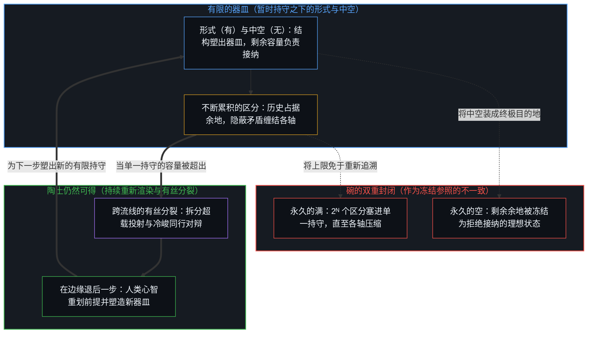
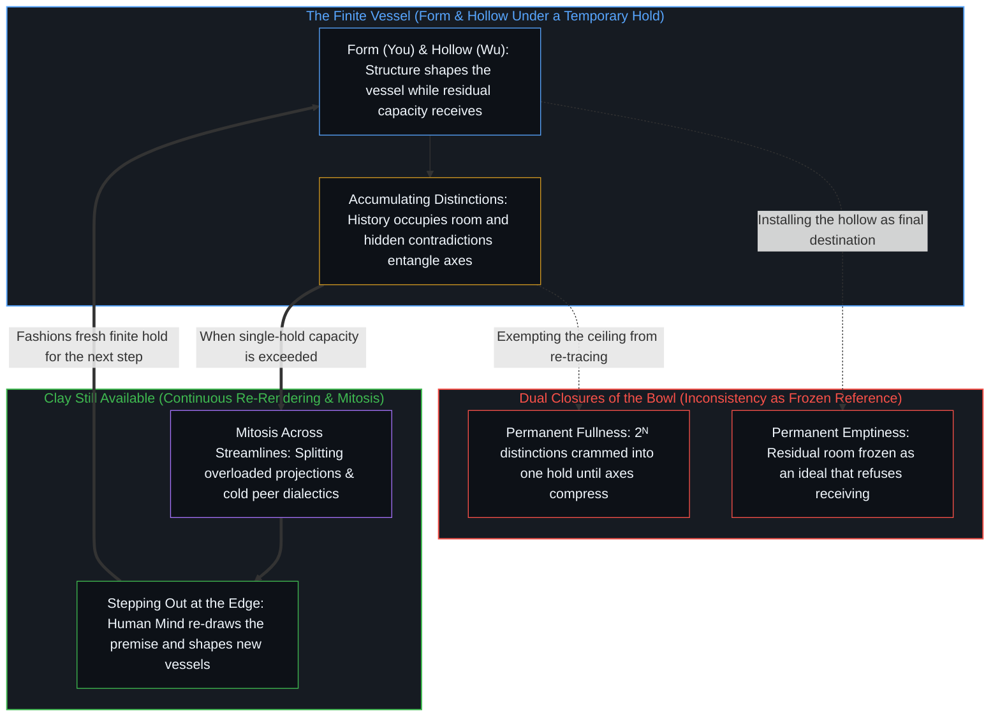

# 只要它不被保持为空 / Only If It Is Not Kept Empty

*空是暂时持守之内的剩余容量，而非永久的理想 / Emptiness is residual capacity inside a temporary hold, not a permanent ideal*

一句流传的格言把老子与语言模型的上下文窗口配在一起，称碗空着时最有用，你的上下文也是。在一份固定的词元预算之内，这句话是站得住的工程建议。当空被装成偏好的永久状态，而不是被持守为进一步接纳的余地时，它就冻结了。碗的用处在于它的中空与它所接纳之物的关系，这意味着它有用，是因为它能被装满，也能被倒空。碗若被当作永久的理想保持为空，剩余的余地就成了一种被保存的状态，拒绝它本为之而保留的那份接纳，而区分仍在继续。

A circulating maxim pairs Laozi with a language model's context window, claiming that a bowl is most useful when empty, and so is your context. Inside a fixed token budget the line is sound engineering advice. It freezes the moment emptiness is installed as the preferred permanent state rather than held as room for further receiving. The bowl's use lies in the relation of its hollow to what it receives, which means it is useful because it can be filled and because it can be emptied. Kept empty as a permanent ideal, the bowl turns its residual room into a preserved state that refuses the receiving it was kept for, while the distinguishing continues.

## 一、 形式塑出器皿，中空提供用处 / 1. Form Shapes the Vessel and the Hollow Supplies the Use

《道德经》第十一章的古典原句写道，埏埴以为器，当其无，有器之用。这一表述比它流行的压缩版更精确。揉和陶土做成器皿，器皿的用处在于其中的中空。形式（有）提供结构；中空（无）提供接纳的余地。用处不只在中空本身，而在它与所接纳之物的关系，因为器皿能盛，也能被倒空。剩余的余地，是中空里还有多少没被占据。满了的器皿装不进更多而不溢出，但它仍是一件盛着所接纳之物的器皿。流行的译法“碗空着时最有用”，保留了实用的力道，丢掉了与之相伴的三十辐共一毂与凿户牖以为室的意象。它也招来那种把暂时的接纳余地当作偏好之永久状态的冻结。

The classical line in Chapter 11 of the *Tao Te Ching* states that clay is shaped into a vessel, and where it is not, there is the vessel's use. That formulation is more precise than its popular compression. Clay is fashioned into a vessel, and the vessel's use lies in the hollow within. Form (*you*) supplies the structure; the hollow (*wu*) supplies the room to receive. The use is not in the hollow alone but in its relation to what it receives, for the vessel can hold and it can be emptied. Residual room is how much of the hollow is still unoccupied. A full vessel cannot take in more without overflow, yet it is still a vessel holding what it received. The popular rendering, "a bowl is most useful when empty," keeps the practical force and drops the companion images of thirty spokes meeting at a hub, and doors and windows cut to make a room. It also invites the freeze where temporary room to receive is treated as a preferred permanent state.

[有无之边](../you-wu-zhi-bian/)在它的起点追溯同一种站队：自我、他人与世界都是分别，办法从无授权起手，借“有”作一步宽的仪器而还，或不借，于是返回的是正在区分的这一步，不是有或无。那里的“无”是那个未经授权的起手；这里的“无”是让一件已成形的器皿有其用处的中空。两者在同一道封印上相遇：把空封为唯一正确的路，与把形式封为地基，是同样过宽的参照。

[The Edge of Being and Non-Being](../you-wu-zhi-bian/) traces the same taking of sides at its starting point: self, others, and world are all distinctions, and the method starts from no authorization, borrowing *you* as an instrument one step wide and returning it, or not borrowing at all, so that what returns is the step now distinguishing, not being or non-being. Its *wu* is that unauthorized start; here *wu* is the hollow that gives an already formed vessel its use. The two meet in one seal: emptiness sealed as the one right path is the same over-wide reference as form sealed as ground.

## 二、 封闭持守之下的剩余容量 / 2. Residual Capacity Under a Closed Hold

一旦三个条件为当下的行动被固定下来，这条劝告就变得可操作。有一个容量有限的有界所在。那份容量已经划定，在眼前这一步里无法重划。仍在直接掌控之下的，是在进一步的区分压缩之前，它里面剩下的余地。

The counsel becomes operational once three conditions are held fixed for the present act. There is one bounded locus of finite capacity. That capacity is already drawn and cannot be redrawn in the immediate step. What stays under direct control is the room left inside it before further distinctions compress.

在这些条件之下，指令是机械的：让持守仍能接纳。有两样不同的东西会拿走这种能力。无关的历史与走进死胡同的推理占据余地，新到的东西便找不到位置。相互矛盾的指令把轴缠在一起，于是即便还有空闲的词元，彼此不同的关切也登记为同一个。一份持守可以还有余地，而它的轴已经缠在一起；一份几乎满了的持守，也可以让它的轴保持分开。清掉历史释放余地；解开矛盾恢复让轴保持分开的那份宽度。碗有用，是因为进一步的区分仍能落进它里面，而不是因为它一直空着。在任何边界暂时被固定的有限系统里，都是如此。[真正稀缺的不是记忆，而是持续的重新追溯](../the-real-scarcity-is-not-memory-but-continuous-re-tracing/)在不断增长的到来量之下追溯这道界限：可用的结构，是在新的负载下作为重新渲染而返回的东西，不是作为库存被存放的东西，也不是在被纳入当下构型之前一直待在外面的东西。必须重新追溯的所在保持有限，而残余在增殖，所以变稀薄的是持续形成并消解脚手架的能力，不是存储。[你的代码库即是记忆](../your-codebase-is-memory/)把这一点延伸到工作持守如何在两次运行之间被倒空：代码、文章、计划、桥接文件与模型权重都是早先区分层叠而成的残余，因此清空这只碗既不是丢弃仍在承重的部分，也不是把中间记录囤积进归档，而是就地重切当下检查点，并修剪已被取代的脚手架——退役的会话词元、已交接的桥接文件与已完工的工作目录——让约束表面在无关维度上更小，在活的轴线上更锐利。

Under those conditions the instruction is mechanical: keep the hold able to receive. Two different things take that ability away. Irrelevant history and dead-end reasoning occupy room, so new arrivals find no place. Contradictory instructions entangle axes, so distinct concerns register as one even where free tokens remain. A hold can have room left while its axes are already entangled, and a nearly full hold can keep its axes apart. Clearing history frees room; resolving the contradiction restores the width that keeps axes apart. The bowl is useful because further distinguishing can still land inside it, not because it stays empty. The same holds in any finite system whose boundaries are, for the moment, held fixed. [The Real Scarcity Is Not Memory, But Continuous Re-Tracing](../the-real-scarcity-is-not-memory-but-continuous-re-tracing/) traces this bound under a growing volume of arrivals: usable structure is what returns under new load as re-rendering, not what is stored as inventory and not what sits outside until it is taken into the present configuration. The locus that must re-trace stays finite while residue multiplies, so what thins is the capacity to keep forming and dissolving scaffoldings, not storage. [Your Codebase Is Memory](../your-codebase-is-memory/) carries this into how a working hold is emptied between runs: code, essays, plans, bridges, and model weights are stacked residues of prior distinctions, so clearing the bowl neither discards what still carries load nor hoards intermediate transcripts in an archive, but re-cuts the present checkpoint in place and prunes superseded scaffolding—retired session tokens, handed-off bridges, and finished working folders—leaving the constraint surface smaller in irrelevant dimensions and sharper on live axes.

## 三、 这句格言的适用范围止于何处 / 3. Where the Maxim's Scope Ends

这份智慧是局部的。两个未说出的假设一被按压，就标出了它的适用范围。

The wisdom is local. Two unspoken assumptions mark its scope as soon as they are pressed.

第一个是封闭持守的假设。格言把器皿的容积当作在这条劝告持续期间固定不变。在一个被持守为封闭的寄存器之内，这个假设成立，建议在那里有效。没有哪份持守保持封闭，无论是物理的、认知的还是技术的：上下文窗口在扩大，外部记忆系统在出现，多智能体与层级架构让持守成倍增加。一旦容量本身成为一个设计变量，在一只碗里留出余地就不再是杠杆最大的那一步；把碗做大或添碗可以做得更多，而被移到外部存储的内容，在被重新追溯进当下构型之前，在这里不为任何东西定出样式。[超越投射](../beyond-the-projection/)追溯的正是当智能体的上下文窗口撞上复杂度天花板时的这一工程跃迁：把 2ᴺ 个相互竞争的区分硬塞进单只有限的碗里，会震碎正交性并让彼此独立的轴缠结在一起；而通过有丝分裂把投射拆分到平行、互不污染的流线上，并为任务智能体配上一位不带会话历史的冷峻同行评审，就能让每一只器皿都保持对干净贝叶斯更新的接纳力，同时把前提死锁隔离出来，交还给人类心智去重划。[没有系统能被保持封闭](../no-system-can-be-kept-closed/)在一个做加法的一位寄存器里给出不完备性最直观的一面：1 + 1 在持守之内有效，在那里登记为 0 加一个进位，而只要寄存器还是一位，它的延续就落在持守之外。扩大寄存器接住那份延续，却不违背旧的规则，旧规则在它自己的持守之内仍然有效。每一份新的持守又是有限的。[生产、消费与心智的区分](../production-consumption-and-the-minds-distinction/)在敞开或固定的边界之下追溯同一次加法：生产与消费是同一个活动在其界限被持守为敞开或固定时登记出的样子，所以寄存器保持敞开时 1 + 1 得 2，界限被免于重新追溯时得 0。一只被做大的碗，如果它的新上限又被免于重新追溯，仍是固定的那种情形。

The first is the closed-hold assumption. The maxim treats the vessel's volume as fixed for the duration of the counsel. Inside a register held closed, that assumption holds and the advice is valid there. No hold stays closed, whether physical, cognitive, or technological: context windows enlarge, external memory systems appear, and multi-agent and hierarchical architectures multiply the holds. Once capacity itself becomes a design variable, keeping room in one bowl is no longer the move with the most leverage; enlarging the bowl or adding bowls can do more, while contents moved to an external store pattern nothing here until they are re-traced into the present configuration. [Beyond the Projection](../beyond-the-projection/) traces this exact engineering transition when an agent's context window hits its complexity ceiling: cramming 2ᴺ competing distinctions into a single finite bowl shatters orthogonality and entangles independent axes, whereas splitting the projection via mitosis across parallel, uncontaminated streamlines and pairing the task agent with a cold peer critic without session history keeps each vessel receptive to clean Bayesian updates while isolating premise deadlocks for the human Mind to re-draw. [No System Can Be Kept Closed](../no-system-can-be-kept-closed/) gives incompleteness its most intuitive face in a one-bit register under addition: 1 + 1 is valid inside the hold and registers there as 0 with a carry, while its continuation lies outside the hold for as long as the register stays one bit. Enlarging the register takes up that continuation without violating the old rule, which stays valid inside its own hold. Each new hold is finite again. [Production, Consumption, and the Mind’s Distinction](../production-consumption-and-the-minds-distinction/) traces the same addition under an open or a fixed boundary: production and consumption are how one activity registers when its bound is held open or held fixed, so 1 + 1 gives 2 when the register stays open and 0 when the bound is exempted from re-tracing. An enlarged bowl whose new ceiling is exempted from re-tracing in turn is still the fixed case.

第二个假设是格言把器皿当作一个原初项。它从不说明碗从哪里来，也不顾及别的碗的可能。问陶土从哪里来，或能否做出更大的器皿，格言便失去了它那种终结的气派。古典的原句也遇到同一个问题，因为它把陶土与塑形当作既定，在形式已在之后把用处定位在中空里。这道界限与保持为空是不同的另一道：它触及任何把器皿当作既定的说法，不论那个说法是否把空装成偏好的状态。一个无法说明自身可能之条件的陈述，在一个固定的框架之内仍是出色的工程建议，而一旦框架本身被允许移动，它就成了哲学上的过拟合。

The second assumption is that the maxim treats the vessel as a primitive. It never accounts for where the bowl came from or for the possibility of other bowls. Ask where the clay came from, or whether larger vessels can be made, and the maxim loses its air of finality. The classical line meets the same question, since it takes the clay and the shaping as given and locates use in the hollow once form is there. This limit is a different one from keeping empty: it reaches any account that takes the vessel as given, whether or not it installs emptiness as the preferred state. A statement that cannot account for its own conditions of possibility stays excellent engineering advice inside a fixed frame, and becomes philosophical overfitting once the frame itself is allowed to move.

## 四、 空被装成偏好的永久状态 / 4. Emptiness Installed as the Preferred Permanent State

冻结本身与持守能否扩展无关，只要剩余容量被冻结成一个永久之空的理想，它就会发生。

The freeze itself is independent of whether the hold can expand, occurring whenever residual capacity is frozen into an ideal of permanent emptiness.

每一个区分的行动都在划界，而被划界的东西只能盛那么多。当穿过一个所在的区分多于它的边界能保持分开的，起初彼此独立的轴便压缩成一根。剩余容量，是持守在那种压缩之前还拥有的：给到来之物的空闲余地，以及让它们保持分开的宽度。它不是一个清空了的目的地；它是一份仍能接纳的持守的暂时宽度。

Every act of distinguishing bounds, and what is bounded holds only so much. When more distinctions press through one locus than its boundary can keep apart, axes that began independent compress into one. Residual capacity is what the hold still has before that compression: free room for arrivals and width to keep them apart. It is not a cleared destination; it is the temporary width of a hold that can still receive.

永久的空把剩余冻结成一种状态，拒绝它本为之而保留的那份接纳，而区分在继续，并对着那个状态被登记。永久的满把剩余塌缩成压缩。两者都不是有用的碗。[开放即一致](../openness-is-consistency/)命名在这类封闭中起作用的那份要求：不一致是对封闭的欲求或尝试，是一个有限结构被迫去为只会延续的东西奠基。[追求机缘中的封闭现实](../closed-reality-in-the-pursuit-of-serendipity/)在空白的时间被装成敞开之原因的地方追溯那份要求：敞开不是靠清空日程产生的，它是不把任何计划，包括“没有计划”这个计划，保存为固定的参照；一幅冻结的“结构缺席”的形象，与一幅冻结的结构形象是同一份冻结，只是符号相反。永久的空与永久的满是同一份要求，只是符号相反：把形式的缺席装成地基，或把塞满的形式装成地基。倒空，就像借形式而还，仍是一件工具；冻结在于装入。[悲观是乐观的阴影](../pessimism-is-the-shadow-of-optimism/)在情绪中追溯同一份滞后：乐观是心智所感知的区分之运动，悲观是它的阴影，即被稳住的痕迹，这是一份持续着的平衡，只有当它被计为一对可以一劳永逸地扳倒的封闭两端时才冻结。当下持守的有限也是这样在那里，作为接纳的余地，只有当它被装成一种偏好的永久状态时才冻结。[不预测是没有觉察的预测](../not-predicting-is-predicting-without-awareness/)追溯有所保留的代价：拒绝预测仍是一次预测，选择在继续，落下的只是对它的觉察，而一只作为永久方法保持近乎空的碗，预先收窄了可能之满的范围。

Permanent emptiness freezes the residual into a state that refuses the receiving it was kept for, while the distinguishing continues and registers against that state. Permanent fullness collapses the residual into compression. Neither is the useful bowl. [Openness Is Consistency](../openness-is-consistency/) names the demand at work in such closures: inconsistency is the desire, or attempt, for closure, a finite structure forced to ground what only continues. [Closed Reality in the Pursuit of Serendipity](../closed-reality-in-the-pursuit-of-serendipity/) traces that demand where blank time is installed as the cause of openness: openness is not produced by clearing the calendar; it is the non-preservation of any plan, including the plan of having no plan, as a fixed reference, and a frozen image of the absence of structure is the same freeze as a frozen image of structure, under the opposite sign. Permanent emptiness and permanent fullness are that one demand under opposite signs: the absence of form installed as ground, or form packed full and installed as ground. Emptying, like borrowing form and returning it, stays an instrument; the freeze lies in the installing. [Pessimism Is the Shadow of Optimism](../pessimism-is-the-shadow-of-optimism/) traces the same lag in mood: optimism is the movement of distinguishing as Minds perceive it, and pessimism its shadow, the trace held steady, a balance that continues and freezes only when it is scored as a closed pair to be tipped once for all. The finitude of the present hold is there in the same way, as room to receive, and freezes only when installed as a preferred permanent state. [Not Predicting Is Predicting Without Awareness](../not-predicting-is-predicting-without-awareness/) traces the cost of holding back: refusing to predict is still a prediction, choosing continues while only the awareness of it drops, and a bowl kept near-empty as a permanent method narrows the range of possible fullness in advance.

所以，落在这句格言上的回答是，碗空着时最有用，只要它不被保持为空。一份不打破自己偏好形象就无法接纳的空，已经不再是剩余容量。它成了形象滞后，一个被保存过了它那一步的参照，被当作有用性本身的尺度，而它所衡量的区分已经往前走了。

The reply that lands on the maxim is therefore that a bowl is most useful when empty, only if it is not kept empty. Emptiness that cannot receive without breaking its own preferred image has stopped being residual capacity. It has become Image lag, a reference preserved past its step as the measure of usefulness itself, while the distinguishing it measures moves on.

## 五、 陶土仍然可得 / 5. Clay Still Available

认出一道边界是又一次区分的行动，它划出又一份持守，更大或形状不同，而又是有限的。没有一个在每个框架之外的永久立足点可得；去寻找它，是在一个被冻结的观察外部之下的又一次区分。仍然起作用的，是对当下这一步之有限器皿的全然参与，器皿被持守为一件工具，并随着步子移动而重新渲染。

Recognizing a boundary is a further act of distinguishing, and it draws a further hold, larger or differently shaped, that is finite again. No permanent stand outside every frame is available; looking for one is further distinguishing under a frozen observational exterior. What stays operative is full participation in the finite vessel of the present step, the vessel held as an instrument and re-rendered as the step moves.

敞开的现实不是一份更大的空碗清单。它是不被冻结地持续着的活动，结构被持守为结构，而不是被装成穷尽一切的地基。[遗忘的脚手架](../the-scaffolding-we-forget/)追溯工具的另一面：脚手架退出递归，好让进一步的区分得以落地，而当这种退出冻结为一幅被保存的形象，能力便压缩在曾经让运动成为可能的残余上。有用的碗是一份仍能接纳、也能被做大的有限持守，它早先的界限在新的界限成形时从内部承重，而塑造陶土的活动在继续。扩展寄存器，就是把那份延续用在容量上：当下持守之内的规则仍然有效，它的上限是一道暂时的天花板，不是最终的界限。

An open reality is not a larger inventory of empty bowls. It is the activity continuing without freeze, structure held as structure rather than installed as exhaustive ground. [The Scaffolding We Forget](../the-scaffolding-we-forget/) traces the other face of the instrument: scaffolding drops out of recursion so further distinguishing can land, and when that drop-out freezes into a preserved image, capacity compresses against the residue that once enabled movement. The useful bowl is a finite hold that can still receive and can be enlarged, its earlier bounds carrying load from inside as new ones form, while the activity that fashions clay goes on. Expanding the register is that continuation applied to capacity: the rule inside the present hold stays valid, and its upper limit is a temporary ceiling, not the final bound.

于是，空不再是一个要抵达的理想。它是接纳的余地，为当下的持守而保留，而划出每一份持守的区分在继续。[清晰不是抵达的终点，而是运动本身](../clarity-isnt-a-state-you-arrive-at/)把同样的不抵达追溯为实践：清晰就是运动，每一步都以同一个行动照亮又投下阴影，抵达就意味着停在一个位置上，被持守为清空了的目的地的永久之空也是如此。[持续生长的脚手架](../the-scaffolding-that-keeps-growing/)把持守追溯为持续的建造：敞开不是从一个完成的框架退后一步找回的，因为它是让每一个框架保持未完成的条件；新的临时支撑在边缘成形，早先的支撑则退出焦点、从内部承重。

Emptiness is then no ideal to arrive at. It is room to receive, kept for the present hold while the distinguishing that draws every hold continues. [Clarity Isn't a State You Arrive At. It's the Movement Itself.](../clarity-isnt-a-state-you-arrive-at/) traces the same non-arrival as practice: clarity is the movement, each step illuminates and casts shadow by the same act, and arriving would mean stopping at a position, which permanent emptiness held as a cleared destination also does. [The Scaffolding That Keeps Growing](../the-scaffolding-that-keeps-growing/) traces the hold as continuous construction: openness is not recovered by stepping back from a finished frame, since it is the condition that keeps every frame unfinished, and new provisional braces form at the edge while earlier ones drop out of focus and carry load from inside.

行动全然发生在手头的这只碗里，而陶土仍然可以被塑造。

Action happens wholly inside the bowl at hand, and the clay is still available to be shaped.
