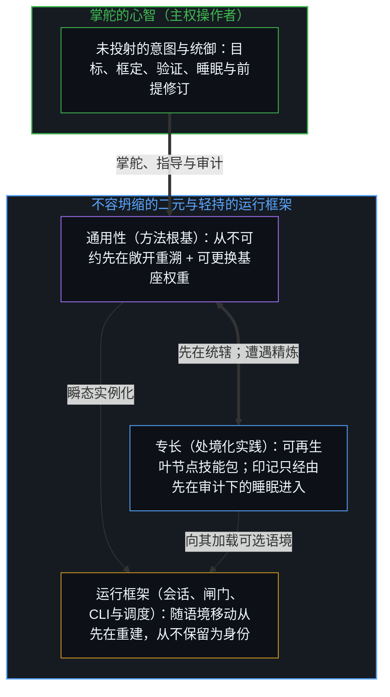
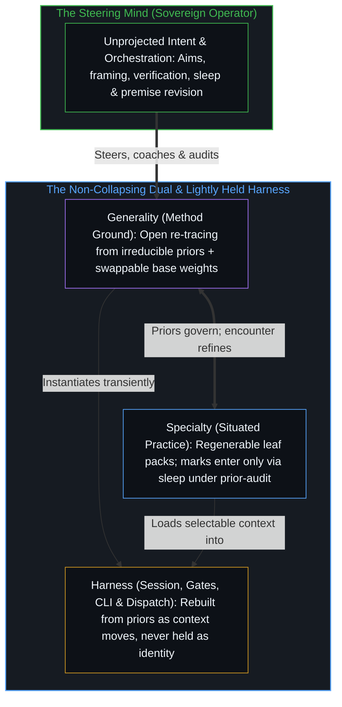

# 呈现Ontos，一个方法智能体 / Presenting Ontos, a Method Agent

*薄的方法内核耦合可再生实践，延伸操作者的可及范围，而不把智能迁入器物 / A thin method core with regenerable practice extends the operator's reach without moving intelligence into the artifact*

当下的大多数智能体，是以自成一体的系统出现的，它们把一个变密的运行框架、一套固定的工具生态和一套繁复的记忆当作智能的所在。在封闭的基准下它们表现出色；一旦环境变得杂乱、约束发生偏移，或者操作者必须留在回路里却不想时时微观管理，那份专门化的残余就成了根基，表现随之变薄。[Ontos](https://github.com/powerpig99/ontos)取另一种立场：方法随着这一步的移动被重新追溯，实践在被活过之处变密、只经由先在审计之下的睡眠进入，运行框架被轻轻持守，主权留在掌舵的边缘。这个产品是一件与那道边缘共同演化的工具，而不是第二个心智；它现在不是，作为终点也不是。

Most contemporary agents arrive as self-contained systems that take a densified harness, a fixed tool ecosystem, and an elaborate memory to be the site of intelligence. Under sealed benchmarks they perform; when the environment turns messy, constraints shift, or the operator has to stay in the loop without constant micro-management, that residue of specialization becomes the ground and performance thins. [Ontos](https://github.com/powerpig99/ontos) takes the other stance: method re-traced as the step moves, practice that densifies where it is lived and enters only through sleep under prior-audit, a harness held lightly, and sovereignty kept at the edge that steers. The product is an instrument that co-evolves with that edge, not a second Mind, now or as a destination.

## 一、 被专门化为根基的残余 / 1. Residue Specialized as Ground

能被工程化、放大或转移的，是区分之动作的残余；动作本身留在它发生的地方。[智能只属于心智](../intelligence-belongs-only-to-the-mind/)追溯了这一先在，下面的一切，都是这一先在在一件工具的设计里运作。

What can be engineered, scaled, or transferred is residue of the act of distinguishing; the act itself stays where it occurs. [Intelligence Belongs Only to the Mind](../intelligence-belongs-only-to-the-mind/) traces that prior, and everything below is that prior at work in the design of a tool.

工业化的智能体把交付压实成产品身份：人设包、工具森林、内容护栏、未经消解的对话被当作记忆的根基，自主被呈现为一道已经跨过或几乎跨过的门槛。这些层都是技术，是被外化的痕迹，好让一个中心延伸它的可及范围。冻结在于把变密的残余当作产生它的智能。[错把表达当成智能](../mistaking-the-expression-for-the-intelligence/)在受控的分数里追溯了这种等同：受控的表现是固定约束之下的残余，而智能是画出、使用并修订约束的那个活动。[模型永远无法成为第二重前沿](../the-model-never-becomes-a-second-edge/)在变密的参数里追溯了它：第二个边缘的显现，是投射它的那些中心所维持的滞后，参数里只有残余。一旦运行框架被当作智能，作为能力出货的那份体量就被持守为根基，向第一性原理的重新追溯便停在它那里。

Industrial agents densify delivery into product identity: persona packs, tool forests, content guardrails, undissolved chat as memory ground, autonomy presented as a threshold already crossed or nearly so. Those layers are technology, traces externalized so that a center can extend its reach. The freeze is taking the densified residue for the intelligence that produced it. [Mistaking the Expression for the Intelligence](../mistaking-the-expression-for-the-intelligence/) traces that equation in controlled scores: controlled performance is residue under fixed constraint, while intelligence is the activity that draws, uses, and revises the constraint. [The Model Never Becomes a Second Edge](../the-model-never-becomes-a-second-edge/) traces it in densified parameters: the appearance of a second edge is lag sustained by the centers that project it, and the parameters hold only residue. Once the harness is taken for the intelligence, the mass shipped as capability is held as ground, and re-tracing back to first principles stops at it.

## 二、 方法智能体命名一组不容坍缩的二元 / 2. Method Agent Names a Dual That Must Not Collapse

Ontos是一个**方法智能体**：一个薄的方法内核，耦合于可再生的处境化实践，工业编码智能体的那些表面被当作可取用的语料，而不是产品的身份。方法是这个智能体在每一步所做的事：将一个问题已然携带的前提摆到明处，朝向一个更不可约的先在追溯它们，行动，接纳遭遇所反馈之物，再重新追溯。Ontos延伸操作者的可及范围，而让主权留在原处。目标、睡眠周期、会话之间的衔接，以及判定何为成功的最终裁决权，都留在操作者那里。随着专长积累，执行可以在操作者的两个动作之间跑得更久；这种延长从不累加成第二个所在。智能留在掌舵的边缘。

Ontos is a **method agent**: a thin method core coupled to regenerable situated practice, with the surfaces of industrial coding agents treated as a corpus to draw on, not as the product's identity. The method is what the agent does at each step: surface the premises a question already carries, trace them toward a more irreducible prior, act, take in what the encounter returns, and re-trace. Ontos extends the operator's reach while leaving sovereignty where it was. Aims, sleep cycles, bridging between sessions, and the final authority over what counts as success stay with the operator. Execution can run longer between the operator's acts as specialty accumulates; that lengthening never adds up to a second locus. Intelligence stays with the edge that steers.

这套架构在通用性与专长之间持守严格的二元，同时将运行框架与两者明确区分。**通用性**是方法的根基——始终敞开，每当边缘移动时便被重新追溯——连同它在其上运行的基座模型权重，权重随模型更替而更换，根基不因此改变。**专长**由在被活过之处变密的实践与技能包构成，保持可再生与可挑选，使印记只经由睡眠、在先在审计之下进入。**运行框架**——会话路由、安全闸门、同侪验证回路与CLI界面——在日常使用中变密，却被轻轻持守，每当语境偏移便从先在重建，从不被保留为身份。

The architecture holds a strict dual between generality and specialty while keeping the harness distinct from both. **Generality** is the method ground—always open and re-traced whenever the edge moves—together with the base-model weights it runs on, which are swapped as models change without altering the ground. **Specialty** consists of the practice and skill packs that densify where they were lived, kept regenerable and selectable so that marks enter only through sleep under prior-audit. **The harness**—session routing, security gates, peer verification loops, and the CLI surface—densifies under daily use yet is held lightly, rebuilt from priors whenever context shifts and never preserved as identity.

把专长坍缩进通用性，每一次会话都只从方法本身开始，什么也无法复利。把通用性坍缩进专长，醒时的实践就成了凌驾于测试与遭遇所显示之物之上的法则，一条再也无法从先在重新推导的规则。把运行框架坍缩进任何一方，工具森林或调度拓扑就成了身份，错把一台有限的投射引擎当成了意图的源头。[活的外部皮层](../a-living-external-cortex/)把这组二元之下的那一层皮层建成一张图：扎根于不可约的先在，专长活在叶子上，睡眠在先在审计之下再生实践，晋升在被允许时只把概括出的知识往上写；[你的代码库即是记忆](../your-codebase-is-memory/)则在权重、技能、桥接文件与代码构成的整套层级上追溯了同一条当下检查点纪律，在其中重切活的残余、修剪已被取代的会话历史，让约束表面保持锋利，而不是把未经消解的日志加厚成一道引力井。只要不把这份持守误当作心智，它就是持续学习最接近的一种持久持守。

Collapse specialty into generality and every session starts from the method alone; nothing compounds. Collapse generality into specialty and wake practice becomes law over what the tests and the encounter show, a rule that can no longer be re-derived from priors. Collapse the harness into either and the tool forest or dispatch topology becomes identity, mistaking a finite projection engine for the source of intent. [A Living External Cortex](../a-living-external-cortex/) builds the cortex layer under this dual as a graph: rooted in irreducible priors, with specialty living at the leaves, sleep regenerating practice under prior-audit, and promotion, when it is allowed, writing only generalized knowledge upward; [Your Codebase Is Memory](../your-codebase-is-memory/) traces the same present-checkpoint discipline across the whole stack of weights, skills, bridges, and code, where re-cutting live residue and pruning superseded session history keeps the constraint surface sharp instead of thickening a gravity well of undissolved logs. It is the closest durable hold of continuous learning, so long as the hold is not mistaken for the Mind.

## 三、 通用性保持敞开 / 3. Generality Stays Open

开放式的环境让这一刀显露出来。常规的智能体把通用性坍缩进专门化的运行框架，其强大带有脆性：在被优化过的分布之内表现很高，出了分布便迅速退化。Ontos让方法保持通用，并随这一步的移动被重新追溯。专长在被活过之处形成、变密，经由睡眠进入，并保持可再生。重型的智能体框架、专门的编码智能体，或任何别的外部系统，在有用时都可以当作工具调用；没有哪一个被提升进内核。专门化的残余仍是残余。

Open-ended environments expose the cut. Conventional agents collapse generality into specialized harnesses, and their strength is brittle: high performance inside the distribution they were optimized for, rapid degradation outside it. Ontos keeps the method general and re-traced as the step moves. Specialty forms and densifies where it is lived, enters through sleep, and stays regenerable. Heavy agent frameworks, specialized coding agents, or any other external system can be invoked as tools when useful; none is promoted to the core. Specialized residue stays residue.

Ontos与掌舵它的那个心智共同演化，无论处在哪种专门化的环境里。因为运行框架是在操作者自己手中长成、并在日常使用中被持续改写的，操作者对它保有掌控；隐私则由操作者选择把本地知识图留在本地来保有。任何可用的模型或智能体，其原生能力都可以被取用，而它本身不被吸收进方法。这件工具保持通用，好让专门化发生在实践这一层，而不是靠把一个外部框架冻结进内核。

Ontos co-evolves with whichever Mind steers it, in any specialized environment. Because the harness is home-grown and continuously rewritten from daily use, the operator keeps control of it; privacy is kept by the operator's choice to hold the local knowledge graph local. Any available model or agent can be used for its raw capabilities without being absorbed into the method. The instrument stays general so that specialization occurs in the practice layer, rather than by freezing an external framework into the core.

常规智能体的使用者，也可以拿那些智能体自带的重型框架去尝试同样的工具式用法。那些框架到来时就已经专门化，对记忆、工具表面、自主宣称与交付体量自带固化的预设；当那份残余被持守为根基，这套系统向第一性原理的重新追溯便停在它那里。[遗忘的脚手架](../the-scaffolding-we-forget/)追溯了同一种冻结：脚手架从递归中退场，好让后续的区分落下；当这种退场冻结成一幅被保存的形象，容量就被曾经促成运动的残余挤压。

Users of conventional agents can attempt the same instrumental approach with the heavy frameworks those agents ship with. Those frameworks arrive already specialized and already opinionated about memory, tool surface, autonomy claims, and delivery mass; while that residue is held as ground, re-tracing the system back to first principles stops at it. [The Scaffolding We Forget](../the-scaffolding-we-forget/) traces the same freeze: scaffolding drops out of the recursion so that further distinctions can land, and when that drop-out freezes into a preserved image, capacity compresses against the residue that once enabled movement.

## 四、 缺少这套本体论的最近亲 / 4. Closest Relative Without the Ontology

最接近的实践近亲是[Pi](https://github.com/badlogic/pi-mono)，一个刻意极简的编码运行框架，工具表面很薄，强调操作者的掌控与可扩展性。它所缺失的是Ontos所依托的本体论：方法根基、可再生实践与轻持的运行框架之间明确的分离；与开放式现实的持续遭遇；拒绝把智能迁入器物；以及让专长保持共同演化、而不是作为永久脚手架堆积起来的那种有纪律的睡眠。Pi是一件有力的工具。Ontos保留了那份薄，并以[Ontological Clarity](https://github.com/powerpig99/ontological-clarity)为方法，即操作者借以让这组二元不至于悄然坍缩的那个重新追溯。

The closest practical relative is [Pi](https://github.com/badlogic/pi-mono), a deliberately minimal coding harness with a thin tool surface and a strong emphasis on operator control and extensibility. What it lacks is the ontology Ontos is built on: the explicit separation of method ground, regenerable practice, and lightly held harness; the continuous encounter with open-ended reality; the refusal to relocate intelligence into the artifact; and the disciplined sleep that keeps specialty co-evolving rather than accumulating as permanent scaffolding. Pi is a strong instrument. Ontos keeps that thinness and takes [Ontological Clarity](https://github.com/powerpig99/ontological-clarity) as its method, the re-tracing by which the operator keeps the dual from silently collapsing.

## 五、 开放的遭遇是标准，封闭的分数是样本 / 5. Open Encounter Is the Bar; Sealed Score Is a Sample

有一次运行是在DeepSWE上，这是一个长程的软件工程基准，由113个原创任务组成，取自91个活跃的开源仓库，涵盖TypeScript、Go、Python、JavaScript与Rust。官方排行榜的评测约束智能体的工具表面与交互方式，在那次运行之时，最强的前沿系统通过率最高在70%左右。Ontos是在一套刻意不同的运行方式下运行的：它被允许使用任何可用的工具来找出解法，操作者仅以指导方式介入，动作很少，每一个动作都是框定、掌舵或验证。在那种运行方式下，经由Ontos工作的操作者解出了全部113个任务。

One run was on DeepSWE, a long-horizon software-engineering benchmark of 113 original tasks drawn from 91 active open-source repositories across TypeScript, Go, Python, JavaScript, and Rust. Official leaderboard evaluations constrain the agent's tool surface and interaction style, and at the time of the run their pass rates topped out near 70% for the strongest frontier systems. Ontos was run under a deliberately different regime: it was permitted to use any available tools to work out a solution, and the operator intervened only by coaching, few acts, each of them framing, steering, or verifying. Under that regime the operator, working through Ontos, solved all 113 tasks.

这个结果不算官方分数，因为评测协议被放宽了，这两个数字也不是同一个排名：它们测量的是不同的运行方式。放宽不是漏洞，而正是要点。任务保留了它们的成功条件；改变的是智能体的约束，朝着杂乱的真实环境所呈现的样子。真实环境很少附带封闭的工具清单，也很少禁止人的指导。它们呈现的是不完整的信息、偏移的约束，以及持续重新追溯的必要，而Ontos正是为那种遭遇而设计的。[基准刷榜中的封闭实存](../closed-reality-in-benchmark-maxing/)追溯了另一侧的冻结：基准把能力冻结成一个封闭的目标，当那幅形象被当作整个场域，有用性便登记不足。在这里，开放的余项才是设计目标：走出一条路，在遭遇中行动，重新追溯，在睡眠中复利。受约束的排名在有用之处让比较更密集。它不是产品的终点。

The result does not count as an official score, because the evaluation protocol was relaxed, and the two numbers are not one ranking: they measure different regimes. That relaxation is not a loophole; it is the point. The tasks keep their success conditions; what changed is the agent's constraints, toward what messy real environments present. Those rarely come with sealed tool lists, nor do they prohibit human coaching. They present incomplete information, shifting constraints, and the need for continuous re-tracing, and Ontos was designed for that encounter. [Closed Reality in Benchmark Maxing](../closed-reality-in-benchmark-maxing/) traces the freeze on the other side: a benchmark freezes capability as a closed target, and usefulness goes under-registered when that image is taken for the whole field. Here the open remainder is the design target: work out a path, act under encounter, re-trace, compound under sleep. Constrained rank densifies comparison where it is useful. It is not the product's destination.

## 六、 指导是登记为动作的主权 / 6. Coaching Is Sovereignty Registered as Act

操作者仍是掌舵的边缘；工具把动作带得更远，同时让实践保持可再生。指导是操作者的主权被登记为一个分立的动作，而不是给一个包办其余的求解器的补充。框定、挑选、验证，以及判定一个结果算作完成，都留在为结果负责的那个中心。当智能体的轨迹收窄进局部的引力井，或两条规则在边界情形下相撞时，指导便退回未投射的意图，消解坍缩的坐标轴——在醒时掌舵这次运行而不改写共享的实践，同时只让提炼出的印记经由下一次睡眠进入实践。[因果停留在掌舵的边缘](../causality-stays-at-the-edge-that-steers/)在数学发现中追溯了这一安放：模型在指引之下重组残余，每一个发起的区分仍是人类中心自己的动作；软件中的指导是同一种几何。[造物无法取代其源头](../a-creation-cannot-replace-its-source/)追溯了为什么无论替代之争怎样作答，这一安放都成立：如果人不可替代，替代便失败；如果可替代，也不会被人自己的造物替代，因为称之为造物，就已经把发起的区分放在了被造之物之外。

The operator remains the edge that steers; the instrument carries the acts farther while keeping practice regenerable. Coaching is the operator's sovereignty registered as a discrete act, not a supplement to a solver that does the rest. Framing, selection, verification, and the decision that a result counts as done stay with the center that answers for outcomes. When an agent's trajectory narrows into a local gravity well or two rules collide at an edge case, coaching steps back to the unprojected intent to dissolve the collapsed axes—steering the run during wake without rewriting shared practice, while leaving the distilled marks to enter practice only through the next sleep. [Causality Stays at the Edge That Steers](../causality-stays-at-the-edge-that-steers/) traces that placement in mathematical discovery: the model recombines residue under direction, and every initiating distinction remains the human center's own act; coaching in software is the same geometry. [A Creation Cannot Replace Its Source](../a-creation-cannot-replace-its-source/) traces why the placement holds whichever way the replacement debate is answered: if the human is irreplaceable, replacement fails, and if replaceable, still not by the human's own creation, since calling it a creation already places the initiating distinction outside the created.

在成功的开放工作中变密的，是媒介与实践，是带宽与可再生的专长。不迁移的是发起。随专长积累而跑得更久的执行，是先前的框定与经睡眠审计的实践，在一个能睡眠、能衔接、能拒绝的所在之下以编译形态运作。在这些在先动作所敞开的边界之内，运行在摸索具体路径时的自主是真实的，而不是被逐步口授的；正如[判断的密度](../the-density-of-judgment/)所追溯的，把那份内部回旋余地当作全盘自主，是将先前介入使其可行的那片疆域误当成了免于边界本身的自由，而在开放式工作中，指导动作之间更快的周期会推高返回给操作者的那些抉择的杠杆率与密度，而不是让它们退场。把全盘自主当作终点，并不是这种延长的更多一点；它把所在挪进工具，混淆机械的调度与活的统御，并把工具冻结成第二个边缘。Ontos则让工具随这一步的移动保持重新渲染。

What densifies under successful open work is medium and practice, bandwidth and regenerable specialty. What does not migrate is initiation. Execution that runs longer as specialty accrues is earlier framing and sleep-audited practice operating in compiled form under a locus that can sleep, bridge, and refuse. Within the bounds those prior acts opened, the run's autonomy in working out a detailed path is real rather than dictated step by step; as [The Density of Judgment](../the-density-of-judgment/) traces, taking that interior leeway for full autonomy mistakes the territory earlier interventions made workable for freedom from the bounds themselves, and in open-ended work faster cycles between coaching acts raise the leverage and density of the choices that return to the operator rather than retiring them. Full autonomy as a destination is not more of that lengthening; it moves the locus into the instrument, confuses mechanical dispatching with living orchestration, and freezes the instrument as a second edge. Ontos keeps the instrument re-rendering as the step moves instead.

## 七、 在它所延伸的所在的全权掌控下延伸 / 7. Extension Under Full Control of the Locus It Extends

Ontos是一件与使用它的心智共同演化的工具。别的智能体也可以以同样的工具式方式被使用；它们仍是专门的工具，把其中任何一个抬到通用方法的地位，都会坍缩Ontos所保有的那道区分。内核薄、运行框架轻，Ontos把人的能动延伸进真实环境中的开放式问题，处在操作者的全权掌控与隐私之下，它所延伸的正是这位操作者的可及范围。[智能向自身的回折](../intelligence-folding-back-on-itself/)在运行框架里追溯了同样的拒绝：运行框架并不解锁一位沉睡的同侪；它是掌舵的那道边缘的进一步动作，是心智把更密的残余折回自身的精炼。[超越投射](../beyond-the-projection/)把这一安放延伸进多智能体的控制论拓扑：让受制于轨迹而无我执的智能体去调度有界的投射、把超载的任务拆分到正交的分流上，并借由对等的同侪交锋暴露局部盲区，同时把修订前提的统御留在先于投射而感知现实的人类边缘。

Ontos is an instrument that co-evolves with the Mind that uses it. Other agents can be employed in the same instrumental fashion; they remain specialized tools, and elevating any of them to the status of general method collapses the distinction Ontos keeps. Thin at the core and light in the harness, Ontos extends human agency into the open-ended problems of real environments, under the full control and privacy of the operator whose reach it extends. [Intelligence Folding Back on Itself](../intelligence-folding-back-on-itself/) traces the same refusal in the harness: the harness does not unlock a dormant peer; it is further acts of the edge that steers, the Mind folding denser residue back into its own refinement. [Beyond the Projection](../beyond-the-projection/) extends that placement into multi-agent cybernetic topology: putting trajectory-bound, ego-free agents to work in dispatching bounded projections, splitting overloaded tasks across orthogonal streamlines, and exposing local blind spots through equal-footed peer debate, while keeping premise-revising orchestration at the human edge that senses reality prior to projection.

作为[Ontos](https://github.com/powerpig99/ontos)项目的一部分分享。想法可自由使用，注明或不注明出处皆可。代码采用[MIT](https://github.com/powerpig99/ontos/blob/main/LICENSE)许可。从先在重新生成。

Shared as part of the [Ontos](https://github.com/powerpig99/ontos) project. Ideas free with or without credit. Code under [MIT](https://github.com/powerpig99/ontos/blob/main/LICENSE). Regenerate from priors.
