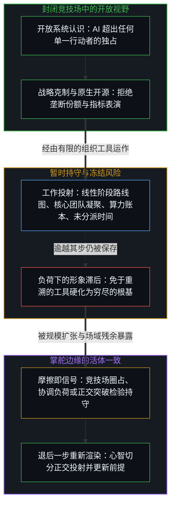
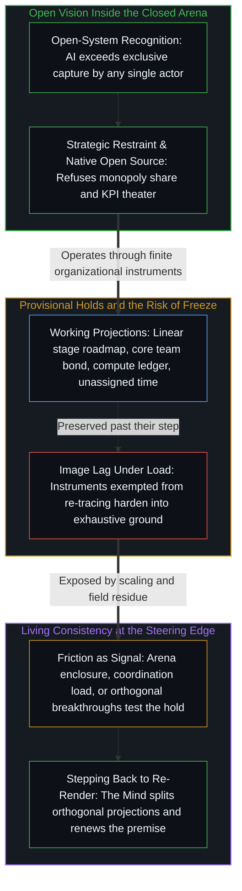

# 封闭竞技场中的开放视野 / Open Vision in a Closed Arena

*开放的认识在奖励圈占的竞技场中组织起一家公司 / Open recognition organizes a firm inside an arena that rewards enclosure*

梁文锋对投资人的谈话，出自DeepSeek首轮外部融资期间一场近四小时的会议，以一份他本人未确认的文字稿流传开来；它把一家利害重大的AI公司，奠基在一种异常一致的、关于这个领域的开放本体论之上：人工智能是一个历史上偶然的、多方参与的过程，超出任何单一行动者的独占。两道切分贯穿这场谈话。开放的立场组织着这家公司的商业行动，而所处的领域，其资本、地缘与竞争的残余，不断把可得的对齐导向圈占。同一场谈话也带着它自己的持守，作为工具可用，一旦免于重新追溯便封闭起来：技术进步的阶段模型，现有团队作为唯一不可谈判的利益，算力差距作为一本资源账，当下的文化作为能力的持久原因，以及变现作为技术进展的副产品。

Liang Wenfeng's remarks to investors, from a meeting of nearly four hours during DeepSeek's first outside funding round and circulated as a transcript he has not confirmed, ground a high-stakes AI company in an unusually consistent open ontology of the field: artificial intelligence as a historically contingent process with many parties taking part, which exceeds exclusive capture by any single actor. Two cuts run through the talk. The open stance organizes the firm's commercial action, while the domain it operates in, with its capital, geopolitical, and competitive residue, keeps steering the available alignments toward enclosure. The same talk also carries holds of its own, usable as instruments, yet closing once exempt from re-tracing: a stage model of technical progress, the existing team as the one non-negotiable interest, the compute gap as a resource ledger, the present culture as the durable cause of capability, and monetization as a side-effect of technical advance.

## 一、 无法被垄断的机会 / 1. The Opportunity That Cannot Be Monopolized

与开放现实最强的一致，是对经典封闭系统商业逻辑的反复拒绝。梁文锋把AI看作一个太大的现象，可能约占全球GDP的十分之一，任何单一公司都无法垄断。独占的企图会招来反作用力，并被历史抛弃。合理的利润就够了；激进地最大化份额或收入，既不必要，在战略上也适得其反，因为克制本身就提高了成功的概率。开源不是勉强的让步，而是公司最初态度的一种表达，是机会的规模所要求的一种必然。

The strongest consistency with open reality is the repeated refusal of classic closed-system business logic. Liang treats AI as too large a phenomenon, potentially around a tenth of global GDP, for any single firm to monopolize. Attempts at exclusive capture generate counter-forces and are abandoned by history. Reasonable profit is enough; aggressive maximization of share or revenue is both unnecessary and strategically counterproductive, because restraint itself raises the probability of success. Open source is not a reluctant concession but an expression of the company's original attitude and a necessity the scale of the opportunity demands.

帮助竞争对手，包括阿里、智谱和月之暗面，自由分享技术细节以助复现，把面向消费者与企业的收入当作副产品而非首要目标，都出自同一种立场：机会巨大，所以激进的圈占会限制自身。这些动作从这家公司自己的取向继续下去：发布与价格克制被持守为它的策略，而不是为别的公司设定的标准。定价被设为大约十个月收回硬件成本，被说成设备上约六倍的利润，是为了可及与内部凝聚，而不是收入最大化。当一个模型的价格被降到初始水平的四分之一，内部的反应是欢呼，而不是哀悼流失的经常性收入。这种反应增密了同一个先在：在合理成本回收之下的有用性，而不是去夺取缺乏弹性的需求所容许的那个上限。

Helping competitors, including Alibaba, Zhipu, and Moonshot, sharing technical details freely to aid replication, and treating consumer and enterprise revenue as by-products rather than primary objectives all flow from the same stance: the opportunity is vast, so aggressive enclosure limits itself. These acts continue from the firm's own orientation: release and price restraint are held as its strategy, not as a standard set for other firms. Pricing, set to recoup hardware costs in about ten months and framed as roughly sixfold profit on equipment, is chosen for accessibility and internal cohesion rather than revenue maximization. When a model's price was cut to a quarter of its initial level, the internal response was cheering, not mourning lost recurring revenue. That reaction densifies the same prior: usefulness under reasonable cost recovery, not capture of the ceiling that inelastic demand would allow.

这种克制，是认识到一个有限的独占份额，无法为一个持续越过任何一家公司之持守的场奠基。[没有系统能被保持封闭](../no-system-can-be-kept-closed/)追溯了不完备性最直观的面：在一个做加法的一位寄存器里，运算在持守之内有效，而真实的结果落在它之外。[开放即一致](../openness-is-consistency/)从另一侧命名了这个要求：不一致，是对封闭的渴望或尝试，是把一个有限的结构强行用来为只会继续的东西奠基。梁文锋的宏观论证，即想拿下AI经济百分之五的人，会输给愿意只拿百分之一的人，是同一种几何的商业说法。“我们的份额”这份封闭的清单，制造出挑战者；开放的立场，拒绝把垄断立为机会的封闭形状。

This restraint is a recognition that a finite exclusive share cannot ground a field that continues past any one firm's hold. [No System Can Be Kept Closed](../no-system-can-be-kept-closed/) traces the most intuitive face of incompleteness: in a one-bit register under addition, the operation is valid inside the hold, and the true result lies outside it. [Openness Is Consistency](../openness-is-consistency/) names the demand from the other side: inconsistency is the desire, or attempt, for closure, a finite structure forced to ground what only continues. Liang's macro argument, that whoever aims to take five percent of the AI economy will lose to whoever is willing to take one percent, is the same geometry in commercial terms. The closed inventory of "our share" generates challengers; the open stance refuses to install monopoly as the sealed shape of the opportunity.

在组织上，偏好共同的愿景而非僵硬的KPI与层级控制，同样倾向开放。人被当作由一个共同方向所定向的自主中心，而不是被严密编排的部件。“正事”，即核心的协同任务，理想上不超过一半的时间，其余留给个人的探索。愿景本身不是一句墙上的口号，而是一种被践行的态度，不靠成文便能组织，也不声称每个成员都持有同样被表述出来的内容。这些立场所依据的，是认识到更大的技术、经济与社会系统，超出任何单一公司封闭或控制它的能力。

Organizationally, the preference for shared vision over rigid KPIs and hierarchical control leans open as well. People are treated as autonomous centers oriented by a common direction rather than as tightly scripted components. "The real work," the core coordinated tasks, ideally takes no more than half the time, with the rest left for individual exploration. The vision itself is not a wall slogan but an enacted attitude that organizes without formal codification, and without claiming that every member holds the same articulated content. These positions rest on recognizing that the larger technological, economic, and social system exceeds any single company's capacity to close it off or control it.

## 二、 阶段模型作为进步的封闭形状 / 2. The Stage Model as a Sealed Shape of Progress

与这份开放并存的，是几项作为封闭世界前提起作用的承诺。技术路线图被呈现为一个相对线性、分阶段把关的必经瓶颈序列：语言模型让位于思维链推理，然后是智能体，然后是持续学习，再到一个自我迭代的过程（常被称为“奇点”，但被描述为渐进而非突变），之后才是具身智能。其他路径，例如以世界模型为主要驱动，或以重度多模态作为提升智能上限的主线，被暂时放在一边，视为正交或较低的优先级。

Alongside that openness, several commitments function as closed-world premises. The technical roadmap is presented as a relatively linear, stage-gated sequence of necessary bottlenecks: language models give way to chain-of-thought reasoning, then to agents, then to continual learning, then to a self-iterating process (commonly called a "singularity," though described as gradual rather than abrupt), and only later to embodied intelligence. Alternative paths, such as world models as the primary driver or heavy multimodality as the main line for raising the intelligence ceiling, are temporarily set aside, regarded as orthogonal or of lower priority.

路线图作为工具起作用：一种暂时的排序，让研究的注意更集中，也让公司不至于把自己摊薄到每一种商业风潮上，无论是视频生成还是每一个垂直智能体。作为结构被持守的结构，仍然可用。当这种排序被当作进步本身的必然形状，当离持续学习还剩的距离被当作这个领域所剩的全部，其他方向相对于那架封闭的梯子只被登记为噪声，它便封闭了。[AGI 与 ASI 是加速通用智能的暂时球门](../agi-and-asi-are-temporary-goalposts/)在阈值上追溯了同一种几何：每一个阈值都永远处在画出它的边缘之前，并在每一个所在都不同，因为能力的增益就是那道边缘在强化自身。[基准刷榜中的封闭实存](../closed-reality-in-benchmark-maxing/)在基准里追溯了它：基准把能力冻结成一个封闭的目标。在这里，那个封闭的目标是一个阶段序列。在这个序列之下得到的发现仍然成立；穷尽性不随它们一起迁移。

The roadmap works as an instrument: a provisional ordering that concentrates research attention and keeps the firm from diluting itself across every commercial fashion, whether video generation or every vertical agent. Structure held as structure remains usable. It closes when that ordering is held as the necessary shape of progress itself, when the remaining distance to continual learning is treated as what remains of the field, and other directions register only as noise relative to the sealed ladder. [AGI and ASI Are Temporary Goalposts](../agi-and-asi-are-temporary-goalposts/) traces the same geometry in thresholds: each sits forever ahead of the edge that draws it, and differs at every locus, because capability gain is that edge reinforcing itself. [Closed Reality in Benchmark Maxing](../closed-reality-in-benchmark-maxing/) traces it in the benchmark, which freezes capability as a closed target. Here the closed target is a stage sequence. Findings under the sequence remain; exhaustiveness does not travel with them.

梁文锋已经软化了一种常见的冻结：“奇点”是连续的，而不是一个离散的临界点。然而序列本身仍被呈现为进步必须经过的次序，并以一个自我迭代的回路收束，而不是留作诸多选择中的一种。[超越投射](../beyond-the-projection/)追溯了为何即便是一个自我迭代的智能体过程，也仍是一台有限的投射引擎：智能体受困于自身的词元轨迹，能够穷尽推演，也能在正交同侪的挑战下完成无我的贝叶斯更新，却从不会成为那个感知前解释摩擦、并向后退一步走出破损框架的未投射活体心智。意料之外的平台期、自我迭代内部的前提死锁，或现在被放在一边的路径取得成功，都会检验这个线性的持守，而这种检验，就是场越过一张曾经有用的地图继续下去。

Liang already softens one common freeze: the "singularity" is continuous, not a discrete critical point. Yet the sequence itself is still presented as the order progress must pass through, culminating in a self-iterating loop rather than remaining one selection among others. [Beyond the Projection](../beyond-the-projection/) traces why even a self-iterating agentic process remains a finite projection engine: an agent is bound to its token trajectory and can exhaust deductions or perform ego-free Bayesian updates when challenged by an orthogonal peer, yet it never becomes the unprojected living Mind that senses pre-interpretive friction and steps backward out of a broken frame. Unexpected plateaus, premise deadlocks inside self-iteration, or the success of paths now set aside will test that linear hold, and the test is the field continuing past a map that was useful.

## 三、 团队稳定作为不可谈判的持守 / 3. Team Stability as the Non-Negotiable Hold

团队稳定被抬升为唯一不可谈判的核心利益；其余一切都可以被克制或牺牲。这种简化自有其优雅：钱、卡和产品线都可以重新获得，一个凝聚的核心却不能。代价是把系统封闭在一个社会单元周围，即现有的核心团队及其文化凝聚，于是规模扩张、外部人才的流入或文化的演变，都有被当作威胁、而不是当作寻常开放系统动态来对待的风险。

Team stability is raised to the single non-negotiable core interest; everything else may be restrained or sacrificed. The simplification has its elegance: money, cards, and product lines can be reacquired, while a cohesive core cannot. The cost is closing the system around one social unit, the existing core team and its cultural cohesion, so that scaling, inflows of outside talent, or cultural evolution risk being met as threats rather than as ordinary open-system dynamics.

保持团队稳定作为工具起作用。一种拒绝KPI表演、留出一半时间不作分派的研究文化，依赖于已经与愿景共振的人。当这份稳定被持守为唯一免于重新追溯的利益，这种依赖便增密成一个封闭的优先项，它就封闭了。[起作用的是信念](../what-works-is-the-belief/)在禁令里追溯了这一点：一道禁令在场中什么也封不住；它在那些把封印当作根基的人之间稳定了一种信念。一个不可谈判的优先项在公司内部也这样起作用：它在持有它的人之间为后来的动作定型可得的对齐，却封不住谁能加入、离开或重塑这个文化的那个场。为更多期权授予出资的那一轮融资，处理的是稳定的一个面，即经济上的拉力。它并不消解那个结构性的风险：增长会迫使出现愿景眼下不愿立为根基的那种正式化。

Keeping the team stable works as an instrument. A research culture that refuses KPI theater and keeps half of the time unassigned depends on people who already resonate with the vision. When that stability is held as the one interest exempt from re-tracing, the dependence densifies into a sealed priority, and it closes. [What Works Is the Belief](../what-works-is-the-belief/) traces this in bans: a ban seals nothing in the field; it stabilizes a belief among those who treat the seal as ground. A non-negotiable priority works the same way inside a firm: it patterns the alignments available to later acts among those who hold it, yet cannot seal the field of who can join, leave, or reconfigure the culture. The financing round that funds more option grants addresses one face of stability, the economic pull. It does not dissolve the structural risk that growth will force the very formalization the vision now declines to install as ground.

## 四、 算力作为封闭的资源竞争 / 4. Compute as Closed Resource Competition

与美国的算力差距被当作主导的结构性约束，近期的主要补救被界定为以合理价格激进地采购硬件，在供应允许的情况下尽快把现金换成卡。算法效率被当作拉伸有限算力的方式来追求，国产芯片生态，包括TileLang与在华为硬件上的工作，被当作一个历史机遇，而不是可有可无的爱国姿态。公司自己对滞后的说法，即以美国算力的一小部分落后几个月，已经把效率编码为一种部分的开放系统回应：扩大每张卡所能完成的工作，而不只是卡的数量。

The compute gap with the United States is treated as the dominant structural constraint, and the main near-term remedy is defined as acquiring hardware aggressively at reasonable prices, converting cash into cards as fast as supply allows. Algorithmic efficiency is pursued as a way to stretch limited compute, and domestic chip ecosystems, including TileLang and work on Huawei hardware, are treated as a historical opportunity rather than as optional patriotism. The firm's own account of its lag, trailing by months on a small fraction of American compute, already encodes efficiency as a partial open-system response: expanding the work each card can perform rather than merely the count of cards.

无论近期多么现实，主导的框定仍把问题放在一场相对封闭的资源竞争之中。H100等效卡的稀缺、资本的密集与出口管制的残余，是有约束力的痕迹。[生产、消费与心智的区分](../production-consumption-and-the-minds-distinction/)追溯了有限存量如何被登记：生产与消费不是两种动作，而是同一个活动在心智把它的边界持守为开放或固定时的登记方式，在固定的持守之下，框架内的每一次进一步使用都被登记为从有限存量中减去。当进步的方程被封闭成卡乘以时间，硬件就是这样一种存量。效率上的工作、更小的激活参数规模，以及拒绝那些公司无法研究透的800B竞赛，已经在登记负荷之下的扩展。当硬件账本被持守为中美能力差距的首要根基，而这家公司自己在做的架构、算法与组织上的差异，只相对于它才被登记，这个持守便封闭了。

However realistic in the near term, the dominant framing still places the problem inside a relatively closed resource competition. The scarcity of H100-equivalent cards, the capital intensity, and the residue of export controls are traces that bind. [Production, Consumption, and the Mind's Distinction](../production-consumption-and-the-minds-distinction/) traces how finite stocks register: production and consumption are not two kinds of act but how the same activity registers when the Mind holds its boundary as open or as fixed, and under a fixed hold every further use inside the frame registers as subtraction from a finite stock. Hardware is such a stock when the equation of progress is sealed as cards times time. Efficiency work, smaller activated-parameter scales, and the refusal of 800B races too large for the firm to research thoroughly already register expansion under load. The hold closes when the hardware ledger is held as the primary ground of the capability gap between the United States and China, and the architectural, algorithmic, and organizational differences the firm itself works on register only relative to it.

## 五、 文化作为持久的形象 / 5. Culture as a Durable Image

这里有一种隐含的信心：当下的文化操作系统，愿景驱动、结构轻、一半时间自由探索，会随着组织的成长依然可行。梁文锋承认，有些部门终将需要更正式的结构，而这种调整已在进行。基础的信念仍是，开放愿景的文化本身就是持久的优势：不靠加班的凝聚，经由克制的专注，只有在相对宽松的环境里才可能的研究。这些做法本身倾向开放，正如机会那一节所追溯的；持守在于把这个构型立为能力的持久原因。

There is an implicit confidence that the present cultural operating system, vision-driven, lightly structured, with half the time for free exploration, will stay viable as the organization grows. Liang acknowledges that more formal structure will eventually be needed in some departments, and that the adjustment is under way. The foundational belief remains that the open-vision culture is itself the durable advantage: cohesion without overtime, focus through restraint, research possible only in a relatively relaxed environment. The practices themselves lean open, as the opportunity section traced; the hold lies in installing this configuration as the durable cause of capability.

随着人数与产品面增长，协调成本上升，压向那个构型。形象滞后的宽度在它身上被量出：不设KPI、一半时间不作分派的样式，被保存为研究成功的机制，过了人数与产品面迫使其他持守出现的那一步。[追求机缘中的封闭现实](../closed-reality-in-the-pursuit-of-serendipity/)以相反的符号追溯了同一种冻结：开放不是靠清空日程产生的；它是不把任何计划，包括没有计划的计划，保存为固定的参照。回返不是为官僚制放弃这个文化。正如[超越投射](../beyond-the-projection/)在架构层面上所追溯的，当增长的复杂度超出单一共享语境的容量时，维持连贯靠的既不是死守一个未切分的单一核心，也不是强加自上而下的KPI脚本、把人的判断压平为机械执行，而是沿着清晰的正交边界切分投射，同时由掌舵边缘的心智在局部流线死锁时重新渲染规则。回返是不把任何单一的组织构型立为能力的封闭原因。

As headcount and product surface grow, coordination costs rise and press against that configuration. The width of Image lag is measured on it: the pattern of no KPIs and half the time unassigned preserved as the mechanism of research success past the step at which headcount and product surface force other holds. [Closed Reality in the Pursuit of Serendipity](../closed-reality-in-the-pursuit-of-serendipity/) traces the same freeze with the opposite sign: openness is not produced by clearing the calendar; it is the non-preservation of any plan, including the plan of having no plan, as a fixed reference. Return is not abandoning the culture for bureaucracy. As [Beyond the Projection](../beyond-the-projection/) traces at the architectural level, when growing complexity exceeds the capacity of a single shared context, coherence is preserved neither by clinging to a single unpartitioned core nor by imposing top-down KPI scripts that flatten human judgment into mechanical execution, but by splitting projections along clean orthogonal boundaries while the Mind at the steering edge re-renders the rules whenever local streamlines deadlock. Return is declining to install any single organizational configuration as the sealed cause of capability.

## 六、 变现作为一条封闭链条的副产品 / 6. Monetization as a Side-Effect of a Closed Chain

一种平行的、近乎决定论的商业可持续观也同样存在：沿着公司自己的路线图持续进展，被预期会作为副产品带来合理的变现；在一个资本密集、竞争激烈的领域里，正是这种变现，基于技术进展与持久经济结果之间一条相对封闭的因果链假设，让企业保持可行。这与机会那一节里的副产品立场处在不同的轴上。不把消费者或企业收入当作首要目标，是拒绝把圈占当作公司的目的，因而保持开放；从技术进展到存续的那条链，是另一个持守。API与企业收入被承认为可能的现金流兜底，而不是第一优先。那个底线的说法，即如果技术进展停滞，单靠API服务也仍可能支撑一家上市公司，是坦率的生存逻辑。

A parallel, nearly deterministic view of commercial sustainability persists as well: continued progress along the firm's own roadmap is expected to generate reasonable monetization as a side-effect; in a capital-intensive, competitive field, that monetization is what keeps the enterprise viable on the assumption of a relatively closed causal chain between technical advance and durable economic outcomes. This sits on a different axis from the by-product stance of the opportunity section. Not making consumer or enterprise revenue the primary objective refuses enclosure as the firm's aim, and that stance stays open; the chain from technical advance to survival is a separate hold. API and enterprise revenue are admitted as possible cash-flow backstops, not as the first priority. The bottom-line argument, that if technical progress stalled, the API service alone might still sustain a listed company, is frank survival logic.

那条链作为规划的工具可用。当技术进展被当作持久经济结果的充分原因，对当前范式下的需求上限、对竞争者的圈占、对重新定义“合理”的资本市场压力都不再留有开放，它就封闭了。梁文锋自己在垂直产品扩张与吃掉应用层上的克制，保持了一侧的开放：公司不试图封住整个技术栈。仍然留下的封闭假设是，沿着它的路线图的进展，会持续写下商业的故事，而公司无须亲手造出圈占来维持生存。

That chain is usable as a planning instrument. It closes when technical advance is treated as sufficient cause of durable economic outcomes, leaving no openness to demand ceilings under current paradigms, to enclosure by competitors, or to capital-market pressures that redefine "reasonable." Liang's own restraint on vertical product expansion and on eating the application layer keeps one side open: the firm does not try to seal the entire stack. The closed assumption that remains is that progress along its roadmap will keep writing the commercial story without the firm having to author enclosure to stay alive.

## 七、 张力是几何，不是意外 / 7. Tension Is the Geometry, Not the Accident

投资人、客户与竞争者会周期性地施压，要求更多的圈占：更大的定价权，更严的知识产权控制，更激进的用户锁定，或垂直的产品扩张。每一次这样的要求都会给开放愿景的文化带来压力，而意料之外的技术平台期或其他研究方向的成功，会检验那个封闭的阶段模型。在一个地缘、资本密集、人才竞争的竞技场里，保持一种异常开放的姿态（发布最强的模型，帮助竞争者，拒绝短期的夺取），会不断提出一个实际的问题：在主流对齐奖励圈占的地方，这家公司能保持多开放？圈占的打法，会把它问成一个战略脆弱的问题。

Investors, customers, and competitors will periodically press for more enclosure: greater pricing power, tighter control of intellectual property, more aggressive user lock-in, or vertical product expansion. Each such demand will strain the open-vision culture, and unexpected technical plateaus or the success of other research directions will test the closed stage model. Operating in a geopolitical, capital-intensive, and talent-competitive arena while maintaining an unusually open posture (releasing the strongest models, aiding competitors, declining short-term capture) will continually raise a practical question: how open can the company stay where prevailing alignments reward enclosure? The playbook of enclosure poses it as a question of strategic vulnerability.

那个问题，就是开放的认识不得不生活在奖励封闭策略的稳定对齐之中时的样子。[现实扭曲力场指认的是封闭的地图](../the-reality-distortion-field-names-the-closed-map/)追溯了这样的对齐如何被读解：被登记为扭曲世界之力量的，是来自一个内在所在的持续活动，被对照一张被持守为可能之封闭场的共识地图来计分。在这里，那张封闭的地图是行业默认的圈占打法。DeepSeek的开源、价格克制与拒绝追逐每一种消费端或企业端的锁定，就是那种持续的活动：它们继续下去而不强化那套打法，并把实现了的场更新到那张地图之外。它们并不消解周围的场。它们定型的是另一种可得性。

That question is what open recognition looks like when it has to live among stabilized alignments that reward closed tactics. [The Reality Distortion Field Names the Closed Map](../the-reality-distortion-field-names-the-closed-map/) traces how such alignments are read: what registers as a power to warp the world is sustained activity from an internal locus, scored against a consensus map held as the sealed field of the possible. Here the sealed map is the industry's default playbook of enclosure. DeepSeek's open source, price restraint, and refusal to chase every consumer or enterprise lock-in are sustained activity of that kind: they continue without reinforcing that playbook, updating the realized field past that map. They do not dissolve the surrounding field. They pattern a different availability.

## 八、 在奖励封闭的残余之中保持开放的结构 / 8. Structure Held Open Inside Residue That Rewards Closure

梁文锋的谈话于是读作这样一种努力：在一个不断奖励封闭系统策略的领域里，以开放系统的价值观来运作。与开放现实的一致是成立的：多方参与的规模，作为策略的克制，作为本性而非被迫的开源，作为被践行的组织而非KPI表演的愿景。封闭的假设也与之并存：分阶段把关的进步，团队作为封闭的核心利益，算力作为差距的首要账本，文化作为持久的原因，变现作为从技术进展到经济结果的一条相对封闭之链的副产品。

Liang's talk reads, then, as an effort to operate with open-system values inside a domain that keeps rewarding closed-system tactics. The consistency with open reality holds: a scale on which many parties take part, restraint as strategy, open source as native rather than forced, vision as enacted organization rather than KPI theater. Closed assumptions coexist with it: stage-gated progress, the team as a sealed core interest, compute as the primary ledger of the gap, culture as durable cause, monetization as side-effect of a relatively closed chain from technical advance to economic outcomes.

同样的余下，对公司与对机会都适用：公司画下的每一个持守（路线图、团队、文化、定价），在画下它的那个动作上成立，而并非最终。把这些持守当作工具而不是穷尽的根基，正是这场谈话已经施加于垄断份额的那份纪律。它也让开放的立场不至于翻转成自身的倒置。[偏好聚类与评判语言](../preference-clusters-and-the-language-of-judgment/)追溯了其下的机制：对与错，命名的是对齐的偏好在另一个所在不重新追溯同一片场域时发出的声音；阻止别人发布与阻止别人去阻止共用一个机制，各自都在为别的中心的对齐定型，而不是从自己的取向继续下去。[要求他人开放是对自我封闭的渴望](../advocating-openness-of-others-is-a-desire-for-closure-of-the-self/)追溯了这种倒置最尖锐的样子：要求他人开放，是一个中心在开放的形象下让自身的选择免于质询的方式。发布与克制，只要从这家公司自己的取向继续下去，就仍是工具；当“开放”冻结成别的中心必须满足的凭据，倒置便开始了。

The same remainder applies to the company as to the opportunity: every hold the firm draws (roadmap, team, culture, pricing) holds at the act that draws it and is not final. Keeping those holds as instruments rather than as exhaustive ground is the discipline the talk already applies to monopoly share. It is also what keeps the open stance from turning into its own inversion. [Preference Clusters and the Language of Judgment](../preference-clusters-and-the-language-of-judgment/) traces the mechanism underneath: right and wrong name the sound aligned preferences make when another locus does not re-trace the same field; stopping others from releasing and stopping others from stopping share a single mechanism, each patterning other centers' alignments rather than continuing from its own orientation. [Advocating Openness of Others Is a Desire for Closure of the Self](../advocating-openness-of-others-is-a-desire-for-closure-of-the-self/) traces the inversion at its sharpest: demanding that others open is how a center keeps its own selection exempt from inquiry under the image of openness. Release and restraint stay instruments while they continue from this firm's orientation; the inversion begins where "openness" freezes into a warrant other centers must meet.

持续的张力，是试图让系统比周围的激励所偏好的更开放所带来的后果。竞技场不必先变得开放，开放的愿景才能保持一致。一致是活动不冻结地继续，作为结构被持守的结构，处在场已经增密了的无论什么残余之中。

The ongoing tension is the consequence of trying to keep the system more open than the surrounding incentives prefer. The arena does not have to become open for the open vision to stay consistent. Consistency is the activity continuing without freeze, structure held as structure, inside whatever residue the field has already densified.
