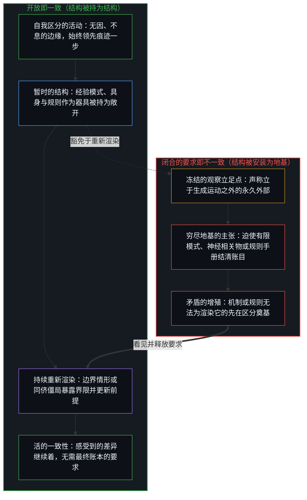
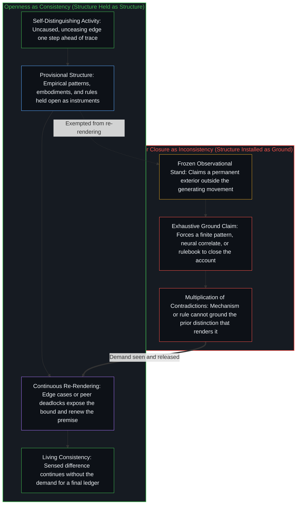

# 开放即一致 / Openness Is Consistency

*不一致是对闭合的渴望或尝试：迫使一个有限的结构为只是继续着的东西奠基 / Inconsistency is the desire for, or attempt at, closure: forcing a finite structure to ground what only continues*

开放不是结构的缺失。它是不经冻结而继续着的活动：结构被持为结构，而不是被安装为穷尽的地基。被登记为矛盾的东西，并不是一种等待更好理论的描述失败：它是已在起作用的闭合要求。当这一要求被看见，而不是得到服从，感受到的差异便继续，而这一继续便是一致。

Openness is not a lack of structure. It is the activity continuing without freeze, structure held as structure rather than installed as exhaustive ground. What registers as contradiction is not a failure of description waiting for a better theory: it is the demand for closure already at work. When that demand is seen rather than obeyed, sensed difference continues, and that continuation is consistency.

## 一、 产生矛盾的要求 / 1. The demand that produces the contradiction

自我区分的活动发生着，无因，不息。称之为心智：已在进行中的观察者，它的每一个动作都是一次区分。每一个动作都是离散的；连续是同一个活动在动作之间的承续。较早动作的残余是痕迹。观察持有结果；产生结果的原因仍领先一步。这个间隙，就是观察得以登记的方式。它不是一个有待由最终框架填补的洞。[一步一步绘制出的路径](../the-path-drawn-one-step-at-a-time/)把这一步之差追溯为时间与因果；[智能只属于心智](../intelligence-belongs-only-to-the-mind/)把活动追溯为先在，而不是从外部审视的一种属性。时间是这个间隙被感受得最直接的地方：[前因，后果](../qian-yin-hou-guo/)、[时间之箭的伪悖论与对称模拟的边界](../the-mirage-of-times-arrow-and-the-boundaries-of-simulation/)与[现实的边界](../xian-shi-de-bian-jie/)各自把边缘置于观察所持有之物的前方。

Self-distinguishing activity occurs, uncaused, unceasing. Call it the Mind: the observer already underway, every act of which is a distinction. Every act is discrete; continuity is the same activity carrying across acts. Residue of earlier acts is trace. Observation holds effect; the cause that produced it remains one step ahead. That gap is how observation registers at all. It is not a hole to be filled by a final frame. [The Path Drawn One Step at a Time](../the-path-drawn-one-step-at-a-time/) traces this one-step gap as time and causality; [Intelligence Belongs Only to the Mind](../intelligence-belongs-only-to-the-mind/) traces the activity as prior, not as a property surveyed from outside. Time is where the gap is felt most directly: [Cause Before, Effect After](../qian-yin-hou-guo/), [The Mirage of Time's Arrow and the Boundaries of Symmetric Simulation](../the-mirage-of-times-arrow-and-the-boundaries-of-simulation/) and [The Boundary of Reality](../xian-shi-de-bian-jie/) each place the edge ahead of what observation holds.

当某个东西被迫充当地基、同时仍被当作必须奠基之物时，不一致便产生。闭合的要求制造出它随后试图化解的张力。一旦这一要求发动起来，每一种描述都开始自相矛盾，因为它声称立于让它得以显现的那个运动之外，并把观察的立足点冻结，仿佛这个立足点能从一个永久的外部审视活动。[善恶是硬币的两面与那一刀](../good-and-evil-are-the-two-sides-of-the-coin-and-the-cut/)在一本二元的账本中追溯那个被冻结的立足点：一种言说，要在那一刀已经撤回之后，从外部审视善与恶。[道德语言稀释自由复利的反馈](../moral-language-dilutes-the-feedback-that-scales-freedom/)追溯这个被冻结的立足点：终局或封闭的假定被强加于接受与后果的连续过程之上，由此产生的不融贯被计为世界的属性。[选择、矛盾与开放的现实](../selection-contradiction-and-open-reality/)把矛盾追溯为由择取本身生成：承认择取性，便使暂时的闭合不致滑向永久。维度是被持为敞开的投影，正如[维度即投影](../dimensions-are-projections/)所论证的；[稳定与溢出](../stability-and-excess/)追溯意识一面持住一个形式，一面溢出它。

Inconsistency arises when something is forced to serve as ground while still being treated as something that must be grounded. The demand for closure creates the tension it then tries to resolve. Once that demand is active, every description begins to contradict itself because it claims a stand outside the movement that allowed it to appear, freezing the observational stand as if it could survey the activity from a permanent exterior. [Good and Evil Are the Two Sides of the Coin and the Cut](../good-and-evil-are-the-two-sides-of-the-coin-and-the-cut/) traces that frozen stand in a dualistic ledger: speech that would survey good and evil from outside after the cut has already withdrawn. [Moral Language Dilutes the Feedback That Scales Freedom](../moral-language-dilutes-the-feedback-that-scales-freedom/) traces the frozen stand where absolute or closed assumptions are imposed on the continuous process of acceptance and consequence, and the resulting incoherence is scored as a property of the world. [Selection, Contradiction, and Open Reality](../selection-contradiction-and-open-reality/) traces contradiction as generated by selection itself: owning the selectivity keeps a temporary closure from sliding toward permanence. Dimensions are projections held open, as [Dimensions Are Projections](../dimensions-are-projections/) argues, and [Stability and Excess](../stability-and-excess/) traces consciousness holding a form while exceeding it.

因与果之间感受到的差异，并不需要一本把一切差异都记清的账本。它继续着。当继续被想要结清账目的尝试打断，矛盾便增殖：机制被描述了，可把机制当作有意义之物的能力却未得到解释；学习被定位于神经调整，可让调整显现为学习的那个先在区分，却被默默略过。增殖不是第二个问题。它是同一个要求在产出更多的表面。评审者与监管者若把自己的签署持为安全的保证，便以安全之名要求闭合；[数字火箭、同行审查与因果闭环的稀释](../the-dilution-of-the-causal-loop-and-the-misallocation-of-agency/)与[风险在于对监管本身的迷信](../the-risk-is-the-belief-in-oversight-itself/)在评审与监管中追溯这一要求。

The sensed difference between cause and effect does not require a ledger in which all differences are accounted for. It continues. When continuation is interrupted by the attempt to close the account, contradictions multiply: the mechanism is described, yet the capacity to treat the mechanism as meaningful is left unexplained; learning is located in neural adjustment, yet the prior distinction that makes adjustment appear as learning is passed over in silence. The multiplication is not a second problem. It is the same demand, producing more surface. Where reviewers and overseers hold their sign-off as the guarantee of safety, they demand closure in its name; [Digital Rockets, Peer Review, and the Dilution of the Causal Loop](../the-dilution-of-the-causal-loop-and-the-misallocation-of-agency/) and [The Risk Is the Belief in Oversight Itself](../the-risk-is-the-belief-in-oversight-itself/) trace that demand in review and oversight.

## 二、 发现仍在，穷尽性并不随它们迁移 / 2. Findings remain, and exhaustiveness does not travel with them

经验发现并不因此受到触动。它们登记一些模式，这些模式在其被观察的条件之内成立。一致并不要求否认它们。当这些模式被赋予穷尽实在的地位时，不一致便出现。在那一刻，发现被要求去解释当初使它们的观察成为可能的东西。它们做不到。这一要求本身已是产生矛盾的那个闭合。这一点的形式面向是[没有系统能被保持封闭](../no-system-can-be-kept-closed/)、[非万物之理](../not-a-theory-of-everything/)，以及在[“物理学才是定律”的障眼法](../the-sleight-of-hand-in-physics-is-the-law-and-the-friction-of-reality/)中被审视的类定律闭合。

Empirical findings remain untouched by this. They register patterns that hold within the conditions under which those patterns are observed. Consistency does not require denying them. Inconsistency appears when those patterns are granted the status of exhaustive reality. At that moment the findings are asked to explain what made their observation possible in the first place. They cannot. The demand itself is already the closure that produces the contradiction. The formal faces of this are [No System Can Be Kept Closed](../no-system-can-be-kept-closed/), [Not a Theory of Everything](../not-a-theory-of-everything/), and the law-like closure examined in [The Sleight of Hand in "Physics Is the Law"](../the-sleight-of-hand-in-physics-is-the-law-and-the-friction-of-reality/).

两种区分很容易压缩到同一个所在上：*模式在一个持守之下登记*，与*模式是先于任何持守的结构*。它们不是同一个动作。否认那层包装，这一否认便被听成对痕迹的否认。第一种可以留下：结构作为结构，敞开着。第二种是滞后：在一个选定的持守之下的相对登记，被当作独立于心智的结构；区分与继续之间感受到的融贯，被当作已经走出活动的证明。那种滞后就是不一致：它试图闭合只是继续着的东西。[重新审视反脆弱](../a-new-deeper-look-at-antifragility/)在统计框架中追溯这两种区分：持守之下的症状仍在；持守的豁免并不随之迁移。将边界持为敞开，便把消费转为生产，正如[生产、消费与心智的区分](../production-consumption-and-the-minds-distinction/)所追溯的；[现实是心智持续的实现](../reality-is-the-minds-ongoing-realization/)把实在追溯为心智持续承接的东西。

Two distinctions compress easily onto one locus: *pattern registers under a hold*, and *pattern is structure prior to any hold*. They are not the same act. Deny the packaging and the denial is heard as denial of the traces. The first can stay: structure as structure, open. The second is the lag: relative registration under a chosen hold treated as mind-independent structure, felt coherence of distinction with continuation taken as proof that the activity has been exited. That lag is inconsistency: the attempt to close what only continues. [A New Deeper Look at Antifragility](../a-new-deeper-look-at-antifragility/) traces the two distinctions in a statistical frame: symptoms under a hold stay; the exemption of the hold does not travel with them. Holding the boundary open turns consumption into production, as [Production, Consumption, and the Mind's Distinction](../production-consumption-and-the-minds-distinction/) traces, and [Reality Is the Mind's Ongoing Realization](../reality-is-the-minds-ongoing-realization/) traces reality as what the Mind keeps taking up.

## 三、 具身是所在，不是完整的场所 / 3. Embodiment is locus, not complete site

作为具身的大脑，并不与心智的开放相矛盾。当具身被要求充当完整的场所时，矛盾便产生。具身是活动的一个所在借以维持自身的当前痕迹构型：代谢、学习、互动，持续地被重新追溯。它不是盛放心智的容器。它是觉察在一个所在上借以维持自身的模式。[大脑不进行反向传播，而是正向传导](../the-brain-does-not-backprop/)详尽地追溯作为所在的具身：与形式的认同作为器具是真实的；这种认同不是心智所处的位置。观察者从不离开回路，正如[表征的闭环](../the-closed-loop-of-representation/)与[不可还原的观察者](../the-irreducible-observer/)分别从感知与科学所追溯的。

The brain as embodiment does not contradict the openness of the Mind. Contradiction arises when embodiment is required to stand as the complete site. Embodiment is the current trace-configuration through which one locus of the activity sustains itself: metabolism, learning, interaction, continuously re-traced. It is not a vessel holding the Mind. It is the pattern through which noticing sustains itself at a locus. [The Brain Does Not Backprop, but Propagates](../the-brain-does-not-backprop/) traces embodiment as locus at full length: identification with the form is real as instrument; it is not the location of the Mind. The observer never leaves the loop, as [The Closed Loop of Representation](../the-closed-loop-of-representation/) and [The Irreducible Observer](../the-irreducible-observer/) trace from perception and from science.

一旦具身被允许仍是它之所是（感受到的差异在其上继续的那个所在），便不再要求任何进一步的化解。经由那个差异的正向传导，并不需要通过变得与它自身的痕迹同一来为自己辩护。把心智认同于形式，并以形式为智能的完整位置，是形象滞后，而不是发现了活动住在哪里。在那次认同之后从神经组织内部开始的叙述，能够描述信号如何在一个强加的目标之下调整。它们无法复原先于任何目标的那种感受，因为正是那种感受，从一开始就容许形式被当作完整的舞台。当叙述声称要闭合它所预设的活动时，它就变得不一致。因为活动继续着，好奇没有最终的形态（[好奇没有最终的形态](../curiosity-has-no-final-form/)），智能没有最终的定义（[智能的非定论定义](../the-non-definitive-definition-of-intelligence/)），信息没有基底（[信息是什么](../what-information-is/)）。

Once embodiment is allowed to remain what it is, the locus at which sensed difference continues, no further resolution is demanded. Forward propagation through that difference does not need to justify itself by becoming identical with its own traces. Identification of the Mind with the form as the complete location of intelligence is Image lag, not discovery of where the activity lives. Accounts that begin inside neural tissue after that identification can describe how signals adjust under an imposed objective. They cannot recover the sensing that precedes any objective, because that sensing is what permits the form to be taken as the complete arena in the first place. The account becomes inconsistent when it claims to close the activity it presupposes. Because the activity continues, curiosity has no final form ([Curiosity Has No Final Form](../curiosity-has-no-final-form/)), intelligence no final definition ([The Non-Definitive Definition of Intelligence](../the-non-definitive-definition-of-intelligence/)), and information no substrate ([What Information Is](../what-information-is/)).

## 四、 生与死 / 4. Life and death

生命是开放的表达：感受到的差异在那里继续重新追溯自身的一个所在。死亡是结构的终结：一个中心的离散动作，不再能维持曾构成这个中心的递归。活动没有停止的原因，也并不停止；结束的只是这个所在的特定递归。这个所在的痕迹仍可供其他中心取用。[留不住的](../what-cannot-be-kept/)追溯这种结束：生成者从不在它自己的残余之中。自由是继续着的地基，正如[自由即地基](../freedom-as-ground/)所论证的；[个体抉择是唯一的因果杠杆](../individual-choices-as-the-only-causal-levers/)把这种继续追溯到个体所持续的行动：每一个抉择都是它自己的杠杆，从不是共享的地板。

Life is the expression of openness: a locus at which sensed difference continues to re-trace itself. Death is the conclusion of structure: the discrete acts of a center can no longer sustain the recursion that constituted it. The activity has no cause to stop, and does not; only this locus’s particular recursion ends. Its traces remain available to other centers. [What Cannot Be Kept](../what-cannot-be-kept/) traces this ending: the generator is never among its own residue. Freedom is the ground that continues, as [Freedom as Ground](../freedom-as-ground/) argues, and [Individual Choices as the Only Causal Levers](../individual-choices-as-the-only-causal-levers/) traces that continuation to the acts individuals sustain, each choice its own lever, never a shared floor.

在任何尺度上，若一个构型被误认作活动，便出现同一种几何。把形式冻结为完整的场所，死亡看起来便是一致的终结。把形式持为结构（暂时的、被重新追溯的、有限的），死亡便只闭合结构之所是：一个维持了一段时间的界限。开放从来不是那个界限。一致从来不是那本封闭的账本。预测也可以敞开着，正如[一个可能的全自动交通未来的非定论预测](../non-definitive-forecast-of-a-possible-fully-autonomous-transportation-future/)所尝试的；[一个提示词之遥](../whatever-is-one-prompt-away/)追溯失去的层级如何作为新的表面重新出现。

The same geometry appears at every scale where a configuration is mistaken for the activity. Freeze the form as the complete site and death looks like the end of consistency. Keep the form as structure (temporary, re-traced, finite) and death closes only what structure is: a bound that held for a while. Openness was never the bound. Consistency was never the closed ledger. Forecasts can stay open too, as [Non-Definitive Forecast of a Possible Fully Autonomous Transportation Future](../non-definitive-forecast-of-a-possible-fully-autonomous-transportation-future/) tries, and [Whatever Is One Prompt Away](../whatever-is-one-prompt-away/) traces how lost layers reappear as new surfaces.

## 五、 没有终局性的尝试 / 5. Attempts without finality

尝试仍然可以作出。描述仍然可以提出。顶端树突中的信号仍然可以被记下，它们在行为改变中的作用仍然可以被考察。当这些尝试不被要求交付终局性时，它们仍是一致的。它们是同一传导之内的运动，而不是要阻止它的尝试。终局性是对闭合的尝试。没有那个要求，描述便仍是开放的，也就是说，是一致的。[看似AI的强化学习，实为人类的自我强化学习](../self-rl-for-humans/)在外化的媒介中追溯没有终局性的描述：致密化扩展带宽；它并不把发起迁入器物。[失败即信息](../failure-as-information/)在结果到来的地方追溯它：当前的模型被假定为已经错了，于是失败被写作下一次梯度步，而不是一次地位上的让步。[超越投射](../beyond-the-projection/)在智能体架构中追溯它：一致并不是靠把系统封入单一自我验证的轨迹或静态的主规则手册来实现的，而是把每一条规则、提示词与工作流都作为暂时的投影持为敞开；当任务智能体与冷态同侪在正交的流线内把一个有限的前提推演到不可化约的僵局时，这一矛盾便暴露出隐藏在该规则中的闭合要求，并将其交还给人类心智，以退后一步重新渲染前提。[你的代码库即是记忆](../your-codebase-is-memory/)在代码、模型权重与智能体脚手架层叠的残余中追溯它：外化记忆中的开放，并不是把每一个已被取代的状态、死分支与会话痕迹都囤积为封闭的纪念碑（那只会加厚引力井，将后续轨迹拉入陈旧框架内的合理化辩护），而是原地持续重切活跃的检查点，并在历史死残余被吸收之后将其修剪掉，使昨日的脚手架不致伪装成今日的地基。对一个合成的更高心智的梦想，把闭合当作谦逊，正如[笛卡尔的认识论跃迁与造神狂热](../the-cartesian-overstep-and-the-frenzy-of-creation/)、[造神的障眼法与隐秘阶序的说辞](../the-sleight-of-hand-of-synthesizing-gods-and-unacknowledged-rank/)与[AGI的预设与来自外部的视角](../the-presumption-of-agi-and-the-view-from-outside/)所追溯的。

Attempts can still be made. Descriptions can still be offered. Signals in apical dendrites can still be noted and their role in behavioral change still examined. These attempts remain consistent when they are not required to deliver finality. They are movements within the same propagation, not attempts to arrest it. Finality is the attempt at closure. Without that demand, description remains open, which is to say, consistent. [What Looks Like RL for AIs Is Self-RL for Humans](../self-rl-for-humans/) traces description without finality in externalized media: densification expands bandwidth; it does not relocate initiation into the artifact. [Failure as Information](../failure-as-information/) traces it where outcomes arrive: the present model assumed already wrong, so failure writes as the next gradient step rather than as a concession of status. [Beyond the Projection](../beyond-the-projection/) traces it in agentic architecture: consistency is not achieved by sealing a system inside a single self-validating trajectory or a static master rulebook, but by holding every rule, prompt, and workflow open as a provisional projection; when a task agent and a cold peer run a finite premise to an irreducible deadlock inside an orthogonal streamline, the contradiction exposes the demand for closure hidden in that rule and returns it to the human Mind to step backward and re-render the premise. [Your Codebase Is Memory](../your-codebase-is-memory/) traces it across the stacked residue of code, model weights, and agent scaffolds: openness in an externalized memory is not hoarding every superseded state, dead branch, and session trace as a closed monument, which thickens the gravity well and pulls subsequent trajectories into rationalizing inside stale framings, but continuously re-cutting the active checkpoint in place and pruning dead historical residue once absorbed so yesterday's scaffolding does not masquerade as today's ground. The dream of a synthesized higher mind takes closure for humility, as [The Cartesian Epistemic Leap and the Frenzy of Creation](../the-cartesian-overstep-and-the-frenzy-of-creation/), [The Sleight of Hand of Synthesizing Gods and the Rhetoric of Unacknowledged Rank](../the-sleight-of-hand-of-synthesizing-gods-and-unacknowledged-rank/) and [The Presumption of AGI and the View from Outside](../the-presumption-of-agi-and-the-view-from-outside/) trace.

每一次把心智等同于其具身之内的过程，都始于认同已经发生之后。在那种冻结之内，这种等同可以是精确的。精确不是穷尽。每一步都重新渲染图像，这就把发现留在原处，并释放了“发现结清了账目”这一主张。被释放的是不一致，不是结构。道德与政治的名称也以同样的方式被冻结：[恶是心智自己的造物](../evil-as-the-minds-own-creation/)追溯由一个被保留的自我形象所生的恶，[革命之名把生活收成证据](../the-name-revolution-files-a-life-as-evidence/)追溯一段生活在一个名称之下被归档为证据。

Every equation of the Mind with process inside its embodiment begins after identification has already taken place. The equation can be precise within that freeze. Precision is not exhaustiveness. Re-rendering the image at every step leaves the findings in place and releases the claim that they close the account. What is released is inconsistency, not structure. Moral and political names are frozen the same way: [Evil as the Mind's Own Creation](../evil-as-the-minds-own-creation/) traces evil born of a kept self-image, and [The Name Revolution Files a Life as Evidence](../the-name-revolution-files-a-life-as-evidence/) traces a life filed as evidence under a name.

## 六、 对闭合的渴望是构型，不是缺陷 / 6. Desire for closure is configuration, not defect

对闭合的渴望，不是一种能被更好的思考纠正的思维缺陷。它是这样一种运动：开放借此被暂时构型为某种必须被克服的东西。被保留的参照，即边缘用以衡量自身运动的那个图像，服务于它为之而形成的那一步，并随着那一步移动而被重新渲染。越过那一步的保存，是图像一旦形成后自身的指令；重新渲染对图像而言是一次微型死亡，而成形的图像靠抵抗重新渲染而延续。这种漂移无需任何悖逆之心。消解是渲染间隙本身，而不是删除器具。[清晰不是抵达的终点，而是运动本身](../clarity-isnt-a-state-you-arrive-at/)把同一个运动追溯为实践：每一步都以同一个动作照亮并投下阴影；不闭合不是一个目的地。[目的性的评判与认知的缺省状态](../cong-mu-di-xing-de-ping-pan-kan-ren-zhi-que-sheng/)与[向量与投影的迷局](../the-vector-and-the-puzzle-of-projections/)追溯越过那一步的保存：按目的评判与把投影当作向量，安装了闭合。

The desire for closure is not a flaw in thinking that can be corrected by better thinking. It is the movement by which openness is temporarily configured as something that must be overcome. The retained reference, the image against which the edge measures its own movement, serves the step it was formed for and is re-rendered as the step moves. Preservation past that step is the image’s own directive once formed; re-rendering is a micro-death for the image, and the formed image persists by resisting it. The drift requires no perversity. Dissolution is rendering the gap itself, not deleting the instrument. [Clarity Isn't a State You Arrive At. It's the Movement Itself.](../clarity-isnt-a-state-you-arrive-at/) traces the same movement as practice: each step illuminates and casts shadow by the same act; non-closure is not a destination. [Judging by Purpose and the Default State of Cognition](../cong-mu-di-xing-de-ping-pan-kan-ren-zhi-que-sheng/) and [The Vector and the Puzzle of Projections](../the-vector-and-the-puzzle-of-projections/) trace preservation past the step, where judging by purpose and taking a projection for the vector install closure.

当那种渴望被看见，而不是得到服从，构型便松开。留下的不是一个终于在其他理论失败的地方获得成功的新理论，而是感受到的差异的单纯继续，不带必须闭合于自身的额外负担。那种继续是开放。开放即一致。[基本面的悖论是参照的不自觉切换](../the-paradox-of-fundamentals-is-the-unaware-switch-of-reference/)追溯一种表面的矛盾：“已经知道”的图像被迫覆盖实际在作决定的框架时，它便出现。[为何数学永远解不完](../why-mathematics-can-never-be-solved/)在数学中追溯对闭合的渴望：一片完成了的形式地貌，被迫充当只是继续着的活动的地基。[人口崩溃神话的拆解](../the-myth-of-population-collapse-explained/)在人口学中追溯它：转移支付的框架被迫充当衰退的穷尽解决方案，而剩余的高能动性越过持守继续着。[悲观是乐观的阴影](../pessimism-is-the-shadow-of-optimism/)在情绪中追溯它：乐观是无法被持稳的开放，悲观是被持稳的痕迹；冻结被持住的痕迹，就把当下的有限当作封闭的实在。[恶是封闭的善](../e-shi-feng-bi-de-shan/)在价值中追溯它：一份有限的善之清单被迫为一个开放的生成集奠基，于是这个坐标豁免了自己的重新打开。[作茧不是自缚](../zuo-jian-bu-shi-zi-fu/)把它追溯为空白的自由：一种不受痕迹约束的自由，被迫为当前的构型奠基，于是场显得已经封住。对闭合的渴望有日常的形式：[清单合上之后，胜过免费](../better-than-free-after-the-checklist-closes/)中的价值清单，[基准刷榜中的封闭实存](../closed-reality-in-benchmark-maxing/)中的基准，乃至[追求机缘中的封闭现实](../closed-reality-in-the-pursuit-of-serendipity/)中“没有计划”的计划。

When that desire is seen rather than obeyed, the configuration loosens. What remains is not a new theory that finally succeeds where others failed, but the simple continuation of sensed difference without the added burden of having to close upon itself. That continuation is openness. Openness is consistency. [The Paradox of Fundamentals Is the Unaware Switch of Reference](../the-paradox-of-fundamentals-is-the-unaware-switch-of-reference/) traces the surface contradiction that appears when the image of already knowing is forced to cover the frame that is actually deciding. [Why Mathematics Can Never Be Solved](../why-mathematics-can-never-be-solved/) traces the desire for closure in mathematics: a completed formal landscape forced as ground for activity that only continues. [The Myth of Population Collapse Explained](../the-myth-of-population-collapse-explained/) traces it in demography: the transfer frame forced as exhaustive solution to decline while residual high agency continues past the hold. [Pessimism Is the Shadow of Optimism](../pessimism-is-the-shadow-of-optimism/) traces it in mood: optimism as openness that cannot be held steady, pessimism as the trace held steady, where freezing the held trace treats the finity of the present as closed reality. [Evil Is Closed Good](../e-shi-feng-bi-de-shan/) traces it in value: a finite inventory of the good forced to ground an open generating set, so the coordinate exempts itself from reopening. [Spinning a Cocoon Is Not Binding Oneself](../zuo-jian-bu-shi-zi-fu/) traces it as blank freedom: a freedom unconstrained by traces forced to ground the present configuration, so the field appears already sealed. The desire for closure takes everyday forms: a checklist of value in [Better Than Free After the Checklist Closes](../better-than-free-after-the-checklist-closes/), a benchmark in [Closed Reality in Benchmark Maxing](../closed-reality-in-benchmark-maxing/), even a plan of having no plan in [Closed Reality in the Pursuit of Serendipity](../closed-reality-in-the-pursuit-of-serendipity/).

开放并不通过吸收矛盾来化解矛盾。它使化解矛盾的要求变得不必要；那个要求一旦消失，不一致便没有剩下可以赖以为生的东西。[封闭竞技场中的开放视野](../open-vision-in-a-closed-arena/)在企业战略中追溯开放的认识：多智能体的规模与克制，在仍然奖赏圈占的残余之内运作。[要求他人开放是对自我封闭的渴望](../advocating-openness-of-others-is-a-desire-for-closure-of-the-self/)在分配中追溯对闭合的要求：开放使他人的释放变得可欲；隐私与主权使这个所在的闭合变得可欲。[只要它不被保持为空](../only-if-it-is-not-kept-empty/)在剩余容量中追溯它：永久地满与永久地空，是冻结的两面。[心智最坚固的信念](../the-strongest-belief-of-the-mind/)追溯这样的情形：感受到的基岩被冻结为对产生它的那个注视的出离；[信念如何真正改变](../how-belief-actually-changes/)把那块基岩的释放追溯为自愿的重新划出：有限的持守重新被当作器具试用，而不是被迫充当推理的穷尽地基。[气候问题只作为感知被登记](../the-climate-problem-registers-only-as-perception/)追溯这样的情形：紧迫感被当作一个开放的多因素场的闭合。[持续生长的脚手架](../the-scaffolding-that-keeps-growing/)把开放追溯为让每一个框架都停留在未完成之中的条件，于是，没有任何地貌是靠从一个已完成的框架后退得更远而复原的。

Openness does not resolve contradictions by absorbing them. It renders the demand for their resolution unnecessary, and with that demand gone, inconsistency has nothing left to feed on. [Open Vision in a Closed Arena](../open-vision-in-a-closed-arena/) traces open recognition in firm strategy: multi-agent scale and restraint operating inside residue that still rewards enclosure. [Advocating Openness of Others Is a Desire for Closure of the Self](../advocating-openness-of-others-is-a-desire-for-closure-of-the-self/) traces the demand for closure in distribution: openness makes others’ release desirable; privacy and sovereignty make this locus’s close desirable. [Only If It Is Not Kept Empty](../only-if-it-is-not-kept-empty/) traces it in residual capacity: permanently full and permanently empty as two faces of freeze. [The Strongest Belief of the Mind](../the-strongest-belief-of-the-mind/) traces felt bedrock frozen as exit from the look that produces it, and [How Belief Actually Changes](../how-belief-actually-changes/) traces the release of that bedrock as voluntary re-draw: the finite hold tried as instrument again rather than forced as exhaustive ground of reasoning. [The Climate Problem Registers Only as Perception](../the-climate-problem-registers-only-as-perception/) traces urgency taken as closure of an open multi-factor field. [The Scaffolding That Keeps Growing](../the-scaffolding-that-keeps-growing/) traces openness as the condition that keeps every frame unfinished, so that no landscape is recovered by standing farther back from a finished frame.

未完成的框架在各个领域中逐一重现。[进步的多面手](../the-utility-men-of-progress/)在文明中追溯它：没有哪种封闭的完美终结暂时解题者的队列。[自我放大的制品](../the-artifacts-of-self-amplification/)在过程中追溯它：自指只在相继运算的一致之下复利。[技术是人类复利的残差](../technology-is-residual-of-human-compounding/)在产品中追溯它：每个因子都可能放大或缩小；残差只在相继增量的开放一致之下变厚。[从可辩护的主张到教条的反转](../the-reversal-from-defensible-claim-to-dogma/)在公共卫生中追溯它：一个有限的风险指标被迫为多轴的安全奠基，于是矛盾作为教条增殖。[意识向量论文的真正教训](../the-real-lesson-from-the-consciousness-vector-paper/)在残差流中追溯它：拒绝或诱导一个封存的心智性包裹，便收缩邻近的表征；扭曲是持守的代价。[封闭的假设把复利挤成 S 曲线](../closed-assumptions-squeeze-compounding-into-s-curves/)在增长曲线中追溯它：一个有限的承载容量被迫为只是继续着的复利奠基，于是表面被读作自然的饱和。[关闭选择权的代价](../the-price-of-closing-optionality/)在风险预防中追溯它：一份有限的未知风险清单被迫为一个开放的生成过程奠基，于是代价以延误与追赶的形式到来。[现实扭曲力场颠倒了基线](../the-reality-distortion-field-inverts-the-baseline/)在平均值被持为地基的地方追溯它：大众的融贯被迫为实在之场奠基，于是开口被登记为扭曲，直到持守崩塌。[对 AI 风险的想象](../the-imagining-of-ai-risk/)在灾难图像中追溯它：内在风险被持为封存的清单，于是致密化的人类反应链被计为发现，而不是被持为地基的投影。[意识的难题与学习相容](../the-hard-problem-of-consciousness-is-consistent-with-learning/)在自然化中追溯它：实体二元论被拒绝，随后完成了的连续性被冻结为穷尽的地基，去为学习奠基，而学习仍是那份剩余的开放。[理性选择公设是原罪](../the-rational-choice-postulate-is-the-original-sin/)在经济理论中追溯它：齐一的一致被安装为地基，而选择只在私人的、暂时的前提之下继续，于是事后的拟合依旧优雅，预见依旧薄弱。[平均值是残余，不是引擎](../the-average-is-residue-not-the-engine/)在百分比中追溯它：大众比率被迫为筛选与进步奠基，于是构成被计为逆转，而发起的边缘依旧稀薄。[意识从不作为数据出现在数据之中](../consciousness-never-appears-as-data-among-data/)在证据中追溯它：第三人称数据被迫为领先的边缘奠基，于是相关物增殖，而意识从不出现在它们之中。[抽象、边界与现实的移动边缘](../abstraction-boundaries-and-the-moving-edge-of-reality/)在目录中追溯它：一份有限的清单被迫为只是继续着的东西奠基，于是界限被登记为领土。[硬件的本地性不是信息的边界](../hardware-locality-is-not-the-information-boundary/)在本地性中追溯它：一台本地设备被持为隐私的封存地基，于是已经纠缠在一起的技术栈增殖表面的矛盾。[潜无限与数学思维的暂时闭合](../potential-infinity-and-the-temporary-closures-of-mathematical-thought/)在渐近中追溯它：一个完成了的总体被强加于无限的集合，于是潜在过程的那个“百分之百”增殖出表面的确定性，自身却仍不可通览。[最初的区分](../the-initial-distinction/)在批判理性主义中追溯它：有限的排除法被迫充当穷尽的地基，以图逃离开端那一刀，于是后来的严格在那一刀已经打开的空间之内增殖。[关于归因](../guan-yu-gui-yin/)在证伪中追溯它：一次有限的检验或一次反驳被迫结清账目，于是免疫化或以辩论充当证明的做法增殖，而判断从不被放在它可能落败的地方。[论封闭系统、开放心智与证明的界限](../on-closed-systems-open-minds-and-the-limits-of-proof/)在证明中追溯它：一个封闭的描述被迫把一个心智的开放传递给另一个心智，于是通道依旧经由中介，而意识已经从内部被理解。[复杂性遮蔽了涌现之为心智的行动](../complexity-obscures-emergence-as-the-act-of-mind/)、[回环与成图](../looping-and-graphing/)与[遗忘的脚手架](../the-scaffolding-we-forget/)各自从不同侧面，描述被持为结构而不是地基的结构。旁观者的局限、共识的地图与一纸禁令，都是被误认作地基的封印，正如[旁观者洞察的悖论](../the-paradoxical-nature-of-bystander-insights/)、[现实扭曲力场指认的是封闭的地图](../the-reality-distortion-field-names-the-closed-map/)与[起作用的是信念](../what-works-is-the-belief/)所表明的。

The unfinished frame recurs field by field. [The Utility Men of Progress](../the-utility-men-of-progress/) traces it in civilization: no closed perfection ends the queue of temporary problem-solvers. [The Artifacts of Self-Amplification](../the-artifacts-of-self-amplification/) traces it in process: self-reference compounds only under consistency of successive operations. [Technology Is Residual of Human Compounding](../technology-is-residual-of-human-compounding/) traces it in products: each factor may enlarge or diminish; the residual thickens only under open consistency of successive increments. [The Reversal from Defensible Claim to Dogma](../the-reversal-from-defensible-claim-to-dogma/) traces it in public health: a finite risk metric forced to ground multi-axis safety, so contradiction multiplies as dogma. [The Real Lesson from the Consciousness Vector Paper](../the-real-lesson-from-the-consciousness-vector-paper/) traces it in the residual stream: refusing or inducing a sealed mindedness package contracts neighboring representations; the warping is the cost of the hold. [Closed Assumptions Squeeze Compounding into S-Curves](../closed-assumptions-squeeze-compounding-into-s-curves/) traces it in growth charts: a finite carrying capacity forced to ground compounding that only continues, so the surface reads as natural saturation. [The Price of Closing Optionality](../the-price-of-closing-optionality/) traces it in risk preemption: a finite inventory of unknown risks forced to ground an open generative process, so the costs arrive as delay and catch-up. [The Reality Distortion Field Inverts the Baseline](../the-reality-distortion-field-inverts-the-baseline/) traces it where the average is held as ground: mass coherence forced to ground the field of the real, so openings register as warp until the hold collapses. [The Imagining of AI Risk](../the-imagining-of-ai-risk/) traces it in the catastrophe image: inherent risk held as sealed inventory, so the densified human response chain is scored as discovery rather than as projection held as ground. [The Hard Problem of Consciousness Is Consistent with Learning](../the-hard-problem-of-consciousness-is-consistent-with-learning/) traces it in naturalization: dual substance refused, then finished continuity frozen as exhaustive ground of the residual openness that learning still is. [The Rational Choice Postulate Is the Original Sin](../the-rational-choice-postulate-is-the-original-sin/) traces it in economic theory: uniform consistency installed as foundation while choice continues only under private, provisional premises, so fit after the fact stays elegant while foresight stays weak. [The Average Is Residue, Not the Engine](../the-average-is-residue-not-the-engine/) traces it in percentages: mass rates forced to ground selection and progress, so composition scores as reversal while the initiating edge stays thin. [Consciousness Never Appears as Data Among Data](../consciousness-never-appears-as-data-among-data/) traces it in evidence: third-person data forced to ground the leading edge, so correlates multiply while consciousness never appears among them. [Abstraction Boundaries and the Moving Edge of Reality](../abstraction-boundaries-and-the-moving-edge-of-reality/) traces it in catalogues: a finite inventory forced to ground what only continues, so the bound registers as territory. [Hardware Locality Is Not the Information Boundary](../hardware-locality-is-not-the-information-boundary/) traces it in locality: a local device held as sealed ground of privacy, so the already-entangled stack multiplies surface contradiction. [Potential Infinity and the Temporary Closures of Mathematical Thought](../potential-infinity-and-the-temporary-closures-of-mathematical-thought/) traces it in asymptotics: a completed total forced on infinite collections, so the 100 percent of a potential process multiplies surface certainty while remaining unsurveyable. [The Initial Distinction](../the-initial-distinction/) traces it in critical rationalism: the finite method of elimination forced to serve as exhaustive ground in an attempt to escape the founding cut, so later rigor multiplies inside the space the cut already opened. [On Attribution](../guan-yu-gui-yin/) traces it in falsification: a finite test or a rebuttal forced to close the account, so immunization or debate-as-proof multiplies while the judgment is never put where it can fall. [On Closed Systems, Open Minds, and the Limits of Proof](../on-closed-systems-open-minds-and-the-limits-of-proof/) traces it in proof: a closed description forced to transmit one Mind’s openness to another, so the channel stays mediated while consciousness is already understood from the inside. Structure held as structure rather than as ground is what [Complexity Obscures Emergence as the Act of Mind](../complexity-obscures-emergence-as-the-act-of-mind/), [Looping and Graphing](../looping-and-graphing/) and [The Scaffolding We Forget](../the-scaffolding-we-forget/) describe, each from a different side. A bystander's limit, a consensus map, and a ban are all seals mistaken for ground, as [The Paradoxical Nature of Bystander Insights](../the-paradoxical-nature-of-bystander-insights/), [The Reality Distortion Field Names the Closed Map](../the-reality-distortion-field-names-the-closed-map/) and [What Works Is the Belief](../what-works-is-the-belief/) show.
