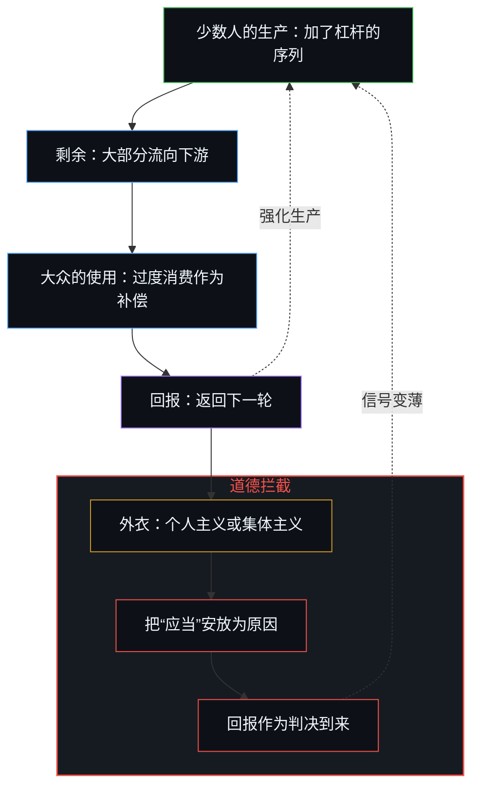
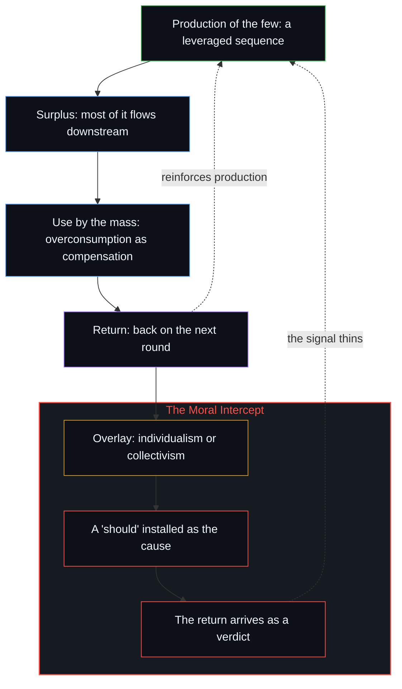

# 秩序、剩余与道德拦截 / Order, Surplus, and the Moral Intercept

*道德语言把因果权能移到从生产到消费这一回路的后一极 / Moral language moves causal power onto the later pole of a loop that runs from production to consumption.*

2026 年 8 月 19 日，Moderna 与默沙东宣布，一款个体化 mRNA 疫苗在术后与帕博利珠单抗合用，在一项 1,137 名患者参与的三期试验中，降低了高危黑色素瘤的复发与远处转移。这组试验结果被当作希望的降临，“人人在自家厨房调配药物”被当作理所当然的续集。改变的不是一种方法的诞生，而是一道门槛的跨越，这道门槛干净到足以作为新闻被反复传播。冻结在于把因果权能安放在事后的登记上，无论是希望、转移的公平，还是作为外衣的个人主义或集体主义，于是回报作为一纸判决到来，而不是去强化那份经年累月积累下来的工作。

On 19 August 2026, Moderna and Merck reported that a personalized mRNA vaccine, given with pembrolizumab after surgery, reduced recurrence and distant spread of high-risk melanoma in a late-stage trial of 1,137 patients. The readout is taken as hope arriving, and a kitchen in which anyone mixes a drug is offered as the obvious sequel. What changed was the crossing of a threshold clean enough to repeat as news, not the birth of a method. The freeze lies in locating causal power in later registration, whether hope, fairness of transfer, or individualism and collectivism as the overlay, so the return arrives as a verdict instead of a reinforcer of the work that accumulated.

## 一、 门槛是真的，一夜之间的故事不是 / 1. The Threshold Is Real; the Overnight Story Is Not

每一剂都要先对患者的肿瘤测序，选出新抗原，再把它们编码进 mRNA，每个人要花上几周的工作，而不是一针现成的药。这是 mRNA 癌症疫苗第一次在三期试验中取得成功。股价大幅波动，信息流照常被填满。

Each dose is built by sequencing a patient's tumor, selecting neoantigens and encoding them in mRNA, weeks of work per person, not a single off-the-shelf shot. It is the first Phase 3 success for an mRNA cancer vaccine. Shares moved sharply. The feed filled in the usual way.

“一人一方”被当作新想法来迎接，尽管这条技术路线已经流传多年。这一切都不是一夜之间到来的。化学、递送封装、测序流程、与检查点抑制剂的配合、早先较小的试验，都是多年的前期工作。19 日改变的不是一种方法的诞生，而是一道门槛的跨越：一次足够干净的比较，在足够大的人群里，让差别可以作为新闻被重复。门槛是真的，一夜之间的故事不是。

A different formulation for every person is greeted as if the idea were new, though the line has been in circulation for years. None of this arrived overnight. The chemistry, the packaging, the sequencing pipeline, the pairing with a checkpoint inhibitor, the earlier smaller trials: those were years of prior work. What changed on the 19th was not the birth of a method but the crossing of a threshold, a comparison clean enough, in a population large enough, that the difference could be repeated as news. The threshold is real. The overnight story is not.

[进步叙事中的症候与原因](../symptom-and-cause-in-the-narratives-of-progress/)追踪的是被当成引擎的那段滞后：响亮的登记来得晚，却被安放在了杠杆的位置上。希望的降临就是这样的登记，生成它的序列早在那之前便已展开。

[Symptom and Cause in the Narratives of Progress](../symptom-and-cause-in-the-narratives-of-progress/) traces the delay that gets taken for the engine: the loud register arrives late and is installed as the lever. Hope arriving is that register. The generating sequence stayed earlier.

## 二、 工具先到达那些已经在动的人 / 2. The Instrument Arrives with Those Already Moving

厨房制药那条评论假定，意愿与洞见已经广泛分布，缺的只是工具。工具先到达的，是那些无论有没有现成工具都已在推动这个问题的人。等待工具的人，把它当作成品接过来，大致照出厂的样子使用，并把这种使用当作作者身份。把下一条指令对准一个早已被区分出来的需要，才是以书写而非等待的方式延续。

The kitchen comment assumes that willingness and insight are already widely distributed, and that only the instrument is missing. The instrument arrives first with those who were already trying to move the problem whether a finished tool existed or not. Those who wait for the tool receive it as a finished object, use it more or less as shipped, and treat that use as authorship. Matching the next instruction to a need already being distinguished is the continuation that writes rather than waits.

一种通用的技术，多半就会造成这种分化。多数人把新方法当作黑箱，一种要接受或拒绝的治疗，一份要发出去的希望。少数人把它当作可以扩展的接口：下一组抗原，下一个适应症，下一种写指令的方式。两种用法落在同一份残差里，以不同的密度各自延续。这种分化并非出于某项计划。

That split is what a general technique tends to produce. Most people take the new method as a black box, a treatment to accept or refuse, a hope to post. A few treat it as an interface they can extend: the next antigen set, the next indication, the next way of writing the instruction. The two uses sit in the same residue, continuing at different densities. That split is not a plan.

[免费智能的幻觉](../the-illusion-of-free-intelligence/)是同一间厨房装扮成流畅残差的样子：现成形式的充裕被冻结为同等的作者身份，而下一条指令仍有待书写。

[The Illusion of Free Intelligence](../the-illusion-of-free-intelligence/) is the same kitchen dressed as fluent residue: an abundance of finished form frozen as equal authorship while the next instruction still has to be written.

## 三、 过度生产由过度消费来补偿 / 3. Overproduction Is Compensated by Overconsumption

少数地方加了杠杆的生产，许多地方的广泛使用：少数人的过度生产，必须由大众的过度消费来补偿，这样的安排才能存在或延续。反馈回路就是这样运转的。

Leveraged production at a few places, wide use at many: the overproduction of the few has to be compensated by the overconsumption of the mass for that arrangement to exist or continue. That is how the feedback loop works.

差别在于因果权能被安放在哪里，以及围绕这个位置的道德语言。以集体的方式表达，这两面就是个人主义与集体主义。如果下一次分配留在产出被造出来的地方，引起共鸣的故事是尊重个人资产；如果它被指向一个须经转移才能抵达的集体对象，引起共鸣的故事就是为转移辩护。这些故事是外衣，它们并不决定生产的序列是持续复利还是日渐变薄。

The difference is where causal power is located, and the moral language around that location. Expressed collectively, the two faces are individualism and collectivism. If the next allocation is kept where the output was made, the resonant story is respect for personal assets. If it is placed on a collective object that must be moved, the resonant story is the justification of transfer. Those stories are the overlay. They do not author whether the producing sequence compounds or thins.

生产是源头，消费是在下一轮返回的反馈。一旦把因果权能放在消费一端，方向就倒了过来：后来的登记被要求去授权已经发生的事，回报被稀释，登记到的方向是收缩。再进一步，转移被当成必不可少的环节，仿佛回路靠的就是转移。大众已经在过度消费少数人的剩余，这份补偿就是回路本身。作为授权的转移，是加在回报上的额外地基。

Production is the source; consumption is the feedback that returns on the next round. Locate causal power on consumption, and the direction inverts: later registration is asked to authorize what has already occurred, the return is diluted, and the registered direction is contraction. A further step makes transfer necessary as if transfer were what the loop required. The mass is already overconsuming the few's surplus. That compensation is the loop. Transfer as authorization is extra ground on the return.

[验证中因果权能的分配](../the-allocation-of-causal-power-in-validation/)讲的是哪一边被当作提供下一步的一方。[剩余个人主义](../residual-individualism/)把因果权能留在剩余的行为上；作为集体道德语言的个人主义与集体主义，是罩在这个位置上的外衣。[公共支出不创造资本](../public-spending-does-not-create-capital/)是再分配被记作创造之源时，集体主义的那一面。

[The Allocation of Causal Power in Validation](../the-allocation-of-causal-power-in-validation/) asks which side is treated as supplying the next step. [Residual Individualism](../residual-individualism/) keeps causal power at residual acts; individualism and collectivism as collective moral language are the overlay on that location. [Public Spending Does Not Create Capital](../public-spending-does-not-create-capital/) is the collectivist face when reallocation is scored as the origin of creation.

## 四、 因果有方向 / 4. Causality Has a Direction

这一切都不需要排定高低。消费不是较低的一极，生产也不是有德的一极。没被造出来的东西无从使用。在先的行为留下一片场，后来的使用才在其中发生；事后的登记并不授权那次制造。这是方向，不是偏好。

None of this needs a ranking. Consumption is not the inferior pole and production is not the virtuous one. What has not been made cannot be used. Earlier acts leave the field in which later use occurs. Later registration does not authorize the making. That is the direction, not a preference.

mRNA 的案例已经是这个方向。平台的工作先于试验，试验先于后来得到一剂匹配疫苗的人。评论、患者和跟进的实验室是后来的使用，它们并不授权先前的工作。等待一间人人都能调配药物的厨房，不会造就那些将写出下一条指令的人，它造出的是一条等着成品的队伍。

The mRNA case is already that direction. Platform work precedes the trial. The trial precedes whoever later receives a matched vaccine. Comments, patients and follow-on labs are later use. They do not authorize the prior work. Waiting for a kitchen in which anyone can mix a drug does not produce the people who will write the next instruction. It produces a queue for the finished object.

[因果贯穿始终](../causality-all-the-way/)讲的是这种单向的塑造：更早的行为塑造后来的行为，一张被当作源头的地图不会让箭头倒转。[生产、消费与心智的区分](../production-consumption-and-the-minds-distinction/)是同一对名字上的另一条轴：约束是被敞开地握着还是被固定住，同一项活动会登记得不同。这里的两极不在握持的宽窄，而在因果的方向。[技术是人类复利的残差](../technology-is-residual-of-human-compounding/)把平台看作那份残差：疫苗是人类自身复利的结果，不是 19 日才到来的第二种力量。[你的代码库即是记忆](../your-codebase-is-memory/)在生产秩序如何复利这一环上追溯了同样的单向残差：外化为技术与制度记忆的代码库，唯有靠边缘处的实时回报不断重描与校验，才能持续产出剩余；道德拦截却把累积的检查点当作不靠回路就能自行存续的存量，反手切断了维持它运转的反馈。

[Causality All the Way](../causality-all-the-way/) is that one-way shaping: earlier acts shape later ones, and a map held as source does not reverse the arrow. [Production, Consumption, and the Mind's Distinction](../production-consumption-and-the-minds-distinction/) is a different axis on the same names: how the identical activity registers when the bound is held open or fixed. The polarity here is not the width of the hold. It is the direction of causality. [Technology Is Residual of Human Compounding](../technology-is-residual-of-human-compounding/) is the platform as that residue: the vaccine is Human compounded, not a second force that arrived on the 19th. [Your Codebase Is Memory](../your-codebase-is-memory/) traces the same one-way residue in how productive order compounds: an externalized codebase of technical and institutional memory yields surplus only while live return at the edge keeps re-tracing and verifying it, whereas the moral intercept treats the accumulated checkpoint as a self-standing stock while severing the feedback loop that sustains it.

## 五、 回路是补偿，作为授权的转移是额外的地基 / 5. The Loop Is Compensation; Transfer as Authorization Is Extra Ground

大众对少数人剩余的过度消费，就是生产序列早已赖以运转的回报。至于事后在其他各方之间进行的政治性再分配，只是这片场上的又一个行为：它是对残差的拾取，而不是对先前生产的授权。没被用上的残差，是回路里尚未被延续的能力，不是一本没能结平的账。

The mass's overconsumption of the few's surplus is the return the producing sequence already runs on. Redistribution as a later political allocation among other parties is a further act in that field, a pickup of residue, not what authorizes the earlier production. Unused residue is capacity not yet continued in the loop, not a ledger that failed to close.

削弱信号的，是把因果权能安放在后一极：仿佛生产已经欠了消费的债，或必须由转移来授权延续。回报于是不再磨利造出残差的那份工作，而是作为一项要求到来。

What weakens the signal is locating causal power on the later pole: production already in debt to consumption, or transfer as what authorizes continuation. The return then no longer sharpens the work that made the residue. It arrives as a requirement.

[自我价值感与所有权](../ownership-and-self-worthiness/)讲的是后果作为自己的后果重新回流时完成的那次闭环更新：此时回报变得锋利。一个必须先满足事后某种解读的回报，就不再训练生产的序列。[私人残差与社会剩余的因果次序](../the-causal-order-of-private-residuals-and-social-surplus/)从威廉·诺德豪斯的战后测算中追溯了这份补偿的规模：创新剩余中约 97.8% 早已流向下游的大众消费者，生产者仅留存约 2.2% 作为事后残差，因此把这份残差当作静态存量加以压缩或夺取，就会在削薄源头在先诱因的同时，连带削薄下游远为庞大的剩余。[当被需要不再是尺度](../when-need-stops-being-the-measure/)是同一种拦截装扮成照护的样子：后来的依赖被要求追认已经做完的工作。联结若到来，也只是延续，而不是先前的行为得以算数的条件。

[Ownership and Self-Worthiness](../ownership-and-self-worthiness/) is the closed update when consequences re-enter as one's own: the return sharpens. A return that must first satisfy a later reading no longer trains the producing sequence. [The Causal Order of Private Residuals and Social Surplus](../the-causal-order-of-private-residuals-and-social-surplus/) traces the scale of that compensation in William Nordhaus's postwar estimate: roughly 97.8 percent of innovation surplus already flows downstream to mass consumers while producers retain about 2.2 percent as an ex-post residual, so compressing or seizing that residual as a static stock thins the antecedent inducement at the origin alongside the far larger downstream surplus. [When Need Stops Being the Measure](../when-need-stops-being-the-measure/) is that intercept dressed as care: later dependence asked to ratify work already done. Association, if it arrives, is continuation. It is not the condition under which the prior act counts.

## 六、 拦截把一个“应当”安放成了原因 / 6. The Intercept Installs a "Should" as If It Were the Cause

公共争论几乎从不离开另一条轴：个人主义还是集体主义，哪一边公平，谁欠谁，生产与转移哪一极才有正当性。这就是围绕因果权能所在位置的道德语言。同样的拦截，早已出现在围绕这次突破的评论里。“希望降临”与“自家厨房里的奇迹”并不描述那个序列，它们把一个“应当”或一个愿望安放成了原因，于是后来的登记不再强化那份积累下来的工作，而成了下一步行动必须满足的判决。

Public argument almost never leaves a different axis: individualism or collectivism, which side is fair, who owes whom, whether production or transfer is the justified pole. That is the moral language around where causal power is located. The same intercept is already in the breakthrough comments. Hope and a domestic miracle do not describe the sequence. They install a should or a wish as if it were the cause, so the later registration is no longer a reinforcer of the work that accumulated. It becomes a verdict the next act has to satisfy.

[道德语言稀释自由复利的反馈](../moral-language-dilutes-the-feedback-that-scales-freedom/)是个人回路里的外衣：评价的范畴横在行动者与自己的后果之间。这里，外衣罩在回报本身上，以集体的方式表达为个人主义或集体主义。转移的公平、作为源头的希望、作为缺失原因的厨房，都是额外的地基，它们声称解释了延续，却让本可磨利它的强化变薄。[道德语言作为投影](../moral-language-as-projection/)从语言的一侧显出同一种拦截：道德词汇把一个封闭的现实投到回路上。

[Moral Language Dilutes the Feedback That Scales Freedom](../moral-language-dilutes-the-feedback-that-scales-freedom/) is the overlay in the personal loop: evaluative categories between agent and one's own consequence. Here the overlay sits on the return itself, expressed collectively as individualism or collectivism. Fairness of transfer, hope as origin, the kitchen as the missing cause: extra ground that claims to explain continuation while thinning the reinforcer that would have sharpened it. [Moral Language as Projection](../moral-language-as-projection/) shows the same intercept from the side of language: moral words project a closed reality onto the loop.

机制在于因果的方向（被消费的必先被生产出来），以及回报被允许做什么。回路是大众的过度消费对少数人过度生产的补偿。道德的拦截，或者说魔法式的拦截，是围绕因果权能所在位置的额外地基，它削弱强化，同时又声称在解释它。

The mechanism comes down to the direction of causality (what is consumed must first be produced) and what the return is allowed to do. The loop is compensation of the few's overproduction by the mass's overconsumption. The moral, or magical, intercept is extra ground around where causal power is located, weakening the reinforcer while claiming to explain it.
