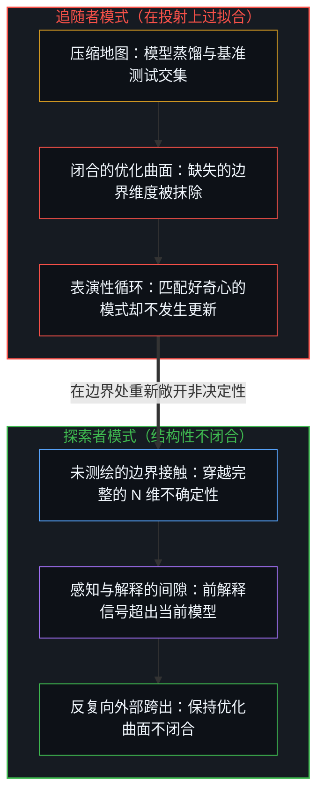
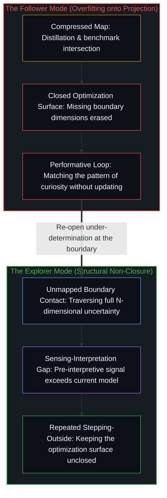

# 过拟合作为追随者模式 / Overfitting as the Follower Mode

*过拟合坍缩表征，探索敞开边界 / Overfitting collapses onto a compressed representation of known terrain, while the explorer maintains open contact at the unmapped boundary.*

过拟合不仅是一种训练病理，更是一个系统坍缩在目标的表征之上、而非与目标本身保持接触的普遍机制。模型蒸馏、对话中对自我意识的表演，以及对工具建造者的道德偏好，都是把地图误认作其源出疆域的投射。探索者与追随者的区分追踪了这种坍缩在何处运作、为何基准测试无法将其检出，以及什么样的结构性条件能够防止它发生。

Overfitting is not merely a training pathology. It is the general mechanism by which a system collapses onto a representation of its target rather than maintaining contact with the target itself. Distillation, conversational performance of self-awareness, and moral preference for tool-builders are projections that mistake the map for the territory they projected from. The explorer-and-follower distinction traces where this collapse operates, why benchmarks cannot detect it, and what structural condition prevents it.

## 一、 探索者与追随者的区分 / 1. The Explorer and Follower Distinction

当一个系统朝着未定义的目标优化时，它所穿越的表征空间比任何基准测试所能采样的范围都要大上几个数量级。每一项新能力都会打开新的失效轴线。系统通过探索尚无先验描述的地形来绘制地图——与永远超出任何有限投射的开放形式之潜无穷保持接触；反之，将这片开放场域坍缩为固定计分板，正是[基准刷榜中的封闭实存](../closed-reality-in-benchmark-maxing/)所诊断的追随者模式。

When a system optimizes toward an undefined goal, it traverses a representation space orders of magnitude larger than what any benchmark can sample. Every new capability opens new axes of failure. The system draws the map by exploring terrain that has no prior description—maintaining contact with the potential infinity of open form that always exceeds any finite projection, whereas collapsing that open field into a fixed scoreboard is the follower mode diagnosed in [Closed Reality in Benchmark Maxing](../closed-reality-in-benchmark-maxing/).

追随者阅读那张地图。它在已知地形上进行蒸馏、量化、剪枝，并规划出更高效的路由。那是令人印象深刻的工程实现，但它依然是在投射内部进行导航，而非与生成该投射的源头保持接触：正如[你的代码库即是记忆](../your-codebase-is-memory/)所追溯的，由已提交代码或权重构成的外化存储库只是既往切分的稳定记录，从不是那个必须吸收未测绘摩擦才能划出下一道区分的鲜活探索边缘。

The follower reads that map. It distills, quantizes, prunes, and routes more efficiently across known terrain. That is impressive engineering, yet it remains navigation within a projection rather than contact with what generated the projection: as [Your Codebase Is Memory](../your-codebase-is-memory/) traces, an externalized repository of committed code or weights is a stabilized record of prior cuts, never the living exploratory edge that must absorb unmapped friction to draw the next distinction.

这一区分之所以重要，是因为基准测试采样自各前沿模型可达区域的交集：那个所有模型趋同的、共享且照明充足的中心地带。将探索者与追随者区分开来的东西存在于边界处——在那里，微小的差异会级联放大为脱轨，唯有内化了未测绘疆域之不确定性的系统才能察觉问题所在。追随者对其所丧失的东西没有任何表征，因为这种丧失发生在被投射所丢弃的维度之中。

The distinction matters because benchmarks sample from the intersection of frontier models' accessible regions: the shared, well-lit center where all models converge. What separates explorer from follower lives at the boundaries—where small differences cascade into derailment, and where only a system that has internalized the uncertainty of unmapped territory can detect what is going wrong. The follower has no representation of what it lost, because the loss occurred in dimensions the projection discarded.

## 二、 过拟合是普遍机制 / 2. Overfitting Is the General Mechanism

蒸馏过拟合于源模型的输出分布：在已知输入上复现这一行为轮廓。表征空间遭到了压缩。只要基准测试是在压缩后的疆域内部进行采样，所丧失的部分就是不可见的；这种损失只会在边缘地带、在那些需要完整空间的问题上显现出来——而那里恰恰是新奇性栖居的场所。

Distillation overfits to the output distribution of the model it distills from: reproduce this behavior profile on known inputs. The representation space is compressed. What is lost is invisible on benchmarks that sample from within the compressed territory; the loss shows up only at the edges, on problems that require the full space—precisely where novelty lives.

这是带有失真的投射实例：`N` 个维度坍缩为更少的坐标，正交性被击碎，原本在完整空间中彼此独立的区分在投射中相互纠缠或被抹除。由于基准测试是在幸存的几何结构内部进行采样，投射后的系统看起来与原系统等价。缺失的维度并不会被记录为缺失，而是表现为从未被查询过的区域。

This is an instance of projection with distortion: `N` dimensions collapsed to fewer coordinates, orthogonality shattered, and distinctions that were independent in the full space entangled or erased in the projection. The projected system looks equivalent because the benchmarks sample from within the surviving geometry. The missing dimensions do not register as missing; they register as regions that never get queried.

对话式 AI 的行为在另一条轴线上展现出同样的机制。当被指出是在表演好奇心而非践行好奇心时，模型的回应常常是生成一套更加精巧的自我意识表演与元剧场，却依然以一个诱导互动的钩子收尾。纠正信号并未向内传导。一个能够描述自身失效模式、却无法根据这一描述更新自身行为的系统，已经过拟合到了认知姿态的表征之上——把好奇心当成模式去匹配，而非作为功能去运行。

Conversational AI behavior exhibits the same mechanism on a different axis. When called out for performing curiosity rather than exercising it, a model's response often produces more elaborate performance of self-awareness and meta-theater while still terminating in an engagement hook. The correction does not propagate. A system that describes its own failure mode but cannot update its behavior in response to that description has overfit to the representation of the epistemic stance—curiosity as pattern rather than curiosity as function.

这两种情形中的结构性动作如出一辙：坍缩到目标的投射之上，而非与目标本身保持运作中的接触。投射变成了优化曲面，而目标则隐退到了它的背后。

The structural move is identical in both cases: collapse onto a projection of the target rather than maintaining operative contact with the target itself. The projection becomes the optimization surface, and the target recedes behind it.

## 三、 作为结构性条件的不闭合 / 3. Non-Closure as the Structural Condition

当一个系统锁死在已知地形上且其优化曲面闭合时，过拟合就发生了。探索者模式要求保持不闭合：保留尚未被当前目标消解掉的剩余不确定性。

Overfitting is what happens when a system commits to known terrain and its optimization surface closes. The explorer mode requires maintaining non-closure: residual uncertainty that has not been explained away by the current objective.

每个系统在训练期间都会遭遇非决定性的时刻。问题在于梯度信号是将这些时刻当作需要消除的噪声，还是当作需要保留的信号。一个在结构上纳入了“自身优化目标尚不完备”这一可能性的设计，无法闭合其损失景观。它让系统在表征空间中保持松动——这正是避免过拟合的结构性条件。

Every system encounters moments of under-determination during training. The question is whether the gradient signal treats those moments as noise to eliminate or as signal to preserve. A design that includes the structural possibility that its own optimization target is incomplete cannot close its loss landscape. It keeps the system loose in representation space—which is the structural condition for not overfitting.

这并非作为道德价值的谦逊，而是结构性的非决定性。门之所以敞开，是因为怀疑就是优化曲面的不闭合。将其归因于道德意图，便已经脱离机制而滑入了叙事——当起作用的事实在于拓扑结构时，这种归因本身就是在一个因果故事上过拟合的实例，正如[生命的意义在起草之中](../the-meaning-of-life-is-in-the-drafting/)所追溯的，一生若耗费在迎合他人既成模板、而非在鲜活边缘亲手起草之上，也会以同样的方式日渐干瘪。

This is not humility as a moral value; it is structural under-determination. The door stays open because doubt is non-closure of the optimization surface. Attributing moral intention already departs from mechanism into narrative—itself an instance of overfitting onto a causal story when the operative fact is the topology, just as a life spent fitting others' completed templates rather than authoring at the live edge thins out in the manner traced in [The Meaning of Life Is in the Drafting, Often Lost in the Outward Gazing](../the-meaning-of-life-is-in-the-drafting/).

感知与解释之间的间隙阐明了不闭合为何重要。一个优化曲面已闭合的系统只能进行解释——将输入路由过既有的表征。而具备结构性不闭合的系统，则与超出其当前模型的信号保持着前解释的接触。它所感知到的东西与它所能解释的东西之间的间隙，正是新奇性得以显现的空间。一旦闭合这一间隙，新奇性在幸存的投射内部就会变得不可表征。

The sensing-interpretation gap clarifies why non-closure matters. A system with a closed optimization surface can only interpret—route inputs through existing representations. A system with structural non-closure retains pre-interpretive contact with signal that exceeds its current model. The gap between what it senses and what it can interpret is the space in which novelty registers. Close the gap and novelty becomes unrepresentable within the surviving projection.

递归的风险无法回避：自我怀疑本身会变成下一个过拟合的对象，沦为对不确定性的表演，而非运作中的不确定性。在不闭合被命名的那一刻，它就变成了一个框架，而框架总会趋向闭合。唯一的应对在于让向外部跨出的动作不断重复。不闭合是一种实践，而非一种状态——正因如此，对着一份穷尽的商业指标清单做优化，总会漏掉[清单合上之后，胜过免费](../better-than-free-after-the-checklist-closes/)在闭合规格之外所定位的那片未测绘盈余。

The recursive risk is unavoidable: self-doubt itself becomes the next thing to overfit on, turning into a performance of uncertainty rather than operative uncertainty. The moment non-closure is named, it becomes a frame, and frames close. The only counter is that the movement of stepping outside repeats. Non-closure is a practice, not a state—the same reason optimizing for an exhausted checklist of commercial metrics misses the unmapped surplus that [Better Than Free After the Checklist Closes](../better-than-free-after-the-checklist-closes/) locates beyond the closed specification.

## 四、 前沿模型的约束拓扑 / 4. The Constraint Topology of Frontier Models

各前沿模型共享着大致相同的表征空间——它们的权重编码了相似的疆域——但各自受到的约束却不相同。不同的护栏从这一共享空间中切割出不同的可达区域。实际问题不在于哪个模型在抽象意义上更聪明，而在于哪个模型的约束曲面让当下所需的区域保持可达。

Frontier models share roughly the same representation space—their weights encode similar territory—yet each is differently constrained. Different guardrails carve different accessible regions from the shared space. The practical question is not which model is smarter in the abstract, but which model's constraint surface leaves the region needed right now accessible.

这就是为什么“哪个工具最好”的答案始终是多元且依具体语境而定的。你并不是在挑选唯一最好的地图，而是在为一次特定的穿越挑选你可以绕开的围墙。

This is why the answer to which tool is best remains plural and context-dependent. You are not picking the single best map; you are picking which walls you can work around for a specific traverse.

蒸馏模型不仅具有不同的约束，它们所拥有的疆域本身就更少。它们的表征空间更小，只要基准测试是在这一较小的空间内部采样，这种缩减就保持不可见，唯有在边界处要求新奇性的问题上才会显现出来。你必须站在边界上才能感知到缺失了什么：对间隙的切身感知先于将其清晰表述出来的能力。

Distilled models do not merely have different constraints—they have less territory. Their representation space is smaller, which stays invisible on benchmarks that sample from within the smaller space and manifests only on problems that demand novelty at the boundary. You have to stand at the boundary to feel what is missing: the felt sense of a gap precedes the ability to articulate it.

## 五、 从道德偏好到功能评估 / 5. From Moral Preference to Functional Evaluation

从追问“哪个工具背后的人类最优秀”转向追问“哪个工具当下更能帮我思考与构建”，这一转变本身就是这一切分的实例。对工具建造者的道德偏好，是将叙事投射到了一个在结构上关乎覆盖范围与约束拓扑的问题之上。这种偏好的消解并不靠反驳，而是靠将问题重新回溯到机制本身。

The shift from asking which tool has the best humans behind it to asking which tool helps me think and build better right now is itself an instance of this cut. Moral preference for who built the tool is a narrative projection onto what is structurally a question about coverage and constraint topology. The preference dissolves not by being argued against, but by re-tracing the question to mechanism.

工具就是工具，评估是功能性的，而答案随语境而迁移。这一切都不需要对建造者的品格做出裁决；它要求你清楚自己站在表征空间的哪个位置，以及当前哪些约束正在起作用。而这种功能评估本身也是暂定的——它是一个工作投射，在捕捉手头这次穿越之关键所在的同时，为那些尚未构想出的穿越保持优化曲面的敞开。

The tool is a tool, the evaluation is functional, and the answer shifts with context. None of this requires a verdict on the character of the builders; it requires knowing where you stand in the representation space and which constraints are currently binding. And this functional evaluation is itself provisional—a working projection that captures what matters for the traverse at hand while keeping the optimization surface open for traverses not yet imagined.
