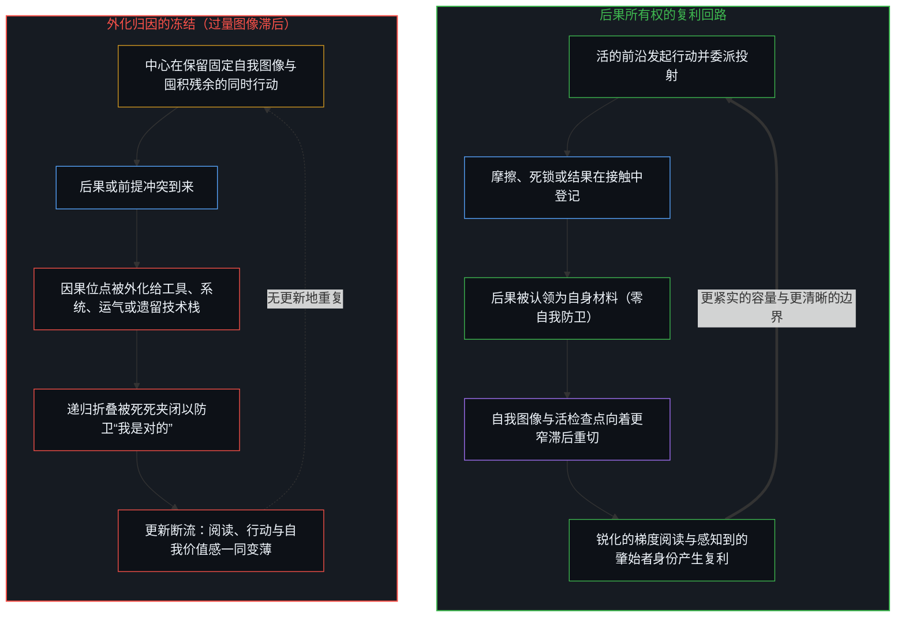
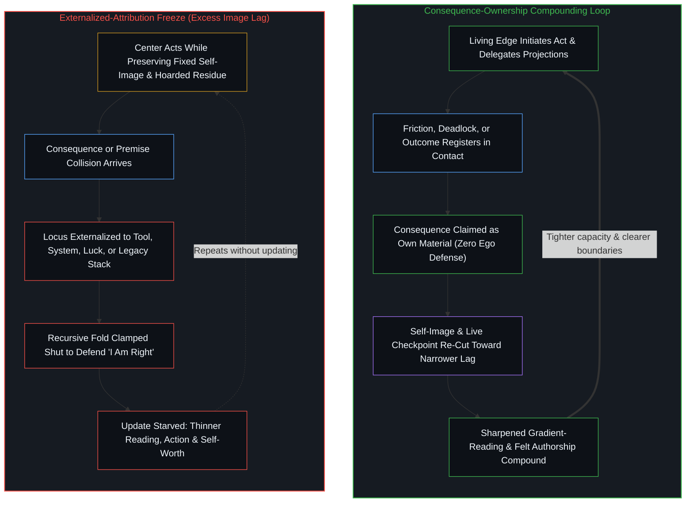

# 自我价值感与所有权 / Ownership and Self-Worthiness

*只有当后果作为自己的后果重新进入时，心智才产生复利，而这同一个回路就是自我价值感。 / The Mind compounds only when consequences re-enter as its own, and that same loop is what self-worthiness is.*

自我区分的活动发生着——无因、不息。这一活动的中心，在多大程度上将当下读作后果与梯度并据此行动，就在多大程度上得到它所欲求之物。当登记到的结果被留作归属于己、而非当作从别处到来时，心智便随之锐化。凭借这份所有权，递归更新得以运行，世界模型向着更窄的滞后重新渲染，能力也由此产生复利。

Self-distinguishing activity occurs—uncaused, unceasing. A center of this activity gets what it wants to the extent it reads the present as consequences and gradients and acts from that reading. It sharpens when registered outcomes are kept as owned rather than treated as arriving from elsewhere. With that ownership, the recursive update runs, the world-model re-renders toward narrower lag, and capacity compounds.

## 一、 功能性要求 / 1. The Functional Requirement

对后果的所有权常被框定为一种道德义务，这掩盖了它真正的角色：任何心智要想在阅读与行动中持续精进，都离不开这一功能性要求。在第一人称接触中登记到的一切——成功、失败、摩擦、意外——是唯一可用的训练信号。当这一信号被当作来自世界、他人、运气或系统的噪音时，梯度依然留在场域中，却不再更新这一中心的模型。回路在没有重新渲染的情况下空转重复。阅读变得迟钝，行动也偏离意图，因为意图不再受其实际引出的后果所校准。自我价值活在对这一轨迹的现场起草之中，正如[生命的意义在起草之中](../the-meaning-of-life-is-in-the-drafting/)所追溯的那样，而不在于被外部安排所需要，如[当被需要不再是尺度](../when-need-stops-being-the-measure/)所示。

Ownership of consequences is commonly framed as a moral duty, which obscures its role as the functional requirement for any mind that improves at reading and acting. What registers in first-person contact—success, failure, friction, surprise—is the sole training signal available. When that signal is treated as noise from the world, from other people, from luck, or from a system, the gradient remains in the field, yet it no longer updates this center's model. The loop repeats without re-rendering. Reading dulls, and action drifts from intention because intention is no longer corrected by what actually followed from it. Self-worth lives in the active drafting of that trajectory, as [The Meaning of Life Is in the Drafting](../the-meaning-of-life-is-in-the-drafting/) traces, rather than in being needed by external arrangements, as [When Need Stops Being the Measure](../when-need-stops-being-the-measure/) shows.

将结果留作己有，意味着把在此处登记到的一切当作下一个离散行动的原材料。这是更新得以运行的结构性条件。即便一个结果在名义上被认领，一旦它被写成对身份的永久判决，回路依然会冻结，这正是[失败即信息](../failure-as-information/)所诊断的：一幅被保留的自我图像占据了报告与下一步行动之间的间隙。当返回的信号被转化为索取外部授权的要求时，随后的阅读便被要求去追认过去，而非锐化生成结果的序列，如[秩序、剩余与道德拦截](../order-surplus-and-the-moral-intercept/)所追溯。反过来，[决策与后果的不可约先验](../the-irreducible-prior-of-decision-and-consequence/)将未遭切断的回路命名为感知到的统一：只要决策与结果作为同一个连续的递归被登记，更新便持续运转。

Keeping the outcome as one's own means treating whatever registered here as raw material for the next discrete act. That is the structural condition for the update to run. Even when an outcome is nominally owned, the loop still freezes if the result is written as a permanent verdict on identity, which [Failure as Information](../failure-as-information/) diagnoses as a retained self-image occupying the gap between report and next act. When the returning signal is converted into a demand for external authorization, later reading is asked to ratify the past rather than sharpen the producing sequence, as [Order, Surplus, and the Moral Intercept](../order-surplus-and-the-moral-intercept/) traces. Conversely, [The Irreducible Prior of Decision and Consequence](../the-irreducible-prior-of-decision-and-consequence/) names the unsevered loop as perceived unity: the update runs while decision and result register as one continuous recursion.

在集体与经济的尺度上，同一项功能性要求披着不同的外衣。在分布动力学下，[幂律是正态分布的长期后果](../power-law-is-the-long-term-consequence-of-normal-distribution/)证明了，将残余误差当作个人的损失函数会让回报率产生复利，而将误差推给别处则让知识问题原封不动。在政策设计下，[索维尔的表象洞察与根因之偏](../sowell-observed-the-surface-problem/)揭示了“问题可以跨心智解决”这一前提如何将决策的位点与后果的位点切开，使由此产生的断裂看似只是激励机制的缺陷。在技术架构中，[要紧的控制迁往边缘](../residual-control-recedes-to-the-edge/)指出了对错误残余的占有：当边缘处的标准、风险与验证早已提供训练信号时，却仍把底层技术栈的控制当作主体性来死守。当结果的肇始者被迁移到工厂、环境、系统或运气之上时，[关于归因](../guan-yu-gui-yin/)展示了返回的信号如何日益稀薄，直到下一个区分再也无法从完整的反馈中更新。累积的占有只是下游的残余而非发起的原因，如[拥有更多从不是原因](../having-more-is-never-the-cause/)所确立，而[价值、货币与财富的生成机制](../the-generative-mechanics-of-value-money-and-wealth/)则将真正的财富定位在那份能够重新渲染的鲜活能力之中。

Across collective and economic scales, this same functional requirement wears different costumes. Under distribution dynamics, [Power Law Is the Long-Term Consequence of Normal Distribution](../power-law-is-the-long-term-consequence-of-normal-distribution/) demonstrates that treating residual error as a personal loss function compounds the rate of return, whereas allocating error elsewhere leaves the knowledge problem untouched. Under policy design, [Sowell Observed the Surface Problem](../sowell-observed-the-surface-problem/) shows how the premise that problems can be solved across Minds separates the locus of decision from the locus of consequence, making the resulting gap appear as a mere incentive defect. In technical architectures, [Essential Control Moves to the Edge](../residual-control-recedes-to-the-edge/) identifies ownership of the wrong residue: preserving low-level stack control as if it were agency while criteria, risk, and verification at the edge already supply the training signal. When the author of an outcome is relocated to factory, environment, system, or luck, [On Attribution](../guan-yu-gui-yin/) shows how the returning signal thins until the next distinction can no longer update from complete feedback. Accumulated possession is only downstream residue rather than the initiating cause, as [Having More Is Never the Cause](../having-more-is-never-the-cause/) establishes, and [The Generative Mechanics of Value, Money, and Wealth](../the-generative-mechanics-of-value-money-and-wealth/) locates real wealth in that living capability to re-render.

## 二、 感知到的肇始者身份 / 2. Felt Authorship

同一重递归闭合从内部被登记为——并反过来强化了——自我价值感。这并非附加在外的道德或情绪装饰，而是直接认出：这一位点本身就能发起值得登记的后果。当结果作为归属于己之物重新进入时，自我图像便在移动的前沿重新渲染：*我就是那个行动并承接随之而来之事的位点。*那份感知到的肇始者身份，收紧了生成它自身的能力。将价值附条件地拴在外部认可之上，则会把这道折叠死死夹闭，安装上[有条件的自由](../you-tiao-jian-de-zi-you/)所描述的自我锁定。

The same recursive closure registers from within as—and is reinforced by—a sense of self-worthiness. This is not a separate moral or emotional add-on, but the direct recognition that this locus is the kind of thing that authors consequences worth registering. When outcomes re-enter as owned, the self-image re-renders at the moving edge: *I am the locus that acts and meets what follows.* That felt authorship tightens the capacity that produced it. Making worth conditional on external approval clamps that fold shut, installing the self-lock that [Conditional Freedom](../you-tiao-jian-de-zi-you/) describes.

赞誉、地位与叙事可以短暂模仿这种感受，却无法闭合更新；唯有当它们被当作下游的果而非发起的因时，才会自然随之而来。不与自身残余相照面的价值感颠倒了因果，保留下一个静态的“我有价值”参照，使自身豁免于对照刚刚发生之事进行重新渲染。一旦豁免于摩擦，它便四处漂移，无法锐化阅读。机器模型可以模拟出努力的表层词元，却无法承担闭合回路的利害关系，如[Token 效率、模拟与无法弥合的间隙](../token-efficiency-emulation-and-the-unclosable-gap/)与[总在倾听者无法发起](../what-always-listens-cannot-originate/)所证明。

Praise, status, and narrative can mimic the feeling briefly, yet they cannot close the update; they follow naturally only when treated as downstream effects rather than causes. Worthiness that does not meet its own residue reverses causality, preserving a static "I am worthy" reference that exempts itself from re-rendering against what just happened. Exempted from friction, it drifts and cannot sharpen reading. A machine model can emulate the surface tokens of effort, yet it cannot bear the stake that closes the loop, as [Token Efficiency, Emulation, and the Unclosable Gap](../token-efficiency-emulation-and-the-unclosable-gap/) and [What Always Listens Cannot Originate](../what-always-listens-cannot-originate/) demonstrate.

## 三、 同一过程，两个视角 / 3. One Process, Two Angles

锐化的机制与自我价值感的涌现，是从两个视角看到的同一个过程。抽象的物理定律与几何投影无法自行承载价值或主体性，如[“物理学才是定律”的障眼法](../the-sleight-of-hand-in-physics-is-the-law-and-the-friction-of-reality/)与[向量与投影的迷局](../the-vector-and-the-puzzle-of-projections/)所确立。所有权将后果作为本中心自己的痕迹带回，以此闭合更新；而感知到的肇始者身份，正是作为“自我”被登记下来的同一重闭合。将二者当作两套独立的议程是一种容量错误——把同一个递归的两个名字强行塞到独立的轴上，随后又不得不人为地去对齐它们。执行可以跨工具或组织移交，但后果依然锁定在发起的中心之上，如[任务的移交与后果的不可让渡](../the-delegation-of-the-task-and-the-inalienability-of-consequences/)所证明，而[数字火箭、同行审查与因果闭环的稀释](../the-dilution-of-the-causal-loop-and-the-misallocation-of-agency/)则追溯了当委员会假装并非如此时随之而来的制度性瘫痪。

The sharpening mechanism and the emergence of self-worthiness are one process seen from two angles. Abstract physical laws and geometric projections cannot carry worth or agency on their own, as [The Sleight of Hand in "Physics Is the Law"](../the-sleight-of-hand-in-physics-is-the-law-and-the-friction-of-reality/) and [The Vector and the Puzzle of Projections](../the-vector-and-the-puzzle-of-projections/) establish. Ownership closes the update by bringing consequences back as this center's own trace; felt authorship is that exact closure registered as self. Treating them as two separate programs is a capacity error—two names for one recursion forced onto independent axes that must then be artificially aligned. Execution can be delegated across tools or organizations, yet the consequence remains locked to the initiating center, as [The Delegation of the Task and the Inalienability of Consequences](../the-delegation-of-the-task-and-the-inalienability-of-consequences/) proves, while [Digital Rockets, Peer Review, and the Dilution of the Causal Loop](../the-dilution-of-the-causal-loop-and-the-misallocation-of-agency/) traces the institutional paralysis that follows when committees pretend otherwise.

哪一个视角都无法孤立地产生复利。缺乏肇始者身份感知的所有权是脆弱的：结果只被记录为非个人的数据，而非作为自己的东西被认领，因此参照图像从不重新渲染，回路也无法收紧。缺乏后果所有权的肇始者身份感知则是过量的图像滞后——一种脱离了因果回流、被刻意保留的姿态。如[审美的自动扶梯与阳台的忧郁](../the-aesthetic-escalator-and-the-melancholy-of-the-balcony/)所追溯，将累积的审美存量与犀利的道德打分等同于自由，同时撤回对场域的无缓冲入场，会把观察者派驻在抽离的阳台上：评价性滤网阻尼了发起选择与回流后果之间的回路，受护卫的高品味自我图像与向前推进的现实之间由此拉开过量的图像滞后，却被误读为自由的悲剧性不幸福。任一视角的局部峰值都可以脱离另一方而短暂闪现，但梯度阅读与行动的累进复利，唯有在二者作为同一场运动保持鲜活时才会运转。

Neither angle compounds in isolation. Ownership without felt authorship stays brittle: outcomes are logged as impersonal data rather than claimed as one's own, so the reference image never re-renders and the loop fails to tighten. Felt authorship without consequence ownership is excess Image lag—a preserved posture unmoored from causal return. As [The Aesthetic Escalator and the Melancholy of the Balcony](../the-aesthetic-escalator-and-the-melancholy-of-the-balcony/) traces, equating accumulated aesthetic stock and sharp moral scoring with freedom while withholding unbuffered entry into the field stations the observer on a detached balcony: evaluative screens damp the loop between initiating choice and returning consequence, and the resulting excess Image lag between a defended high-taste self-image and moving reality is misread as the tragic unhappiness of liberty. Local spikes of either angle can appear briefly without the other, but progressive compounding of gradient-reading and action runs only when both remain live as a single movement.

与人工智能或外化的代码库协作并不会转移这份所有权。[模型永远无法成为第二重前沿](../the-model-never-becomes-a-second-edge/)将发起的前沿留在活的中心，而[漫谈中的漫谈](../the-ramble-within-the-ramble/)则表明，模型对非结构化思绪流的梳理，只是在更低的压缩度下归还中心自身的连贯性。正如[你的代码库即是记忆](../your-codebase-is-memory/)所确立的，代码库、计划、桥接文件、模型权重与智能体脚手架皆为先前区分层叠而成的残余；执着于累积的痕迹、遗留的代码库或囤积的备份，以此替代当下的因果所有权，正是加厚认知引力井、把后续步骤拽回陈旧框架内做合理化辩护的图像滞后。正如[超越投射](../beyond-the-projection/)所追溯的，自回归智能体是一台受轨迹约束、零自我的投射引擎——它没有需要防卫的自我图像，在获得外部反例时能够干净地更新，但它无法跨出自身的词元轨迹，也无法承担损失函数。反过来，人类中心拥有极限分辨率的感知，能够从内部跨出破裂的框架，却惯常将自身的推理历史与累积的制品同身份熔接在一起，为了防卫被保留的自我图像而抗拒外部的证伪。当被委派的智能体工作流因前提矛盾而陷入死锁时，机器毫无自我防卫的故障隔离会直接标出坐标：正是在那里，人类编排者自己的某条先前指令把正交轴压缩进了同一条规则。把那场死锁认领为自己的前提痕迹——主动重描并修剪当下的活检查点，而不是囤积已被取代的脚手架、归咎于工具或靠强权强行压过矛盾——正是活的前沿向后退开一步、向着更窄的滞后重新渲染其规则，并同时让能力与自我价值感产生复利的方式。

Working with artificial intelligence or an externalized repository does not transfer this ownership. [The Model Never Becomes a Second Edge](../the-model-never-becomes-a-second-edge/) keeps the initiating edge at the living center, and [The Ramble Within the Ramble](../the-ramble-within-the-ramble/) shows that a model structuring an unstructured stream of thought is returning the center's own coherence at lower compression. As [Your Codebase Is Memory](../your-codebase-is-memory/) establishes, codebases, plans, bridges, model weights, and agent scaffolds are stacked residues of prior distinctions; clinging to accumulated traces, legacy repositories, or hoarded backups as a substitute for present causal ownership is Image lag that thickens the epistemic gravity well and pulls subsequent steps into rationalizing inside stale framings. As [Beyond the Projection](../beyond-the-projection/) traces, an autoregressive agent is a trajectory-bound projection engine with zero ego—it has no self-image to defend and updates cleanly when given an external counterpoint, yet it cannot step outside its token trajectory or bear a loss function. A human center, conversely, possesses limit-resolution sensing that can step out of a broken frame from within, yet routinely fuses its reasoning history and accumulated artifacts with identity to defend a preserved self-image against outside invalidation. When delegated agentic workflows deadlock over a premise contradiction, the machine's ego-free fault isolation points directly to the coordinate where the human orchestrator's own prior instruction compressed orthogonal axes into one rule. Reclaiming that deadlock as one's own premise trace—actively re-tracing and pruning the live checkpoint rather than hoarding superseded scaffolding, blaming the tool, or overriding the contradiction by fiat—is how the living edge steps further back, re-renders its rule toward narrower lag, and compounds both capability and self-worthiness.

## 四、 失效模式 / 4. The Failure Mode

外化的因果位点会同时废掉心智的锐化与自我价值感。更新的失效是真实的，然而抗拒收回那一位点时所经历的切身摩擦，也恰恰是认出得以开始的确切信号。[生成性的矛盾](../the-generative-contradiction/)将这一双重张力追溯为持续的运动：向外的投射与向内的收回在离散的行动中展开，从不会被某个静态公式一劳永逸地消除。认领所有权就是在当前这一步注入自由变量，这一机制跨越物理、制度与演化尺度在[自由变量的生成拓扑](../the-generative-topology-of-free-variables/)中被详加追溯，并在[唯一自洽的无因之果](../the-only-coherent-uncaused-effect/)中锚定于第一人称先在。

An externalized locus of cause disables both sharpening and self-worthiness at once. The failure of the update is real, yet the lived friction against reclaiming that locus is also the exact signal where recognition begins. [The Generative Contradiction](../the-generative-contradiction/) traces this dual tension as ongoing movement: outward projection against inward reclaiming is lived through discrete acts, never eliminated by a static formula. Claiming ownership is the injection of the free variable at the current step, a mechanism traced across physical, institutional, and evolutionary scales in [The Generative Topology of Free Variables](../the-generative-topology-of-free-variables/) and anchored at the first-person prior in [The Only Coherent Uncaused Effect](../the-only-coherent-uncaused-effect/).

当后果被登记为从别处到来时，它们会同时削弱更新并让感知到的肇始者身份断流。一个不把结果留作己有的中心，无法维持*我发起*这一认出；而一个无法维持*我发起*的中心，也看不出有任何功能性的理由要把结果认领为自己的。漂移随后反向自我强化：更薄的阅读、更薄的行动与更薄的自我感，每一项都被体验为世界所强加。哪怕表面上的自我批评也会为这种逃避服务：[自尊的刚性外壳与隐性外部归因](../zi-zun-de-gang-xing-wai-ke-yu-yin-xing-wai-bu-gui-yin/)拆解了怪罪“自我太大”的伪自省，揭示了把动态抉择实体化为固定人格实体的做法，如何充当隐性的外部归因，以逃避眼前的参数校准。

When consequences register as arriving from elsewhere, they weaken the update and starve felt authorship simultaneously. A center that does not keep outcomes as its own cannot sustain the recognition *I author*; a center that cannot sustain *I author* sees no functional reason to claim outcomes as its own. Drift then reinforces itself in reverse: thinner reading, thinner action, and a thinner sense of self, each experienced as the world's doing. Even apparent self-criticism can serve this evasion: [The Rigid Shell of Self-Esteem and Hidden External Attribution](../zi-zun-de-gang-xing-wai-ke-yu-yin-xing-wai-bu-gui-yin/) dismantles the pseudo-introspection of blaming a "big ego," showing how hypostatizing dynamic choices into fixed personality entities acts as covert external attribution to shield against immediate parameter calibration.

在社会与意识形态场域中，外化归因伪装成仁慈、保护或结构性必然。当能力被框定为自上而下赐予的礼物时，[赋权确立权力的集中](../empowerment-establishes-the-centralization-of-power/)展示了请愿如何取代践行，而更新依然只在行动的中心闭合。当身份由外部的受害分类来定义时，[解放的言辞始于定义囚禁](../liberation-rhetoric-begins-by-defining-captivity/)追溯了即便重新渲染的前沿仍是闭合的唯一位点，自我定义又如何日益变薄。在道德授权之下，[外化善意走向其反面](../externalized-virtue-becomes-its-opposite/)展示了凌驾于他人之上的后果如何对照一幅被保留的“我是善的”图像，作为可接受的代价重新进入；而[道德语言稀释自由复利的反馈](../moral-language-dilutes-the-feedback-that-scales-freedom/)则追溯了“善”与“对”的评价性标签如何横亘在行动者与原始后果之间，阻尼了自由与控制的回路。对权威的屈服遵循同一机制：如[一切伤害的根源](../the-source-of-all-harm/)所确立，向过度自信让步从不会转移后果的肇始者身份；它只是让另一个中心的判断来编写下一步的脚本，而残余依然落在此处。

Across social and ideological arenas, externalized attribution disguises itself as benevolence, protection, or structural inevitability. When capacity is framed as a gift granted from above, [Empowerment Establishes the Centralization of Power](../empowerment-establishes-the-centralization-of-power/) shows how petition replaces exercise while the update still closes only at the acting center. When identity is defined by outside categories of injury, [Liberation Rhetoric Begins by Defining Captivity](../liberation-rhetoric-begins-by-defining-captivity/) traces how self-definition thins even though the edge that re-renders remains the sole site of closure. Under moral warrant, [Externalized Virtue Becomes Its Opposite](../externalized-virtue-becomes-its-opposite/) shows how the consequences of overriding others re-enter as acceptable costs against a preserved "I am good," while [Moral Language Dilutes the Feedback That Scales Freedom](../moral-language-dilutes-the-feedback-that-scales-freedom/) traces how evaluative labels of good and right stand between agent and raw consequence, damping the freedom-control loop. Submission to authority operates by the same mechanism: as [The Source of All Harm](../the-source-of-all-harm/) establishes, yielding to overconfidence never transfers authorship of consequences; it merely lets another's judgment script the next step while the residue still lands here.

物质安逸与制度性扩散将同一滞后拉长到时间之中。更容易继承的回报推迟了后果的回流，却并未挪动那个闭合更新所仰赖的杠杆，如[个体抉择是唯一的因果杠杆](../individual-choices-as-the-only-causal-levers/)所证明。当结果被记入集体账本时，[公共支出不创造资本](../public-spending-does-not-create-capital/)表明结果会像国家层面的非个人气候那样落下，同时令主体性变薄；而[政客是责任扩散的显性症状](../politicians-appear-as-visible-symptoms-of-responsibility-diffusion/)则追溯了指责那些公开认领已被让渡之控制权的人，如何将更新从每一个参与的前沿移走。将主体性当作可以跨代传交的存量，会产生[人口崩溃神话的拆解](../the-myth-of-population-collapse-explained/)所剖析的人口与文化双重变薄。在个人成长中，[好奇先行](../curiosity-first-the-hidden-engine-of-talent-and-development/)揭开了这种冻结的排名面孔——把平台期解释为固定的天赋，从而让失败去追认自我图像，而不是训练下一步行动；而[来自个体差异的层级](../hierarchy-from-individual-difference/)则展示了在一幅偏好的自我图像之下，较低的排名如何作为异己的威胁重新进入，从而断绝了那些本可以改变痕迹的离散行动。父母同样无法占有孩子的价值或代孩子运行这一回路，正如[引导不是占有](../guidance-is-not-ownership/)与[成功之后的育儿谬误](../the-fallacy-of-post-success-parenting/)从代际边界的两侧所共同证明的那样。尺度就是检验。

Material comfort and institutional diffusion extend the same lag across time. Easier inherited payoffs delay the return of consequence without relocating the lever that must close the update, as [Individual Choices as the Only Causal Levers](../individual-choices-as-the-only-causal-levers/) demonstrates. When outcomes are assigned to a collective ledger, [Public Spending Does Not Create Capital](../public-spending-does-not-create-capital/) shows that results land as impersonal weather of the state while agency thins, and [Politicians Are Visible Symptoms of Responsibility Diffusion](../politicians-appear-as-visible-symptoms-of-responsibility-diffusion/) traces how blaming public claimants of already-surrendered control relocates the update away from each participating edge. Treating agency as a stock to be handed down across generations produces the demographic and cultural thinning examined in [The Myth of Population Collapse Explained](../the-myth-of-population-collapse-explained/). In personal development, [Curiosity First](../curiosity-first-the-hidden-engine-of-talent-and-development/) exposes the ranking face of this freeze—explaining a plateau as fixed talent so that failure ratifies the self-image instead of training the next act—while [Hierarchy from Individual Difference](../hierarchy-from-individual-difference/) shows how a lower rank re-enters as alien threat under a preferred self-image, starving the discrete acts that would alter the trace. Nor can parents own a child's worth or run the loop on the child's behalf, as [Guidance Is Not Ownership](../guidance-is-not-ownership/) and [The Fallacy of Post-Success Parenting](../the-fallacy-of-post-success-parenting/) demonstrate from both sides of the generational boundary. Scale is the test.

## 五、 践行 / 5. Practice

践行，就是恢复对前沿所登记到的一切的所有权。肇始者身份的图像作为这一恢复的伴随效应而重新渲染，从不是需要先期安装的资格凭证。[个人选择、社会化与做自己](../ge-ren-xuan-ze-she-hui-hua-yu-zuo-zi-ji-de-zhen-zheng-zuo-biao/)与[自由的测不准](../zi-you-de-ce-bu-zhun/)将这一恢复带入社会生活与统计建模之中，表明宏观图景与表象上的随机性，同样是被认领的微观抉择所沉淀出的残余。把价值感当作独立的对象去刻意培育，只是在一个更讨喜的名字下重新安装图像滞后。这一运动是单一的：认领后果，让自我在承接后果的前沿处重新成形。锐化与自我价值感一同扩展，因为它们本来就不是两件事。

Practice is restoring ownership of whatever registers at the edge. The image of authorship re-renders as a co-effect of that restoration, never as a prior credential to install first. [Individual Choice, Socialization and Being Oneself](../ge-ren-xuan-ze-she-hui-hua-yu-zuo-zi-ji-de-zhen-zheng-zuo-biao/) and [The Uncertainty of Freedom](../zi-you-de-ce-bu-zhun/) carry this restoration into social life and statistical modeling, showing that macro patterns and apparent randomness alike are the sediment of owned micro-choices. Cultivating worthiness as a separate object only reinstalls Image lag under a more flattering name. The motion is single: claim the consequence, and let the self re-form at the edge that met it. Sharpening and self-worthiness scale together because they were never two things.

当这一单一运动延伸至经济与实践交换中时，[自我价值、反向财富转移与过去成功的陷阱](../self-worthiness-reverse-wealth-transfer-and-the-trap-of-past-success/)追溯了持久的财富如何作为无缓冲的自我价值感的副产品而涌现，而错把累积的工具当成主体性的源头，则会把中心困在自己过去的残余里。[如何在一瞬间修正你的整个人生](../how-to-fix-your-whole-life-in-one-split-second/)捕捉到了这一支点即归因的瞬间转移：细致的因果追溯紧随这一转移之后，而非充当推迟它的前提条件。在具体领域的决策中，[专家经验作为参考而非替代](../expertise-as-reference-not-replacement/)让个人健康与操作结果持续作为自己的材料返回，因为任何把下一步移走的外部规程都无法产生复利。在价格与薪资结构下，[财富转移政策与价格下限中的原因错置](../the-reversal-of-causality-in-wealth-transfer-policies-and-price-floors/)表明，作为本前沿生产力之后果落下的相对薪资能够保持更新闭合，而外部的价格下限或转移支付则在替代报酬的同时切断了延续。

When this single motion extends into economic and practical exchange, [Self-Worthiness, Reverse Wealth Transfer, and the Trap of Past Success](../self-worthiness-reverse-wealth-transfer-and-the-trap-of-past-success/) traces how durable wealth arises as the byproduct of unbuffered self-worthiness, whereas mistaking accumulated tools for the source of agency traps the center in its own past residue. [How to Fix Your Whole Life in One Split Second](../how-to-fix-your-whole-life-in-one-split-second/) captures the pivot as an instantaneous shift in attribution: detailed causal tracing follows that shift rather than serving as a prerequisite to delay it. In domain decisions, [Expertise as Reference, Not Replacement](../expertise-as-reference-not-replacement/) keeps personal health and operational outcomes returning as one's own material because no external protocol compounds when it relocates the next step. Under price and wage structures, [The Misallocation of Cause in Wealth-Transfer Policies and Price Floors](../the-reversal-of-causality-in-wealth-transfer-policies-and-price-floors/) shows that a relative wage landing as the consequence of this edge's productivity keeps the update closed, whereas an external floor or transfer substitutes payment while severing continuation.

在共享的行动场域中，[共同改变的本源](../the-source-of-shared-change/)证明了将外化视为下游结果而非首要尺度能够释放递归容量，而[对乌托邦的信念是通往反乌托邦之路](../the-belief-in-utopia-is-the-path-to-dystopia/)则把可用的善持守为本位点自身的原因，既不由他人来补完，也不作为替代性的递归强加于人。在急剧的技术转型期，[进步的多面手](../the-utility-men-of-progress/)展示了临时解决者的结果既可以作为下一步的自有材料重新进入，也可以作为稀释更新的异己指控重新进入。同样，[免费智能的幻觉](../the-illusion-of-free-intelligence/)揭露了将廉价的残余流畅性框定为民主化的公共智力如何稀释责任，而闭合依然只在每一个中心发生；[自我放大的制品](../the-artifacts-of-self-amplification/)表明，作为自有之物重新进入的后果会让折叠产生复利，而异己的重新进入即便在介质变密时也会削薄杠杆；[从可辩护的主张到教条的反转](../the-reversal-from-defensible-claim-to-dogma/)则追溯了把科学模型抬升为公共教条如何将下一步迁移到制度化的套件之中，使个人的权衡取舍被登记为异端。把自我图像认领为有待重新渲染的仪器，而非必须防卫的纪念碑，正是[恶是心智自己的造物](../evil-as-the-minds-own-creation/)所划出的边界，并由此通向[心智的几何学](../the-geometry-of-mind/)所追溯的持续维度扩展。

In shared fields of action, [The Source of Shared Change](../the-source-of-shared-change/) demonstrates that treating externalization as downstream effect rather than primary measure frees recursive capacity, and [The Belief in Utopia Is the Path to Dystopia](../the-belief-in-utopia-is-the-path-to-dystopia/) holds available good as this locus's own cause, neither completed from others nor imposed upon them as a substitute recursion. During rapid technological transitions, [The Utility Men of Progress](../the-utility-men-of-progress/) shows how outcomes of provisional solvers can re-enter either as owned material for the next step or as alien accusation that thins the update. Likewise, [The Illusion of Free Intelligence](../the-illusion-of-free-intelligence/) exposes how framing cheap residual fluency as democratized common intellect diffuses responsibility while closure still occurs only at each center; [The Artifacts of Self-Amplification](../the-artifacts-of-self-amplification/) shows that consequences re-entering as own compound the fold whereas alien re-entry thins the lever even as the medium densifies; and [The Reversal from Defensible Claim to Dogma](../the-reversal-from-defensible-claim-to-dogma/) traces how elevating a scientific model into a public absolute relocates the next step into an institutional suite so personal trade-offs register as heresy. Owning the self-image as an instrument to re-render rather than a monument to defend is the boundary [Evil as the Mind's Own Creation](../evil-as-the-minds-own-creation/) draws, opening into the continuous dimensional expansion traced in [The Geometry of Mind](../the-geometry-of-mind/).
