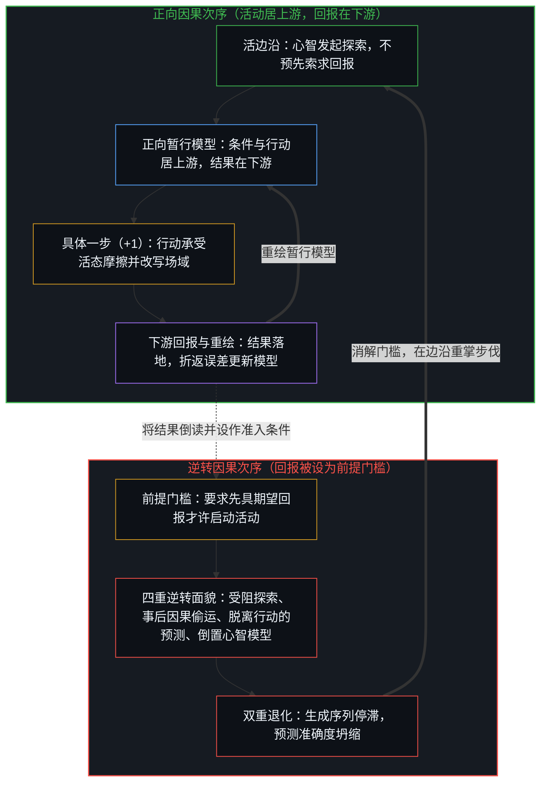
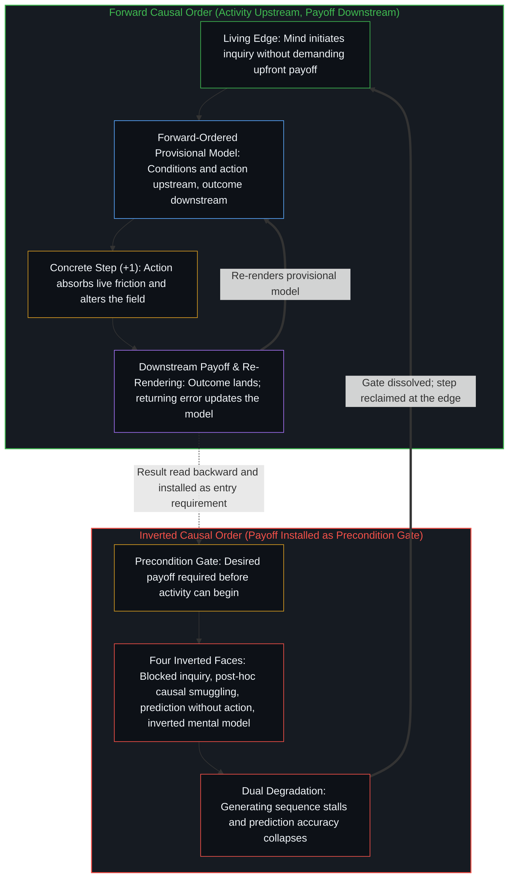

# 回报作为前提与因果方向的逆转 / Payoff as Precondition and the Reversal of Causal Direction

*把下游回报装作启动前提会逆转因果方向，阻断生成活动并削弱预测与模型 / Installing downstream payoff as precondition reverses causal direction, blocking generation and degrading prediction.*

回报一旦到来便切实起作用，可若预先索求，它便会挡在通向自身的那条序列之前。把较后的结果设作较前行动的准入门槛，同一重因果逆转便在四个熟悉的场域上演：效用未获担保便停滞不前的探索、把既成成功倒读为自身起因的事后理论、行动尚未检验便先被索求的预测，以及将期望结果编码在生成条件之前的心智模型。把生成活动留在上游、结果安在下游，便在活边沿上同时恢复行动与预测，让回报作为心智所发起工作的后果落地。

Payoff is what pays off once it arrives, yet requiring it in advance gets in the way of the very sequence that leads to it. Placing a later outcome as the entry gate for an earlier act runs the same causal inversion across four familiar sites: inquiry stalled until utility is guaranteed, retrospective theories that read success backward as its own cause, forecasts demanded before action can test them, and mental models that encode the desired result ahead of the conditions that generate it. Keeping generating activity upstream and outcomes downstream restores both action and prediction at the living edge, so payoff lands as the consequence of work the Mind initiates.

## 一、 把回报设为前提会阻断生成序列 / 1. Installing Payoff as Precondition Blocks the Generating Sequence

好想法屡屡出现在不带即时回报的好奇下游——沙里夫·沙米姆就曾留意到这一模式：他最出色的想法，都浮现在顺着没有可见效用的线索追索之后。自我区分的活动在发生——无因、不息。称之为心智：早已在途的观察者，它的每一次行动都是一次区分。正因为每一次区分都是离散的，而连续性贯穿诸次行动，先前的切分只朝单一方向塑造后续行动所能进入的场域。这道单向不对称正是因果的方向，[前因，后果](../qian-yin-hou-guo/)将其追溯为生成之因与已观察之果之间的落差。心智在活边沿发起并延续好奇，不预先索求结果，这本身便是一记上游行动，重塑了心智随后所能登记的范围；有用的想法作为这片重塑后场域的后果抵达下游，正如[好奇先行](../curiosity-first-the-hidden-engine-of-talent-and-development/)所追溯的那样：日后被登记为天赋的，正是敞开的好奇回路复利积淀出的残余。

Good ideas repeatedly appear downstream of curiosity that carried no immediate payoff—a pattern Sharif Shameem noted when observing that his strongest ideas surfaced after following threads with no visible utility. Self-distinguishing activity occurs — uncaused, unceasing. Call it the Mind: the observer already underway, every act of which is a distinction. Because each distinction is discrete and continuity carries across acts, earlier cuts shape the field available to later ones strictly in one direction. That one-way asymmetry is the direction of causality, traced as the gap between generating cause and observed effect in [Cause Before, Effect After](../qian-yin-hou-guo/). Curiosity initiated and sustained at the living edge without demanding a result in advance is an upstream act that reshapes what the Mind can subsequently register; the useful idea arrives downstream as a consequence of that reshaped field, much as [Curiosity First](../curiosity-first-the-hidden-engine-of-talent-and-development/) traces how what later registers as talent is the compounded residue of an open curiosity loop.

反之，若心智要求以回报为前提，便逆转了这道因果次序。它把下游结果插在上游行动之前，设为探索启动前必须跨过的门槛。好想法或优势唯有在探索步伐改变场域之后才会浮现，在迈出第一步之前便索要它们，会直接阻断或扭曲那条本可将其生成的序列。心智将注意力从眼前敞开的区分抽离，转去审验下一步是否已经确证了回报——[现成接触的因果先验与期望感受的倒置遮蔽](../present-contact-and-the-obscuration-of-desired-feeling/)在情感领域追溯了同一结构逆转：预先索求某种期望感受，恰恰切断了感受得以涌现的当下接触。回报本身在抵达之后依然切实起作用；令生成停滞的，是把这道下游结果塞进了先决条件的槽位。消解这道门槛，既让回报稳妥留在下游位置，也不把“无实用”转写成一条新规则：若把“不求回报地做事”当作明确处方来奉行，无非是在投入之前再安上一道预设条件，落入[里克·鲁宾的奇特案例与不可瞄准的乐趣](../the-interesting-case-of-rubin/)所追溯的副产品陷阱。

When the Mind instead requires payoff as a precondition, it reverses that causal order. It inserts the downstream outcome ahead of the upstream act as a gate that inquiry must satisfy before starting. Because the idea or advantage arises only after exploratory steps have altered the field, demanding it before taking the first step blocks or distorts the very sequence capable of generating it. The Mind diverts attention from the open distinction in front of it toward auditing whether the next move already certifies a return—the exact structural reversal traced in affective life by [Present Contact as Causal Prior and the Obscuration of Desired Feeling](../present-contact-and-the-obscuration-of-desired-feeling/), where requiring a desired feeling upfront severs the present contact from which feeling emerges. Payoff itself remains operative once it arrives; what stalls generation is placing that downstream outcome into the slot of prerequisite. Dissolving that gate leaves payoff intact in its downstream place without converting non-utility into a new rule: adopting "work without payoff" as an explicit prescription would install another preconceived condition ahead of engagement, the byproduct trap traced in [The Interesting Case of Rubin](../the-interesting-case-of-rubin/).

## 二、 事后解释将结果偷运回起点 / 2. Post-Hoc Explanation Smuggles the Outcome Back to the Start

同样的逆转也在事后解释中运转。观察始终落在已成形的果这一边，落后于生成行动一步。一旦回报已经兑现，从完结的记录里梳理伴生特征——某种方法、显见的天赋、激励结构或市场契合——对于已踏入活态约束的行动者而言，仍可充当次级参照，这正是[行路之后的地图](../the-map-after-the-territory/)所标出的参照边界。逆转出现在事后理论把已落定的成功向后倒读之时：它把其中某个早期特征当作从第一步起便引领整条序列的主导原因。

The same reversal operates in post-hoc explanation. Observation always lands on the formed effect, one step behind the generating act. Once a payoff has already materialized, cataloging co-occurring features from the finished record—a method, an apparent talent, an incentive structure, or a market fit—remains usable as secondary reference for an actor already stepping into live constraints, the referential boundary marked in [The Map After the Territory](../the-map-after-the-territory/). The inversion enters when a retrospective theory reads the settled success backward and treats one of those earlier features as the directing cause that steered the sequence from step one.

把终点线倒读回起跑线，理论便将结果安插进因果链条，仿佛它从一开始便在场并起着作用。得到解释的，只是成功打磨后的外观；被遮蔽的，则是更早那段历程——个体在成功尚未被要求也未经确证之前，便主动发起并维系了活动。成功学话语把这种倒读固化为便携的教条，把已完结序列的尾气当作活跃引擎来提供，正如[成功学](../cheng-gong-xue/)所揭示的那样。在公共评论里，同样的滞后把业已可见的结果对照一份留存的早年沉寂记忆重新摆台，让事后的模式匹配读来宛如早期远见，这正是[伪装成远见的表演性后见](../performative-hindsight-that-pretends-to-be-foresight/)所剖析的舞台编排。在组织内部，把个体自发的好奇心追认为“副业项目战略”，等于把一套评估量表扣在了原本先于管理标签而生的运动之上，由此诱发逆向选择与自我模型滞后，如[从未作为战略的副业](../the-strategy-that-wasnt/)所追溯。横跨这三个场域，向后倒读删去的都是同一段敞开区间：心智在尚未获得事前回报担保时，便已展开行动。

By reading the finish line back into the starting block, the theory places the outcome inside the causal chain as if it had been present and operative from the outset. What gets explained is the polished appearance of success; what gets obscured is the prior stretch in which an individual initiated and sustained activity before that success was demanded or certified. Success literature hardens this backward reading into portable doctrine, offering the exhaust of an already-completed sequence as an active engine in [Theories After Success](../cheng-gong-xue/). In public commentary, the same lag stages already-visible outcomes against a preserved memory of earlier obscurity so retrospective pattern-matching reads like early foresight, the staging examined in [Performative Hindsight That Pretends to Be Foresight](../performative-hindsight-that-pretends-to-be-foresight/). Inside organizations, retroactively naming unprompted individual curiosity a "side-project strategy" installs an evaluation rubric over the very movement that preceded management labels, inducing adverse selection and self-model lag as traced in [The Strategy That Wasn't](../the-strategy-that-wasnt/). Across all three surfaces, backward reading edits out the open interval where the Mind acted without an upfront guarantee of payoff.

## 三、 不行动的预测会坍缩，顺向创造则磨锐预测 / 3. Prediction Without Action Collapses Where Forward Creation Sharpens It

想在行动之前先预测未来，执行的是同一重逆转。把经过核验的预测当作启动条件，等于将预测出的结果架成门槛，拦在恰恰能促成该结果的介入行动之前。落在纸面上，先预测后行动看似零成本的审慎；置身鲜活因果之中，每一个具体步伐（+1）都要承受活态摩擦、改写周遭场域，并带回直接接触，从而更新行动者的区分。当心智按住行动、非等预测自行确证不可时，生成序列便从未进入场域——即便进入，也会受制于护持自身预测结果的要求——于是该预测经由行动得以实现的概率随之下降。一边等待条件明朗、一边拒绝预测，同样跳不出这道回路：正如[不预测是没有觉察的预测](../not-predicting-is-predicting-without-awareness/)所揭示的，推迟本身就是一次未经审视的预测，依附在他人的主动下注之上；而等待确定性出现才肯投入，则会放弃结构性杠杆复利累积的那段未经验证区间，正如[看不见的第一步](../the-invisible-first-move/)所追溯的那样。

The desire to predict the future before acting executes the identical inversion. Demanding a verified forecast as the condition for starting installs the predicted outcome as a gate over the very intervention capable of bringing it about. On paper, forecasting ahead of action looks like zero-cost caution; in lived causality, every concrete step (+1) absorbs live friction, alters the surrounding field, and returns direct contact that updates the actor's distinctions. When the Mind holds back action until the prediction certifies itself, the generating sequence never enters the field—or enters constrained by the demand to protect its own forecasted result—so the probability that the prediction will be realized through action falls. Refusing to predict while waiting for conditions to clear offers no escape from this loop: deferral is itself an unexamined prediction riding on others' active bets, as [Not Predicting Is Predicting Without Awareness](../not-predicting-is-predicting-without-awareness/) shows, while waiting for certainty before committing forfeits the unvalidated interval in which structural leverage compounds, as traced in [The Invisible First Move](../the-invisible-first-move/).

“预测未来的最好方式是创造它”这句熟语指向相反的因果次序，前提是按顺向的含义理解“创造”，而非靠发号施令强行催生某个预设结果。这里的创造未来，指的是让探索与工作顺着塑造的正向展开：心智在活态摩擦中迈出上游一步，并不要求回报已在门槛处妥善落定。每一次离散行动都会更新场域并打开下一个前提，绘出[一步一步绘制出的路径](../the-path-drawn-one-step-at-a-time/)。最终落地的未来，是由这条顺向轨迹所实现的未来，而非动身前便硬性索求的预先确证结果。预测之所以愈发敏锐，恰恰因为因果序列维持正向：在与场域的接触中展开行动，既提供塑造后续局面的上游步骤，又源源带回活态反馈，使预测紧贴不断展开的条件。

The familiar maxim that the best way to predict the future is to create it points to the opposite causal order, provided "creating" is understood in its forward sense rather than as forcing a pre-specified result by fiat. Creating a future here means letting inquiry and work run along the forward direction of shaping: the Mind commits to an upstream step under live friction without demanding that the payoff already sit secured at the gate. Each discrete act updates the field and opens the next premise, drawing [The Path Drawn One Step at a Time](../the-path-drawn-one-step-at-a-time/). The future that eventually materializes is the one realized by that forward trajectory, rather than a pre-certified outcome insisted upon before starting. Prediction sharpens precisely because the causal sequence stays forward: acting in contact with the field supplies both the upstream acts that shape what comes next and the live feedback that keeps the forecast aligned with unfolding conditions.

## 四、 心智模型唯有维持正向因果次序才能有效预测 / 4. Mental Models Predict Only While Preserving Forward Causal Order

心智模型唯有在自身结构内部维持这一正向次序时，才能作为有效的预测器运转。横跨先前痕迹划出的心智模型，是一幅暂行投射——心智持作工作仪器的便携模式，而非悬在心智之外的独立架构，正如[因果贯穿始终](../causality-all-the-way/)所追溯的那样。在正向排序的模型里，条件与发起的活动留在上游，结果则居于下游，作为这项活动遭遇活态摩擦后的产物随之显现。以这一形态持守，模型便能引导具体的行动对齐：心智步入上游条件，认领折返的误差作为信号以就地改写运作目标——这正是[动态发现的损失函数与残余误差的转化](../the-dynamically-discovered-loss-function-and-the-conversion-of-error/)所追溯的动态发现——并随着场域推移持续重绘模型。

Mental models operate as effective predictors only while they preserve this forward order inside their own structure. Drawn across prior traces, a mental model is a provisional projection—a portable pattern held as a working instrument rather than an independent structure standing outside the Mind, as [Causality All the Way](../causality-all-the-way/) traces. Within a forward-ordered model, conditions and initiating activity remain upstream, while outcomes appear downstream as what follows when that activity meets live friction. Held in that form, the model guides concrete alignment: the Mind steps into the upstream conditions, claims returning error as signal to rewrite the working objective in place—the dynamic discovery traced in [The Dynamically Discovered Loss Function and the Conversion of Residual Error](../the-dynamically-discovered-loss-function-and-the-conversion-of-error/)—and continuously re-renders the model as the field moves.

如果心智模型反而把期望回报设为启动过程的前提，那么早在迈出第一步之前，因果方向便已在模型内部发生逆转。顺着倒置模型对齐的行动者，会在为探索投入资源之前先索要结果的证据，把过往赢家的事后标记当作必持的入场券，或是一旦事前预测尚不确定便冻结行动。预测与行动由此一并退化：预测退化，因为倒置的模型扣下了能够将其实现的上游机制；行动停滞或走样，因为行动者转而为满足一道倒置的门槛去优化，不再投入生成性的工作。因此，有效的行动仰赖一个内部因果次序顺向运转的暂行模型，从不仰赖动身前先等来一套完备且经预先确证的模型——那只会打着理论的名义，将同一道前提门槛偷运回来。

When a mental model instead installs the desired payoff as the precondition for initiating the process, causal direction has already been reversed inside the model before the first step is taken. An actor aligning with an inverted model demands evidence of the result before funding the inquiry, treats retrospective markers of past winners as required entry tickets, or freezes action whenever the upfront forecast stays uncertain. Both prediction and action degrade together: the prediction degrades because the inverted model withholds the upstream mechanism that could realize it, and action stalls or distorts because the actor optimizes to satisfy an inverted gate rather than engaging the generating work. Effective action therefore depends on a provisional model whose internal causal order runs forward—never on waiting for a complete, pre-certified model before moving, which would smuggle the same precondition gate back in under a theoretical name.

## 五、 在第一人称边沿把回报留在下游 / 5. Holding Payoff Downstream at the First-Person Edge

纵观好奇、事后解释、预测与心智模型，结构模式始终如一。把较后的项要求为较前项的先决条件，便会阻断较前的项。预先索求回报，会让孕育好想法的探索陷入枯竭；把既成成功倒读进初始条件，会抹去成功尚未有把握之前那段敞开历程；抢在行动前索要经确证的预测，会拉低经由行动实现未来的概率；把期望结果作为准入门槛编入心智模型，则会令预测与随之对齐的行动一并退化。

Across curiosity, retrospective explanation, forecasting, and mental models, the structural pattern stays identical. Requiring the later term as a prerequisite for the earlier term blocks the earlier term. Demanding a payoff upfront starves the inquiry that produces good ideas; reading finished success backward into the starting conditions erases the open stretch before success was assured; demanding a certified forecast prior to acting lowers the likelihood of realizing the future through action; and encoding the desired result as an entry gate inside a mental model degrades both the prediction and the action aligned with it.

恢复因果次序既不需要宏大担保，也不需要摆出漠视结果的姿态。回报一旦到来，依然切实起作用——体现在已实现的想法、行得通的系统与更敏锐的远见里。属于第一人称边沿的，是上游这一步：选定一个正向排序的暂行模型，在活态摩擦中迈出下一记具体步伐而不等下游回报预先确证这一步，并依据折返的一切重绘模型。唯有当心智发起并推进生成它的活动、而不把这份回报设为前提时，回报才会真正作为回报兑现。

Restoring causal order requires no grand guarantee and no posture of indifference toward results. Payoff continues to be what pays off once it arrives—in realized ideas, workable systems, and sharper foresight. What belongs at the first-person edge is the upstream move: choosing a forward-ordered provisional model, initiating the next concrete step under live friction without waiting for its downstream payoff to certify the move in advance, and re-rendering the model from whatever returns. Payoff pays off only when the Mind initiates and carries out the activity that generates it without installing that payoff as its precondition.
