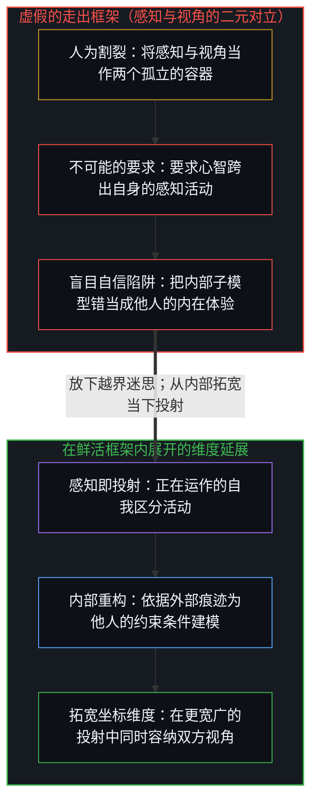
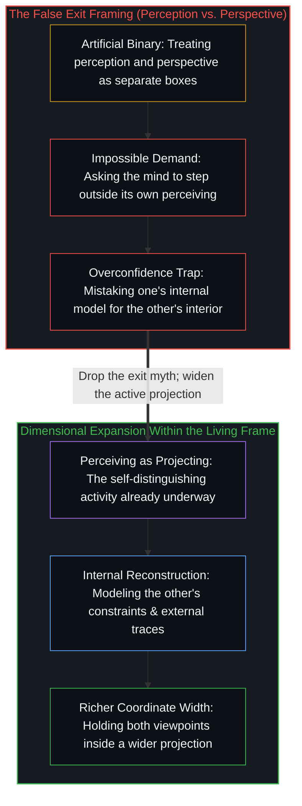

# 感知与视角并不存在的坍缩 / Perception and Perspective Without Collapse

*重构视角不离感知，只从内部拓宽投射维度。 / Reconstructing another's viewpoint never exits your own perceiving; it expands the dimensionality of your projection from within.*

在与莱克斯·弗里德曼（Lex Fridman）的一场广为流传的对谈中，前情报官员安德鲁·布斯塔曼特（Andrew Bustamante）提出了一条化解冲突的实用法则：在任何私人或职场的僵局中，停止从你自己的感知出发，转而切换到对方的视角。透过对方的眼睛重构局势，梳理其驱动力与约束条件，双方的紧绷关系便会开始消融。

In a widely shared conversation with Lex Fridman, former intelligence officer Andrew Bustamante offers a practical rule for resolving conflict: in any personal or professional standoff, stop operating from your own perception and shift instead to the other person's perspective. Reconstruct the situation through their eyes, trace their incentives and constraints, and the tension between parties begins to dissolve.

作为一项操作实践，这套方法行之有效。主动重构另一个心智的立足点，是缓和冲突与促成协作最敏锐的工具之一。然而，这套话语框架却建立在一个结构性的混淆之上，反而遮蔽了该实践得以奏效的真正原因。

As an operational practice, this works reliably. Actively reconstructing another mind's viewpoint is one of the sharpest instruments for de-escalation and coordination. Yet the verbal framing rests on a structural confusion that obscures *why* the practice works.

## 一、 结构性的混淆 / 1. The Structural Confusion

这套框架把“感知”与“视角”当成两个彼此孤立的位置，要求践行者走出自己的感知，踏入一个外部立场。但感知与视角之间并不存在这样的割裂：你无法占据一个不属于你自身感知的视角，就连布斯塔曼特对这两者做出的区分本身，也是在他自己的感知内部生成的一个视角。

The framing treats "perception" and "perspective" as two separate locations, asking the practitioner to step out of their own perceiving and into an external stance. Yet there is no separation between perception and perspective: you cannot occupy a perspective that is not your own perceiving, and even Bustamante's distinction between the two is itself a perspective generated within his own perception.

这种混淆是一场投射坍缩。感知与视角并不是两个可以轮流进驻的独立坐标，而是同一个区分活动在不同组织层级上的描述。视角，不过是将自身的组织坐标系显明出来的感知。要求一个人“从感知切换到视角”，实际上是要求他完成一次真正有益的延展——拓宽自身感知所接纳的范围——却在口头上把它描述成一件在结构上不可能做到的事：走出自己的感知。

The confusion is a projection collapse. Perception and perspective are not two independent coordinates that can be occupied one at a time; they are the same distinguishing operation described at different levels of organization. Perspective is simply perception with its organizing coordinate frame made explicit. Asking someone to "shift from perception to perspective" asks them to perform a genuinely useful expansion—widening the scope of what their perceiving registers—while describing it as a structural impossibility: exiting their own perceiving.

## 二、 作为有序感知的视角 / 2. Perspective as Organized Perception

对同一运动的两种描述一旦被压扁为非此即彼的二选一，就会制造出虚假的对立。世上既没有脱离了视角组织的原始感知，也没有悬浮在心智感知之外的独立视角。

Collapsing two descriptions of the same movement into opposed alternatives creates a false choice. There is no raw perception without a perspective organizing it, and no perspective floating free of a mind's perceiving.

当你“采纳他人的视角”时，并没有发生任何跨出自身的越界。相反，你是在延展自身感知所记录的版图——收集额外的信号，为对方的约束条件建模，并在你自己的框架内部将对方的激励格局重构为一个子模型。这一重构真实而有效，但它从未离开你的感知。感知不是把你困在里面的盒子；它就是正在发生的投射活动本身，并不存在一个可供踏入的“外部”。

When you "take someone else's perspective," no exit occurs. Instead, you expand what your own perceiving registers—gathering additional signal, modeling the other person's constraints, and reconstructing their incentive landscape as a sub-model within your own frame. That reconstruction is real and effective, yet it never leaves your perceiving. Perceiving is not a box you are trapped inside; it is the live act of projecting itself, which has no "outside" to step into.

## 三、 不跳出框架的维度延展 / 3. Expanding Dimensionality Without Exiting the Frame

把感知框定为某种带有限制的容器，依然是把它当成了四面有墙的静态物体。然而感知并不是你所持有的某个容器，而是正在推进的区分活动本身；其中一步，正是通过递归折叠，生成那个“正持有某种视角”的自我体验。

Framing perception as a limiting container still treats it as a static object with walls. Yet perceiving is not a container you possess; it is the distinguishing activity underway, and part of that activity is the recursive fold that generates the sense of a "you" holding a viewpoint.

这条实用建议之所以奏效，恰恰是因为感知可以在维度上不断延展，而不是因为它可以被跨出。当你为他人的处境建模时，你让自己的框架变得更宽广、维度更高，在同一个延展后的投射中同时容纳了你的初始看法与你对他人看法的重构。正如[你的代码库即是记忆](../your-codebase-is-memory/)所展示的，外化的痕迹——交谈的话语、提交的代码库与共享的文档——充当了持久的记忆媒介，让不同的心智得以跨越边界校准各自的重构，而无需融合成同一个内在空间。心智之间的坍缩之所以从不发生，是因为果始终有别于因——这正是[非万物之理](../not-a-theory-of-everything/)所确立的最小前提。

The practical advice works precisely because perceiving is dimensionally expandable rather than exitable. When you model another person's situation, you make your own frame wider and higher-dimensional, registering both your initial view and your reconstruction of their view within a single expanded projection. As [Your Codebase Is Memory](../your-codebase-is-memory/) shows, externalized traces—spoken words, committed codebases, and shared documents—serve as the durable memory medium across which distinct minds calibrate their reconstructions without ever merging into a single interior. The collapse between minds never happens because effect stays distinct from cause, the minimal premise [Not a Theory of Everything](../not-a-theory-of-everything/) sets out.

看清这一实践究竟在做什么，能让它变得既可持续又诚实：它放下了“走出自我”这一不可能的要求，转而锤炼“拓宽自身感知容量”的可行功夫；同时让你保持清醒——哪怕你构建出再丰满的模型，它依然是你自己的内部投射，而不是对他人内在体验的占有。

Understanding what the practice actually does makes it both more sustainable and more honest: it drops the impossible demand to exit yourself in favor of the tractable discipline of expanding what you register, while keeping you clear-eyed that even your richest reconstruction remains your own projection rather than possession of the other's interior.
