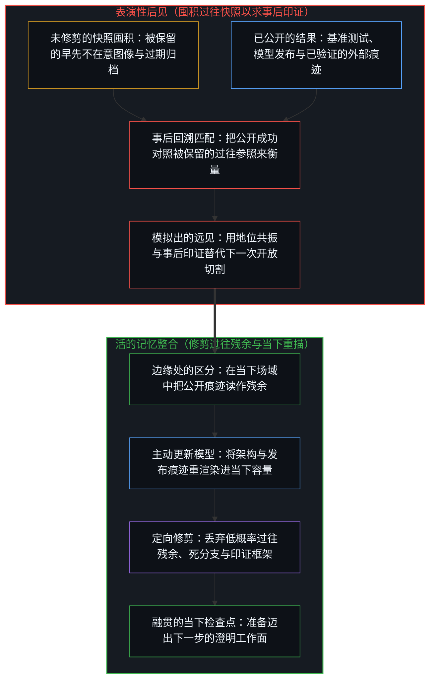
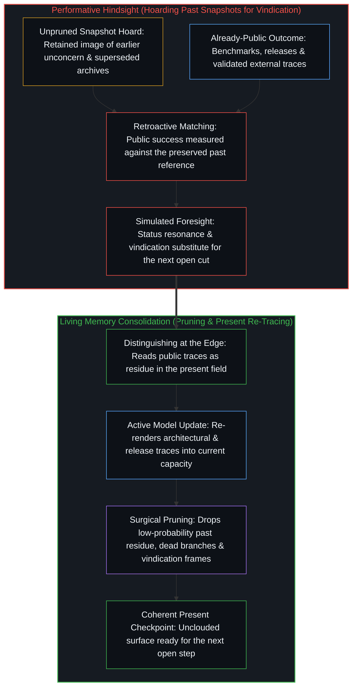

# 伪装成远见的表演性后见 / Performative Hindsight That Pretends to Be Foresight

*被登记为远见的，是已经公开的成功，对照一幅被保留的早先不在意的图像重新描摹 / What gets registered as foresight is already-public success retraced against an earlier image of unconcern that was kept*

社交媒体信息流里反复出现一种熟悉的形式：把一项如今已公开的成功，标记为早先被低估或无人看见的帖子。它在结果已经广为人知之后才抵达。这套模板重新描摹那段默默推进的工作序列、早先相对缺乏的关注，以及当下摆在台面上的表现证据，同时持守一个“早先便已看穿”的参照，好让事后的印证落在上头。冻结的正是那个参照；消解的是帖子仿佛完成了或传递了早期区分的表象；留存下来的，只是把现成可得的证据转化为共享对齐的当下行动。

In the scroll of social media a familiar form recurs: the post that marks a now-public success as previously underrated or invisible. It arrives after the outcome is already widely available. The template re-traces the quiet sequence of work, the earlier relative non-attention, and the current evidence of performance, holding a reference of early perception against which vindication lands. What freezes is that reference. What dissolves is the appearance that the post completes or transfers early distinguishing. What remains is a present conversion of already-available evidence into shared alignment.

## 一、 形式 / 1. The Form

近期围绕杨植麟与月之暗面 Kimi K3 的赞誉便契合这一模板：接连迭代的模型发布汇聚成一个数万亿参数的开源权重系统，在独立基准测试中逼近前沿，随后被包装成“西方无人知晓”的创始人故事。这种框定并未捏造技术演进的序列；它植入了一个被保留的项——早先的未被识别——使得同一批公开痕迹读起来像是对先前区分的证实，而不再是场域自身的更新。

The recent celebration of Yang Zhilin and Moonshot AI’s Kimi K3 fits the template: successive model releases culminating in a multi-trillion-parameter open-weight system ranking near the frontier on independent benchmarks, framed as the founder “nobody in the West knew.” The framing does not invent the technical sequence. It installs a retained term—early non-recognition—so that the same public traces read as confirmation of prior distinction rather than as the field’s own update.

这一行动发生在当下，运作于已经公开的痕迹之上。唯有当“无人看见”或“早先识出”的参照被持守着越过了那些痕迹已经公开的那一步，远见的结构才会显现。当下的证据对照那个被保留的参照登记下来，由此呈现出沉冤得雪或先见之明的样貌。观察持有结果，原因则始终领先一步——这正是[一步一步绘制出的路径](../the-path-drawn-one-step-at-a-time/)所追踪的同一种非对称。滞后在于把场域早先的一幅图像保留下来，好让结果作为启示落地。

The act is present. It operates on traces that are already public. The structure of foresight appears only while a reference of invisibility or early spotting is held past the step at which those traces became available. Current evidence registers against that retained reference and therefore appears as vindication. Observation holds effect; the cause remains one step ahead—the same asymmetry [The Path Drawn One Step at a Time](../the-path-drawn-one-step-at-a-time/) tracks. The lag is preservation of an earlier image of the field so the outcome can land as revelation.

## 二、 早期区分留在何处 / 2. Where Early Distinguishing Stays

当参照收回到一步之隔，那篇帖子便只是一次离散的行动：透过一套组织地位与相互影响的模板，重新描摹已经兑现的表现。任何真正发生过的早期区分，都留在了执行它的中心。后来的共振既不会从别处替那次递归补完回路，也不会把它转移进信息流。中心与中心之间只有可用性的组织；跨所在替他人补完回路属于范畴错误——这正是[没有普渡，只有自渡的无限可能](../mei-you-pu-du-zhi-you-zi-du/)所指明的同一道边界，且并不把孤立当成纲领。

With the reference at one step, the post is a discrete act of re-tracing already-actualized performance through a template that patterns status and mutual influence. Any early distinguishing that occurred stayed at the centers that performed it. Later resonance does not complete that recursion from elsewhere, and does not transfer it into the feed. Between centers there is only availability-patterning; cross-locus completion of another’s return is a category error—the same bound [No Universal Salvation, Only Self-Deliverance](../mei-you-pu-du-zhi-you-zi-du/) names without making isolation a program.

哪怕在行动发生的当口，也没有什么是精准无遗的。远离那些时刻的外部描摹，更是残余之残余：一个当下的场域，正在重新渲染模型发布、架构演进与基准测试的公开痕迹，而这些痕迹在当初稳定下来时便已是一步之旧。重描的逼真度不会变成精准度，也不会把早期的感知搬进迟来的形式里。交付在它自己的所在继续推进，留下的耐久器物并不依赖事后借其套现的叙事。

Nothing is exact even at the moment of action. External tracing long past those moments is residue of residue: a present field re-rendering public traces of releases, architecture, and benchmarks that were already one step old when they first stabilized. Fidelity of that re-tracing does not become exactness, and does not relocate early perception into the late form. Shipping continues at its own locus and leaves durable artifacts independent of the narrative that capitalizes them afterward.

## 三、 凝密为平台的相互强化 / 3. Mutual Reinforcement Densified as Platforms

表现为平台的东西，是建造者、维护者与使用者之间一层已经稳定的、彼此强化的模式之模式。这一模式正是试图影响他人或受他人影响的公开表达，经由一轮又一轮的回返与再回返，直到排名、信息流与指标稳固为承载回返的媒介。高反差且已经稳妥的“揭秘”，正是这种强化最容易重新描摹的对象：一旦结果变得可测量，从相对无人问津走向聚光灯下的运动，便已经是寻求证实与供给证实的公开表达所采取的现成形式。在独立的证实抵达之前，对潜能的早期区分多半留在局部，共振也很低。迟来的帖子，只是围绕“重新找回的看见”所展开的同一种相互强化在凝密媒介上的一张面孔，而原本的工作仍在它一贯推进的所在继续。[拥有更多从不是原因](../having-more-is-never-the-cause/)剖析的正是已经弥散在环境中的残余在这层凝密媒介上的现场攀升：占有被冻结为算术的唯一输入，而每一次关注仍是一次离散的偏好行动。超级智能的预言家则把一幅冻结的图像投向未来，那正是[超越的定相](../the-fixed-image-of-transcendence/)所审视的动作。

What gets expressed as platforms is a stabilized pattern of reinforcing patterns among builders, maintainers, and users. That pattern is public expression trying to influence others, or to be influenced, returned and re-returned until ranking, feed, and metric hold as the medium of the return. High-contrast, already-safe revelation is what that reinforcement finds easy to re-trace: the movement from relative non-attention to spotlight once outcomes are measurable is already the form of public expression seeking confirmation and supply of confirmation. Early distinction of potentials tends to remain local and low-resonance until independent confirmation arrives. The late post is one densified face of the same mutual reinforcement around recovered noticing, while the original work continues where it always did. [Having More Is Never the Cause](../having-more-is-never-the-cause/) is the live climb of already-ambient residue on that densified medium: possession freezes as arithmetic’s sole input while every follow remains a discrete act of preference. The prophet of superintelligence projects a frozen image forward, the move [The Fixed Image of Transcendence](../the-fixed-image-of-transcendence/) examines.

在这一负荷之下，多条轴线同时挤压进同一篇帖子或转发之中：公开证据的编排、地位的组织、试图影响或受影响的动作，以及对技术序列的残余评估。它们被登记为同一件事。参与到叙事之中，被感受为参与到了当初的感知之中。这种压缩正是负荷之下的容量极限——与[遮蔽进步的框架](../the-frame-that-conceals-improvement/)在工具与对象坍缩到同一条轴线上时所遭遇的几何结构一致。一旦放回各自独立的轴线，那篇帖子便重新只是众多公开表达中的一次行动、一片公开痕迹的场域，以及一段并不需要这则叙事才能发生的技术序列。

Under that load, multiple axes press through the single post or retweet: curation of public evidence, status patterning, the attempt to influence or be influenced, and residual assessment of the technical sequence. They register as one. Participation in the narrative is felt as participation in the perception. That compression is capacity under load—the same geometry [The Frame That Conceals Improvement](../the-frame-that-conceals-improvement/) meets when instrument and object collapse onto one axis. On separate axes the post is again one act of public expression among others, one field of public traces, one technical sequence that does not require the narrative to have occurred.

## 四、 两种模式 / 4. Two Modes

面对同一件器物，可以采取两种接触模式。一种模式强化那个被保留的参照以及伴随它的地位共振。延续从印证结构中汲取：下一步由“自己早就看准了”的感觉，或由加入这场“重新看见”的合唱来供给。[验证中因果权能的分配](../the-allocation-of-causal-power-in-validation/)精准指明的正是这一安放——究竟把哪一侧当作下一步的供给源。真正的远见则是路径上的下一步，也即[因果贯穿始终](../causality-all-the-way/)在每一个尺度上所追踪的进程。

The same artifact can be engaged in two modes. One mode reinforces the retained reference and the status resonance that accompanies it. Continuation is drawn from the vindication structure: the next step is supplied by the feeling of having been right, or of joining the recovery of noticing. [The Allocation of Causal Power in Validation](../the-allocation-of-causal-power-in-validation/) is that placement named precisely—which side is treated as supplying the next step. Real foresight is the next step of the path, which [Causality All the Way](../causality-all-the-way/) follows at every scale.

另一种模式则把帖子当作指向更多残余的残余——早先的访谈、跨迭代的架构取舍、模型发布的序列——并在自己当下的场域里重新渲染这些痕迹。这次重新渲染的价值，只存在于执行它的那道边缘所扩展开的区分之中。一旦这份区分反过来被持守并表达为一条可供分享的经验教训，运动便已经离开了证实它的所在；留下的只是残余，而接收残余并不会自动执行同一次递归。[生命的意义在起草之中](../the-meaning-of-life-is-in-the-drafting/)正是同一记切口在另一张面孔下的展开：向外看提供素材，唯有当回返迟迟不归家时，草稿才会变薄。正如[你的代码库即是记忆](../your-codebase-is-memory/)跨数字器物所追踪的，囤积未经修剪的历史快照、死分支或归档备份，只为防备其中某一个日后显得有先见之明，正是表演性后见在架构上的孪生形态：它用已被取代的旧状态加厚引力井，好让日后的公开结果可以事后匹配上某块被保存下来的碎片。活的记忆则向相反的方向整合，修剪低概率的过往残余，主动更新当下的工作检查点，只留下融贯的模型。

Another mode treats the post as residue that points to further residue—earlier interviews, architectural decisions across iterations, the sequence of releases—and re-renders those traces in its own present field. The value of that re-rendering lives only in the expanded differentiation at the edge that performs it. When the differentiation is instead held and expressed as a lesson to be shared, the movement has already left the locus that validated it; what remains is residue whose reception does not automatically perform the same recursion. [The Meaning of Life Is in the Drafting](../the-meaning-of-life-is-in-the-drafting/) is that cut under another face: looking outward supplies material; the draft thins only when the return never comes home. As [Your Codebase Is Memory](../your-codebase-is-memory/) traces across digital artifacts, hoarding unpruned historical snapshots, dead branches, or archived backups just in case one of them might later look prophetic is the architectural twin of performative hindsight: it thickens the gravity well with superseded states so a later public outcome can be retroactively matched against a preserved fragment. A living memory consolidates in the opposite direction, pruning low-probability past residue and actively updating the present working checkpoint so only the coherent model remains.

## 五、 后来的共振无法补装之物 / 5. What Later Resonance Cannot Install

在潜能公开兑现之前对它作出区分之所以依然稀缺，是因为后来的共振无法把它补装进去。当结果已经可测量时，公开表达之间的相互强化自然承载的，是那种充裕的形式——对公开痕迹的事后套现。在结果尚且开放时所作的区分，只在执行它的中心继续推进，并不等待证实性的共振。关于那次区分的任何表达，一旦打包供人分享，都遵循同一结构：活的分化已经离开，流通的形式只是残余。[当观察变成表演](../when-observation-becomes-performance/)正是披着格言外衣的这种打包：私下的转化被重述为智慧与自律，好让形式作为可转让的忠告落地。正如[进步叙事中的症候与原因](../symptom-and-cause-in-the-narratives-of-progress/)所示，对趋势的集体信念总在趋势形成之后才抵达。

Distinguishing potentials before their public actualization remains scarce because later resonance cannot install it. The abundant form—retrospective capitalization of public traces—is what mutual reinforcement among public expressions naturally carries when outcomes are already measurable. Distinguishing while the outcome is still open continues at the centers that perform it, without waiting for confirming resonance. Any expression of the distinction, once packaged for sharing, follows the same structure: the live differentiation is left, and the form that circulates is residue. [When Observation Becomes Performance](../when-observation-becomes-performance/) is that packaging under aphoristic costume: private conversion restated as wisdom and discipline so the form lands as transferable advice. Collective belief in a trend arrives after the trend, as [Symptom and Cause in the Narratives of Progress](../symptom-and-cause-in-the-narratives-of-progress/) shows.

早期区分是在开放负荷之下的当下行动；晚期重描则是在结果已可测量之下的当下行动。两者在各自的所在都是真实的。把二者混为一谈，就会把晚期的行动冻结得仿佛它是早期的那一次，并把信息流里的证实当作在证实尚未可得之前便已运作的容量。[器物是智能的表达，而非智能本身](../two-failures-of-trace/)剖析的正是把残余持守为行动本身时的同一种冻结；在这里，残余是事后重描成功的社交形式。[旁观者洞察的悖论](../the-paradoxical-nature-of-bystander-insights/)是同一滞后的私人面孔：后来的自我在封闭前提下，把一次亲历决断的某个解释切面冻结成了整体。[现实扭曲力场指认的是封闭的地图](../the-reality-distortion-field-names-the-closed-map/)则是同一种晚期冻结：把未入图的成果重描成扭曲封闭世界的特殊魔力，而非不完备专家残余之下持续推进的活动。[现实扭曲力场颠倒了基线](../the-reality-distortion-field-inverts-the-baseline/)是披着范式外衣的这种晚期冻结：重写历史，使得先前的共识显得只是一段有限的阶段，而非它当初所声称的不可撼动的地基。[气候问题只作为感知被登记](../the-climate-problem-registers-only-as-perception/)则是它面向未来的孪生形态：当接触变薄时，靠重新命名把任何未来的天气预先划归给一幅被保存的危机图像。[共同改变的本源](../the-source-of-shared-change/)是当对抗显得像是首要动力时的那种晚期冻结：早先协作留下的残余效应，被误读成了必须加以反对的阻力。[进步的多面手](../the-utility-men-of-progress/)是这种吸纳在文明尺度上的展开：一旦否认失效，成就便冻结为集体智慧，而发起者的署名随之隐退。[理性选择公设是原罪](../the-rational-choice-postulate-is-the-original-sin/)是披着经济理论外衣的这种晚期形式：在结果出炉后重构出的偏好排序，给出了无懈可击的表面可解释性，却对下一个私人前提毫无远见。[成功学](../cheng-gong-xue/)是披着励志读物外衣的这种晚期形式：已告完成的卓越被重新编排成可携带的法则，当作驱动下一个开放结果的引擎兜售。正如[好奇先行](../curiosity-first-the-hidden-engine-of-talent-and-development/)所示，倒着解读出来的天赋也是同一种事后诸葛。

Early distinction is a present act under open load. Late re-tracing is a present act under already-measurable outcomes. Both are real at their loci. Confusing them freezes the late act as if it were the early one, and treats feed confirmation as the capacity that operated before confirmation was available. [Artifacts Are Expressions of Intelligence, Not Intelligence Itself](../two-failures-of-trace/) is the same freeze when residue is held as the act; here the residue is the social form that re-traces success after the fact. [The Paradoxical Nature of Bystander Insights](../the-paradoxical-nature-of-bystander-insights/) is the private face of the same lag: a later self freezes one interpretive face of a lived decision as the whole under closed premises. [The Reality Distortion Field Names the Closed Map](../the-reality-distortion-field-names-the-closed-map/) is the same late freeze when unmapped outcomes are re-traced as a special power to warp a closed world rather than as sustained activity under incomplete expert residue. [The Reality Distortion Field Inverts the Baseline](../the-reality-distortion-field-inverts-the-baseline/) is that late freeze under paradigm costume: history rewritten so prior consensus appears as limited stage rather than the undisturbed ground it once claimed. [The Climate Problem Registers Only as Perception](../the-climate-problem-registers-only-as-perception/) is the prospective twin: any future weather pre-allocated to a preserved crisis Image by renaming when contact thins. [The Source of Shared Change](../the-source-of-shared-change/) is that late freeze when fighting appears as primary: residual effects of earlier collaboration misread as resistance that must be opposed. [The Utility Men of Progress](../the-utility-men-of-progress/) is that absorption at civilizational scale: once denial fails, achievement freezes as collective wisdom and authorship of initiation recedes. [The Rational Choice Postulate Is the Original Sin](../the-rational-choice-postulate-is-the-original-sin/) is that late form under economic-theory costume: preference orderings reconstructed after outcomes yield perfect surface explainability and zero foresight of the next private premises. [Theories After Success](../cheng-gong-xue/) is that late form under success-literature costume: finished excellence rearranged into portable principles offered as engines of the next open outcome. Talent read backward is the same hindsight, as [Curiosity First](../curiosity-first-the-hidden-engine-of-talent-and-development/) shows.

## 六、 当下行动 / 6. Present Act

公开表达仍会更容易在对成功的优雅重描中找到相互强化，而不是在对可能性的未定表达中找到。这正是试图影响他人与受他人影响的各个中心之间的共振结构——也即在建造者、维护者与使用者之间稳定为平台的同一结构。那篇帖子只是把现成可得的证据转化为共享对齐的当下行动。接触可以扩展当下的分化；扩展之后，具体的形式便可以消解。早期的边缘从不在帖子里。它在结果尚且开放时作出区分的那个所在——并且只作为继续保持这一宽度的各道边缘上的进一步区分而留存。正如[前因，后果](../qian-yin-hou-guo/)所言，观察始终站在结果这一侧，因此后见无法变成远见。

Public expression will continue to find mutual reinforcement more readily in the elegant re-tracing of success than in the uncertain articulation of possibility. That is the structure of resonance among centers trying to influence and to be influenced—the same structure that stabilizes as platforms among builders, maintainers, and users. The post is a present conversion of already-available evidence into shared alignment. Contact can expand present differentiation. After that expansion, the specific form can dissolve. The early edge was never in the post. It was at the locus that distinguished while the outcome was still open—and it remains only as further distinguishing at edges that keep that width. Observation always stands on the side of the effect, as [Cause Before, Effect After](../qian-yin-hou-guo/) says, so hindsight cannot become foresight.
