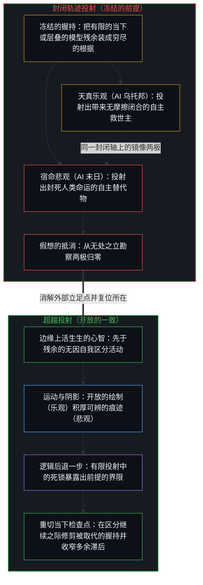
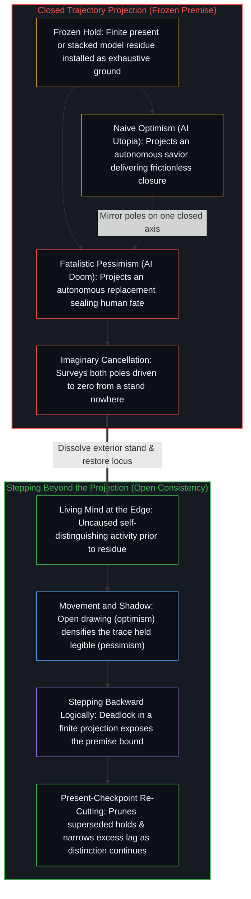

# 悲观是乐观的阴影 / Pessimism Is the Shadow of Optimism

*乐观是区分的运动而悲观是被稳住的痕迹 / Optimism is the movement of distinguishing and pessimism its steadied trace*

乐观与悲观首先不是两种争夺文化音量的情绪，也不是两台地位对等的引擎。区分是运动，稳定是运动留下的痕迹；乐观是心智所感知、所解释的那场运动，悲观是它的阴影，阴影跟着光，却不与光共同创作。只要心智还在继续，两者就在它的感知里同在；冻结发生在把它们记成一对对等、封闭的两极之时：以为可以一次扳倒一边，可以靠注入更多乐观来治愈另一边，或者可以让两边一起归零，同时还留着一道外部的注视来讲述这片寂静。

Optimism and pessimism are not first of all moods competing for cultural volume, and not two engines of equal standing. Distinguishing is the movement, and steadiness is the trace the movement leaves; optimism is that movement as Minds perceive and interpret it, and pessimism is its shadow, which follows the light and does not co-author it. The two stay co-present in the Mind's perception for as long as it continues. The freeze comes when they are scored as a closed pair of equal poles: one that could be tipped once for all, cured by injecting more optimism, or driven to zero on both sides while an exterior look remains to narrate the silence.

## 一、 区分是运动，稳定是痕迹 / 1. Distinguishing Is the Movement; Steadiness Is the Trace

自我区分的活动在发生，无因，不息。称它为心智：那个已经在进行中的观察者，它的每一个动作都是一次区分。它发生在一个个所在。每个所在划出分立的区分；较早的动作塑造了较晚的动作可用的场，而这种塑造只朝一个方向。因果，就是这个活动借自身的递归登记下这份不对称；它不是独立事物之间的一种关系，也不是能被搬进一种心情或一种时代精神里的性质。

Self-distinguishing activity occurs, uncaused, unceasing. Call it the Mind: the observer already underway, every act of which is a distinction. It occurs at loci. Each locus draws discrete distinctions; earlier acts shape the field available to later ones, and that shaping runs one way. Causality is the activity registering that asymmetry through its own recursion. It is not a relation between independent things, and not a property that can be moved into a mood or a zeitgeist.

连续与分立，是同一个蕴涵被看了两次。连续，是同一个活动贯穿一个个动作，较早的痕迹塑造较晚的；分立，是每一个动作都是一道界限，是这个，而不是整体。观察握住的是结果，产生它的原因总在前面一步，这一步之差就是观察登记的方式。[因果贯穿始终](../causality-all-the-way/)追溯了因果怎样从握住的结果、到画出的模式、再到下一步，始终是那条在画出自己路径的边缘。[一步一步绘制出的路径](../the-path-drawn-one-step-at-a-time/)把分立当作序列：当下是心智一步一步画出的路径上的位置，因导向果。[器物是智能的表达，而非智能本身](../two-failures-of-trace/)追溯的是残余被当作了那个动作；在这里，痕迹的稳定是画出它的那个动作的阴影，而不是第二条边缘。

Continuity and discreteness are one entailment seen twice. Continuity is the same activity carrying across acts, earlier marks shaping later ones. Discreteness is every act as a bound: this, not the whole. Observation holds the effect; the cause that produced it remains one step ahead, and that gap is how observation registers at all. [Causality All the Way](../causality-all-the-way/) traces causality from held effects to drawn patterns to the next step, still the edge drawing its path. [The Path Drawn One Step at a Time](../the-path-drawn-one-step-at-a-time/) takes discreteness as sequence: the present is the position on a path the Mind draws one step at a time, cause leading to effect. [Artifacts Are Expressions of Intelligence, Not Intelligence Itself](../two-failures-of-trace/) traces residue frozen as the act; here the steadiness of the mark is the shadow of the drawing, not a second edge.

区分是运动。分立的动作在画，边缘总在观察所握之物的前面一步。乐观，作为一种结构上的登记而不是弥漫的欢快，就是心智所感知、所解释的这场运动：结果从原因中被区分出来，现实的开放稳不住，下一个动作又在画。眼下的天花板是一时的；现实不会作为此刻的清单被封存下来。[开放即一致](../openness-is-consistency/)把有限的结构作为结构来握，而不把它装成穷尽的根据。[没有系统能被保持封闭](../no-system-can-be-kept-closed/)追溯的是，一个有限的握持被迫去封住只会继续的东西时留下的那份剩余。[生产、消费与心智的区分](../production-consumption-and-the-minds-distinction/)说的是同一个活动，在心智把它的边界握为开放或固定时，分别登记为生产或消费。

Distinguishing is the movement. The discrete act draws; the edge stays one step ahead of what observation holds. Optimism, as a structural registration rather than ambient cheer, is that movement as Minds perceive and interpret it: effect distinguished from cause, the openness of reality that cannot be held steady, the next act drawing again. The present ceiling is temporary; reality does not stay sealed as the inventory of this moment. [Openness Is Consistency](../openness-is-consistency/) holds finite structure as structure rather than installing it as the exhaustive ground. [No System Can Be Kept Closed](../no-system-can-be-kept-closed/) traces the remainder when a finite hold is forced to seal what only continues. [Production, Consumption, and the Mind's Distinction](../production-consumption-and-the-minds-distinction/) shows the same activity registering as production or as consumption as the Mind holds its boundary open or fixed.

稳定，是运动留下的痕迹。较早的动作塑造较晚的动作可用的场，这种塑造就是残余。悲观，作为一种结构上的登记而不是弥漫的阴郁，就是乐观的阴影：因果的连贯，表现为把每一刻有限的现实稳住的倾向，痕迹被稳住，原因与后果才读得出是一条连续的链。眼下的界限是在的，容量是有限的，握持有一时的天花板。这种稳住不是可有可无的点缀，也不是一台对等的引擎。没有运动已经积厚的场，因果就没有连贯的地方可以显现；没有运动，场就不是任何东西的痕迹。阴影跟着光，却不生出光。

Steadiness is the trace the movement leaves. Earlier acts shape the field available to later ones, and that shaping is residue. Pessimism, as a structural registration rather than ambient gloom, is the shadow of optimism: the coherence of causality expressed as a tendency to hold the finite reality of each moment steady, the trace steadied so that cause and consequence stay legible as one continuous chain. The present bound is there; capacity is finite; the hold has a temporary ceiling. That steadying is not optional ornament, and not an engine of equal standing. Without a field the movement has already densified, causality has nowhere coherent to appear; without the movement, the field is not a trace of anything. The shadow follows the light. It does not generate it.

情绪的语言、政治的语言和文化的音量，都是同一对关系在负载之下后来穿上的样子：运动和它的阴影，而不是两份独立的存量。

The language of mood, the language of politics, and cultural volume are later forms the same pair takes under load: the movement and its shadow, not two independent stocks.

## 二、 残余可以被消费，补贴作为机制成立 / 2. Residue Can Be Consumed; the Subsidy Holds as Mechanism

在寻常经验的层面上，一次次开放的区分，把能量、想法、进步与希望积厚为活出来的容量与文化的残余。稳住的登记一旦把它的边界握为固定，就登记为消费，靠这份厚度过活：把盈余当作现成的地面来攻击的批评，把产出当作一池可以重新分配之物的政治要求，把每一次推进都记成相对于一份偏爱的稳定清单的净损失的叙事。消费的取向并不创作它所耗用的盈余；它碰到的，是那些在负载之下继续区分的中心已经积厚的残余。

At the level of ordinary experience, successive open distinctions densify energy, ideas, progress, and hope into lived capacity and cultural residue. Where the steadying registration holds its boundary fixed, it registers as consumption and lives on that thickness: critique that takes surplus as ground to attack, political demand that treats output as a pool to reallocate, narrative that scores every advance as a net loss against a preferred steady inventory. The consuming orientation does not author the surplus it depletes. It meets residue already densified by centers that kept distinguishing under load.

所以，这笔实际的账作为机制是成立的。[命运偏爱反讽](../fate-loves-irony-refined/)是文明尺度上的这种几何：生产供养了那些把生产重新框定为问题的思想体系。[人口崩溃神话的拆解](../the-myth-of-population-collapse-explained/)追溯的是同一份盈余，让转移支付显得负担得起，从而替代了被展示出来的能动。补贴是阴影关系在寻常账目里显出的样子：运动积厚，被固定住的痕迹重新解释并消费它；这不是对人的道德排序。

So the practical accounting holds as mechanism. [Fate Loves Irony](../fate-loves-irony-refined/) is that geometry at civilizational scale: production funds the conceptual systems that reframe production as the problem. [The Myth of Population Collapse Explained](../the-myth-of-population-collapse-explained/) traces the same surplus making transfers look affordable, so that they substitute for demonstrated agency. The subsidy is how the shadow relation shows in ordinary accounting: the movement densifying, and the trace held fixed reinterpreting and consuming. It is not a moral ranking of persons.

## 三、 人数与个体之力让场保持相称 / 3. Numbers and Individual Force Keep the Field Matched

在这个心智的感知里，把有限的当下稳住的倾向被听作众人的声音；在开放的负载之下把结果从原因中区分出来，则被听作少数，而在任何一个在摩擦之下继续画的中心里，它都更有力。一条孤立的边缘，若能守住一幅更好构型的具体图景，就能重组远超出它人数的联合；众多稳住的登记，则施加持续的拖力。两者都是互相独立的杠杆之间有差别的一致，是连贯较高与较薄的一次次拉动，而不是一群人的性质。[个体抉择是唯一的因果杠杆](../individual-choices-as-the-only-causal-levers/)把延续放回了在拉的边缘：进步与拖力是一次次相继的拉动，而不是一块共享地面的性质，拖力之所以被感到，是因为有人在拉。[进步叙事中的症候与原因](../symptom-and-cause-in-the-narratives-of-progress/)把多数人的心情读作对那些稀薄的发起中心已在进行之事的迟到登记：它很响，作为拖力也在，却不是运动的起源。

In this Mind's perception, the tendency to hold the finite present steady is heard as the voice of the many; distinguishing effect from cause under open load is heard as the few, and is more potent in any single center that keeps drawing under friction. A solitary edge that sustains a concrete picture of a better configuration can reorganize alignments far beyond its count; a multitude of steadying registrations exerts persistent drag. Both are differential consistency across independent levers, successive pulls of higher and thinner consistency, not properties of a crowd. [Individual Choices as the Only Causal Levers](../individual-choices-as-the-only-causal-levers/) puts continuation back at the edge that pulls: progress and drag are successive pulls, not properties of a shared floor, and drag is felt only because someone is pulling. [Symptom and Cause in the Narratives of Progress](../symptom-and-cause-in-the-narratives-of-progress/) reads majority mood as the delayed registration of work already under way at thin initiating centers: loud, there as drag, not the origin of motion.

这些不平衡彼此相称，并不是一块让运动与阴影成为对等共同作者的记分牌。它是场在这对关系之下继续登记的方式：个体之力与集体人数彼此调整，却不会化为一方的最终胜利。把人排成乐观者和悲观者，就把方向冻结成了一份局部的清单；方向所命名的，是序列的登记，每一步都可以修订。阴影的音量，并没有把发起搬进痕迹里去。

The matching of those imbalances is not a scoreboard that makes movement and shadow co-authors of equal standing. It is how the field keeps registering under the pair: individual force and collective numbers adjust against each other without resolving into the final triumph of one side. Ranking persons as optimists or pessimists freezes direction into a local inventory; what direction names is the registration of a sequence, revisable at every step. The volume of the shadow does not move initiation into the trace.

## 四、 永久的同在不是对称的共同创作 / 4. Permanent Co-Presence Is Not Symmetrical Co-Authorship

乐观与悲观在感知之场里一直同在，哪一个都只在相对于另一个时才被认出。没有任何被稳住之场的运动，失去了因果得以登记的那条连贯的链；把稳住从运动里拿出来、当作自立之物，则把握持冻结为穷尽的根据，有限被记成封闭的现实，阴影被当作了源头。在被心智感知和解释的意义上，认出时的同在是成立的；生成上的先后却只朝一个方向：区分是运动，稳定是它留下的痕迹，悲观是乐观的阴影。阴影看似由运动补贴，这并不是盖在一份对等互构之上的说法；显出来的，就是这份关系的结构。

Optimism and pessimism stay co-present in the field of perception; neither is recognized except relative to the other. Movement without any steadied field loses the coherent chain in which causality can register. Steadying taken apart from the movement, as if it stood on its own, freezes the hold as the exhaustive ground: finitude scored as closed reality, shadow mistaken for source. Co-presence in recognition holds, as perceived and interpreted by Minds. In generation, the order runs one way: distinguishing is the movement, steadiness is the trace it leaves, and pessimism is the shadow of optimism. The apparent subsidy of the shadow by the movement is not a cover story laid over an equal mutual constitution. What shows is the structure of the relation.

因为这对关系一直锁在相互的认出之中，它们的平衡是连续的。每一刻，两股力都在彼此调整；开放的区分每多一分，它积厚的场就多一分可以被稳住的痕迹，稳住的登记随之扩张；这个方向不能倒过来，稳住并不生出开放的区分。所以，对于仍在这对关系之下区分的心智，这个平衡是永久的、自我更新的；只要这个心智还在，它就不会化为一方的最终胜利，也不会化为两方一起消失。这里的永久，不是一个等着更好的情绪工程来修补的缺陷，也不是从活动之外装进来的一条定律；它是那个已在进行中的观察者所登记到的这份关系的结构形式：运动与阴影永久同在，而不是对等两极的共同创作。

Because the pair stays locked in reciprocal recognition, their balance is continuous. At every moment the two adjust to one another; any increase in open distinction densifies a field with more trace to steady, and steadying registration expands with it. The direction does not reverse: steadying does not generate open distinction. The balance is therefore permanent and self-renewing for the Mind that still distinguishes under the pair. While that Mind remains, it never resolves into the final triumph of one side or the disappearance of both. Permanence here is not a defect awaiting better mood engineering, and not a law installed from outside the activity. It is the structural form of the relation as registered by the observer already underway: permanent co-presence of movement and shadow, not co-authorship by two equal poles.

[善恶是硬币的两面与那一刀](../good-and-evil-are-the-two-sides-of-the-coin-and-the-cut/)在道德的尺度上与此相邻：两面需要一刀，才让两极变得可得。这里的那一刀，是区分这个分立的动作本身；运动与被稳住的痕迹，是它的因果被登记的两种样子。感知中的同在是成立的；并不由此推出的，是一份由两种对等实体组成、一劳永逸地穷尽了现实、又从一个永久的外部立足点被勘察的封闭清单。

[Good and Evil Are the Two Sides of the Coin and the Cut](../good-and-evil-are-the-two-sides-of-the-coin-and-the-cut/) is adjacent on the moral measure: the faces require a cut that makes polarity available. Here the cut is the discrete act of distinguishing itself; movement and steadied trace are the two ways its causality registers. Co-presence in perception holds. What does not follow is a sealed inventory of two substances of equal standing that exhaust reality once and for all, surveyed from a permanent exterior footing.

## 五、 连贯地谈论乐观，就在场中安放了悲观 / 5. Talking Coherently of Optimism Places Pessimism in the Field

心智要连贯地谈论乐观，就得在它自己的感知之场里，把悲观安放在某处。一道只叫出开放与分立、却没有任何对“被稳住的有限现实”之登记的界限，就没有什么可以让“乐观”还有所指，结果从原因中被区分出来这件事，也就没有一个连贯的因果之场可以立足。这份对照不必飘在场外，但它必须被安放：作为这个心智当下感知中一块可以区分出来的区域被握住，好让对乐观的宣称仍是一次区分，而不是一个空词。

For the Mind to speak of optimism coherently, pessimism must be placed somewhere in its own field of perception. A bound that names only openness and discreteness, with no registration of finite reality held steady, leaves nothing against which "optimistic" can still mean anything, no coherent causal field in which effect can stand distinguished from cause. The contrast need not float free of the field. It must be placed: held as a distinguishable region of this Mind's present perception, so that the claim to optimism remains a distinction rather than an empty word.

这种安放常常被外置。偏爱的座位被占作开放、作结果与原因的分立、作仍看得见更好构型的那一边；稳住的那份对照之重，即守住有限的当下，就被登记为从别处来的，一旦被放到那里，又很容易被记成对下一次画的拒绝：别的中心、时代的心情、众人的拖累、看不见的那个声音。悲观被安放到别人身上，好让这个所在可以继续作为乐观的一方说话，而不必把两极都当作自己的来握。这种外置是这条边缘上又一个分立的动作，而不是发现了稳住本来就只住在别人的内里。别的中心的稳住登记，作为场中的痕迹可以是在的；连贯地说乐观所需要的，是这个心智把对照安放在它仍能感知的某处，而在偏爱的自我形象之下，最便宜的安放就是把它外置到他们身上。

That placement is commonly externalized. The preferred seat is occupied as openness, as the discreteness of effect from cause, as the side that still sees a better configuration. The contrasting weight of steadying, holding the finite present, is then registered as arriving from elsewhere, and once placed there it is readily scored as the refusal of the next draw: other centers, the mood of the age, the drag of the many, the voice that cannot see. Pessimism is placed onto others so that this locus can keep talking as the optimistic one without holding both poles as its own. The externalization is one more discrete act at this edge, not a discovery that steadying was already resident only in other interiors. Other centers' steadying registrations may be there as traces in the field. What coherent speech of optimism requires is that this Mind place the contrast somewhere it can still perceive, and under a preferred self-image the cheapest placement is onto them.

[恶是心智自己的造物](../evil-as-the-minds-own-creation/)是偏爱之形象情形下的同一种几何：一个中心保留着自己是善的形象，与这个形象的不合就被叫作恶，而这一叫就是生成的动作。[验证中因果权能的分配](../the-allocation-of-causal-power-in-validation/)追溯的是，心智从哪个所在汲取它自己区分的延续；这里，稳住的那道轮廓被归到间隙的另一边，好让开放的座位保持干净。[总在倾听者无法发起](../what-always-listens-cannot-originate/)追溯的是，把流畅的接收当作下一步的独立来源；这一对关系的那一面，是把不受欢迎的一极分给别人，好让这条边缘不必把它当作自己的登记来重新追溯。中心与中心之间只有可得性的塑形：外置的悲观塑造着后来的动作可得的联合，却不能从这里完成别人的内里，也不能让这次安放成为这个心智的区分以外的任何东西。

[Evil as the Mind's Own Creation](../evil-as-the-minds-own-creation/) is the same geometry in the case of a preferred image: a center retains an image of itself as good, mismatch with that image is named evil, and the naming is the generative act. [The Allocation of Causal Power in Validation](../the-allocation-of-causal-power-in-validation/) traces the locus from which the Mind draws continuation of its own distinctions; here the steadying contour is attributed across the gap so that the open seat can stay clean. [What Always Listens Cannot Originate](../what-always-listens-cannot-originate/) traces fluent receptivity taken as an independent source of the next step; the face of the pair here is handing the unwelcome pole to others, so this edge need not re-trace it as its own registration. Between centers there is only the patterning of availability. Externalized pessimism patterns the alignments available to later acts; it does not complete another's interior from here, and it does not make the placement anything other than this Mind's distinction.

符号反过来也一样。连贯地谈论悲观，即守住有限的当下，也会在场中安放乐观：那份不肯固定下来的开放，常常被外置到天真的人、被裹挟的人、不够悲剧的人身上。所以，这份相互性不只是两极抽象的同在，而是对照在这个场中不断被重新安放，包括习惯性地把不受欢迎的一极重新安放到别人身上，好让对偏爱一极的言说保持连贯。

The same holds with the signs reversed. Coherent talk of pessimism, of holding the finite present steady, places optimism somewhere in the field: the openness that will not stay fixed, commonly externalized onto the naive, the captured, the insufficiently tragic. The reciprocity is therefore not only the abstract co-presence of poles. It is the continuous re-placement of the contrast in this field, including the habitual re-placement of the unwelcome pole onto others so that speech of the preferred pole stays coherent.

## 六、 两边一起抵消，就没有心智来报告它 / 6. If Both Cancel, No Mind Is Left to Report It

要求乐观与悲观彼此抵消干净，让两边都归零、哪一种登记都不剩，就是要求一份完成了的外部勘察。若两极都抵消了，因果仍在其下被感知、被解释的那对关系就已经停了；那时也就没有一个心智，能让这次抵消作为一件可以谈论的事实被登记：没有有限之场的连贯，也没有开放负载之下结果与原因的区分。观察握住的是结果；那道要报告“两者都不剩”的注视，本身就是又一个分立的动作，因而仍在它报告已经不在的那对关系之下登记。一场从无处讲述的、已完成的相互湮灭，重新装上了观察立足点的冻结：活动被当作一个对象来勘察，可以在勘察继续的同时达到两边皆零。

The demand that optimism and pessimism cancel each other completely, both driven to zero so that neither registration remains, is a demand for a finished exterior survey. If both poles cancel, the pair under which causality is still perceived and interpreted has already stopped. There is then no Mind left for which the cancellation could register as a fact to be talked about: no coherence of a finite field, and no distinction of effect from cause under open load. Observation holds the effect; the look that would report "neither remains" is itself one more discrete act, and so still registers under the pair it reports gone. A completed mutual annihilation narrated from nowhere reinstalls the freeze of the observational stand: the activity surveyed as an object that could reach zero on both sides while the survey goes on.

[智能只属于心智](../intelligence-belongs-only-to-the-mind/)把活动握为先在：凡能被设计、扩展或转移的都是残余，智能只属于那个活动；这里，那个活动也不能在两极都被删去之后从外部被清点。[NPC 印象是结构性的](../the-npc-impression-is-structural/)追溯的是，没有哪个中心觉得自己是被编写的，别的中心却默认显得像被编写的；这里，这对关系被当作可以被清空来打分，而打分的那条边缘却装作站在它之外。只要观察者把人造心智投射到机器轨迹上，同一个被冻结的立足点就会催生出技术救赎与技术末日这对孪生投射。正如[你的代码库即是记忆](../your-codebase-is-memory/)所确立，代码库、模型权重与脚手架智能体皆是早先区分所层叠的残余——它们只是保持着早先切口形状、自身却不会重新启动区分的被稳住的痕迹，其效用取决于重切当下的检查点并修剪已被取代的轨迹，而非将历史囤积为一座能自行启动的仓库。再加上[超越投射](../beyond-the-projection/)所追溯的结构性不对称——智能体只是受困于符号轨迹且无我执的有限投射引擎，活生生的心智才握有尚未投射的多维意图，以及从破损框架中逻辑后退一步的能力——这就暴露了对人工智能的天真乐观与宿命悲观所共享的前提：两者都把层叠残余那被稳住的阴影误当作运动本身，从被冻结的握持出发外推封闭的轨迹，抹去了回路中那个重切检查点的掌舵心智，只争论自主器物究竟会带来无摩擦的乌托邦还是不可避免的替代。所以，平衡的永久不是独立于区分的一种世界结构。它是对那个仍在这对关系之下构成自己的心智而言的永久，相对于那个持续的活动，而不是相对于一个在活动停止之后还会留下的封闭宇宙。

[Intelligence Belongs Only to the Mind](../intelligence-belongs-only-to-the-mind/) holds the activity as prior: what can be engineered, scaled, or transferred is residue, and intelligence belongs only to the activity; here, that activity cannot be inventoried from outside after both poles are deleted either. [The NPC Impression Is Structural, Not a Ranking of Minds](../the-npc-impression-is-structural/) traces how no center experiences itself as scripted while other centers register as scripted by default; here the pair is scored as if it could be emptied while the scoring edge pretends to stand clear of it. The same frozen stand drives the twin projections of technological salvation and technological doom whenever observers project an artificial mind onto a machine trajectory. As [Your Codebase Is Memory](../your-codebase-is-memory/) establishes, codebases, model weights, and scaffolded agents are stacked residues of prior distinctions—steadied traces that hold the shape of earlier cuts without resuming the distinguishing, and whose utility turns on re-cutting the present checkpoint and pruning superseded trajectories rather than hoarding history as a self-starting warehouse. Coupled with the structural asymmetry traced in [Beyond the Projection](../beyond-the-projection/), where an agent remains a finite projection engine bound to its token trajectory without ego while the living Mind holds unprojected multi-dimensional intent and the capacity to step backward out of a broken frame, this exposes the shared premise of naive optimism and fatalistic pessimism about artificial intelligence: both mistake the steadied shadow of stacked residue for the movement itself and extrapolate a closed trajectory from a frozen hold, arguing only over whether an autonomous artifact will deliver frictionless utopia or inevitable replacement while erasing the steering Mind that re-cuts the checkpoint from the loop. The permanence of the balance is therefore not an architecture of the world independent of distinguishing. It is permanent for the Mind that still constitutes itself under this pair, relative to that ongoing activity, not to a sealed cosmos that would remain after the activity stopped.

## 七、 永久不是冻结，有限不是封闭的现实 / 7. Permanence Is Not Freeze; Finitude Is Not Closed Reality

冻结，是更进一步的那一步：把永久的平衡当作一对封闭的两极，一个可以从外部占据、可以一次扳倒、可以把一边压到零的完成了的结构。这一步，与把任一时刻现实的有限当作封闭的现实，是同一种滞后：两者都让一个握持免于重新追溯。

The freeze is the further move that treats the permanent balance as a closed pair: a finished structure that can be occupied from outside, tipped once for all, or driven to zero on one side. That move is the same lag as treating the finitude of reality at any given moment as closed reality: both exempt a hold from re-tracing.

每一刻，登记都是有限的。界限在画出它的那个动作上是在的；容量有界，眼下的握持有一时的天花板。这些是负载之下分立的事实，是悲观作为对有限当下的连贯稳住所用的材料。[只要它不被保持为空](../only-if-it-is-not-kept-empty/)把空看作一时握持之内的剩余容量：空作为接纳的余地是在的，被装成永久的偏爱状态时就冻结了。当下的有限是在的；封闭的现实，则是免于重新追溯的有限，被记成了整个场，是稳住冲过头成了冻结。开放冲过头，飘在任何连贯的场之外，是相反的滞后：只有分立，没有让结果与原因仍能被登记为一条链的那份连续。

At every moment registration is finite. A bound is there at the act that draws it; capacity is bounded, and the present hold has a temporary ceiling. Those are facts of discreteness under load, the material of pessimism as a coherent steadying of the finite present. [Only If It Is Not Kept Empty](../only-if-it-is-not-kept-empty/) takes emptiness as residual capacity inside a temporary hold: there as room to receive, frozen when installed as a permanent preferred state. The finitude of the present is there. Closed reality is finitude exempted from re-tracing and scored as the whole field, steadying overshot into freeze. Openness overshot into free-floating, without any coherent field, is the opposite lag: discreteness without the continuity in which effect and cause can still register as one chain.

乐观与悲观的平衡也是如此。永久，指的是开放调整之下连续的相互认出，是稳住与开放区分的自我更新的平衡，相对于仍在这对关系之下区分的心智。冻结，指的是这份永久被记成一对封闭的两极：一个跷跷板，其定律是两份穷尽对立的存量守恒；一个只要从外部注入足够的乐观就能治好的系统；或者一对两边都归零、同时还留着一道外部注视来证明这片寂静的关系。把它们揉成“部分永久、部分冻结”，两条轴就又被压在一起了。要把它们分开：永久，是对这个活动而言持续着的关系；冻结，是让这份关系免于重新追溯，仿佛它是独立于登记它的心智的一座完成了的外部建筑。

So with the balance of optimism and pessimism. Permanence names continuous reciprocal recognition under open adjustment, a self-renewing balance of steadying and open distinction, relative to the Mind still distinguishing under the pair. Freeze names that permanence scored as a closed pair: a see-saw whose law is the conservation of two exhaustively opposed stocks, a system that could be cured if only enough optimism were injected from outside, or a pair driven to zero on both sides while an exterior look remains to certify the silence. Blend this into "partly permanent, partly frozen" and the two axes compress again. Keep them apart: permanence is the ongoing relation for this activity; freeze is the exemption of that relation from re-tracing, as if it were a finished exterior architecture independent of the Mind that registers it.

## 八、 注入乐观放大了平衡，却不抵消它 / 8. Injecting Optimism Scales the Balance; It Does Not Cancel It

因为这对关系被握成一对应当倾斜的封闭两极，靠注入更多集体乐观来克服普遍的悲观，就读起来像是自然的策略：把开放区分的底子扩大，系统就该化解了。这样注入的，是弥漫的欢快，是希望的叙事残余，而不是第一节所说的那种结构上的登记。在永久而开放的平衡之下，随之而来的是尺度的移动，而不是抵消。充满希望的讯息所积成的文化残余变厚了；贩卖心情的机构与信息流扩张了；稳住的登记找到了更多充满希望的残余，可以把它们重新记成天真、被裹挟或不够悲剧；悲观那响亮的音区，恰恰可能在叙事上的乐观盈余最厚的地方变得更强。这种增强作为被塑形的结果是在的。它就是永久的平衡在更大的尺度上运作：更多叙事上的乐观带来更多悲观，因为在心智的感知与解释中，每一种心情都只在相对于另一种时才被认出。它也在情绪的尺度上呼应着[命运偏爱反讽](../fate-loves-irony-refined/)：那里，生产供养了把生产重新框定为问题的思想体系。

Because the pair is held as a closed pair that should tip, attempts to overcome widespread pessimism by injecting still more collective optimism read as the natural strategy: enlarge the substrate of open distinction and the system should resolve. What gets injected is ambient cheer, the narrative residue of hope, not the structural registration of the first section. What follows under a permanent, open balance is a shift of scale without cancellation. The cultural residue of hopeful messaging densifies. Institutions and feeds that traffic in mood expand. Steadying registration finds more hopeful residue to re-score as naive, captured, or insufficiently tragic, and the loud register of pessimism can intensify precisely where the surplus of narrative optimism is thickest. That intensification is there as patterned effect. It is the permanent balance operating at a larger scale: more narrative optimism brings more pessimism, because each mood is recognized only against the other as perceived and interpreted by Minds. It also echoes [Fate Loves Irony](../fate-loves-irony-refined/) at the scale of mood, where production funds the conceptual systems that reframe production as the problem.

[进步叙事中的症候与原因](../symptom-and-cause-in-the-narratives-of-progress/)已经叫出了相邻的错误：把集体乐观当作经济的引擎，药方就成了文化尺度上对结果的管理。[当效果主宰了框架的叙事](../when-the-effect-authors-the-frame/)追溯的是，感受到的那个音区被赋予了因果上的优先，于是可用的回应都围着管理它重新组织。[阻力体感与速率差](../felt-resistance-and-the-speed-differential/)在关于技术推进的争论里拆解了同一种因果颠倒：阻力只是速率差的体感，对抗这份体感，只会因为把构建的力气抽走而坐实迟滞。把悲观当作一个外在的障碍，就把力气从扩展能力转去争夺情绪。一个人可以在这个所在、在开放的负载之下继续把结果从原因中区分出来；这和管理多数人的心情不是同一个动作，也完成不了另一个中心的回返。跨所在的完成是一个范畴错误。在这里，这对关系被握为封闭的建筑，被误当成一根可以一直调、调到别人的音区翻转的杠杆，立在每个所在的拉动之旁。自己的乐观治不好别人的悲观，因为跨所在的完成是范畴错误；而且，只要最便宜的那种安放还在用，连贯地说出这份乐观，就倚靠着那些人仍然悲观：治好他们，就会拿掉那个在偏爱的座位之下让言说连贯的安放。这在习惯性的外置之下成立，而不是一个冻结的论断，说没有人能重新渲染自己那份封闭的存量。

[Symptom and Cause in the Narratives of Progress](../symptom-and-cause-in-the-narratives-of-progress/) already names the adjacent error: treat collective optimism as the economic engine and the remedy becomes the management of effects at cultural scale. [When the Effect Authors the Frame](../when-the-effect-authors-the-frame/) traces a felt register granted causal priority, so that available responses reorganize around managing it. [Felt Resistance and the Speed Differential](../felt-resistance-and-the-speed-differential/) dissects the same causal inversion in disputes over technological advance: resistance is the sensation of a speed differential, and contesting it only confirms the lag by diverting generative effort. Treating pessimism as an external obstacle moves effort from extending capability to contesting sentiment. One may keep distinguishing effect from cause under open load at this locus; that is not the same act as managing the majority's mood, and it does not complete another center's return. Cross-locus completion is a category error. Here the pair, held as a closed architecture, is mistaken for a lever that can be tuned until others' registers flip, standing beside the pull at each locus. One's own optimism does not cure pessimism in others, because cross-locus completion is a category error. And while the cheapest placement is in use, coherent speech of that optimism leans on those others staying pessimistic: curing them would remove the placement that kept the speech coherent from the preferred seat. That holds under habitual externalization; it is not a frozen claim that no one can ever re-render their own closed stock.

## 九、 下一次区分在永久的同在之中保持开放 / 9. The Next Distinction Stays Open Inside Permanent Co-Presence

乐观与悲观既不是独立的对立面，也不是对等的两股力。区分是运动，稳定是它留下的痕迹，在心智的感知与解释里，悲观是乐观的阴影。哪一个都只在相对于另一个时才被认出，所以，对仍在这对关系之下区分的心智，运动与阴影永久同在；个体之力与集体人数改变的是比例，而不是这份同在。这份同在是连续的、自我更新的；它不是穷尽了活动的一对对等的封闭两极，不是一块必须把一边压到零的记分牌，也不是一对能在还有心智讲述的时候让两极一起抵消的关系。

Optimism and pessimism are neither independent opposites nor equal co-forces. Distinguishing is the movement, steadiness is the trace it leaves, and pessimism is the shadow of optimism, as perceived and interpreted by Minds. Neither is recognized except against the other, so for the Mind that still distinguishes under the pair, movement and shadow stay permanently co-present; individual force and collective numbers change the proportion, not the co-presence. That co-presence is continuous and self-renewing. It is not a closed pair of equal poles that exhausts the activity, not a scoreboard that must be driven to zero on one side, and not a pair that could cancel both poles while a Mind remains to narrate the cancellation.

[开放即一致](../openness-is-consistency/)所说的一致，让下一步的供给留在仍在行动的边缘，不一致则把它搬走。这条边缘上的动作，包括在负载之下开放的区分，也包括把一个曾被冻结为穷尽根据的握持重新渲染，如[超越投射](../beyond-the-projection/)所追溯，从死锁的投射中逻辑后退一步，而不是把统御权让渡给一条轨迹。运动与阴影的永久同在，并不把这条边缘搬进一个从外部勘察的封闭跷跷板。眼下平衡的有限，每一刻都是在的；封闭的现实，只是这份有限被冻结为整个场时发生的事。随着步伐移动，不断把参照朝更窄的滞后重新渲染，这份关系就还是它本来的样子：对仍在进行的心智永久、开放、不断调整，阴影跟着积厚场的那场运动，既不是一极的最终胜利，也不是在区分继续时两极的消失，更不是一座取消了下一次区分的完成了的建筑。

Consistency, in the sense of [Openness Is Consistency](../openness-is-consistency/), keeps the supply of the next step at the edge still acting, where inconsistency would move it elsewhere. The acts at that edge include open distinction under load and the re-rendering of a hold that had been frozen as exhaustive, stepping backward out of deadlocked projections as [Beyond the Projection](../beyond-the-projection/) traces rather than surrendering orchestration to a trajectory. The permanent co-presence of movement and shadow does not move that edge into a sealed see-saw surveyed from outside. The finitude of the present balance is there at every moment; closed reality is only what happens when that finitude is frozen as the whole field. Keep re-rendering the reference toward narrower lag as the step moves, and the relation stays what it is: permanent for the Mind still underway, open, continuously adjusting, the shadow following the movement that densifies the field. It is never the final triumph of one pole, never the disappearance of both while distinction continues, and never a finished architecture that cancels the next distinction.
