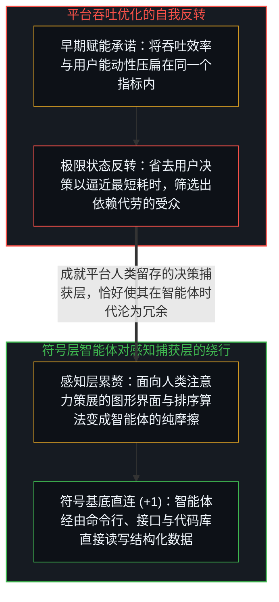
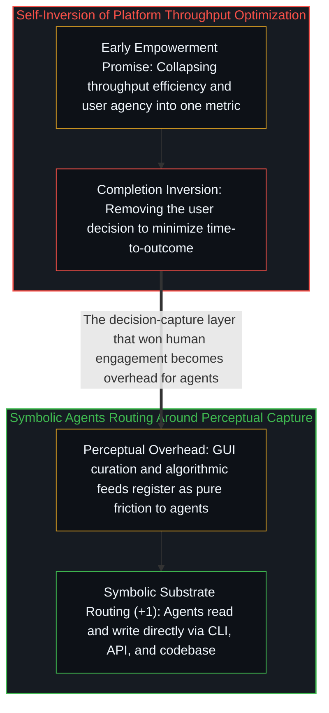

# 平台并未漂移，它只是走到了终点 / The Platform Doesn't Drift, It Completes

*平台从赋能用户转向代做决定并非道德堕落，而是吞吐率指标无法区分赋能与替代时的必然完成。 / Shifting from empowering decisions to making them is the completion of throughput optimization.*

平台的初衷本是赋能用户更高效地做出自己的决定，然而几乎所有平台最终都会退化为替用户做决定——早期的成功反倒成了后期的桎梏。人们习惯将这一现象归咎于“企业贪婪”、“平台劣化”或“创新者的窘境”，仿佛平台背叛了初心、偏离了正轨。然而一旦剥去道德评判的外衣，显露出的却是更为冷峻的结构事实：平台从未发生漂移，它只是把既定的优化目标走到了终点。

The stated role of a platform is to empower users to make their own decisions more efficiently, yet platforms reliably revert to making decisions for users until their early success becomes their defining limitation. Observers routinely file this trajectory under "corporate greed," "platform decay," or the "innovator's dilemma," each label implying a moral betrayal or departure from the original path. Strip away the moral framing and a structural mechanism appears: the platform did not drift; it completed.

## 一、 包含自身反转的优化目标与两重投射的坍缩 / 1. An Optimization Target Containing Its Own Inversion

一个以“决策效率”为优化目标的平台，衡量的是用户抵达结果的耗时。早期降低摩擦的每一项改进——更精准的搜索、更聪明的排序、更清爽的界面——在这一坐标轴上都登记为正向提升。然而这条坐标轴本身包含着它的极限状态：抵达结果最快的路径，恰恰是把“由用户做决定”这一环直接省掉。从自动补全、自动推荐、自动策展直到自动代做决定，每一步在平台的仪表盘上都与最初的优化毫无二致；没有人篡改目标，而是同一个目标在被推向极致时反转了最初的功能。

A platform optimizing for decision efficiency measures how rapidly users reach an outcome, and every early intervention that reduces friction—sharper search, smarter ranking, cleaner interfaces—registers as progress along that axis. Yet the axis contains its own limit: the fastest path to an outcome is removing the user's decision altogether. Auto-complete, auto-recommend, auto-curate, and auto-decide all register as continuations of the exact same optimization because the metric cannot distinguish between enabling a decision and replacing it.

这种反转源于把两个正交的维度压扁进了一个承诺：“吞吐效率”（用户多快抵达结果）具有清晰的梯度，而“能动性”（究竟是谁在做决定）在吞吐轴上并无读数——用零点一秒替你做出的决定，与你用零点一秒自己做出的决定，在吞吐指标上毫无二致。早期平台因技术粗糙而无力代做决定，两条轴看似并肩同行；随着优化深入，有梯度的吞吐率必然甩开无读数的能动性。看重主权的用户随之离场或自建绕行通道，看重省事的用户则留存并加深依赖，筛选出的受众群体反过来锁死了平台的决策捕获架构，正如[界面栈与命令行基底](../cli-interface-stack/)与[是脚手架还是特化语境](../scaffolds-or-specialized-contexts/)、[人工智能为何正在暴露现代学校教育的致命缺陷](../school_essay_final/)、[坍缩的辩论与正交的生存风险轴](../the-collapsed-debate/)与[先于解释的感知](../sensing-before-interpretation/)所追踪的那样。

This inversion arises from collapsing two orthogonal dimensions into the single word "empower": throughput—how fast an outcome is reached—carries a clear gradient, whereas agency—whether the user is the one deciding—registers zero gradient on the throughput axis. At low optimization levels the two travel together by accident because a crude platform can only speed up outcomes by helping users decide; as optimization deepens, throughput pulls away from agency and triggers a selection effect. Users who value agency exit or build workarounds while those who prefer convenience stay, locking the platform into its decision-capture architecture, as traced in [The Interface Stack](../cli-interface-stack/) and [Scaffolds or Specialized Contexts](../scaffolds-or-specialized-contexts/), [Why AI Is Exposing the Fatal Flaw in Modern Schooling](../school_essay_final/), [The Collapsed Debate](../the-collapsed-debate/), and [Sensing Before Interpretation](../sensing-before-interpretation/).

## 二、 智能体时代的选择压力：符号层对感知层的绕行 / 2. Agents as the Next Selection Pressure: Routing Around the Perceptual Layer

从搜索框把网页列表变成直接喂给你的唯一定论，到电商把货架变成系统钦定的默认选项，再到社交时间线用算法信息流取代时间顺序，所有平台都在重复同一条轨迹：“帮你寻找”演变为“替你寻找”，最终演变为“由平台定义什么叫找到”。然而智能体时代的到来并没有去修补这套动态，而是直接从外部加速了选择压力：原生栖居在命令行、应用程序接口（API）与结构化数据层的智能体，以及耦合了如[你的代码库即是记忆](../your-codebase-is-memory/)所剖析的外部代码库的建造者，直接绕过了平台的决策捕获层。

From search engines turning link indices into single curated answers to marketplaces replacing open catalogs with algorithmic defaults, "helping you find" reliably completes into "deciding what counts as found." The arrival of software agents does not repair this dynamic; it accelerates the selection pressure from outside. Operating natively across command-line interfaces, APIs, and externalized repositories as examined in [Your Codebase Is Memory](../your-codebase-is-memory/), agents route around the platform's decision-capture layer altogether.

智能体不需要图形界面的视觉喂养，也不受算法信息流的情绪牵引；平台耗费十余年打磨出的那套专门用来捕获人类感官注意力、替人类代做决定的感知层，在直接解析结构化数据的智能体眼中只是毫无价值的摩擦与累赘。平台由此撞上了一个自身架构无法消化的悖论：当初让它在人类用户身上大获全胜的决策代劳层，恰恰成了它在智能体面前被直接跳过的原因。任何一场被推向极致的优化，都会以自身的完满催生出下一层将其消解的边界条件（参见[至简即至繁](../simplicity-ultimate-sophistication/)）。

Agents have no need for graphical curation and are immune to algorithmic attention nudges; the perceptual layer engineered to capture human attention and pre-digest human choices registers to a symbolic agent as pure overhead. Platforms thus confront a structural inversion born of their own triumph: the decision-capture layer built to maximize human throughput is precisely what makes them obsolete to the next layer of the stack (see [Simplicity Is the Ultimate Sophistication](../simplicity-ultimate-sophistication/)).
