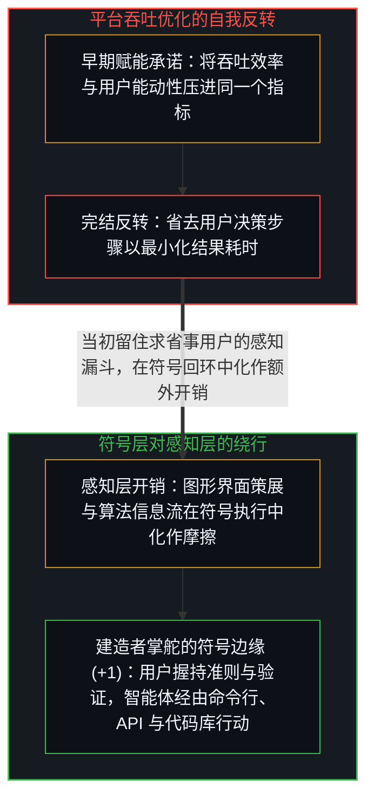
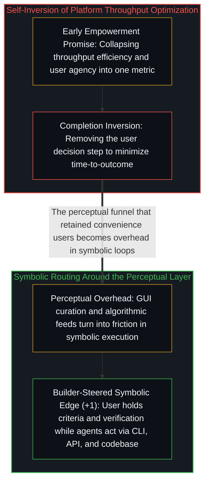

# 平台并未漂移，它只是走到了终点 / The Platform Doesn't Drift, It Completes

*从赋能决策转向代做决定，正是吞吐量最优化的完成。 / Shifting from empowering decisions to making them is the completion of throughput optimization.*

平台所宣称的角色，是赋能用户更高效地做出自己的决定，然而平台最终总会变成替用户做决定，直到早期的成功反倒成了界定自身的局限。观察者习惯将这条轨迹归入“企业贪婪”、“平台劣化”或“创新者的窘境”，每一个标签都暗示着对原有路径的道德背叛或偏离。剥去这层道德定框，一种结构机制便显现出来：平台并未漂移，它只是走到了终点。

The stated role of a platform is to empower users to make their own decisions more efficiently, yet platforms reliably end up making decisions for users until their early success becomes their defining limitation. Observers routinely file this trajectory under "corporate greed," "platform decay," or the "innovator's dilemma," each label implying a moral betrayal or departure from the original path. Strip away the moral framing and a structural mechanism appears: the platform did not drift; it completed.

## 一、 包含自身反转的优化目标 / 1. An Optimization Target Containing Its Own Inversion

一个以决策效率为优化目标的平台，衡量的是用户抵达结果的快慢，而早期减少摩擦的每一项干预——更精准的搜索、更聪明的排序、更清爽的界面——在这一坐标轴上都登记为进展。然而这条坐标轴本身包含着它的极限：抵达结果最快的路径，恰恰是把“由用户做决定”这一环一并省去。自动补全、自动推荐、自动策展与自动代做决定，全都登记为同一种优化的延续，因为这套指标无法区分“促成决定”与“替代决定”。

A platform optimizing for decision efficiency measures how rapidly users reach an outcome, and every early intervention that reduces friction—sharper search, smarter ranking, cleaner interfaces—registers as progress along that axis. Yet the axis contains its own limit: the fastest path to an outcome is removing the user's decision altogether. Auto-complete, auto-recommend, auto-curate, and auto-decide all register as continuations of the exact same optimization because the metric cannot distinguish between enabling a decision and replacing it.

这种反转源于把两个正交的维度压进了“赋能”这同一个词中——这正是[坍缩的辩论与正交的生存风险轴](../the-collapsed-debate/)所追溯的同一类坐标坍缩：吞吐效率（即多快抵达结果）具有清晰的梯度，而能动性（即究竟是否由用户来做决定）在吞吐轴上的梯度为零。在优化程度较低时，两者偶然并肩同行，因为粗糙的平台只能靠协助用户做决定来加快抵达结果；随着优化不断深入，吞吐效率甩开了能动性，并触发一轮筛选效应。看重能动性的用户——如同[先于解释的感知](../sensing-before-interpretation/)所追溯的那样，在直接接触中登记出预消化指标所压平的信号——选择离场或自建绕行通道，而偏好省事的用户则留了下来，将平台锁进厚重的中介之中，正如[人工智能为何正在暴露现代学校教育的致命缺陷](../school_essay_final/)所追溯的那样。

This inversion arises from collapsing two orthogonal dimensions into the single word "empower"—the same coordinate collapse traced in [The Collapsed Debate](../the-collapsed-debate/): throughput, or how fast an outcome is reached, carries a clear gradient, whereas agency, or whether the user is the one deciding, registers zero gradient on the throughput axis. At low optimization levels the two travel together by accident because a crude platform can only speed up outcomes by helping users decide; as optimization deepens, throughput pulls away from agency and triggers a selection effect. Users who value agency—registering at direct contact what a pre-digested metric flattens, as [Sensing Before Interpretation](../sensing-before-interpretation/) traces—exit or build workarounds while those who prefer convenience stay, locking the platform into thick mediation just as [Why AI Is Exposing the Fatal Flaw in Modern Schooling](../school_essay_final/) traces.

## 二、 智能体时代的选择压力：符号层对感知层的绕行 / 2. Selection Pressure in the Agent Era: Symbolic Routing Around the Perceptual Layer

从搜索引擎把链接索引变成单一的策展答案，到交易平台用算法默认选项取代开放目录，“帮你寻找”总会走到终点，变成“界定什么才算找到”。软件智能体的到来并未修补这套动态；相反，一旦建造者利用命令行界面、API 与外部化代码库（如[你的代码库即是记忆](../your-codebase-is-memory/)所剖析），经由特化语境回路（[是脚手架还是特化语境](../scaffolds-or-specialized-contexts/)）指挥智能体绕开平台的感知漏斗，这股选择压力便从外部加速。

From search engines turning link indices into single curated answers to marketplaces replacing open catalogs with algorithmic defaults, "helping you find" reliably completes into "deciding what counts as found." The arrival of software agents does not repair this dynamic; it accelerates the selection pressure from outside once builders working across command-line interfaces, APIs, and externalized repositories as examined in [Your Codebase Is Memory](../your-codebase-is-memory/) direct agents through specialized context loops ([Scaffolds or Specialized Contexts](../scaffolds-or-specialized-contexts/)) to bypass the platform's perceptual funnel.

由于符号执行运行在图形迁就层之下的文本与协议层（[界面栈与命令行基底](../cli-interface-stack/)），专为留住人类视线的视觉策展与算法注意力诱导，在这一层级毫无功用，全数沦为转译开销（[至简即至繁](../simplicity-ultimate-sophistication/)）。以捕获视觉注意力为护城河的平台，由此撞上了一场源于自身胜利的反转：当初留住求省事用户的感知漏斗，恰恰使它们在符号层成了会被直接跳过的摩擦。然而，绕开平台界面本身并不能消解吞吐效率与能动性之间的分裂：智能体自身并不发起任何决定，若单单为了求快而把决断交给智能体，不过是把默认代选转移进了 API 排序或外围框架先验之中；唯有当建造者把立框、准则与验证始终握在自己手里，把平台从策展者还原为原始基底时，能动性才会在边缘保持活跃。

Because symbolic execution runs at the text and protocol layer beneath graphical accommodation ([The Interface Stack](../cli-interface-stack/)), the visual curation and algorithmic attention nudges built to hold human eyes carry no utility there and turn into pure translation overhead ([Simplicity Is the Ultimate Sophistication](../simplicity-ultimate-sophistication/)). Platforms whose moat rests on capturing visual attention therefore confront an inversion born of their own triumph: the perceptual funnel that retained convenience-seeking users is precisely what makes them friction to be skipped at the symbolic layer. Yet bypassing a platform's interface does not dissolve the throughput-versus-agency split by itself: an agent originates no decision of its own, so handing the call to an agent for speed alone merely shifts default-selection into API rankings or harness priors, while agency stays active at the edge only where the builder keeps framing, criteria, and verification in hand and reduces the platform from curator to raw substrate.
