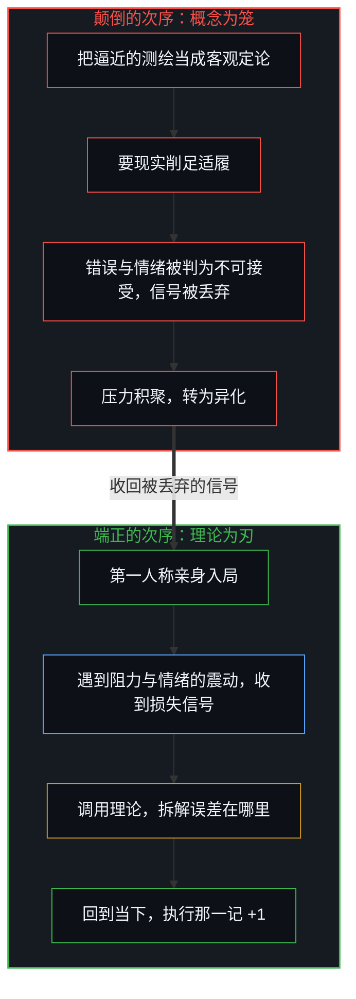
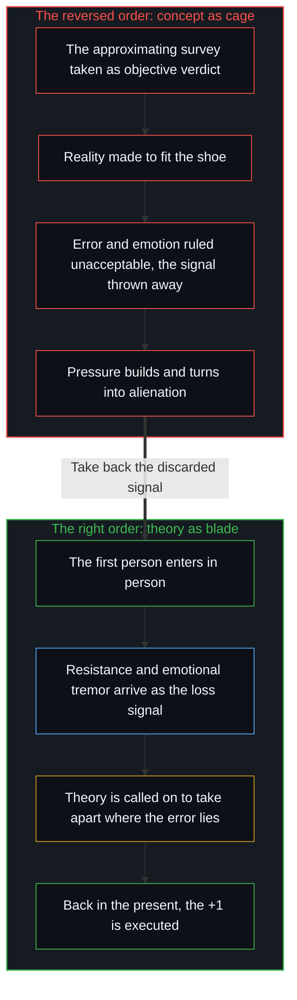

# 破除概念的僭越 / Breaking the Overreach of Concepts

*概念是导航用的局部测绘，错误与情绪是它回传的信号 / A concept is a local survey for navigating, and error and emotion are the signal it sends back.*

算式 1 + 1 = 2 在纸面上是一条静止、对称、已经完成的法则。在因果一步步展开的地方，“+”却不是一个印刷符号，而是一次必须花力气、遇阻力、付代价的执行。概念的僭越，就是把纸面上已完成的那一面，当成仍在展开的那一面：用第三人称的全景图置换第一人称的切身在场，用驯服的符号顶替未决的因果。站在起点的 1 上反复盘算、等一张完美的图纸，而从不去执行那一记粗糙的 +1，2 就一直只是纸面上的 2。

On paper the sum 1 + 1 = 2 is a still, symmetrical, finished law. Where causality unfolds step by step, however, "+" is not a printed sign but an execution that takes effort, meets resistance and pays a cost. The overreach of concepts is taking the finished face on paper for the face still unfolding: swapping a third-person panorama for first-person presence, and letting tame symbols stand in for undecided causality. Standing on the starting 1, calculating again and again and waiting for a flawless blueprint without ever executing that rough +1, the 2 stays a 2 on paper.

[从形式迷思到逻辑闭环](../cong-xing-shi-mi-si-dao-luo-ji-bi-huan/)走过同一道缝：记住符号，不等于因果落了地。[寄存器的算术](../the-arithmetic-of-the-register/)在账本上看见同一件事：数字的对称，代替不了生成时实际发生的那一次位移。

[From the Myth of Form to the Closed Loop of Logic](../cong-xing-shi-mi-si-dao-luo-ji-bi-huan/) walks the same seam: remembering the symbol is not causality landing. [The Arithmetic of the Register](../the-arithmetic-of-the-register/) sees the same thing in the ledger: the symmetry of the numbers cannot stand in for the displacement that actually happens in generating them.

## 一、 测绘与颠倒 / 1. The Survey and the Reversal

从第一人称的原点去找，能找到的在场者只有当下这一个感知切片。过去是当下保留下来的痕迹，未来是当下向前敞开的可能，两端都从现在这一处投射出去。[现实的边界](../xian-shi-de-bian-jie/)确认的正是这一点：心智从未离开过现在。即便谈论记录过去的介质，岩层、底片、硬盘，谈论本身也发生在这一处。[非万物之理](../manifesto-of-not-a-theory-of-everything/)从这里起步。

Searched for from the first-person origin, the only thing present is this one perceptual slice of now. The past is the trace the present keeps, the future is the possibility the present opens ahead, and both ends are projected out from this one place. [The Boundary of Reality](../xian-shi-de-bian-jie/) confirms exactly this: the Mind never leaves the present. Even talk of the media that record the past, rock strata, film, hard drives, takes place here. [Not a Theory of Everything](../manifesto-of-not-a-theory-of-everything/) starts from this point.

这并不是说看到的世界是幻觉。宣布世界是“假的”和宣布它是“全然客观的”，站在同一个地方：一个不属于任何心智的位置。从原点出发找不到那个位置，所以两种宣判都下不了。登记到的是摩擦：意料之外的东西，不随意愿让开的东西，一再回来的阻力。看到的，就是能看到的。“真”与“假”、“主观”与“客观”，是在经验之内为了预期和协同行动而立的尺子；撤不掉这双眼睛，去看没有眼睛时世界的样子。[模型永远无法成为第二重前沿](../the-model-never-becomes-a-second-edge/)：一切表征都晚于正在发生的那一步。物理主义把这一处换成了一个无人的视角，[因果的自反性与物理的无源假定](../causality-is-irreducible-the-physical-is-a-view-from-nowhere/)指出了它所倚靠的那个位置。

None of this says the world that is seen is an illusion. Declaring the world "fake" and declaring it "wholly objective" stand in the same place: a position belonging to no Mind. Starting from the origin, that position is not found, so neither verdict can be passed. What registers is friction: what was not expected, what does not give way to wishing, resistance that keeps coming back. What is seen is what can be seen. "True" and "false", "subjective" and "objective", are rulers set up inside experience for anticipation and for coordinating action among individuals; these eyes cannot be taken away to look at the world as it is without eyes. [The Model Never Becomes a Second Edge](../the-model-never-becomes-a-second-edge/): every representation comes after the step that is happening. Physicalism swaps this place for a view from no one, and [Causality is Irreducible; The Physical is a View from Nowhere](../causality-is-irreducible-the-physical-is-a-view-from-nowhere/) locates the position it leans on.

理论的用处在这里显出来：借着对因果的理解，向后逼近过去，向前预估未来。这是雾中的局部测绘，有折损，有盲区，它给行动一个落脚点。纸面上的推演替代不了行动中的摩擦，[调速者的幻觉与行动的活态摩擦](../the-fallacy-of-pacing-and-the-felt-friction-of-ground-truth/)在节奏上看到了同一件事。

The use of theory shows itself here: through an understanding of causality, approximating the past looking back and estimating the future looking ahead. This is local surveying in fog, with losses and blind spots, and it gives action a foothold. Deduction on paper cannot replace the friction of acting, which [The Fallacy of Pacing and the Felt Friction of Ground Truth](../the-fallacy-of-pacing-and-the-felt-friction-of-ground-truth/) sees in the matter of rhythm.

颠倒发生在测绘被当成地形的时候。本是借理论去读处境，转而把那张带着折损的草图，当成比处境高出一级的“客观基底”。在[因果贯穿始终](../causality-all-the-way/)里，因果链无始无终，却不是一条铺在虚空里的实体链条：被觉察到的每一个切片，都承接前一刻的扰动，又成为下一刻的边界条件；链条是这种承接的名字。[错置的因果与心智编译器](../cuo-zhi-de-yin-guo-yu-xin-zhi-bian-yi-qi/)看到了下一步：不可逆的因果被换成可以倒着跑的几何参数 t，时间被换成孤立系统里的熵增，未完的潜无穷被符号 ∞ 封成一个可以求和的整体。到这一步，测绘图坐上了地形的位置。

The reversal happens when the survey is taken for the terrain. Theory was meant for reading a situation; instead the damaged sketch is taken for an "objective substrate" one level above the situation. In [Causality All the Way](../causality-all-the-way/) the causal chain has no beginning and no end, yet it is not a substantial chain laid out in the void: each slice that is noticed carries on the disturbance of the moment before and becomes the boundary condition of the moment after, and "chain" is the name of that carrying on. [Misplaced Causality and the Mind's Compiler](../cuo-zhi-de-yin-guo-yu-xin-zhi-bian-yi-qi/) sees the next step: irreversible causality is replaced by a geometric parameter t that can be run backward, time is replaced by entropy increase in an isolated system, and the unfinished potential infinity is sealed by the symbol ∞ into a whole that can be summed. At that point the survey has taken the seat of the terrain.

理论是辨认方向的火把。颠倒之后，火把照亮的那一圈光，被当成了整片荒原的边界。

Theory is a torch for finding one's bearings. After the reversal, the ring of light the torch throws is taken for the border of the whole wilderness.

## 二、 错误与情绪是回传的信号 / 2. Error and Emotion Are the Signal Sent Back

要把次序摆正，先要放下“理智”与“反馈、情绪”相对立的那个分法。理性常把外部的错误当成羞耻，把内部的负面情绪当成要清除的噪声。借机器学习的一幅图来看，错误与负面情绪是测绘与地形相撞之后回传的损失（loss）。

To set the order right, the split that sets "reason" against "feedback and emotion" has to go first. Reason tends to treat outward error as disgrace and inward negative emotion as noise to be cleared. Borrowing a picture from machine learning, error and negative emotion are the loss sent back when the survey collides with the terrain.

在思想的真空里，模型的误差恒为零。只有把模型放进行动，失算和受挫才出现；它们是图与地相撞时登记下来的摩擦，每一次错误都是写在图上的一条修正。情绪是同一类信号在身体上的登记。预期与到来的东西相合时，情绪平静，几乎不带新的信息；悲伤、恐惧、愤怒、焦虑登记的是一道裂口，预设的图与正在发生的这一刻对不上了。这个信号来得比任何推理都快，指向的也比任何推理都近：它指的就是差在哪里。

In a vacuum of thought a model's error is always zero. Only when the model is put into action do miscalculation and setback appear; they are friction registered where map meets ground, and each error is a correction written onto the map. Emotion is the same kind of signal registered in the body. When what arrives fits what was expected, emotion is calm and carries almost no new information; sadness, fear, anger and anxiety register a rift, the preset map no longer matching the moment that is happening. The signal comes faster than any reasoning and points closer than any reasoning: it points at where the difference lies.

第二层的损失从这里开始。现实击碎预期，一阶的信号到来：悲伤、恐惧、挫败。随后一条被训练出来的规则替这个信号下判决：“不该生气”，“强者不焦虑”，“悲伤是软弱”。[自尊的刚性外壳与隐性外部归因](../zi-zun-de-gang-xing-wai-ke-yu-yin-xing-wai-bu-gui-yin/)看到的正是这一步：为了保住无误的形象，误差被拒认。于是负担翻了一倍，原先那次碰撞的痛还在，又加上“居然有这种情绪”的自我审判。这第二层损失不来自现实，是判决本身造出来的。用理性去消灭情绪，像对着火药库开枪救火。

The second layer of loss begins here. Reality shatters an expectation and the first-order signal arrives: sadness, fear, frustration. Then a trained rule passes a verdict on the signal: "one should not be angry", "the strong do not get anxious", "sadness is weakness". [The Rigid Shell of Self-Esteem and Hidden External Attribution](../zi-zun-de-gang-xing-wai-ke-yu-yin-xing-wai-bu-gui-yin/) sees exactly this step: to keep an image of being without error, the error is disowned. The load then doubles: the pain of the original collision is still there, and on top of it comes the self-trial of "how could such a feeling arise". This second layer of loss does not come from reality; the verdict itself makes it. Using reason to destroy emotion is like firing a gun at a powder magazine to put out its fire.

接纳这个信号，用理智去定位图上哪里错了，再调整下一步，信号就在那一记 +1 里被用掉了，像梯度沿着误差下降。判它“不合法”、切断它通往觉察与行动的路，信号并不因此消失；它还在登记，积成一种找不到出口的压力。

Taking the signal in, using reason to locate where the map went wrong and adjusting the next step, the signal is spent in that +1, the way a gradient descends along the error. Ruling it "illegal" and cutting its path to awareness and action does not make it disappear; it keeps registering and builds into pressure with no outlet.

这压力会找出口。向外，它落在别人身上，成为莫名的敌意与攻击；向内，它落在身体上，成为失眠、偏头痛、长久的紧绷，重的时候成为对自身的伤害。即便到了这里，下一步怎么走仍是这个心智自己的选择；压力做到的，是让选择显得像没有选择。[决定论机器](../the-deterministic-machine/)剖开的就是这一层：模型被锁死，选择被否认，因果的力量被搬到自身之外。剧烈的异化，起点在把损失当成污点扔掉的那一刻。

The pressure looks for an outlet. Outward, it lands on others as hostility and aggression without a clear cause; inward, it lands on the body as insomnia, migraine, long tension, and at its heaviest as harm done to oneself. Even here the next step is still the choice of this Mind; what the pressure does is make a choice look like no choice. [The Deterministic Machine](../the-deterministic-machine/) dissects exactly this layer: the model locked, choice denied, causal power moved outside oneself. Violent alienation starts at the moment the loss is thrown away as a stain.

## 三、 阿甘的跑鞋 / 3. Gump's Running Shoes

把错误与情绪当作信号来看，就能看清《阿甘正传》里那种不经中介的行动是怎么回事。

Seeing error and emotion as signal makes clear what the unmediated action in *Forrest Gump* consists of.

有一种姿态，是在脑子里先把误差消到零再动。为了推理的无瑕，宁可改写对现实的解释，也不去承受碰撞。这种姿态容易停在沙盘上，动不起来。

There is a posture that wants error brought to zero in the head before moving. For the sake of flawless reasoning it would rather rewrite its account of reality than take the collision. That posture tends to stay on the sand table, unable to move.

阿甘体现的是另一种姿态。珍妮喊他跑，他就跑，腿上的支架在奔跑中散落一地。出海捕虾，网拉上来全是破鞋和碎瓦，他不替这次落空背一个概念上的包袱：倒掉，调整，再撒一网。丹中尉带着一个故事，家族世代死在战场上，他也该如此；故事被现实打断时，他把损失对准了世界与自己，直到很久以后，在风暴里的桅杆上才放下它。同一种失落，在两种姿态里走了两条路。

Gump embodies the other posture. Jenny shouts at him to run and he runs, his leg braces scattering as he goes. Out shrimping, the nets come up full of old shoes and broken tiles, and he carries no conceptual burden for the miss: dump it, adjust, cast again. Lieutenant Dan carries a story, that his family has died in every war and he should too; when reality breaks the story he aims the loss at the world and at himself, until much later, up the mast in the storm, he lets it go. The same kind of loss takes two roads in two postures.

记者追问他为什么跑，他的回答只有一句：“I just felt like running.”他没有向任何抽象体系去讨行动的许可。[路口的转向与地平说的行动悖论](../lu-kou-de-zhuan-xiang-yu-di-ping-shuo-de-xing-dong-bei-lun/)与[个体抉择是唯一的因果杠杆](../individual-choices-as-the-only-causal-levers/)讲的都是这一处：行动的杠杆只在作出选择的那一个位置上。另一面也要看清。飓风毁掉港里所有渔船、偏偏留下阿甘的船，这不是他挣来的，是落在他身上的；他做到的，只是一次次落空之后手还放在舵上。把风暴之后的丰收讲成“只有坚持的人才会被托起”，就已经是下一节要说的倒放。

Asked by reporters why he runs, he has one answer: "I just felt like running." He never asked any abstract system for permission to act. [Turning at the Crossroad and the Flat-Earth Action Paradox](../lu-kou-de-zhuan-xiang-yu-di-ping-shuo-de-xing-dong-bei-lun/) and [Individual Choices as the Only Causal Levers](../individual-choices-as-the-only-causal-levers/) are both about this place: the lever of action sits only at the position where the choice is made. The other side needs seeing too. The hurricane that wrecks every boat in the harbor and spares Gump's was not earned; it fell to him. What he did was keep a hand on the wheel after miss after miss. Telling the catch after the storm as "only those who persist are lifted up" is already the playback the next section is about.

## 四、 磁带倒放 / 4. The Tape Played Backward

靠第一人称试错走出来的人，到了终点，同样容易落进理性的倒放。回头看时，那段满是迷雾、险滩与侥幸的摸索，被事后的建模剪成一条因果严密、注定如此的大路。[成功学](../cheng-gong-xue/)剖开的就是这种倒果为因：九十九次撞得头破血流的错误与挣扎被剪出叙述，而它们恰是第一百次收敛的前提。剪好的故事再被当成一张人人共用的地图，就落进了[共享沙盒的幻象](../the-illusion-of-the-shared-sandbox/)：以为别人站在同一张图上。

Those who found their way by first-person trial and error fall just as easily, at the finish, into reason's playback. Looking back, the groping through fog, rapids and luck is edited by after-the-fact modelling into a causally tight road that had to be. [Theories After Success, Mistaken for Theories Leading to Success](../cheng-gong-xue/) dissects this reversal of effect into cause: the ninety-nine bruising errors and struggles are cut from the story, though they were the precondition of the hundredth convergence. The edited story, taken in turn as a map everyone shares, falls into [The Illusion of the Shared Sandbox](../the-illusion-of-the-shared-sandbox/): the belief that others stand on the same map.

出于庇护，走到终点的人常想替后来者铲平沟壑，建一座不受挫的温室。[成功之后的育儿谬误](../the-fallacy-of-post-success-parenting/)看到了这份善意里的两重剥夺。解决问题的直觉与韧性，是一次次碰撞与情绪的损失调出来的权重；替人清掉摩擦，也就清掉了用误差校准自己的机会。后来者又被夹在长辈那张不容置疑的地图与自己的处境之间，失去了试错的余地，却背上了“照着标准答案仍然过不好”的内疚。

Out of the wish to shelter, those who reached the finish often want to level the ravines for those who come after and build a greenhouse free of setbacks. [The Fallacy of Post-Success Parenting](../the-fallacy-of-post-success-parenting/) sees a double deprivation in that kindness. The intuition and resilience for solving problems are weights tuned by collision after collision and by the loss carried in emotion; clearing the friction away for someone also clears away their chance to calibrate themselves by error. And the one who comes after is caught between the elders' unquestionable map and their own situation, without room for trial and error, yet carrying the guilt of "following the standard answer and still not living well".

## 五、 端正次序 / 5. Setting the Order Right

剖开概念的僭越，不是走向反智、去砸碎理论，恰恰是把理论放回工具的位置，让它重新锋利。心智既是向量又是坐标系，[向量、坐标系与自指心智](../the-mind-as-vector-and-coordinate-system/)给出了与概念相处的那套几何。

Dissecting the overreach of concepts is not a turn to anti-intellectualism that smashes theory; it puts theory back in the place of a tool so that it is sharp again. The Mind is both vector and coordinate system, and [The Mind as Vector and Coordinate System](../the-mind-as-vector-and-coordinate-system/) gives the geometry for living with concepts.

概念、模型与学术框架，都是手上的工具，是为了在当下导航而画的逼近图。[遗忘的脚手架](../the-scaffolding-we-forget/)早已讲明，脚手架在建筑成形之后撤去。工具锋不锋利，不看它在工具箱里多对称，看握刀的手腕与被切之物的质地。抽象一级级往上走，也不会变成执行者，[抽象的阶梯与可执行的实体](../the-ladder-of-abstraction-and-the-executable-entity/)在 AI 身上看清了这一点。两种次序的差别，就在信号被丢弃还是被收回：

Concepts, models and academic frameworks are tools in the hand, approximating maps drawn to navigate the present. [The Scaffolding We Forget](../the-scaffolding-we-forget/) made it plain long ago that scaffolding comes down once the building stands. How sharp a tool is depends not on how symmetrical it looks in the toolbox but on the wrist holding the blade and the grain of what is being cut. Abstraction climbing level after level never turns into the executor, which [The Ladder of Abstraction and the Executable Entity](../the-ladder-of-abstraction-and-the-executable-entity/) sees clearly in AI. The difference between the two orders lies in whether the signal is thrown away or taken back:

离开因果的理论，像停了的钟自称永恒；离开第一人称的观察，像离开身体悬在半空；把未完的潜无穷当成可以封箱的实无穷，是用有限的符号去收拢一个仍在展开的宇宙；把错误与情绪当成过错扔掉，是自己丢掉了最灵敏的那只罗盘。以为“已知”，就截去了现实留下的余量，[以知为刃的截肢与解脱](../the-illusion-of-knowing-and-the-geometry-of-amputation/)剖开了这种截肢的几何；把彼此不可通约的视界列进同一张清单，是同一次截肢的另一面，[远方的轮廓与无处之境的清单](../the-distant-silhouette-and-the-inventory-from-nowhere/)看到了它。

Theory apart from causality is a stopped clock calling itself eternal; observation apart from the first person is a body left hanging in the air; taking the unfinished potential infinity for a sealable actual infinity is gathering a still-unfolding universe into finite symbols; throwing error and emotion away as faults is discarding the most sensitive compass at hand. Believing something "known" cuts away the margin reality leaves, and [The Illusion of Knowing and the Geometry of Amputation](../the-illusion-of-knowing-and-the-geometry-of-amputation/) dissects the geometry of that cut; listing incommensurable horizons on one inventory is the other face of the same cut, which [The Distant Silhouette and the Inventory from Nowhere](../the-distant-silhouette-and-the-inventory-from-nowhere/) sees.

现实不是一件等着被审计完毕的死物，是在不可逆的因果里一步步代谢展开的活火。[牛肝菌、算力风暴与普罗米修斯的火](../boletus-compute-storm-and-promethean-fire/)：脱离身体的算力风暴，在粗粝的秤盘上压不出一粒尘；生活的定盘星落在切身的冷暖与日常的镬气之间。清醒不是躲进模型里预支终局，而是把投向虚构时空的视线收回来，站在脚下的泥土上。跟概念对着干，仍然绕着它的轴转；[流动中的坐标](../coordinates-in-flux-negation-and-self-anchoring/)讲的是不靠对立、自己锚定的那一种。

Reality is not a dead thing waiting to be fully audited but a living fire unfolding by metabolism, step by step, in irreversible causality. [Boletus, the Compute Storm, and Promethean Fire](../boletus-compute-storm-and-promethean-fire/): a storm of compute cut off from the body cannot press one grain of dust onto the rough scale; the fixed star of living sits between felt warmth and cold and the wok-heat of the everyday. Lucidity is not hiding inside a model to draw on the ending in advance, but bringing the gaze back from imagined spacetime to the soil underfoot. Fighting a concept still turns on its axis; [Coordinates in Flux](../coordinates-in-flux-negation-and-self-anchoring/) is about the anchoring that needs no opposition.

承接前史，读懂每一个内部与外部的损失，然后执行属于当下的那一记 +1：因果在第一人称这一处，只以这种方式发生。

Carrying on the prehistory, reading every inner and outer loss, then executing the +1 that belongs to the present: this is the only way causality happens at the first-person place.
