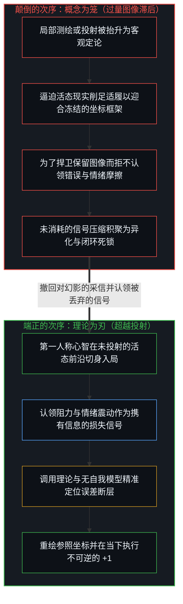
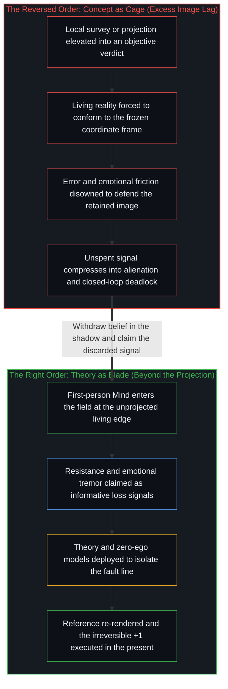

# 破除概念的僭越 / Breaking the Overreach of Concepts

*概念是导航用的局部测绘，错误与情绪是它回传的信号 / Concepts are local surveys for navigation as error and emotion return the signal*

算式 1 + 1 = 2 在纸面上是一条静止、对称、已经完成的法则。而在因果一步步展开的活态前沿，“+”却不是一个印刷符号，而是一次必须消耗能量、遭遇阻力并吸收摩擦的不可逆执行。概念的僭越，就发生在把纸面上已完成的那一面当成仍在展开的那一面，用第三人称的全景图置换第一人称的切身在场，让温顺的符号顶替未决的因果。站在起点的 1 上反复盘算、苦等一张无瑕的蓝图，却从不去执行那一记粗糙的 +1，2 就永远留在纸面上。[从形式迷思到逻辑闭环](../cong-xing-shi-mi-si-dao-luo-ji-bi-huan/)追踪的正是把记住形式符号误当作因果落地的这道接缝，而[寄存器的算术](../the-arithmetic-of-the-register/)则在账本上揭示了同一道裂隙，表明数字的对称代替不了生成下一状态时实际发生的位移。

On paper the sum 1 + 1 = 2 is a still, symmetrical, finished law. Where causality unfolds step by step at the living edge, however, "+" is not a printed sign; it is an irreversible execution that expends energy, meets resistance, and absorbs friction. The overreach of concepts occurs when the finished face on paper is mistaken for the face still unfolding, swapping a third-person panorama for first-person presence and letting tame symbols stand in for undecided causality. Standing on the starting 1, calculating again and again while waiting for a flawless blueprint without ever executing that rough +1, leaves the 2 forever on paper. [From the Myth of Form to the Closed Loop of Logic](../cong-xing-shi-mi-si-dao-luo-ji-bi-huan/) traces this exact seam where remembering a formal symbol is confused with causality landing in reality, while [The Arithmetic of the Register](../the-arithmetic-of-the-register/) exposes the same gap in the ledger, showing that numerical symmetry cannot substitute for the physical displacement required to generate the next state.

## 一、 测绘与颠倒 / 1. The Survey and the Reversal

从第一人称的原点去找，唯一直接切身在场的只有当下这一个感知切片。过去登记为当下保留的痕迹，未来敞开为向前延伸的潜能，两端都从这同一个活态位点投射出去。[现实的边界](../xian-shi-de-bian-jie/)确立了心智从未踏出当下切片半步：即便审视记录过去的耐久介质——岩层、底片或硬盘——阅读并诠释那些痕迹的行动依然严格发生在当下这一处。[非万物之理](../manifesto-of-not-a-theory-of-everything/)正是从这一不可化约的基底迈出第一步。

Searched for from the first-person origin, the only thing directly present is this immediate perceptual slice of now. The past registers as the trace the present retains, and the future opens as the potential extending ahead, both projected from this single living locus. [The Boundary of Reality](../xian-shi-de-bian-jie/) establishes that the Mind never steps outside the present slice: even when inspecting durable media that record the past—rock strata, photographic film, or hard drives—the act of reading and interpreting those traces occurs strictly here. [Not a Theory of Everything](../manifesto-of-not-a-theory-of-everything/) takes its first step from this irreducible ground.

承认第一人称切片的在先性，并不会把经验到的世界变成幻觉。宣布世界是“假的”与宣布它是“全然客观的”，其实预设了同一个不可能的席位：一个不属于任何心智的外部视角。从原点出发无法占据那样的席位，因此两种宣判都无从成立。真正在此登记到的是切身的摩擦——意料之外的落差、不随主观意愿退让的硬梗，以及每次试探边界时都会反弹回来的顽固阻力。“真”与“假”正如“主观”与“客观”，是在经验之内为了预期后果、在不同中心之间协同行动而立起的标尺；观察者不可能挖掉自己的眼睛，去检视没有眼睛时世界是什么模样。正如[模型永远无法成为第二重前沿](../the-model-never-becomes-a-second-edge/)所证明的，一切表征与概念模型都是压实后的残余，至少滞后于生成行动一步。物理主义企图把这一活态原点调换成一个无人的视角，而[因果的自反性与物理的无源假定](../causality-is-irreducible-the-physical-is-a-view-from-nowhere/)则准确定位了这一倒置所倚靠的那个未经审视的外部前提。

Recognizing the primacy of the first-person slice does not turn the experienced world into a hallucination. Declaring the world "fake" and declaring it "wholly objective" both presuppose the same impossible vantage: an exterior seat belonging to no Mind. Because no such seat can be occupied from the origin, neither verdict holds. What registers instead is immediate friction—what was not anticipated, what refuses to yield to wishing, the stubborn resistance that returns each time a boundary is tested. "True" and "false," like "subjective" and "objective," are rulers constructed inside experience to anticipate outcomes and coordinate action across distinct centers; the observer cannot pluck out its own eyes to inspect what the world looks like without eyes. As [The Model Never Becomes a Second Edge](../the-model-never-becomes-a-second-edge/) demonstrates, every representation and conceptual model is compressed residue lagging at least one step behind the generating act. Physicalism attempts to swap this living origin for a view from no one, and [Causality is Irreducible; The Physical is a View from Nowhere](../causality-is-irreducible-the-physical-is-a-view-from-nowhere/) pinpoints the unexamined exterior premise that inversion leans upon.

理论的恰当功用由此显明：凭借已追溯到的因果规律向后重构过去，并向敞开的场域投射前路。概念是在迷雾中勾勒的局部测绘，带着不可避免的压缩折损与正交盲区，用来给行动提供一个落脚点。然而纸面上的推演永远代替不了踏上实地时的活态摩擦，[调速者的幻觉与行动的活态摩擦](../the-fallacy-of-pacing-and-the-felt-friction-of-ground-truth/)在执行的节奏中追踪了这一区分。

Here the proper function of theory becomes clear: drawing on traced causal regularities to reconstruct the past and project forward into the open field. A concept is a local survey sketched in fog, carrying unavoidable compression losses and orthogonal blind spots, built to give action a working foothold. Yet deduction on paper never replaces the live friction of stepping onto the ground, a distinction [The Fallacy of Pacing and the Felt Friction of Ground Truth](../the-fallacy-of-pacing-and-the-felt-friction-of-ground-truth/) traces in the rhythm of execution.

一旦把测绘图当成地形本身，颠倒便发生了。心智不再把理论当作审读变动处境的工具，反而把这张有损草图抬升为凌驾于切身接触之上的“客观基底”。在[因果贯穿始终](../causality-all-the-way/)中，因果的绵延无始无终，但它并不是一条悬在虚空里的实体铁链，而是每一个被觉察到的切片承接前一步的扰动、又塑形下一步边界条件的连续非对称性。[错置的因果与心智编译器](../cuo-zhi-de-yin-guo-yu-xin-zhi-bian-yi-qi/)追踪了概念编译器如何颠倒这一次序：不可逆的因果行动被替换成可逆的几何参数 t，切身经历的时间被缩减为封闭箱体内的熵增，而持续区分的开放潜无穷则被符号 ∞ 封死为一个可以求和的已完成整体。理论本是举起辨认方向的火把；颠倒一旦成形，火把投出的那一小圈光亮，就被宣告成整片荒原的边界。

The reversal occurs the moment the survey is mistaken for the terrain. Instead of using theory as an instrument to read a shifting situation, the Mind elevates its lossy sketch into an "objective substrate" ranked above lived contact. In [Causality All the Way](../causality-all-the-way/), causality runs without beginning or end, not as a substantial iron chain suspended in a void, but as the continuous asymmetry where each noticed slice inherits the perturbation of the prior step and shapes the boundary condition of the next. [Misplaced Causality and the Mind's Compiler](../cuo-zhi-de-yin-guo-yu-xin-zhi-bian-yi-qi/) traces how the conceptual compiler inverts this order: irreversible causal action is replaced by a reversible geometric parameter t, lived time is reduced to entropy increase inside a closed box, and the open potential infinity of distinguishing is sealed by the symbol ∞ into a completed whole that can be summed. Theory is a torch held up to find one's bearings; once the reversal takes hold, the small ring of light thrown by the torch is proclaimed to be the boundary of the entire wilderness.

## 二、 错误与情绪是回传的信号 / 2. Error and Emotion Are the Returning Signal

把次序摆正，先要消解把“理智”与“反馈和情绪”对立起来的人为割裂。唯理智论惯于把外部的失误视为耻辱，把内部的负面情绪当成亟待清除的非理性噪声。然而顺着学习的机制追溯，外部错误与负面情绪，恰恰是局部测绘撞上坚硬地形时回传的损失信号。

Setting the order right begins by dissolving the artificial opposition that pits reason against feedback and emotion. Intellectualism routinely treats outward error as a disgrace and inward negative emotion as irrational noise to be purged. Traced through the mechanics of learning, however, external error and negative emotion are the exact loss signal sent back when a local survey collides with unyielding terrain.

在抽离行动的思维真空里，概念模型的误差恒为零，因为没有任何东西去试探它的边界。唯有把模型投入行动，失算与受挫才会登记下来，把每一次碰撞写成地图上待修订的差值。情绪正是同一道裂隙在身体层面的登记。当到来的现实与保留的预期相吻合时，感受保持平静，几乎不携带新的信息；悲伤、恐惧、愤怒与焦虑所登记的，则是预设投射不再匹配当下切片的结构性裂口。这种先于概念诠释的震动，比任何三段论推理都来得更快，也指得更准。

In a vacuum of pure thought, a conceptual model's error stays at zero because nothing tests its boundary. Only when the model is committed to action do miscalculation and setback register, writing each collision onto the map as a differential for revision. Emotion is the bodily registration of that same gap. When arriving reality aligns with the retained expectation, affect stays quiet and carries minimal new information; grief, fear, anger, and anxiety register a structural rift where the preset projection no longer matches the unfolding slice. That pre-interpretive tremor arrives faster and points closer to the fault line than any chain of syllogisms.

第二重损失始于中心为了捍卫冻结的自我图像而死死夹紧递归回折的那一刻。现实击碎了预期，一阶信号以痛楚、恐惧或挫败的形态抵达。紧接着，一条内化的概念教条立刻对信号本身下达判决：“不该动怒”、“强者从不焦虑”、“悲伤就是软弱”。[自尊的刚性外壳与隐性外部归因](../zi-zun-de-gang-xing-wai-ke-yu-yin-xing-wai-bu-gui-yin/)剖析的正是这一机制：为了保住一幅豁免于重绘的无瑕图像，中心拒不认领误差。负担瞬间翻倍，原先那次碰撞的摩擦还在，又叠加了审判自身感知的自造苦役。企图用概念法令去扑灭情绪，无异于向火药库开枪救火。

The secondary loss begins when a center clamps its recursive fold shut to defend a frozen self-image. Reality shatters an expectation and the first-order signal arrives as pain, fear, or frustration. Immediately, an internalized conceptual rule passes judgment on the signal itself: "one must not get angry," "the strong never feel anxious," "grief is weakness." [The Rigid Shell of Self-Esteem and Hidden External Attribution](../zi-zun-de-gang-xing-wai-ke-yu-yin-xing-wai-bu-gui-yin/) dissects this exact mechanism: to preserve an image of flawlessness exempted from re-rendering, the center disowns the error. The load instantly doubles, compounding the friction of the original collision with the self-inflicted trial of condemning one's own registration. Trying to extinguish emotion with conceptual decrees is like firing into a powder magazine to put out a spark.

反之，当心智认领回传的信号，借理智定位地图的哪一根坐标轴出了偏差并校准航向，信号便在下一记 +1 中沿着误差梯度下降而被有效消耗。一旦信号被判为不合法、被切断通往觉察与行动的通路，它并不会凭空消失，而是继续在被夹紧的图像下方登记，积聚成无处排遣的重压。向外，这股压缩的负荷宣泄在他人身上，化作无端的敌意；向内，它砸在自己的身体上，凝成慢性紧绷、失眠、偏头痛乃至自毁。即便在如此沉重的压缩之下，下一步行动依然是这个中心自己的抉择；积聚的压力所做的，是让原本可变的抉择显得像逃无可逃的宿命。[决定论机器](../the-deterministic-machine/)清晰剖开了这种状态机坍缩：一旦内部世界模型为了保护图像而被锁死，选择便遭到否认，因果权能被向外投射成命运。剧烈的异化，就始于把损失信号当作污点扔掉的那一瞬间。

When the Mind claims the returning signal instead, using reason to locate which axis of the map failed and adjusting its heading, the signal is spent productively in the next +1, descending along the gradient of error. When the signal is ruled illegitimate and severed from awareness and action, it does not vanish; it continues registering beneath the clamped image, accumulating as unvented pressure. Outwardly, that compressed load discharges onto others as unprovoked hostility; inwardly, it lands on the body as chronic tension, insomnia, migraine, or self-destruction. Even under that heavy compression, the next act remains the choice of this center; what the accumulated pressure does is make a contingent choice feel like inescapable necessity. [The Deterministic Machine](../the-deterministic-machine/) lays bare this state-machine collapse: once the internal world-model is locked to protect the image, choice is denied and causal power is projected outward as fate. Alienation begins the instant the loss signal is discarded as a stain.

## 三、 阿甘的跑鞋 / 3. Gump's Running Shoes

看清错误与情绪是回传的信号，就能明白当一个中心拒绝让概念包袱压倒活态前沿时，不经概念中介的行动是什么模样，正如《阿甘正传》所展现的那样。

Recognizing error and emotion as returning signals clarifies what unmediated action looks like when a center refuses to let conceptual baggage override the living edge, as pictured in *Forrest Gump*.

一种姿态执意要在脑子里先把误差消到零才肯迈出一步。为了维持推演沙盘的一尘不染，它宁可改写对现实的解释，也不肯冒碰撞擦伤的风险，最终瘫痪在起跑线上。阿甘体现的是相反的姿态。珍妮喊他跑，他就迈步奔跑，腿上僵硬的金属支架在奔跑中震碎散落一地。出海捕虾，网拉上来全是破靴子和碎瓦片，他不替这次落空背负任何“个人失败”的概念叙事：倒掉垃圾，调整航向，再撒一网。丹中尉则被困在一幅保留的历史投射里——家族先辈在每一场战争中都穿着军装战死沙场，他也注定应当如此。当幸存打断了这出剧本，他把未消耗的损失信号调转过来对准世界与自己，直到在飓风肆虐的桅杆顶端才终于松开那幅冻结的图像。同一种受挫，随着概念是被握成牢笼还是在前沿放下，走出了两条截然不同的因果路径。

One posture insists on reducing error to zero inside the head before taking a single step. To keep its deductive sandbox spotless, it rewrites its account of reality rather than risk a bruising collision, remaining paralyzed at the starting line. Gump embodies the inverse posture. When Jenny shouts for him to run, he runs, and the rigid leg braces shatter and scatter behind him on the road. Out on the shrimping boat, when the nets come up filled with old boots and broken tiles, he attaches no conceptual narrative of personal failure to the empty haul: dump the debris, adjust the course, and cast the net again. Lieutenant Dan, by contrast, is trapped inside a preserved historical projection—that his ancestors died in uniform on every battlefield and he was destined to do the same. When survival breaks his script, he turns the unspent loss against the world and himself, until he finally releases the frozen image atop the mast in the hurricane. The same raw setback travels two completely different causal paths depending on whether the concept is held as a cage or dropped at the edge.

当记者追问阿甘横穿大陆奔跑背后有什么宏大原因时，他的回答只有一句：“我只是想跑跑。”他在迈出一步之前，从不向任何抽象体系乞讨行动的授权。[路口的转向与地平说的行动悖论](../lu-kou-de-zhuan-xiang-yu-di-ping-shuo-de-xing-dong-bei-lun/)与[个体抉择是唯一的因果杠杆](../individual-choices-as-the-only-causal-levers/)把行动的杠杆定在同一个位置：唯有具体抉择付诸执行之处，因果才发生位移。账本的另一面同样清晰：那场摧毁港内所有船只、偏偏放过阿甘捕虾船的飓风，并不是美德换来的道德奖赏，而是在他一次次落空后双手依然握在舵轮上时，恰好落在他身上的外部偶然。把风暴过后的丰收改写成“只要坚持就必定胜利”的普世法则，就已经滑入了下一节要剖析的事后倒放。

When reporters press Gump for the grand cause behind his cross-country run, his answer is simply: "I just felt like running." He seeks no authorization from an abstract system before initiating a step. [Turning at the Crossroad and the Flat-Earth Action Paradox](../lu-kou-de-zhuan-xiang-yu-di-ping-shuo-de-xing-dong-bei-lun/) and [Individual Choices as the Only Causal Levers](../individual-choices-as-the-only-causal-levers/) locate the lever of action at this exact spot: causality moves only where a concrete choice is executed. Equally clear is the other side of the ledger: the hurricane that wrecks every other vessel in the harbor while sparing Gump's boat is not a moral reward earned by virtue; it is an external contingency that landed on him while his hands happened to stay on the wheel after repeated misses. Turning that post-storm harvest into a universal law that "persistence guarantees victory" is already the retrospective playback dissected next.

## 四、 磁带倒放 / 4. The Tape Played Backward

靠第一人称试错闯出一条路的人，一旦站上安稳的高处，同样容易滑入概念的颠倒。回头望去，那段充满迷雾、险滩与偶然运气的摸索轨迹，被事后建模剪辑成一条因果严密、注定如此的平坦大道。[成功学](../cheng-gong-xue/)剖析的正是这种倒果为因：九十九次撞得头破血流的碰撞与情绪修正被剪出叙事之外，尽管它们恰恰是第一百次收敛不可或缺的因果前提。当这则被清洗干净的故事被当作普适蓝图分发出去，便制造出[共享沙盒的幻象](../the-illusion-of-the-shared-sandbox/)，预设其他每一个中心都站在同一张坐标网格上。

Those who carve a path through first-person trial and error often fall into conceptual reversal the moment they reach a vantage of stability. Looking backward, a ragged trajectory of fog, near-misses, and contingent luck is edited by hindsight modeling into a seamless, deterministic highway. [Theories After Success](../cheng-gong-xue/) dissects this inversion of effect into cause: ninety-nine bruising collisions and emotional course-corrections are spliced out of the narrative, even though they were the indispensable causal preconditions for the hundredth convergence. When that sanitized story is then handed out as a universal blueprint, it produces [The Illusion of the Shared Sandbox](../the-illusion-of-the-shared-sandbox/), presupposing that every other center stands on the exact same coordinate grid.

出于庇护后代的愿望，抵达终点的人常想替晚辈铲平前路上的每一道沟壑，搭建一座没有摩擦的温室。[成功之后的育儿谬误](../the-fallacy-of-post-success-parenting/)追踪了这份保护背后隐藏的双重剥夺。审时度势的判断力与韧性，是在直接触碰阻力及随后的情绪损失信号中一次次调校出来的权重；替人剥离摩擦，也就剥离了年轻心智用来校准自身罗盘的差值信号。后来者被夹在长辈不容置疑的地图与自己尚未测绘的处境之间，既被剥夺了试错的空间，又背上了“守着无瑕公式却依然过不好”的二阶内疚。

Out of a desire to shelter the next generation, those who have arrived frequently try to bulldoze every ravine ahead of their children and construct a friction-free greenhouse. [The Fallacy of Post-Success Parenting](../the-fallacy-of-post-success-parenting/) traces the double deprivation hidden inside that protection. Practical judgment and resilience are weights tuned through direct contact with resistance and the emotional loss signals that follow; stripping away friction strips away the very differentials through which a young Mind calibrates its own compass. Trapped between an elder's unquestionable map and their own unmapped terrain, the newcomer is denied room to err while saddled with the secondary guilt of failing to thrive inside a supposedly flawless formula.

## 五、 端正次序 / 5. Setting the Order Right

破除概念的僭越，并不意味着退回反智主义或砸碎理论工具，而是把理论交还到手上，让刀刃重新利落切入。每一个心智同时作为有向的状态向量与自身参照基底的递归生成器运作，[向量、坐标系与自指心智](../the-mind-as-vector-and-coordinate-system/)给出了与投射共处而不被投射囚禁的几何结构。

Breaking the overreach of concepts does not mean retreating into anti-intellectualism or smashing theoretical tools; it restores theory to the hand so that the blade cuts cleanly again. Every Mind operates simultaneously as a directed state vector and as the recursive generator of its own reference basis, and [The Mind as Vector and Coordinate System](../the-mind-as-vector-and-coordinate-system/) lays out the exact geometry of living with projections without being imprisoned by them.

概念、形式体系与计算模型，都是为了在当下切片中导航而搭建的脚手架。正如[遗忘的脚手架](../the-scaffolding-we-forget/)所确立的，脚手架存在的意义，在于迈出那一步之后被拆解或重绘。工具锋利与否，不在于符号在工具箱里排列得多么对称，而在于顺着现实纹理运刀的活态手腕。沿着形式表征的阶梯一味往上爬，永远不会把地图变成行路人，[抽象的阶梯与可执行的实体](../the-ladder-of-abstraction-and-the-executable-entity/)在人工智能身上把这条边界照得一清二楚。在人机协同的智能体架构中，[超越投射](../beyond-the-projection/)展示了同一次序如何在更大尺度上运作：自回归智能体是没有自我的轨迹受限投射引擎，擅长在冷峻的对等辩论中穷尽推演路径并执行干净的贝叶斯更新；而人类心智则握有未投射的极限分辨率感知，能够从死锁的框架中后退一步，直接修订前提本身。无论是在独处反思还是多智能体协同中，受困于牢笼与保持澄明的分水岭，都在于回传的摩擦信号究竟是为了保护投射而被丢弃，还是在活态前沿被认领：

Concepts, formalisms, and computational models are scaffolding constructed to navigate the present slice. As [The Scaffolding We Forget](../the-scaffolding-we-forget/) establishes, scaffolding exists to be dismantled or re-rendered once the step is taken. A tool's sharpness resides not in the internal symmetry of its symbols inside the toolbox, but in the living wrist that steers it against the grain of reality. Climbing higher up the ladder of formal representation never turns the map into the walker, a boundary [The Ladder of Abstraction and the Executable Entity](../the-ladder-of-abstraction-and-the-executable-entity/) makes unmistakable in artificial intelligence. Across human-agent architectures, [Beyond the Projection](../beyond-the-projection/) demonstrates how this same order operates at scale: an autoregressive agent is a trajectory-bound projection engine with zero ego, capable of exhausting deductive paths and performing clean Bayesian updates in cold-peer debate, whereas the human Mind holds the unprojected, limit-resolution sensing that steps backward out of deadlocked frames to revise the premise. Whether in solitary reflection or multi-agent orchestration, the divergence between imprisonment and lucidity comes down to whether the returning friction signal is discarded to protect the projection or claimed at the living edge:

抽离因果的理论，就像停摆的钟表自封永恒；抽离第一人称的观察，就像妄想脱离身体悬在半空的视线；把未完的潜无穷封死成实无穷，是企图用有限的符号把仍在展开的宇宙装进木箱；把错误与情绪当作羞耻的瑕疵扔掉，则是亲手丢弃了中心最灵敏的罗盘。自以为有限概念已经穷尽现实，就会截断尚未解决的正交残差，[以知为刃的截肢与解脱](../the-illusion-of-knowing-and-the-geometry-of-amputation/)剖析了这种截肢的几何结构；而把彼此不可通约的第一人称流形强行排进同一张平面账单，则是[远方的轮廓与无处之境的清单](../the-distant-silhouette-and-the-inventory-from-nowhere/)所追踪的同源化约。

Theory severed from causality is a stopped clock proclaiming itself eternal; observation severed from the first person is a gaze pretending to hang in mid-air without a body; sealing potential infinity into an actual infinity tries to crate an unfolding universe inside finite tokens; discarding error and emotion as shameful defects throws away the most sensitive compass at the center's disposal. Presuming that a finite concept has exhausted reality amputates the unresolved orthogonal residual, a cut whose geometry [The Illusion of Knowing and the Geometry of Amputation](../the-illusion-of-knowing-and-the-geometry-of-amputation/) dissects, while lining up incommensurable first-person manifolds on a single flat ledger performs the companion reduction traced in [The Distant Silhouette and the Inventory from Nowhere](../the-distant-silhouette-and-the-inventory-from-nowhere/).

现实不是一份等待被审计完毕的静态清单，而是在不可逆的因果中一步步代谢展开的活火。正如[牛肝菌、算力风暴与普罗米修斯的火](../boletus-compute-storm-and-promethean-fire/)所追踪的，脱离切身利害的符号算力风暴，在粗粝的秤盘上压不出一粒微尘；生活的定盘星始终落在冷暖自知的触感与当下行动的热度之中。澄明从来不在于躲进模型里预支终局，也不在于沿着概念原有的一维轴线跟它缠斗；[流动中的坐标](../coordinates-in-flux-negation-and-self-anchoring/)展示了自我锚定如何不靠外部地板、以正交转向跳出二元对立的陷阱。承接累积至今的痕迹，认领每一个内部与外部的损失信号，重绘地图，并执行属于当下的那一记 +1——因果在第一人称的前沿，正是这样向前推进。

Reality is not a static inventory waiting to be audited to completion; it is a living fire metabolizing step by step through irreversible causality. As [Boletus, the Compute Storm, and Promethean Fire](../boletus-compute-storm-and-promethean-fire/) traces, a storm of symbolic compute detached from bodily stakes cannot tip the rough scale by a single grain of dust, while the anchor of living sits in felt warmth and cold and the immediate heat of action. Lucidity never consists in hiding inside a model to pre-draw the ending, nor in fighting a concept on its own one-dimensional axis; [Coordinates in Flux](../coordinates-in-flux-negation-and-self-anchoring/) shows how self-anchoring pivots orthogonally out of oppositional traps without needing an external floor. Carrying forward the accumulated trace, claiming every inner and outer loss signal, re-rendering the map, and executing the +1 that belongs to this moment—that is how causality advances at the first-person edge.
