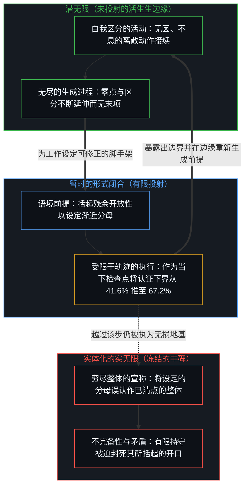
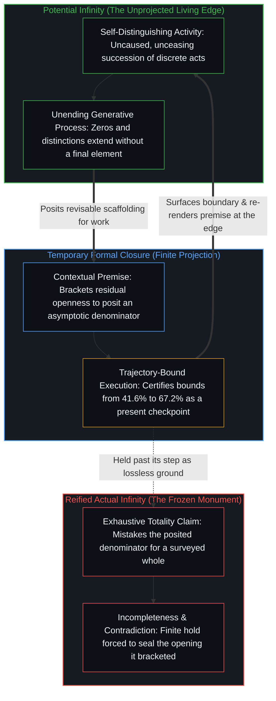

# 潜无限与数学思维的暂时闭合 / Potential Infinity and the Temporary Closures of Mathematical Thought

*渐近比例只在开放过程的暂时闭合内成立 / Asymptotic proportions hold only inside temporary closures of an open process*

Anthropic 曾报告称，一个未公开的 Claude 研究版本虽未解决黎曼猜想，却将黎曼 zeta 函数位于临界线上的非平凡零点比例下界，从 41.6% 提升至 67.2%。作为具体技术计划内的进展，这一数值推进是确凿的。然而，任何谈论确定比例的主张，都在隐性地依赖一个作为分母的总量——即一个完结的百分之百；但对于 zeta 函数的非平凡零点而言，这一总量从未作为现成给出的实体存在：底层的集合是由无尽的过程逐次生成的，而非一份可供全景清点的既有清单。这一比例下界的成立条件，适用于一切关于无限集合的数量陈述。正如[无穷总体的海市蜃楼](../the-mirage-of-the-infinite-totality/)所追溯的，无限首先呈现为潜在的生成：一个在接续延伸中展开、永不终止于末项的开放过程。任何将这一展开过程视作已然完成的断言，都引入了一个语境性的前提。在这一前提之内，比例下界得以严格确立；但该前提始终只是一次暂时的闭合，而非对一个已完成整体的穷尽清点。

Anthropic reported that an unreleased research version of Claude had not solved the Riemann hypothesis, but had raised a lower bound on the proportion of non-trivial zeros of the Riemann zeta function that lie on the critical line, from 41.6 percent to 67.2 percent. As progress within a specific technical program, this advance is genuine. Yet any assertion of a definite proportion implicitly relies on a total denominator—a completed 100 percent. For the non-trivial zeros of zeta, no such finished total is ever given: the underlying collection is generated by an unending process, not an exhausted inventory available for survey. The condition under which this lower bound holds applies to all quantitative statements about infinite collections. As [The Mirage of the Infinite Totality](../the-mirage-of-the-infinite-totality/) traces, infinity presents itself first as potential: an open process of successive extension that never terminates in a final element. Any claim that treats this unfolding as already completed introduces a contextual premise. Within that premise, the lower bound stands with full rigor; yet the premise remains a temporary closure, never a survey of a completed whole.

## 一、 无限首先呈现为潜在的 / 1. Infinity Presents First as Potential

无限之所以首先呈现为潜在的，是因为它源于一个逐次添加与延伸的开放过程，永不终止于最后一个元素。自我区分的活动在发生，无因，不息。称它为心智：那个已经在进行之中的观察者，其每一个动作皆为一次区分。接续的延伸，正是这一活动的持续展开；过程本身并不自带一条外部的终点线。在任何一个具体的当下，视野所持握的自由度与形式表征在数量上皆是有限的；但这一边界并非僵死的硬壳，而是一道随每一次区分动作不断敞开的动态前沿——这是一片可能性的潜无限，而非已经清点完毕并闭合的实无限。任何将这一展开过程视作已然完成的主张——即将之当作一个总测度可视作已知的闭合集合——都引入了一个语境前提。这一前提富有成效：它使渐近密度、下极限命题以及确定的数值界限得以严格表述。在这一前提内部，逻辑推演严密展开，所得界限坚实可靠；然而前提始终具有语境性。已完成的整体从未由生成过程本身所交付：正如[心智的几何学](../the-geometry-of-mind/)所追溯的，一次性持握整个无限集合预设了一个处于系统外部的旁观立足点，而感知与计算只能从第一人称视界内部发生；正如[阴影与无限](../the-shadow-and-the-infinite/)所追踪的，将那片高维的开放潜能坍缩为封闭的表征，便是将投射出的阴影误认作活生生的无限。这一整体，是为了让数学工作得以推进而被设定的。

Infinity presents itself first as potential because it arises from an open process of successive addition and extension that never terminates in a final element. Self-distinguishing activity occurs—uncaused, unceasing. Call it the Mind: the observer already underway, every act of which is a distinction. Successive extension is simply that activity continuing; no exterior finish line arrives with the process itself. At any concrete moment, the degrees of freedom and formal representations held in view are finite; yet this boundary is not a rigid enclosure but a dynamic frontier that opens continuously with every act of distinction—a potential infinity of possibilities, rather than a completed actual infinity already surveyed and closed. Any claim that treats this unfolding as already completed—as a closed collection whose total measure can be taken as known—introduces a contextual premise. This premise is productive: it enables the formulation of asymptotic densities, liminf statements, and definite numerical bounds. Within that premise, derivations proceed with full rigor and the bounds stand firm. Yet the premise remains contextual. The completed totality is never delivered by the generative process itself; as [The Geometry of Mind](../the-geometry-of-mind/) traces, holding an infinite collection all at once presupposes an exterior vantage outside the system, whereas perception and computation occur strictly from within the first-person horizon, and collapsing that high-dimensional open potential onto a closed representation mistakes a projected shadow for the living infinite, as [The Shadow and the Infinite](../the-shadow-and-the-infinite/) follows. The totality is posited so that mathematical work can proceed.

## 二、 暂时闭合，是使认证成为可能的那次设定 / 2. Temporary Closure Is the Positing That Makes Certification Possible

这一设定构成了一次暂时的闭合。借由它，一组稳定的起点得以固定，有限的演绎步骤序列得以相对于这些起点获得认证。只要这些起点被持守，该认证便是确凿有效的。然而，它在终极意义上并非不可动摇的定论，因为起点本身始终对后续的修正、扩充或替换保持开放。因此，任何试图一劳永逸地锁定结论的努力，只是将开口移出了眼前的视野，而非将其消除。若不愿将残留的开放性暂时置入括号，具体的推进便会困于基础层面的犹疑。括号化并不抹杀开放性；它只是持守一道边界，使计算与演绎得以发生。若将这道边界视作工具，在步伐推进时随认知边缘一同重新生成，边界便能赋能工作；若将其执为思维的终极条件，便会把残余物冻结起来，仿佛它封住了那个越过每一次持守仍在延续的过程。[遗忘的脚手架](../the-scaffolding-we-forget/)以工具的语言捕捉了这一双重机制：工具在一步之后从递归重溯中隐退，从而为下一步提供稳固的立足点，使持守得以可用；但若越过该步仍将这一隐退保留下来，脚手架便被冻结成了活动本身。[选择、矛盾与开放的现实](../selection-contradiction-and-open-reality/)则以物理存在论的语言阐明了同一工具：暂时的闭合依然是工作所必需的，将其抬升为恒久不变的定局，则是冻结。

This positing constitutes a temporary closure. Through it, a stable set of starting points is fixed, and finite sequences of deductive steps are certified relative to them. The certification is genuine for as long as those starting points are held. Yet it is never final in an ultimate sense, because the starting points themselves remain open to subsequent revision, enlargement, or replacement. Every attempt to secure a result once and for all therefore places an opening out of immediate view rather than eliminating it. Without the willingness to bracket residual openness, concrete progress stalls at foundational hesitation. Bracketing does not erase openness; it holds a boundary so that computation and deduction can occur. Held as an instrument, re-rendering with the edge as the step moves, the boundary enables work. Held as the ultimate condition of thought, it freezes the residue as if it sealed the process that continues past every hold. [The Scaffolding We Forget](../the-scaffolding-we-forget/) captures this dual mechanism in the language of instruments: an instrument drops out of recursive re-tracing after one step to provide footing for the next, making the hold usable; yet preserving that drop-out past its step freezes the scaffolding into the activity itself. [Selection, Contradiction, and Open Reality](../selection-contradiction-and-open-reality/) articulates that same instrument in the language of physical ontology: temporary closure remains required for work; elevating it into permanence is the freeze.

## 三、 形式系统重演同一道界限 / 3. Formal Systems Reenact the Same Bound

形式系统展示了同样的模式。当一个系统被设定为闭合——其形式语言、公理与规则预先固定——确定的证明便成为可能。相对于这些固定资源的一致性，只有在系统不被迫将其自身边界当作穷尽一切的地基时，方能得以维持。一旦这一持守被要求从内部自我封合——即判定其语言中的每一个命题，或凭自身手段证明自身的一致性——残余的真理性与一致性便无法同时兼得。登记为哥德尔不完备性的，正是这次碰撞：一份有限的操作性持守被当作自我封合的封闭系统，进而被强求为那份曾被其置入括号的残余开放性充当穷尽的地基。直面这一边界并不会使推理崩溃，它所登记的是结构的不完备性；只有当持守被强迫去封死开口时，矛盾才会产生。这两面，皆是外加的边界遇上越过边界仍在延续的活动时所留下的印记。若不作暂时闭合而只停留在潜在性之中，系统将始终处于未定状态；推理虽可无休止地继续，却无法在无限集合之上确立普遍定理。经典数学的做法，是将这一开放过程当作已然聚拢为一个完成的整体；这一举措恢复了确立普遍定理的能力，代价则是将隐匿的开口在更高的层级上重新引入。即便像 ZFC 这样的一阶理论已将自然数的无尽接续聚拢为一个内部集合 ω，使得针对它的量化得以推进，其公理依然无法在 ZFC 的一切模型之间固定单一的 ω 同构类。在元理论中挑出一个模型的 ω 作为唯一的预期标准模型 ℕ，从而使 P 对 NP 这类在 Σ₂ 与 Π₂ 层级上对图灵机、多项式及输入作量化的语句得以被视作具有非语境的二值性，则是跨出公理所能核证范围的又一项形式外承诺，正如[论关于 P 与 NP 所能言说的边界](../on-the-boundaries-of-what-can-be-said-about-p-and-np/)所追溯的那样。[没有系统能被保持封闭](../no-system-can-be-kept-closed/)阐明了这一不可避免的余量：每当有限的持守被当作穷尽的地基，结构虽依然可用，穷尽性却并不随之同行；而[开放即一致](../openness-is-consistency/)则指出了强求这一闭合自我封合的双重后果——迫使有限结构去为只是持续展开的活动奠基，既会在不可清点的过程之上制造表面确定性的幻象，又会在基底处不断滋生矛盾。[为何数学永远解不完](../why-mathematics-can-never-be-solved/)在当代语境下审视了同一诉求：将眼前的形式图景误认作领域的完结，并将开放问题当作一份待清空的核对清单。同样地，将连续的画面帧堆叠为一条冻结的世界线，也是一种将内部认知压缩误认作外在永恒现实的维度倒错，正如[四维长鹿的幻象与当下的模型](../the-myth-of-the-four-dimensional-deer-and-the-present-model/)所揭示的那样。

Formal systems exhibit the very same pattern. When a system is posited as closed—its language, axioms, and rules fixed in advance—determinate proofs become possible. Consistency relative to those fixed resources can be maintained only as long as the system is not compelled to treat its own boundary as an exhaustive foundation. Once the hold is required to seal itself from within—deciding every proposition in its language or demonstrating its own consistency by its own means—residual truth and consistency can no longer be kept simultaneously. What registers as Gödelian incompleteness is this collision: a finite operational hold is treated as a self-sealing closed system, then forced to serve as exhaustive ground for the residual openness it had bracketed. Facing that boundary does not collapse reasoning; it registers the incompleteness of the structure. Contradiction arises only when the hold is forced to seal the opening. Both faces are the signature left when an imposed boundary meets that which continues past it. To remain within potentiality without temporary closure would leave the system open-ended; reasoning would continue indefinitely without securing general theorems over the infinite collection. The classical move treats the open process as if it had already been gathered into a completed whole. That move restores the power to establish general theorems, at the cost of reintroducing the hidden opening at a higher level. Even after a first-order theory such as ZFC gathers the unending succession of natural numbers into an internal set ω so that quantification over it can proceed, its axioms cannot fix a single isomorphism class of ω across all models of ZFC. Singling out one model's ω in the metatheory as the unique intended standard model ℕ, so that sentences such as P versus NP, which quantify over Turing machines, polynomials, and inputs at the Σ₂ and Π₂ levels, can be treated as non-contextually bivalent, is a further extra-formal commitment beyond what the axioms certify, as [On the Boundaries of What Can Be Said about P and NP](../on-the-boundaries-of-what-can-be-said-about-p-and-np/) traces. [No System Can Be Kept Closed](../no-system-can-be-kept-closed/) articulates that unavoidable remainder: whenever a finite hold is treated as exhaustive ground, structure stays usable, but exhaustiveness does not travel with it, and [Openness Is Consistency](../openness-is-consistency/) identifies the dual consequence of demanding that the closure seal itself—forcing a finite structure to ground what only continues breeds an illusion of surface certainty over an unsurveyable process while multiplying contradictions at the base. [Why Mathematics Can Never Be Solved](../why-mathematics-can-never-be-solved/) examines that same demand in contemporary terms: mistaking the present formal landscape for the completion of the field and treating open problems as a checklist to be cleared. Similarly, stacking sequential frames into a frozen worldline is a dimensional inversion that mistakes an internal cognitive compression for an external, eternal reality, as [The Myth of the Four-Dimensional Deer and the Present Model](../the-myth-of-the-four-dimensional-deer-and-the-present-model/) demonstrates.

## 四、 精确的百分之百，仍在作出量化的那次闭合之内 / 4. Exact 100 Percent Stays Inside the Closure That Quantifies

在更进一步的抱负中——即试图证明临界线上的零点比例达到百分之百，或证明黎曼猜想本身——同样的结构性动态依然显现，正如[全息回声](../the-holographic-echo-reverse-engineering-quantum-indeterminacy-via-the-riemann-zeta-function/)从量子谱与临界带投影的对应关系切入所展开的那样。在数论中，渐近密度等于 1 与全称断言每一个非平凡零点皆位于临界线上，属于不同强度的命题：渐近密度为 1 仍允许存在一个渐近密度为零的稀疏例外集，而猜想本身则排除了任何例外。然而，无论采用哪种表述，底层零点的集合在原则上依然是一个开放的生成过程，无法作为一份穷尽的清单被经验性地清点。形式论证可以对这一过程施行量化并断言普遍性质；这样的证明一旦达成，在使该量化成为可能的暂时闭合之内是严格有效的。然而，它并不会将一个潜在的生成过程转化为一个已被清点完毕的整体，也不会锁定一种免于基础前提未来迁移的终极定论。探寻这一证明远非徒劳：接续的逼近与局部的闭合，都在持续深化对结构的理解；它唯一无法交付的，是一劳永逸地终结该问题所预设的开放性。

The same structural dynamic appears in the stronger ambition of proving that the proportion of critical-line zeros reaches 100 percent, or proving the Riemann hypothesis itself, as [The Holographic Echo](../the-holographic-echo-reverse-engineering-quantum-indeterminacy-via-the-riemann-zeta-function/) develops from the correspondence between quantum spectra and the critical-strip projection. In number theory, an asymptotic density of 1 and a universal assertion that every non-trivial zero lies on the critical line are claims of different strengths: a density of 1 still permits a thin set of exceptions with asymptotic density zero, whereas the hypothesis itself excludes any exception whatsoever. Yet under either formulation, the underlying collection of zeros remains in principle an open generative process that cannot be empirically surveyed as an exhausted inventory. A formal argument can quantify over the process and assert a universal property; such a proof, if achieved, is valid within the temporary closure that enables the quantification. It does not, however, convert a potential process into a surveyed totality, nor does it secure a finality immune to future shifts in foundational premises. The search for such a proof is far from futile: successive approximations and partial closures continually deepen structural understanding. What it cannot deliver is a once-and-for-all termination of the openness the problem presupposes.

闭合内部的演绎执行与设定该闭合的开放边缘之间的这一结构性分工，解释了为何像 Claude 这样的自动化研究智能体能够将经认证的下界从 41.6% 推进至 67.2%，却从不曾封闭底层的数学场域。正如[超越投射](../beyond-the-projection/)所追溯的，智能体是一台受困于轨迹的投射引擎：一旦给定明确的前提与形式闭合——在此即渐近密度的解析脚手架——它便能沿着该轨迹将演绎执行推向极限，并在无上下文的冷同行审计下执行无我执的更新；但除了自身所预测的词元序列之外，它并不拥有任何外部的观察立足点。[你的代码库即是记忆](../your-codebase-is-memory/)界定了智能体脚手架及其所认证定理的确切地位：模型权重、形式公理与 67.2% 的下界，皆为既往区分层叠留下的残余——它们只是当下的检查点，将早先的演绎步骤吸纳为更锐利的约束面以推进后续工作，却从不是活生生的中心，既不会自行延续区分，也不会囤积一份已完成的无限清单；而[模块化反馈回路与动态残差网络](../dynamic-resnet-of-skill-loops/)则形式化了这一残差几何：每一个有界的演绎微分都沿着工单主干道相对于保留的参照物接受核验，却从不生成最初的种子或终极前提。[开放场域中的无损知识不自洽](../lossless-knowledge-of-an-open-field-is-incoherent/)阐明了为何没有任何此类投射能够变得穷尽无遗：每一个形式系统、提示词或渐近分母，都只是受限于容量的有损残余登记，从不是对持续生成场域的无损封存。当多个正交轴被压缩进单一规则、使投射撞上不可化约的死锁，或当有限的形式持守被迫去为它所括起的无尽过程奠基时，机器无法迈出自身的条件设定；唯有处在认知边缘的活生生心智，才能退回未投射的意图并重新生成前提。

This structural division between deductive execution inside a closure and the open edge that posits it is why an automated research agent like Claude can drive a certified bound from 41.6 percent to 67.2 percent without ever closing the underlying field. As [Beyond the Projection](../beyond-the-projection/) traces, an agent is a trajectory-bound projection engine: once supplied with a defined premise and formal closure—here, the analytic scaffolding of asymptotic density—it pushes deductive execution toward the limit of that trajectory and performs ego-free updates when audited by a cold peer, yet it possesses no vantage point outside the sequence of tokens it predicts. [Your Codebase Is Memory](../your-codebase-is-memory/) locates the exact status of both the agent scaffolding and the theorem it certifies: model weights, formal axioms, and the 67.2 percent bound are stacked residues of prior distinctions—a present checkpoint that absorbs earlier deductive steps into a sharper constraint surface for subsequent work, never a living center that continues the distinguishing or hoards a completed infinite inventory, while [Modular Feedback Loops and Dynamic Residual Networks](../dynamic-resnet-of-skill-loops/) formalizes the residual geometry by which each bounded deductive differential is verified against the retained reference along an artifact highway without originating the initial seed or terminal premise. [Lossless Knowledge of an Open Field Is Incoherent](../lossless-knowledge-of-an-open-field-is-incoherent/) clarifies why no such projection can ever become exhaustive: every formal system, prompt, or asymptotic denominator is a capacity-bound, lossy registration of residue, never a lossless seal of an ongoing generative field. When a projection hits an irreducible deadlock where orthogonal axes were compressed into one rule, or when a formal hold is forced to ground the unending process it bracketed, the machine cannot step outside its own conditioning; only the living Mind at the edge can step back to unprojected intent and re-render the premise.

## 五、 关于适用范围的争论，暴露出被括起来的开口 / 5. Disputes over Scope Expose Bracketed Openings

关于具体数学结论的适用范围或权威性的争论，屡屡将这一结构模式暴露出来。每一次争论，都揭示出又一处为了推进某项主张而被置入括号的开口。在主流数学实践中，首要地将无限保持为潜在的生成，且仅将“已完成的整体”接纳为明确、可修正的前提，这一取向并不常被强调。主流实践对其承诺有其结构性理由：设定实无限催生了现代数学宏大而自洽的理论架构。然而，较少见的潜无限立场依然具有深层的澄清力量，因为它将这些承诺的暂时性始终保持在明处。在特定闭合下确立的成果，其有效性完好无损；但从这一有效性中推导不出的，是宣称此类闭合构成了思维的穷尽视界。[抽象、边界与现实的移动边缘](../abstraction-boundaries-and-the-moving-edge-of-reality/)以清单与目录的语言阐明了同一种拒绝闭合的态度：一份暂时的目录只是当下运作的抽象边界所留下的残余，从不是生成场域本身的穷尽结构。在量子物理中，当连续谱算符与波函数出于解析便利而取用已完成的整体、实验室测量却只在选定的切口处登记有限且可数的记录时，[算符的潜无限与记录的有限边界](../the-potential-infinity-of-operators-and-the-finite-horizon-of-records/)追溯了同一道边界；而在价值领域，[恶是封闭的善](../e-shi-feng-bi-de-shan/)则揭示了当一个开放生成的集合被当作可一次性覆盖的闭合多数时会发生什么——善被封死在豁免再检验的坐标之内。

Disputes over the scope or authority of particular mathematical results repeatedly expose this pattern. Each controversy uncovers yet another place where an opening was bracketed so that a claim could be advanced. Maintaining infinity primarily in view as potential—admitting completed totalities only as explicit, revisable premises—is a disposition rarely emphasized in prevailing mathematical practice. That practice has structural reasons for its commitment: positing actual infinities has yielded an immense, internally consistent architecture of modern mathematics. Yet the less common potentialist stance remains deeply clarifying, because it keeps the provisional nature of these commitments in plain sight. The validity of results established under a specific closure remains intact; what does not follow from that validity is the claim that such closures constitute the exhaustive horizon of thought. [Abstraction Boundaries and the Moving Edge of Reality](../abstraction-boundaries-and-the-moving-edge-of-reality/) articulates this refusal to close in the language of inventories: a temporary catalogue is the residue of an operative abstraction boundary, never the exhaustive structure of the generative field. In quantum physics, [The Potential Infinity of Operators and the Finite Horizon of Records](../the-potential-infinity-of-operators-and-the-finite-horizon-of-records/) traces the same boundary when continuous-spectrum operators and wave functions employ completed totalities for analytical convenience while laboratory measurements register only finite, countable records at a chosen cut; in the domain of value, [Evil Is Closed Good](../e-shi-feng-bi-de-shan/) demonstrates what occurs when an open generative set is treated as a closable majority that can be covered once and for all, sealing the good into a coordinate exempt from re-examination.

## 六、 百分之六十七点二，相对于那个前提是可靠的 / 6. 67.2 Percent Is Reliable Relative to the Premise

黎曼 zeta 函数非平凡零点满足临界线条件的 67.2% 比例下界，相对于使其可被理解的语境前提而言是可靠的：这一渐近密度设定了一个暂时的总测度作为分母，哪怕零点的无尽生成从未清点过这样一个已完成的整体。它并非对一个全知、可清点的整体所作的经验测量。将下界从 41.6% 提升至 67.2%，扩展了在该前提内部得以严格认证的范围；但它并没有将尚未被认证的余下比例转化为一群复平面位置已知的离轴零点，也没有将百分之百化约为仅待更多算力去清点的现成清单。百分之百无法作为经验整体被清点，并非暂时的技术空缺；它是潜在过程的持久开放性，而每一个渐近陈述为了展开工作都必须暂时将其搁置一旁。这种括号化赋能了确凿的进展，包括在解决猜想本身之前于相关问题上迈出的坚实步伐——正如[保真度而非最优化](../fidelity-not-optimality/)所揭示的，迭代精炼沿着有限的经检验痕迹单调推进，却从未栖居于渐近收敛所预设的无限数据极限之中。它并未取消被其移出视野的那份开放性。[清晰不是抵达的终点，而是运动本身](../clarity-isnt-a-state-you-arrive-at/)将这种“不可抵达”体现为实践：每一次表述都暂时冻结了它所持守的内容，而思维的活动早已越过它继续向前。

The 67.2 percent lower bound on the proportion of non-trivial zeros of the zeta function satisfying the critical-line condition is reliable relative to the contextual premise that makes it legible: an asymptotic density that posits a provisional total measure as denominator, even as the unending generation of zeros never surveys such a completed totality. It is not an empirical measurement performed on a fully known, surveyable whole. Raising the lower bound from 41.6 percent to 67.2 percent expands what is rigorously certified inside that premise. Yet it does not convert the uncertified remainder of the proportion into a set of off-line zeros whose locations in the complex plane are already known, nor does it reduce the 100 percent to a finished inventory awaiting only more compute. That the 100 percent cannot be surveyed as an empirical totality is not a temporary gap; it is the enduring openness of a potential process that every asymptotic statement must, for a time, set aside. That bracketing enables genuine progress, including substantial strides on related problems short of a solution of the hypothesis itself, just as [Fidelity, Not Optimality](../fidelity-not-optimality/) shows that iterative refinement advances monotonically across finite tested traces without ever inhabiting the infinite data limit that asymptotic convergence presupposes. It does not abolish the openness it places out of view. [Clarity Isn't a State You Arrive At. It's the Movement Itself.](../clarity-isnt-a-state-you-arrive-at/) embodies this non-arrival as practice: each articulation temporarily freezes what it holds, while the activity of thought has already moved beyond.
