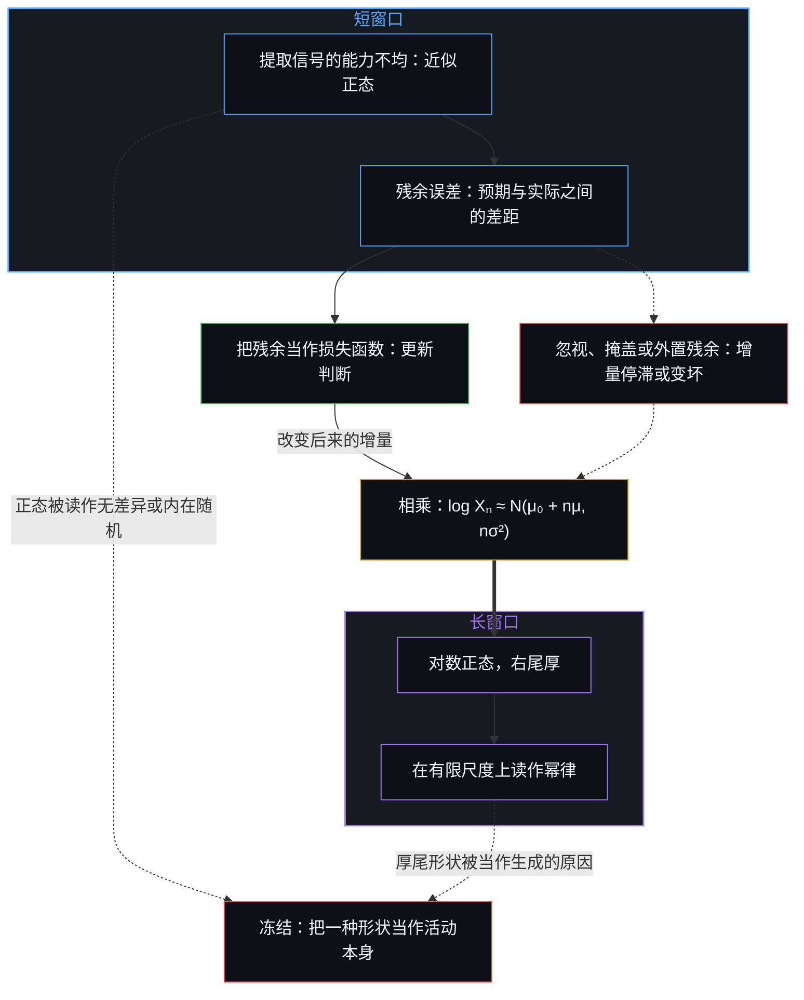
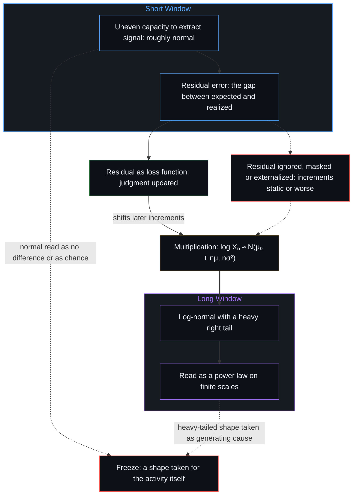

# 幂律是正态分布的长期后果 / Power Law Is the Long-Term Consequence of Normal Distribution

*看似幂律的残余，是近似正态的增量经过足够多次相乘之后的样子。 / A power-law-looking residue is what approximately normal increments become after enough multiplication.*

在不确定之下做决策，同一个领域在短窗口里看起来大致正态，在长窗口里看起来是厚尾。这不是两个过程：对数上的增量近似正态，它们经过迭代累加，使水平成为对数正态分布，它的右尾在可观测的尺度上读作幂律。残余的误差是更新了下一次判断，还是被归到了别处，调节着长窗口记录下来的速率差。两种形状都不是下一次决策的对象。

In decision-making under uncertainty, the same domain looks roughly normal over a short window and heavy-tailed over a long one. These are not two processes: increments of the logarithm are approximately normal; summed through iteration, they make the level log-normal, and its right tail reads as a power law on the scales where it is observed. Whether residual error updates the next judgment or is attributed elsewhere modulates the rate differentials the long window records. Neither shape is the object of the next decision.

## 一、 短窗口登记的仍是当前的知识问题 / 1. Short Windows Still Register the Present Knowledge Problem

观察窗口短的时候，累积的差异相对于残余的变异仍然很小。在决策的那一刻，把信号从噪声里分出来的能力，本身就不均匀地分布在各个心智之间。信号与噪声都是信息；在累积差异仍小的短窗口里，这种理解能力上的差异，在一阶近似下表现为正态分布，于是决策与早期结果的横截面看起来大致正态。正态分布是复利还没来得及组织这片场域之前，对分辨率不均的登记，而不是心智要服从的规律。

When the observation window is short, cumulative differences remain small relative to residual variation. At the moment of decision, the ability to separate signal from noise is itself unevenly distributed across individual Minds. Signal and noise are both information; over a short window, while cumulative differences stay small, that variation in the capacity to make sense appears, to a first approximation, normally distributed, and the cross-section of decisions and early outcomes therefore looks roughly normal. The normal distribution is the registration of uneven resolution before compounding has had time to organize the field, not a law that Minds obey.

在这个区间里出现的随机因素，是一个知识问题，而不是信息本身的属性。被登记为随机的东西，反映的是模型与分辨率当前的界限，而不是正在进行的活动里有什么内在的不确定，这正是[自由的测不准](../zi-you-de-ce-bu-zhun/)所追踪的横截面：每个心智都从自身当下的前提做出确定的切分，而无法触及那些内部变量、也无法解析整片场域的第三人称模型，便把由此产生的变异登记为统计上的随机。

The random factor that appears in this regime is a knowledge problem, not a property of the information itself. What registers as randomness reflects the present limits of models and resolution rather than any intrinsic indeterminacy in the ongoing activity, which is the cross-sectional face [The Uncertainty of Freedom](../zi-you-de-ce-bu-zhun/) traces: each Mind draws determinate cuts from its own active premises, while a third-person model that cannot access those internal variables or resolve the full field registers the resulting variation as statistical randomness.

## 二、 噪声是尚未被解析的信息 / 2. Noise Is Information Not Yet Resolved

即使是被称作噪声的残余变异，也携带着信息。它是大多数心智在那个尺度上还无法解析、组织或据以行动的信息。生成的过程已经是有区分的；理解这些区分的能力仍然有限，并且不均匀地落在各个心智上。表面的随机因此是认识上的，是知识不完备的产物，而不是活动本身固有的一种属性。

Even the residual variation called noise carries information. It is information most Minds cannot yet resolve, organize, or act upon at that scale. The generative process is already differentiated; the ability to make sense of the differentiation is still limited and unevenly held across Minds. Apparent randomness is therefore epistemic, an artifact of incomplete knowledge, rather than a property installed in the activity.

随着模型的改进，一个个尚未被解析的因素变得可以理解。观察仍然只握着已经发生的东西，生成的那一步总在前面。把这些噪声转为可用的知识，是分辨率的持续推进，而不是抵达一份完整的存量，因为正如[开放场域中的无损知识不自洽](../lossless-knowledge-of-an-open-field-is-incoherent/)所确立的，每一个模型都只是对那片不断在它之外继续区分的开放场域所做的有限、受容量约束的压缩。

Particular unresolved factors become intelligible as models improve. Observation still holds what has already happened, and the generating step stays ahead. Converting this noise into usable knowledge is continued resolution, not arrival at a complete stock, because every model remains a finite, capacity-bound compression of an open field that keeps distinguishing past it, as [Lossless Knowledge of an Open Field Is Incoherent](../lossless-knowledge-of-an-open-field-is-incoherent/) establishes.

## 三、 相乘把温和的增量变成厚尾 / 3. Multiplication Turns Modest Increments into a Heavy Tail

这个过渡是一个乘法过程，而不是第二套生成的故事。设第 t 步的水平为 Xₜ > 0。在对数尺度上近似正态的增量，每一步都可以写成 log Xₜ₊₁ = log Xₜ + εₜ，其中 εₜ ≈ N(μ, σ²)，也就是 Xₜ₊₁ = Xₜ · exp(εₜ)。经过 n 个独立或弱相关的步骤，这些 ε 的和本身近似正态，于是 log Xₙ ≈ N(μ₀ + nμ, nσ²)：Xₙ 近似服从对数正态分布，它的对数的方差随时间跨度线性增长。

The transition is a multiplicative process, not a second generative story. Let the level at step t be Xₜ > 0. Increments that are approximately normal on a logarithmic scale can be written, at every step, log Xₜ₊₁ = log Xₜ + εₜ, with εₜ ≈ N(μ, σ²), or equivalently Xₜ₊₁ = Xₜ · exp(εₜ). After n independent or weakly dependent steps the sum of the ε's is itself approximately normal, so log Xₙ ≈ N(μ₀ + nμ, nσ²): Xₙ is approximately log-normal, and the variance of its logarithm grows linearly with the horizon.

步数少时，水平的分布仍接近正态；步数多时，铺展得很宽。σ√n 足够大的对数正态分布有一条厚的右尾。在实证工作常见的有限尺度上，也就是对数坐标下的密度或互补累积分布跨一到几个数量级，这条尾巴用肉眼常常分不出它与一段幂律。形式上的判别是一个似然问题（克劳塞特、沙利齐与纽曼的方法及其变体）。在许多序列里，对数正态更受支持，或者两者难分胜负，因为任何单纯的幂律区段，如果存在，也落在样本稀少的更深的尾部。这是乘法过程与吉布拉定律的标准结论，也是财富、企业规模与城市规模上幂律对对数正态这场长久争论的内容。

After only a few steps the distribution of levels remains close to normal; after many, the spread is wide. A log-normal with a large enough σ√n has a heavy right tail. On the finite scales typical of empirical work, one to a few orders of magnitude on a log-log density or complementary cumulative distribution, that tail is frequently indistinguishable by eye from a power-law segment. Formal discrimination is a question of likelihood (the method of Clauset, Shalizi and Newman and its variants). In many series the log-normal is preferred, or the two remain inconclusive, because any pure power-law regime, if one exists, sits deeper in the tail where samples are sparse. That is the standard result for multiplicative processes and Gibrat's law, and the substance of the long-standing debate between power law and log-normal for wealth, firm size and city size.

复利的时间跨度越长，先前在提取信号上的温和差异，以及它们造成的速率差，就被放大得越多，直到它们把观测到的分布组织成厚尾的形状。夹在看似正态的快照与看似幂律的快照之间的，是同一个递推的继续迭代。随着知识的改进，曾被当作随机的因素逐步变得可以理解；这种可理解是局部的、相继的，并不封闭这片场域。

The longer the horizon of compounding, the more the once-modest differences in extracting signal, and the rate differentials they produce, are amplified, until they organize the observed distribution into the heavy-tailed shape. What sits between the normal-looking snapshot and the power-law-looking snapshot is continued iteration of the same recurrence. As knowledge improves, factors once treated as random become progressively intelligible; that intelligibility is local and successive, and it does not seal the field.

## 四、 残余误差是更新判断的信号 / 4. Residual Error Is the Signal That Updates Judgment

由于短期结果还没有被大量复合，它们紧贴着当前的决策质量。预期与实际结果之间的残余误差，因此含有关于决策过程本身质量的可用信息。

Because short-term outcomes have not yet been heavily compounded, they closely track the present quality of decision-making. The residual error between expected and realized results therefore contains usable information about the quality of the decision process itself.

当一个决策中心把这份残余误差当作损失函数，据此更新自己的模型，也就是对自己的判断做梯度下降，后续决策的质量便趋于提高。这个说法关乎 εₜ 本身的分布：更新改变后来的增量，忽视或外置残余，则让增量的分布停滞甚至变坏。更新因此调节着长期的对数正态：更新把概率质量往右推，而以不等的速率更新，造出更厚的有效尾部。更好的决策带来更好的短期结果，短期结果又为进一步的更新提供更干净的信号；改进在复利，同时抬高近期的表现与长期的轨迹，也把更多先前看似随机的东西转为可用的知识。[自我价值感与所有权](../ownership-and-self-worthiness/)追的是同一个循环的功能面：只有当结果作为自己的结果重新进入，模型才会复利。[失败即信息](../failure-as-information/)追的是结果与下一步行动之间的间隙空着时的那个损失函数：成功与失败写成同一个策略的样本，而不是对自我的裁决。

When a decision-making center treats that residual error as a loss function and updates its model accordingly, a form of gradient descent on its own judgment, the quality of subsequent decisions tends to improve. The claim concerns the distribution of the εₜ themselves: updating shifts later increments, while ignoring or externalizing the residual leaves the distribution of increments static or worse. Updating therefore modulates the long-horizon log-normal: updating shifts mass rightward, and updating at unequal rates produces a heavier effective tail. Better decisions produce better short-term outcomes, which in turn supply cleaner signals for further updating; the improvement compounds, raising both near-term performance and the long-term trajectory, and converts more of what previously appeared random into usable knowledge. [Ownership and Self-Worthiness](../ownership-and-self-worthiness/) traces the same loop on its functional face: the model compounds only when outcomes re-enter as one's own. [Failure as Information](../failure-as-information/) traces that loss function where the gap between outcome and next act stays empty: success and failure are written as samples of one policy rather than as verdicts on the self.

当残余误差被忽视、被过去的成功掩盖，或被归给与决策过程无关的外部因素，判断的质量就停滞或下降。这种折损本身也随时间复合，在最终的厚尾分布里塑造出一个更不利的位置；知识问题，那个更新只能局部地、相继地推进而永不封闭的问题，持续或恶化。[关于归因](../guan-yu-gui-yin/)追的是落在一个显眼节点上的同一种向外归因：作者被挪到一个看得见的外部，信号变薄，下一个区分无法从完整的反馈中更新。

When residual error is ignored, masked by past successes, or attributed to external factors unrelated to the decision process, the quality of judgment stagnates or declines. That impairment is itself compounded over time, shaping a less favorable position inside the eventual heavy-tailed distribution, and the knowledge problem, which updating moves only locally and successively and never closes, persists or worsens. [On Attribution](../guan-yu-gui-yin/) traces the same outward attribution, settled on a conspicuous node: the author is relocated to a visible exterior, the signal thins, and the next distinction cannot update from complete feedback.

## 五、 长窗口的形状是复利速率的记录 / 5. The Long-Window Shape Is the Record of Compounded Rates

一旦窗口足够长，极端值便主导了总量。这个厚尾的残余，是随时间复利的速率差留下的统计记录。这些速率差源于把信号从噪声里分出来的能力那看似正态的分布，又被每个决策中心是把残余误差当作学习的信息，还是让知识问题悬而未决，进一步塑造。幂律的样子始终在生成的活动的下游。[幂律是结果的表象](../mi-lv-shi-jie-guo-de-biao-xiang/)守的是长窗口：被冻结为生成规律的那个形状，被放回迭代速率不等留下的残余的位置。这里互补的那一面是短窗口的正态：那些相乘之后成为残余的增量；而[可延展的地平线](../the-extendable-horizon/)则追踪了为什么通过重新校准注入正增量的能力，在系统的任何坐标上都始终敞开，而不专属于尾部某个固定的位置。

Once the window is long enough, the extremes dominate the aggregate. This heavy-tailed residue is the statistical record of rate differentials compounded over time. Those differentials originate in the normal-looking distribution of the ability to separate signal from noise, and are further shaped by whether each decision center treats residual error as information for learning or leaves the knowledge problem unaddressed. The power-law appearance stays downstream of the generative activity. [Power Law Is the Surface of Outcomes](../mi-lv-shi-jie-guo-de-biao-xiang/) holds the long window: the shape frozen as generating law is returned to its place as the residue of unequal rates of iteration. Here the complementary face is the short-window normal: the increments that, multiplied together, become that residue, while [The Extendable Horizon](../the-extendable-horizon/) traces why the capacity to inject a positive increment through recalibration remains open at any coordinate in the system rather than belonging to a fixed position in the tail.

## 六、 两种分布都不是下一次决策 / 6. Neither Distribution Is the Next Decision

这层关系指出两种互补的冻结。第一种把短窗口的正态当作证据，认为判断上不存在有意义的差异，或者认为残余变异内在地就是随机的。正态分布已经反映了各个心智上分辨率的不均与知识的不完备，进一步的复利放大这种不均的后果，而放大的速率仍由学习的循环移动，这也正是[平均值是残余，不是引擎](../the-average-is-residue-not-the-engine/)把横截面均值放回事后残余、而不当作支配性底线的原因。

The relation names two complementary freezes. The first treats short-window normality as evidence that no meaningful differences in judgment exist, or that the residual variation is intrinsically random. The normal distribution already reflects the uneven resolution and incomplete knowledge across Minds, and further compounding magnifies the consequences of that unevenness, at rates the learning loop still moves, which is why [The Average Is Residue, Not the Engine](../the-average-is-residue-not-the-engine/) returns the cross-sectional mean to posterior residue rather than a governing floor.

第二种把长窗口的幂律残余当作生成的规则本身。当决策者开始为极端、或为自己在厚尾分布里过去的位置而优化，他们就从提高提取信号的能力，转向追踪过去结果的统计签名。残余误差不再被当作损失函数，而被合理化或忽视；知识问题悬而未决，后续决策的质量下降，哪怕分布仍然是厚尾的。残余被误认作原因。[封闭的假设把复利挤成 S 曲线](../closed-assumptions-squeeze-compounding-into-s-curves/)追的是另一条被写成进步本性的统计曲线，那是在封闭的天花板之内被记分的复利；这里被写成本性的曲线，是那条厚尾，开放的乘法留下的横截面。

The second treats the long-window power-law residue as the generating rule itself. When decision-makers begin to optimize for extremity, or for their own past position inside the heavy-tailed distribution, they shift from improving the capacity to extract signal from noise to tracking the statistical signature of past outcomes. Residual error is no longer treated as a loss function; it is rationalized or ignored. The knowledge problem is left unaddressed, and the quality of subsequent decisions deteriorates even while the distribution may remain heavy-tailed. The residue is mistaken for the cause. [Closed Assumptions Squeeze Compounding into S-Curves](../closed-assumptions-squeeze-compounding-into-s-curves/) traces another statistical curve written as the nature of progress, compounding scored inside a closed ceiling; here the curve written as nature is the heavy tail, the cross-section open multiplication leaves.

继续下去的是更新：残余误差作为下一次判断的信息重新进入，一个个尚未解析的因素转为可用的知识，而[你的代码库即是记忆](../your-codebase-is-memory/)指出了那些经受检验的区分如何沉淀为内部习惯与外化记忆，同时掌舵的前沿始终留在下一次更新上，让复利去做它的事。决策那一刻的正态分布，反映的是各个心智当前分辨率的不均与普遍的知识问题；看似幂律的分布，是同样的不均在学习循环的质量调节之下，经过足够多次迭代之后的样子。两种形状都不是生成的规律，也都不是下一次决策的对象。它们都是同一个乘法在不同窗口上的暂时视图；增量有没有被更新，不在形状里，而在残余误差有没有重新进入下一次判断。

What continues is the update: residual error re-enters as information for the next judgment, particular unresolved factors convert into usable knowledge, and [Your Codebase Is Memory](../your-codebase-is-memory/) shows how those validated cuts crystallize into internal habits and externalized memory while the steering edge stays at the next update and compounding is left to do its work. The normal distribution at the moment of decision reflects the present unevenness of resolution and the prevailing knowledge problem across Minds; the power-law-looking distribution is what that same unevenness, modulated by the quality of the learning loop, becomes after enough iteration. Neither shape is a generating law, and neither is the object of the next decision. Both are transient views of the same multiplication on different windows; whether the increments are being updated lies not in the shape but in whether residual error re-enters the next judgment.
